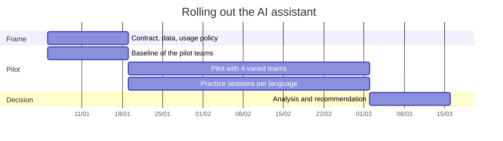

# DevX Engineer interview: the exercises

!!! warning "Disclaimer"
    These notes are personal cheat sheets, not a source of truth. They reflect my own understanding and choices: their content remains subjective, despite the quotes and references it contains. It may be incomplete, simplified, inaccurate or outdated. Always check the official documentation before applying it. This content is provided as is, without any warranty: you use it at your own risk.

!!! audience "Who and what for"
    - **Roles**: DevX engineer, platform engineer, DevOps engineer or SRE, tech lead in charge of tooling.
    - **Uses**: I practise a live exercise where I am asked to speed up a CI pipeline; I want a reference answer for a `doctor` script or a DORA query; I prepare an oral case study, like rolling out an AI coding assistant; I check with the final checklist that my answer forgets neither the measure nor the adoption.

This page gathers practical exercises with detailed worked answers. It complements [DevX Engineer interview: the questions](questions.md). There is no single right answer: what I have here are **concrete reference answers** (CI configuration, scripts, measurement queries, adoption plans) and an oral phrasing.

The role aims at improving the daily work of many developers: inner loop, CI/CD, environments, templates, documentation, measurement and adoption. The exercises therefore mix configuration and code with case studies where the hard part is convincing people and measuring.

## How to use these exercises

In a live interview, the interviewer mostly watches **how** I search, not only what I find. For each exercise:

1. I read the statement without looking at the answer.
2. **I ask two or three questions before answering**: "how many developers?", "how many pipelines a day?", "what is already in place?". This shows I start from the users, not from a trendy tool.
3. **I measure before proposing**: I ask for or estimate the starting number (duration, delay, rate). A DevX improvement without a <span class="term" data-term="baseline">baseline</span> cannot be demonstrated.
4. **I think out loud**: I explain what I check and why, even while I write YAML or code.
5. I give a simple solution, then its limits, its maintenance cost and how teams will adopt it.
6. **I end with a lived example**: "in my current job, I cut CI from...". The answers are theoretical; my own experience with numbers is what makes the difference.

The examples are deliberately small to fit in an interview. They are in Python, YAML (GitLab CI, <span class="term" data-term="docker-compose">Docker Compose</span>), SQL (PostgreSQL) and Dockerfile. The tool versions quoted are examples, to check and adapt to the real repository.

## Exercise 1. Halve the duration of a CI pipeline

### Statement

The `my-api` pipeline (Python, about 1,500 tests) takes 28 minutes. Everything is sequential: dependency install (3 min), lint (4 min), tests (15 min), Docker image build (6 min). Developers often rerun the pipeline. I propose a new `.gitlab-ci.yml` configuration and explain my approach.

### Expected answer

#### Step 1: measure before changing

Over two weeks, I collect:

- the duration of each <span class="term" data-term="ci-job">job</span>, at p50 and <span class="term" data-term="p95">p95</span>;
- the wait before a <span class="term" data-term="runner">runner</span> picks up the job;
- the failure rate per job, and the rerun rate with no code change;
- the number of pipelines per day, to put a number on the total gain.

These numbers serve as a comparison point, and they keep me from optimizing a job that is not on the <span class="term" data-term="critical-path">critical path</span>.

#### Step 2: the new configuration

The starting configuration, in series: each stage waits for the previous one, so the 28 minutes add up.

``` { .yaml .ex-bad title="Avoid" }
# Avoid: four stages in series, lint and image wait for the end of the tests
stages: [install, lint, test, build]

install:
  stage: install
  script: [pip install uv, uv sync]

lint:
  stage: lint
  script: [uv run ruff check .]

tests:
  stage: test
  script: [uv run pytest]

build-image:
  stage: build
  script: [docker build -t "$CI_REGISTRY_IMAGE:$CI_COMMIT_SHA" .]
```

The version that parallelizes, caches and splits the tests:

``` { .yaml .ex-good title="Recommended · .gitlab-ci.yml" }
stages:
  - test
  - build

# Good: a new push cancels the old pipeline
default:
  image: python:3.12-slim
  interruptible: true

variables:
  UV_CACHE_DIR: .uv-cache

# Good: the cache changes only when the lockfile changes
.python:
  cache:
    key:
      files:
        - uv.lock
    paths:
      - .uv-cache/
  before_script:
    - pip install uv==0.4.30
    - uv sync --frozen

# Good: empty needs, lint starts right away
lint:
  stage: test
  extends: .python
  needs: []
  script:
    - uv run ruff check .
    - uv run ruff format --check .

# Good: four test shards in parallel, JUnit report kept
tests:
  stage: test
  extends: .python
  needs: []
  parallel: 4
  script:
    - uv run pytest --splits "$CI_NODE_TOTAL" --group "$CI_NODE_INDEX"
      --junitxml=report.xml
  artifacts:
    when: always
    reports:
      junit: report.xml

# Good: the image is built only when code or dependencies change
build-image:
  stage: build
  image: docker:27
  services:
    - docker:27-dind
  needs: []
  rules:
    - changes:
        - Dockerfile
        - pyproject.toml
        - uv.lock
        - src/**/*
  script:
    - docker login -u "$CI_REGISTRY_USER" -p "$CI_REGISTRY_PASSWORD" "$CI_REGISTRY"
    - docker build
      --cache-from "$CI_REGISTRY_IMAGE:cache"
      --build-arg BUILDKIT_INLINE_CACHE=1
      -t "$CI_REGISTRY_IMAGE:$CI_COMMIT_SHA"
      -t "$CI_REGISTRY_IMAGE:cache" .
    - docker push "$CI_REGISTRY_IMAGE:$CI_COMMIT_SHA"
    - docker push "$CI_REGISTRY_IMAGE:cache"
```

#### uv and the lockfile

<span class="term" data-term="uv">uv</span> is a Python package and environment manager (written in Rust, by Astral) that replaces `pip`, `venv` and `pip-tools`. It writes into `uv.lock` the exact version of every dependency, indirect ones included. `uv sync --frozen` installs exactly what `uv.lock` says, without ever recomputing it: if `pyproject.toml` and the lockfile no longer match, the command fails instead of silently resolving new versions.

| | `pip install -r requirements.txt` | `uv sync --frozen` |
|---|---|---|
| Installed versions | those of the file; unpinned indirect dependencies are resolved at install time | exactly those of `uv.lock`, indirect ones included |
| Virtual environment | to create yourself (`python -m venv`) | created or updated in `.venv` |
| Extra package in the environment | stays installed | removed, the environment follows the lockfile |
| Speed | sequential downloads and install | global cache and parallel install, much faster [Take with caution: numbers from the vendor Astral, to check on my project] |

#### What each setting brings

| Setting | Effect | Estimated gain (example) |
|---|---|---|
| `needs: []` | lint, tests and image start together, without waiting for a previous stage | the 4 min of lint and 6 min of image leave the critical path |
| cache keyed on `uv.lock` | dependencies are downloaded again only when the <span class="term" data-term="lockfile">lockfile</span> changes | from 3 min to about 30 s |
| `parallel: 4` and pytest-split | tests are spread over 4 <span class="term" data-term="test-shard">shards</span> of similar duration | from 15 min to about 4 min |
| `rules: changes` | the image is built only when code or dependencies change | a documentation MR builds no image |
| `interruptible: true` | a new push cancels the old pipeline | fewer runners busy for nothing |
| `--cache-from` | unchanged Docker layers are reused | from 6 min to 2 or 3 min |

Expected critical path: install from cache, then the longest test shard, about 5 minutes, plus runner wait. Example numbers, to measure.

pytest-split spreads the tests according to a `.test_durations` file generated by `pytest --store-durations`. This file must be refreshed now and then, otherwise the shards become unbalanced.

The YAML is illustrative: image versions, Docker cache options and keywords are to check for the GitLab version in use.

#### Pitfalls to point out

- **Order-dependent tests**: splitting into shards reveals tests that only passed because another test ran before them. I watch the failure rate for two weeks.
- **Cache too wide**: a cache holding the whole virtual environment can hide a dependency missing from the lockfile. I cache uv's download cache, not `.venv`.
- **Parallelism without runners**: four shards only help if four runners are free. Otherwise I add waiting.

#### What a DevX Engineer adds

- I turn this pipeline into a **shared CI component**, so other Python repositories get the same gain without copying the file.
- I publish the **before and after**: p95 duration, number of reruns, hours recovered per day for the organization.
- I add a dashboard of CI duration per repository, to spot the next slow ones.

#### Possible oral answer

> "First I measure each job's duration and the runner wait, to find the critical path. Here everything is in series, so I start with `needs` to parallelize lint, tests and image. Then a cache keyed on the lockfile, and I split the tests into four shards. We should go from about 28 to 5 minutes of critical path. I watch order-dependent tests for two weeks, and I turn it into a shared component for the other repositories."

**Read next**: [A fast and reliable CI](../../knowledge/devx.md#a-fast-and-reliable-ci), [Shared, versioned CI component](../../knowledge/devx.md#shared-versioned-ci-component), [Parallelizing without breaking](../../knowledge/qualite.md#parallelising-without-breaking-things), [Python: pip, uv](../../knowledge/gestionnaires-paquets.md#python-pip-uv-poetry-pdm-conda), [Theory of constraints](../../knowledge/culture-entreprise.md#theory-of-constraints)

## Exercise 2. Make a Dockerfile quick to rebuild

### Statement

Here is the `my-api` Dockerfile. Every one-line code change reinstalls all the dependencies, and the image weighs 1.1 GB. I propose a better version, usable both in development and in production.

``` { .dockerfile .ex-bad title="Avoid" }
# Avoid: all the code is copied before the install, the cache never helps
FROM python:3.12
WORKDIR /app
COPY . .
RUN pip install uv && uv sync
CMD ["uv", "run", "uvicorn", "my_api.main:app", "--host", "0.0.0.0"]
```

### Expected answer

#### Problems to point out

- **`COPY . .` before the install**: any file change invalidates the layer, so dependencies are reinstalled every time. Docker's layer cache is useless.
- **Full `python:3.12` image**: it contains compilers and tools useless in production. Hence the size.
- **No frozen lockfile**: `uv sync` without `--frozen` may resolve different versions from one build to the next.
- **Development tools in production**: test and lint dependencies end up in the image.
- **Running as root**: the process runs with all rights inside the container.
- **No `.dockerignore`**: `.git`, `.venv` or local files go into the build context.

#### Proposal

``` { .dockerfile .ex-good title="Recommended" }
# syntax=docker/dockerfile:1
# Good: a common slim base, uv copied from its official image
FROM python:3.12-slim AS base
WORKDIR /app
ENV UV_COMPILE_BYTECODE=1 \
    UV_LINK_MODE=copy \
    PYTHONUNBUFFERED=1
COPY --from=ghcr.io/astral-sh/uv:0.4.30 /uv /usr/local/bin/uv

# Good: the lockfile alone first, this layer changes only when dependencies change
FROM base AS deps
COPY pyproject.toml uv.lock ./
RUN --mount=type=cache,target=/root/.cache/uv \
    uv sync --frozen --no-install-project --no-dev

# Good: the dev target adds test tools and reloads the code mounted as a volume
FROM deps AS dev
RUN --mount=type=cache,target=/root/.cache/uv \
    uv sync --frozen --no-install-project
CMD ["uv", "run", "uvicorn", "my_api.main:app", "--host", "0.0.0.0", "--reload"]

# Good: the prod target copies the code last and runs without root
FROM deps AS prod
COPY src ./src
RUN --mount=type=cache,target=/root/.cache/uv \
    uv sync --frozen --no-dev
RUN useradd --uid 10001 --no-create-home app
USER app
CMD ["/app/.venv/bin/uvicorn", "my_api.main:app", "--host", "0.0.0.0"]
```

And a `.dockerignore`:

``` { .text .ex-good title="Recommended · .dockerignore" }
# Good: nothing local or useless in the build context
.git
.venv
.uv-cache
__pycache__
tests
*.md
```

#### Why it is faster

| Change | Before | After |
|---|---|---|
| One line of code in `src/` | full reinstall of the dependencies | only the last layer is rebuilt |
| Adding a dependency | full reinstall | reinstall, but the `--mount=type=cache` cache avoids downloading everything again |
| Local development | rebuild on every try | `dev` target, code mounted as a volume, automatic reload |

The <span class="term" data-term="multi-stage-build">multi-stage build</span> gives two <span class="term" data-term="docker-image">images</span> from a single file: `docker build --target dev` for the workstation, `docker build --target prod` for CI and production. The dependency layer is shared and reused by the <span class="term" data-term="docker-layer-cache">layer cache</span>.

uv options and uv image version to check in their documentation at the time of use.

#### What a DevX Engineer adds

- I provide this Dockerfile in the **service template**, so new services start directly from the right version.
- I add a **Dockerfile linter** (hadolint) to the common CI component, which flags for instance a missing `USER`.
- I measure build time and image size before and after, and publish the result.

#### Possible oral answer

> "The main problem is the layer order: all the code is copied before installing the dependencies, so the cache never helps. I copy the lockfile first, install, then copy the code. I separate a development target and a production target, with a slim image and a non-root user. A code change now rebuilds only the last layer. Then I put this Dockerfile in the template so every new service benefits."

**Read next**: [Multi-stage image](../../knowledge/kubernetes.md#multi-stage-image-fast-to-rebuild-light-in-production), [Docker: the image](../../knowledge/kubernetes.md#docker-the-image), [Docker Compose and code mounted through a volume](../../knowledge/devx.md#docker-compose-and-code-mounted-through-a-volume), [Golden paths and templates](../../knowledge/devx.md#golden-paths-and-templates)

## Exercise 3. Write a workstation diagnostic script (doctor)

### Statement

Newcomers on `orders-service` spend hours on install errors: Docker not started, wrong Python version, missing environment variable, port already in use. I write a `doctor.py` script that checks the workstation and says how to fix each problem.

### Expected answer

#### What the script must do

1. Run a series of independent checks.
2. For each check, print the result **and the fix**.
3. Never stop at the first error: show everything at once.
4. Return a non-zero <span class="term" data-term="exit-code">exit code</span> if a check fails, so it can be used in CI.

#### The role of mise

<span class="term" data-term="mise">mise</span> is a command-line tool that installs, repository by repository, the right tool versions (Python, uv, Node), loads the project's environment variables and runs its tasks, all described in a versioned `mise.toml` file. The doctor relies on it: when a check fails, the suggested fix is often `mise install`.

``` { .toml .ex-ref title="Reference · mise.toml" }
# Example: tool versions pinned for the whole repository
[tools]
python = "3.12"
uv = "0.4.30"

# Example: variables loaded for every command run in the repository
[env]
DATABASE_URL = "postgresql://localhost:5432/orders"

# Example: a task run by mise run setup
[tasks.setup]
run = "uv sync --frozen"
```

With this file, `mise install` installs Python 3.12 and uv 0.4.30, every command run in the repository gets `DATABASE_URL`, and `mise run setup` installs the dependencies.

#### Proposal

``` { .python .ex-good title="Recommended · doctor.py" }
"""Check that the workstation is ready to work on orders-service."""

import os
import shutil
import socket
import subprocess
import sys
from collections.abc import Callable
from dataclasses import dataclass

MIN_PYTHON = (3, 12)
REQUIRED_COMMANDS = ("docker", "uv", "git")
REQUIRED_ENV = ("DATABASE_URL",)
API_PORT = 8000
DOCKER_TIMEOUT_SECONDS = 10


# Good: each result carries its fix, printed on failure
@dataclass(frozen=True)
class CheckResult:
    """Outcome of one workstation check, with a fix to show on failure."""

    name: str
    ok: bool
    fix: str = ""


# Good: one check per function, independent of the others
def check_python_version() -> CheckResult:
    """Check that the running Python is recent enough."""
    current = sys.version_info[:2]
    return CheckResult(
        name=f"Python >= {MIN_PYTHON[0]}.{MIN_PYTHON[1]}",
        ok=current >= MIN_PYTHON,
        fix="run `mise install` at the root of the repository",
    )


# Good: a command missing from the PATH gives a fix, not a stack trace
def check_command(command: str) -> CheckResult:
    """Check that a command is available in the PATH."""
    return CheckResult(
        name=f"command `{command}`",
        ok=shutil.which(command) is not None,
        fix=f"run `mise install`, or install {command}",
    )


# Good: a timeout, so the script does not hang if Docker stops answering
def check_docker_running() -> CheckResult:
    """Check that the Docker daemon answers."""
    name = "Docker running"
    if shutil.which("docker") is None:
        return CheckResult(name, False, "install Docker, then start it")
    try:
        result = subprocess.run(
            ["docker", "info"],
            capture_output=True,
            timeout=DOCKER_TIMEOUT_SECONDS,
            check=False,
        )
    except subprocess.TimeoutExpired:
        return CheckResult(name, False, "Docker does not answer: restart it")
    return CheckResult(name, result.returncode == 0, "start Docker")


# Good: an empty variable counts as missing
def check_env_var(variable: str) -> CheckResult:
    """Check that an environment variable is set and not empty."""
    return CheckResult(
        name=f"variable {variable}",
        ok=bool(os.environ.get(variable)),
        fix="run the command from the repository so mise loads [env]",
    )


# Good: the fix gives the command that finds the offending process
def check_port_free(port: int) -> CheckResult:
    """Check that nothing already listens on a local port."""
    with socket.socket(socket.AF_INET, socket.SOCK_STREAM) as sock:
        busy = sock.connect_ex(("127.0.0.1", port)) == 0
    return CheckResult(
        name=f"port {port} free",
        ok=not busy,
        fix=f"find the process with `lsof -i :{port}` and stop it",
    )


# Good: the list of checks can be replaced in tests
def all_checks() -> list[Callable[[], CheckResult]]:
    """List every check to run, in display order."""
    checks: list[Callable[[], CheckResult]] = [check_python_version]
    checks += [lambda c=c: check_command(c) for c in REQUIRED_COMMANDS]
    checks.append(check_docker_running)
    checks += [lambda v=v: check_env_var(v) for v in REQUIRED_ENV]
    checks.append(lambda: check_port_free(API_PORT))
    return checks


# Good: everything is printed at once, and the exit code serves CI
def main() -> int:
    """Run all checks, print a report and return the exit code."""
    results = [check() for check in all_checks()]
    for result in results:
        status = "OK " if result.ok else "KO "
        print(f"[{status}] {result.name}")
        if not result.ok:
            print(f"       fix: {result.fix}")
    failures = [r for r in results if not r.ok]
    print(f"\n{len(results) - len(failures)}/{len(results)} checks OK")
    return 1 if failures else 0


if __name__ == "__main__":
    sys.exit(main())
```

Sample output:

``` { .text .ex-illus title="Illustration · doctor.py output" }
[OK ] Python >= 3.12
[OK ] command `docker`
[OK ] command `uv`
[OK ] command `git`
[KO ] Docker running
       fix: start Docker
[OK ] variable DATABASE_URL
[OK ] port 8000 free

6/7 checks OK
```

#### Tests

``` { .python .ex-good title="Recommended · test_doctor.py" }
"""Tests for the workstation doctor script."""

import doctor


# Good: the missing command is simulated instead of depending on the machine
def test_missing_command_is_reported_with_a_fix(monkeypatch):
    """A command absent from the PATH fails and suggests mise install."""
    monkeypatch.setattr(doctor.shutil, "which", lambda _: None)

    result = doctor.check_command("uv")

    assert not result.ok
    assert "mise install" in result.fix


# Good: the empty-string edge case is covered
def test_empty_env_var_fails(monkeypatch):
    """An environment variable set to an empty string counts as missing."""
    monkeypatch.setenv("DATABASE_URL", "")

    assert not doctor.check_env_var("DATABASE_URL").ok


# Good: exit code and printed fix are checked together
def test_main_returns_1_when_a_check_fails(monkeypatch, capsys):
    """The exit code is non-zero as soon as one check fails."""
    monkeypatch.setattr(
        doctor,
        "all_checks",
        lambda: [
            lambda: doctor.CheckResult("a", True),
            lambda: doctor.CheckResult("b", False, "fix b"),
        ],
    )

    assert doctor.main() == 1
    assert "fix b" in capsys.readouterr().out
```

#### Choices to explain

- **One fix per error**: a "Docker KO" message without a solution sends the newcomer to a colleague.
- **No automatic install in the doctor**: it diagnoses, `mise install` and `mise run setup` install. Keeping the two apart makes the script safe to run at any time.
- **Standard library only**: the script must work before the project's dependencies are even installed.
- **Port 8000 must be free before starting the API**: run while the API is up, the check fails, which is expected.

#### What a DevX Engineer adds

- I run `setup`, then `doctor`, then the tests in a **weekly CI job on a blank image**, to catch a broken setup before the next newcomer.
- I add each new error a newcomer hits as a new check: the script becomes the memory of the problems.
- I turn it into a common template, with checks specific to each repository in a small configuration file.

#### Possible oral answer

> "The doctor runs independent checks, prints everything at once, and gives a fix for each failure. It depends only on the standard library, because it must work on an empty machine. It returns 1 on failure so it can be used in CI. And I run it every week on a blank image, so the setup does not break silently."

**Read next**: [Setting up a project in one command](../../knowledge/devx.md#setting-up-a-project-in-one-command), [Development tools: mise, uv](../../knowledge/outils.md#developer-tooling-mise-uv-ruff-yarn), [Onboarding](../../knowledge/devx.md#onboarding)

## Exercise 4. Detect and quarantine flaky tests

### Statement

In the organization, about one pipeline out of five gets rerun "just to see". The <span class="term" data-term="junit-xml">JUnit XML</span> test reports of every pipeline are available as artifacts. I propose a way to find the flaky tests, then a quarantine mechanism.

### Expected answer

#### 1. Define what we look for

A <span class="term" data-term="flaky-test">flaky test</span> is a test that failed **and** passed on the **same commit**. It is the only definition that does not mistake flakiness for a real regression: a regression fails every time on the faulty commit.

#### 2. Collect the results

A small collector reads the JUnit report at the end of each pipeline and writes one row per test into a `test_runs` table. A JUnit XML report is the result format produced by pytest (`--junitxml=report.xml`) and most test tools: one `<testcase>` tag per test, with a `<failure>` tag inside when it fails.

``` { .xml .ex-ref title="Reference · report.xml" }
<!-- Example: two tests, the second one failing -->
<testsuite name="pytest" tests="2" failures="1">
  <testcase classname="tests.test_orders" name="test_create" time="0.12"/>
  <testcase classname="tests.test_orders" name="test_cancel" time="1.03">
    <failure message="assert 500 == 200">AssertionError</failure>
  </testcase>
</testsuite>
```

``` { .python .ex-good title="Recommended · collector" }
"""Load JUnit XML reports into rows ready to be stored in test_runs."""

from dataclasses import dataclass
from pathlib import Path

from defusedxml import ElementTree


# Good: one row per run, with the commit that reveals flakiness
@dataclass(frozen=True)
class CaseRun:
    """One execution of one test case in one pipeline."""

    test_name: str
    commit_sha: str
    pipeline_id: int
    status: str
    duration_s: float


# Good: an error counts as a failure, as in CI
def status_of(testcase) -> str:
    """Return passed, failed or skipped for a JUnit testcase element."""
    if testcase.find("failure") is not None or testcase.find("error") is not None:
        return "failed"
    if testcase.find("skipped") is not None:
        return "skipped"
    return "passed"


# Good: defusedxml reads a file whose content we do not fully control
def parse_report(path: Path, commit_sha: str, pipeline_id: int) -> list[CaseRun]:
    """Parse one JUnit XML report into CaseRun rows."""
    root = ElementTree.parse(path).getroot()
    return [
        CaseRun(
            test_name=f"{case.get('classname')}::{case.get('name')}",
            commit_sha=commit_sha,
            pipeline_id=pipeline_id,
            status=status_of(case),
            duration_s=float(case.get("time") or 0),
        )
        for case in root.iter("testcase")
    ]
```

`defusedxml` replaces `xml.etree` to read XML without the risk of entity attacks: security scanners like bandit flag `xml.etree` on files whose content is not fully under control.

#### 3. Rank the flaky tests

``` { .sql .ex-good title="Recommended" }
-- Good: a commit counts as flaky if it saw a failure and a success of the same test
WITH per_commit AS (
    SELECT
        test_name,
        owner_team,
        commit_sha,
        BOOL_OR(status = 'failed') AS has_failure,
        BOOL_OR(status = 'passed') AS has_success
    FROM test_runs
    WHERE run_at >= CURRENT_DATE - INTERVAL '14 days'
    GROUP BY test_name, owner_team, commit_sha
)
-- Good: the rate divides flaky commits by the commits where the test ran
SELECT
    test_name,
    owner_team,
    COUNT(*) AS commits_run,
    COUNT(*) FILTER (WHERE has_failure AND has_success) AS flaky_commits,
    ROUND(
        100.0 * COUNT(*) FILTER (WHERE has_failure AND has_success) / COUNT(*),
        1
    ) AS flaky_pct
FROM per_commit
GROUP BY test_name, owner_team
HAVING COUNT(*) FILTER (WHERE has_failure AND has_success) > 0
ORDER BY flaky_commits DESC
LIMIT 20;
```

The `owner_team` column comes from a code ownership file (<span class="term" data-term="codeowners">CODEOWNERS</span>) or from the service catalogue. Without an owner, the flaky test will never be fixed. `CODEOWNERS` maps a path to a team, line by line:

``` { .text .ex-ref title="Reference · CODEOWNERS" }
# Example: everything under tests/payments/ belongs to team-core
/tests/payments/  @team-core
```

A test whose file is under `tests/payments/` is therefore assigned to `team-core`.

#### 4. The quarantine mechanism

A `quarantine.txt` file at the root of the repository lists the quarantined tests, one per line, with the related ticket:

``` { .text .ex-illus title="Illustration · quarantine.txt" }
tests/test_orders.py::test_cancel_after_payment  # ticket 123, team-core, before 2026-11-15
```

The reflex to avoid: skipping the test. It disappears from the report, and nobody sees any more whether it got fixed or hides a real bug.

``` { .python .ex-bad title="Avoid" }
import pytest


# Avoid: skip hides the test, its result shows up nowhere
@pytest.mark.skip(reason="flaky")
def test_cancel_after_payment():
    ...
```

A pytest hook in `conftest.py` instead marks the listed tests as non-blocking:

``` { .python .ex-good title="Recommended · conftest.py" }
"""Pytest hooks shared by the whole test suite."""

from pathlib import Path

import pytest

QUARANTINE_FILE = Path(__file__).parent.parent / "quarantine.txt"


# Good: the ticket reference after # is ignored, a missing file breaks nothing
def load_quarantine() -> set[str]:
    """Read quarantined test ids, ignoring the trailing ticket reference."""
    if not QUARANTINE_FILE.exists():
        return set()
    lines = QUARANTINE_FILE.read_text().splitlines()
    return {line.split("#")[0].strip() for line in lines if line.strip()}


# Good: non-strict xfail, the test still runs but no longer blocks the MR
def pytest_collection_modifyitems(config, items):
    """Mark quarantined tests as non-blocking, while still running them."""
    quarantined = load_quarantine()
    for item in items:
        if item.nodeid in quarantined:
            item.add_marker(pytest.mark.xfail(reason="quarantine", strict=False))
```

The test keeps running, its result stays visible in the report, but it no longer blocks the MR. That is the difference with a `skip`, which hides the problem.

#### Organization rules

| Rule | Why |
|---|---|
| A test in <span class="term" data-term="test-quarantine">quarantine</span> has a ticket and a deadline | otherwise quarantine becomes a graveyard |
| Quarantine is capped, for example 10 tests per repository | to keep the pressure to fix |
| No silent automatic retry as a lasting fix | it hides the flakiness and costs CI time |
| Published indicator: pipelines failed because of a flaky test | to follow the effect over time |

#### What a DevX Engineer adds

- I build the reading of `quarantine.txt` into the **common CI component**, so every repository gets the mechanism for free.
- I publish a ranking per team every week, and highlight the teams that fix tests, not only those that have flaky ones.
- I classify the causes found (order, clock, network, shared data) to write a guide that prevents the next ones.

#### Possible oral answer

> "I define a flaky test as a test that fails and passes on the same commit. I collect the JUnit reports of all pipelines into a table, and a query gives me the ranking. The worst ones go to quarantine: they still run but no longer block, with a ticket and a deadline for the owning team. I put the mechanism in the common CI template and follow the rerun rate every week."

**Read next**: [Flaky test](../../knowledge/qualite.md#flaky-test), [Strategy for a flaky test](../../knowledge/qualite.md#strategy-for-a-flaky-test), [Causes of flakiness](../../knowledge/qualite.md#causes-of-flakiness-that-are-not-test-bugs), [Keeping the history](../../knowledge/qualite.md#keeping-the-history), [A fast and reliable CI](../../knowledge/devx.md#a-fast-and-reliable-ci), [Quarantining without blocking](../../knowledge/qualite.md#quarantining-without-blocking)

## Exercise 5. Compute the DORA metrics from the data

### Statement

I have three PostgreSQL tables fed by the deployment tool and the incident tool. I write the queries that give the four <span class="term" data-term="dora-metrics">DORA metrics</span> per service, over the last 90 days.

``` { .sql .ex-illus title="Illustration · schema" }
-- Example: one deployment per row, linked to the deployed commit
CREATE TABLE deployments (
    id            BIGINT PRIMARY KEY,
    service       TEXT NOT NULL,
    environment   TEXT NOT NULL,
    commit_sha    TEXT NOT NULL,
    deployed_at   TIMESTAMPTZ NOT NULL,
    status        TEXT NOT NULL
);

-- Example: the time of each commit, to compute the lead time
CREATE TABLE commits (
    sha           TEXT PRIMARY KEY,
    service       TEXT NOT NULL,
    committed_at  TIMESTAMPTZ NOT NULL
);

-- Example: an incident, linked when possible to the deployment at fault
CREATE TABLE incidents (
    id             BIGINT PRIMARY KEY,
    service        TEXT NOT NULL,
    deployment_id  BIGINT REFERENCES deployments (id),
    started_at     TIMESTAMPTZ NOT NULL,
    resolved_at    TIMESTAMPTZ
);
```

### Expected answer

#### 1. Deployment frequency

``` { .sql .ex-good title="Recommended" }
-- Good: only successful production deployments count
SELECT
    service,
    ROUND(COUNT(*) / (90 / 7.0), 1) AS deployments_per_week
FROM deployments
WHERE environment = 'production'
  AND status = 'success'
  AND deployed_at >= NOW() - INTERVAL '90 days'
GROUP BY service
ORDER BY deployments_per_week DESC;
```

#### 2. Lead time for changes

The lead time goes from the commit to its deployment in production. I take the median, not the mean, so a few commits left for weeks on a branch do not skew it.

``` { .sql .ex-good title="Recommended" }
-- Good: median in hours, insensitive to a few forgotten branches
SELECT
    d.service,
    PERCENTILE_CONT(0.5) WITHIN GROUP (
        ORDER BY EXTRACT(EPOCH FROM d.deployed_at - c.committed_at) / 3600
    ) AS median_lead_time_hours
FROM deployments AS d
JOIN commits AS c ON c.sha = d.commit_sha
WHERE d.environment = 'production'
  AND d.status = 'success'
  AND d.deployed_at >= NOW() - INTERVAL '90 days'
GROUP BY d.service;
```

Limit of this version: a deployment often contains several commits, and the query measures only the last one. To be exact, each commit must be linked to the first deployment that contains it, by following the Git history. I point this out in the interview: it is exactly the kind of detail that skews a dashboard.

#### 3. Change failure rate

``` { .sql .ex-good title="Recommended" }
-- Good: a deployment linked to at least one incident counts only once
SELECT
    d.service,
    ROUND(
        100.0 * COUNT(DISTINCT i.deployment_id) / COUNT(DISTINCT d.id),
        1
    ) AS change_failure_rate_pct
FROM deployments AS d
LEFT JOIN incidents AS i ON i.deployment_id = d.id
WHERE d.environment = 'production'
  AND d.status = 'success'
  AND d.deployed_at >= NOW() - INTERVAL '90 days'
GROUP BY d.service;
```

#### 4. Time to restore

``` { .sql .ex-good title="Recommended" }
-- Good: median in minutes, and incidents still open stay visible separately
SELECT
    service,
    PERCENTILE_CONT(0.5) WITHIN GROUP (
        ORDER BY EXTRACT(EPOCH FROM resolved_at - started_at) / 60
    ) AS median_time_to_restore_minutes,
    COUNT(*) FILTER (WHERE resolved_at IS NULL) AS open_incidents
FROM incidents
WHERE started_at >= NOW() - INTERVAL '90 days'
GROUP BY service;
```

#### Pitfalls to explain

| Pitfall | Consequence | Fix |
|---|---|---|
| Incidents not linked to a deployment | failure rate underestimated | ask for the link in the incident tool, or estimate it by time window |
| Rollbacks counted as successful deployments | inflated frequency | mark <span class="term" data-term="rollback">rollbacks</span> with a dedicated status |
| Comparing teams | unfair ranking, gamed numbers | compare each service with itself over time |
| Mean instead of median | extreme values crush the rest | median, and p90 if needed |
| Manual entry | wrong or missing data | automatic computation from the tools |

#### What a DevX Engineer adds

- I show the four metrics **together**, so nobody pushes speed at the expense of stability.
- I split the <span class="term" data-term="lead-time">lead time</span> into steps (review, CI, wait for deployment) to know where to act.
- I cross-check with the developer survey: a short lead time felt as stressful is not a success.

#### Possible oral answer

> "I compute the four metrics automatically from deployments, commits and incidents, as medians over 90 days. I point out the limits: a deployment contains several commits, and incidents must be linked to deployments. I show the four together, per service, compared with themselves over time, and I split the lead time to know which step to work on."

**Read next**: [Measuring delivery: DORA](../../knowledge/livraison.md#measuring-delivery-dora), [Measuring without monitoring people](../../knowledge/devx.md#measuring-without-monitoring-people), [Accelerate](../../knowledge/textes-fondateurs.md#forsgren-humble-and-kim-accelerate-2018)

## Exercise 6. Analyse a developer survey without exposing anyone

### Statement

The quarterly survey has just closed: 180 answers, 12 questions scored from 1 to 5, a team column. I write a script that produces, for each team and each question, the share of favourable answers and the change since the previous quarter, without ever making it possible to recognize a person.

### Expected answer

#### Rules to set before writing code

- **Favourable share rather than mean**: the share of 4s and 5s reads more easily ("62% are satisfied") and does not hide a team split in two.
- **<span class="term" data-term="anonymity-threshold">Anonymity threshold</span>**: a team with fewer than 5 respondents is not shown on its own. Its answers count in the organization total.
- **No fine cross-tabulation**: team, seniority and location together let someone find a person. I show only one criterion at a time.
- **Raw answers do not leave the DevX team**, and free-text answers are reviewed to remove identifying details.

#### Proposal

``` { .python .ex-good title="Recommended · survey.py" }
"""Summarize developer survey answers per team, with an anonymity threshold."""

from collections import defaultdict
from dataclasses import dataclass

MIN_RESPONDENTS = 5
FAVORABLE_SCORES = {4, 5}


# Example: one person's answer to one question
@dataclass(frozen=True)
class Answer:
    """One respondent's score for one question."""

    respondent_id: str
    team: str
    question: str
    score: int


# Good: the share of 4s and 5s, which does not hide a divided team
def favorable_share(scores: list[int]) -> float:
    """Return the percentage of favorable scores (4 or 5)."""
    favorable = sum(1 for score in scores if score in FAVORABLE_SCORES)
    return round(100 * favorable / len(scores), 1)


# Good: small teams are hidden but count in the ALL total
def summarize(answers: list[Answer]) -> dict[tuple[str, str], float]:
    """Return the favorable share per (team, question), hiding small teams."""
    respondents_per_team: dict[str, set[str]] = defaultdict(set)
    scores: dict[tuple[str, str], list[int]] = defaultdict(list)
    for answer in answers:
        respondents_per_team[answer.team].add(answer.respondent_id)
        scores[(answer.team, answer.question)].append(answer.score)
        scores[("ALL", answer.question)].append(answer.score)

    visible_teams = {
        team for team, people in respondents_per_team.items()
        if len(people) >= MIN_RESPONDENTS
    }
    return {
        key: favorable_share(values)
        for key, values in scores.items()
        if key[0] == "ALL" or key[0] in visible_teams
    }


# Good: a new question has no change, rather than a fake zero
def evolution(
    current: dict[tuple[str, str], float],
    previous: dict[tuple[str, str], float],
) -> dict[tuple[str, str], float | None]:
    """Return the change in points since the previous survey, None if new."""
    return {
        key: round(value - previous[key], 1) if key in previous else None
        for key, value in current.items()
    }
```

#### Tests

``` { .python .ex-good title="Recommended · test_survey.py" }
"""Tests for the survey summary."""

from survey import Answer, summarize


# Example: builds one answer per person for a single question
def answers_for(team: str, people: int, score: int) -> list[Answer]:
    """Build one answer per person for a single question."""
    return [Answer(f"{team}-{i}", team, "ci_fast_enough", score) for i in range(people)]


# Good: anonymity threshold and total are checked in the same test
def test_team_below_threshold_is_hidden_but_counted_in_total():
    """A 3-person team is not shown alone, but still counts in ALL."""
    answers = answers_for("team-core", 6, 5) + answers_for("team-tiny", 3, 1)

    result = summarize(answers)

    assert ("team-tiny", "ci_fast_enough") not in result
    assert result[("team-core", "ci_fast_enough")] == 100.0
    assert result[("ALL", "ci_fast_enough")] == round(100 * 6 / 9, 1)
```

#### Sample report

Example numbers. Each percentage is the share of favourable answers (4 or 5 out of 5). Change: gap with the previous survey, in points. Last column: number of teams with fewer than 5 respondents, hidden to protect anonymity.

| Question | Organization | Change | team-core | team-web | Hidden teams (fewer than 5) |
|---|---|---|---|---|---|
| CI is fast enough for me to stay focused | 41% | +12 pts | 55% | 30% | 2 |
| I find the documentation I need | 48% | +3 pts | 50% | 44% | 2 |
| I can start an unknown project in under an hour | 35% | new | 40% | 22% | 2 |

Reading: CI improves clearly after the quarter's project, setup is the weakest point and becomes the next project.

#### What a DevX Engineer adds

- I publish the summary **within two weeks**, with three actions and their owners, and I say what we do not address.
- I cross each question with a **system measure** (CI duration, setup time) to check that perception and data point the same way.
- I keep **the same questions** from one quarter to the next, otherwise the changes mean nothing.

#### Possible oral answer

> "I compute the share of favourable answers per team and per question, and the change since the previous quarter. A team with fewer than five respondents is never shown on its own, but it counts in the total. I publish the summary within two weeks with three actions, and I cross each question with a system measure."

**Read next**: [Measuring without monitoring people](../../knowledge/devx.md#measuring-without-monitoring-people), [SPACE and DevEx](../../knowledge/livraison.md#measuring-developer-experience-space-and-devex), [Anonymization or pseudonymization](../../knowledge/ia-entreprise.md#why-anonymous-mode-is-actually-pseudonymisation)

## Exercise 7. Test a service template and track its drift

### Statement

The DevX team maintains a <span class="term" data-term="copier">Copier</span> template `python-service-template`, used by 35 services. Two problems: a recent template change generated projects whose tests did not pass, and nobody knows which services use an old version. I propose the template's CI and a drift report.

### Expected answer

#### 1. Test the template by generating a real project

Copier is a Python tool that generates a project from a template repository and the answers to a few questions (service name, team, Python version). It can also replay later template changes into an already generated project (`copier update`).

The only proof a template works is a generated project whose CI passes. The job generates a project with default answers, then runs its checks.

``` { .yaml .ex-good title="Recommended · template .gitlab-ci.yml" }
stages:
  - test
  - release

# Good: one generated project per Python version, then its own checks
generate-and-test:
  stage: test
  image: python:3.12-slim
  parallel:
    matrix:
      - PYTHON_VERSION: ["3.11", "3.12"]
  script:
    - apt-get update && apt-get install -y --no-install-recommends git
    - pip install copier uv
    - copier copy --defaults --vcs-ref HEAD
      --data service_name=demo-service
      --data owner_team=team-devx
      --data python_version="$PYTHON_VERSION"
      . /tmp/demo-service
    - cd /tmp/demo-service
    - uv sync
    - uv run ruff check .
    - uv run pytest

# Example: a version published on tag
release:
  stage: release
  rules:
    - if: $CI_COMMIT_TAG
  script:
    - echo "Version $CI_COMMIT_TAG published"
```

The `parallel: matrix` tests each combination of answers that changes the result, here the Python version. An option that adds a file (database, worker) also deserves its line in the matrix.

#### 2. Measure the drift

Copier writes into each project a `.copier-answers.yml` file, which contains `_commit`, the template version used. A script reads this file in each repository and compares it with the latest published version.

``` { .yaml .ex-ref title="Reference · .copier-answers.yml" }
# Example: template version and answers kept in the generated project
_commit: v2.3.0
_src_path: https://gitlab.example.com/devx/python-service-template.git
service_name: orders-service
owner_team: team-core
python_version: "3.12"
```

``` { .python .ex-good title="Recommended · drift_report.py" }
"""Report which services lag behind the latest service template version."""

import sys
from pathlib import Path

import yaml
from packaging.version import InvalidVersion, Version

ANSWERS_FILE = ".copier-answers.yml"


# Good: safe_load, and an unreadable version becomes None instead of crashing
def template_version(repo: Path) -> Version | None:
    """Return the template version recorded in a repository, if any."""
    answers_path = repo / ANSWERS_FILE
    if not answers_path.exists():
        return None
    answers = yaml.safe_load(answers_path.read_text()) or {}
    try:
        return Version(str(answers.get("_commit", "")).lstrip("v"))
    except InvalidVersion:
        return None


# Good: repositories with no known version show up too, with -1
def drift_report(repos_root: Path, latest: Version) -> list[tuple[str, str, int]]:
    """List (repository, recorded version, major versions behind) rows."""
    rows = []
    for repo in sorted(p for p in repos_root.iterdir() if p.is_dir()):
        version = template_version(repo)
        if version is None:
            rows.append((repo.name, "unknown", -1))
        elif version < latest:
            rows.append((repo.name, str(version), latest.major - version.major))
    return rows


if __name__ == "__main__":
    root, latest_version = Path(sys.argv[1]), Version(sys.argv[2])
    for name, version, behind in drift_report(root, latest_version):
        print(f"{name:<30} {version:<10} {behind} major version(s) behind")
```

Usage on a folder where all repositories are cloned:

``` { .bash .ex-illus title="Illustration" }
# Example: drift report against version 4.2.0 of the template
python drift_report.py ~/src/all-repos 4.2.0
```

#### 3. Reduce the drift

| Lever | Effect |
|---|---|
| Move out of the template what changes often (CI, logging) into versioned building blocks | updates arrive through <span class="term" data-term="dependency-update-bot">Renovate</span>, without `copier update` |
| One automatic `copier update` MR per service at each major version | the team reviews and merges, instead of redoing the work |
| Show the template version in the service catalogue | the drift becomes visible to everyone |
| Keep a changelog of the template | the team knows what it receives |

#### What a DevX Engineer adds

- I set a simple goal: **90% of services less than one major version** behind the template, tracked every month.
- I treat <span class="term" data-term="template-drift">drift</span> as a signal: a service that always refuses updates may have a need the template ignores.
- I limit <span class="term" data-term="scaffolding">scaffolding</span> to what really cannot be shared.

#### Possible oral answer

> "I test the template like a product: CI generates a project for each important combination of answers and runs its tests. For the drift, I read the template version recorded in each repository and compare it with the latest one. Then I reduce the drift by moving out of the template what changes often, and by opening automatic update MRs."

**Read next**: [Golden paths and templates](../../knowledge/devx.md#golden-paths-and-templates), [Shared, versioned CI component](../../knowledge/devx.md#shared-versioned-ci-component), [Updating dependencies](../../knowledge/gestionnaires-paquets.md#updating-dependencies), [Developer portal and catalogue](../../knowledge/devx.md#developer-portal-and-catalogue)

## Exercise 8. Prepare the removal of an internal library

### Statement

The internal library `legacy_config` has no maintainer left and blocks the move to Python 3.12. It is said to be used by "about sixty services". All repositories are cloned in one folder. I write an inventory script, then propose the removal plan.

### Expected answer

#### 1. Inventory with the syntax tree, not with a regex

A text search on `legacy_config` also finds comments and strings, and misses `import legacy_config as cfg` followed by `cfg.load()`.

``` { .bash .ex-bad title="Avoid" }
# Avoid: counts comments and misses cfg.load() after an aliased import
grep -rn "legacy_config\." ~/src/all-repos --include="*.py"
```

Python's `ast` module reads the real structure of the code.

``` { .python .ex-good title="Recommended · inventory.py" }
"""Inventory the usages of legacy_config across many cloned repositories."""

import ast
import sys
from collections import Counter
from pathlib import Path

TARGET = "legacy_config"


# Good: follows import aliases and named imports, not the text
def used_functions(source: str) -> Counter[str]:
    """Count the legacy_config functions used in one Python source file."""
    tree = ast.parse(source)
    aliases: set[str] = set()
    usages: Counter[str] = Counter()
    for node in ast.walk(tree):
        if isinstance(node, ast.Import):
            aliases |= {a.asname or a.name for a in node.names if a.name == TARGET}
        elif isinstance(node, ast.ImportFrom) and node.module == TARGET:
            usages.update(a.name for a in node.names)
    for node in ast.walk(tree):
        if (
            isinstance(node, ast.Attribute)
            and isinstance(node.value, ast.Name)
            and node.value.id in aliases
        ):
            usages[node.attr] += 1
    return usages


# Good: an unreadable file is reported and skipped, the inventory goes on
def inventory(repos_root: Path) -> dict[str, Counter[str]]:
    """Return the functions used per repository, for repositories that use the library."""
    result: dict[str, Counter[str]] = {}
    for repo in sorted(p for p in repos_root.iterdir() if p.is_dir()):
        total: Counter[str] = Counter()
        for path in repo.rglob("*.py"):
            if ".venv" in path.parts:
                continue
            try:
                total += used_functions(path.read_text(encoding="utf-8"))
            except (SyntaxError, UnicodeDecodeError) as error:
                print(f"skipped {path}: {error}", file=sys.stderr)
        if total:
            result[repo.name] = total
    return result


if __name__ == "__main__":
    usages = inventory(Path(sys.argv[1]))
    overall: Counter[str] = sum(usages.values(), Counter())
    print(f"{len(usages)} repositories use {TARGET}")
    for function, count in overall.most_common():
        print(f"  {function:<20} {count} usages")
```

Sample output (example numbers):

``` { .text .ex-illus title="Illustration · inventory.py output" }
57 repositories use legacy_config
  load                 212 usages
  get_secret           97 usages
  reload               6 usages
  _parse_env           3 usages
```

The last line illustrates <span class="term" data-term="hyrum-law">Hyrum's law</span>: three repositories use a private function nobody would have thought of replacing.

#### 2. The removal plan

| Step | When | Action | Measure |
|---|---|---|---|
| Announcement | month 0 | migration page, end date, `DeprecationWarning` on import | announcement read by each owning team |
| Automatic migration | month 1 | <span class="term" data-term="codemod">codemod</span> for `load` and `get_secret`, one MR per repository | MRs open, CI green |
| Freeze | month 2 | <span class="term" data-term="lint-rule">lint rule</span> that rejects any new import | zero new usage |
| Support | months 3 to 5 | pairing with the remaining teams, `reload` and `_parse_env` cases | remaining repositories |
| Shutdown | month 6 | repository archived, package removed from the internal registry | zero remaining repository |

The freeze is written with ruff's `banned-api` rule (code `TID251`), in each repository's `pyproject.toml` or in the shared ruff configuration:

``` { .toml .ex-good title="Recommended · pyproject.toml" }
# Good: any new legacy_config import fails the lint, with the migration link
[tool.ruff.lint]
extend-select = ["TID251"]

[tool.ruff.lint.flake8-tidy-imports.banned-api]
"legacy_config".msg = "removed on April 30, see the migration guide"
```

A new import then fails CI:

``` { .text .ex-ref title="Reference · ruff output" }
$ ruff check --output-format=concise .
src/my_api/settings.py:3:8: TID251 `legacy_config` is banned: removed on April 30, see the migration guide
```

The rule also rejects the imports already there: I mark them once with `ruff check --add-noqa .`, which adds `# noqa: TID251` on each existing line, and only new usages block. Exact message format to check for the ruff version.

#### 3. The announcement message

``` { .markdown .ex-illus title="Illustration · announcement" }
**legacy_config will be removed on April 30**

Why: no maintainer left, and it blocks Python 3.12.

What changes for each team:
- A service that only uses `load` and `get_secret` (50 services out of 57)
  receives an automatic MR in November. Reviewing it is enough.
- For the other services, team-devx contacts the team to migrate together.

Migration guide: https://docs.example.com/migrate-config
List of affected services: https://dashboard.example.com/legacy-config
Questions: #devx channel
```

#### What a DevX Engineer adds

- **I bear the migration cost**: the team retiring the tool writes the codemod and opens the MRs, not each team on its own.
- I keep a **public board** of the remaining repositories, updated automatically by the inventory script.
- I draw the lessons: the new library has an owner, a clear public interface and a written <span class="term" data-term="deprecation">deprecation</span> policy.

#### Possible oral answer

> "I start with a reliable inventory using the syntax tree, not a regex, to know which repositories use which functions. That tells me what a codemod can migrate automatically and what needs support. I announce a five-step schedule, I open the MRs myself, I freeze new usages with a lint rule, and I help the last teams directly."

**Read next**: [Large-scale migrations](../../knowledge/devx.md#large-scale-migrations), [Codemod example](../../knowledge/devx.md#codemod-example-changing-an-import-in-48-repositories), [SemVer and deprecation](../../knowledge/devx.md#semver-the-contract-of-an-internal-library-cli-or-component), [Hyrum's law](../../knowledge/lois-et-principes.md#hyrums-law), [Freezing new usages of a deprecated module](../../knowledge/devx.md#freezing-new-usages-of-a-deprecated-module)

## Exercise 9. Measure the usage of an internal CLI without monitoring developers

### Statement

The DevX team maintains an internal CLI `devx` (create an environment, run the tests, open a service's dashboard). We want to know which commands are used, how long they take and which ones fail. I propose a <span class="term" data-term="usage-telemetry">usage telemetry</span> acceptable to developers, and its code.

### Expected answer

#### Rules before the code

| Rule | Why |
|---|---|
| No personal data: no name, no email, no machine name | we measure the tool, not the people |
| No arguments or paths | they may contain project names, secrets |
| Team only, read from the configuration | enough to prioritize, not enough to identify |
| Simple, documented <span class="term" data-term="opt-out">opt-out</span> | trust matters more than completeness |
| Telemetry never makes the command fail or slow down | otherwise it degrades the experience it wants to measure |
| Data published to developers | they see what is collected and what for |

#### Proposal

``` { .python .ex-good title="Recommended · telemetry.py" }
"""Anonymous, opt-out usage telemetry for the devx internal CLI."""

import functools
import json
import logging
import os
import platform
import time
import urllib.request
from collections.abc import Callable
from typing import Any

TELEMETRY_URL = "https://telemetry.example.com/v1/events"
TELEMETRY_TIMEOUT_SECONDS = 0.5
OPT_OUT_VARIABLE = "DEVX_TELEMETRY"
CLI_VERSION = "1.8.0"

logger = logging.getLogger(__name__)


# Good: an opt-out through an environment variable, documented
def telemetry_enabled() -> bool:
    """Return False when the developer opted out with DEVX_TELEMETRY=0."""
    return os.environ.get(OPT_OUT_VARIABLE, "1") != "0"


# Good: a time-bound send that never raises an error
def send_event(event: dict[str, Any]) -> None:
    """Send one event, never raising and never waiting more than the timeout."""
    request = urllib.request.Request(
        TELEMETRY_URL,
        data=json.dumps(event).encode(),
        headers={"Content-Type": "application/json"},
        method="POST",
    )
    try:
        urllib.request.urlopen(request, timeout=TELEMETRY_TIMEOUT_SECONDS).close()
    except OSError as error:
        logger.debug("telemetry not sent: %s", error)


# Good: only command, duration, exit code, version, system and team are sent
def tracked(command_name: str, team: str) -> Callable:
    """Decorate a CLI command to report its duration and exit code."""

    def decorator(func: Callable[..., int]) -> Callable[..., int]:
        """Wrap the command function."""

        @functools.wraps(func)
        def wrapper(*args: Any, **kwargs: Any) -> int:
            """Run the command, then report it if telemetry is enabled."""
            start = time.monotonic()
            exit_code = 1
            try:
                exit_code = func(*args, **kwargs)
                return exit_code
            finally:
                if telemetry_enabled():
                    send_event({
                        "command": command_name,
                        "exit_code": exit_code,
                        "duration_ms": round((time.monotonic() - start) * 1000),
                        "cli_version": CLI_VERSION,
                        "os": platform.system(),
                        "team": team,
                    })

        return wrapper

    return decorator
```

Usage:

``` { .python .ex-illus title="Illustration" }
# Example: a CLI command followed by the telemetry
@tracked("env-create", team=config.team)
def env_create(service: str) -> int:
    """Create a preview environment for a service."""
    ...
    return 0
```

The 0.5-second timeout is still noticeable if the server is slow. A sturdier version writes the event to a local file and sends it on the next run, or from a separate process.

#### What we get out of it

Sample query on the collected events:

``` { .sql .ex-good title="Recommended" }
-- Good: usage, reach, p95 duration and failure rate per command, over 30 days
SELECT
    command,
    COUNT(*) AS runs,
    COUNT(DISTINCT team) AS teams,
    PERCENTILE_CONT(0.95) WITHIN GROUP (ORDER BY duration_ms) / 1000 AS p95_seconds,
    ROUND(100.0 * COUNT(*) FILTER (WHERE exit_code <> 0) / COUNT(*), 1) AS failure_pct
FROM cli_events
WHERE received_at >= NOW() - INTERVAL '30 days'
GROUP BY command
ORDER BY runs DESC;
```

| Command | Runs | Teams | p95 | Failures | Decision (example) |
|---|---|---|---|---|---|
| `test` | 9,400 | 18 | 42 s | 3% | nothing to do |
| `env-create` | 610 | 7 | 6 min | 21% | priority project: slow and fragile |
| `dashboard` | 35 | 2 | 1 s | 0% | candidate for removal |

Over the last 30 days. Runs: number of times the command was launched. Teams: number of teams that launched it. p95: duration under which 95% of runs finish. Failures: share of runs that ended in error.

#### What a DevX Engineer adds

- I write the **"what the CLI collects" page** before the first event is sent, with the exact example of an event.
- I validate the setup with the security and data protection teams, even without personal data: it is easier before than after.
- I use this data to **remove** commands, not only to add them.

#### Possible oral answer

> "I collect the bare minimum to improve the tool: command, duration, exit code, version, system, team. Never a name, nor arguments. Sending can neither fail nor block the command, and an opt-out is documented. With this data, I see that `env-create` is slow and fails one time in five: that is the next project."

**Read next**: [Getting a tool adopted without imposing it](../../knowledge/devx.md#getting-a-tool-adopted-without-imposing-it), [Measuring an AI assistant's usage in a team](../../knowledge/ia-entreprise.md#measuring-ai-assistant-usage-in-a-team), [Leaving the choice to each person](../../knowledge/ia-entreprise.md#letting-each-person-choose), [Measuring without monitoring people](../../knowledge/devx.md#measuring-without-monitoring-people), [Usage telemetry for an internal tool or CLI](../../knowledge/devx.md#usage-telemetry-for-an-internal-tool-or-cli)

## Exercise 10. Case study: rolling out an AI coding assistant

!!! info "Exercise written in November 2026"
    The studies quoted and the compatible tools change fast: numbers and names to check at the time of reading.

### Statement

Management wants to equip the 200 developers with an <span class="term" data-term="ai-coding-assistant">AI coding assistant</span> and asks the DevX team for a one-quarter rollout plan, with a final recommendation: generalize, adjust or stop. The vendor claims "55% more productivity".

### Expected answer

#### 1. Questions to ask first

- Which data does the vendor keep, and is it used for training? Does the contract say so?
- Which repositories are excluded (code under client contract, historical secrets)?
- Does the tool offer an agent mode that runs commands? With which rights?
- What budget, and which decision does management want to make at the end of the quarter?

#### 2. The plan over a quarter



Choice of pilot teams: a back-end team, a front-end team, a data team and a team on old code. A pilot limited to the most enthusiastic volunteers always overestimates the gain.

#### 3. The measures

| Indicator | Source | Why |
|---|---|---|
| Median lead time | forge and deployments | effect on the real flow |
| Change failure rate | incident tool | speed must not degrade stability |
| Median MR size, review time | forge | generated code that is barely reviewed inflates MRs |
| Perception (3 questions out of 5) | survey | adoption and comfort |
| Weekly usage per team | vendor statistics | adoption, not productivity |

Comparison: each pilot team with its own previous quarter, and with similar teams without the tool, the <span class="term" data-term="comparison-group">comparison group</span>.

Sample query for MR size:

``` { .sql .ex-good title="Recommended" }
-- Good: pilots and comparison group side by side, month by month
SELECT
    CASE WHEN team IN ('team-core', 'team-web', 'team-data', 'team-legacy')
         THEN 'pilot' ELSE 'comparison' END AS cohort,
    DATE_TRUNC('month', merged_at) AS month,
    PERCENTILE_CONT(0.5) WITHIN GROUP (ORDER BY lines_added + lines_deleted) AS median_mr_size,
    PERCENTILE_CONT(0.5) WITHIN GROUP (
        ORDER BY EXTRACT(EPOCH FROM merged_at - opened_at) / 3600
    ) AS median_hours_to_merge
FROM merge_requests
WHERE merged_at >= DATE '2025-10-01'
GROUP BY cohort, month
ORDER BY month, cohort;
```

#### 4. Reading the vendor's number

The 55% figure comes from a controlled experiment on a short task (writing an HTTP server in JavaScript), released as a preprint in 2023 by researchers linked to the vendor [Take with caution: a single task, authors linked to the vendor, not peer-reviewed at the time of publication]. A METR study (July 2025) on 16 experienced open source developers, in their own repositories, measured a 19% slowdown, while the participants thought they had saved time [Take with caution: small sample, early-2025 tools]. Conclusion: no external number replaces a measure on our own flow.

#### 5. The decision grid

| Result after the pilot | Recommendation |
|---|---|
| Lead time down, failure rate stable, positive perception | generalize, with the training and the <span class="term" data-term="ai-usage-policy">usage policy</span> |
| Lead time down, failure rate or MR size up | adjust: review rules, MR size, training, then a new measure |
| No measurable effect, positive perception | generalize only if the cost is low, presenting it as a comfort tool |
| No effect and neutral or negative perception | stop or change tools |

#### What a DevX Engineer adds

- A **one-page usage policy**, ready before the pilot: forbidden data, mandatory human review, limited rights for agents. Four headings are enough:
    1. **Data**: what must never be pasted or sent (secrets, personal data, code under client contract).
    2. **Tools and rights**: allowed tools, what an agent may run, on which repositories.
    3. **Review and accountability**: all generated code goes through human review, the MR author stays accountable for it.
    4. **Reporting a problem**: who to contact in case of a leak or unexpected behaviour.
- **Instruction files in the repositories** (test commands, conventions), useful to the assistant as well as to newcomers. An `AGENTS.md` file at the root, read by several assistants (list of compatible tools to check):

    ``` { .markdown .ex-illus title="Illustration · AGENTS.md" }
    # orders-service
    ## Commands
    - Tests: `uv run pytest`
    - Lint: `uv run ruff check . && uv run ruff format --check .`
    ## Conventions
    - No raw SQL outside `src/orders/repository.py`.
    ```

- An honest report, even if the result is disappointing: that is what makes the next recommendation credible.

#### Possible oral answer

> "First I set the frame: data, contract, agent rights. Then a six-week pilot with four varied teams, baselines, and a comparison group. I measure lead time, failure rate, MR size and perception, not the suggestion acceptance rate. The 55% figure comes from an isolated task: I do not use it to decide. At the end, a grid says in advance what leads to generalizing, adjusting or stopping."

**Read next**: [AI coding assistants](../../knowledge/devx.md#ai-coding-assistants), [Writing an effective instructions file](../../knowledge/ia-agents.md#writing-an-effective-instructions-file), [What the AI Act changes for a dev team](../../knowledge/ia-entreprise.md#what-it-changes-for-a-dev-and-qa-team), [Deciding with data](../../knowledge/donnees-decision.md#deciding-with-data), [Proving a tool's value with a pilot](../../knowledge/devx.md#proving-a-tools-value-with-a-pilot)

## Preparation checklist for a live exercise

Before wrapping up an answer, I check that I covered:

- [ ] **Users**: did I say which developers are affected, and how many?
- [ ] **Baseline**: did I ask for or estimate the current number?
- [ ] **Minimal solution**: did I propose a concrete approach, the lightest one that is enough?
- [ ] **Risks**: did I talk about security, personal data, reliability or cost when relevant?
- [ ] **Tests**: did I explain how to check that the tool or configuration works, and keeps working?
- [ ] **Adoption**: did I say how teams will discover, try and migrate, without needless mandates?
- [ ] **Measuring the result**: did I define how to prove the gain?
- [ ] **Maintenance**: did I say who maintains the solution, and how it avoids ageing?

### If I get stuck during the interview

I can say out loud:

> "I will start by clarifying who is affected and what the starting number is, then propose the simplest solution. Then I will look at the risks, the adoption and how to measure the result."

That beats a rushed answer. For a DevX Engineer, the ability to start from the users, to measure and to get a solution adopted counts as much as the technical solution itself.

### Revision priority if I am short of time

1. Speeding up a CI pipeline ([exercise 1](#exercise-1-halve-the-duration-of-a-ci-pipeline)).
2. Measuring: DORA metrics and developer survey ([exercises 5](#exercise-5-compute-the-dora-metrics-from-the-data) and [6](#exercise-6-analyse-a-developer-survey-without-exposing-anyone)).
3. Flaky tests and quarantine ([exercise 4](#exercise-4-detect-and-quarantine-flaky-tests)).
4. Setup and Dockerfile ([exercises 2](#exercise-2-make-a-dockerfile-quick-to-rebuild) and [3](#exercise-3-write-a-workstation-diagnostic-script-doctor)).
5. Rolling out an AI coding assistant ([exercise 10](#exercise-10-case-study-rolling-out-an-ai-coding-assistant)).
6. Retiring a tool and running a migration ([exercise 8](#exercise-8-prepare-the-removal-of-an-internal-library)).
7. Templates and drift ([exercise 7](#exercise-7-test-a-service-template-and-track-its-drift)).
8. Usage telemetry of an internal tool ([exercise 9](#exercise-9-measure-the-usage-of-an-internal-cli-without-monitoring-developers)).

I do not recite these answers word for word. I use them as structures, then tie them to my own experience: a pipeline I sped up, a tool I got adopted, a migration I led, with my numbers.

## Measuring success

I know my practice works when I solve an exercise against the clock without forgetting the measure or the adoption, not when I have read every answer. Before starting, I write down a **baseline**: I do three exercises cold, timed, and count the checklist boxes I covered. I take **the same measure** a week later on three other exercises. The **guard metric** is the share of my answers that rest on a lived story: if it drops while my speed goes up, I am reciting the answers.

| Solution | Success indicator (<span class="term" data-term="sli">SLI</span>) | Likely <span class="term" data-term="slo">SLO</span> | Likely <span class="term" data-term="sla">SLA</span> |
|---|---|---|---|
| timed exercise, out loud | minutes to reach a complete, explained solution | 20 minutes at most for a configuration exercise [Take with caution: example duration, depends on the interview format] | n/a: no external contract |
| checklist reread at the end of the answer | checklist boxes covered, out of 8 | at least 7 out of 8, three exercises out of three [Take with caution: example threshold] | n/a: no external contract |
| questions asked before answering | number of clarifying questions asked at the start | at least two in every exercise | n/a: no external contract |
| lived story to conclude | share of exercises concluded with a lived example with numbers | 100% of the exercises in the first five priorities | n/a: no external contract |
| code written without the answer in sight | share of scripts that run first time on the statement's example | three out of four [Take with caution: example value] | n/a: no external contract |

## Pitfalls to avoid

| Pitfall | What happens | Solution |
|---|---|---|
| **Coding right away**: I write the YAML as soon as the statement ends. | I may optimize a job off the critical path, and I do not show that I start from the users. | I ask two or three questions and measure first ([How to use these exercises](#how-to-use-these-exercises)). |
| **Caching `.venv`**: I put the whole virtual environment in the CI cache. | A dependency missing from the lockfile goes unnoticed until production. | I cache the download cache, keyed on the lockfile ([Exercise 1](#exercise-1-halve-the-duration-of-a-ci-pipeline)). |
| **Skipping a flaky test**: I mark it `skip` to unblock the MR. | It vanishes from the report and may hide a real concurrency bug. | Non-blocking quarantine, with a ticket and a deadline ([Exercise 4](#exercise-4-detect-and-quarantine-flaky-tests)). |
| **Mean instead of median**: I compute the lead time as a mean. | A few forgotten branches crush the number. | Median, and I point out that a deployment contains several commits ([Exercise 5](#exercise-5-compute-the-dora-metrics-from-the-data)). |
| **Showing a small team**: I publish the results of a three-person team. | Everyone guesses who answered what, and the response rate collapses. | Anonymity threshold, no fine cross-tabulation ([Exercise 6](#exercise-6-analyse-a-developer-survey-without-exposing-anyone)). |
| **Inventorying with a regex**: I look for a library's usages with a text search. | I count comments and miss aliases, so the codemod forgets repositories. | I use the syntax tree ([Exercise 8](#exercise-8-prepare-the-removal-of-an-internal-library)). |
| **Chatty telemetry**: I send the command's arguments and the machine name. | I collect secrets and personal data, and developers switch everything off. | The bare minimum, opt-out, a send that never blocks ([Exercise 9](#exercise-9-measure-the-usage-of-an-internal-cli-without-monitoring-developers)). |
