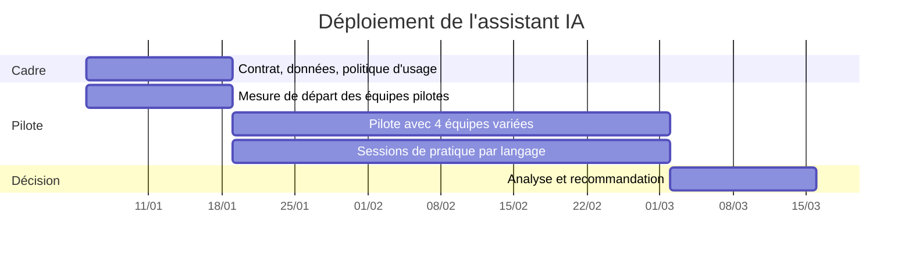

# Entretien DevX Engineer : les exercices

!!! warning "Avertissement"
    Ces notes sont des pense-bêtes personnels, pas une source de vérité. Elles reflètent ma compréhension et mes choix : leur contenu reste subjectif, malgré les citations et les références qu'il contient. Il peut être incomplet, simplifié, inexact ou dépassé. Vérifiez toujours dans la documentation officielle avant de l'appliquer. Ce contenu est fourni tel quel, sans aucune garantie : son utilisation se fait sous votre seule responsabilité.

!!! audience "Pour qui, pour quoi"
    - **Métiers** : ingénieur DevX, ingénieur plateforme, ingénieur DevOps ou SRE, tech lead chargé de l'outillage.
    - **Usages** : je m'entraîne à un exercice en direct où l'on me demande d'accélérer un pipeline de CI ; je veux un corrigé de référence pour un script `doctor` ou une requête DORA ; je prépare une étude de cas orale, comme le déploiement d'un assistant de code IA ; je vérifie avec la grille finale que ma réponse n'oublie ni la mesure ni l'adoption.

Cette page rassemble des exercices pratiques avec corrigés détaillés. Elle complète [Entretien DevX Engineer : les questions](questions.md). Il n'existe pas de réponse unique : je dispose ici de **réponses de référence concrètes** (configuration de CI, scripts, requêtes de mesure, plans d'adoption) et d'une formulation orale.

Le poste vise à améliorer le quotidien de nombreux développeurs : boucle interne, CI/CD, environnements, templates, documentation, mesure et adoption. Les exercices mêlent donc configuration et code, et des études de cas où la difficulté est de convaincre et de mesurer.

## Comment utiliser ces exercices

En entretien en direct, le recruteur regarde surtout **comment** je cherche, pas seulement ce que je trouve. Pour chaque exercice :

1. Je lis l'énoncé sans regarder le corrigé.
2. **Je pose deux ou trois questions avant de répondre** : « combien de développeurs ? », « combien de pipelines par jour ? », « qu'est-ce qui est déjà en place ? ». Je montre ainsi que je pars des utilisateurs, pas d'un outil à la mode.
3. **Je mesure avant de proposer** : je demande ou j'estime le chiffre de départ (durée, délai, taux). Une amélioration DevX sans <span class="term" data-term="baseline">mesure de départ</span> ne se démontre pas.
4. **Je pense à voix haute** : j'explique ce que je vérifie et pourquoi, même pendant que j'écris du YAML ou du code.
5. Je donne une solution simple, puis ses limites, son coût de maintenance et la façon dont les équipes vont l'adopter.
6. **Je termine par un exemple vécu** : « dans mon poste actuel, j'ai réduit la CI de... ». Les corrigés sont théoriques, c'est mon expérience chiffrée qui fait la différence.

Les exemples sont volontairement petits pour tenir dans un entretien. Ils sont en Python, en YAML (GitLab CI, <span class="term" data-term="docker-compose">Docker Compose</span>), en SQL (PostgreSQL) et en Dockerfile. Les versions d'outils citées sont des exemples, à vérifier et à adapter au dépôt réel.

## Exercice 1. Diviser par deux la durée d'un pipeline de CI

### Énoncé

Le pipeline de `my-api` (Python, environ 1 500 tests) dure 28 minutes. Tout est séquentiel : installation des dépendances (3 min), lint (4 min), tests (15 min), construction de l'image Docker (6 min). Les développeurs relancent souvent le pipeline. Je propose une nouvelle configuration `.gitlab-ci.yml` et j'explique ma démarche.

### Corrigé attendu

#### Étape 1 : mesurer avant de modifier

Sur deux semaines, je collecte :

- la durée de chaque <span class="term" data-term="ci-job">job</span>, au p50 et au <span class="term" data-term="p95">p95</span> ;
- le temps d'attente avant qu'un <span class="term" data-term="runner">runner</span> prenne le job ;
- le taux d'échec par job, et le taux de relance sans changement de code ;
- le nombre de pipelines par jour, pour chiffrer le gain total.

Ces chiffres servent de point de comparaison, et ils m'évitent d'optimiser un job qui n'est pas sur le <span class="term" data-term="critical-path">chemin critique</span>.

#### Étape 2 : la nouvelle configuration

La configuration de départ, en série : chaque stage attend le précédent, donc les 28 minutes s'additionnent.

``` { .yaml .ex-bad title="À éviter" }
# À éviter : quatre stages en série, le lint et l'image attendent la fin des tests
stages: [install, lint, test, build]

install:
  stage: install
  script: [pip install uv, uv sync]

lint:
  stage: lint
  script: [uv run ruff check .]

tests:
  stage: test
  script: [uv run pytest]

build-image:
  stage: build
  script: [docker build -t "$CI_REGISTRY_IMAGE:$CI_COMMIT_SHA" .]
```

La version qui parallélise, met en cache et découpe les tests :

``` { .yaml .ex-good title="Recommandé · .gitlab-ci.yml" }
stages:
  - test
  - build

# Bien : un nouveau push annule l'ancien pipeline
default:
  image: python:3.12-slim
  interruptible: true

variables:
  UV_CACHE_DIR: .uv-cache

# Bien : le cache ne change que si le lockfile change
.python:
  cache:
    key:
      files:
        - uv.lock
    paths:
      - .uv-cache/
  before_script:
    - pip install uv==0.4.30
    - uv sync --frozen

# Bien : needs vide, le lint démarre tout de suite
lint:
  stage: test
  extends: .python
  needs: []
  script:
    - uv run ruff check .
    - uv run ruff format --check .

# Bien : quatre shards de tests en parallèle, rapport JUnit gardé
tests:
  stage: test
  extends: .python
  needs: []
  parallel: 4
  script:
    - uv run pytest --splits "$CI_NODE_TOTAL" --group "$CI_NODE_INDEX"
      --junitxml=report.xml
  artifacts:
    when: always
    reports:
      junit: report.xml

# Bien : l'image n'est construite que si le code ou les dépendances changent
build-image:
  stage: build
  image: docker:27
  services:
    - docker:27-dind
  needs: []
  rules:
    - changes:
        - Dockerfile
        - pyproject.toml
        - uv.lock
        - src/**/*
  script:
    - docker login -u "$CI_REGISTRY_USER" -p "$CI_REGISTRY_PASSWORD" "$CI_REGISTRY"
    - docker build
      --cache-from "$CI_REGISTRY_IMAGE:cache"
      --build-arg BUILDKIT_INLINE_CACHE=1
      -t "$CI_REGISTRY_IMAGE:$CI_COMMIT_SHA"
      -t "$CI_REGISTRY_IMAGE:cache" .
    - docker push "$CI_REGISTRY_IMAGE:$CI_COMMIT_SHA"
    - docker push "$CI_REGISTRY_IMAGE:cache"
```

#### uv et le lockfile

<span class="term" data-term="uv">uv</span> est un gestionnaire de paquets et d'environnements Python (écrit en Rust, par Astral) qui remplace `pip`, `venv` et `pip-tools`. Il écrit dans `uv.lock` la version exacte de chaque dépendance, y compris les dépendances indirectes. `uv sync --frozen` installe exactement ce que dit `uv.lock`, sans jamais le recalculer : si `pyproject.toml` et le lockfile ne correspondent plus, la commande échoue au lieu de résoudre de nouvelles versions en silence.

| | `pip install -r requirements.txt` | `uv sync --frozen` |
|---|---|---|
| Versions installées | celles du fichier, les dépendances indirectes non figées sont résolues au moment de l'installation | exactement celles de `uv.lock`, indirectes comprises |
| Environnement virtuel | à créer soi-même (`python -m venv`) | créé ou mis à jour dans `.venv` |
| Paquet en trop dans l'environnement | reste installé | retiré, l'environnement suit le lockfile |
| Vitesse | téléchargements et installation séquentiels | cache global et installation parallèle, nettement plus rapide [À prendre avec précaution : chiffres de l'éditeur Astral, à vérifier sur mon projet] |

#### Ce que chaque réglage apporte

| Réglage | Effet | Gain estimé (exemple) |
|---|---|---|
| `needs: []` | lint, tests et image démarrent ensemble, sans attendre un stage précédent | les 4 min de lint et les 6 min d'image sortent du chemin critique |
| cache dont la clé est `uv.lock` | les dépendances ne sont retéléchargées que si le <span class="term" data-term="lockfile">lockfile</span> change | de 3 min à environ 30 s |
| `parallel: 4` et pytest-split | les tests sont répartis en 4 <span class="term" data-term="test-shard">shards</span> de durée proche | de 15 min à environ 4 min |
| `rules: changes` | l'image n'est construite que si le code ou les dépendances changent | une MR de documentation ne construit pas d'image |
| `interruptible: true` | un nouveau push annule l'ancien pipeline | moins de runners occupés pour rien |
| `--cache-from` | les couches Docker inchangées sont réutilisées | de 6 min à 2 ou 3 min |

Chemin critique attendu : installation depuis le cache, puis le shard de tests le plus long, soit environ 5 minutes, plus l'attente de runner. Chiffres d'exemple, à mesurer.

pytest-split répartit les tests selon un fichier `.test_durations` généré par `pytest --store-durations`. Ce fichier doit être mis à jour de temps en temps, sinon les shards se déséquilibrent.

Le YAML est illustratif : versions d'images, options de cache Docker et mots-clés sont à vérifier pour la version de GitLab utilisée.

#### Les pièges à signaler

- **Tests dépendants de l'ordre** : découper en shards révèle des tests qui ne passaient que parce qu'un autre test s'exécutait avant. Je surveille le taux d'échec pendant deux semaines.
- **Cache trop large** : un cache qui contient l'environnement virtuel entier peut masquer une dépendance manquante dans le lockfile. Je mets en cache le cache de téléchargement de uv, pas `.venv`.
- **Parallélisme sans runners** : quatre shards n'aident que si quatre runners sont libres. Sinon j'ajoute de l'attente.

#### Ce qu'un DevX Engineer ajoute

- Je transforme ce pipeline en **composant de CI partagé**, pour que les autres dépôts Python profitent du même gain sans copier le fichier.
- Je publie le **avant et après** : durée au p95, nombre de relances, heures récupérées par jour pour l'organisation.
- J'ajoute un tableau de bord de durée de CI par dépôt, pour repérer les prochains dépôts lents.

#### Réponse orale possible

> « Je mesure d'abord la durée de chaque job et l'attente de runner, pour trouver le chemin critique. Ici tout est en série, donc je commence par `needs` pour paralléliser lint, tests et image. Ensuite un cache basé sur le lockfile, et je découpe les tests en quatre shards. On devrait passer d'environ 28 à 5 minutes de chemin critique. Je surveille les tests qui dépendent de l'ordre pendant deux semaines, et j'en fais un composant partagé pour les autres dépôts. »

**À relire** : [Une CI rapide et fiable](../../knowledge/devx.md#une-ci-rapide-et-fiable), [Composant de CI partagé et versionné](../../knowledge/devx.md#composant-de-ci-partage-et-versionne), [Paralléliser sans casser](../../knowledge/qualite.md#paralleliser-sans-casser), [Python : pip, uv](../../knowledge/gestionnaires-paquets.md#python-pip-uv-poetry-pdm-conda), [Théorie des contraintes](../../knowledge/culture-entreprise.md#theorie-des-contraintes)

## Exercice 2. Rendre un Dockerfile rapide à reconstruire

### Énoncé

Voici le Dockerfile de `my-api`. Chaque modification d'une ligne de code relance l'installation de toutes les dépendances, et l'image fait 1,1 Go. Je propose une meilleure version, utilisable à la fois en développement et en production.

``` { .dockerfile .ex-bad title="À éviter" }
# À éviter : tout le code est copié avant l'installation, le cache ne sert jamais
FROM python:3.12
WORKDIR /app
COPY . .
RUN pip install uv && uv sync
CMD ["uv", "run", "uvicorn", "my_api.main:app", "--host", "0.0.0.0"]
```

### Corrigé attendu

#### Problèmes à relever

- **`COPY . .` avant l'installation** : toute modification d'un fichier invalide la couche, donc les dépendances sont réinstallées à chaque fois. Le cache de couches de Docker ne sert à rien.
- **Image complète `python:3.12`** : elle contient des compilateurs et des outils inutiles en production. D'où la taille.
- **Pas de lockfile figé** : `uv sync` sans `--frozen` peut résoudre des versions différentes d'une construction à l'autre.
- **Outils de développement en production** : les dépendances de test et de lint finissent dans l'image.
- **Exécution en root** : le processus tourne avec tous les droits dans le conteneur.
- **Pas de `.dockerignore`** : `.git`, `.venv` ou des fichiers locaux partent dans le contexte de construction.

#### Proposition

``` { .dockerfile .ex-good title="Recommandé" }
# syntax=docker/dockerfile:1
# Bien : une base slim commune, uv copié depuis son image officielle
FROM python:3.12-slim AS base
WORKDIR /app
ENV UV_COMPILE_BYTECODE=1 \
    UV_LINK_MODE=copy \
    PYTHONUNBUFFERED=1
COPY --from=ghcr.io/astral-sh/uv:0.4.30 /uv /usr/local/bin/uv

# Bien : le lockfile seul d'abord, cette couche ne change que si les dépendances changent
FROM base AS deps
COPY pyproject.toml uv.lock ./
RUN --mount=type=cache,target=/root/.cache/uv \
    uv sync --frozen --no-install-project --no-dev

# Bien : la cible dev ajoute les outils de test et recharge le code monté en volume
FROM deps AS dev
RUN --mount=type=cache,target=/root/.cache/uv \
    uv sync --frozen --no-install-project
CMD ["uv", "run", "uvicorn", "my_api.main:app", "--host", "0.0.0.0", "--reload"]

# Bien : la cible prod copie le code en dernier et tourne sans root
FROM deps AS prod
COPY src ./src
RUN --mount=type=cache,target=/root/.cache/uv \
    uv sync --frozen --no-dev
RUN useradd --uid 10001 --no-create-home app
USER app
CMD ["/app/.venv/bin/uvicorn", "my_api.main:app", "--host", "0.0.0.0"]
```

Et un `.dockerignore` :

``` { .text .ex-good title="Recommandé · .dockerignore" }
# Bien : rien de local ni d'inutile dans le contexte de construction
.git
.venv
.uv-cache
__pycache__
tests
*.md
```

#### Pourquoi c'est plus rapide

| Modification | Avant | Après |
|---|---|---|
| Une ligne de code dans `src/` | réinstallation complète des dépendances | seule la dernière couche est reconstruite |
| Ajout d'une dépendance | réinstallation complète | réinstallation, mais le cache `--mount=type=cache` évite de tout retélécharger |
| Développement local | reconstruction à chaque essai | cible `dev`, code monté en volume, rechargement automatique |

La construction en plusieurs étapes (<span class="term" data-term="multi-stage-build">multi-stage build</span>) donne deux <span class="term" data-term="docker-image">images</span> depuis un seul fichier : `docker build --target dev` pour le poste, `docker build --target prod` pour la CI et la production. La couche des dépendances est commune et réutilisée par le <span class="term" data-term="docker-layer-cache">cache de couches</span>.

Options de uv et version de l'image uv à vérifier dans leur documentation au moment de l'utilisation.

#### Ce qu'un DevX Engineer ajoute

- Je fournis ce Dockerfile dans le **template de service**, pour que les nouveaux services partent directement de la bonne version.
- J'ajoute un **lint de Dockerfile** (hadolint) dans le composant de CI commun, qui signale par exemple l'absence de `USER`.
- Je mesure la durée de construction et la taille de l'image avant et après, et je publie le résultat.

#### Réponse orale possible

> « Le problème principal est l'ordre des couches : on copie tout le code avant d'installer les dépendances, donc le cache ne sert jamais. Je copie d'abord le lockfile, j'installe, puis je copie le code. Je sépare une cible de développement et une cible de production, avec une image slim et un utilisateur non root. Une modification de code ne reconstruit plus que la dernière couche. Ensuite, je mets ce Dockerfile dans le template pour que tous les nouveaux services en profitent. »

**À relire** : [Image multi-étapes](../../knowledge/kubernetes.md#image-multi-etapes-rapide-a-reconstruire-legere-en-production), [Docker : l'image](../../knowledge/kubernetes.md#docker-limage), [Docker Compose et code monté par un volume](../../knowledge/devx.md#docker-compose-et-code-monte-par-un-volume), [Golden paths et templates](../../knowledge/devx.md#golden-paths-et-templates)

## Exercice 3. Écrire un script de diagnostic du poste (doctor)

### Énoncé

Les nouveaux arrivants d'`orders-service` passent des heures sur des erreurs d'installation : Docker non démarré, mauvaise version de Python, variable d'environnement manquante, port déjà utilisé. J'écris un script `doctor.py` qui vérifie le poste et dit comment corriger chaque problème.

### Corrigé attendu

#### Ce que le script doit faire

1. Lancer une série de vérifications indépendantes.
2. Pour chaque vérification, afficher le résultat **et la correction**.
3. Ne jamais s'arrêter à la première erreur : tout afficher d'un coup.
4. Retourner un <span class="term" data-term="exit-code">code de sortie</span> non nul si une vérification échoue, pour pouvoir l'utiliser dans la CI.

#### Le rôle de mise

<span class="term" data-term="mise">mise</span> est un outil en ligne de commande qui installe, dépôt par dépôt, les bonnes versions des outils (Python, uv, Node), charge les variables d'environnement du projet et lance ses tâches, le tout décrit dans un fichier `mise.toml` versionné. Le doctor s'appuie dessus : quand une vérification échoue, la correction proposée est souvent `mise install`.

``` { .toml .ex-ref title="Référence · mise.toml" }
# Exemple : versions d'outils figées pour tout le dépôt
[tools]
python = "3.12"
uv = "0.4.30"

# Exemple : variables chargées pour chaque commande lancée dans le dépôt
[env]
DATABASE_URL = "postgresql://localhost:5432/orders"

# Exemple : une tâche lancée par mise run setup
[tasks.setup]
run = "uv sync --frozen"
```

Avec ce fichier, `mise install` installe Python 3.12 et uv 0.4.30, chaque commande lancée dans le dépôt reçoit `DATABASE_URL`, et `mise run setup` installe les dépendances.

#### Proposition

``` { .python .ex-good title="Recommandé · doctor.py" }
"""Check that the workstation is ready to work on orders-service."""

import os
import shutil
import socket
import subprocess
import sys
from collections.abc import Callable
from dataclasses import dataclass

MIN_PYTHON = (3, 12)
REQUIRED_COMMANDS = ("docker", "uv", "git")
REQUIRED_ENV = ("DATABASE_URL",)
API_PORT = 8000
DOCKER_TIMEOUT_SECONDS = 10


# Bien : chaque résultat porte sa correction, affichée en cas d'échec
@dataclass(frozen=True)
class CheckResult:
    """Outcome of one workstation check, with a fix to show on failure."""

    name: str
    ok: bool
    fix: str = ""


# Bien : une vérification par fonction, indépendante des autres
def check_python_version() -> CheckResult:
    """Check that the running Python is recent enough."""
    current = sys.version_info[:2]
    return CheckResult(
        name=f"Python >= {MIN_PYTHON[0]}.{MIN_PYTHON[1]}",
        ok=current >= MIN_PYTHON,
        fix="lancer `mise install` à la racine du dépôt",
    )


# Bien : une commande absente du PATH donne une correction, pas une trace
def check_command(command: str) -> CheckResult:
    """Check that a command is available in the PATH."""
    return CheckResult(
        name=f"commande `{command}`",
        ok=shutil.which(command) is not None,
        fix=f"lancer `mise install`, ou installer {command}",
    )


# Bien : un délai maximal, pour ne pas bloquer si Docker ne répond plus
def check_docker_running() -> CheckResult:
    """Check that the Docker daemon answers."""
    name = "Docker démarré"
    if shutil.which("docker") is None:
        return CheckResult(name, False, "installer Docker, puis le démarrer")
    try:
        result = subprocess.run(
            ["docker", "info"],
            capture_output=True,
            timeout=DOCKER_TIMEOUT_SECONDS,
            check=False,
        )
    except subprocess.TimeoutExpired:
        return CheckResult(name, False, "Docker ne répond pas : le redémarrer")
    return CheckResult(name, result.returncode == 0, "démarrer Docker")


# Bien : une variable vide compte comme absente
def check_env_var(variable: str) -> CheckResult:
    """Check that an environment variable is set and not empty."""
    return CheckResult(
        name=f"variable {variable}",
        ok=bool(os.environ.get(variable)),
        fix="lancer la commande depuis le dépôt pour que mise charge [env]",
    )


# Bien : la correction donne la commande qui trouve le processus fautif
def check_port_free(port: int) -> CheckResult:
    """Check that nothing already listens on a local port."""
    with socket.socket(socket.AF_INET, socket.SOCK_STREAM) as sock:
        busy = sock.connect_ex(("127.0.0.1", port)) == 0
    return CheckResult(
        name=f"port {port} libre",
        ok=not busy,
        fix=f"trouver le processus avec `lsof -i :{port}` et l'arrêter",
    )


# Bien : la liste des vérifications est remplaçable dans les tests
def all_checks() -> list[Callable[[], CheckResult]]:
    """List every check to run, in display order."""
    checks: list[Callable[[], CheckResult]] = [check_python_version]
    checks += [lambda c=c: check_command(c) for c in REQUIRED_COMMANDS]
    checks.append(check_docker_running)
    checks += [lambda v=v: check_env_var(v) for v in REQUIRED_ENV]
    checks.append(lambda: check_port_free(API_PORT))
    return checks


# Bien : tout s'affiche d'un coup, et le code de sortie sert à la CI
def main() -> int:
    """Run all checks, print a report and return the exit code."""
    results = [check() for check in all_checks()]
    for result in results:
        status = "OK " if result.ok else "KO "
        print(f"[{status}] {result.name}")
        if not result.ok:
            print(f"       correction : {result.fix}")
    failures = [r for r in results if not r.ok]
    print(f"\n{len(results) - len(failures)}/{len(results)} vérifications OK")
    return 1 if failures else 0


if __name__ == "__main__":
    sys.exit(main())
```

Exemple de sortie :

``` { .text .ex-illus title="Illustration · sortie de doctor.py" }
[OK ] Python >= 3.12
[OK ] commande `docker`
[OK ] commande `uv`
[OK ] commande `git`
[KO ] Docker démarré
       correction : démarrer Docker
[OK ] variable DATABASE_URL
[OK ] port 8000 libre

6/7 vérifications OK
```

#### Tests

``` { .python .ex-good title="Recommandé · test_doctor.py" }
"""Tests for the workstation doctor script."""

import doctor


# Bien : on simule l'absence de la commande au lieu de dépendre du poste
def test_missing_command_is_reported_with_a_fix(monkeypatch):
    """A command absent from the PATH fails and suggests mise install."""
    monkeypatch.setattr(doctor.shutil, "which", lambda _: None)

    result = doctor.check_command("uv")

    assert not result.ok
    assert "mise install" in result.fix


# Bien : le cas limite de la chaîne vide est couvert
def test_empty_env_var_fails(monkeypatch):
    """An environment variable set to an empty string counts as missing."""
    monkeypatch.setenv("DATABASE_URL", "")

    assert not doctor.check_env_var("DATABASE_URL").ok


# Bien : le code de sortie et la correction affichée sont vérifiés ensemble
def test_main_returns_1_when_a_check_fails(monkeypatch, capsys):
    """The exit code is non-zero as soon as one check fails."""
    monkeypatch.setattr(
        doctor,
        "all_checks",
        lambda: [
            lambda: doctor.CheckResult("a", True),
            lambda: doctor.CheckResult("b", False, "fix b"),
        ],
    )

    assert doctor.main() == 1
    assert "fix b" in capsys.readouterr().out
```

#### Choix à expliquer

- **Une correction par erreur** : un message « Docker KO » sans solution renvoie le nouvel arrivant vers un collègue.
- **Pas d'installation automatique dans le doctor** : il diagnostique, `mise install` et `mise run setup` installent. Séparer les deux rend le script sûr à lancer à tout moment.
- **Bibliothèque standard seulement** : le script doit marcher avant même que les dépendances du projet soient installées.
- **Le port 8000 doit être libre avant de lancer l'API** : lancé pendant que l'API tourne, le contrôle échoue, c'est attendu.

#### Ce qu'un DevX Engineer ajoute

- Je lance `setup` puis `doctor` puis les tests dans un **job de CI hebdomadaire sur une image vierge**, pour détecter une mise en route cassée avant le prochain nouvel arrivant.
- J'ajoute chaque nouvelle erreur rencontrée par un arrivant comme nouvelle vérification : le script devient la mémoire des problèmes.
- J'en fais un modèle commun, avec des vérifications propres à chaque dépôt dans un petit fichier de configuration.

#### Réponse orale possible

> « Le doctor lance des vérifications indépendantes, affiche tout d'un coup, et donne une correction pour chaque échec. Il ne dépend que de la bibliothèque standard, parce qu'il doit marcher sur un poste vide. Il retourne 1 en cas d'échec pour être utilisable en CI. Et je le fais tourner chaque semaine sur une image vierge, pour que la mise en route ne casse pas en silence. »

**À relire** : [Mettre un projet en route en une commande](../../knowledge/devx.md#mettre-un-projet-en-route-en-une-commande), [Outils de développement : mise, uv](../../knowledge/outils.md#outils-de-developpement-mise-uv-ruff-yarn), [Onboarding](../../knowledge/devx.md#onboarding)

## Exercice 4. Détecter et mettre en quarantaine les tests instables

### Énoncé

Dans l'organisation, environ un pipeline sur cinq est relancé « pour voir ». Les rapports de tests <span class="term" data-term="junit-xml">JUnit XML</span> de chaque pipeline sont disponibles comme artefacts. Je propose un moyen de trouver les tests instables, puis un mécanisme de quarantaine.

### Corrigé attendu

#### 1. Définir ce qu'on cherche

Un <span class="term" data-term="flaky-test">test instable</span> est un test qui a échoué **et** réussi sur le **même commit**. C'est la seule définition qui ne confond pas instabilité et vraie régression : une régression échoue à chaque fois sur le commit fautif.

#### 2. Collecter les résultats

Un petit collecteur lit le rapport JUnit à la fin de chaque pipeline et écrit une ligne par test dans une table `test_runs`. Un rapport JUnit XML est le format de résultats que produisent pytest (`--junitxml=report.xml`) et la plupart des outils de test : une balise `<testcase>` par test, avec une balise `<failure>` à l'intérieur quand il échoue.

``` { .xml .ex-ref title="Référence · report.xml" }
<!-- Exemple : deux tests, le second en échec -->
<testsuite name="pytest" tests="2" failures="1">
  <testcase classname="tests.test_orders" name="test_create" time="0.12"/>
  <testcase classname="tests.test_orders" name="test_cancel" time="1.03">
    <failure message="assert 500 == 200">AssertionError</failure>
  </testcase>
</testsuite>
```

``` { .python .ex-good title="Recommandé · collecteur" }
"""Load JUnit XML reports into rows ready to be stored in test_runs."""

from dataclasses import dataclass
from pathlib import Path

from defusedxml import ElementTree


# Bien : une ligne par exécution, avec le commit qui permet de repérer l'instabilité
@dataclass(frozen=True)
class CaseRun:
    """One execution of one test case in one pipeline."""

    test_name: str
    commit_sha: str
    pipeline_id: int
    status: str
    duration_s: float


# Bien : une erreur compte comme un échec, comme dans la CI
def status_of(testcase) -> str:
    """Return passed, failed or skipped for a JUnit testcase element."""
    if testcase.find("failure") is not None or testcase.find("error") is not None:
        return "failed"
    if testcase.find("skipped") is not None:
        return "skipped"
    return "passed"


# Bien : defusedxml lit un fichier dont on ne contrôle pas tout le contenu
def parse_report(path: Path, commit_sha: str, pipeline_id: int) -> list[CaseRun]:
    """Parse one JUnit XML report into CaseRun rows."""
    root = ElementTree.parse(path).getroot()
    return [
        CaseRun(
            test_name=f"{case.get('classname')}::{case.get('name')}",
            commit_sha=commit_sha,
            pipeline_id=pipeline_id,
            status=status_of(case),
            duration_s=float(case.get("time") or 0),
        )
        for case in root.iter("testcase")
    ]
```

`defusedxml` remplace `xml.etree` pour lire du XML sans risque d'attaque par entités : les analyseurs de sécurité comme bandit signalent `xml.etree` sur des fichiers dont on ne contrôle pas totalement le contenu.

#### 3. Classer les tests instables

``` { .sql .ex-good title="Recommandé" }
-- Bien : un commit compte comme instable s'il a vu un échec et un succès du même test
WITH per_commit AS (
    SELECT
        test_name,
        owner_team,
        commit_sha,
        BOOL_OR(status = 'failed') AS has_failure,
        BOOL_OR(status = 'passed') AS has_success
    FROM test_runs
    WHERE run_at >= CURRENT_DATE - INTERVAL '14 days'
    GROUP BY test_name, owner_team, commit_sha
)
-- Bien : le taux rapporte les commits instables aux commits où le test a tourné
SELECT
    test_name,
    owner_team,
    COUNT(*) AS commits_run,
    COUNT(*) FILTER (WHERE has_failure AND has_success) AS flaky_commits,
    ROUND(
        100.0 * COUNT(*) FILTER (WHERE has_failure AND has_success) / COUNT(*),
        1
    ) AS flaky_pct
FROM per_commit
GROUP BY test_name, owner_team
HAVING COUNT(*) FILTER (WHERE has_failure AND has_success) > 0
ORDER BY flaky_commits DESC
LIMIT 20;
```

La colonne `owner_team` vient d'un fichier de propriété du code (<span class="term" data-term="codeowners">CODEOWNERS</span>) ou du catalogue de services. Sans propriétaire, le test instable ne sera jamais réparé. `CODEOWNERS` associe un chemin à une équipe, ligne par ligne :

``` { .text .ex-ref title="Référence · CODEOWNERS" }
# Exemple : tout ce qui est sous tests/payments/ appartient à team-core
/tests/payments/  @team-core
```

Un test dont le fichier est sous `tests/payments/` est donc attribué à `team-core`.

#### 4. Le mécanisme de quarantaine

Un fichier `quarantine.txt` à la racine du dépôt liste les tests en quarantaine, un par ligne, avec le ticket associé :

``` { .text .ex-illus title="Illustration · quarantine.txt" }
tests/test_orders.py::test_cancel_after_payment  # ticket 123, team-core, avant le 2026-11-15
```

Le réflexe à éviter : ignorer le test. Il disparaît du rapport, et plus personne ne voit s'il est réparé ou s'il cache un vrai bug.

``` { .python .ex-bad title="À éviter" }
import pytest


# À éviter : skip cache le test, son résultat n'apparaît plus nulle part
@pytest.mark.skip(reason="instable")
def test_cancel_after_payment():
    ...
```

Un hook pytest dans `conftest.py` marque plutôt les tests listés comme non bloquants :

``` { .python .ex-good title="Recommandé · conftest.py" }
"""Pytest hooks shared by the whole test suite."""

from pathlib import Path

import pytest

QUARANTINE_FILE = Path(__file__).parent.parent / "quarantine.txt"


# Bien : la référence au ticket après # est ignorée, le fichier absent ne casse rien
def load_quarantine() -> set[str]:
    """Read quarantined test ids, ignoring the trailing ticket reference."""
    if not QUARANTINE_FILE.exists():
        return set()
    lines = QUARANTINE_FILE.read_text().splitlines()
    return {line.split("#")[0].strip() for line in lines if line.strip()}


# Bien : xfail non strict, le test tourne toujours mais ne bloque plus la MR
def pytest_collection_modifyitems(config, items):
    """Mark quarantined tests as non-blocking, while still running them."""
    quarantined = load_quarantine()
    for item in items:
        if item.nodeid in quarantined:
            item.add_marker(pytest.mark.xfail(reason="quarantine", strict=False))
```

Le test continue de tourner, son résultat reste visible dans le rapport, mais il ne bloque plus la MR. C'est la différence avec un `skip`, qui cache le problème.

#### Règles d'organisation

| Règle | Pourquoi |
|---|---|
| Un test en <span class="term" data-term="test-quarantine">quarantaine</span> a un ticket et une date limite | sinon la quarantaine devient un cimetière |
| La quarantaine est limitée, par exemple 10 tests par dépôt | pour garder la pression de réparation |
| Pas de relance automatique silencieuse comme solution durable | elle cache l'instabilité et coûte du temps de CI |
| Indicateur publié : pipelines échoués à cause d'un test instable | pour suivre l'effet dans le temps |

#### Ce qu'un DevX Engineer ajoute

- J'intègre la lecture de `quarantine.txt` dans le **composant de CI commun**, pour que tous les dépôts aient le mécanisme sans effort.
- Je publie un classement par équipe chaque semaine, et je souligne les équipes qui réparent, pas seulement celles qui ont des tests instables.
- Je classe les causes trouvées (ordre, horloge, réseau, données partagées) pour écrire un guide qui évite les suivantes.

#### Réponse orale possible

> « Je définis un test instable comme un test qui échoue et réussit sur le même commit. Je collecte les rapports JUnit de tous les pipelines dans une table, et une requête me donne le classement. Les pires passent en quarantaine : ils tournent toujours mais ne bloquent plus, avec un ticket et une date limite pour l'équipe propriétaire. Je mets le mécanisme dans le modèle de CI commun et je suis le taux de relance chaque semaine. »

**À relire** : [Test instable](../../knowledge/qualite.md#test-instable-flaky), [Stratégie face à un test instable](../../knowledge/qualite.md#strategie-face-a-un-test-instable), [Causes d'instabilité](../../knowledge/qualite.md#causes-dinstabilite-qui-ne-sont-pas-des-bugs-de-test), [Garder l'historique](../../knowledge/qualite.md#garder-lhistorique), [Une CI rapide et fiable](../../knowledge/devx.md#une-ci-rapide-et-fiable), [Mettre en quarantaine sans bloquer](../../knowledge/qualite.md#mettre-en-quarantaine-sans-bloquer)

## Exercice 5. Calculer les métriques DORA à partir des données

### Énoncé

Je dispose de trois tables PostgreSQL alimentées par l'outil de déploiement et l'outil d'incidents. J'écris les requêtes qui donnent les quatre <span class="term" data-term="dora-metrics">métriques DORA</span> par service, sur les 90 derniers jours.

``` { .sql .ex-illus title="Illustration · schéma" }
-- Exemple : un déploiement par ligne, relié au commit déployé
CREATE TABLE deployments (
    id            BIGINT PRIMARY KEY,
    service       TEXT NOT NULL,
    environment   TEXT NOT NULL,
    commit_sha    TEXT NOT NULL,
    deployed_at   TIMESTAMPTZ NOT NULL,
    status        TEXT NOT NULL
);

-- Exemple : l'heure de chaque commit, pour calculer le délai
CREATE TABLE commits (
    sha           TEXT PRIMARY KEY,
    service       TEXT NOT NULL,
    committed_at  TIMESTAMPTZ NOT NULL
);

-- Exemple : un incident, relié si possible au déploiement en cause
CREATE TABLE incidents (
    id             BIGINT PRIMARY KEY,
    service        TEXT NOT NULL,
    deployment_id  BIGINT REFERENCES deployments (id),
    started_at     TIMESTAMPTZ NOT NULL,
    resolved_at    TIMESTAMPTZ
);
```

### Corrigé attendu

#### 1. Fréquence de déploiement

``` { .sql .ex-good title="Recommandé" }
-- Bien : seuls les déploiements réussis en production comptent
SELECT
    service,
    ROUND(COUNT(*) / (90 / 7.0), 1) AS deployments_per_week
FROM deployments
WHERE environment = 'production'
  AND status = 'success'
  AND deployed_at >= NOW() - INTERVAL '90 days'
GROUP BY service
ORDER BY deployments_per_week DESC;
```

#### 2. Délai de livraison des changements

Le délai va du commit à son déploiement en production. Je prends la médiane, pas la moyenne, pour ne pas être faussé par quelques commits restés des semaines sur une branche.

``` { .sql .ex-good title="Recommandé" }
-- Bien : médiane en heures, insensible aux quelques branches oubliées
SELECT
    d.service,
    PERCENTILE_CONT(0.5) WITHIN GROUP (
        ORDER BY EXTRACT(EPOCH FROM d.deployed_at - c.committed_at) / 3600
    ) AS median_lead_time_hours
FROM deployments AS d
JOIN commits AS c ON c.sha = d.commit_sha
WHERE d.environment = 'production'
  AND d.status = 'success'
  AND d.deployed_at >= NOW() - INTERVAL '90 days'
GROUP BY d.service;
```

Limite de cette version : un déploiement contient souvent plusieurs commits, et la requête ne mesure que le dernier. Pour être exact, il faut relier chaque commit au premier déploiement qui le contient, en suivant l'historique Git. Je le signale en entretien : c'est précisément le genre de détail qui fausse un tableau de bord.

#### 3. Taux d'échec des changements

``` { .sql .ex-good title="Recommandé" }
-- Bien : un déploiement relié à au moins un incident compte une seule fois
SELECT
    d.service,
    ROUND(
        100.0 * COUNT(DISTINCT i.deployment_id) / COUNT(DISTINCT d.id),
        1
    ) AS change_failure_rate_pct
FROM deployments AS d
LEFT JOIN incidents AS i ON i.deployment_id = d.id
WHERE d.environment = 'production'
  AND d.status = 'success'
  AND d.deployed_at >= NOW() - INTERVAL '90 days'
GROUP BY d.service;
```

#### 4. Temps de restauration

``` { .sql .ex-good title="Recommandé" }
-- Bien : médiane en minutes, et les incidents encore ouverts restent visibles à part
SELECT
    service,
    PERCENTILE_CONT(0.5) WITHIN GROUP (
        ORDER BY EXTRACT(EPOCH FROM resolved_at - started_at) / 60
    ) AS median_time_to_restore_minutes,
    COUNT(*) FILTER (WHERE resolved_at IS NULL) AS open_incidents
FROM incidents
WHERE started_at >= NOW() - INTERVAL '90 days'
GROUP BY service;
```

#### Les pièges à expliquer

| Piège | Conséquence | Correction |
|---|---|---|
| Incidents non reliés à un déploiement | taux d'échec sous-estimé | demander le lien dans l'outil d'incidents, ou l'estimer par fenêtre de temps |
| Retours arrière comptés comme déploiements réussis | fréquence gonflée | marquer les <span class="term" data-term="rollback">rollbacks</span> avec un statut dédié |
| Comparaison entre équipes | classement injuste, chiffres manipulés | comparer chaque service à lui-même dans le temps |
| Moyenne au lieu de médiane | valeurs extrêmes qui écrasent le reste | médiane, et p90 si besoin |
| Saisie manuelle | données fausses ou absentes | calcul automatique depuis les outils |

#### Ce qu'un DevX Engineer ajoute

- J'affiche les quatre métriques **ensemble**, pour qu'on ne pousse pas la vitesse au détriment de la stabilité.
- Je découpe le <span class="term" data-term="lead-time">délai de livraison</span> en étapes (revue, CI, attente du déploiement) pour savoir où agir.
- Je croise avec l'enquête développeurs : un délai court mais vécu comme stressant n'est pas une réussite.

#### Réponse orale possible

> « Je calcule les quatre métriques automatiquement à partir des déploiements, des commits et des incidents, en médiane sur 90 jours. Je signale les limites : un déploiement contient plusieurs commits, et les incidents doivent être reliés aux déploiements. J'affiche les quatre ensemble, par service, comparés à eux-mêmes dans le temps, et je découpe le délai pour savoir quelle étape traiter. »

**À relire** : [Mesurer la livraison : DORA](../../knowledge/livraison.md#mesurer-la-livraison-dora), [Mesurer sans surveiller](../../knowledge/devx.md#mesurer-sans-surveiller), [Accelerate](../../knowledge/textes-fondateurs.md#forsgren-humble-et-kim-accelerate-2018)

## Exercice 6. Analyser une enquête développeurs sans exposer personne

### Énoncé

L'enquête trimestrielle vient de se terminer : 180 réponses, 12 questions notées de 1 à 5, une colonne équipe. J'écris un script qui produit, pour chaque équipe et chaque question, la part de réponses favorables et l'évolution par rapport au trimestre précédent, sans jamais permettre de reconnaître une personne.

### Corrigé attendu

#### Les règles à poser avant d'écrire le code

- **Part favorable plutôt que moyenne** : la part de 4 et de 5 se lit plus facilement (« 62 % sont satisfaits ») et ne cache pas une équipe divisée en deux.
- **<span class="term" data-term="anonymity-threshold">Seuil d'anonymat</span>** : une équipe de moins de 5 répondants n'est pas affichée seule. Ses réponses comptent dans le total de l'organisation.
- **Pas de croisement fin** : équipe, ancienneté et lieu ensemble permettent de retrouver une personne. Je n'affiche qu'un critère à la fois.
- **Les réponses brutes ne quittent pas l'équipe DevX**, et les réponses libres sont relues pour retirer les détails identifiants.

#### Proposition

``` { .python .ex-good title="Recommandé · survey.py" }
"""Summarize developer survey answers per team, with an anonymity threshold."""

from collections import defaultdict
from dataclasses import dataclass

MIN_RESPONDENTS = 5
FAVORABLE_SCORES = {4, 5}


# Exemple : une réponse d'une personne à une question
@dataclass(frozen=True)
class Answer:
    """One respondent's score for one question."""

    respondent_id: str
    team: str
    question: str
    score: int


# Bien : la part de 4 et de 5, qui ne cache pas une équipe divisée
def favorable_share(scores: list[int]) -> float:
    """Return the percentage of favorable scores (4 or 5)."""
    favorable = sum(1 for score in scores if score in FAVORABLE_SCORES)
    return round(100 * favorable / len(scores), 1)


# Bien : les petites équipes sont masquées mais comptent dans le total ALL
def summarize(answers: list[Answer]) -> dict[tuple[str, str], float]:
    """Return the favorable share per (team, question), hiding small teams."""
    respondents_per_team: dict[str, set[str]] = defaultdict(set)
    scores: dict[tuple[str, str], list[int]] = defaultdict(list)
    for answer in answers:
        respondents_per_team[answer.team].add(answer.respondent_id)
        scores[(answer.team, answer.question)].append(answer.score)
        scores[("ALL", answer.question)].append(answer.score)

    visible_teams = {
        team for team, people in respondents_per_team.items()
        if len(people) >= MIN_RESPONDENTS
    }
    return {
        key: favorable_share(values)
        for key, values in scores.items()
        if key[0] == "ALL" or key[0] in visible_teams
    }


# Bien : une question nouvelle n'a pas d'évolution, plutôt qu'un faux zéro
def evolution(
    current: dict[tuple[str, str], float],
    previous: dict[tuple[str, str], float],
) -> dict[tuple[str, str], float | None]:
    """Return the change in points since the previous survey, None if new."""
    return {
        key: round(value - previous[key], 1) if key in previous else None
        for key, value in current.items()
    }
```

#### Tests

``` { .python .ex-good title="Recommandé · test_survey.py" }
"""Tests for the survey summary."""

from survey import Answer, summarize


# Exemple : fabrique une réponse par personne pour une seule question
def answers_for(team: str, people: int, score: int) -> list[Answer]:
    """Build one answer per person for a single question."""
    return [Answer(f"{team}-{i}", team, "ci_fast_enough", score) for i in range(people)]


# Bien : le seuil d'anonymat et le total sont vérifiés dans le même test
def test_team_below_threshold_is_hidden_but_counted_in_total():
    """A 3-person team is not shown alone, but still counts in ALL."""
    answers = answers_for("team-core", 6, 5) + answers_for("team-tiny", 3, 1)

    result = summarize(answers)

    assert ("team-tiny", "ci_fast_enough") not in result
    assert result[("team-core", "ci_fast_enough")] == 100.0
    assert result[("ALL", "ci_fast_enough")] == round(100 * 6 / 9, 1)
```

#### Exemple de restitution

Chiffres d'exemple. Chaque pourcentage est la part de réponses favorables (4 ou 5 sur 5). Évolution : écart avec l'enquête précédente, en points. Dernière colonne : nombre d'équipes de moins de 5 répondants, masquées pour protéger l'anonymat.

| Question | Organisation | Évolution | team-core | team-web | Équipes masquées (moins de 5) |
|---|---|---|---|---|---|
| La CI est assez rapide pour rester concentré | 41 % | +12 pts | 55 % | 30 % | 2 |
| Je trouve la documentation dont j'ai besoin | 48 % | +3 pts | 50 % | 44 % | 2 |
| Je peux lancer un projet inconnu en moins d'une heure | 35 % | nouvelle | 40 % | 22 % | 2 |

Lecture : la CI progresse nettement après le chantier du trimestre, la mise en route est le point le plus faible et devient le chantier suivant.

#### Ce qu'un DevX Engineer ajoute

- Je publie la synthèse **dans les deux semaines**, avec trois actions et leurs responsables, et je dis ce qu'on ne traite pas.
- Je croise chaque question avec une **mesure système** (durée de CI, temps de mise en route) pour vérifier que ressenti et données vont dans le même sens.
- Je garde **les mêmes questions** d'un trimestre à l'autre, sinon les évolutions ne veulent rien dire.

#### Réponse orale possible

> « Je calcule la part de réponses favorables par équipe et par question, et l'évolution depuis le trimestre précédent. Une équipe de moins de cinq répondants n'est jamais affichée seule, mais compte dans le total. Je publie la synthèse en deux semaines avec trois actions, et je croise chaque question avec une mesure système. »

**À relire** : [Mesurer sans surveiller](../../knowledge/devx.md#mesurer-sans-surveiller), [SPACE et DevEx](../../knowledge/livraison.md#mesurer-lexperience-developpeur-space-et-devex), [Anonymisation ou pseudonymisation](../../knowledge/ia-entreprise.md#pourquoi-le-mode-anonyme-est-en-realite-de-la-pseudonymisation)

## Exercice 7. Tester un template de service et suivre sa dérive

### Énoncé

L'équipe DevX maintient un template <span class="term" data-term="copier">Copier</span> `python-service-template`, utilisé par 35 services. Deux problèmes : une modification du template a récemment généré des projets dont les tests ne passaient pas, et personne ne sait quels services utilisent une vieille version. Je propose la CI du template et un rapport de dérive.

### Corrigé attendu

#### 1. Tester le template en générant un vrai projet

Copier est un outil Python qui génère un projet à partir d'un dépôt template et des réponses à quelques questions (nom du service, équipe, version de Python). Il sait aussi rejouer plus tard les évolutions du template dans un projet déjà généré (`copier update`).

La seule preuve qu'un template fonctionne, c'est un projet généré dont la CI passe. Le job génère un projet avec des réponses par défaut, puis lance ses contrôles.

``` { .yaml .ex-good title="Recommandé · .gitlab-ci.yml du template" }
stages:
  - test
  - release

# Bien : un projet généré par version de Python, puis ses propres contrôles
generate-and-test:
  stage: test
  image: python:3.12-slim
  parallel:
    matrix:
      - PYTHON_VERSION: ["3.11", "3.12"]
  script:
    - apt-get update && apt-get install -y --no-install-recommends git
    - pip install copier uv
    - copier copy --defaults --vcs-ref HEAD
      --data service_name=demo-service
      --data owner_team=team-devx
      --data python_version="$PYTHON_VERSION"
      . /tmp/demo-service
    - cd /tmp/demo-service
    - uv sync
    - uv run ruff check .
    - uv run pytest

# Exemple : une version publiée par tag
release:
  stage: release
  rules:
    - if: $CI_COMMIT_TAG
  script:
    - echo "Version $CI_COMMIT_TAG publiée"
```

Le `parallel: matrix` teste chaque combinaison de réponses qui change le résultat, ici la version de Python. Une option qui ajoute un fichier (base de données, worker) mérite aussi sa ligne dans la matrice.

#### 2. Mesurer la dérive

Copier écrit dans chaque projet un fichier `.copier-answers.yml`, qui contient `_commit`, la version du template utilisée. Un script lit ce fichier dans chaque dépôt et le compare à la dernière version publiée.

``` { .yaml .ex-ref title="Référence · .copier-answers.yml" }
# Exemple : version du template et réponses gardées dans le projet généré
_commit: v2.3.0
_src_path: https://gitlab.example.com/devx/python-service-template.git
service_name: orders-service
owner_team: team-core
python_version: "3.12"
```

``` { .python .ex-good title="Recommandé · drift_report.py" }
"""Report which services lag behind the latest service template version."""

import sys
from pathlib import Path

import yaml
from packaging.version import InvalidVersion, Version

ANSWERS_FILE = ".copier-answers.yml"


# Bien : safe_load, et une version illisible devient None au lieu de planter
def template_version(repo: Path) -> Version | None:
    """Return the template version recorded in a repository, if any."""
    answers_path = repo / ANSWERS_FILE
    if not answers_path.exists():
        return None
    answers = yaml.safe_load(answers_path.read_text()) or {}
    try:
        return Version(str(answers.get("_commit", "")).lstrip("v"))
    except InvalidVersion:
        return None


# Bien : les dépôts sans version connue apparaissent aussi, avec -1
def drift_report(repos_root: Path, latest: Version) -> list[tuple[str, str, int]]:
    """List (repository, recorded version, major versions behind) rows."""
    rows = []
    for repo in sorted(p for p in repos_root.iterdir() if p.is_dir()):
        version = template_version(repo)
        if version is None:
            rows.append((repo.name, "inconnue", -1))
        elif version < latest:
            rows.append((repo.name, str(version), latest.major - version.major))
    return rows


if __name__ == "__main__":
    root, latest_version = Path(sys.argv[1]), Version(sys.argv[2])
    for name, version, behind in drift_report(root, latest_version):
        print(f"{name:<30} {version:<10} {behind} version(s) majeure(s) de retard")
```

Utilisation sur un dossier où tous les dépôts sont clonés :

``` { .bash .ex-illus title="Illustration" }
# Exemple : rapport de dérive par rapport à la version 4.2.0 du template
python drift_report.py ~/src/all-repos 4.2.0
```

#### 3. Réduire la dérive

| Levier | Effet |
|---|---|
| Sortir du template ce qui évolue souvent (CI, logs) vers des briques versionnées | les mises à jour arrivent par <span class="term" data-term="dependency-update-bot">Renovate</span>, sans `copier update` |
| Une MR automatique `copier update` par service à chaque version majeure | l'équipe relit et fusionne, au lieu de refaire le travail |
| Afficher la version du template dans le catalogue de services | la dérive devient visible pour tous |
| Garder un journal des changements du template | l'équipe sait ce qu'elle reçoit |

#### Ce qu'un DevX Engineer ajoute

- Je fixe un objectif simple : **90 % des services à moins d'une version majeure** du template, suivi chaque mois.
- Je traite la <span class="term" data-term="template-drift">dérive</span> comme un signal : un service qui refuse toujours les mises à jour a peut-être un besoin que le template ignore.
- Je limite le <span class="term" data-term="scaffolding">scaffolding</span> à ce qui ne peut vraiment pas être partagé.

#### Réponse orale possible

> « Je teste le template comme un produit : la CI génère un projet pour chaque combinaison importante de réponses et lance ses tests. Pour la dérive, je lis la version du template enregistrée dans chaque dépôt et je la compare à la dernière. Ensuite, je réduis la dérive en sortant du template ce qui évolue souvent, et en ouvrant des MR de mise à jour automatiques. »

**À relire** : [Golden paths et templates](../../knowledge/devx.md#golden-paths-et-templates), [Composant de CI partagé et versionné](../../knowledge/devx.md#composant-de-ci-partage-et-versionne), [Mettre à jour les dépendances](../../knowledge/gestionnaires-paquets.md#mettre-a-jour-les-dependances), [Portail développeur et catalogue](../../knowledge/devx.md#portail-developpeur-et-catalogue)

## Exercice 8. Préparer le retrait d'une bibliothèque interne

### Énoncé

La bibliothèque interne `legacy_config` n'a plus de mainteneur et bloque le passage à Python 3.12. Elle serait utilisée par « une soixantaine de services ». Tous les dépôts sont clonés dans un même dossier. J'écris un script d'inventaire, puis je propose le plan de retrait.

### Corrigé attendu

#### 1. Inventorier avec l'arbre syntaxique, pas avec une regex

Une recherche texte sur `legacy_config` trouve aussi les commentaires et les chaînes, et rate `import legacy_config as cfg` suivi de `cfg.load()`.

``` { .bash .ex-bad title="À éviter" }
# À éviter : compte les commentaires et rate cfg.load() après un import avec alias
grep -rn "legacy_config\." ~/src/all-repos --include="*.py"
```

Le module `ast` de Python lit la structure réelle du code.

``` { .python .ex-good title="Recommandé · inventory.py" }
"""Inventory the usages of legacy_config across many cloned repositories."""

import ast
import sys
from collections import Counter
from pathlib import Path

TARGET = "legacy_config"


# Bien : suit les alias d'import et les imports nommés, pas le texte
def used_functions(source: str) -> Counter[str]:
    """Count the legacy_config functions used in one Python source file."""
    tree = ast.parse(source)
    aliases: set[str] = set()
    usages: Counter[str] = Counter()
    for node in ast.walk(tree):
        if isinstance(node, ast.Import):
            aliases |= {a.asname or a.name for a in node.names if a.name == TARGET}
        elif isinstance(node, ast.ImportFrom) and node.module == TARGET:
            usages.update(a.name for a in node.names)
    for node in ast.walk(tree):
        if (
            isinstance(node, ast.Attribute)
            and isinstance(node.value, ast.Name)
            and node.value.id in aliases
        ):
            usages[node.attr] += 1
    return usages


# Bien : un fichier illisible est signalé et ignoré, l'inventaire continue
def inventory(repos_root: Path) -> dict[str, Counter[str]]:
    """Return the functions used per repository, for repositories that use the library."""
    result: dict[str, Counter[str]] = {}
    for repo in sorted(p for p in repos_root.iterdir() if p.is_dir()):
        total: Counter[str] = Counter()
        for path in repo.rglob("*.py"):
            if ".venv" in path.parts:
                continue
            try:
                total += used_functions(path.read_text(encoding="utf-8"))
            except (SyntaxError, UnicodeDecodeError) as error:
                print(f"ignoré {path}: {error}", file=sys.stderr)
        if total:
            result[repo.name] = total
    return result


if __name__ == "__main__":
    usages = inventory(Path(sys.argv[1]))
    overall: Counter[str] = sum(usages.values(), Counter())
    print(f"{len(usages)} dépôts utilisent {TARGET}")
    for function, count in overall.most_common():
        print(f"  {function:<20} {count} usages")
```

Exemple de sortie (chiffres d'exemple) :

``` { .text .ex-illus title="Illustration · sortie de inventory.py" }
57 dépôts utilisent legacy_config
  load                 212 usages
  get_secret           97 usages
  reload               6 usages
  _parse_env           3 usages
```

La dernière ligne illustre la <span class="term" data-term="hyrum-law">loi de Hyrum</span> : trois dépôts utilisent une fonction privée que personne n'aurait pensé à remplacer.

#### 2. Le plan de retrait

| Étape | Quand | Action | Mesure |
|---|---|---|---|
| Annonce | mois 0 | page de migration, date de fin, `DeprecationWarning` à l'import | annonce lue par chaque équipe propriétaire |
| Migration automatique | mois 1 | <span class="term" data-term="codemod">codemod</span> pour `load` et `get_secret`, une MR par dépôt | MR ouvertes, CI verte |
| Gel | mois 2 | <span class="term" data-term="lint-rule">règle de lint</span> qui refuse tout nouvel import | zéro nouvel usage |
| Accompagnement | mois 3 à 5 | binôme avec les équipes restantes, cas `reload` et `_parse_env` | dépôts restants |
| Arrêt | mois 6 | dépôt archivé, paquet retiré du registre interne | zéro dépôt restant |

Le gel s'écrit avec la règle `banned-api` de ruff (code `TID251`), dans le `pyproject.toml` de chaque dépôt ou dans la configuration ruff partagée :

``` { .toml .ex-good title="Recommandé · pyproject.toml" }
# Bien : tout nouvel import de legacy_config fait échouer le lint, avec le lien de migration
[tool.ruff.lint]
extend-select = ["TID251"]

[tool.ruff.lint.flake8-tidy-imports.banned-api]
"legacy_config".msg = "retirée le 30 avril, voir le guide de migration"
```

Un nouvel import fait alors échouer la CI :

``` { .text .ex-ref title="Référence · sortie de ruff" }
$ ruff check --output-format=concise .
src/my_api/settings.py:3:8: TID251 `legacy_config` is banned: retirée le 30 avril, voir le guide de migration
```

La règle refuse aussi les imports déjà présents : je les marque une fois avec `ruff check --add-noqa .`, qui ajoute `# noqa: TID251` sur chaque ligne existante, et seuls les nouveaux usages bloquent. Format exact du message à vérifier selon la version de ruff.

#### 3. Le message d'annonce

``` { .markdown .ex-illus title="Illustration · annonce" }
**legacy_config sera retirée le 30 avril**

Pourquoi : plus de mainteneur, et elle bloque Python 3.12.

Ce qui change pour chaque équipe :
- Un service qui n'utilise que `load` et `get_secret` (50 services sur 57)
  reçoit une MR automatique en novembre. Il suffit de la relire.
- Pour les autres services, team-devx contacte l'équipe pour migrer ensemble.

Guide de migration : https://docs.example.com/migrate-config
Liste des services concernés : https://dashboard.example.com/legacy-config
Questions : canal #devx
```

#### Ce qu'un DevX Engineer ajoute

- **Je porte le coût de la migration** : c'est l'équipe qui retire l'outil qui écrit le codemod et ouvre les MR, pas chaque équipe seule.
- Je tiens un **tableau public** des dépôts restants, mis à jour automatiquement par le script d'inventaire.
- J'en tire les leçons : la nouvelle bibliothèque a un propriétaire, une interface publique claire et une politique de <span class="term" data-term="deprecation">dépréciation</span> écrite.

#### Réponse orale possible

> « Je commence par un inventaire fiable avec l'arbre syntaxique, pas une regex, pour savoir quels dépôts utilisent quelles fonctions. Ça me dit ce qu'un codemod peut migrer automatiquement et ce qui demande un accompagnement. J'annonce un calendrier en cinq étapes, j'ouvre les MR moi-même, je gèle les nouveaux usages par une règle de lint, et j'aide directement les dernières équipes. »

**À relire** : [Migrations à grande échelle](../../knowledge/devx.md#migrations-a-grande-echelle), [Exemple de codemod](../../knowledge/devx.md#exemple-de-codemod-changer-un-import-dans-48-depots), [SemVer et dépréciation](../../knowledge/devx.md#semver-le-contrat-dune-bibliotheque-dune-cli-ou-dun-composant-interne), [Loi de Hyrum](../../knowledge/lois-et-principes.md#loi-de-hyrum), [Geler les nouveaux usages d'un module déprécié](../../knowledge/devx.md#geler-les-nouveaux-usages-dun-module-deprecie)

## Exercice 9. Mesurer l'usage d'une CLI interne sans surveiller les développeurs

### Énoncé

L'équipe DevX maintient une CLI interne `devx` (créer un environnement, lancer les tests, ouvrir le tableau de bord d'un service). On veut savoir quelles commandes sont utilisées, combien de temps elles prennent et lesquelles échouent. Je propose une <span class="term" data-term="usage-telemetry">télémétrie d'usage</span> acceptable pour les développeurs, et son code.

### Corrigé attendu

#### Les règles avant le code

| Règle | Pourquoi |
|---|---|
| Aucune donnée personnelle : ni nom, ni e-mail, ni nom de machine | on mesure l'outil, pas les personnes |
| Pas les arguments ni les chemins | ils peuvent contenir des noms de projets, des secrets |
| Équipe seulement, lue dans la configuration | assez pour prioriser, pas assez pour identifier |
| <span class="term" data-term="opt-out">Opt-out</span> simple et documenté | la confiance compte plus que l'exhaustivité |
| La télémétrie ne fait jamais échouer ni ralentir la commande | sinon elle dégrade l'expérience qu'elle veut mesurer |
| Données publiées aux développeurs | ils voient ce qui est collecté et à quoi ça sert |

#### Proposition

``` { .python .ex-good title="Recommandé · telemetry.py" }
"""Anonymous, opt-out usage telemetry for the devx internal CLI."""

import functools
import json
import logging
import os
import platform
import time
import urllib.request
from collections.abc import Callable
from typing import Any

TELEMETRY_URL = "https://telemetry.example.com/v1/events"
TELEMETRY_TIMEOUT_SECONDS = 0.5
OPT_OUT_VARIABLE = "DEVX_TELEMETRY"
CLI_VERSION = "1.8.0"

logger = logging.getLogger(__name__)


# Bien : un opt-out par variable d'environnement, documenté
def telemetry_enabled() -> bool:
    """Return False when the developer opted out with DEVX_TELEMETRY=0."""
    return os.environ.get(OPT_OUT_VARIABLE, "1") != "0"


# Bien : un envoi borné dans le temps, qui ne lève jamais d'erreur
def send_event(event: dict[str, Any]) -> None:
    """Send one event, never raising and never waiting more than the timeout."""
    request = urllib.request.Request(
        TELEMETRY_URL,
        data=json.dumps(event).encode(),
        headers={"Content-Type": "application/json"},
        method="POST",
    )
    try:
        urllib.request.urlopen(request, timeout=TELEMETRY_TIMEOUT_SECONDS).close()
    except OSError as error:
        logger.debug("telemetry not sent: %s", error)


# Bien : seuls la commande, la durée, le code de sortie, la version, le système et l'équipe partent
def tracked(command_name: str, team: str) -> Callable:
    """Decorate a CLI command to report its duration and exit code."""

    def decorator(func: Callable[..., int]) -> Callable[..., int]:
        """Wrap the command function."""

        @functools.wraps(func)
        def wrapper(*args: Any, **kwargs: Any) -> int:
            """Run the command, then report it if telemetry is enabled."""
            start = time.monotonic()
            exit_code = 1
            try:
                exit_code = func(*args, **kwargs)
                return exit_code
            finally:
                if telemetry_enabled():
                    send_event({
                        "command": command_name,
                        "exit_code": exit_code,
                        "duration_ms": round((time.monotonic() - start) * 1000),
                        "cli_version": CLI_VERSION,
                        "os": platform.system(),
                        "team": team,
                    })

        return wrapper

    return decorator
```

Utilisation :

``` { .python .ex-illus title="Illustration" }
# Exemple : une commande de la CLI suivie par la télémétrie
@tracked("env-create", team=config.team)
def env_create(service: str) -> int:
    """Create a preview environment for a service."""
    ...
    return 0
```

Le délai d'attente de 0,5 seconde reste perceptible si le serveur est lent. Une version plus robuste écrit l'événement dans un fichier local et l'envoie au lancement suivant, ou dans un processus séparé.

#### Ce qu'on en tire

Requête d'exemple sur les événements collectés :

``` { .sql .ex-good title="Recommandé" }
-- Bien : usage, étendue, durée au p95 et taux d'échec par commande, sur 30 jours
SELECT
    command,
    COUNT(*) AS runs,
    COUNT(DISTINCT team) AS teams,
    PERCENTILE_CONT(0.95) WITHIN GROUP (ORDER BY duration_ms) / 1000 AS p95_seconds,
    ROUND(100.0 * COUNT(*) FILTER (WHERE exit_code <> 0) / COUNT(*), 1) AS failure_pct
FROM cli_events
WHERE received_at >= NOW() - INTERVAL '30 days'
GROUP BY command
ORDER BY runs DESC;
```

| Commande | Exécutions | Équipes | p95 | Échecs | Décision (exemple) |
|---|---|---|---|---|---|
| `test` | 9 400 | 18 | 42 s | 3 % | rien à faire |
| `env-create` | 610 | 7 | 6 min | 21 % | chantier prioritaire : lent et fragile |
| `dashboard` | 35 | 2 | 1 s | 0 % | candidate au retrait |

Sur les 30 derniers jours. Exécutions : nombre de lancements de la commande. Équipes : nombre d'équipes qui l'ont lancée. p95 : durée sous laquelle passent 95 % des exécutions. Échecs : part des exécutions terminées en erreur.

#### Ce qu'un DevX Engineer ajoute

- J'écris la **page « ce que collecte la CLI »** avant le premier envoi, avec l'exemple exact d'un événement.
- Je valide le dispositif avec les équipes sécurité et protection des données, même sans donnée personnelle : c'est plus simple avant qu'après.
- J'utilise ces données pour **retirer** des commandes, pas seulement pour en ajouter.

#### Réponse orale possible

> « Je collecte le strict nécessaire pour améliorer l'outil : commande, durée, code de sortie, version, système, équipe. Jamais de nom, ni d'arguments. L'envoi ne peut ni échouer ni bloquer la commande, et un opt-out est documenté. Avec ces données, je vois que `env-create` est lent et échoue une fois sur cinq : c'est le prochain chantier. »

**À relire** : [Faire adopter un outil sans l'imposer](../../knowledge/devx.md#faire-adopter-un-outil-sans-limposer), [Mesurer l'usage d'un assistant IA en équipe](../../knowledge/ia-entreprise.md#mesurer-lusage-dun-assistant-ia-en-equipe), [Laisser le choix à chaque personne](../../knowledge/ia-entreprise.md#laisser-le-choix-a-chaque-personne), [Mesurer sans surveiller](../../knowledge/devx.md#mesurer-sans-surveiller), [Télémétrie d'usage d'un outil interne ou d'une CLI](../../knowledge/devx.md#telemetrie-dusage-dun-outil-interne-ou-dune-cli)

## Exercice 10. Étude de cas : déployer un assistant de code IA

!!! info "Exercice rédigé en novembre 2026"
    Les études citées et les outils compatibles évoluent vite : chiffres et noms à vérifier au moment de la lecture.

### Énoncé

La direction veut équiper les 200 développeurs d'un <span class="term" data-term="ai-coding-assistant">assistant de code IA</span> et demande à l'équipe DevX un plan de déploiement sur un trimestre, avec une recommandation finale : généraliser, ajuster ou arrêter. Le fournisseur annonce « 55 % de productivité en plus ».

### Corrigé attendu

#### 1. Questions à poser d'abord

- Quelles données le fournisseur conserve-t-il, et sont-elles utilisées pour l'entraînement ? Le contrat le dit-il ?
- Quels dépôts sont exclus (code sous contrat client, secrets historiques) ?
- L'outil propose-t-il un mode agent qui exécute des commandes ? Avec quels droits ?
- Quel budget, et quelle décision la direction veut-elle prendre à la fin du trimestre ?

#### 2. Le plan sur un trimestre



Choix des équipes pilotes : une équipe back-end, une front-end, une équipe data et une équipe sur du code ancien. Un pilote limité aux volontaires les plus enthousiastes surestime toujours le gain.

#### 3. Les mesures

| Indicateur | Source | Pourquoi |
|---|---|---|
| Délai de livraison médian | forge et déploiements | effet sur le flux réel |
| Taux d'échec des changements | outil d'incidents | la vitesse ne doit pas dégrader la stabilité |
| Taille médiane des MR, durée de revue | forge | du code généré peu relu grossit les MR |
| Ressenti (3 questions sur 5) | enquête | adoption et confort |
| Usage hebdomadaire par équipe | statistiques du fournisseur | adoption, pas productivité |

Comparaison : chaque équipe pilote avec son propre trimestre précédent, et avec des équipes semblables sans l'outil, le <span class="term" data-term="comparison-group">groupe de comparaison</span>.

Requête d'exemple pour la taille des MR :

``` { .sql .ex-good title="Recommandé" }
-- Bien : pilotes et groupe de comparaison côte à côte, mois par mois
SELECT
    CASE WHEN team IN ('team-core', 'team-web', 'team-data', 'team-legacy')
         THEN 'pilote' ELSE 'comparaison' END AS cohort,
    DATE_TRUNC('month', merged_at) AS month,
    PERCENTILE_CONT(0.5) WITHIN GROUP (ORDER BY lines_added + lines_deleted) AS median_mr_size,
    PERCENTILE_CONT(0.5) WITHIN GROUP (
        ORDER BY EXTRACT(EPOCH FROM merged_at - opened_at) / 3600
    ) AS median_hours_to_merge
FROM merge_requests
WHERE merged_at >= DATE '2025-10-01'
GROUP BY cohort, month
ORDER BY month, cohort;
```

#### 4. Lire le chiffre du fournisseur

Le chiffre de 55 % vient d'une expérience contrôlée sur une tâche courte (écrire un serveur HTTP en JavaScript), publiée en prépublication en 2023 par des chercheurs liés au fournisseur [À prendre avec précaution : une seule tâche, auteurs liés au fournisseur, pas de relecture par les pairs au moment de la publication]. Une étude de METR (juillet 2025) sur 16 développeurs open source expérimentés, dans leurs propres dépôts, a mesuré un ralentissement de 19 %, alors que les participants pensaient avoir gagné du temps [À prendre avec précaution : petit échantillon, outils du début de 2025]. Conclusion : aucun chiffre externe ne remplace une mesure sur notre propre flux.

#### 5. La grille de décision

| Résultat après le pilote | Recommandation |
|---|---|
| Délai en baisse, taux d'échec stable, ressenti positif | généraliser, avec la formation et la <span class="term" data-term="ai-usage-policy">politique d'usage</span> |
| Délai en baisse, taux d'échec ou taille des MR en hausse | ajuster : règles de revue, taille des MR, formation, puis nouvelle mesure |
| Aucun effet mesurable, ressenti positif | généraliser seulement si le coût est faible, en le présentant comme un outil de confort |
| Aucun effet et ressenti neutre ou négatif | arrêter ou changer d'outil |

#### Ce qu'un DevX Engineer ajoute

- Une **politique d'usage d'une page**, prête avant le pilote : données interdites, revue humaine obligatoire, droits limités pour les agents. Quatre rubriques suffisent :
    1. **Données** : ce qui ne doit jamais être collé ou envoyé (secrets, données personnelles, code sous contrat client).
    2. **Outils et droits** : outils autorisés, ce qu'un agent peut exécuter, sur quels dépôts.
    3. **Revue et responsabilité** : tout code généré passe en revue humaine, l'auteur de la MR en reste responsable.
    4. **Signaler un problème** : qui contacter en cas de fuite ou de comportement inattendu.
- Des **fichiers d'instructions dans les dépôts** (commandes de test, conventions), utiles à l'assistant comme aux nouveaux arrivants. Un fichier `AGENTS.md` à la racine, lu par plusieurs assistants (liste des outils compatibles à vérifier) :

    ``` { .markdown .ex-illus title="Illustration · AGENTS.md" }
    # orders-service
    ## Commandes
    - Tests : `uv run pytest`
    - Lint : `uv run ruff check . && uv run ruff format --check .`
    ## Conventions
    - Pas de SQL brut hors de `src/orders/repository.py`.
    ```

- Une restitution honnête, y compris si le résultat est décevant : c'est ce qui rend crédible la recommandation suivante.

#### Réponse orale possible

> « Je pose d'abord le cadre : données, contrat, droits des agents. Ensuite un pilote de six semaines avec quatre équipes variées, des mesures de départ, et un groupe de comparaison. Je mesure le délai, le taux d'échec, la taille des MR et le ressenti, pas le taux d'acceptation des suggestions. Le chiffre de 55 % vient d'une tâche isolée : je ne m'en sers pas pour décider. À la fin, une grille dit à l'avance ce qui mène à généraliser, ajuster ou arrêter. »

**À relire** : [Assistants de code IA](../../knowledge/devx.md#assistants-de-code-ia), [Écrire un fichier d'instructions efficace](../../knowledge/ia-agents.md#ecrire-un-fichier-dinstructions-efficace), [Ce que l'AI Act change pour une équipe de dev](../../knowledge/ia-entreprise.md#ce-que-ca-change-pour-une-equipe-de-dev-et-de-qa), [Décider avec les données](../../knowledge/donnees-decision.md#decider-avec-les-donnees), [Prouver la valeur d'un outil par un pilote](../../knowledge/devx.md#prouver-la-valeur-dun-outil-par-un-pilote)

## Grille de préparation pour un exercice en direct

Avant de conclure une réponse, je vérifie que j'ai abordé :

- [ ] **Utilisateurs** : ai-je dit quels développeurs sont touchés, et combien ?
- [ ] **Mesure de départ** : ai-je demandé ou estimé le chiffre actuel ?
- [ ] **Solution minimale** : ai-je proposé une approche concrète, la plus légère qui suffit ?
- [ ] **Risques** : ai-je parlé de sécurité, de données personnelles, de fiabilité ou de coût quand c'est pertinent ?
- [ ] **Tests** : ai-je expliqué comment vérifier que l'outil ou la configuration fonctionne, et continue de fonctionner ?
- [ ] **Adoption** : ai-je dit comment les équipes vont découvrir, essayer et migrer, sans obligation inutile ?
- [ ] **Mesure du résultat** : ai-je défini comment prouver le gain ?
- [ ] **Maintenance** : ai-je dit qui maintient la solution, et comment elle évite de vieillir ?

### Si je bloque pendant l'entretien

Je peux verbaliser :

> « Je vais commencer par clarifier qui est concerné et quel est le chiffre de départ, puis proposer la solution la plus simple. Ensuite je regarderai les risques, l'adoption et la façon de mesurer le résultat. »

C'est préférable à une réponse précipitée. Pour un DevX Engineer, la capacité à partir des utilisateurs, à mesurer et à faire adopter une solution compte autant que la solution technique elle-même.

### Priorité de révision si je manque de temps

1. Accélérer un pipeline de CI ([exercice 1](#exercice-1-diviser-par-deux-la-duree-dun-pipeline-de-ci)).
2. Mesurer : métriques DORA et enquête développeurs ([exercices 5](#exercice-5-calculer-les-metriques-dora-a-partir-des-donnees) et [6](#exercice-6-analyser-une-enquete-developpeurs-sans-exposer-personne)).
3. Tests instables et quarantaine ([exercice 4](#exercice-4-detecter-et-mettre-en-quarantaine-les-tests-instables)).
4. Mise en route et Dockerfile ([exercices 2](#exercice-2-rendre-un-dockerfile-rapide-a-reconstruire) et [3](#exercice-3-ecrire-un-script-de-diagnostic-du-poste-doctor)).
5. Déployer un assistant de code IA ([exercice 10](#exercice-10-etude-de-cas-deployer-un-assistant-de-code-ia)).
6. Retirer un outil et mener une migration ([exercice 8](#exercice-8-preparer-le-retrait-dune-bibliotheque-interne)).
7. Templates et dérive ([exercice 7](#exercice-7-tester-un-template-de-service-et-suivre-sa-derive)).
8. Télémétrie d'usage d'un outil interne ([exercice 9](#exercice-9-mesurer-lusage-dune-cli-interne-sans-surveiller-les-developpeurs)).

Je ne récite pas ces réponses mot pour mot. Je les utilise comme structures, puis je les relie à mes propres expériences : un pipeline que j'ai accéléré, un outil que j'ai fait adopter, une migration que j'ai menée, avec mes chiffres.

## Mesurer le succès

Je sais que mon entraînement marche quand je résous un exercice en temps limité sans oublier la mesure ni l'adoption, pas quand j'ai lu tous les corrigés. Avant de commencer, je note une **base** : je fais trois exercices à blanc, chronométrés, et je compte les cases de la grille que j'ai couvertes. Je refais **la même mesure** une semaine plus tard sur trois autres exercices. La **métrique garde-fou** est la part de mes réponses qui s'appuient sur une histoire vécue : si elle baisse pendant que ma vitesse monte, je suis en train de réciter les corrigés.

| Solution | Indicateur de succès (<span class="term" data-term="sli">SLI</span>) | <span class="term" data-term="slo">SLO</span> probable | <span class="term" data-term="sla">SLA</span> probable |
|---|---|---|---|
| exercice chronométré, à voix haute | minutes pour arriver à une solution complète et expliquée | 20 minutes au plus pour un exercice de configuration [À prendre avec précaution : durée d'exemple, selon le format de l'entretien] | sans objet : pas de contrat externe |
| grille de préparation relue en fin de réponse | cases de la grille couvertes, sur 8 | au moins 7 sur 8, trois exercices sur trois [À prendre avec précaution : seuil d'exemple] | sans objet : pas de contrat externe |
| questions posées avant de répondre | nombre de questions de clarification posées au début | au moins deux à chaque exercice | sans objet : pas de contrat externe |
| histoire vécue en conclusion | part des exercices conclus par un exemple vécu et chiffré | 100 % des exercices des cinq premières priorités | sans objet : pas de contrat externe |
| code écrit sans corrigé sous les yeux | part des scripts qui tournent du premier coup sur l'exemple de l'énoncé | trois sur quatre [À prendre avec précaution : valeur d'exemple] | sans objet : pas de contrat externe |

## Pièges à éviter

| Piège | Ce qui se passe | Solution |
|---|---|---|
| **Coder tout de suite** : j'écris le YAML dès la fin de l'énoncé. | J'optimise peut-être un job hors du chemin critique, et je ne montre pas que je pars des utilisateurs. | Je pose deux ou trois questions et je mesure d'abord ([Comment utiliser ces exercices](#comment-utiliser-ces-exercices)). |
| **Mettre `.venv` en cache** : je mets tout l'environnement virtuel dans le cache de CI. | Une dépendance absente du lockfile passe inaperçue jusqu'à la production. | Je mets en cache le cache de téléchargement, clé sur le lockfile ([Exercice 1](#exercice-1-diviser-par-deux-la-duree-dun-pipeline-de-ci)). |
| **Ignorer un test instable** : je le marque `skip` pour débloquer la MR. | Il disparaît du rapport et peut cacher un vrai bug de concurrence. | Quarantaine non bloquante, avec ticket et date limite ([Exercice 4](#exercice-4-detecter-et-mettre-en-quarantaine-les-tests-instables)). |
| **Moyenne au lieu de médiane** : je calcule le délai de livraison en moyenne. | Quelques branches oubliées écrasent le chiffre. | Médiane, et je signale qu'un déploiement contient plusieurs commits ([Exercice 5](#exercice-5-calculer-les-metriques-dora-a-partir-des-donnees)). |
| **Afficher une petite équipe** : je publie les résultats d'une équipe de trois personnes. | Chacun devine qui a répondu quoi, et le taux de réponse s'effondre. | Seuil d'anonymat, pas de croisement fin ([Exercice 6](#exercice-6-analyser-une-enquete-developpeurs-sans-exposer-personne)). |
| **Inventorier avec une regex** : je cherche les usages d'une bibliothèque par recherche texte. | Je compte les commentaires et je rate les alias, donc le codemod oublie des dépôts. | J'utilise l'arbre syntaxique ([Exercice 8](#exercice-8-preparer-le-retrait-dune-bibliotheque-interne)). |
| **Télémétrie bavarde** : j'envoie les arguments de la commande et le nom de la machine. | Je collecte des secrets et des données personnelles, et les développeurs désactivent tout. | Le strict nécessaire, opt-out, envoi qui ne bloque jamais ([Exercice 9](#exercice-9-mesurer-lusage-dune-cli-interne-sans-surveiller-les-developpeurs)). |
