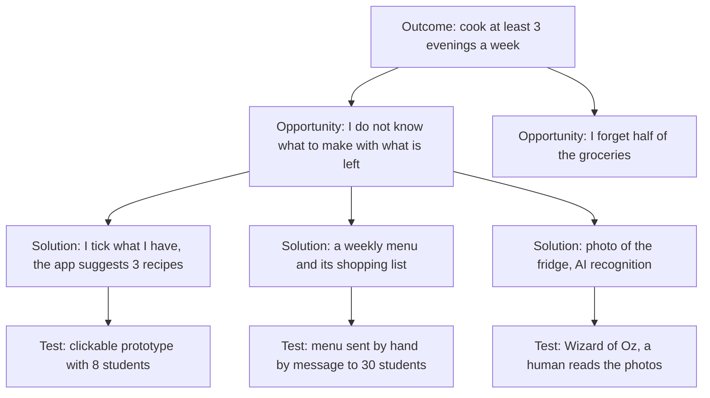
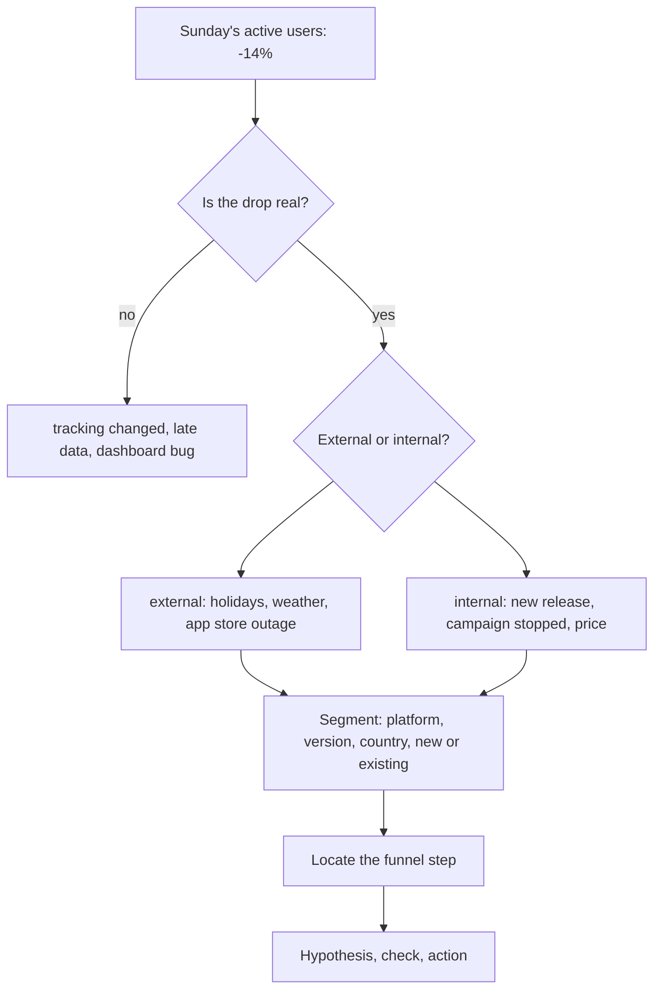
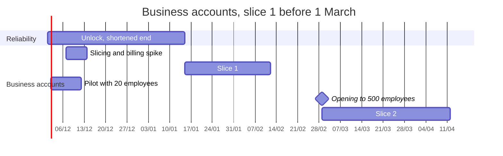

# Product Manager interview: the exercises

!!! warning "Disclaimer"
    These notes are personal cheat sheets, not a source of truth. They reflect my own understanding and choices: their content remains subjective, despite the quotes and references it contains. It may be incomplete, simplified, inaccurate or outdated. Always check the official documentation before applying it. This content is provided as is, without any warranty: you use it at your own risk.

!!! audience "Who and what for"
    - **Roles**: product manager, product owner, product designer or tech lead moving towards product, product analyst.
    - **Uses**: I practise a live case study, like "design an app for..."; I want a reference answer to diagnose a metric drop, with the SQL query; I redo a RICE ranking by hand to see its limits; I check with the final checklist that my answer forgets neither the segment nor the measurement.

This page gathers case studies with detailed worked answers. It complements [Product Manager interview: the questions](questions.md). There is no single right answer: what I have here are **concrete reference answers** (prioritisation tables, queries, calculations, framing documents) and an oral phrasing.

The PM job is tested mostly out loud: the interviewer gives a short statement and watches how I structure, what I ask, what I choose and how I measure. Some interviews add a written exercise (a one-pager, a PR/FAQ) or a data exercise (a query, an A/B test calculation). The apps `recipe-app` (cooking recipes) and `bike-app` (bike rental), the people (ada the PM, grace the designer, alan the tech lead, katherine the sales director) and all numbers are made up.

## How to use these exercises

In an interview, the interviewer mostly watches **how** I reason, not only where I land. For each exercise:

1. I read the statement without looking at the answer.
2. **I ask two or three questions before answering**: "what is the goal for the company?", "which users?", "which time constraint?". This shows I start from the problem, not from a feature.
3. **I announce my structure** in one sentence, then follow it: the interviewer can follow me and steer me.
4. **I choose**: a segment, an opportunity, a solution, a metric. Covering everything means deciding nothing.
5. I end with how I measure success, a guardrail and the limit of my choice.
6. **I tie it to a lived example**: "in my current job, I removed a feature used by...". The answers are theoretical; my own experience with numbers is what makes the difference.

Queries are in SQL (PostgreSQL), the statistical calculation in Python with no external library, acceptance criteria in Gherkin. The numbers are examples, to replace with those of the real case.

## Exercise 1. Design an app that helps students cook

### Statement

"A company wants to launch an app that helps students cook. Design the product. You have 25 minutes."

### Expected answer

#### Questions I ask first

- What is the goal for the company: gaining users, revenue, or a public health aim? The choice of metric depends on it.
- Are we starting from scratch, or does the company already have a recipe product (`recipe-app`)?
- Is there a constraint: a country, a budget, a date like the start of the university year?

Assumed interviewer answer: a new offer of `recipe-app`, in France, engagement goal first, possible launch at the start of the university year.

#### How I start

Avoid: describing screens from the first minute. The interviewer knows neither for whom nor why, and I can no longer defend my choices.

``` { .text .ex-bad title="Avoid" }
"So, there would be a home screen with recipes of the day, an AI fridge scanner,
 a chat between students, weekly challenges and a dark mode."
```

Good: I announce the structure, then follow it.

``` { .text .ex-good title="Recommended" }
"I will pick a segment, list its needs, prioritise one, propose three solutions,
 pick one, then say how I measure success and what could prove me wrong."
```

#### 1. Pick a segment

Students are not a uniform group. I list a few segments, then pick one:

| Segment | Situation | Estimated size | Pain |
|---|---|---|---|
| first year, first home alone | rarely cooks, tight budget, little equipment | large | strong: eats badly and expensively |
| students in a shared flat | sometimes cook together, share groceries | medium | medium: coordination |
| students who already cook well | look for new ideas | small | low: they already have solutions |
| student athletes | track their intake | small | medium, but served by existing apps |

I pick **first-year students in their first home alone**: the segment is large, the pain strong and recurring (every evening), and the habit forms at that moment. I say what I leave aside: shared flats, which I could serve later.

#### 2. List the needs

I phrase needs as situations, in the spirit of <span class="term" data-term="jobs-to-be-done">jobs to be done</span>, not as features:

| Need (situation) | Frequency | Pain | What they do today |
|---|---|---|---|
| "in the evening, I do not know what to make with what is left in my fridge" | daily | strong | pasta, or a 12 € delivery |
| "I shop without a list and forget half of it" | weekly | medium | several trips to the shop |
| "I throw out food past its date" | weekly | medium | nothing |
| "I only have one hob and one pan" | every recipe | strong | recipes found online that do not work at home |

I prioritise the first need: daily, painful, and it contains the last one (limited equipment is a constraint on the answer).

#### 3. Three solutions, then a choice



| Solution | Value for the student | Effort (example) | Main risk |
|---|---|---|---|
| tick your ingredients, 3 recipes "one hob, under 20 minutes" | strong, immediate, every evening | low: filters on the existing catalogue | ingredients must be ticked by hand |
| weekly menu and shopping list | strong, but requires planning ahead | medium | first-year students rarely plan |
| fridge photo recognised by AI | spectacular | high: recognition, errors, cost per photo | recognition errors, cost |

I pick the **first solution**: it answers the daily need, builds on the existing catalogue, and I can test it in a week with a prototype. The AI photo remains a lead, to test later with a <span class="term" data-term="wizard-of-oz-test">Wizard of Oz</span> if students find typing tedious.

#### 4. The first scope

- A "what I have" screen with the 30 ingredients most common among students, ticked in two gestures.
- Three recipes suggested, filtered on the declared equipment (one hob, an oven, a microwave) and under 20 minutes.
- An "I cooked it" button, to measure and to suggest the next recipe.
- Out of scope: social network, challenges, dark mode, detailed nutrition.

#### 5. Measuring success

| Role | Metric | Baseline and target (example) |
|---|---|---|
| main metric | share of new student sign-ups who mark 3 recipes "cooked" in their first 14 days | unknown at first: I measure it in the pilot, then aim at +5 points the next quarter |
| <span class="term" data-term="input-metric">input metric</span> | share of evenings where the "what I have" screen leads to an opened recipe | 40% |
| <span class="term" data-term="guardrail-metric">guardrail</span> | rating of suggested recipes after cooking | not below 4 out of 5 |

#### 6. Risks and limit of my choice

- Students might not tick their ingredients: I check it in the prototype by measuring typing time.
- The "I cooked it" button underestimates real usage (people forget to tap it): I cross it with interviews.
- A first-year segment renews every year: retention into the following year will say whether the habit sticks.

#### What a PM adds

- A **decision date** for the test: "if fewer than 5 students out of 8 find a recipe in under a minute in the prototype, I change solution".
- The **go-to-market** from the start: the cheapest channel to reach first-year students, like student associations at the start of the year.

#### Possible oral answer

> "I pick first-year students living alone for the first time: the need is daily and the habit forms now. Their main pain is not knowing what to cook with what they have, with a single hob. I considered a weekly menu and an AI fridge photo, but I start with a simple solution: I tick what I have, the app suggests three recipes under 20 minutes. I test it in a week with a prototype. I measure the share of new sign-ups who cook three recipes in 14 days, with recipe ratings as a guardrail. My limit: if typing ingredients is too tedious, I move to the photo, tested by hand first."

**Read next**: [Jobs to be done](../../knowledge/culture-entreprise.md#jobs-to-be-done), [Continuous discovery and the opportunity solution tree](../../knowledge/product-management.md#continuous-discovery-and-the-opportunity-solution-tree), [Prototypes and tests](../../knowledge/product-management.md#prototypes-and-tests-fake-door-concierge-wizard-of-oz), [The four risks](../../knowledge/product-management.md#the-four-risks), [North Star and metric tree](../../knowledge/product-management.md#north-star-and-metric-tree)

## Exercise 2. Diagnose a drop in active users

### Statement

On Monday 16 November, the `recipe-app` dashboard shows: Sunday's active users down 14%. I have an `events` table (`user_id`, `event_name`, `event_time`, `platform`, `app_version`). I say how I investigate, write the queries and propose an action.

### Expected answer

#### Questions I ask first

- How is "active" defined: an app open, or an opened recipe?
- Is the drop compared with the previous day or with the same weekday the week before?
- What changed recently: a release, a campaign, a price, the tracking?

#### 1. Follow a diagnosis tree



#### 2. Check the drop is real, with the right query

Avoid: counting events from one day to the next. A person who opens ten recipes counts ten times, and Sunday is compared with Saturday, while usage depends on the day of the week.

``` { .sql .ex-bad title="Avoid" }
-- Avoid: events, not people, and Sunday compared with Saturday
SELECT DATE(event_time) AS day, COUNT(*) AS events
FROM events
WHERE event_time >= CURRENT_DATE - INTERVAL '2 days'
GROUP BY 1
ORDER BY 1;
```

Good: distinct users, per platform, compared with the average of the four previous same weekdays.

``` { .sql .ex-good title="Recommended" }
-- Good: distinct users per day and per platform, over 29 days
WITH daily AS (
    SELECT
        DATE(event_time) AS day,
        platform,
        COUNT(DISTINCT user_id) AS active_users
    FROM events
    WHERE event_name = 'recipe_opened'
      AND event_time >= CURRENT_DATE - INTERVAL '29 days'
      AND event_time < CURRENT_DATE
    GROUP BY 1, 2
)
-- Good: yesterday compared with the four previous same weekdays
SELECT
    today.platform,
    today.active_users,
    ROUND(AVG(past.active_users)) AS same_weekday_avg,
    ROUND(
        100.0 * (today.active_users - AVG(past.active_users)) / AVG(past.active_users),
        1
    ) AS change_pct
FROM daily AS today
JOIN daily AS past
  ON past.platform = today.platform
 AND past.day IN (today.day - 7, today.day - 14, today.day - 21, today.day - 28)
WHERE today.day = CURRENT_DATE - 1
GROUP BY today.platform, today.active_users
ORDER BY change_pct;
```

Result (example):

``` { .text .ex-illus title="Illustration" }
platform  active_users  same_weekday_avg  change_pct
android         33,000            44,200       -25.3
ios             30,100            30,300        -0.7
web              6,300             6,250        +0.8
```

The drop is real (all three platforms have data, web and iOS are stable) and concentrated on Android. As Android weighs about 55% of active users, its -25% alone explains the -14% overall.

#### 3. Rule out external causes

- No school holidays or public holiday that differs from the four previous Sundays.
- An external cause (weather, a festival) would affect every platform: it does not.
- The Android app store reported no outage (to check on its status page).

#### 4. Segment by version and locate the step

Version 5.0 of the Android app shipped on Thursday, in a staged rollout in the app store.

``` { .sql .ex-good title="Recommended" }
-- Good: the login funnel per version, on Android, since release 5.0
SELECT
    app_version,
    COUNT(DISTINCT user_id) FILTER (WHERE event_name = 'app_opened') AS opened,
    COUNT(DISTINCT user_id) FILTER (WHERE event_name = 'login_succeeded') AS logged_in,
    ROUND(
        100.0 * COUNT(DISTINCT user_id) FILTER (WHERE event_name = 'login_succeeded')
        / NULLIF(COUNT(DISTINCT user_id) FILTER (WHERE event_name = 'app_opened'), 0),
        1
    ) AS login_rate_pct
FROM events
WHERE platform = 'android'
  AND event_time >= DATE '2026-11-12'
GROUP BY app_version
ORDER BY app_version;
```

| Step, Android, Sunday (example) | Average of 4 Sundays | Sunday 15 | Version 4.9 only | Version 5.0 only |
|---|---|---|---|---|
| app opened | 60,000 | 59,000 | 29,000 | 30,000 |
| login succeeded | 55,200 (92%) | 41,300 (70%) | 26,700 (92%) | 14,600 (49%) |
| recipe opened | 44,200 (80%) | 33,000 (80%) | 21,400 (80%) | 11,600 (79%) |

The loss is entirely at the "login" step, and only on version 5.0. Once logged in, users open recipes as before: this is not a rejection of the product, it is a technical block.

#### 5. Hypothesis and check

Hypothesis: 5.0 logs users out on update, and the login link sent by email opens the browser instead of the app on Android, because the file that associates the domain with the app (`assetlinks.json`) was not updated with the new signing key. Alan checks it in ten minutes on a test phone: the link does open the browser.

#### 6. Action and communication

1. Halt the staged rollout of 5.0 in the app store, so no other users are affected.
2. Fix the domain association file, without a new app version.
3. Send blocked users an in-app message with a six-digit login code as a fallback.
4. Add an end-to-end test of the login link on Android to the release CI, and an alert on the login rate per version.
5. Write a short message to stakeholders: what happened, who is affected, what is being done, when the number should recover.

#### Pitfalls to point out

| Pitfall | Consequence | Fix |
|---|---|---|
| comparing with the previous day | a Sunday compared with a Saturday always looks abnormal | same weekday, four-week average |
| counting events | a tracking change or a few heavy users move the number | distinct users |
| concluding on the average | a strong drop in one segment is diluted in the total | segment before concluding |
| stopping at the first plausible cause | "it is the weather", and the bug stays in production | look for proof in the segments |

<span class="term" data-term="simpson-paradox">Simpson's paradox</span> also reminds me that a total can drop while every segment goes up, when the weight of the segments changes: I always look at the segments and their weight.

#### What a PM adds

- An **alert** on the login rate per platform and per version, so this kind of drop is no longer discovered on Monday.
- A **blameless review** of the incident, and one line added to the release checklist.

#### Possible oral answer

> "I first check the drop is real, with distinct users and a comparison with the same weekday. It is, and it comes only from Android. No external cause: it would hit every platform. Segmenting by version, I see only 5.0 loses users, at the login step. The hypothesis, a login link that opens the browser, is checked in ten minutes. I halt the rollout, we fix it, we help blocked users, and I add an alert per version."

**Read next**: [Investigating a metric drop](../../knowledge/product-management.md#investigating-a-metric-drop), [Funnel and activation](../../knowledge/product-management.md#funnel-and-activation), [Progressive deployment](../../knowledge/livraison.md#progressive-deployment), [Deciding with data](../../knowledge/donnees-decision.md#deciding-with-data)

## Exercise 3. Prioritize a backlog of eight items with RICE

### Statement

The `recipe-app` quarterly goal: "the share of new sign-ups who cook 2 recipes in their first 14 days goes from 22% to 30%". The team has five developers, about 15 person-months over the quarter. Eight requests are on the table. I rank them with RICE, then critique the result and propose the quarter's plan.

### Expected answer

#### Questions I ask first

- Does any of these requests have an imposed date (contract, law, partner)?
- How many new sign-ups per quarter, and how many active users?
- What are the estimated impacts based on: data, a test, or intuition?

#### 1. The calculation

The <span class="term" data-term="rice-score">RICE score</span> is reach × impact × confidence ÷ effort. Reach: people affected per quarter. Impact: 3 massive, 2 high, 1 medium, 0.5 low, 0.25 minimal. Effort: person-months.

| Request | Reach | Impact | Confidence | Effort | RICE score |
|---|---|---|---|---|---|
| "ready in 15 minutes" filter | 25,000 | 1 | 80% | 0.5 | 40,000 |
| shopping list generated from a recipe | 30,000 | 2 | 80% | 3 | 16,000 |
| dark mode | 60,000 | 0.25 | 100% | 1 | 15,000 |
| "pick 3 tastes" onboarding for new sign-ups | 12,000 | 2 | 50% | 1 | 12,000 |
| AI-generated recipes from the fridge | 20,000 | 3 | 50% | 6 | 5,000 |
| new API format required by the ingredient delivery partner before 1 March | 5,000 | 1 | 100% | 2 | 2,500 |
| offline mode | 15,000 | 1 | 80% | 5 | 2,400 |
| import recipes from a website | 8,000 | 1 | 50% | 4 | 1,000 |

Example numbers. First row: 25,000 × 1 × 0.8 ÷ 0.5 = 40,000.

#### 2. Critique the ranking

- **The reaches do not measure the same population.** The "3 tastes" onboarding only affects the quarter's 12,000 new sign-ups, which is exactly the goal's population. Dark mode affects 60,000 people, but none in a way that helps the goal.
- **Dark mode is third** because it is small, broad and safe: RICE favours that profile. It does not move the target outcome.
- **The partner request has a date**: without the new format before 1 March, ingredient delivery stops. Its <span class="term" data-term="cost-of-delay">cost of delay</span> is huge, its RICE score does not see it. It goes first, outside the ranking.
- **50% confidence calls for a test, not a refusal.** The "3 tastes" onboarding and the AI recipes are bets with a possibly high impact: I test the onboarding fast (one week of effort), and I test the AI with a <span class="term" data-term="fake-door-test">fake door</span> before six person-months.
- **The impacts are one person's estimates.** I get the trio to score them separately, and I look at the gaps.

#### 3. The quarter's plan

| Order | Request | Effort | Why |
|---|---|---|---|
| 1 | partner API | 2 | imposed date, high cost of delay |
| 2 | "ready in 15 minutes" filter | 0.5 | serves the goal, small, decent confidence |
| 3 | "3 tastes" onboarding, as an A/B test | 1 | targets exactly new sign-ups; the test removes the uncertainty |
| 4 | generated shopping list | 3 | serves the goal (sign-ups cook what they bought) |
| 5 | "recipe from my fridge" fake door | 0.5 | measures demand before 6 person-months |
| reserve | technical debt and the unexpected | 3 | about 20% of capacity |
| | **total** | **10** | 5 person-months of slack for what the tests reveal |

Not this quarter, and I write it down: dark mode, offline mode, recipe import. I note who asked for them and the condition for reconsidering (for example, "offline mode comes back if negative reviews about the underground exceed 5% of reviews").

#### What a PM adds

- I **publish the table**, refusals included, so everyone sees the reasoning and can challenge an assumption rather than the decision.
- At the end of the quarter, I **compare estimated and measured impact** of the shipped bets, and recalibrate the impact scale.

#### Possible oral answer

> "I compute RICE to make the assumptions visible, but I do not stop at the score. Dark mode is third although it does not serve the goal; the partner request is second to last although its date is imposed. So I take dated obligations out of the ranking, keep what serves new sign-ups' second recipe, and turn uncertain bets into tests: an A/B test for the onboarding, a fake door for the AI. I keep 20% for debt, and I write what we do not do, with the condition that would change our mind."

**Read next**: [RICE](../../knowledge/product-management.md#rice), [WSJF and cost of delay](../../knowledge/product-management.md#wsjf-and-cost-of-delay), [Which method, and when it fails](../../knowledge/product-management.md#which-method-and-when-it-fails), [Saying no](../../knowledge/product-management.md#saying-no), [Cost of delay](../../knowledge/culture-entreprise.md#cost-of-delay)

## Exercise 4. Define the success metrics of a feature

### Statement

`recipe-app` is about to launch the **shopping list generated from a recipe**: a button on each recipe adds its ingredients to a list, sorted by aisle. I define how we will know whether it is a success: main metric, input metrics, guardrails, tracking plan, target and decision.

### Expected answer

#### Questions I ask first

- Which team outcome must the feature serve? Here, new sign-ups' second cooked dish.
- Will the feature ship behind a feature flag, with a possible control group?
- Which events are already tracked today?

#### 1. Start from the expected behaviour

The feature is worthless if people create lists without cooking. The target behaviour: **I add a recipe to my list, I do my shopping, I cook it**.

Avoid: a volume metric. It rises with duplicates and trials, and does not say whether anyone cooked: it is a <span class="term" data-term="vanity-metric">vanity metric</span>.

``` { .sql .ex-bad title="Avoid" }
-- Avoid: a count of lists, which rises with duplicates and does not say whether anyone cooked
SELECT COUNT(*) AS lists_created
FROM shopping_lists
WHERE created_at >= DATE '2026-11-02';
```

Good: the share of users who create a list then cook the recipe within 7 days.

``` { .sql .ex-good title="Recommended" }
-- Good: one row per user and recipe, at the first list created
WITH lists AS (
    SELECT user_id, recipe_id, MIN(created_at) AS list_at
    FROM shopping_lists
    WHERE created_at >= DATE '2026-11-02'
      AND created_at < DATE '2026-11-30'
    GROUP BY user_id, recipe_id
),
-- Good: the listed recipe is cooked within the next 7 days
cooked AS (
    SELECT DISTINCT l.user_id
    FROM lists AS l
    JOIN recipe_cooked AS c
      ON c.user_id = l.user_id
     AND c.recipe_id = l.recipe_id
     AND c.cooked_at BETWEEN l.list_at AND l.list_at + INTERVAL '7 days'
)
-- Good: a rate, with its denominator visible
SELECT
    COUNT(DISTINCT l.user_id) AS users_with_list,
    COUNT(DISTINCT c.user_id) AS users_who_cooked,
    ROUND(100.0 * COUNT(DISTINCT c.user_id) / COUNT(DISTINCT l.user_id), 1) AS list_to_cook_pct
FROM lists AS l
LEFT JOIN cooked AS c ON c.user_id = l.user_id;
```

#### 2. The metrics table

I use the goals, signals, metrics approach of the <span class="term" data-term="heart-framework">HEART</span> framework, keeping only two categories: Adoption and Task success.

| Role | Metric | Baseline | Target at 8 weeks (example) |
|---|---|---|---|
| main (outcome) | share of new sign-ups who cook 2 recipes in 14 days | 22% | 25% |
| adoption | share of exposed active users who create at least one list in 30 days | 0% | 20% |
| task success | share of lists followed by a recipe cooked within 7 days | unknown | 35% |
| guardrail | median duration of a recipe session | 4 min 10 s | not down by more than 10% |
| guardrail | support tickets about lists | 0 | fewer than 20 a week |

Why this guardrail: if the list button pulls people away from the recipe (they add and leave), sessions get shorter and cooking drops.

#### 3. The tracking plan

The <span class="term" data-term="tracking-plan">tracking plan</span> lists the events needed, written before development and checked in the definition of done:

| Event | When | Properties |
|---|---|---|
| `shopping_list_item_added` | the user adds a recipe to their list | `recipe_id`, `source` (recipe page, suggestion), `items_count` |
| `shopping_list_opened` | they open their list | `items_count`, `items_checked` |
| `shopping_list_item_checked` | they tick an ingredient in the shop | `aisle` |
| `recipe_cooked` | they tap "I cooked it" | `recipe_id`, `from_list` (true or false) |

No free-text product name or address: the list needs no personal data to be measured.

#### 4. Write the decision before launch

``` { .text .ex-illus title="Illustration" }
Reading          8 weeks after opening to 50% of users (control group: the other 50%)
If               cooking at 14 days +2 points or more, guardrails within thresholds: open to 100%
If               strong adoption but cooking flat: interviews with 8 users, then a new iteration
If               adoption under 5%: the feature is removed, the lesson written down
(example numbers)
```

#### What a PM adds

- An **8-week review** booked in the calendar at launch, with the same query.
- A **written definition** of each metric ("active", "cooked") in a shared dictionary, so the measurement does not change along the way.

#### Possible oral answer

> "I do not count lists created: that always goes up. I measure the target behaviour, a list followed by a recipe cooked within the week, and the team's outcome, new sign-ups' second dish. I add a guardrail, recipe session duration, in case the button makes people leave. I write the tracking plan before development, the target, the reading date and the decision I will take in each case, with a control group thanks to the flag."

**Read next**: [HEART](../../knowledge/product-management.md#heart), [Guardrail metrics](../../knowledge/product-management.md#guardrail-metrics), [Outcomes over outputs](../../knowledge/product-management.md#outcomes-over-outputs), [Definition of done](../../knowledge/product-management.md#definition-of-done), [Avoiding the Goodhart trap](../../knowledge/culture-entreprise.md#avoiding-the-goodhart-trap)

## Exercise 5. Read the result of an A/B test

### Statement

For two weeks, `recipe-app` tested a new "tonight's idea" card on the home screen, with existing users, split 50/50. Main metric: the share of users who cook at least one recipe in the week. Guardrail: the share who switch off notifications, threshold written beforehand: no more than +0.5 point. The experimentation tool shows the two-week average: 20.0% for A, 21.6% for B, "+8% cooks, significant". The manager wants to roll it out. I read the result.

| | A (without the card) | B (with the card) |
|---|---|---|
| users assigned | 20,000 | 20,150 |
| cooked, week 1 | 3,980 | 4,513 |
| cooked, week 2 | 4,020 | 4,191 |
| switched off notifications | 600 | 665 |

### Expected answer

#### Questions I ask first

- Were the sample size and duration fixed beforehand? Was the test looked at and stopped midway?
- Are the users regulars or new sign-ups? A <span class="term" data-term="novelty-effect">novelty effect</span> mostly affects regulars.
- What minimum difference was worth the cost of the card?

#### 1. What not to do

Avoid: deciding on the average difference alone. This code rolls out as soon as B beats A, even by a hair, even by chance, and ignores the split and the guardrails.

``` { .python .ex-bad title="Avoid" }
# Avoid: B beats A, so we roll out, with no interval and no check of the split
rate_a = (3_980 + 4_020) / 2 / 20_000
rate_b = (4_513 + 4_191) / 2 / 20_150
if rate_b > rate_a:
    print(f"+{(rate_b - rate_a) / rate_a:.0%}: rolling out")
```

#### 2. Read in order: split, effect per week, guardrail

``` { .python .ex-good title="Recommended · ab_read.py" }
"""Read an A/B test result: sample ratio, confidence interval per week, guardrail."""

from math import sqrt
from statistics import NormalDist

Z_95 = NormalDist().inv_cdf(0.975)
GUARDRAIL_MAX_INCREASE = 0.005


# Good: the sample ratio is checked before reading the effect
def srm_p_value(n_a: int, n_b: int, expected_share_a: float = 0.5) -> float:
    """Return the p-value of a chi-squared test (1 degree of freedom) on the group sizes."""
    total = n_a + n_b
    expected_a = total * expected_share_a
    z = (n_a - expected_a) / sqrt(total * expected_share_a * (1 - expected_share_a))
    return 2 * (1 - NormalDist().cdf(abs(z)))


# Good: a difference with its 95% interval, not a percentage alone
def diff_with_ci(n_a: int, x_a: int, n_b: int, x_b: int) -> tuple[float, float, float]:
    """Return the difference B minus A in points, with its 95% confidence interval."""
    p_a, p_b = x_a / n_a, x_b / n_b
    se = sqrt(p_a * (1 - p_a) / n_a + p_b * (1 - p_b) / n_b)
    diff = p_b - p_a
    return 100 * diff, 100 * (diff - Z_95 * se), 100 * (diff + Z_95 * se)


# Good: each week is read separately, to spot a novelty effect
def report() -> None:
    """Print the checks in the order they must be read."""
    n_a, n_b = 20_000, 20_150
    print(f"split: p = {srm_p_value(n_a, n_b):.2f}")
    weeks = {"week 1": (3_980, 4_513), "week 2": (4_020, 4_191)}
    for label, (x_a, x_b) in weeks.items():
        diff, low, high = diff_with_ci(n_a, x_a, n_b, x_b)
        print(f"{label}: {diff:+.2f} points, interval {low:+.2f} to {high:+.2f}")
    diff, low, high = diff_with_ci(n_a, 600, n_b, 665)
    ok = high / 100 <= GUARDRAIL_MAX_INCREASE
    print(f"notifications guardrail: {diff:+.2f} points, upper bound {high:+.2f}, ok={ok}")


if __name__ == "__main__":
    report()
```

Script output:

``` { .text .ex-illus title="Illustration" }
split: p = 0.45
week 1: +2.50 points, interval +1.70 to +3.30
week 2: +0.70 points, interval -0.09 to +1.49
notifications guardrail: +0.30 points, upper bound +0.64, ok=False
```

[Take with caution: intervals computed with the normal approximation for two proportions; an experimentation tool may give slightly different values.]

#### 3. Interpret

| Check | Reading | Consequence |
|---|---|---|
| split | 20,000 against 20,150, p = 0.45: no <span class="term" data-term="sample-ratio-mismatch">sample ratio mismatch</span> | I can read on |
| week 1 | +2.5 points, <span class="term" data-term="confidence-interval">confidence interval</span> from +1.7 to +3.3 | clear effect in the first week |
| week 2 | +0.7 point, interval from -0.1 to +1.5 | the interval contains 0: the effect has melted |
| trend | the difference is divided by more than three in one week, on regulars | likely signature of a novelty effect |
| guardrail | +0.3 point estimated, but the upper bound (+0.6) exceeds the threshold (+0.5) | I cannot rule out a degradation beyond the threshold |

The tool's "+8% significant" is true for the average, but it hides what matters: the lasting effect, the second week's, is not demonstrated, and the guardrail is not reassuring yet.

#### 4. Decide

- I do not roll out now. I extend the test by two weeks, changing nothing, as the "decreasing effect" case would have said had it been written down.
- If the difference in weeks 3 and 4 settles above +0.5 point with an interval that excludes 0, and the guardrail passes, I roll out.
- I may keep a small <span class="term" data-term="holdout-group">permanent holdout group</span> (5%) to measure the effect over three months.
- I do not dig into segments to "find" the one where it works: with twenty segments tested, one comes out by chance.

#### What a PM adds

- For the next tests, I write **beforehand** the duration, the size, the minimum useful difference and the decision for each case, "decreasing effect" included.
- I explain it to the manager in one sentence, without jargon: "the card catches the eye in the first week, but we do not know yet whether it makes people cook more over time".

#### Possible oral answer

> "I first check the split: 20,000 against 20,150, compatible with chance. Then I read the difference week by week, with its interval: +2.5 points the first week, +0.7 the second with an interval that contains zero. On regular users, that is the signature of a novelty effect. The guardrail is not safe yet either. I extend by two weeks before deciding, and I keep a small holdout group if we roll out."

**Read next**: [Experimenting with an A/B test](../../knowledge/product-management.md#experimenting-with-an-ab-test), [A/B testing](../../knowledge/donnees-decision.md#ab-testing), [Guardrail metrics](../../knowledge/product-management.md#guardrail-metrics)

## Exercise 6. Estimate a market and the economics of a subscription

### Statement

`recipe-app` is free. Leadership is considering a "premium" subscription at 4 € a month in France (weekly menus, unlimited shopping lists, no ads). I answer two questions, out loud and without a computer: how much revenue can we expect within three years, and do the economics of one subscriber hold?

### Expected answer

#### Questions I ask first

- How many monthly active users do we have in France today?
- Do subscriptions go through the app stores (and their commission)?
- What acquisition cost do we see today for a user?

Assumed answer: 1.2 million monthly active users, subscriptions through the stores, no acquisition cost yet for a paying subscriber.

#### 1. A Fermi warm-up

I set an order of magnitude with a <span class="term" data-term="fermi-estimate">Fermi estimate</span>, to check my numbers later:

``` { .text .ex-illus title="Illustration" }
How many dinners are cooked at home every evening in France?
households                                       about 30 million (order of magnitude, to check)
share of households cooking on a given evening   × 60%    = 18 million dinners
of which look for a recipe idea that evening     × 10%    = 1.8 million searches an evening
check: our million monthly active users is a small share of that need, consistent
(example assumptions, to say out loud)
```

#### 2. Market size, bottom-up

I compute <span class="term" data-term="tam-sam-som">TAM, SAM and SOM</span> from people I can count, not from a "cooking market" seen from above.

``` { .text .ex-illus title="Illustration" }
TAM  households cooking at least 4 evenings a week      30 M × 60%      = 18 M households
SAM  of which use a recipe app every month                       × 20%   = 3.6 M
     value if all paid: 3.6 M × 48 € a year                              ≈ 173 M€ a year
SOM  paying share reachable in 3 years                           × 3%    = 108,000 subscribers
     revenue: 108,000 × 48 €                                             ≈ 5.2 M€ a year
check: 108,000 subscribers = 9% of our current 1.2 M active users
(example numbers)
```

The 3% rate is the most fragile assumption: free-to-paid conversion rates quoted in specialised articles range from 1 to 10% depending on the product [Take with caution: ranges from blogs and tool vendors, with no published study, very variable]. So I give a range: from 1.7 M€ (1%) to 8.6 M€ (5%) a year.

#### 3. The economics of one subscriber

``` { .text .ex-illus title="Illustration" }
revenue per subscriber         4 € a month
margin after store commission and service costs   × 70%   = 2.80 € a month
assumed monthly churn          6%: average lifetime = 1 ÷ 0.06 ≈ 16.7 months
LTV                            2.80 × 16.7                           ≈ 47 €
CAC paid in advertising (assumption)                                 20 €
LTV ÷ CAC                      ≈ 2.3
payback period                 20 ÷ 2.80                             ≈ 7 months
(example numbers)
```

A <span class="term" data-term="customer-lifetime-value">customer lifetime value</span> of 47 € for an <span class="term" data-term="customer-acquisition-cost">acquisition cost</span> of 20 € gives a ratio of 2.3, under the widespread rule of 3 [Take with caution: an investors' rule of thumb, with no published study]. Conclusion: the subscription holds if it is sold mostly to our current users (acquisition cost close to zero) and not through paid advertising, and if churn drops below 5%.

#### 4. What I recommend

1. No decision on this calculation alone: every line is an assumption.
2. A price test before building: a "Go premium" <span class="term" data-term="fake-door-test">fake door</span> for 10% of active users, with two prices (3 € and 5 €), for two weeks.
3. Criterion written beforehand: at least 2% of exposed users click on the higher price, otherwise I rework the offer.
4. Weekly menus are the core value of the offer: I test their free usage first.

#### What a PM adds

- A **sensitivity table**: three-year revenue by conversion rate (1, 3, 5%) and churn (4, 6, 8%), to show which assumptions matter most.
- The **risk for the free product**: moving shopping lists to premium may lower engagement of non-payers, measured as a guardrail.

#### Possible oral answer

> "I start from households that cook, then from those using a recipe app: about 3.6 million. With 3% paying within three years, we aim at about 5 million euros a year, between 2 and 9 depending on the rate, which is the most fragile assumption. A subscriber brings in about 47 € of margin over their lifetime: that cannot carry paid acquisition at 20 €, so we sell to our current users first. Before building, I test two prices with a fake door, with a written criterion."

**Read next**: [TAM, SAM, SOM](../../knowledge/product-management.md#market-size-tam-sam-som), [Estimating an order of magnitude](../../knowledge/product-management.md#estimating-an-order-of-magnitude), [LTV and CAC](../../knowledge/product-management.md#customer-value-and-acquisition-cost-ltv-and-cac), [Pricing basics](../../knowledge/product-management.md#pricing-basics)

## Exercise 7. Write a PR/FAQ for a new offer

### Statement

"You have 30 minutes to write the document that will let `bike-app` leadership decide whether the team explores a **family subscription** (up to four riders, teenagers included)." I pick the format, write it and say what I expect from it.

### Expected answer

#### Questions I ask first

- Which decision must leadership take: start six weeks of discovery, or fund development?
- What do we already know: support requests, account sharing observed, age data?
- Is there a legal constraint for minors (minimum age, parental consent)?

#### The format

I pick a <span class="term" data-term="pr-faq">PR/FAQ</span> (Colin Bryar and Bill Carr, "Working Backwards", 2021): a press release for launch day, then an FAQ. It forces me to explain the benefit in simple words, and the internal FAQ brings the awkward questions out early. For a shorter decision, a <span class="term" data-term="one-pager">one-pager</span> would do.

#### Avoid

The following document is a feature list: leadership knows neither for whom, nor why now, nor what remains to prove, so it can only decide on intuition.

``` { .markdown .ex-bad title="Avoid" }
# Family subscription
- 4 accounts linked to one payer
- parent dashboard
- speed limit for teenagers
- price: 30 € a month
- launch in March
```

#### Recommended

The PR/FAQ starts from the customer, says what we know and what we do not, and ends with the expected decision.

``` { .markdown .ex-good title="Recommended" }
# bike-app launches the family subscription: the whole family rides on one subscription

**Fictitious city, spring.** Parents who share one account with their children today
can link up to three riders to their subscription, teenagers included.

**The problem.** A family of four pays four subscriptions, or shares one account:
one bike at a time, and the parent gets the bills without knowing who rode.

**The solution.** One subscription, four riders. Each unlocks their bike with their phone.
The parent sees the family's rides and sets a monthly spending limit.

**Customer quote (fictitious).** "My son cycles to school and I no longer pay upfront."

**Getting started.** In the app, Profile, Family, Invite.

## Customer FAQ
- Can my child ride alone? From the minimum age set by the city's rules (to check).
- What if two members want a bike at the same station? Each unlocks their own.

## Internal FAQ
- What do we know? 6% of accounts unlock two bikes within 5 minutes at the same station.
- What do we not know? The price that moves people from two individual subscriptions to a family one.
- Which risk? Cannibalisation: couples who paid two subscriptions pay less.
- Legal? Parental consent and minors' data: legal opinion before any discovery.
- Cost? Linked accounts, shared billing: 3 to 5 person-months estimated, wide range.

## Expected decision
Fund 6 weeks of discovery (interviews with 12 families, price test through a fake door).
Decision by 15 January.

(example numbers)
```

#### What I expect from the review

- The review happens in silence at the start of the meeting, then the discussion focuses on the internal FAQ.
- If the press release excites nobody, the idea does not either: that is a useful result.
- Unanswered questions become the assumptions to test during discovery.

#### What a PM adds

- A **rewrite** after each review: a PR/FAQ often goes through several versions.
- **Sourced numbers** in the internal FAQ (query, date), so the discussion is about assumptions and not about where the numbers come from.

#### Possible oral answer

> "I write a launch-day press release and an FAQ: if the press release does not convince, neither does the idea. The part that matters is the internal FAQ: what we already know (accounts unlocking two bikes at once), what we do not know (the price), the risks (cannibalisation, minors' data) and the cost as a range. I ask for a precise decision: six weeks of discovery, not development."

**Read next**: [Working Backwards](../../knowledge/product-management.md#working-backwards-the-press-release-and-faq), [PRD and one-pager](../../knowledge/product-management.md#prd-and-one-pager), [One-pager](../../knowledge/culture-entreprise.md#one-pager), [The six-page narrative memo](../../knowledge/culture-entreprise.md#the-six-page-narrative-memo)

## Exercise 8. Arbitrate the roadmap against a demanded date

### Statement

Katherine, `bike-app` sales director, announces in a meeting: "A big (fictitious) customer signs if we have **business accounts** on 1 March: the company pays its employees' rides. I need the date today." The team is committed to unlock reliability until the end of January, and alan estimates business accounts at 10 to 14 weeks. It is 1 December. I answer.

### Expected answer

#### Questions I ask first, to katherine

- What does the customer really need on 1 March: employees riding without paying upfront, or a full management portal?
- Is 1 March in the contract, or is it the desired signing date?
- How much is the contract worth, and how many other prospects ask for the same thing?

Assumed answers: the customer wants 500 employees to ride without paying upfront; monthly billing and fine-grained management can wait; 1 March is the contract start date; two other prospects ask for it.

#### Avoid, then recommended

Avoid: giving in to the date under pressure, or refusing it without an alternative. In the first case, the date becomes a firm promise the team cannot keep; in the second, the sale goes over my head to leadership.

``` { .text .ex-bad title="Avoid" }
"Fine, we ship on 1 March." (and the team discovers the commitment the next day)
"It is not on the roadmap, we will see next quarter."
```

Good: I separate the customer's need from the full feature, give a date with its confidence and conditions, and say what slips.

``` { .text .ex-good title="Recommended" }
"On 1 March, the 500 employees can ride without paying upfront: 80% confidence,
 if the customer sends us the list of employees before 15 February.
 Automatic monthly billing and the management portal come in April.
 What it costs: unlock reliability stops mid-January instead of end of January.
 I confirm on Friday, after estimating slice 1 with the team."
```

#### 1. The options

| Option | What the customer has on 1 March | What we lose | Risk |
|---|---|---|---|
| ship everything on 1 March | everything, on paper | reliability stopped dead, tests sacrificed | missed date or bugs at a big account's start |
| add two developers from another team | everything, in theory | the other team | <span class="term" data-term="brooks-law">Brooks's law</span> (1975): newcomers slow the team down first |
| **fixed date, variable scope** | employees ride, invoices done by hand | two weeks of reliability | low, if slice 1 holds |
| refuse | nothing | the contract | losing the customer, product credibility with sales |

#### 2. Scope ranked with MoSCoW

``` { .text .ex-illus title="Illustration" }
Business accounts, contract start date: 1 March
Must    link an employee by their work email, rides paid by the company
Should  spending cap per employee
Could   automatic monthly billing (meanwhile: an export done by support)
Won't   management portal for the company (April), connection to the company directory (later)
```

#### 3. The schedule



#### What a PM adds

- A written **checkpoint** with katherine: if slice 1 is not in pilot by 20 February, I tell her that day, not on the 28th.
- A **written decision**: what is promised to the customer, what is not, and the confidence, sent to katherine, alan and leadership.

#### Possible oral answer

> "I answer neither yes nor no: I ask what the customer needs on 1 March. They want their employees to ride without paying upfront, not a full portal. So I propose a fixed date with variable scope: employees ride on 1 March, with 80% confidence and one condition, billing and the portal in April. I say what we lose, two weeks of reliability, and I refuse to add people midway. I confirm after the team's estimate, and I set a checkpoint before the date."

**Read next**: [Holding a date commitment](../../knowledge/product-management.md#holding-a-date-commitment), [MoSCoW](../../knowledge/product-management.md#moscow), [Communicating a trade-off](../../knowledge/product-management.md#communicating-a-trade-off), [Saying no](../../knowledge/product-management.md#saying-no), [Shape Up](../../knowledge/culture-entreprise.md#shape-up)

## Exercise 9. Slice an epic into stories with Gherkin criteria

### Statement

The `recipe-app` "meal planner" <span class="term" data-term="epic">epic</span>: the user picks their dinners for the week, and the app prepares the shopping list. Alan estimates it at "three months, maybe more". I slice it into stories that can ship on their own, write the acceptance criteria of the first one, and explain the order.

### Expected answer

#### Questions I ask first

- Which outcome does the epic serve? Here: more evenings cooked per week among active users.
- What already exists: is the shopping list generated from a recipe (exercise 4) in production?
- What is the smallest version that tells us whether people plan?

#### 1. The story map

I arrange the stories along the user's journey (<span class="term" data-term="story-mapping">story mapping</span>, Jeff Patton, 2008), then draw the release lines:

``` { .text .ex-illus title="Illustration" }
              Pick dinners            Adjust the menu        Do the shopping        Cook
backbone      ────────────────────    ───────────────────    ───────────────────    ────────────────
slice 1       add a recipe to a       remove a recipe        week's list grouped    evening reminder
              day of the week         from the menu          by aisle
──────────────────────────────────────────────────────────────────────────────────────────────────
slice 2       menu suggested from     replace with a         quantities adjusted    "I cooked it"
              my tastes               similar recipe         to the number of people from the menu
──────────────────────────────────────────────────────────────────────────────────────────────────
later         menu shared with        weekly budget          online order           reuse leftovers
              flatmates
```

Slice 1 forms a complete journey, even a minimal one: it tells us whether people plan and cook what they planned.

#### 2. The stories of slice 1

| Story | INVEST | Team estimate (example) |
|---|---|---|
| As a user who shops once a week, I want to add a recipe to a day of the week, so that I know what I cook each evening. | yes | 3 days |
| ... I want to remove a recipe from my menu, so that I can change my mind without redoing everything. | yes | 1 day |
| ... I want a weekly shopping list grouped by aisle, so that I buy everything in one trip. | yes, builds on the existing list | 4 days |
| ... I want a reminder at 6 pm with the evening's recipe, so that I do not forget what I planned. | yes | 2 days |

Each story goes through database, API and screen: these are <span class="term" data-term="vertical-slice">vertical slices</span>. Avoid: slicing by layer ("the menus table", "the menus API", "the menus screen"); none ships alone, and nothing is measurable before the last one.

#### 3. Acceptance criteria of the first story

Avoid: a scenario that describes the interface, chains several actions and does not state the expected behaviour. It breaks at every screen redesign and tests nothing precise.

``` { .gherkin .ex-bad title="Avoid" }
# Avoid: clicks and colours, several actions, no business behaviour
Feature: menu
  Scenario: add
    Given I am on the home screen
    When I click the green "Plan" button
    And I click "Tuesday"
    And I click the recipe "Lentil curry"
    Then I see an orange card
```

Good: one behaviour per scenario, concrete examples, and the edge cases found with the developer and the QA engineer.

``` { .gherkin .ex-good title="Recommended" }
# Good: the expected behaviour, independent of the screen
Feature: plan my dinners for the week
  In order to know what I cook each evening
  As a user who shops once a week
  I want to add a recipe to a day of my week

  # Good: the main case
  Scenario: an added recipe shows on the right day
    Given ada has nothing planned on Tuesday
    When she adds "Lentil curry" to Tuesday
    Then her Tuesday menu contains "Lentil curry"

  # Good: an edge case found in a workshop with the QA engineer
  Scenario: two recipes on the same evening
    Given ada has planned "Lentil curry" on Tuesday
    When she adds "Chickpea salad" to Tuesday
    Then her Tuesday menu contains both recipes

  # Good: past days cannot be changed
  Scenario: a past day cannot be planned
    Given today is Thursday
    When ada tries to add a recipe to this week's Tuesday
    Then the addition is refused with the message "this day has passed"
```

#### 4. Order and measurement

1. Add and remove a recipe, behind a feature flag, opened to 5% of active users.
2. The weekly list, which reuses the existing list.
3. The evening reminder, which is the first test of the hypothesis "planning makes people cook".
4. Reading at 4 weeks: share of menus with at least 3 recipes cooked; if under 20%, slice 2 is not started [example number].

Slice 1 fits in about two team weeks instead of three months, and it answers the question that decides what comes next.

#### What a PM adds

- The **three-person workshop** (PM, developer, QA engineer) before development, with <span class="term" data-term="example-mapping">Example Mapping</span>, to find edge cases and open questions.
- **Measurement in the definition of done**: planning and cooking events are tracked from slice 1.

#### Possible oral answer

> "I arrange the stories along the journey: pick, adjust, shop, cook. The first slice crosses the whole journey in a minimal version: add a recipe to a day, remove it, the weekly list, an evening reminder. Each story ships on its own. I write the criteria in Gherkin with the developer and the QA engineer, one behaviour per scenario, without talking about buttons. Slice 1 takes two weeks and tells me whether people cook what they plan: that is what decides slice 2."

**Read next**: [User stories and INVEST](../../knowledge/product-management.md#user-stories-and-invest), [Acceptance criteria](../../knowledge/product-management.md#acceptance-criteria), [Story mapping](../../knowledge/product-management.md#story-mapping), [Gherkin with a "Goal"](../../knowledge/conception-tests.md#gherkin-with-a-goal), [Estimating and slicing a feature](../../knowledge/culture-entreprise.md#estimating-and-slicing-a-feature)

## Preparation checklist for a live exercise

Before wrapping up an answer, I check that I covered:

- [ ] **Clarification**: did I ask one or two questions about the goal and the constraint?
- [ ] **Segment**: did I pick a precise group of users, and say why?
- [ ] **Problem**: did I describe a painful situation before the solution?
- [ ] **Options**: did I compare at least three solutions before picking one?
- [ ] **Choice and refusal**: did I say what I do and what I do not do?
- [ ] **Measurement**: main metric, guardrail, baseline, target and reading date?
- [ ] **Test**: did I propose a cheap way to check the riskiest assumption?
- [ ] **Stakeholders**: did I say whom to inform, and what it costs others?

### If I get stuck during the interview

I can say out loud:

> "I will first clarify the goal and pick a segment, then list its needs, compare three solutions and say how I would measure success."

That beats a rushed answer. For a PM, the ability to structure, choose and measure counts as much as the idea itself.

### Revision priority if I am short of time

1. Designing a product ([exercise 1](#exercise-1-design-an-app-that-helps-students-cook)).
2. Diagnosing a metric drop ([exercise 2](#exercise-2-diagnose-a-drop-in-active-users)).
3. Defining a feature's success ([exercise 4](#exercise-4-define-the-success-metrics-of-a-feature)).
4. Prioritising a backlog ([exercise 3](#exercise-3-prioritize-a-backlog-of-eight-items-with-rice)).
5. Arbitrating a demanded date ([exercise 8](#exercise-8-arbitrate-the-roadmap-against-a-demanded-date)).
6. Reading an A/B test ([exercise 5](#exercise-5-read-the-result-of-an-ab-test)).
7. Sizing a market ([exercise 6](#exercise-6-estimate-a-market-and-the-economics-of-a-subscription)).
8. Slicing an epic ([exercise 9](#exercise-9-slice-an-epic-into-stories-with-gherkin-criteria)) and writing a PR/FAQ ([exercise 7](#exercise-7-write-a-prfaq-for-a-new-offer)).

I do not recite these answers word for word. I use them as structures, then tie them to my own experience: a feature I removed, a drop I explained, a date I negotiated, with my numbers.

## Measuring success

I know my practice works when I solve a case study against the clock without forgetting the segment or the measurement, not when I have read every answer. Before starting, I write down a **baseline**: I do three exercises cold, timed and recorded, and count the checklist boxes I covered. I take **the same measure** a week later on three other exercises. The **guard metric** is the share of my answers that rest on a lived story: if it drops while my speed goes up, I am reciting the answers.

| Solution | Success indicator (<span class="term" data-term="sli">SLI</span>) | Likely <span class="term" data-term="slo">SLO</span> | Likely <span class="term" data-term="sla">SLA</span> |
|---|---|---|---|
| timed case study, out loud | minutes to reach a complete answer, measurement included | 25 minutes at most [Take with caution: example duration, depends on the interview format] | n/a: no external contract |
| checklist reread at the end of the answer | checklist boxes covered, out of 8 | at least 7 out of 8, three exercises out of three [Take with caution: example threshold] | n/a: no external contract |
| questions asked before answering | number of clarifying questions at the start | one to three in every exercise | n/a: no external contract |
| calculations by hand | share of calculations (RICE, LTV, Fermi) right the first time | four out of five [Take with caution: example value] | n/a: no external contract |
| lived story to conclude | share of exercises concluded with a lived example with numbers | 100% of the first five priorities | n/a: no external contract |

## Pitfalls to avoid

| Pitfall | What happens | Solution |
|---|---|---|
| **Describing screens straight away**: I list features as soon as the statement ends. | The interviewer sees no segment, no need, no reason for the choice. | I announce the structure, then segment, need, options ([Exercise 1](#exercise-1-design-an-app-that-helps-students-cook)). |
| **Counting events**: I compare events from one day to the next. | A tracking change or the weekday creates a fake drop. | Distinct users, same weekday, then segment ([Exercise 2](#exercise-2-diagnose-a-drop-in-active-users)). |
| **Following the score**: I ship in RICE order. | Dark mode goes ahead of a dated obligation and of what serves the goal. | The score opens the discussion, the goal and the cost of delay decide ([Exercise 3](#exercise-3-prioritize-a-backlog-of-eight-items-with-rice)). |
| **Measuring a volume**: I judge the shopping list by the number of lists created. | The number always rises and does not say whether anyone cooked. | A behaviour rate, a guardrail, a decision written beforehand ([Exercise 4](#exercise-4-define-the-success-metrics-of-a-feature)). |
| **Trusting an A/B test average**: I roll out on "+8% significant". | A novelty effect fades after launch, and the feature is useless. | Split, interval per week, guardrail ([Exercise 5](#exercise-5-read-the-result-of-an-ab-test)). |
| **A market seen from above**: "if we take 1% of the cooking market". | A huge, empty number the interviewer takes apart in one question. | Bottom-up, with a range and the most fragile assumption named ([Exercise 6](#exercise-6-estimate-a-market-and-the-economics-of-a-subscription)). |
| **Giving in on the date**: I promise everything for 1 March. | The date is missed, or kept by sacrificing tests. | Fixed date, variable scope, confidence and conditions in writing ([Exercise 8](#exercise-8-arbitrate-the-roadmap-against-a-demanded-date)). |
| **Slicing by layer**: database, then API, then screen. | Nothing ships and nothing is measurable until the end. | Vertical slices, a minimal complete journey ([Exercise 9](#exercise-9-slice-an-epic-into-stories-with-gherkin-criteria)). |
