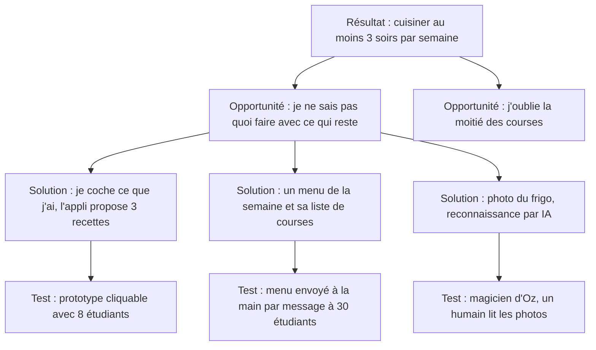
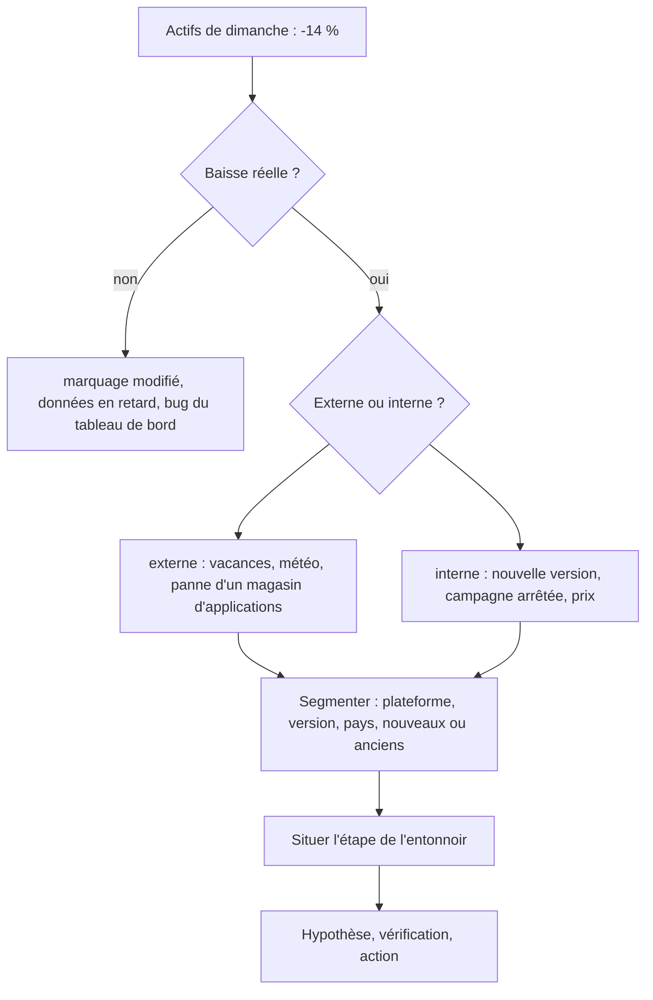
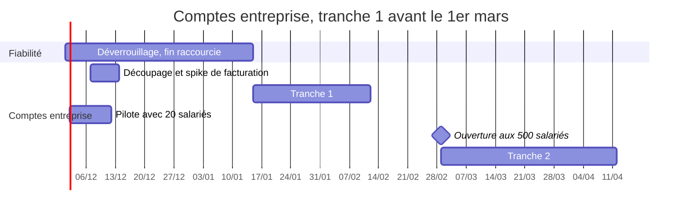

# Entretien Product Manager : les exercices

!!! warning "Avertissement"
    Ces notes sont des pense-bêtes personnels, pas une source de vérité. Elles reflètent ma compréhension et mes choix : leur contenu reste subjectif, malgré les citations et les références qu'il contient. Il peut être incomplet, simplifié, inexact ou dépassé. Vérifiez toujours dans la documentation officielle avant de l'appliquer. Ce contenu est fourni tel quel, sans aucune garantie : son utilisation se fait sous votre seule responsabilité.

!!! audience "Pour qui, pour quoi"
    - **Métiers** : product manager, product owner, product designer ou tech lead qui évolue vers le produit, analyste produit.
    - **Usages** : je m'entraîne à une étude de cas en direct, comme « concevez une application pour... » ; je veux un corrigé de référence pour diagnostiquer une baisse de métrique, avec la requête SQL ; je refais un classement RICE à la main pour en voir les limites ; je vérifie avec la grille finale que ma réponse n'oublie ni le segment ni la mesure.

Cette page rassemble des études de cas avec corrigés détaillés. Elle complète [Entretien Product Manager : les questions](questions.md). Il n'existe pas de réponse unique : je dispose ici de **réponses de référence concrètes** (tableaux de priorisation, requêtes, calculs, documents de cadrage) et d'une formulation orale.

Le métier de PM se teste surtout à l'oral : le recruteur donne un énoncé court et regarde comment je structure, ce que je demande, ce que je choisis et comment je mesure. Certains entretiens ajoutent un exercice écrit (un one-pager, un PR/FAQ) ou un exercice de données (une requête, un calcul d'A/B test). Les applications `recipe-app` (recettes de cuisine) et `bike-app` (location de vélos), les personnes (ada la PM, grace la designer, alan le tech lead, katherine la directrice commerciale) et tous les chiffres sont des exemples inventés.

## Comment utiliser ces exercices

En entretien, le recruteur regarde surtout **comment** je raisonne, pas seulement où j'arrive. Pour chaque exercice :

1. Je lis l'énoncé sans regarder le corrigé.
2. **Je pose deux ou trois questions avant de répondre** : « quel est le but pour l'entreprise ? », « quels utilisateurs ? », « quelle contrainte de temps ? ». Je montre ainsi que je pars du problème, pas d'une fonction.
3. **J'annonce ma structure** en une phrase, puis je la suis : le recruteur peut me suivre et me recadrer.
4. **Je choisis** : un segment, une opportunité, une solution, une métrique. Couvrir tout revient à ne rien décider.
5. Je termine par la mesure du succès, un garde-fou et la limite de mon choix.
6. **Je relie à un exemple vécu** : « dans mon poste actuel, j'ai retiré une fonction utilisée par... ». Les corrigés sont théoriques, c'est mon expérience chiffrée qui fait la différence.

Les requêtes sont en SQL (PostgreSQL), le calcul statistique en Python sans bibliothèque externe, les critères d'acceptation en Gherkin. Les chiffres sont des exemples, à remplacer par ceux du cas réel.

## Exercice 1. Concevoir une application pour aider les étudiants à cuisiner

### Énoncé

« Une entreprise veut lancer une application qui aide les étudiants à cuisiner. Conçois le produit. Tu as 25 minutes. »

### Corrigé attendu

#### Questions que je pose d'abord

- Quel est le but pour l'entreprise : gagner des utilisateurs, du revenu, ou un objectif de santé publique ? Le choix de la métrique en dépend.
- Partons-nous de zéro, ou l'entreprise a-t-elle déjà un produit de recettes (`recipe-app`) ?
- Y a-t-il une contrainte : un pays, un budget, une date comme la rentrée universitaire ?

Réponse supposée du recruteur : nouvelle offre de `recipe-app`, en France, but d'engagement d'abord, lancement possible à la rentrée.

#### Comment je démarre

À éviter : décrire des écrans dès la première minute. Le recruteur ne sait ni pour qui ni pourquoi, et je ne peux plus défendre mes choix.

``` { .text .ex-bad title="À éviter" }
« Alors, il y aurait un écran d'accueil avec des recettes du jour, un scanner de frigo par IA,
  un chat entre étudiants, des défis hebdomadaires et un mode sombre. »
```

Bien : j'annonce la structure, puis je la suis.

``` { .text .ex-good title="Recommandé" }
« Je vais choisir un segment, lister ses besoins, en prioriser un, proposer trois solutions,
  en choisir une, puis dire comment je mesure le succès et ce qui pourrait me faire tort. »
```

#### 1. Choisir un segment

Les étudiants ne forment pas un groupe homogène. Je liste quelques segments, puis j'en choisis un :

| Segment | Situation | Taille estimée | Douleur |
|---|---|---|---|
| première année, premier logement seul | cuisine rarement, budget serré, peu d'équipement | grande | forte : mange mal et cher |
| étudiants en colocation | cuisinent parfois à plusieurs, partagent les courses | moyenne | moyenne : coordination |
| étudiants qui cuisinent déjà bien | cherchent de nouvelles idées | petite | faible : ils ont déjà des solutions |
| étudiants sportifs | suivent leurs apports | petite | moyenne, mais servie par des applis existantes |

Je choisis **la première année en premier logement seul** : le segment est grand, la douleur forte et récurrente (chaque soir), et l'habitude se forme à ce moment. Je dis ce que je laisse de côté : la colocation, que je pourrais servir plus tard.

#### 2. Lister les besoins

Je formule les besoins comme des situations, à la manière des <span class="term" data-term="jobs-to-be-done">jobs to be done</span>, et pas comme des fonctions :

| Besoin (situation) | Fréquence | Douleur | Ce qu'ils font aujourd'hui |
|---|---|---|---|
| « le soir, je ne sais pas quoi faire avec ce qui reste dans mon frigo » | quotidienne | forte | pâtes, ou livraison à 12 € |
| « je fais mes courses sans liste et j'oublie la moitié » | hebdomadaire | moyenne | plusieurs passages au magasin |
| « je jette des produits périmés » | hebdomadaire | moyenne | rien |
| « je n'ai qu'une plaque et une casserole » | à chaque recette | forte | recettes trouvées en ligne qui ne marchent pas chez moi |

Je priorise le premier besoin : quotidien, douloureux, et il contient le dernier (l'équipement limité est une contrainte de la réponse).

#### 3. Trois solutions, puis un choix



| Solution | Valeur pour l'étudiant | Effort (exemple) | Risque principal |
|---|---|---|---|
| cocher ses ingrédients, 3 recettes « une plaque, moins de 20 minutes » | forte, immédiate, chaque soir | faible : filtres sur le catalogue existant | il faut cocher ses ingrédients à la main |
| menu de la semaine et liste de courses | forte, mais demande d'anticiper | moyen | l'étudiant de première année planifie rarement |
| photo du frigo reconnue par IA | spectaculaire | élevé : reconnaissance, erreurs, coût par photo | erreurs de reconnaissance, coût |

Je choisis la **première solution** : elle répond au besoin quotidien, elle s'appuie sur le catalogue existant, et je peux la tester en une semaine avec un prototype. La photo par IA reste une piste, à tester plus tard par un <span class="term" data-term="wizard-of-oz-test">magicien d'Oz</span> si les étudiants trouvent la saisie pénible.

#### 4. Le premier périmètre

- Un écran « ce que j'ai » avec les 30 ingrédients les plus courants chez les étudiants, cochés en deux gestes.
- Trois recettes proposées, filtrées sur l'équipement déclaré (une plaque, un four, un micro-ondes) et un temps de moins de 20 minutes.
- Un bouton « j'ai cuisiné » pour mesurer et pour proposer la recette suivante.
- Hors périmètre : réseau social, défis, mode sombre, nutrition détaillée.

#### 5. Mesurer le succès

| Rôle | Métrique | Base et cible (exemple) |
|---|---|---|
| métrique principale | part des nouveaux étudiants inscrits qui marquent 3 recettes « cuisinées » dans leurs 14 premiers jours | inconnue au départ : je la mesure sur le pilote, puis je vise +5 points au trimestre suivant |
| <span class="term" data-term="input-metric">métrique d'entrée</span> | part des soirs où l'écran « ce que j'ai » mène à une recette ouverte | 40 % |
| <span class="term" data-term="guardrail-metric">garde-fou</span> | note des recettes proposées après cuisson | pas en dessous de 4 sur 5 |

#### 6. Risques et limite de mon choix

- Les étudiants pourraient ne pas cocher leurs ingrédients : je le vérifie dans le prototype en mesurant le temps de saisie.
- Le bouton « j'ai cuisiné » sous-estime l'usage réel (on oublie de le toucher) : je le croise avec des entretiens.
- Un segment de première année se renouvelle chaque année : la rétention sur l'année suivante dira si l'habitude reste.

#### Ce qu'un PM ajoute

- Une **date de décision** pour le test : « si moins de 5 étudiants sur 8 trouvent une recette en moins d'une minute dans le prototype, je change de solution ».
- Le **go-to-market** dès le départ : le canal le moins cher pour atteindre la première année, comme les associations étudiantes à la rentrée.

#### Réponse orale possible

> « Je choisis les étudiants de première année qui vivent seuls pour la première fois : le besoin est quotidien et l'habitude se forme maintenant. Leur douleur principale, c'est de ne pas savoir quoi cuisiner avec ce qu'ils ont, avec une seule plaque. J'ai envisagé un menu de la semaine et une photo du frigo par IA, mais je commence par une solution simple : je coche ce que j'ai, l'appli propose trois recettes en moins de 20 minutes. Je la teste en une semaine avec un prototype. Je mesure la part des nouveaux inscrits qui cuisinent trois recettes en 14 jours, avec la note des recettes comme garde-fou. Ma limite : si la saisie des ingrédients est trop pénible, je passe à la photo, testée d'abord à la main. »

**À relire** : [Jobs to be done](../../knowledge/culture-entreprise.md#jobs-to-be-done), [Discovery continue et arbre d'opportunités](../../knowledge/product-management.md#discovery-continue-et-arbre-dopportunites), [Prototypes et tests](../../knowledge/product-management.md#prototypes-et-tests-fausse-porte-concierge-magicien-doz), [Les quatre risques](../../knowledge/product-management.md#les-quatre-risques), [North Star et arbre de métriques](../../knowledge/product-management.md#north-star-et-arbre-de-metriques)

## Exercice 2. Diagnostiquer une baisse d'utilisateurs actifs

### Énoncé

Lundi 16 novembre, le tableau de bord de `recipe-app` affiche : utilisateurs actifs de dimanche en baisse de 14 %. Je dispose d'une table `events` (`user_id`, `event_name`, `event_time`, `platform`, `app_version`). Je dis comment j'enquête, j'écris les requêtes et je propose une action.

### Corrigé attendu

#### Questions que je pose d'abord

- Comment « actif » est-il défini : une ouverture de l'appli, ou une recette ouverte ?
- La baisse est-elle comparée à la veille ou au même jour de la semaine précédente ?
- Qu'est-ce qui a changé récemment : une version, une campagne, un prix, le marquage ?

#### 1. Suivre un arbre de diagnostic



#### 2. Vérifier que la baisse est réelle, avec la bonne requête

À éviter : compter des événements d'un jour sur l'autre. Une personne qui ouvre dix recettes compte dix fois, et dimanche est comparé à samedi, alors que l'usage dépend du jour de la semaine.

``` { .sql .ex-bad title="À éviter" }
-- À éviter : des événements, pas des personnes, et dimanche comparé à samedi
SELECT DATE(event_time) AS day, COUNT(*) AS events
FROM events
WHERE event_time >= CURRENT_DATE - INTERVAL '2 days'
GROUP BY 1
ORDER BY 1;
```

Bien : des utilisateurs distincts, par plateforme, comparés à la moyenne des quatre mêmes jours de semaine précédents.

``` { .sql .ex-good title="Recommandé" }
-- Bien : utilisateurs distincts par jour et par plateforme, sur 29 jours
WITH daily AS (
    SELECT
        DATE(event_time) AS day,
        platform,
        COUNT(DISTINCT user_id) AS active_users
    FROM events
    WHERE event_name = 'recipe_opened'
      AND event_time >= CURRENT_DATE - INTERVAL '29 days'
      AND event_time < CURRENT_DATE
    GROUP BY 1, 2
)
-- Bien : hier comparé aux quatre mêmes jours de semaine précédents
SELECT
    today.platform,
    today.active_users,
    ROUND(AVG(past.active_users)) AS same_weekday_avg,
    ROUND(
        100.0 * (today.active_users - AVG(past.active_users)) / AVG(past.active_users),
        1
    ) AS change_pct
FROM daily AS today
JOIN daily AS past
  ON past.platform = today.platform
 AND past.day IN (today.day - 7, today.day - 14, today.day - 21, today.day - 28)
WHERE today.day = CURRENT_DATE - 1
GROUP BY today.platform, today.active_users
ORDER BY change_pct;
```

Résultat (exemple) :

``` { .text .ex-illus title="Illustration" }
platform  active_users  same_weekday_avg  change_pct
android         33 000            44 200       -25.3
ios             30 100            30 300        -0.7
web              6 300             6 250        +0.8
```

La baisse est réelle (les trois plateformes ont des données, le web et iOS sont stables) et concentrée sur Android. Comme Android pèse environ 55 % des actifs, ses -25 % expliquent à eux seuls les -14 % du total.

#### 3. Écarter les causes externes

- Pas de vacances scolaires ni de jour férié différent des quatre dimanches précédents.
- Une cause externe (météo, fête) toucherait toutes les plateformes : ce n'est pas le cas.
- Le magasin d'applications Android n'a pas signalé de panne (à vérifier sur sa page d'état).

#### 4. Segmenter par version et situer l'étape

La version 5.0 de l'appli Android est sortie jeudi, en déploiement progressif dans le magasin d'applications.

``` { .sql .ex-good title="Recommandé" }
-- Bien : l'entonnoir de connexion par version, sur Android, depuis la sortie de la 5.0
SELECT
    app_version,
    COUNT(DISTINCT user_id) FILTER (WHERE event_name = 'app_opened') AS opened,
    COUNT(DISTINCT user_id) FILTER (WHERE event_name = 'login_succeeded') AS logged_in,
    ROUND(
        100.0 * COUNT(DISTINCT user_id) FILTER (WHERE event_name = 'login_succeeded')
        / NULLIF(COUNT(DISTINCT user_id) FILTER (WHERE event_name = 'app_opened'), 0),
        1
    ) AS login_rate_pct
FROM events
WHERE platform = 'android'
  AND event_time >= DATE '2026-11-12'
GROUP BY app_version
ORDER BY app_version;
```

| Étape, Android, dimanche (exemple) | Moyenne des 4 dimanches | Dimanche 15 | Version 4.9 seule | Version 5.0 seule |
|---|---|---|---|---|
| appli ouverte | 60 000 | 59 000 | 29 000 | 30 000 |
| connexion réussie | 55 200 (92 %) | 41 300 (70 %) | 26 700 (92 %) | 14 600 (49 %) |
| recette ouverte | 44 200 (80 %) | 33 000 (80 %) | 21 400 (80 %) | 11 600 (79 %) |

La perte est entièrement à l'étape « connexion », et seulement sur la version 5.0. Une fois connectés, les utilisateurs ouvrent des recettes comme avant : ce n'est pas un rejet du produit, c'est un blocage technique.

#### 5. Hypothèse et vérification

Hypothèse : la 5.0 déconnecte les utilisateurs à la mise à jour, et le lien de connexion envoyé par e-mail ouvre le navigateur au lieu de l'appli sur Android, parce que le fichier qui associe le domaine à l'appli (`assetlinks.json`) n'a pas été mis à jour avec la nouvelle clé de signature. Alan la vérifie en dix minutes sur un téléphone de test : le lien ouvre bien le navigateur.

#### 6. Action et communication

1. Arrêter le déploiement progressif de la 5.0 dans le magasin d'applications, pour ne pas toucher d'autres utilisateurs.
2. Corriger le fichier d'association du domaine, sans nouvelle version de l'appli.
3. Envoyer aux utilisateurs bloqués un message dans l'appli avec un code de connexion à six chiffres en solution de secours.
4. Ajouter un test de bout en bout du lien de connexion sur Android à la CI de publication, et une alerte sur le taux de connexion par version.
5. Écrire un message court aux parties prenantes : ce qui s'est passé, qui est touché, ce qui est fait, quand le chiffre doit revenir.

#### Les pièges à signaler

| Piège | Conséquence | Correction |
|---|---|---|
| comparer à la veille | un dimanche comparé à un samedi semble toujours anormal | même jour de la semaine, moyenne de quatre semaines |
| compter des événements | un changement de marquage ou quelques gros utilisateurs bougent le chiffre | utilisateurs distincts |
| conclure sur la moyenne | une baisse forte d'un segment se dilue dans le total | segmenter avant de conclure |
| s'arrêter à la première cause plausible | « c'est la météo », et le bug reste en production | chercher la preuve dans les segments |

Le <span class="term" data-term="simpson-paradox">paradoxe de Simpson</span> rappelle aussi qu'un total peut baisser alors que chaque segment monte, quand la part des segments change : je regarde toujours les segments et leur poids.

#### Ce qu'un PM ajoute

- Une **alerte** sur le taux de connexion par plateforme et par version, pour ne plus découvrir ce type de baisse le lundi.
- Une **revue sans reproche** de l'incident, et une ligne ajoutée à la liste de vérification des sorties de version.

#### Réponse orale possible

> « Je vérifie d'abord que la baisse est réelle, avec des utilisateurs distincts et une comparaison au même jour de la semaine. Elle l'est, et elle vient uniquement d'Android. Pas de cause externe : elle toucherait toutes les plateformes. En segmentant par version, je vois que seule la 5.0 perd des utilisateurs, et à l'étape de connexion. L'hypothèse, un lien de connexion qui ouvre le navigateur, se vérifie en dix minutes. J'arrête le déploiement, on corrige, on aide les utilisateurs bloqués, et j'ajoute une alerte par version. »

**À relire** : [Enquêter sur une baisse de métrique](../../knowledge/product-management.md#enqueter-sur-une-baisse-de-metrique), [Entonnoir et activation](../../knowledge/product-management.md#entonnoir-et-activation), [Déploiement progressif](../../knowledge/livraison.md#deploiement-progressif), [Décider avec les données](../../knowledge/donnees-decision.md#decider-avec-les-donnees)

## Exercice 3. Prioriser un backlog de huit éléments avec RICE

### Énoncé

L'objectif du trimestre de `recipe-app` : « la part des nouveaux inscrits qui cuisinent 2 recettes dans leurs 14 premiers jours passe de 22 % à 30 % ». L'équipe a cinq développeurs, soit environ 15 personnes-mois sur le trimestre. Huit demandes sont sur la table. Je les classe avec RICE, puis je critique le résultat et je propose le plan du trimestre.

### Corrigé attendu

#### Questions que je pose d'abord

- Une de ces demandes a-t-elle une date imposée (contrat, loi, partenaire) ?
- Combien de nouveaux inscrits par trimestre, et combien d'utilisateurs actifs ?
- Sur quoi reposent les impacts estimés : des données, un test, ou une intuition ?

#### 1. Le calcul

Le <span class="term" data-term="rice-score">score RICE</span> vaut portée × impact × confiance ÷ effort. Portée : personnes touchées par trimestre. Impact : 3 massif, 2 fort, 1 moyen, 0,5 faible, 0,25 minime. Effort : personnes-mois.

| Demande | Portée | Impact | Confiance | Effort | Score RICE |
|---|---|---|---|---|---|
| filtre « prêt en 15 minutes » | 25 000 | 1 | 80 % | 0,5 | 40 000 |
| liste de courses générée depuis une recette | 30 000 | 2 | 80 % | 3 | 16 000 |
| mode sombre | 60 000 | 0,25 | 100 % | 1 | 15 000 |
| accueil « choisis 3 goûts » pour les nouveaux inscrits | 12 000 | 2 | 50 % | 1 | 12 000 |
| recettes générées par IA à partir du frigo | 20 000 | 3 | 50 % | 6 | 5 000 |
| nouveau format d'API exigé par le partenaire de livraison d'ingrédients avant le 1er mars | 5 000 | 1 | 100 % | 2 | 2 500 |
| mode hors ligne | 15 000 | 1 | 80 % | 5 | 2 400 |
| import de recettes depuis un site web | 8 000 | 1 | 50 % | 4 | 1 000 |

Chiffres d'exemple. Calcul de la première ligne : 25 000 × 1 × 0,8 ÷ 0,5 = 40 000.

#### 2. Critiquer le classement

- **Les portées ne mesurent pas la même population.** L'accueil « 3 goûts » ne touche que les 12 000 nouveaux inscrits du trimestre, et c'est exactement la population de l'objectif. Le mode sombre touche 60 000 personnes, mais aucune de façon utile pour l'objectif.
- **Le mode sombre est troisième** parce qu'il est petit, large et sûr : RICE favorise ce profil. Il ne fait pas bouger le résultat visé.
- **La demande du partenaire a une date** : sans le nouveau format avant le 1er mars, la livraison d'ingrédients s'arrête. Son <span class="term" data-term="cost-of-delay">coût du retard</span> est énorme, son score RICE ne le voit pas. Elle passe avant, hors classement.
- **La confiance à 50 % appelle un test, pas un refus.** L'accueil « 3 goûts » et les recettes par IA sont des paris à fort impact possible : je teste l'accueil vite (une semaine d'effort), et je teste l'IA par une <span class="term" data-term="fake-door-test">fausse porte</span> avant six personnes-mois.
- **Les impacts sont des estimations d'une seule personne.** Je les fais noter par le trio séparément, et je regarde les écarts.

#### 3. Le plan du trimestre

| Ordre | Demande | Effort | Pourquoi |
|---|---|---|---|
| 1 | API du partenaire | 2 | date imposée, coût du retard élevé |
| 2 | filtre « prêt en 15 minutes » | 0,5 | sert l'objectif, petit, confiance correcte |
| 3 | accueil « 3 goûts », en A/B test | 1 | vise exactement les nouveaux inscrits ; le test lève l'incertitude |
| 4 | liste de courses générée | 3 | sert l'objectif (les inscrits cuisinent ce qu'ils ont acheté) |
| 5 | fausse porte « recette depuis mon frigo » | 0,5 | mesure la demande avant 6 personnes-mois |
| réserve | dette technique et imprévus | 3 | environ 20 % de la capacité |
| | **total** | **10** | marge de 5 personnes-mois pour ce que les tests révèlent |

Pas ce trimestre, et je l'écris : mode sombre, mode hors ligne, import de recettes. Je note qui les a demandés et la condition de réexamen (par exemple, « le mode hors ligne revient si les avis négatifs sur le métro dépassent 5 % des avis »).

#### Ce qu'un PM ajoute

- Je **publie le tableau**, refus compris, pour que chacun voie le raisonnement et puisse contester une hypothèse plutôt que la décision.
- À la fin du trimestre, je **compare l'impact estimé et l'impact mesuré** des paris livrés, et je recale l'échelle d'impact.

#### Réponse orale possible

> « Je calcule RICE pour rendre les hypothèses visibles, mais je ne m'arrête pas au score. Le mode sombre est troisième alors qu'il ne sert pas l'objectif ; la demande du partenaire est avant-dernière alors que sa date est imposée. Je sors donc les obligations datées du classement, je garde ce qui sert le deuxième trajet des nouveaux inscrits, et je transforme les paris incertains en tests : un A/B test pour l'accueil, une fausse porte pour l'IA. Je laisse 20 % pour la dette, et j'écris ce qu'on ne fait pas, avec la condition qui nous ferait changer d'avis. »

**À relire** : [RICE](../../knowledge/product-management.md#rice), [WSJF et coût du retard](../../knowledge/product-management.md#wsjf-et-cout-du-retard), [Quelle méthode, et quand elle échoue](../../knowledge/product-management.md#quelle-methode-et-quand-elle-echoue), [Dire non](../../knowledge/product-management.md#dire-non), [Coût du retard](../../knowledge/culture-entreprise.md#cout-du-retard)

## Exercice 4. Définir les métriques de succès d'une fonction

### Énoncé

`recipe-app` va lancer la **liste de courses générée depuis une recette** : un bouton sur chaque recette ajoute ses ingrédients à une liste, triés par rayon. Je définis comment on saura si c'est un succès : métrique principale, métriques d'entrée, garde-fous, plan de marquage, cible et décision.

### Corrigé attendu

#### Questions que je pose d'abord

- Quel résultat de l'équipe la fonction doit-elle servir ? Ici, le deuxième plat cuisiné des nouveaux inscrits.
- La fonction sortira-t-elle derrière un feature flag, avec un groupe témoin possible ?
- Quels événements sont déjà marqués aujourd'hui ?

#### 1. Partir du comportement attendu

La fonction ne vaut rien si les gens créent des listes sans cuisiner. Le comportement visé : **j'ajoute une recette à ma liste, je fais mes courses, je la cuisine**.

À éviter : une métrique de volume. Elle monte avec les doublons et les essais, et ne dit pas si quelqu'un a cuisiné : c'est une <span class="term" data-term="vanity-metric">métrique de vanité</span>.

``` { .sql .ex-bad title="À éviter" }
-- À éviter : un volume de listes, qui monte avec les doublons et ne dit pas si on a cuisiné
SELECT COUNT(*) AS lists_created
FROM shopping_lists
WHERE created_at >= DATE '2026-11-02';
```

Bien : la part des utilisateurs qui créent une liste puis cuisinent la recette dans les 7 jours.

``` { .sql .ex-good title="Recommandé" }
-- Bien : une ligne par utilisateur et par recette, à la première liste créée
WITH lists AS (
    SELECT user_id, recipe_id, MIN(created_at) AS list_at
    FROM shopping_lists
    WHERE created_at >= DATE '2026-11-02'
      AND created_at < DATE '2026-11-30'
    GROUP BY user_id, recipe_id
),
-- Bien : la recette de la liste est cuisinée dans les 7 jours qui suivent
cooked AS (
    SELECT DISTINCT l.user_id
    FROM lists AS l
    JOIN recipe_cooked AS c
      ON c.user_id = l.user_id
     AND c.recipe_id = l.recipe_id
     AND c.cooked_at BETWEEN l.list_at AND l.list_at + INTERVAL '7 days'
)
-- Bien : un taux, avec son dénominateur visible
SELECT
    COUNT(DISTINCT l.user_id) AS users_with_list,
    COUNT(DISTINCT c.user_id) AS users_who_cooked,
    ROUND(100.0 * COUNT(DISTINCT c.user_id) / COUNT(DISTINCT l.user_id), 1) AS list_to_cook_pct
FROM lists AS l
LEFT JOIN cooked AS c ON c.user_id = l.user_id;
```

#### 2. Le tableau des métriques

J'utilise la démarche objectifs, signaux, métriques du cadre <span class="term" data-term="heart-framework">HEART</span>, en ne gardant que deux catégories : Adoption et Task success.

| Rôle | Métrique | Base | Cible à 8 semaines (exemple) |
|---|---|---|---|
| principale (résultat) | part des nouveaux inscrits qui cuisinent 2 recettes en 14 jours | 22 % | 25 % |
| adoption | part des utilisateurs actifs exposés qui créent au moins une liste en 30 jours | 0 % | 20 % |
| réussite de la tâche | part des listes suivies d'une recette cuisinée sous 7 jours | inconnue | 35 % |
| garde-fou | durée médiane de la session de recette | 4 min 10 s | pas en baisse de plus de 10 % |
| garde-fou | tickets du support sur les listes | 0 | moins de 20 par semaine |

Pourquoi ce garde-fou : si le bouton de liste détourne les gens de la recette (ils ajoutent et partent), la session raccourcit et la cuisson baisse.

#### 3. Le plan de marquage

Le <span class="term" data-term="tracking-plan">plan de marquage</span> liste les événements nécessaires, écrits avant le développement et vérifiés dans la définition de terminé :

| Événement | Quand | Propriétés |
|---|---|---|
| `shopping_list_item_added` | l'utilisateur ajoute une recette à sa liste | `recipe_id`, `source` (fiche recette, suggestion), `items_count` |
| `shopping_list_opened` | il ouvre sa liste | `items_count`, `items_checked` |
| `shopping_list_item_checked` | il coche un ingrédient en magasin | `aisle` |
| `recipe_cooked` | il touche « j'ai cuisiné » | `recipe_id`, `from_list` (vrai ou faux) |

Pas de nom de produit libre ni d'adresse : la liste n'a pas besoin de données personnelles pour être mesurée.

#### 4. Écrire la décision avant le lancement

``` { .text .ex-illus title="Illustration" }
Lecture          8 semaines après l'ouverture à 50 % des utilisateurs (groupe témoin : les autres 50 %)
Si               cuisson à 14 jours +2 points ou plus, garde-fous dans leurs seuils : ouverture à 100 %
Si               adoption forte mais cuisson stable : entretiens avec 8 utilisateurs, puis nouvelle itération
Si               adoption sous 5 % : la fonction est retirée, la leçon notée
(chiffres d'exemple)
```

#### Ce qu'un PM ajoute

- Une **revue à 8 semaines** inscrite au calendrier dès le lancement, avec la même requête.
- La **définition écrite** de chaque métrique (« actif », « cuisiné ») dans un dictionnaire partagé, pour que la mesure ne change pas en cours de route.

#### Réponse orale possible

> « Je ne compte pas les listes créées : ça monte toujours. Je mesure le comportement visé, une liste suivie d'une recette cuisinée dans la semaine, et le résultat de l'équipe, le deuxième plat des nouveaux inscrits. J'ajoute un garde-fou, la durée de session de recette, au cas où le bouton ferait partir les gens. J'écris le plan de marquage avant le développement, la cible, la date de lecture et la décision que je prendrai dans chaque cas, avec un groupe témoin grâce au flag. »

**À relire** : [HEART](../../knowledge/product-management.md#heart), [Métriques garde-fous](../../knowledge/product-management.md#metriques-garde-fous), [Résultats plutôt que livrables](../../knowledge/product-management.md#resultats-plutot-que-livrables), [Définition de terminé](../../knowledge/product-management.md#definition-de-termine), [Éviter le piège de Goodhart](../../knowledge/culture-entreprise.md#eviter-le-piege-de-goodhart)

## Exercice 5. Lire le résultat d'un A/B test

### Énoncé

`recipe-app` a testé pendant deux semaines une nouvelle carte « l'idée du soir » sur l'écran d'accueil, auprès d'utilisateurs existants, répartis 50/50. Métrique principale : la part des utilisateurs qui cuisinent au moins une recette dans la semaine. Garde-fou : la part qui désactive les notifications, seuil écrit avant : pas plus de +0,5 point. L'outil d'expérimentation affiche la moyenne des deux semaines : 20,0 % pour A, 21,6 % pour B, « +8 % de cuisiniers, significatif ». Le manager veut généraliser. Je lis le résultat.

| | A (sans la carte) | B (avec la carte) |
|---|---|---|
| utilisateurs affectés | 20 000 | 20 150 |
| ont cuisiné, semaine 1 | 3 980 | 4 513 |
| ont cuisiné, semaine 2 | 4 020 | 4 191 |
| ont désactivé les notifications | 600 | 665 |

### Corrigé attendu

#### Questions que je pose d'abord

- La taille d'échantillon et la durée étaient-elles fixées avant ? Le test a-t-il été regardé et arrêté en cours ?
- Les utilisateurs sont-ils des habitués ou des nouveaux inscrits ? Un <span class="term" data-term="novelty-effect">effet de nouveauté</span> touche surtout les habitués.
- Quel écart minimal valait le coût de la carte ?

#### 1. Ce qu'il ne faut pas faire

À éviter : décider sur l'écart moyen seul. Ce code généralise dès que B dépasse A, même d'un cheveu, même par hasard, et ignore la répartition et les garde-fous.

``` { .python .ex-bad title="À éviter" }
# À éviter : B dépasse A, donc on généralise, sans intervalle ni contrôle de la répartition
rate_a = (3_980 + 4_020) / 2 / 20_000
rate_b = (4_513 + 4_191) / 2 / 20_150
if rate_b > rate_a:
    print(f"+{(rate_b - rate_a) / rate_a:.0%} : on généralise")
```

#### 2. Lire dans l'ordre : répartition, effet par semaine, garde-fou

``` { .python .ex-good title="Recommandé · ab_read.py" }
"""Read an A/B test result: sample ratio, confidence interval per week, guardrail."""

from math import sqrt
from statistics import NormalDist

Z_95 = NormalDist().inv_cdf(0.975)
GUARDRAIL_MAX_INCREASE = 0.005


# Bien : le déséquilibre d'échantillon est vérifié avant de lire l'effet
def srm_p_value(n_a: int, n_b: int, expected_share_a: float = 0.5) -> float:
    """Return the p-value of a chi-squared test (1 degree of freedom) on the group sizes."""
    total = n_a + n_b
    expected_a = total * expected_share_a
    z = (n_a - expected_a) / sqrt(total * expected_share_a * (1 - expected_share_a))
    return 2 * (1 - NormalDist().cdf(abs(z)))


# Bien : un écart avec son intervalle à 95 %, pas un pourcentage seul
def diff_with_ci(n_a: int, x_a: int, n_b: int, x_b: int) -> tuple[float, float, float]:
    """Return the difference B minus A in points, with its 95% confidence interval."""
    p_a, p_b = x_a / n_a, x_b / n_b
    se = sqrt(p_a * (1 - p_a) / n_a + p_b * (1 - p_b) / n_b)
    diff = p_b - p_a
    return 100 * diff, 100 * (diff - Z_95 * se), 100 * (diff + Z_95 * se)


# Bien : chaque semaine est lue à part, pour repérer un effet de nouveauté
def report() -> None:
    """Print the checks in the order they must be read."""
    n_a, n_b = 20_000, 20_150
    print(f"répartition : p = {srm_p_value(n_a, n_b):.2f}")
    weeks = {"semaine 1": (3_980, 4_513), "semaine 2": (4_020, 4_191)}
    for label, (x_a, x_b) in weeks.items():
        diff, low, high = diff_with_ci(n_a, x_a, n_b, x_b)
        print(f"{label} : {diff:+.2f} points, intervalle {low:+.2f} à {high:+.2f}")
    diff, low, high = diff_with_ci(n_a, 600, n_b, 665)
    ok = high / 100 <= GUARDRAIL_MAX_INCREASE
    print(f"garde-fou notifications : {diff:+.2f} points, borne haute {high:+.2f}, ok={ok}")


if __name__ == "__main__":
    report()
```

Sortie du script :

``` { .text .ex-illus title="Illustration" }
répartition : p = 0.45
semaine 1 : +2.50 points, intervalle +1.70 à +3.30
semaine 2 : +0.70 points, intervalle -0.09 à +1.49
garde-fou notifications : +0.30 points, borne haute +0.64, ok=False
```

[À prendre avec précaution : intervalles calculés avec l'approximation normale de deux proportions ; un outil d'expérimentation peut donner des valeurs légèrement différentes.]

#### 3. Interpréter

| Contrôle | Lecture | Conséquence |
|---|---|---|
| répartition | 20 000 contre 20 150, p = 0,45 : pas de <span class="term" data-term="sample-ratio-mismatch">déséquilibre d'échantillon</span> | je peux lire la suite |
| semaine 1 | +2,5 points, <span class="term" data-term="confidence-interval">intervalle de confiance</span> de +1,7 à +3,3 | effet net la première semaine |
| semaine 2 | +0,7 point, intervalle de -0,1 à +1,5 | l'intervalle contient 0 : l'effet a fondu |
| tendance | l'écart est divisé par plus de trois en une semaine, sur des habitués | signature probable d'un effet de nouveauté |
| garde-fou | +0,3 point estimé, mais la borne haute (+0,6) dépasse le seuil (+0,5) | je ne peux pas exclure une dégradation au-delà du seuil |

Le « +8 % significatif » de l'outil est vrai pour la moyenne, mais il cache l'essentiel : l'effet durable, celui de la deuxième semaine, n'est pas démontré, et le garde-fou n'est pas encore rassurant.

#### 4. Décider

- Je ne généralise pas maintenant. Je prolonge le test de deux semaines, sans rien changer, comme prévu dans le cas « effet décroissant » s'il avait été écrit.
- Si l'écart des semaines 3 et 4 se stabilise au-dessus de +0,5 point avec un intervalle qui exclut 0, et que le garde-fou passe, je généralise.
- Je garde éventuellement un petit <span class="term" data-term="holdout-group">groupe témoin permanent</span> (5 %) pour mesurer l'effet sur trois mois.
- Je n'examine pas les segments pour « trouver » celui où ça marche : à vingt segments testés, un sort par hasard.

#### Ce qu'un PM ajoute

- Pour les tests suivants, j'écris **avant** la durée, la taille, l'écart minimal utile et la décision pour chaque cas, y compris « effet qui décroît ».
- J'explique au manager en une phrase, sans jargon : « la carte attire l'œil la première semaine, mais on ne sait pas encore si elle fait cuisiner plus sur la durée ».

#### Réponse orale possible

> « Je vérifie d'abord la répartition : 20 000 contre 20 150, compatible avec le hasard. Ensuite je lis l'écart semaine par semaine, avec son intervalle : +2,5 points la première semaine, +0,7 la deuxième avec un intervalle qui contient zéro. Sur des utilisateurs habitués, c'est la signature d'un effet de nouveauté. Le garde-fou n'est pas encore sûr non plus. Je prolonge de deux semaines avant de décider, et je garde un petit groupe témoin si on généralise. »

**À relire** : [Expérimenter avec un A/B test](../../knowledge/product-management.md#experimenter-avec-un-ab-test), [A/B testing](../../knowledge/donnees-decision.md#ab-testing), [Métriques garde-fous](../../knowledge/product-management.md#metriques-garde-fous)

## Exercice 6. Estimer un marché et l'économie d'un abonnement

### Énoncé

`recipe-app` est gratuite. La direction envisage un abonnement « premium » à 4 € par mois en France (menus de la semaine, listes de courses illimitées, pas de publicité). Je réponds à deux questions, à voix haute et sans ordinateur : combien de revenu peut-on espérer à trois ans, et l'économie d'un abonné tient-elle ?

### Corrigé attendu

#### Questions que je pose d'abord

- Combien d'utilisateurs actifs mensuels avons-nous en France aujourd'hui ?
- Les abonnements passent-ils par les magasins d'applications (et leur commission) ?
- Quel coût d'acquisition observons-nous aujourd'hui pour un utilisateur ?

Réponse supposée : 1,2 million d'actifs mensuels, abonnements via les magasins, pas encore de coût d'acquisition pour un abonné payant.

#### 1. Un échauffement de Fermi

Je pose un ordre de grandeur par une <span class="term" data-term="fermi-estimate">estimation de Fermi</span>, pour vérifier mes chiffres plus tard :

``` { .text .ex-illus title="Illustration" }
Combien de dîners cuisinés à la maison chaque soir en France ?
ménages                                         environ 30 millions (ordre de grandeur, à vérifier)
part des ménages qui cuisinent un soir donné    × 60 %   = 18 millions de dîners
dont cherchent une idée de recette ce soir-là   × 10 %   = 1,8 million de recherches par soir
vérification : notre million d'actifs mensuels représente une petite part de ce besoin, cohérent
(hypothèses d'exemple, à dire à voix haute)
```

#### 2. Taille du marché, de bas en haut

Je calcule <span class="term" data-term="tam-sam-som">TAM, SAM et SOM</span> à partir de gens que je peux compter, pas d'un « marché de la cuisine » vu d'en haut.

``` { .text .ex-illus title="Illustration" }
TAM  ménages qui cuisinent au moins 4 soirs par semaine     30 M × 60 %     = 18 M ménages
SAM  dont utilisent une appli de recettes chaque mois                × 20 %  = 3,6 M
     valeur si tous payaient : 3,6 M × 48 € par an                           ≈ 173 M€ par an
SOM  part payante atteignable en 3 ans                               × 3 %   = 108 000 abonnés
     revenu : 108 000 × 48 €                                                 ≈ 5,2 M€ par an
vérification : 108 000 abonnés = 9 % de nos 1,2 M actifs actuels
(chiffres d'exemple)
```

Le taux de 3 % est l'hypothèse la plus fragile : les taux de conversion du gratuit vers le payant cités dans les articles spécialisés vont de 1 à 10 % selon les produits [À prendre avec précaution : fourchettes de blogs et d'éditeurs d'outils, sans étude publiée, très variables]. Je donne donc une fourchette : de 1,7 M€ (1 %) à 8,6 M€ (5 %) par an.

#### 3. L'économie d'un abonné

``` { .text .ex-illus title="Illustration" }
revenu par abonné              4 € par mois
marge après commission du magasin et coûts de service   × 70 %   = 2,80 € par mois
churn mensuel supposé          6 % : durée de vie moyenne = 1 ÷ 0,06 ≈ 16,7 mois
LTV                            2,80 × 16,7                           ≈ 47 €
CAC payé en publicité (hypothèse)                                    20 €
LTV ÷ CAC                      ≈ 2,3
délai de retour                20 ÷ 2,80                             ≈ 7 mois
(chiffres d'exemple)
```

La <span class="term" data-term="customer-lifetime-value">valeur vie client</span> de 47 € pour un <span class="term" data-term="customer-acquisition-cost">coût d'acquisition</span> de 20 € donne un ratio de 2,3, sous la règle répandue de 3 [À prendre avec précaution : règle empirique d'investisseurs, sans étude publiée]. Conclusion : l'abonnement tient s'il est vendu surtout à nos utilisateurs actuels (coût d'acquisition proche de zéro) et pas par de la publicité payante, et si le churn baisse sous 5 %.

#### 4. Ce que je recommande

1. Pas de décision sur ce seul calcul : chaque ligne est une hypothèse.
2. Un test de prix avant de construire : une <span class="term" data-term="fake-door-test">fausse porte</span> « Passer premium » sur 10 % des actifs, avec deux prix (3 € et 5 €), pendant deux semaines.
3. Critère écrit avant : au moins 2 % des exposés cliquent sur le prix le plus haut, sinon je revois l'offre.
4. Les menus de la semaine sont la valeur centrale de l'offre : je teste d'abord leur usage gratuit.

#### Ce qu'un PM ajoute

- Un **tableau de sensibilité** : le revenu à trois ans selon le taux de conversion (1, 3, 5 %) et le churn (4, 6, 8 %), pour montrer quelles hypothèses comptent le plus.
- Le **risque pour le produit gratuit** : déplacer les listes de courses en premium peut faire baisser l'engagement des non-payants, mesuré comme garde-fou.

#### Réponse orale possible

> « Je pars des ménages qui cuisinent, puis de ceux qui utilisent une appli de recettes : environ 3,6 millions. Avec 3 % de payants à trois ans, on vise environ 5 millions d'euros par an, entre 2 et 9 selon le taux, qui est l'hypothèse la plus fragile. Un abonné rapporte environ 47 € de marge sur sa durée de vie : ça ne supporte pas une acquisition payante à 20 €, donc on vend d'abord à nos utilisateurs actuels. Avant de construire, je teste deux prix par une fausse porte, avec un critère écrit. »

**À relire** : [TAM, SAM, SOM](../../knowledge/product-management.md#taille-de-marche-tam-sam-som), [Estimer un ordre de grandeur](../../knowledge/product-management.md#estimer-un-ordre-de-grandeur), [LTV et CAC](../../knowledge/product-management.md#valeur-dun-client-et-cout-dacquisition-ltv-et-cac), [Les bases du prix](../../knowledge/product-management.md#les-bases-du-prix)

## Exercice 7. Écrire un PR/FAQ pour une nouvelle offre

### Énoncé

« Tu as 30 minutes pour écrire le document qui permettra à la direction de `bike-app` de décider si l'équipe explore un **abonnement famille** (jusqu'à quatre cyclistes, dont des adolescents). » Je choisis le format, je l'écris et je dis ce que j'en attends.

### Corrigé attendu

#### Questions que je pose d'abord

- Quelle décision la direction doit-elle prendre : lancer une discovery de six semaines, ou financer le développement ?
- Que savons-nous déjà : demandes au support, partage de comptes observé, données d'âge ?
- Y a-t-il une contrainte juridique pour les mineurs (âge minimal, accord parental) ?

#### Le format

Je choisis un <span class="term" data-term="pr-faq">PR/FAQ</span> (Colin Bryar et Bill Carr, « Working Backwards », 2021) : un communiqué de presse du jour du lancement, puis une FAQ. Il oblige à expliquer le bénéfice en mots simples, et la FAQ interne fait sortir tôt les questions qui fâchent. Pour une décision plus courte, un <span class="term" data-term="one-pager">one-pager</span> suffirait.

#### À éviter

Le document suivant est une liste de fonctions : la direction ne sait ni pour qui, ni pourquoi maintenant, ni ce qui reste à prouver, donc elle ne peut décider que sur l'intuition.

``` { .markdown .ex-bad title="À éviter" }
# Abonnement famille
- 4 comptes rattachés à un payeur
- tableau de bord parent
- limite de vitesse pour les ados
- prix : 30 € par mois
- lancement en mars
```

#### Recommandé

Le PR/FAQ part du client, dit ce qu'on sait et ce qu'on ne sait pas, et finit par la décision attendue.

``` { .markdown .ex-good title="Recommandé" }
# bike-app lance l'abonnement famille : toute la famille roule avec un seul abonnement

**Ville fictive, printemps.** Les parents qui partagent aujourd'hui un compte pour leurs enfants
peuvent rattacher jusqu'à trois cyclistes à leur abonnement, adolescents compris.

**Le problème.** Une famille de quatre paie quatre abonnements, ou partage un seul compte :
un seul vélo à la fois, et le parent reçoit les factures sans savoir qui a roulé.

**La solution.** Un abonnement, quatre cyclistes. Chacun déverrouille son vélo avec son téléphone.
Le parent voit les trajets de la famille et fixe une limite de dépense mensuelle.

**Citation d'une cliente (fictive).** « Mon fils va au lycée à vélo et je ne fais plus l'avance. »

**Pour commencer.** Dans l'appli, Profil, Famille, Inviter.

## FAQ client
- Mon enfant peut-il rouler seul ? Dès l'âge minimal fixé par le règlement de la ville (à vérifier).
- Que se passe-t-il si deux membres veulent un vélo à la même station ? Chacun déverrouille le sien.

## FAQ interne
- Que savons-nous ? 6 % des comptes déverrouillent deux vélos en moins de 5 minutes à la même station.
- Que ne savons-nous pas ? Le prix qui fait passer de deux abonnements individuels à un abonnement famille.
- Quel risque ? Cannibalisation : des couples qui payaient deux abonnements paient moins.
- Juridique ? Consentement parental et données des mineurs : avis du juridique avant toute discovery.
- Coût ? Comptes rattachés, facturation partagée : 3 à 5 mois-personne estimés, fourchette large.

## Décision attendue
Financer 6 semaines de discovery (entretiens avec 12 familles, test de prix par fausse porte).
Décision d'ici le 15 janvier.

(chiffres d'exemple)
```

#### Ce que j'attends de la relecture

- La relecture se fait en silence en début de réunion, puis la discussion porte sur la FAQ interne.
- Si le communiqué n'enthousiasme personne, l'idée ne l'est pas non plus : c'est un résultat utile.
- Les questions sans réponse deviennent les hypothèses à tester pendant la discovery.

#### Ce qu'un PM ajoute

- Une **réécriture** après chaque relecture : un PR/FAQ passe souvent par plusieurs versions.
- Les **chiffres sourcés** dans la FAQ interne (requête, date), pour que la discussion porte sur les hypothèses et pas sur l'origine des chiffres.

#### Réponse orale possible

> « J'écris un communiqué du jour du lancement et une FAQ : si le communiqué ne convainc pas, l'idée non plus. La partie qui compte est la FAQ interne : ce qu'on sait déjà (des comptes qui déverrouillent deux vélos à la fois), ce qu'on ne sait pas (le prix), les risques (cannibalisation, données des mineurs) et le coût en fourchette. Je demande une décision précise : six semaines de discovery, pas le développement. »

**À relire** : [Working Backwards](../../knowledge/product-management.md#working-backwards-le-communique-et-la-faq), [PRD et one-pager](../../knowledge/product-management.md#prd-et-one-pager), [One-pager](../../knowledge/culture-entreprise.md#one-pager), [Le mémo narratif de six pages](../../knowledge/culture-entreprise.md#le-memo-narratif-de-six-pages)

## Exercice 8. Arbitrer la feuille de route face à une date exigée

### Énoncé

Katherine, directrice commerciale de `bike-app`, annonce en réunion : « Un grand client (fictif) signe si on a les **comptes entreprise** le 1er mars : l'entreprise paie les trajets de ses salariés. Il me faut la date aujourd'hui. » L'équipe est engagée sur la fiabilité du déverrouillage jusqu'à fin janvier, et alan estime les comptes entreprise à 10 à 14 semaines. Nous sommes le 1er décembre. Je réponds.

### Corrigé attendu

#### Questions que je pose d'abord, à katherine

- Que veut vraiment le client le 1er mars : que ses salariés roulent sans avancer d'argent, ou un portail complet de gestion ?
- La date du 1er mars est-elle dans le contrat, ou est-ce la date de signature souhaitée ?
- Combien vaut le contrat, et combien d'autres prospects demandent la même chose ?

Réponses supposées : le client veut que 500 salariés roulent sans avancer d'argent ; la facturation mensuelle et la gestion fine peuvent attendre ; le 1er mars est la date de début du contrat ; deux autres prospects le demandent.

#### À éviter, puis recommandé

À éviter : céder la date sous la pression, ou la refuser sans alternative. Dans le premier cas, la date devient une promesse ferme que l'équipe ne peut pas tenir ; dans le second, la vente passe par la direction.

``` { .text .ex-bad title="À éviter" }
« D'accord, on livre le 1er mars. » (et l'équipe découvre l'engagement le lendemain)
« Ce n'est pas dans la roadmap, on verra au prochain trimestre. »
```

Bien : je sépare le besoin du client de la fonction complète, je donne une date avec sa confiance et ses conditions, et je dis ce qui glisse.

``` { .text .ex-good title="Recommandé" }
« Le 1er mars, les 500 salariés peuvent rouler sans avancer d'argent : confiance 80 %,
  si le client nous envoie la liste des salariés avant le 15 février.
  La facturation mensuelle automatique et le portail de gestion arrivent en avril.
  Ce que ça coûte : la fiabilité du déverrouillage s'arrête à mi-janvier au lieu de fin janvier.
  Je te confirme vendredi, après une estimation de la tranche 1 avec l'équipe. »
```

#### 1. Les options

| Option | Ce que le client a le 1er mars | Ce qu'on perd | Risque |
|---|---|---|---|
| tout livrer le 1er mars | tout, sur le papier | la fiabilité arrêtée net, des tests sacrifiés | date ratée ou bugs au démarrage d'un grand compte |
| ajouter deux développeurs d'une autre équipe | tout, en théorie | l'autre équipe | la <span class="term" data-term="brooks-law">loi de Brooks</span> (1975) : les nouveaux ralentissent d'abord l'équipe |
| **date fixe, périmètre variable** | les salariés roulent, factures faites à la main | deux semaines de fiabilité | faible, si la tranche 1 tient |
| refuser | rien | le contrat | perte du client, crédibilité du produit auprès des ventes |

#### 2. Le périmètre classé en MoSCoW

``` { .text .ex-illus title="Illustration" }
Comptes entreprise, date de début du contrat : 1er mars
Must    rattacher un salarié par son adresse professionnelle, trajets payés par l'entreprise
Should  plafond de dépense par salarié
Could   facturation mensuelle automatique (en attendant : export fait par le support)
Won't   portail de gestion pour l'entreprise (avril), connexion à l'annuaire de l'entreprise (plus tard)
```

#### 3. Le calendrier



#### Ce qu'un PM ajoute

- Un **point de contrôle** écrit avec katherine : si la tranche 1 n'est pas en pilote le 20 février, je la préviens ce jour-là, pas le 28.
- Une **décision écrite** : ce qui est promis au client, ce qui ne l'est pas, et la confiance, envoyée à katherine, à alan et à la direction.

#### Réponse orale possible

> « Je ne réponds ni oui ni non : je demande ce dont le client a besoin le 1er mars. Il veut que ses salariés roulent sans avancer d'argent, pas un portail complet. Je propose donc une date fixe avec un périmètre variable : les salariés roulent le 1er mars, avec une confiance de 80 % et une condition, la facturation et le portail en avril. Je dis ce qu'on perd, deux semaines de fiabilité, et je refuse d'ajouter des personnes en cours de route. Je confirme après une estimation de l'équipe, et je fixe un point de contrôle avant la date. »

**À relire** : [Tenir un engagement de date](../../knowledge/product-management.md#tenir-un-engagement-de-date), [MoSCoW](../../knowledge/product-management.md#moscow), [Communiquer un compromis](../../knowledge/product-management.md#communiquer-un-compromis), [Dire non](../../knowledge/product-management.md#dire-non), [Shape Up](../../knowledge/culture-entreprise.md#shape-up)

## Exercice 9. Découper une epic en stories avec critères Gherkin

### Énoncé

L'<span class="term" data-term="epic">epic</span> « planificateur de repas » de `recipe-app` : l'utilisateur choisit ses dîners de la semaine, et l'appli prépare la liste de courses. Alan l'estime à « trois mois, peut-être plus ». Je la découpe en stories qui peuvent sortir seules, j'écris les critères d'acceptation de la première, et j'explique l'ordre.

### Corrigé attendu

#### Questions que je pose d'abord

- Quel résultat l'epic sert-elle ? Ici : plus de soirs cuisinés par semaine chez les utilisateurs actifs.
- Qu'existe-t-il déjà : la liste de courses générée depuis une recette (exercice 4) est-elle en production ?
- Quelle est la plus petite version qui permet d'apprendre si les gens planifient ?

#### 1. La carte des stories

Je range les stories selon le parcours de l'utilisateur (<span class="term" data-term="story-mapping">story mapping</span>, Jeff Patton, 2008), puis je trace les lignes de version :

``` { .text .ex-illus title="Illustration" }
              Choisir ses dîners      Ajuster le menu        Faire les courses      Cuisiner
colonne       ────────────────────    ───────────────────    ───────────────────    ────────────────
tranche 1     ajouter une recette     retirer une recette    liste de la semaine    rappel le soir
              à un jour de la         du menu                 regroupée par rayon
              semaine
──────────────────────────────────────────────────────────────────────────────────────────────────
tranche 2     menu proposé selon      remplacer par une      quantités ajustées     « j'ai cuisiné »
              mes goûts               recette proche         au nombre de personnes depuis le menu
──────────────────────────────────────────────────────────────────────────────────────────────────
plus tard     menu partagé en         budget de la semaine   commande en ligne      restes réutilisés
              colocation
```

La tranche 1 forme un parcours complet, même minimal : elle permet de mesurer si les gens planifient et cuisinent ce qu'ils ont planifié.

#### 2. Les stories de la tranche 1

| Story | INVEST | Estimation de l'équipe (exemple) |
|---|---|---|
| En tant qu'utilisateur qui fait ses courses une fois par semaine, je veux ajouter une recette à un jour de la semaine, afin de savoir ce que je cuisine chaque soir. | oui | 3 jours |
| ... je veux retirer une recette de mon menu, afin de changer d'avis sans tout refaire. | oui | 1 jour |
| ... je veux une liste de courses de la semaine regroupée par rayon, afin de tout acheter en un passage. | oui, s'appuie sur la liste existante | 4 jours |
| ... je veux un rappel à 18 h avec la recette du soir, afin de ne pas oublier ce que j'avais prévu. | oui | 2 jours |

Chaque story traverse base, API et écran : ce sont des <span class="term" data-term="vertical-slice">tranches verticales</span>. À éviter : découper par couche (« la table des menus », « l'API des menus », « l'écran des menus ») ; aucune ne sort seule, et rien n'est mesurable avant la dernière.

#### 3. Les critères d'acceptation de la première story

À éviter : un scénario qui décrit l'interface, enchaîne plusieurs actions et ne dit pas le comportement attendu. Il casse à chaque refonte de l'écran et ne teste rien de précis.

``` { .gherkin .ex-bad title="À éviter" }
# language: fr
# À éviter : des clics et des couleurs, plusieurs actions, aucun comportement métier
Fonctionnalité : menu
  Scénario : ajouter
    Étant donné que je suis sur l'écran d'accueil
    Quand je clique sur le bouton vert "Planifier"
    Et je clique sur "Mardi"
    Et je clique sur la recette "Curry de lentilles"
    Alors je vois une carte orange
```

Bien : un comportement par scénario, des exemples concrets, et les cas limites trouvés avec le développeur et le QA.

``` { .gherkin .ex-good title="Recommandé" }
# language: fr
# Bien : le comportement attendu, indépendant de l'écran
Fonctionnalité : planifier ses dîners de la semaine
  Afin de savoir ce que je cuisine chaque soir
  En tant qu'utilisateur qui fait ses courses une fois par semaine
  Je veux ajouter une recette à un jour de ma semaine

  # Bien : le cas nominal
  Scénario : une recette ajoutée apparaît le bon jour
    Étant donné qu'ada n'a rien prévu mardi
    Quand elle ajoute "Curry de lentilles" à mardi
    Alors son menu de mardi contient "Curry de lentilles"

  # Bien : un cas limite trouvé en atelier avec le QA
  Scénario : deux recettes le même soir
    Étant donné qu'ada a prévu "Curry de lentilles" mardi
    Quand elle ajoute "Salade de pois chiches" à mardi
    Alors son menu de mardi contient les deux recettes

  # Bien : la semaine passée ne se modifie pas
  Scénario : un jour passé ne se planifie pas
    Étant donné que nous sommes jeudi
    Quand ada essaie d'ajouter une recette à mardi de cette semaine
    Alors l'ajout est refusé avec le message "ce jour est passé"
```

#### 4. L'ordre et la mesure

1. Ajouter et retirer une recette, derrière un feature flag, ouvert à 5 % des utilisateurs actifs.
2. La liste de la semaine, qui réutilise la liste existante.
3. Le rappel du soir, qui est le premier test de l'hypothèse « planifier fait cuisiner ».
4. Lecture à 4 semaines : part des menus dont au moins 3 recettes sont cuisinées ; si moins de 20 %, la tranche 2 n'est pas lancée [chiffre d'exemple].

La tranche 1 tient en environ deux semaines d'équipe au lieu de trois mois, et elle répond à la question qui décide de la suite.

#### Ce qu'un PM ajoute

- L'**atelier à trois** (PM, développeur, QA) avant le développement, en <span class="term" data-term="example-mapping">Example Mapping</span>, pour trouver les cas limites et les questions ouvertes.
- La **mesure dans la définition de terminé** : les événements de planification et de cuisson sont marqués dès la tranche 1.

#### Réponse orale possible

> « Je range les stories selon le parcours : choisir, ajuster, faire les courses, cuisiner. La première tranche traverse tout le parcours en version minimale : ajouter une recette à un jour, la retirer, la liste de la semaine, un rappel le soir. Chaque story sort seule. J'écris les critères en Gherkin avec le développeur et le QA, un comportement par scénario, sans parler de boutons. La tranche 1 prend deux semaines et me dit si les gens cuisinent ce qu'ils planifient : c'est ce qui décide de la tranche 2. »

**À relire** : [Stories utilisateur et INVEST](../../knowledge/product-management.md#stories-utilisateur-et-invest), [Critères d'acceptation](../../knowledge/product-management.md#criteres-dacceptation), [Story mapping](../../knowledge/product-management.md#story-mapping), [Gherkin avec un « Goal »](../../knowledge/conception-tests.md#gherkin-avec-un-goal), [Estimer et découper une fonctionnalité](../../knowledge/culture-entreprise.md#estimer-et-decouper-une-fonctionnalite)

## Grille de préparation pour un exercice en direct

Avant de conclure une réponse, je vérifie que j'ai abordé :

- [ ] **Clarification** : ai-je posé une ou deux questions sur le but et la contrainte ?
- [ ] **Segment** : ai-je choisi un groupe d'utilisateurs précis, et dit pourquoi ?
- [ ] **Problème** : ai-je décrit une situation douloureuse avant la solution ?
- [ ] **Options** : ai-je comparé au moins trois solutions avant d'en choisir une ?
- [ ] **Choix et refus** : ai-je dit ce que je fais et ce que je ne fais pas ?
- [ ] **Mesure** : métrique principale, garde-fou, base, cible et date de lecture ?
- [ ] **Test** : ai-je proposé une façon bon marché de vérifier l'hypothèse la plus risquée ?
- [ ] **Parties prenantes** : ai-je dit qui informer, et ce que ça coûte aux autres ?

### Si je bloque pendant l'entretien

Je peux verbaliser :

> « Je vais d'abord clarifier le but et choisir un segment, puis lister ses besoins, comparer trois solutions et dire comment je mesurerais le succès. »

C'est préférable à une réponse précipitée. Pour un PM, la capacité à structurer, à choisir et à mesurer compte autant que l'idée elle-même.

### Priorité de révision si je manque de temps

1. Concevoir un produit ([exercice 1](#exercice-1-concevoir-une-application-pour-aider-les-etudiants-a-cuisiner)).
2. Diagnostiquer une baisse de métrique ([exercice 2](#exercice-2-diagnostiquer-une-baisse-dutilisateurs-actifs)).
3. Définir le succès d'une fonction ([exercice 4](#exercice-4-definir-les-metriques-de-succes-dune-fonction)).
4. Prioriser un backlog ([exercice 3](#exercice-3-prioriser-un-backlog-de-huit-elements-avec-rice)).
5. Arbitrer une date exigée ([exercice 8](#exercice-8-arbitrer-la-feuille-de-route-face-a-une-date-exigee)).
6. Lire un A/B test ([exercice 5](#exercice-5-lire-le-resultat-dun-ab-test)).
7. Estimer un marché ([exercice 6](#exercice-6-estimer-un-marche-et-leconomie-dun-abonnement)).
8. Découper une epic ([exercice 9](#exercice-9-decouper-une-epic-en-stories-avec-criteres-gherkin)) et écrire un PR/FAQ ([exercice 7](#exercice-7-ecrire-un-prfaq-pour-une-nouvelle-offre)).

Je ne récite pas ces réponses mot pour mot. Je les utilise comme structures, puis je les relie à mes propres expériences : une fonction que j'ai retirée, une baisse que j'ai expliquée, une date que j'ai négociée, avec mes chiffres.

## Mesurer le succès

Je sais que mon entraînement marche quand je résous une étude de cas en temps limité sans oublier le segment ni la mesure, pas quand j'ai lu tous les corrigés. Avant de commencer, je note une **base** : je fais trois exercices à blanc, chronométrés et enregistrés, et je compte les cases de la grille que j'ai couvertes. Je refais **la même mesure** une semaine plus tard sur trois autres exercices. La **métrique garde-fou** est la part de mes réponses qui s'appuient sur une histoire vécue : si elle baisse pendant que ma vitesse monte, je suis en train de réciter les corrigés.

| Solution | Indicateur de succès (<span class="term" data-term="sli">SLI</span>) | <span class="term" data-term="slo">SLO</span> probable | <span class="term" data-term="sla">SLA</span> probable |
|---|---|---|---|
| étude de cas chronométrée, à voix haute | minutes pour arriver à une réponse complète, mesure comprise | 25 minutes au plus [À prendre avec précaution : durée d'exemple, selon le format de l'entretien] | sans objet : pas de contrat externe |
| grille de préparation relue en fin de réponse | cases de la grille couvertes, sur 8 | au moins 7 sur 8, trois exercices sur trois [À prendre avec précaution : seuil d'exemple] | sans objet : pas de contrat externe |
| questions posées avant de répondre | nombre de questions de clarification au début | une à trois à chaque exercice | sans objet : pas de contrat externe |
| calculs à la main | part des calculs (RICE, LTV, Fermi) justes du premier coup | quatre sur cinq [À prendre avec précaution : valeur d'exemple] | sans objet : pas de contrat externe |
| histoire vécue en conclusion | part des exercices conclus par un exemple vécu et chiffré | 100 % des cinq premières priorités | sans objet : pas de contrat externe |

## Pièges à éviter

| Piège | Ce qui se passe | Solution |
|---|---|---|
| **Décrire des écrans d'emblée** : je liste des fonctions dès la fin de l'énoncé. | Le recruteur ne voit ni segment, ni besoin, ni raison du choix. | J'annonce la structure, puis segment, besoin, options ([Exercice 1](#exercice-1-concevoir-une-application-pour-aider-les-etudiants-a-cuisiner)). |
| **Compter des événements** : je compare des événements d'un jour sur l'autre. | Un changement de marquage ou le jour de la semaine fabrique une fausse baisse. | Utilisateurs distincts, même jour de la semaine, puis segmenter ([Exercice 2](#exercice-2-diagnostiquer-une-baisse-dutilisateurs-actifs)). |
| **Suivre le score** : je livre dans l'ordre RICE. | Le mode sombre passe avant une obligation datée et avant ce qui sert l'objectif. | Le score ouvre la discussion, l'objectif et le coût du retard tranchent ([Exercice 3](#exercice-3-prioriser-un-backlog-de-huit-elements-avec-rice)). |
| **Mesurer un volume** : je juge la liste de courses au nombre de listes créées. | Le chiffre monte toujours et ne dit pas si quelqu'un a cuisiné. | Un taux de comportement, un garde-fou, une décision écrite avant ([Exercice 4](#exercice-4-definir-les-metriques-de-succes-dune-fonction)). |
| **Croire la moyenne d'un A/B test** : je généralise sur « +8 % significatif ». | Un effet de nouveauté disparaît après le lancement, et la fonction ne sert à rien. | Répartition, intervalle par semaine, garde-fou ([Exercice 5](#exercice-5-lire-le-resultat-dun-ab-test)). |
| **Un marché vu d'en haut** : « si on prend 1 % du marché de la cuisine ». | Un chiffre énorme et vide, que le recruteur démonte en une question. | De bas en haut, avec une fourchette et l'hypothèse la plus fragile nommée ([Exercice 6](#exercice-6-estimer-un-marche-et-leconomie-dun-abonnement)). |
| **Céder la date** : je promets tout pour le 1er mars. | La date est ratée, ou tenue en sacrifiant les tests. | Date fixe, périmètre variable, confiance et conditions écrites ([Exercice 8](#exercice-8-arbitrer-la-feuille-de-route-face-a-une-date-exigee)). |
| **Découper par couche** : base, puis API, puis écran. | Rien ne sort et rien ne se mesure avant la fin. | Des tranches verticales, un parcours complet minimal ([Exercice 9](#exercice-9-decouper-une-epic-en-stories-avec-criteres-gherkin)). |
