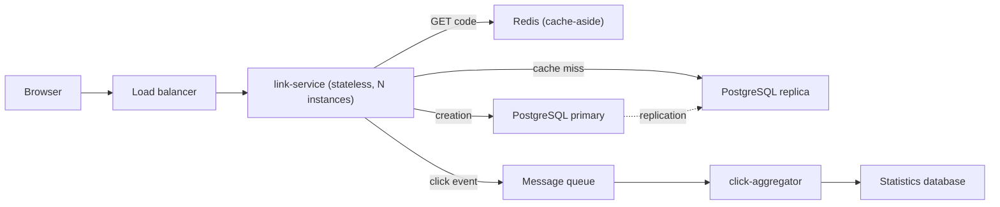
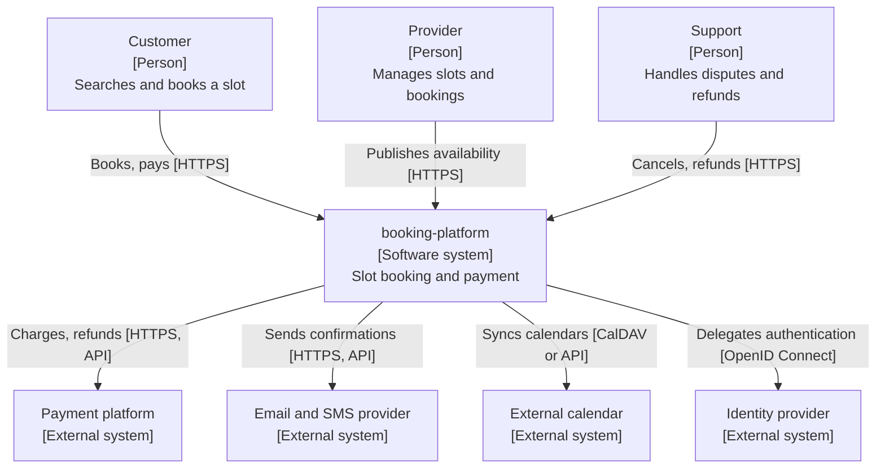
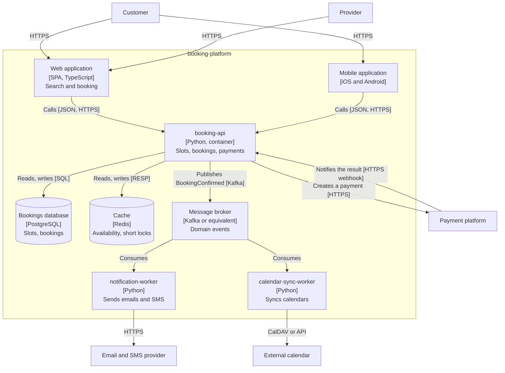
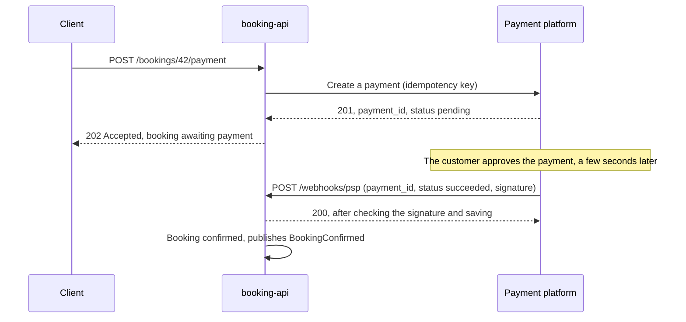
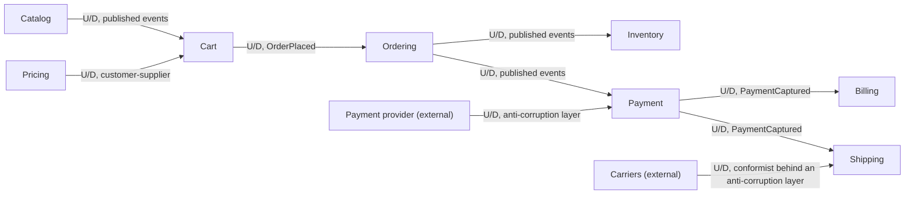
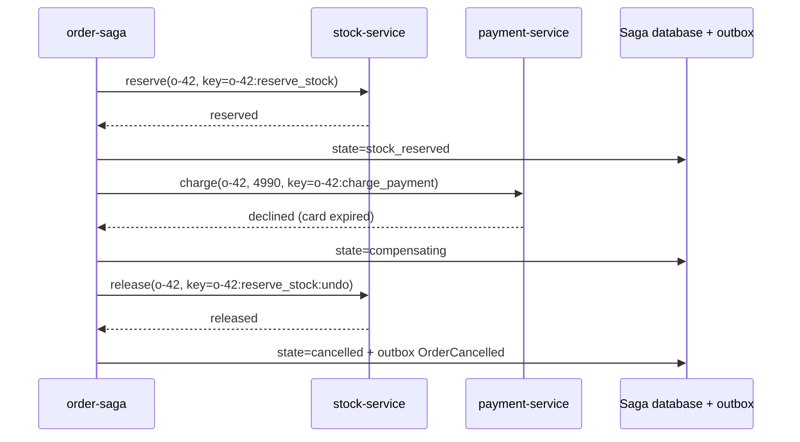
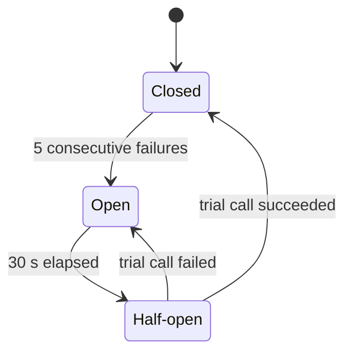
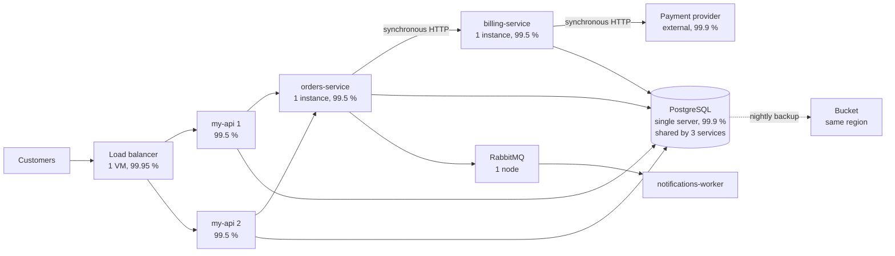
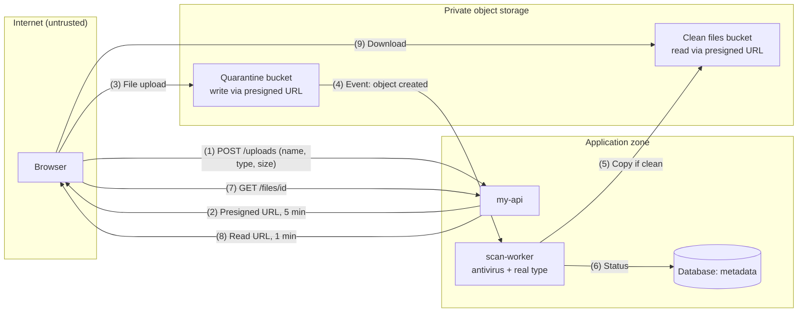
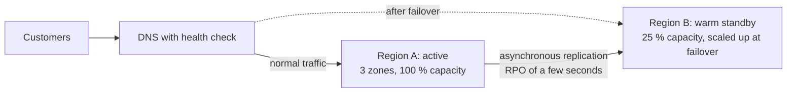

# Software Architect interview: live exercises

!!! warning "Disclaimer"
    These notes are personal cheat sheets, not a source of truth. They reflect my own understanding and choices: their content remains subjective, despite the quotes and references it contains. It may be incomplete, simplified, inaccurate or outdated. Always check the official documentation before applying it. This content is provided as is, without any warranty: you use it at your own risk.

!!! audience "Who and what for"
    - **Roles**: software architect, solution architect, Staff Engineer, tech lead, senior developer aiming for an architect role.
    - **Uses**: I prepare a whiteboard design exercise, like the URL shortener, and I want a complete worked answer; I practice writing an ADR in twenty minutes; I review the composite availability calculation before an architecture review; I want saga or resilient client code that I can explain out loud.

This page gathers practical exercises with detailed worked answers. It complements [the questions page](questions.md): where the questions ask for reasoning, the exercises ask for a result on the whiteboard. There is no single right answer; what I look for is **concrete reference answers**: diagrams, estimates, written decisions, resilience code and how to say it out loud.

The target role is someone who designs systems spread across several teams and defends their trade-offs. The exercises are therefore mostly whiteboard design exercises, with some code where the architecture is decided in the details (saga, resilient client, dependency rules). Each exercise points, through a **Read next** line, to the Knowledge sections that explain the notions it needs.

## How to use this page

A live architecture exercise (whiteboard design, "system design", review of a diagram) is not judged on the final drawing. The interviewer watches how I go from a vague need to an argued solution, and whether I can say what my solution gives up. For each exercise:

1. **I clarify the need before drawing** (5 minutes): who uses the system, for what, and above all the expected <span class="term" data-term="quality-attribute">quality attributes</span> (availability, latency, consistency, cost, security). I write them on the board: they will justify every choice.
2. **I estimate the orders of magnitude** (5 minutes): requests per second on average and at peak, volume stored over the lifetime, read to write ratio. I round boldly and state my assumptions out loud.
3. **I draw simple boxes, then zoom in** (15 minutes): first a version that works for the basic need, only then the scaling. Each arrow carries a verb and a protocol.
4. **I discuss the <span class="term" data-term="trade-off">trade-offs</span>** (10 minutes): for each strong choice, I name the rejected option and why. "I chose X because attribute Y matters more than Z here."
5. **I say what I would not do** (5 minutes): the useless message queue, the premature split into services, the cache with no invalidation strategy. Refusing complexity is an architect's skill.
6. **I keep 5 minutes for the limits**: points of failure, what breaks first if traffic is multiplied by ten, what I would measure.

In total, I aim for 45 minutes. If the interviewer takes me into a detail, I follow: they are often testing my depth on a specific point (ID generation, consistency, recovery after a failure). The numbers in the worked answers are examples for the exercise, not production references. The code is in Python, deliberately short.

---

## Exercise 1. Design a URL shortener

### Problem

I am asked to design a service that turns a long URL into a short link (`https://sho.rt/aZ3k9Qx`) and redirects anyone who opens the short link to the original URL. Links are created by logged-in users, opened by anyone. The product also wants to know how many times each link is opened.

**Read next**: [Estimating capacity](../../knowledge/architecture.md#estimating-capacity), [Where to put a cache](../../knowledge/architecture.md#where-to-put-a-cache), [Response codes](../../knowledge/api-rest-async.md#response-codes), [Read replicas](../../knowledge/sql.md#read-replicas), [Example: a URL shortener](../../knowledge/architecture.md#example-a-url-shortener), [Account enumeration](../../knowledge/securite.md#account-enumeration)

### Expected answer

#### 1. Clarify the requirements

Functional <span class="term" data-term="requirements">requirements</span> to confirm:

- Create a short link for a long URL, with an optional custom alias.
- Redirect the short link to the long URL.
- Optional expiry, deletion by the owner.
- Count clicks per link (statistics viewable a few minutes late).

<span class="term" data-term="non-functional-requirement">Non-functional requirements</span>, the ones that shape the architecture:

- The redirect is the critical path: highly available, fast (example target: p99 under 50 ms server side).
- The code must not be guessable: we do not want a third party to enumerate every link.
- A link must be usable by its creator right after creation.
- Statistics can be late and slightly approximate.

#### 2. Estimate the orders of magnitude

Example assumptions, to state as such: 100 million links created per month, 100 reads per write, 5 years retention, 500 bytes per link.

| Quantity | <span class="term" data-term="back-of-envelope">Back-of-the-envelope calculation</span> | Result |
|---|---|---|
| Writes | 100 M / (30 d x 86,400 s) | about 40 per second |
| Reads | 40 x 100 | about 4,000 per second, 12,000 at peak (x3) |
| Links over 5 years | 100 M x 12 x 5 | 6 billion |
| Storage | 6 billion x 500 bytes | about 3 TB |
| Code space | 62 to the power of 7 | about 3,500 billion codes |

Conclusion to say out loud: the system is heavily read-oriented, writes are modest, the volume fits in a well-sized database. The real topic is redirect latency and availability.

#### 3. The API

``` { .http .ex-ref title="Reference · creating a link" }
POST /api/links
Authorization: Bearer <token>
Content-Type: application/json

{"url": "https://example.com/a/very/long/path", "alias": null, "expires_at": null}

201 Created
{"code": "aZ3k9Qx", "short_url": "https://sho.rt/aZ3k9Qx"}
```

``` { .http .ex-ref title="Reference · redirect" }
GET /aZ3k9Qx

302 Found
Location: https://example.com/a/very/long/path
```

The <span class="term" data-term="http-redirect">redirect</span> status code is a real trade-off (RFC 9110, 2022): `301` (permanent) is cached by browsers, so less load but invisible clicks and a destination that cannot change; `302` (temporary) sends every click through the service, so accurate statistics. Since the product wants to count clicks, I would pick `302`.

#### 4. The data model

``` { .sql .ex-illus title="Illustration · links table" }
-- Example: one row per link, read by its code
CREATE TABLE links (
    code        VARCHAR(16) PRIMARY KEY,
    long_url    TEXT        NOT NULL,
    owner_id    BIGINT      NOT NULL,
    created_at  TIMESTAMPTZ NOT NULL DEFAULT now(),
    expires_at  TIMESTAMPTZ NULL
);
-- Example: list an owner's links
CREATE INDEX links_owner_idx ON links (owner_id, created_at);
```

The only critical access is "find `long_url` by `code`": a read by key. A relational database is enough at this volume; a distributed <span class="term" data-term="key-value-store">key-value store</span> becomes interesting if volume or geographic spread require it.

#### 5. Generate the short code

| Method | Principle | Advantage | Limit |
|---|---|---|---|
| Truncated hash of the URL | First 7 characters of a hash | Same URL, same code | Collisions to handle, code tied to content |
| Counter + <span class="term" data-term="base62">Base62</span> | A global counter encoded in Base62 | No collision, short codes | Guessable codes, central counter to protect |
| Counter blocks per instance | Each instance reserves 1,000 IDs at once | No central call on each creation | Gaps in the sequence, still guessable without scrambling |
| Random + uniqueness constraint | Draw 7 random characters, insert, draw again on conflict | Simple, not guessable | One more query on collision |

I would pick random with a <span class="term" data-term="unique-constraint">unique constraint</span>: with 6 billion links in 3,500 billion possible codes, the collision probability on insert stays under 0.2% at end of life, so a second attempt now and then.

The first idea, to avoid: a counter encoded in Base62 gives consecutive codes, so anyone can enumerate every link by incrementing the last code they got.

``` { .python .ex-bad title="Avoid" }
# Avoid: consecutive codes, so guessable
def new_code(counter) -> str:
    return to_base62(counter.next())
```

The chosen version: random codes and a uniqueness constraint.

``` { .python .ex-good title="Recommended" }
import secrets

ALPHABET = "0123456789abcdefghijklmnopqrstuvwxyzABCDEFGHIJKLMNOPQRSTUVWXYZ"
CODE_LENGTH = 7
MAX_ATTEMPTS = 5


# Good: 7 random characters, not guessable
def new_code() -> str:
    return "".join(secrets.choice(ALPHABET) for _ in range(CODE_LENGTH))


# Good: insert, and draw a new code only on a collision
def create_link(db, long_url: str, owner_id: int) -> str:
    for _ in range(MAX_ATTEMPTS):
        code = new_code()
        inserted = db.execute(
            "INSERT INTO links (code, long_url, owner_id) VALUES (%s, %s, %s) "
            "ON CONFLICT (code) DO NOTHING",
            (code, long_url, owner_id),
        ).rowcount
        if inserted == 1:
            return code
    raise RuntimeError("could not allocate a unique code")
```

#### 6. Handle the read load

- **<span class="term" data-term="stateless">Stateless</span> instances** behind a load balancer: add more as load grows.
- **<span class="term" data-term="cache-aside">Cache-aside</span> cache** in front of the database: recent and popular links concentrate most clicks (assumption to check on real data). 10 million hot links x 500 bytes is 5 GB, a single Redis instance is enough. No complex invalidation: a link almost never changes, a deletion removes the key.
- **Short negative cache** for unknown codes, otherwise a bot trying random codes hits the database directly.
- **<span class="term" data-term="read-replica">Read replicas</span>** for cache misses. The creator who opens their link right after creating it reads the primary (or the cache filled on write), otherwise they could get a `404` because of replication lag.
- **Clicks off the critical path**: the redirect publishes an event to a queue, a consumer aggregates the counters. If the queue is slow, the redirect is not.
- **<span class="term" data-term="sharding">Sharding</span>** by code hash only if one database is no longer enough for writes or size, which the estimates do not show.



#### What a Software Architect should add

- Abuse: a shortener is also used to hide phishing. Check submitted URLs against a list of malicious domains, rate-limit creation per account.
- What I would not do: separate microservices for creation and redirect from day one, a NoSQL database chosen "for scale" when 3 TB and 40 writes per second fit in PostgreSQL.
- What breaks first if traffic is multiplied by ten: the cache (size, number of connections), then the click queue. The primary database only sees writes.

#### Possible spoken answer

> "I start with the requirements: the redirect is the critical path, it must be fast and available, statistics can be late. At 100 million links a month, that is 40 writes and 4,000 reads per second: a read system. I generate random 7-character Base62 codes with a uniqueness constraint, because they are not guessable and collisions stay rare. I answer with 302 to count clicks, I put a cache in front of the database and I send clicks to a queue so the redirect is not slowed down. I do not shard the database until the numbers ask for it."

---

## Exercise 2. Write an ADR: which database for a product catalog?

### Problem

`catalog-service` must store 200,000 products (example). Each category has its own attributes: a book has an ISBN and a page count, a garment a size and a color, a TV a screen size and an energy class. Two teams disagree: one wants PostgreSQL, which the company already runs for orders, the other wants a document database "because the schema is variable". I have to write the <span class="term" data-term="adr">ADR</span> that settles it.

**Read next**: [ADR](../../knowledge/architecture.md#adr), [Choosing the type of database](../../knowledge/architecture.md#choosing-the-type-of-database), [Design before coding](../../knowledge/livraison.md#design-before-coding), [Superseding an outdated ADR](../../knowledge/architecture.md#superseding-an-outdated-adr)

### Expected answer

#### 1. Questions to ask before writing

- Who reads the catalog and how? Product pages (read by ID), lists filtered by attributes, full-text search.
- Is faceted search ("size M, red, under 50 euros") already handled by a search engine? If so, the database does not have to serve it.
- Are transactional updates with other data (price, stock) needed?
- Who runs the database at night? A new technology means a new on-call.

#### 2. The options

- **A. PostgreSQL**: typed columns for common fields (name, price, category), a <span class="term" data-term="jsonb">JSONB</span> column for category-specific attributes.
- **B. A <span class="term" data-term="document-store">document database</span>** (for example MongoDB): one document per product, validated by a JSON schema.
- **C. Entity-attribute-value model** in PostgreSQL (one row per attribute and per product). I rule it out straight away in front of the interviewer: unreadable queries, no typing, cascading joins.

#### 3. The criteria grid

The <span class="term" data-term="decision-criteria">decision criteria</span> and their weights are set with both teams **before** scoring the options. Scores from 1 to 5, example figures.

| Criterion | Weight | A. PostgreSQL + JSONB | B. Document database |
|---|---|---|---|
| Variable attributes per category | 3 | 4 (JSONB, validation by constraint or in the application) | 5 (native, optional JSON schema) |
| Queries on attributes | 2 | 4 (GIN index, `@>` operator) | 4 (field indexes) |
| Transactions with price and stock | 2 | 5 (same database, one transaction) | 3 (multi-document transactions since MongoDB 4.0, 2018) |
| Existing skills and operations | 3 | 5 (backups, on-call, monitoring already in place) | 2 (new technology to operate) |
| Scaling beyond one server | 1 | 3 (read replicas, sharding is costlier) | 4 (built-in sharding) |
| **Weighted total** | | **48** | **39** |

The total is not the decision: it makes the discussion explicit. If the other team disputes a weight, the discussion moves to the weight, not the conclusion.

#### 4. The filled-in ADR

Michael Nygard's format, "Documenting Architecture Decisions" (2011): context, decision, consequences.

``` { .markdown .ex-illus title="Illustration · ADR-012" }
# ADR-012: Store the product catalog in PostgreSQL with a JSONB column

Status: Accepted (2026-11-02, example)
Deciders: ada (architect), team-catalog, team-orders

## Context
- 200,000 products, 30 categories, attributes specific to each category (examples).
- Faceted search is served by the existing search engine, fed by events.
- Price and stock are updated together with the product in some admin screens.
- The platform team already runs PostgreSQL (backups, on-call, monitoring).

## Decision
We store products in PostgreSQL: typed columns for common fields,
an `attributes JSONB` column for category attributes, a GIN index on that column.
Each category's schema is a JSON Schema versioned in the repository and checked by the application.

## Rejected options
- Document database: well suited to the variable schema, but one more technology to operate,
  with no volume need that justifies it today.
- Entity-attribute-value: complex queries, no typing.

## Consequences
- Positive: a single database technology, transactions with price and stock, known tooling.
- Negative: attribute validation is on us; JSONB queries are less readable
  than columns; attributes filtered very often will have to be promoted to columns.
- Revisit if: the catalog exceeds 50 million products, or more than half of the queries
  no longer go through the search engine.
```

#### 5. What the decision gives in SQL

``` { .sql .ex-illus title="Illustration · the catalog in SQL" }
-- Example: typed columns for common fields, JSONB for the rest
CREATE TABLE products (
    id          BIGINT PRIMARY KEY,
    name        TEXT          NOT NULL,
    category    TEXT          NOT NULL,
    price_cents INTEGER       NOT NULL CHECK (price_cents >= 0),
    attributes  JSONB         NOT NULL DEFAULT '{}'::jsonb,
    CHECK (jsonb_typeof(attributes) = 'object')
);
-- Example: a GIN index that serves the @> operator
CREATE INDEX products_attributes_gin ON products USING GIN (attributes jsonb_path_ops);

-- Example: red t-shirts in size M
SELECT id, name
FROM products
WHERE category = 'tshirt'
  AND attributes @> '{"color": "red", "size": "M"}';
```

The <span class="term" data-term="gin-index">GIN index</span> with `jsonb_path_ops` serves the `@>` containment operator, more compact than the default option but limited to that use (PostgreSQL documentation, to check for the version in use). JSONB exists since PostgreSQL 9.4 (2014).

The <span class="term" data-term="json-schema">JSON Schema</span> named in the ADR: a JSON document that describes the expected shape of another JSON document (required fields, types, allowed values), here in its 2020-12 version. The one for the `tshirt` category, checked by the application before the `INSERT`:

``` { .json .ex-ref title="Reference · JSON Schema of the tshirt category" }
{
  "type": "object",
  "required": ["color", "size"],
  "properties": {
    "color": {"type": "string"},
    "size": {"enum": ["S", "M", "L", "XL"]}
  },
  "additionalProperties": false
}
```

The attributes `{"color": "red", "size": "XXL"}` are rejected before they reach the database, with the message `'XXL' is not one of ['S', 'M', 'L', 'XL']` (Python `jsonschema` library). An unknown field, such as `{"colour": "red", ...}`, is rejected too thanks to `additionalProperties: false`: that is what stops a typo from silently creating a new attribute.

#### What a Software Architect should add

- The "revisit if" clause: a decision with no revision condition becomes dogma. The thresholds must be measurable.
- Operating cost is a criterion in its own right: it often weighs more than model flexibility.
- The <span class="term" data-term="vendor-lock-in">vendor lock-in</span> risk: JSONB and the `@>` operators are PostgreSQL-specific. It is accepted, and written down.
- What I would not do: choose a database for a hypothetical future volume, or let each team pick its database without an ADR.

#### Possible spoken answer

> "I first set the criteria and their weights with both teams, before scoring the options, so the debate is about what matters. The variable schema is real, but JSONB covers it, and faceted search is already in the search engine. What tips it toward PostgreSQL is existing operations and transactions with price and stock. I write the ADR with the rejected options, the accepted negative consequences and measurable revision thresholds: beyond them, we reopen the decision."

---

## Exercise 3. Draw the C4 views of a booking platform

### Problem

`booking-platform` lets customers book time slots with providers (hairdressers, coaches, rooms). The customer pays online, gets a confirmation by email or SMS, and the provider sees their bookings in a calendar they can sync with an external calendar. I have to draw the context and container views, and explain what each one is for.

**Read next**: [C4 model](../../knowledge/architecture.md#c4-model), [Webhook](../../knowledge/api-rest-async.md#webhook), [Concurrent writes](../../knowledge/sql.md#concurrent-writes), [Exclusion constraint: no overlapping slots](../../knowledge/sql.md#exclusion-constraint-no-overlapping-slots)

### Expected answer

#### 1. The C4 model in two sentences

Simon Brown's <span class="term" data-term="c4-model">C4 model</span> (c4model.com website, popularized in the early 2010s, exact date to check) describes software at four zoom levels: **context** (the system and its surroundings), **containers** (deployable applications and databases), **components** (the blocks inside a container), **code**. "Container" does not mean Docker container: it is anything that runs or stores data separately (web app, API, database, queue).

| View | Question it answers | Audience | Lifetime |
|---|---|---|---|
| Context | Who uses the system, what does it depend on? | Everyone, business included | Years |
| Containers | Which technical building blocks, how do they talk? | Technical teams, security, operations | Months |
| Components | How is a container split? | The container's team | Weeks (often generated or skipped) |
| Code | Classes and functions | Nobody in an interview | Generated by tooling, never drawn by hand |

In an interview, the first two are almost always enough.

#### 2. Context view



This view fits on one slide for an executive committee. It shows the system <span class="term" data-term="system-boundary">boundary</span> and its external dependencies, hence the first risks: if the payment platform goes down, nobody books. Calendar sync goes through <span class="term" data-term="caldav">CalDAV</span>, the standard calendar exchange protocol, or through the calendar's API.

#### 3. Container view



Reading to give the interviewer: a single API holding the business logic, one database that is the source of truth for slots, and slow or unreliable tasks (emails, calendar sync) taken off the booking path by a <span class="term" data-term="message-broker">message broker</span>. If the SMS provider is slow, booking is not.

The "<span class="term" data-term="webhook">webhook</span>" arrow from the payment platform: a webhook is an HTTP call the provider makes to us when an event happens, instead of us polling it in a loop. Payment therefore becomes asynchronous:



Pitfalls to mention: check the signature (otherwise anyone can confirm a payment), handle the webhook idempotently (the provider resends it until it gets a 200), and do not rely on the webhook alone: a job polls the provider for payments stuck in `pending` too long.

#### 4. The key decision the view brings out: no double booking

Two customers clicking the same slot at the same time is the scenario that matters. The naive version checks then inserts, to avoid: two API instances pass the check at the same instant, then both insert, so two customers get the same slot.

``` { .python .ex-bad title="Avoid" }
# Avoid: check then insert, in two separate queries
def book(db, provider_id: int, during) -> None:
    if not db.has_overlap(provider_id, during):
        db.insert_booking(provider_id, during)
```

The version that holds: the database prevents it, not the cache nor the application code.

``` { .sql .ex-good title="Recommended" }
-- Good: btree_gist allows combining = and && in one constraint
CREATE EXTENSION IF NOT EXISTS btree_gist;

-- Good: the database rejects two active overlapping bookings
CREATE TABLE bookings (
    id          BIGINT PRIMARY KEY,
    provider_id BIGINT    NOT NULL,
    during      TSTZRANGE NOT NULL,
    status      TEXT      NOT NULL,
    EXCLUDE USING gist (provider_id WITH =, during WITH &&) WHERE (status <> 'cancelled')
);
```

The <span class="term" data-term="exclusion-constraint">exclusion constraint</span> rejects two active overlapping bookings for the same provider, even when two API instances write at the same time.

#### 5. Notation rules to follow

- Each box has a name, a type in brackets, a technology and a one-line role.
- Each arrow has a verb and a protocol. An unlabeled arrow says nothing.
- A legend and a title per view, the date or version of the diagram.
- Diagrams live in the repository, as text (Mermaid, <span class="term" data-term="structurizr-dsl">Structurizr DSL</span>), and are reviewed like code.

#### What a Software Architect should add

- A deployment view (regions, zones, networks) when the question is about availability, and a dynamic view (sequence diagram) for the "book and pay" journey.
- The <span class="term" data-term="spof">single points of failure</span> visible on the container view: the database, the payment platform. For each one, what happens if it goes down.
- What I would not do: split `booking-api` into five services on the diagram to look "modern", or draw the code view by hand.

#### Possible spoken answer

> "I first draw the context view: three kinds of users, four external systems. It is for the business and shows our critical dependencies right away, like payment. Then the container view: one API, a PostgreSQL database as source of truth, a cache, and two workers behind a message broker to take emails and calendar sync off the booking path. Each arrow has a verb and a protocol. Double booking is prevented by an exclusion constraint in the database, not by the cache. I only go down to the component level if asked."

---

## Exercise 4. Split an e-commerce monolith into bounded contexts

### Problem

`shop-monolith` is a single application with a shared database of 20 tables: `customers`, `addresses`, `products`, `categories`, `product_images`, `prices`, `promotions`, `stock_levels`, `warehouses`, `carts`, `cart_items`, `orders`, `order_lines`, `payments`, `refunds`, `invoices`, `shipments`, `carriers`, `reviews`, `newsletter_subscriptions`. Four teams work on it and block each other on every release. I have to propose a split, a map of the relationships and the extraction order.

**Read next**: [Splitting the system](../../knowledge/architecture.md#splitting-the-system), [Event storming](../../knowledge/architecture.md#event-storming), [Context map](../../knowledge/architecture.md#context-map), [Modular monolith](../../knowledge/architecture.md#modular-monolith), [Strangler fig](../../knowledge/architecture.md#strangler-fig)

### Expected answer

#### 1. Questions to ask

- Which problem are we solving: blocked releases, uneven load, reliability? A split is only justified by a named problem.
- Which parts change most often? (Git history tells.)
- Which teams exist, and for which parts of the business? Following <span class="term" data-term="conway-law">Conway's law</span>, technical boundaries will follow team boundaries.

#### 2. Output of an Event Storming workshop

<span class="term" data-term="event-storming">Event Storming</span> (Alberto Brandolini, presented from 2013) brings business and tech people in front of a wall: people stick the <span class="term" data-term="domain-event">domain events</span> in time order, then the commands that trigger them, then everyone looks for where the vocabulary changes. Condensed workshop output (example):

| Command | Domain event | Main data | Candidate context |
|---|---|---|---|
| Publish a product | `ProductPublished` | `products`, `categories`, `product_images` | Catalog |
| Change a price | `PriceChanged` | `prices`, `promotions` | Pricing |
| Receive stock | `StockReceived` | `stock_levels`, `warehouses` | Inventory |
| Add to cart | `ItemAddedToCart` | `carts`, `cart_items` | Cart |
| Place an order | `OrderPlaced` | `orders`, `order_lines` | Ordering |
| Pay | `PaymentCaptured` | `payments`, `refunds` | Payment |
| Invoice | `InvoiceIssued` | `invoices` | Billing |
| Ship | `ShipmentDispatched` | `shipments`, `carriers` | Shipping |
| Post a review | `ReviewPosted` | `reviews` | Reviews |
| Sign up | `CustomerRegistered` | `customers`, `addresses`, `newsletter_subscriptions` | Customer |

The most useful signal: the word "product" does not mean the same thing everywhere. For Catalog, it is a description and images; for Pricing, a price and rules; for Inventory, a reference and a quantity per warehouse; for Shipping, a weight and dimensions. Each distinct meaning is a candidate <span class="term" data-term="bounded-context">bounded context</span>, with its own <span class="term" data-term="ubiquitous-language">ubiquitous language</span> (Eric Evans, "Domain-Driven Design", 2003). Mistake to avoid: a single `Product` model shared by everyone.

#### 3. The context map

The <span class="term" data-term="context-map">context map</span> shows who depends on whom (U for upstream, D for downstream) and the type of relationship, with Evans's vocabulary (2003).



Relationships to name: **customer-supplier** (downstream states its needs, upstream plans for them), **conformist** (downstream accepts the upstream model as is), **<span class="term" data-term="anti-corruption-layer">anti-corruption layer</span>** (a translation protects our model from an external model), **published language** (events in a versioned format). I would not use a **shared kernel** (a model common to two contexts): it is the shared database under another name.

#### 4. What to extract first, and why

| Criterion | Shipping | Ordering | Catalog |
|---|---|---|---|
| Tables and <span class="term" data-term="foreign-key">foreign keys</span> crossing the boundary | Few (`shipments` reads the address and the lines) | Many (everyone reads `orders`) | Many (everyone reads `products`) |
| Runtime coupling | Asynchronous by nature (after payment) | Synchronous at the heart of the journey | Read everywhere |
| Change frequency | High (new carriers) | Medium | Medium |
| Own reason to be separate | Slow calls to carriers, to isolate | None right now | Read load, served by a cache |
| Risk if it goes wrong | Low (delayed shipment) | High (lost orders) | Medium |

I would start with Shipping: few incoming dependencies, a natural event trigger (`PaymentCaptured`), a concrete reason to isolate it, and a low risk to learn the extraction path. That is Sam Newman's advice, "Monolith to Microservices" (2019): start with an easy, low-risk context, then aim for those that bring the most. Ordering, at the center of everything, goes last, or stays in the monolith.

#### 5. The extraction path

1. **First a <span class="term" data-term="modular-monolith">modular monolith</span>**: each context becomes a module, with a rule that forbids reading another module's tables. Violations are measured in CI (architecture rules) before any separate deployment.
2. **Replace joins with calls or events**: `shipments` no longer joins `orders`, it receives the lines and the address in the `PaymentCaptured` event.
3. **Strangle progressively** following the <span class="term" data-term="strangler-fig">strangler fig</span> (Martin Fowler, "StranglerFigApplication" article, 2004): the new `shipping-service` first receives the events in parallel, its results are compared with the monolith's, then it takes over carrier by carrier.
4. **Split the data** last: initial copy, sync through <span class="term" data-term="cdc">CDC</span> during the transition, switch over, then drop the tables in the monolith.

#### What a Software Architect should add

- The <span class="term" data-term="distributed-monolith">distributed monolith</span> trap: extracting services that still share the database or call each other in chains gives all the costs of distribution with none of the benefits.
- One owning team per extracted context, with its own deployments and on-call. No owner, no extraction.
- What I would not do: extract all ten contexts. Reviews, Customer and Billing can perfectly stay modules of the monolith if nothing pushes them out.

#### Possible spoken answer

> "I first ask which problem we want to fix, because a split with no named problem only adds network. An Event Storming workshop brings out the contexts: the word product does not mean the same thing in catalog, inventory and shipping, that is where the boundaries go. I draw the context map with anti-corruption layers toward external systems. I would extract Shipping first: few dependencies, an event trigger, low risk. Before anything, I would go through a modular monolith to check the boundaries in code, and I would keep Ordering at the center as long as it has no reason to leave."

---

## Exercise 5. Order saga: payment, stock, shipping and compensations

### Problem

An order goes through three services: `stock-service` reserves the items, `payment-service` charges the customer, `shipping-service` creates the shipment. Each service has its own database: a single transaction is impossible. I have to design the sequence, what happens when a step fails, and how the system survives a restart at the wrong moment, then code the orchestrator.

**Read next**: [Orchestrated or choreographed saga](../../knowledge/architecture.md#orchestrated-or-choreographed-saga), [Outbox](../../knowledge/architecture.md#outbox), [Idempotency](../../knowledge/architecture.md#idempotency), [Delivery guarantees](../../knowledge/api-rest-async.md#delivery-guarantees), [Payment authorization and capture](../../knowledge/architecture.md#payment-authorization-and-capture)

### Expected answer

#### 1. Why a saga, and which one

Without a distributed transaction, the system chains local transactions: that is a <span class="term" data-term="saga-pattern">saga</span> (Hector Garcia-Molina and Kenneth Salem, "Sagas", 1987). Each successful step has a <span class="term" data-term="compensation">compensation</span> that undoes it in business terms: nothing is rolled back, the payment is refunded and the stock released.

| Style | Principle | Advantage | Limit |
|---|---|---|---|
| <span class="term" data-term="saga-orchestration">Orchestrated</span> | An orchestrator tells each service what to do and keeps the state | Flow readable in one place, visible state, easy to test | One more component, risk of putting other services' business logic in it |
| <span class="term" data-term="saga-choreography">Choreographed</span> | Each service reacts to the others' events | No coordinator | Scattered flow, event cycles, hard to follow beyond three steps |

With three steps and compensations, I would choose orchestration: the flow and the state of each order can be read in one place.

#### 2. The order of the steps

Reserve stock first (easy to undo, with automatic expiry of the reservation), then pay, then ship. The hardest step to undo (payment) comes as late as possible. Compensations run in reverse order.

#### 3. The orchestrator as a state machine

The <span class="term" data-term="state-machine">possible states</span> and allowed transitions are explicit: a forbidden transition raises an error instead of corrupting the order.

``` { .python .ex-good title="Recommended" }
from collections.abc import Callable
from dataclasses import dataclass, field
from enum import Enum


# Good: the saga states, named
class SagaState(str, Enum):
    STARTED = "started"
    STOCK_RESERVED = "stock_reserved"
    PAID = "paid"
    COMPLETED = "completed"
    COMPENSATING = "compensating"
    CANCELLED = "cancelled"


# Good: the allowed transitions, everything else is rejected
ALLOWED = {
    SagaState.STARTED: {SagaState.STOCK_RESERVED, SagaState.COMPENSATING},
    SagaState.STOCK_RESERVED: {SagaState.PAID, SagaState.COMPENSATING},
    SagaState.PAID: {SagaState.COMPLETED, SagaState.COMPENSATING},
    SagaState.COMPENSATING: {SagaState.CANCELLED},
}


# Good: a definitive business refusal, distinct from a timeout
class StepRejected(Exception):
    """Definitive business refusal: no retry, compensate."""


# Good: a forbidden transition raises an error
class InvalidTransition(Exception):
    pass


# Good: the persisted state of an order and the steps already done
@dataclass
class Saga:
    order_id: str
    amount_cents: int
    state: SagaState = SagaState.STARTED
    done: list[str] = field(default_factory=list)

    # Good: refuse an unplanned transition
    def move_to(self, new_state: SagaState) -> None:
        if new_state not in ALLOWED.get(self.state, set()):
            raise InvalidTransition(f"{self.state} -> {new_state}")
        self.state = new_state


# Good: a step, its compensation and the state it reaches
@dataclass(frozen=True)
class Step:
    name: str
    action: Callable[[Saga, str], None]
    compensation: Callable[[Saga, str], None] | None
    reached: SagaState


# Good: the orchestrator, the hardest step to undo comes last
class OrderSaga:
    def __init__(self, stock, payment, shipping, store) -> None:
        self._store = store
        self._steps = [
            Step("reserve_stock",
                 lambda s, k: stock.reserve(s.order_id, key=k),
                 lambda s, k: stock.release(s.order_id, key=k),
                 SagaState.STOCK_RESERVED),
            Step("charge_payment",
                 lambda s, k: payment.charge(s.order_id, s.amount_cents, key=k),
                 lambda s, k: payment.refund(s.order_id, key=k),
                 SagaState.PAID),
            Step("create_shipment",
                 lambda s, k: shipping.create(s.order_id, key=k),
                 None,
                 SagaState.COMPLETED),
        ]

    # Good: resume where the saga stopped, compensate on a refusal
    def run(self, saga: Saga) -> Saga:
        if saga.state == SagaState.COMPENSATING:
            return self._compensate(saga)
        for step in self._steps:
            if step.name in saga.done:
                continue
            try:
                step.action(saga, f"{saga.order_id}:{step.name}")
            except StepRejected:
                saga.move_to(SagaState.COMPENSATING)
                self._store.save(saga)
                return self._compensate(saga)
            saga.done.append(step.name)
            saga.move_to(step.reached)
            event = "OrderConfirmed" if step.reached == SagaState.COMPLETED else None
            self._store.save(saga, event=event)
        return saga

    # Good: compensate in reverse order, then publish OrderCancelled
    def _compensate(self, saga: Saga) -> Saga:
        by_name = {step.name: step for step in self._steps}
        for name in reversed(saga.done):
            step = by_name[name]
            if step.compensation is not None:
                step.compensation(saga, f"{saga.order_id}:{name}:undo")
        saga.move_to(SagaState.CANCELLED)
        self._store.save(saga, event="OrderCancelled")
        return saga
```

Two kinds of error, two treatments: `StepRejected` (card declined, out of stock) is a definitive answer, so the saga compensates. A timeout does not say whether the step happened: the exception propagates, the saved state stays the previous one, and a recovery job runs `run` again later with the same key.

#### 4. The idempotent step, on the participant side

Each call carries a stable <span class="term" data-term="idempotency-key">idempotency key</span> (`o-42:charge_payment`). The participant stores it with a uniqueness constraint and returns the already recorded result if the key comes back:

``` { .sql .ex-good title="Recommended" }
-- Good: the idempotency key is the primary key
CREATE TABLE charges (
    idempotency_key TEXT PRIMARY KEY,
    order_id        TEXT    NOT NULL,
    amount_cents    INTEGER NOT NULL,
    status          TEXT    NOT NULL
);
-- Good: INSERT ... ON CONFLICT (idempotency_key) DO NOTHING, then read the row back and return its status
```

Compensations follow the same rule, and must accept "nothing to undo": refunding a payment that never happened answers success and does nothing.

#### 5. The outbox: change the state and publish without losing the event

Writing to the database then publishing to the broker is a <span class="term" data-term="dual-write">dual write</span>, to avoid: a crash between the two loses the event.

``` { .python .ex-bad title="Avoid" }
# Avoid: write to the database, then publish to the broker
def save(db, broker, saga, event) -> None:
    db.update_saga(saga)
    broker.publish(event)
```

With the <span class="term" data-term="outbox-pattern">outbox pattern</span>, `store.save` does both in a single local transaction:

``` { .sql .ex-good title="Recommended" }
-- Good: the state and the event in the same local transaction
BEGIN;
UPDATE sagas SET state = 'completed', done = '{reserve_stock,charge_payment,create_shipment}'
WHERE order_id = 'o-42';
INSERT INTO outbox (event_id, type, payload) VALUES (gen_random_uuid(), 'OrderConfirmed', '{"order_id": "o-42"}');
COMMIT;
```

A relay reads `outbox` and publishes. It may publish twice after a crash: delivery is <span class="term" data-term="at-least-once">at least once</span>, consumers deduplicate on `event_id`.

#### 6. The failure path as a sequence



#### 7. Timeline of a crash at the worst moment

| Time | What happens | Saved state |
|---|---|---|
| t0 | Stock reserved, state saved | `stock_reserved`, `done=[reserve_stock]` |
| t1 | `charge` sent, `payment-service` charges and records the key | `stock_reserved` |
| t2 | The orchestrator stops before saving `paid` | `stock_reserved` |
| t3 | Restart, the recovery job runs `run` again | `stock_reserved` |
| t4 | `charge` sent again with the same key: `payment-service` returns the t1 result without charging again | `paid` |
| t5 | Shipment created, `OrderConfirmed` in the outbox | `completed` |

Without an idempotency key, t4 would charge the customer twice.

#### 8. The tests

``` { .python .ex-good title="Recommended" }
# Good: a declined payment releases the stock and publishes OrderCancelled
def test_declined_payment_releases_the_stock():
    saga_runner, journal, store = build(reject_payment=True)
    saga = saga_runner.run(Saga("o-2", 4990))
    assert saga.state == SagaState.CANCELLED
    assert journal == ["stock.reserve", "stock.release"]
    assert store.outbox == ["OrderCancelled"]


# Good: compensations run in reverse order
def test_shipping_failure_compensates_in_reverse_order():
    saga_runner, journal, _ = build(reject_shipping=True)
    saga_runner.run(Saga("o-3", 4990))
    assert journal[-2:] == ["payment.refund", "stock.release"]


# Good: a resume after a crash does not redo finished steps
def test_resume_after_crash_does_not_redo_finished_steps():
    saga_runner, journal, _ = build()
    saga = Saga("o-4", 4990, state=SagaState.STOCK_RESERVED, done=["reserve_stock"])
    saga_runner.run(saga)
    assert journal == ["payment.charge", "shipping.create"]
```

`build` wires the orchestrator with fake services that log each call and ignore an already seen key, and a fake store that keeps the outbox events.

#### What a Software Architect should add

- <span class="term" data-term="eventual-consistency">Eventual consistency</span> shows on the customer side: the order goes through "in progress" before "confirmed". The product must validate that display.
- A safer variant for payment: <span class="term" data-term="payment-authorization-capture">authorize when the order is placed, capture at shipping</span>. A shipping failure voids the authorization instead of refunding.
- A stuck saga (a compensation that keeps failing) must alert and end up in a manual handling queue, with a dashboard of sagas by state and age.
- What I would not do: a <span class="term" data-term="two-phase-commit">two-phase commit</span> between three services and an external payment provider, which does not support it anyway.

#### Possible spoken answer

> "No distributed transaction is possible, so an orchestrated saga: one orchestrator, an explicit state machine, the hardest step to undo last. A negative business answer triggers the compensations in reverse order; a timeout proves nothing, so we retry later with the same idempotency key, and each participant ignores a key it has already seen. The state and the final event are written in the same transaction thanks to the outbox, and consumers deduplicate. The scenario I test first: a crash between the payment call and saving the state."

**See also**: [Staff Engineer interview: the exercises](../staff-engineer/exercices.md), for the idempotency of a creation API and double submission.

---

## Exercise 6. Resilient client: timeout, retry with backoff and jitter, circuit breaker

### Problem

`orders-service` calls `pricing-service` over HTTP on every order. Yesterday, `pricing-service` slowed down for ten minutes: all of `orders-service`'s threads waited, then `orders-service` went down in turn, then the whole site. I have to write a client that prevents this from happening again, with its tests, and explain what retry storms are.

**Read next**: [Timeout](../../knowledge/architecture.md#timeout), [Retry, exponential backoff and jitter](../../knowledge/architecture.md#retry-exponential-backoff-and-jitter), [Retry budget](../../knowledge/architecture.md#retry-budget), [Circuit breaker](../../knowledge/architecture.md#circuit-breaker), [HTTP methods](../../knowledge/api-rest-async.md#http-methods), [Simulating a third party that fails or is slow](../../knowledge/qualite.md#simulating-a-third-party-that-fails-or-is-slow)

### Expected answer

#### 1. What happened

Without a <span class="term" data-term="timeout">timeout</span>, each slow call holds a thread and a connection. When they are all busy, `orders-service` stops answering, and its own callers wait in turn: these are <span class="term" data-term="cascading-calls">cascading calls</span>. Michael Nygard describes this scenario and its countermeasures in "Release It!" (2007, 2nd edition 2018).

#### 2. The four countermeasures, in order

| Countermeasure | What it avoids | Starting setting (example) |
|---|---|---|
| Timeout | Waiting forever | A bit above the dependency's <span class="term" data-term="p999">p99.9</span>, for example 500 ms |
| Retry with <span class="term" data-term="exponential-backoff">exponential backoff</span> and <span class="term" data-term="jitter">jitter</span> | Failing on a transient error | 3 attempts at most, random delay between 0 and 100 ms, 200 ms, capped at 2 s |
| <span class="term" data-term="retry-budget">Retry budget</span> | Multiplying load when the dependency is sick | Retries limited to 10% of requests |
| <span class="term" data-term="circuit-breaker">Circuit breaker</span> | Calling a dependency known to be down | Opens after 5 failures, trial after 30 s |

Absolute rule: only retry <span class="term" data-term="idempotency">idempotent</span> calls. According to RFC 9110 (2022), `GET`, `HEAD`, `PUT` and `DELETE` are, `POST` and `PATCH` are not. A `POST` becomes retryable if it carries an idempotency key that the server honors.

#### 3. The code

Yesterday's client, to avoid: no timeout, so each slow call holds a thread until they are all taken.

``` { .python .ex-bad title="Avoid" }
import requests


# Avoid: a call with no timeout and no bounded retry
def get_price(product_id: str) -> int:
    response = requests.get(f"http://pricing-service/prices/{product_id}")
    return response.json()["cents"]
```

The version that holds:

``` { .python .ex-good title="Recommended" }
import random
import time
from collections.abc import Callable
from typing import TypeVar

T = TypeVar("T")


# Good: only transient errors are retried
class TransientError(Exception):
    """Timeout, connection reset, 503: the call may succeed if repeated."""


# Good: the breaker refuses without calling the dependency
class CircuitOpenError(Exception):
    """The breaker refuses the call without contacting the dependency."""


# Good: closed, open or half-open depending on failures and time
class CircuitBreaker:
    # Good: threshold, reset timeout and injected clock
    def __init__(
        self,
        failure_threshold: int = 5,
        reset_timeout: float = 30.0,
        clock: Callable[[], float] = time.monotonic,
    ) -> None:
        self._threshold = failure_threshold
        self._reset_timeout = reset_timeout
        self._clock = clock
        self._failures = 0
        self._opened_at: float | None = None

    # Good: the state derives from the opening time
    @property
    def state(self) -> str:
        if self._opened_at is None:
            return "closed"
        if self._clock() - self._opened_at >= self._reset_timeout:
            return "half_open"
        return "open"

    # Good: refuse while the breaker is open
    def allow_request(self) -> bool:
        return self.state != "open"

    # Good: a success closes the breaker
    def record_success(self) -> None:
        self._failures = 0
        self._opened_at = None

    # Good: a failure in half-open reopens, otherwise it is counted
    def record_failure(self) -> None:
        if self.state == "half_open":
            self._opened_at = self._clock()
            return
        self._failures += 1
        if self._failures >= self._threshold:
            self._opened_at = self._clock()


# Good: retries capped at a share of the traffic
class RetryBudget:
    """Each request earns `ratio` token, each retry spends one."""

    # Good: the budget starts full
    def __init__(self, ratio: float = 0.1, max_tokens: float = 10.0) -> None:
        self._ratio = ratio
        self._max = max_tokens
        self._tokens = max_tokens

    # Good: each request earns a fraction of a token
    def record_request(self) -> None:
        self._tokens = min(self._max, self._tokens + self._ratio)

    # Good: a retry costs a token, no token, no retry
    def try_spend(self) -> bool:
        if self._tokens < 1:
            return False
        self._tokens -= 1
        return True


# Good: full jitter under an exponential ceiling
def backoff_delay(attempt: int, base: float, cap: float, rng: random.Random) -> float:
    """Full jitter: a random delay between 0 and the exponential ceiling."""
    return rng.uniform(0, min(cap, base * 2**attempt))


# Good: timeout, bounded retries, budget and breaker together
class ResilientClient:
    # Good: sleep and randomness injected for tests without waiting
    def __init__(
        self,
        breaker: CircuitBreaker,
        budget: RetryBudget,
        timeout: float = 0.5,
        max_attempts: int = 3,
        base_delay: float = 0.1,
        max_delay: float = 2.0,
        sleep: Callable[[float], None] = time.sleep,
        rng: random.Random | None = None,
    ) -> None:
        self._breaker = breaker
        self._budget = budget
        self._timeout = timeout
        self._max_attempts = max_attempts
        self._base = base_delay
        self._cap = max_delay
        self._sleep = sleep
        self._rng = rng or random.Random()

    # Good: a single attempt if the call is not idempotent
    def call(self, operation: Callable[[float], T], *, idempotent: bool) -> T:
        self._budget.record_request()
        attempts = self._max_attempts if idempotent else 1
        for attempt in range(attempts):
            if not self._breaker.allow_request():
                raise CircuitOpenError("dependency marked as down")
            try:
                result = operation(self._timeout)
            except TransientError:
                self._breaker.record_failure()
                is_last = attempt == attempts - 1
                if is_last or not self._budget.try_spend():
                    raise
                self._sleep(backoff_delay(attempt, self._base, self._cap, self._rng))
                continue
            self._breaker.record_success()
            return result
        raise AssertionError("unreachable")
```

Choices to explain: `operation` receives the timeout and passes it to the HTTP client; only transient errors count for the breaker (a `400` is the caller's error, not an outage of the dependency); the clock, `sleep` and the random generator are injected for tests with no real waiting. "Full" jitter comes from Marc Brooker, "Exponential Backoff And Jitter", AWS Architecture Blog (2015).

#### 4. The circuit breaker states



When open, the client fails immediately without calling: `orders-service` can answer with a cached price or a clear message instead of collapsing. This version lets every call through in half-open; a production version would only let a limited number through.

#### 5. The tests

``` { .python .ex-good title="Recommended" }
import pytest


# Good: an idempotent call is retried with growing, bounded delays
def test_idempotent_call_is_retried_with_growing_bounded_delays():
    sleeps, now = [], [0.0]
    client, _ = make_client(sleeps, now)
    dependency = FlakyDependency(failures=2)

    assert client.call(dependency, idempotent=True) == "ok"
    assert dependency.calls == 3
    assert 0 <= sleeps[0] <= 0.1
    assert 0 <= sleeps[1] <= 0.2


# Good: a non-idempotent call is never retried
def test_non_idempotent_call_is_never_retried():
    sleeps, now = [], [0.0]
    client, _ = make_client(sleeps, now)
    dependency = FlakyDependency(failures=1)

    with pytest.raises(TransientError):
        client.call(dependency, idempotent=False)
    assert dependency.calls == 1


# Good: the breaker opens, then lets a trial through
def test_breaker_opens_then_lets_a_trial_through():
    sleeps, now = [], [0.0]
    client, breaker = make_client(sleeps, now, threshold=2)
    always_down = FlakyDependency(failures=100)
    for _ in range(2):
        with pytest.raises(TransientError):
            client.call(always_down, idempotent=False)

    with pytest.raises(CircuitOpenError):
        client.call(always_down, idempotent=False)
    assert always_down.calls == 2

    now[0] = 31.0
    assert client.call(FlakyDependency(failures=0), idempotent=True) == "ok"
    assert breaker.state == "closed"


# Good: an empty budget stops retries
def test_empty_budget_stops_retries():
    sleeps, now = [], [0.0]
    client, _ = make_client(sleeps, now, budget=RetryBudget(ratio=0.1, max_tokens=0))
    dependency = FlakyDependency(failures=1)

    with pytest.raises(TransientError):
        client.call(dependency, idempotent=True)
    assert dependency.calls == 1
```

`FlakyDependency(failures=n)` fails `n` times then answers `"ok"`; `make_client` injects a list for `sleep`, a modifiable clock and a fixed-seed random generator.

#### 6. Retry storms

A <span class="term" data-term="retry-storm">retry storm</span> is when retries meant to help a fragile dependency finish it off. Example: three layers (`gateway`, `orders-service`, `pricing-service`) each doing up to 3 retries, so 4 attempts. When the database behind `pricing-service` saturates, one user request becomes 4 x 4 x 4 = 64 requests on that database, exactly when it has the least headroom. And without jitter, all clients retry at the same instant, in waves.

The countermeasures combine:

- **Retry at a single level** of the stack, the one that calls the dependency directly; the others fail fast.
- **Retry budget**: Google, "Site Reliability Engineering" (2016), in the chapter on overload, suggests at most 3 attempts per request and a 10% retry ratio per client. When the dependency is sick, the budget runs out and load stays around 1.1 times normal traffic instead of 3 times.
- **Jitter** to spread retries over time.
- **Honor `Retry-After`** and never retry a `429` or a `503` before the indicated delay.
- **Propagate a deadline**: if the original request has 2 s in total, there is no point starting a retry at 1.9 s.

#### What a Software Architect should add

- Degraded behavior is a product decision: a cached price under 5 minutes old, or reject the order? It is decided before the incident.
- Libraries exist (Resilience4j in Java, Polly in .NET, tenacity in Python, or a <span class="term" data-term="service-mesh">service mesh</span> such as Envoy): in production, I would take one rather than this code, which is here to show I understand the mechanism.
- Metrics per dependency: retry rate, breaker state, timeouts. A breaker that opens must be visible on a dashboard.
- What I would not do: retries at every layer, a timeout longer than the caller's, or retries on a `POST` without an idempotency key.

#### Possible spoken answer

> "The outage comes from the missing timeout: the threads waited, and the slowness spread. I set a timeout based on the dependency's p99.9, retries only on idempotent calls, with exponential backoff and full jitter, capped by a 10% budget. A circuit breaker cuts calls after several failures and lets a trial through after 30 seconds. I only retry at one level of the stack, otherwise three layers of three retries make 64 times the load on the sick dependency. And I decide with the product what we show when the breaker is open."

---

## Exercise 7. Capacity estimation: a notification service for 10 million users

### Problem

I am asked to size `notifications-service`: it sends push, email and in-app notifications to the 10 million registered users of an application. Marketing also wants to be able to send a campaign to everyone at once. In 20 minutes, at the whiteboard, I have to give the number of requests per second (average and peak), the storage over one year, the bandwidth and the number of instances. There is no single right answer: the interviewer looks at my assumptions and my reasoning.

**Read next**: [Average and peak QPS](../../knowledge/architecture.md#average-and-peak-qps), [Little's law](../../knowledge/architecture.md#littles-law), [And the database](../../knowledge/architecture.md#and-the-database), [What to use for scaling](../../knowledge/kubernetes-echelle.md#what-to-use-for-scaling)

### Expected answer

#### 1. State the assumptions before computing

A <span class="term" data-term="back-of-envelope">back-of-the-envelope calculation</span> is only as good as its assumptions: write them on the board, have them validated, and keep round numbers. **All the figures below are examples**, to be replaced with those of the real context.

| Assumption | Example value | Question to ask to validate it |
|---|---|---|
| Registered users | 10 million | Given in the problem |
| Daily active users | 30 %, that is 3 million | What is the active / registered ratio today? |
| Notifications per active user per day | 5 | How many notification types, how often? |
| In-app inbox views | 4 per active user per day | Is the in-app inbox paginated, cached? |
| Daily peak factor | × 5 the average | Are there quiet hours at night? |
| Campaign to all registered users | 10 million in 10 minutes | Are 10 minutes a real need? |
| Size of a stored notification | 500 bytes (ids, type, text, status, dates) | Rich text, images, translations? |
| Size of a call to the push provider | 2 KB with HTTP headers | Provider's maximum payload (to check in its documentation) |
| Latency of a call to the push provider | 100 ms | Measured or assumed? |

Mental math tip: a day has 86,400 seconds, rounded to 100,000 (10^5). Dividing a daily volume by 10^5 gives a slightly underestimated average per second, which is fine for an order of magnitude.

#### 2. Requests per second: average, peak, campaign

We count in <span class="term" data-term="qps">QPS</span>, separately for writes (sending) and reads (in-app inbox), because they are not sized the same way.

| Quantity | Calculation | Result (example) |
|---|---|---|
| Notifications per day | 3 M active × 5 | 15 million |
| Sends, average | 15 M / 86,400 s | ≈ 175 /s |
| Sends, daily peak | 175 × 5 | ≈ 870 /s |
| Sends, campaign in 10 min | 10 M / 600 s | ≈ 16,700 /s |
| Sends, campaign in 1 h | 10 M / 3,600 s | ≈ 2,800 /s |
| In-app reads, average | 3 M × 4 / 86,400 s | ≈ 140 /s |
| In-app reads, peak | 140 × 5 | ≈ 700 /s |

The number that sizes the system is neither the average nor the daily peak, but **the campaign**: 20 times the normal peak. It is the first thing to tell the interviewer, and the first decision to escalate: spreading the campaign over one hour divides the need by six.

#### 3. Storage over one year

| Quantity | Calculation | Result (example) |
|---|---|---|
| Notifications, raw per day | 15 M × 500 B | 7.5 GB |
| Notifications, raw per year | 7.5 GB × 365 | ≈ 2.7 TB |
| With indexes (+ 50 %) | 2.7 TB × 1.5 | ≈ 4.1 TB |
| With 3 copies (replication) | 4.1 TB × 3 | ≈ 12.3 TB |
| If only 90 days are kept in the database | 7.5 GB × 90 × 1.5 × 3 | ≈ 3 TB |
| Tracking events (sent, delivered, opened) | 15 M × 3 × 200 B × 365 | ≈ 3.3 TB per year, in object storage |

The decision that changes the result the most is the **retention period**: nobody reads a notification from two years ago. I would propose 90 days in the database, then archiving to object storage (cheaper, queryable if needed).

#### 4. Outbound bandwidth

| Quantity | Calculation | Result (example) |
|---|---|---|
| Average | 175 /s × 2 KB × 8 bits | ≈ 2.8 Mbit/s |
| Campaign in 10 min | 16,700 /s × 2 KB × 8 bits | ≈ 270 Mbit/s |

Bandwidth is not the problem here. The real limit will rather be the push provider's (quotas, <span class="term" data-term="rate-limit">rate limit</span>), to check in its contract.

#### 5. Number of instances

Sends go into a <span class="term" data-term="message-broker">message broker</span> and are consumed by <span class="term" data-term="worker">workers</span>. To know how many calls are in flight at the same time, we use <span class="term" data-term="littles-law">Little's law</span> (John D. C. Little, 1961): requests in progress = throughput × duration of each request.

| Quantity | Calculation | Result (example) |
|---|---|---|
| Calls in flight during the campaign | 16,700 /s × 0.1 s | ≈ 1,700 concurrent calls |
| Capacity of one async worker | 200 concurrent calls / 0.1 s | 2,000 /s in theory |
| Usable capacity (target 50 % utilization) | 2,000 × 0.5 | 1,000 /s per worker |
| Workers for the campaign in 10 min | 16,700 / 1,000, + 2 spare | ≈ 19 |
| Workers for the campaign in 1 h | 2,800 / 1,000, + 2 spare | ≈ 5 |
| Instances of the in-app read API | 700 /s / 250 /s usable per instance | 3, minimum 3 to cover three zones |
| Messages waiting in the broker when a campaign starts | 10 M × 1 KB | ≈ 10 GB |

The capacity of one instance (200 concurrent calls, 250 usable requests per second) is an assumption: it is measured with a load test, never at the whiteboard. I would say so explicitly.

#### 6. What the numbers change in the design

- **Database writes during the campaign**: 16,700 inserts per second on a single relational database is a risk. Options: insert in batches, create the in-app row only when the app is opened, or partition by `user_id`.
- **Absorbing the peak**: the broker acts as a buffer, and worker <span class="term" data-term="autoscaling">autoscaling</span> is driven by queue depth, not CPU.
- **Duplicates**: a broker delivers <span class="term" data-term="at-least-once">at least once</span>, so a send must be <span class="term" data-term="idempotency">idempotent</span> (key `campaign_id` + `user_id`), otherwise a restart sends the notification again.

#### What a Software Architect should add

- Have the three assumptions that weigh the most (campaign duration, retention, active ratio) validated by product, and write them in the ADR.
- Put the numbers next to the cost: 19 workers for 10 minutes or 5 workers for one hour is a product decision, not a technical one.
- Plan a load test that replays a campaign at 1/10 scale before the first real campaign.

#### Possible spoken answer

> "I first state my assumptions: 30 % active users, 5 notifications a day, 500 bytes per notification, these are examples to validate. That gives about 175 sends per second on average, 870 at peak, but a campaign to 10 million in 10 minutes goes up to 16,700 per second: that is what sizes everything. With Little's law and 100 ms per call, I have 1,700 calls in flight, so about twenty workers. Spreading the campaign over one hour brings that down to five: I would ask product. On storage, 2.7 TB raw per year, but 90 days of retention is probably enough. And I would validate the real capacity of one instance with a load test."

---

## Exercise 8. Architecture review: find the single points of failure

### Problem

Here is the current order-taking architecture. The team asks for a review before a trade show that should triple traffic. I have to find the weak points, compute the current availability and propose a plan, ranked by cost / benefit. The availabilities shown are examples.



Everything runs in a single zone of a single region (zone: 99.9 %, example).

**Read next**: [Single point of failure](../../knowledge/architecture.md#single-point-of-failure), [Composite availability](../../knowledge/architecture.md#composite-availability), [Zones and regions](../../knowledge/architecture.md#zones-and-regions), [Practicing: game days and chaos engineering](../../knowledge/incidents.md#practicing-game-days-and-chaos-engineering)

### Expected answer

#### 1. List the single points of failure

A <span class="term" data-term="spof">single point of failure</span> (SPOF) is an element whose failure alone stops the service. I look for them by following the path of an order, from left to right.

| Element | Why it is a SPOF | Consequence if it fails |
|---|---|---|
| Load balancer on 1 VM | No copy | Nothing gets in |
| `orders-service`, 1 instance | No copy, and every deployment takes it down | No more orders |
| `billing-service`, 1 instance | Same, and it is on the synchronous path | No more orders |
| Payment provider | External, called synchronously | No more orders, while we could accept and charge later |
| PostgreSQL, 1 server | No replica, shared by 3 services | Everything stops, and a slow query from one slows the others: maximal <span class="term" data-term="blast-radius">blast radius</span> |
| RabbitMQ, 1 node | No cluster | Notifications stop, and the order fails if `orders-service` publishes in a blocking way |
| The zone (and the region) | Everything is in the same place | Total outage |
| Backup in the same region | The backup shares the fate of the database | Data loss in a regional disaster |

To add out loud, the hidden SPOFs: DNS, the TLS certificate (its expiry cuts everything), the single cloud account, the deployment pipeline, and the one person who knows how to restore the database.

#### 2. Compute the composite availability

<span class="term" data-term="composite-availability">Composite availability</span> is computed with two rules:

- **In series** (A **and** B are both needed): multiply. A × B.
- **In parallel** (A **or** B is enough): 1 minus the product of the unavailabilities. 1 - (1 - A) × (1 - B).

The two `my-api` instances in parallel: 1 - 0.005 × 0.005 = 99.9975 %.

The path of an order is in series: load balancer × `my-api` pair × `orders` × `billing` × provider × database × zone.

| Component | Availability (example) |
|---|---|
| Load balancer | 0.9995 |
| `my-api` pair | 0.999975 |
| `orders-service` | 0.995 |
| `billing-service` | 0.995 |
| Provider | 0.999 |
| Database | 0.999 |
| Zone | 0.999 |
| **Product** | **≈ 0.9865, that is 98.65 %** |

98.65 % is about **118 hours of downtime per year**, while every building block claims "at least 99.5 %". A chain of <span class="term" data-term="cascading-calls">cascading calls</span> adds up failures: its availability is always lower than that of its weakest link.

RabbitMQ is not in the product: the notification is asynchronous. It only enters it if `orders-service` fails when it cannot publish. That is a point to check in the code.

[Take with caution: the parallel formula assumes independent failures. Two instances that receive the same faulty deployment, or that sit in the same zone, fail together. The real gain is lower than the calculation.]

#### 3. Propose fixes, ranked by cost / benefit

| Rank | Fix | Cost (example) | Path availability after | Downtime per year |
|---|---|---|---|---|
| 0 | Current state | | 98.65 % | ≈ 118 h |
| 1 | 2 instances of `orders` and `billing`, <span class="term" data-term="rolling-update">rolling deployment</span> | Low: 2 more instances | 99.64 % | ≈ 31 h |
| 2 | Spread instances over 2 zones | Low: configuration, a bit of cross-zone traffic | 99.74 % | ≈ 22 h |
| 3 | Managed database with a synchronous replica in another zone and automatic <span class="term" data-term="failover">failover</span> | Medium: about × 2 on the database cost | 99.84 % | ≈ 14 h |
| 4 | Take payment off the synchronous path: order accepted, payment by message (<span class="term" data-term="outbox-pattern">outbox</span> then broker) | Medium: product change ("payment in progress") and code | 99.95 % | ≈ 5 h |
| 5 | Managed multi-zone load balancer (99.99 %, example) | Low | 99.985 % | ≈ 1.3 h |

Fixes that do not change this number but are essential:

- **Timeouts and a <span class="term" data-term="circuit-breaker">circuit breaker</span>** on each synchronous call (Michael Nygard, "Release It!", 2007, 2nd edition 2018): without them, a slow `billing` blocks all the threads of `orders`, and the failure spreads instead of staying local. Very low cost, do it first.
- **RabbitMQ as a 3-node cluster** over 3 zones with "<span class="term" data-term="quorum">quorum</span>" queues (replication by Raft consensus), and the outbox so that a message is never lost when the broker is unavailable. In practice, with 3 nodes, a message is confirmed to the publisher only once 2 of them (the majority) have written it: losing one node loses no confirmed message, and the queue stays available.
- **One database per service**, eventually: each service owns its tables, the others go through its API or its events.
- **Copy backups to another region** and **test a restore** every quarter: a backup never restored is not a backup.

Database failover is not instantaneous: count one to two minutes per failover (to check with the provider). It must not create a <span class="term" data-term="split-brain">split brain</span> either: that is why I would prefer a managed service that handles replica promotion over a home-made script.

#### 4. What I would do before the trade show

The trade show is close: I would do ranks 1, 2 and 5 and the timeouts (a few days of work), the HA database if the budget allows, and keep rank 4 for later, since it changes the customer experience and needs product's agreement. Then a load test at × 3 and a simple <span class="term" data-term="chaos-engineering">chaos engineering</span> exercise: kill one instance of each service during the test.

#### What a Software Architect should add

- Compare the result with the target <span class="term" data-term="slo">SLO</span>: if the business asks for 99.9 %, ranks 1 to 4 are needed, rank 5 is a comfort.
- Write the review as an ADR: SPOFs, calculation, options, decision, accepted risks (for example the single region, see exercise 12).
- Remind everyone that measured availability (real incidents, deployments included) is worth more than vendor figures.

#### Possible spoken answer

> "I follow the path of an order and look for what has no copy: the load balancer, `orders`, `billing`, the database, the broker, the zone, and the backup in the same region. Availabilities in series multiply: with building blocks at 99.5 % or more, the path drops to 98.65 %, about 118 hours of downtime a year. I rank the fixes by cost: double the instances over two zones, timeouts and a circuit breaker, a managed database with a replica in another zone, then take payment off the synchronous path. We get to about 99.95 %. I warn that the parallel calculation assumes independent failures, so it is optimistic, and I would validate with a load test where we kill instances."

---

## Exercise 9. Rename a column with zero downtime

### Problem

The `users` table (40 million rows, example) has a `mail` column. The team wants to rename it to `email`. The application runs on 6 instances deployed progressively, and the company does not tolerate downtime. A developer proposes `ALTER TABLE users RENAME COLUMN mail TO email;` in the next release. I have to explain why it is risky and give the full plan, with the rollback at each step. Database: PostgreSQL.

**Read next**: [Zero-downtime schema migrations](../../knowledge/sql.md#zero-downtime-schema-migrations), [Batched backfill](../../knowledge/sql.md#batched-backfill), [Locks: lock_timeout](../../knowledge/sql.md#locks-lock_timeout), [Indexes and constraints without blocking](../../knowledge/sql.md#indexes-and-constraints-without-blocking), [Changing without breaking: expand and contract](../../knowledge/architecture.md#changing-without-breaking-expand-and-contract)

### Expected answer

#### 1. Why the direct rename breaks

The developer's proposal, to avoid during a rolling deployment:

``` { .sql .ex-bad title="Avoid" }
-- Avoid: rename in a single step
ALTER TABLE users RENAME COLUMN mail TO email;
```

`RENAME COLUMN` is instantaneous in the database. The problem is elsewhere: during a rolling deployment, the old and the new version of the application run **at the same time**.

| Moment | v1 instances (read `mail`) | v2 instances (read `email`) |
|---|---|---|
| Migration run before the deployment | Error: unknown column `mail` | Not deployed yet |
| Migration run after the deployment | Work | Error: unknown column `email` |

Whatever the order, part of the fleet is in error. And an application <span class="term" data-term="rollback">rollback</span> fixes nothing, since the database has already changed.

The solution is the <span class="term" data-term="expand-contract">expand / contract</span> pattern (described as "parallel change" by Danilo Sato, martinfowler.com, 2014, and in Scott Ambler and Pramod Sadalage, "Refactoring Databases", 2006): add the new, migrate, then remove the old, staying <span class="term" data-term="backward-compatibility">backward compatible</span> at every step.

#### 2. The plan, step by step

| Step | Database | Application version | Reads | Writes | Rollback |
|---|---|---|---|---|---|
| 1. Expand | Add `email`, nullable | v1 | `mail` | `mail` | `DROP COLUMN email` |
| 2. Dual write | | v2 | `mail` | `mail` and `email` | Redeploy v1 |
| 3. Backfill | Copy in batches | v2 | `mail` | both | Nothing to undo, `mail` is still the reference |
| 4. Constraints | `NOT NULL`, unique index on `email` | v2 | `mail` | both | Drop index and constraint |
| 5. Switch reads | | v3 | `email` | both | Redeploy v2 |
| 6. End of dual write | | v4 | `email` | `email` | Redeploy v3 (which reads `email`) |
| 7. Contract | `DROP COLUMN mail` | v4 | `email` | `email` | Backup restore only |

#### 3. The SQL migrations

Step 1, add the column:

``` { .sql .ex-good title="Recommended" }
-- Good: add the column, giving up after 3 s if a lock blocks
SET lock_timeout = '3s';
ALTER TABLE users ADD COLUMN email text;
```

Without a default value, the addition does not rewrite the table: it is a metadata change. But `ALTER TABLE` still takes an exclusive lock: if a long transaction holds the table, the `ALTER` waits, and all the following queries wait behind it. `lock_timeout` makes the migration fail after 3 seconds instead of blocking production. We run it again later.

Step 3, the <span class="term" data-term="backfill">backfill</span> in batches, started **only when 100 % of instances run v2** (otherwise a v1 instance writes `mail` without `email` after the batch went through):

``` { .python .ex-good title="Recommended" }
import time

BATCH_SIZE = 5_000
PAUSE_SECONDS = 0.2

# Good: one batch per id range, skipping rows already copied
BACKFILL_BATCH = """
    UPDATE users
    SET email = mail
    WHERE id > %s AND id <= %s
      AND email IS DISTINCT FROM mail
"""


# Good: short batches with a pause, resumable
def backfill_email(conn) -> None:
    max_id = conn.execute("SELECT max(id) FROM users").fetchone()[0] or 0
    last_id = 0
    while last_id < max_id:
        upper = last_id + BATCH_SIZE
        with conn.transaction():
            conn.execute(BACKFILL_BATCH, (last_id, upper))
        last_id = upper
        time.sleep(PAUSE_SECONDS)
```

- **Batches by `id` range**: each batch uses the primary key, the transaction is short, locks cover 5,000 rows at most.
- **The pause** lets the database and replicas breathe: I would watch <span class="term" data-term="replication-lag">replication lag</span> and stop the script if it goes above a few seconds.
- **The script is resumable**: `IS DISTINCT FROM` skips rows already copied, it can be run again safely.

Check before going on:

``` { .sql .ex-good title="Recommended" }
-- Good: count the rows that still differ, the result must be 0
SELECT count(*) FROM users WHERE email IS DISTINCT FROM mail;
```

The result must be 0.

Step 4, constraints without blocking:

``` { .sql .ex-good title="Recommended" }
-- Good: the unique index built without blocking writes
CREATE UNIQUE INDEX CONCURRENTLY users_email_key ON users (email);

-- Good: NOT NULL in two steps, without a long lock
ALTER TABLE users ADD CONSTRAINT users_email_not_null
    CHECK (email IS NOT NULL) NOT VALID;
ALTER TABLE users VALIDATE CONSTRAINT users_email_not_null;
ALTER TABLE users ALTER COLUMN email SET NOT NULL;
```

- `CONCURRENTLY` builds the index without blocking writes. It cannot run inside a transaction, and if it fails it leaves an invalid index to drop.
- `NOT VALID` then `VALIDATE` checks existing rows without blocking writes. Since PostgreSQL 12, `SET NOT NULL` reuses the validated constraint and avoids scanning the table again (to check in the documentation of the version in use).

Step 7, remove the old column, after an observation period (for example one full release):

``` { .sql .ex-good title="Recommended" }
-- Good: drop the old column, the only irreversible step, after a backup
SET lock_timeout = '3s';
ALTER TABLE users DROP COLUMN mail;
```

#### 4. The traps on the application side

- **The ORM**: if the model still declares `mail`, every generated `SELECT` names it and breaks after step 7. v4 must have removed `mail` from the model before the `DROP`.
- **Other readers**: reports, exports, data warehouse, <span class="term" data-term="cdc">CDC</span>. Look for them before step 7, they are the ones that break silently.
- **An alternative to application dual write**: a database <span class="term" data-term="db-trigger">trigger</span> (a function the database runs by itself on every `INSERT` or `UPDATE` of the table) that copies `mail` into `email`. It also covers v1 instances and scripts, but it is logic hidden in the database, to remove at the end: before v4, which no longer writes `mail` and would otherwise see `email` reset to `NULL` on every insert.

    ``` { .sql .ex-illus title="Illustration · trigger alternative" }
    -- Example: the function copies mail into email
    CREATE FUNCTION users_copy_mail() RETURNS trigger AS $$
    BEGIN
        NEW.email := NEW.mail;
        RETURN NEW;
    END $$ LANGUAGE plpgsql;

    -- Example: fired on every write of mail
    CREATE TRIGGER users_copy_mail BEFORE INSERT OR UPDATE OF mail ON users
        FOR EACH ROW EXECUTE FUNCTION users_copy_mail();
    ```

#### What a Software Architect should add

- Make this plan the team standard for any destructive migration (rename, type change, table split), and add a CI check that rejects a `RENAME COLUMN` or `DROP COLUMN` without explicit approval.
- Accept the cost: four application versions for a rename. If the column is read by a single service and a short outage is acceptable, a simple rename during maintenance may be enough: it is a trade-off, not a dogma.
- Take a backup right before step 7, the only irreversible one.

#### Possible spoken answer

> "The direct rename breaks during the rolling deployment: the old and the new version run together, and one of them looks for a column that does not exist. I would use expand / contract: I add `email`, v2 writes both columns, I copy existing data in batches of 5,000 with a pause while watching replication, I check there is no difference left, I add the constraints without blocking. Then v3 reads `email`, v4 only writes `email`, and I drop `mail` one release later. Each step has its rollback, except the last one, which I do after a backup."

---

## Exercise 10. STRIDE threat modeling of a file upload API

### Problem

`my-api` will let users upload documents (PDF, images, 20 MB at most, example), which other members of the same organization will be able to download. I am asked for a <span class="term" data-term="threat-model">threat model</span> before development: data flow diagram, threats, mitigations, and the order in which to handle them.

**Read next**: [Threat modeling (STRIDE)](../../knowledge/securite.md#threat-modeling-stride), [The most common API vulnerabilities](../../knowledge/securite.md#the-most-common-api-vulnerabilities), [XSS, CSRF, CORS: browser-side vulnerabilities](../../knowledge/securite.md#xss-csrf-cors-browser-side-vulnerabilities), [File upload: presigned URL, quarantine and separate domain](../../knowledge/securite.md#file-upload-presigned-url-quarantine-and-separate-domain)

### Expected answer

#### 1. Draw the data flow

We start with a <span class="term" data-term="data-flow-diagram">data flow diagram</span>: who sends what to whom. <span class="term" data-term="trust-boundary">Trust boundaries</span> (the places where data moves from one zone to another, less safe one) are where threats hide.

The proposed design uses <span class="term" data-term="presigned-url">presigned URLs</span>: the client sends the file directly to object storage, without going through the API.



#### 2. Apply STRIDE to each flow

<span class="term" data-term="stride">STRIDE</span> (Loren Kohnfelder and Praerit Garg, Microsoft, "The threats to our products", 1999) gives six threat families to review on each element of the diagram.

| Family | Concrete threat | Element | Mitigation |
|---|---|---|---|
| **S**poofing | A stolen token allows uploading as someone else; a leaked presigned URL is reused | 1, 3 | Strong authentication, URL valid for 5 minutes, object key generated by the server (UUID), one object per URL |
| **T**ampering | The file is replaced after the scan; a name like `../../config` targets another path; the declared type lies | 3, 5 | The client only writes to quarantine, never to the clean bucket; the client's file name is never used as a path; SHA-256 checksum signed in the request |
| **R**epudiation | A user denies uploading a malicious file | 1, 6 | Audit log: who, when, IP address, SHA-256 hash, object key; tamper-proof logs |
| **I**nformation disclosure | A user changes the `id` in `GET /files/id` and reads a file from another organization (<span class="term" data-term="bola">BOLA</span>); public bucket; GPS coordinates in a photo's metadata; read URL in the logs | 7, 8, 9 | Check the file's organization on every read, private buckets with public access blocked, short read URL, EXIF metadata stripped, no presigned URL in the logs |
| **D**enial of service | Huge files, thousands of uploads, a zip archive that expands to 100 GB | 1, 3, 4 | Maximum size enforced by the storage, <span class="term" data-term="rate-limit">rate limit</span> and quota per user, decompression limits in the scanner, automatic deletion of quarantine after 24 h |
| **E**levation of privilege | An SVG or HTML containing script, served from the application's domain, becomes an <span class="term" data-term="xss">XSS</span> flaw; a flaw in the image library gives control of the scanner | 4, 9 | Allow list of types checked by <span class="term" data-term="magic-bytes">magic bytes</span>, downloads served from another domain with `Content-Disposition: attachment` and `X-Content-Type-Options: nosniff`, scanner isolated with <span class="term" data-term="least-privilege">least privilege</span> |

The two headers from the last row, on the `GET /files/id` response:

``` { .http .ex-ref title="Reference · download headers" }
HTTP/1.1 200 OK
Content-Type: image/svg+xml
Content-Disposition: attachment; filename="logo.svg"
X-Content-Type-Options: nosniff
```

| Header | Without | With |
|---|---|---|
| `Content-Disposition: attachment` | The browser displays the SVG in the tab, its `<script>` runs with the rights of the domain that serves it | The browser saves the file without displaying it, nothing runs |
| `X-Content-Type-Options: nosniff` | The browser may guess the type from the content ("<span class="term" data-term="mime-sniffing">MIME sniffing</span>"): a file declared `text/plain` that looks like HTML may be rendered as a page | The browser sticks to the declared `Content-Type` and refuses to load as a script or stylesheet a resource whose type does not match |

Browser behavior to check against the MDN page of each header. These headers do not replace the separate domain: they limit the damage if a booby-trapped file gets past the scanner.

#### 3. The code for the two critical points

The maximum size must be enforced **by the storage**, not only checked by the API, since the file does not go through the API. With S3, a "presigned POST" accepts a size condition (example with boto3):

``` { .python .ex-good title="Recommended" }
import uuid

# Good: 20 MB at most, three allowed types, URL valid 5 minutes
MAX_UPLOAD_BYTES = 20 * 1024 * 1024
ALLOWED_TYPES = {"application/pdf", "image/png", "image/jpeg"}
UPLOAD_URL_TTL_SECONDS = 300


# Good: the maximum size enforced by the storage, not only by the API
def create_upload(s3, org_id: str, content_type: str) -> dict:
    if content_type not in ALLOWED_TYPES:
        raise ValueError(f"type refused: {content_type}")
    key = f"{org_id}/{uuid.uuid4()}"
    return s3.generate_presigned_post(
        Bucket="my-api-uploads-quarantine",
        Key=key,
        Fields={"Content-Type": content_type},
        Conditions=[
            {"Content-Type": content_type},
            ["content-length-range", 1, MAX_UPLOAD_BYTES],
        ],
        ExpiresIn=UPLOAD_URL_TTL_SECONDS,
    )
```

A presigned `PUT` URL cannot set a size range (only an exact size can be signed, to check with the provider): that is why I would choose POST here.

The scanner never trusts the declared type. It reads the first bytes of the file:

``` { .python .ex-good title="Recommended" }
# Good: the first bytes of each allowed type
SIGNATURES = {
    b"%PDF-": "application/pdf",
    b"\x89PNG\r\n\x1a\n": "image/png",
    b"\xff\xd8\xff": "image/jpeg",
}


# Good: the real type, read from the file
def detect_type(head: bytes) -> str | None:
    for signature, content_type in SIGNATURES.items():
        if head.startswith(signature):
            return content_type
    return None


# Good: refuse if the real type differs from the declared one
def is_acceptable(head: bytes, declared_type: str) -> bool:
    return detect_type(head) == declared_type
```

Then the antivirus (for example ClamAV, open source), then the copy to the clean bucket. The status `pending`, `clean` or `rejected` is stored in the database, and `GET /files/id` refuses any file that is not `clean`.

#### 4. Prioritize

Not all threats are equal. I would rank by likelihood × impact:

1. **BOLA on download**: very likely (changing an id is enough), high impact (leak between customers). It is the first risk of the OWASP API Security Top 10 (2023 edition). Automated test mandatory.
2. **Active file served from the application's domain**: stored XSS, high impact.
3. **Size and quotas**: easy to exploit, cloud cost and outage.
4. **Malware**: impact on the other users who download.
5. **Repudiation**: the audit log, cheap if planned from the start.

#### What a Software Architect should add

- Keep the model in the repository, next to the code, and review it on each change of the flow (new file type, public sharing). Adam Shostack, "Threat Modeling: Designing for Security" (2014), sums up the approach in four questions: what are we building, what can go wrong, what are we going to do about it, did we do a good job?
- Turn each mitigation into a testable acceptance criterion ("a user of organization B gets 404 on a file of organization A").
- Rely on the OWASP File Upload Cheat Sheet (update date not stated, to check) for the full list.

#### Possible spoken answer

> "I first draw the flow: the client asks for a presigned URL, uploads the file to a quarantine bucket, a worker scans it and copies it to a clean bucket, and reads go through the API, which gives a short URL. Then I run STRIDE on each arrow of the diagram. The two priority risks are reading another organization's file by changing the id, and an active file such as an SVG served from our domain. I enforce the size in the storage with a presigned POST, I check the real type from the first bytes, and I serve downloads from another domain as attachments. Each mitigation becomes a test."

---

## Exercise 11. Write a fitness function that protects dependencies between layers

### Problem

The `orders` service follows a <span class="term" data-term="hexagonal-architecture">hexagonal architecture</span> (Alistair Cockburn, 2005). In reviews, imports of the database or of the HTTP framework keep showing up in the domain. I have to write an automated test that fails the CI when the rule is broken, then explain how to introduce it in code that already has violations.

Code structure:

``` { .text .ex-illus title="Illustration · service tree" }
orders/
├── domain/          # entities, business rules, ports (interfaces)
├── application/     # use cases, orchestrates the domain
├── infrastructure/  # adapters: database, broker, HTTP clients
└── http/            # controllers, entry point
```

**Read next**: [Fitness functions](../../knowledge/architecture.md#fitness-functions), [Hexagonal and clean architecture](../../knowledge/architecture.md#hexagonal-and-clean-architecture), [D: dependency inversion](../../knowledge/principes-conception.md#d-dependency-inversion)

### Expected answer

#### 1. Write the rules as sentences first

A <span class="term" data-term="fitness-function">fitness function</span> (Neal Ford, Rebecca Parsons and Patrick Kua, "Building Evolutionary Architectures", 2017, 2nd edition 2023) is an automated check of a characteristic of the architecture. Here it is an <span class="term" data-term="architecture-rule">architecture rule</span> on the direction of dependencies:

1. `domain` imports neither `application`, nor `infrastructure`, nor `http`, nor technical libraries (SQLAlchemy, requests, FastAPI).
2. `application` imports neither `infrastructure` nor `http`.
3. `infrastructure` may import `domain`: it is the adapter that implements the port (<span class="term" data-term="dependency-inversion">dependency inversion</span>).

#### 2. The code of the rule

=== "Python"

    With import-linter, in `pyproject.toml`:

    ``` { .toml .ex-good title="Recommended" }
    # Good: import-linter analyzes the orders package and external packages
    [tool.importlinter]
    root_package = "orders"
    include_external_packages = true

    # Good: layers only depend downward
    [[tool.importlinter.contracts]]
    name = "Layers go one way"
    type = "layers"
    layers = [
        "orders.http",
        "orders.application",
        "orders.domain",
    ]

    # Good: no technical library in the domain
    [[tool.importlinter.contracts]]
    name = "The domain depends on no technology"
    type = "forbidden"
    source_modules = ["orders.domain", "orders.application"]
    forbidden_modules = [
        "orders.infrastructure",
        "sqlalchemy",
        "requests",
        "fastapi",
    ]
    ```

    And a pytest test, so the rule runs with the other tests and shows up in the report:

    ``` { .python .ex-good title="Recommended" }
    import subprocess


    # Good: the rule runs with the other tests and breaks the CI
    def test_architecture_contracts_are_kept():
        result = subprocess.run(
            ["lint-imports"], capture_output=True, text=True, check=False
        )
        assert result.returncode == 0, result.stdout
    ```

=== "Java"

    With ArchUnit and JUnit 5, in `src/test/java`:

    ``` { .java .ex-good title="Recommended" }
    import com.tngtech.archunit.core.importer.ImportOption;
    import com.tngtech.archunit.junit.AnalyzeClasses;
    import com.tngtech.archunit.junit.ArchTest;
    import com.tngtech.archunit.lang.ArchRule;

    import static com.tngtech.archunit.lang.syntax.ArchRuleDefinition.noClasses;
    import static com.tngtech.archunit.library.Architectures.layeredArchitecture;

    // Good: analyze production code, not the tests
    @AnalyzeClasses(
        packages = "com.example.orders",
        importOptions = ImportOption.DoNotIncludeTests.class)
    class ArchitectureTest {

        // Good: layers in one direction only
        @ArchTest
        static final ArchRule layersGoOneWay = layeredArchitecture()
            .consideringOnlyDependenciesInLayers()
            .layer("Http").definedBy("..http..")
            .layer("Application").definedBy("..application..")
            .layer("Domain").definedBy("..domain..")
            .layer("Infrastructure").definedBy("..infrastructure..")
            .whereLayer("Http").mayNotBeAccessedByAnyLayer()
            .whereLayer("Application").mayOnlyBeAccessedByLayers("Http")
            .whereLayer("Infrastructure").mayNotBeAccessedByAnyLayer();

        // Good: no technical dependency in the domain
        @ArchTest
        static final ArchRule domainHasNoTechnicalDependency = noClasses()
            .that().resideInAnyPackage("..domain..", "..application..")
            .should().dependOnClassesThat().resideInAnyPackage(
                "..infrastructure..",
                "jakarta.persistence..",
                "org.springframework..");
    }
    ```

Points to explain:

- **The wiring**: there has to be one place that knows both the adapter and the port (the Spring configuration, or the function that builds the application in Python). This assembly point is outside the checked layers, or declared explicitly as an exception.
- **Test the rule itself**: deliberately add `from orders.infrastructure.db import Session` in `orders/domain/order.py`, check that the test fails with a readable message, then remove the import. A rule that never breaks protects nothing.
- **Syntax to check** for the version in use of import-linter and ArchUnit (example written for ArchUnit 1.x).

#### 3. Introduce it in code that already has violations

If the code already has 37 violations (example), the rule cannot block from day one. We freeze the existing ones and forbid new ones:

=== "Python"

    ``` { .toml .ex-good title="Recommended" }
    # Good: existing violations listed, the list only shrinks
    [[tool.importlinter.contracts]]
    name = "The domain depends on no technology"
    type = "forbidden"
    source_modules = ["orders.domain", "orders.application"]
    forbidden_modules = ["orders.infrastructure", "sqlalchemy"]
    ignore_imports = [
        "orders.domain.invoice -> orders.infrastructure.pdf",
        "orders.application.export -> sqlalchemy",
    ]
    ```

=== "Java"

    ``` { .java .ex-good title="Recommended" }
    import static com.tngtech.archunit.library.freeze.FreezingArchRule.freeze;

    // Good: freeze records the existing ones and only blocks new violations
    @ArchTest
    static final ArchRule domainHasNoTechnicalDependency = freeze(
        noClasses()
            .that().resideInAnyPackage("..domain..", "..application..")
            .should().dependOnClassesThat().resideInAnyPackage(
                "..infrastructure..", "jakarta.persistence.."));
    ```

The exception list is versioned in the repository: it may only shrink. I would track its size as an indicator, and each fix removes a line. ArchUnit's `FreezingArchRule` records the existing violations in a file and only fails on new ones.

#### 4. Fix a violation: go through a port

The typical violation, to avoid: the domain imports SQLAlchemy, so testing a business rule needs a database, and changing the ORM touches the business code.

``` { .python .ex-bad title="Avoid" }
# orders/domain/order.py
# Avoid: the domain imports the technology and commits the transaction
from sqlalchemy.orm import Session


def confirm(order, session: Session) -> None:
    order.status = "confirmed"
    session.commit()
```

The fix: the domain declares a port, the infrastructure provides it.

``` { .python .ex-good title="Recommended" }
# orders/domain/ports.py
from typing import Protocol

from orders.domain.order import Order


# Good: the port, what the domain needs
class OrderRepository(Protocol):
    def save(self, order: Order) -> None: ...


# orders/infrastructure/sql_order_repository.py
from orders.domain.order import Order
from orders.domain.ports import OrderRepository


# Good: the SQL adapter implements the port
class SqlOrderRepository(OrderRepository):
    def __init__(self, session) -> None:
        self._session = session

    def save(self, order: Order) -> None:
        self._session.execute(...)
```

The domain declares what it needs (`OrderRepository`), the infrastructure provides it. The import goes from the infrastructure to the domain, never the other way around.

#### What a Software Architect should add

- Put the rule in the <span class="term" data-term="ci-pipeline">CI pipeline</span> as a blocking <span class="term" data-term="quality-gate">quality gate</span>, and document it in the ADR that chose the hexagonal architecture: the rule is the decision, made executable.
- Do not write too many: three or four rules that protect the important decisions are worth more than thirty that freeze details.
- Reuse the same principle for other characteristics: a performance test with a threshold, a Docker image size check, an API contract test are fitness functions too.

#### Possible spoken answer

> "I first write the rule in one sentence: the domain and the application import nothing technical, and the infrastructure depends on the domain, not the other way around. In Python, I turn it into import-linter contracts, run by a pytest test in CI; in Java, into ArchUnit rules. I check that the rule really breaks by adding a forbidden import. If the code already has violations, I freeze them in a versioned exception list that can only shrink, and the rule only blocks new ones. To fix a violation, the domain declares a port and the infrastructure provides the adapter."

---

## Exercise 12. Weigh a cost: go multi-region or not?

### Problem

After a cloud provider's highly publicized regional outage, the executive committee asks: "Should we make `orders-service` multi-region?". Today the service runs in one region, over three zones, with a measured availability of 99.95 %. I have to prepare the decision, with numbers, and present it to non-technical people. **All amounts are examples.**

| Data (example) | Value |
|---|---|
| Revenue going through the service | €50M per year |
| Current infrastructure cost | €400k per year |
| Share of sales lost during an outage (the rest comes back later) | 50 % |
| Fixed cost of a major incident (support, penalties, communication) | €20k |

**Read next**: [RTO and RPO](../../knowledge/architecture.md#rto-and-rpo), [Recovery strategies](../../knowledge/architecture.md#recovery-strategies), [CAP and PACELC](../../knowledge/architecture.md#cap-and-pacelc), [Presenting a technical trade-off in business terms](../../knowledge/culture-entreprise.md#presenting-a-technical-trade-off-in-business-terms)

### Expected answer

#### 1. Ask the two questions before putting numbers

- **What do we want to be protected against?** A zone outage (already covered by the three zones), a full region outage, data loss (human error, ransomware), or a legal requirement? They do not have the same answers.
- **How long can we be down, and how much data can we lose?** That is the <span class="term" data-term="rto">RTO</span> (maximum time to get back into service) and the <span class="term" data-term="rpo">RPO</span> (maximum amount of data lost, expressed as a duration). It is up to the business to set them, with their price next to them.

A point that often surprises: **multi-region does not protect against everything**. A bad deployment is deployed to both regions, a data deletion is replicated within milliseconds, and some provider services are global (identity, DNS). Against data corruption, backups protect, not a second region.

#### 2. Put a number on the cost of an outage

| Quantity | Calculation | Result (example) |
|---|---|---|
| Average revenue per hour | €50M / 8,760 h | ≈ €5,700/h |
| Business hours weighting (outages during the day cost more) | × 1.5 | ≈ €8,600/h |
| Real <span class="term" data-term="cost-of-downtime">cost of downtime</span> (50 % of sales lost) | 8,600 × 0.5 | ≈ €4,300/h |
| Regional outage of 6 h | 6 × 4,300 + 20,000 | ≈ €46k per incident |
| Assumed frequency of a regional outage | 1 every 3 years | 0.33 per year |
| **Expected annual loss** | 0.33 × €46k | **≈ €15k per year** |

[Take with caution: there is no official statistic on regional outage frequency per provider. Frequency and duration here come from reading public postmortems, to redo for the real provider.]

#### 3. Compare the options

The four classic strategies are described in the AWS whitepaper "Disaster Recovery of Workloads on AWS: Recovery in the Cloud" (2021, to check), and apply to every provider.

| Option | Principle | Typical RPO | Typical RTO | Extra infra cost (example) | Protects against |
|---|---|---|---|---|---|
| Backup and restore | Backups copied to another region, infrastructure recreated with <span class="term" data-term="infrastructure-as-code">infrastructure as code</span> | Hours | Hours to 1 day | + 3 %, ≈ €12k | Permanent region loss, corruption, ransomware |
| <span class="term" data-term="pilot-light">Pilot light</span> | Database continuously replicated to the 2nd region, application servers off | Minutes | Tens of minutes to a few hours | + 10 %, ≈ €40k | Long regional outage |
| <span class="term" data-term="warm-standby">Warm standby</span> | Full scaled-down copy running in the 2nd region, scaled up at failover | Seconds to minutes | Minutes | + 35 %, ≈ €140k | Regional outage of a few hours |
| <span class="term" data-term="active-active">Active-active</span> | Both regions serve traffic all the time | Close to 0 to a few seconds | Close to 0 to a few minutes | + 90 %, ≈ €360k, plus ≈ €200k of one-off engineering work | Regional outage, and latency for distant customers |

[Take with caution: RPO and RTO depend on the implementation and must be measured with a real failover exercise. The extra costs are example orders of magnitude.]

The break-even point is simple to compute: warm standby costs €140k per year, one hour of downtime costs €4,300. It would have to avoid **about 33 hours of regional outage per year** to pay for itself, while the assumption gives 2 on average.

#### 4. What active-active hides

It is the most requested option and the hardest, because it is a distributed systems problem:

- **The <span class="term" data-term="cap-theorem">CAP</span> theorem** (Eric Brewer, 2000, proven by Seth Gilbert and Nancy Lynch, 2002): if the link between regions is cut, each region must choose between refusing writes (consistency) or accepting them and diverging (availability). The PACELC model (Daniel Abadi, 2012) adds: even without a cut, the system must choose between latency and consistency.
- **Synchronous replication between regions** adds a network round trip to every write (about 10 to 20 ms between two neighboring European regions, 70 to 100 ms between Europe and the US east coast, orders of magnitude to measure). Asynchronous replication avoids that cost but loses the last writes on failover (non-zero RPO).
- **Write conflicts**: if the same order is modified in both regions, "last write wins" silently loses one change. The usual solution is that a single region owns each entity (for example per customer), which requires reworking the data model.
- **The failover itself**: avoid <span class="term" data-term="split-brain">split brain</span>, account for DNS TTL and clients that keep the old address, and check that the backup region will have capacity while all the provider's customers fail over at the same time. A failover never tested does not work on the day.



#### 5. Present the decision to non-technical people

One page, no jargon, the number first:

``` { .text .ex-illus title="Illustration · one-page memo" }
Question: should we double our infrastructure in a second region?

Recommendation: not for now. Yes to backups in a second region
(EUR 12k per year).

Why:
- A region outage would cost us about EUR 46k (6 hours, lost sales
  and support). If it happens once every three years, that is about
  EUR 15k per year.
- Restarting within minutes in another region costs EUR 140k per
  year, about 10 times what we would avoid.
- Our outages of the last two years (to take from the real history)
  came from our own deployments, not from the provider. A second
  region would not have prevented them.

What we accept: in a region outage, up to 6 hours of downtime (we
wait for the provider). If the region is destroyed, up to 24 hours
to restart, with at most 1 hour of data lost.

What would change the decision: a legal or contractual obligation,
revenue per hour 10 times higher, or customers on another
continent. We review this choice every year.
```

Expected loss is not always enough: if a single long outage could endanger the company (lost contract, sanction), we reason like insurance, on the worst case and not the average. And a regulatory obligation can settle the question regardless of the calculation: for example the European DORA regulation (Digital Operational Resilience Act, Regulation (EU) 2022/2554, applicable since January 2025) for financial entities.

#### What a Software Architect should add

- Have the accepted RTO and RPO validated in writing: it is a risk accepted by the business, not a hidden technical decision.
- Test backup and restore every quarter, stopwatch in hand: the real RTO is the one of the exercise, not the one in the document.
- Invest first where outages really happen: progressive deployments, <span class="term" data-term="feature-flag">feature flags</span>, time to restore (<span class="term" data-term="mttr">MTTR</span>).

#### Possible spoken answer

> "I first ask what we want to be protected against, and which RTO and RPO the business accepts. Then I put numbers on it: one hour of downtime costs us about €4,300, a six-hour regional outage about €46k, and at one every three years, that is €15k a year. On the other side, warm standby costs €140k a year and active-active more than double, with cross-region consistency problems that affect the data model. So I would recommend backups in another region, tested every quarter, and I would write down what we accept and what would change the decision: a legal obligation, contractual penalties or customers on another continent."

---

## Measuring success

I know my preparation works when I finish an exercise on time, out loud, without rereading the worked answer. Before starting, I take a baseline: I do two timed exercises cold (for example the URL shortener and the single point of failure review) and I note the time spent and the forgotten steps (assumptions not stated, trade-off not named, limits not mentioned). I take the same measure two weeks later on two other exercises. The guard metric is preparation time: if I spend my evenings learning worked answers by heart, I recite instead of reasoning, and the interviewer sees it as soon as they change an assumption.

I track an <span class="term" data-term="sli">SLI</span> (the measured number), I set myself an <span class="term" data-term="slo">SLO</span> (my internal target), and an <span class="term" data-term="sla">SLA</span> (the contractual promise made to a customer) makes no sense here.

| Solution | Success indicator (SLI) | Likely SLO | Likely SLA |
|---|---|---|---|
| do each exercise timed, out loud | share of exercises finished in 45 minutes | 10 exercises out of 12 | not applicable: no external contract |
| state the assumptions and orders of magnitude before drawing | share of exercises where the numbers are set within the first 10 minutes | 100 % of design exercises | not applicable: no external contract |
| name the rejected option for each strong choice | number of trade-offs named per exercise, counted by listening to my recording | at least three per exercise | not applicable: no external contract |
| say what I would not do and what breaks at ten times the load | share of exercises that end with the limits | 100 % | not applicable: no external contract |
| redo a failed exercise one week later | time saved between the first and the second attempt | at least 10 minutes less | not applicable: no external contract |

[Take with caution: example orders of magnitude, to adjust to my starting level and to the format the interviewer announces]

## Pitfalls to avoid

| Pitfall | What happens | Solution |
| --- | --- | --- |
| **Drawing right away**: I draw boxes before setting the quality attributes. | I cannot justify any choice, and the interviewer asks "why?" at every arrow. | I clarify the need and write the quality attributes on the board first ([How to use this page](#how-to-use-this-page)). |
| **Computing without assumptions**: I announce "10,000 requests per second" without saying where the number comes from. | The interviewer changes an assumption and I can no longer redo the calculation. | I write each assumption in a table before computing, as in the [capacity estimation](#exercise-7-capacity-estimation-a-notification-service-for-10-million-users). |
| **Over-designing to impress**: I add microservices, Kafka and sharding from the first version. | I show that I cannot refuse complexity, while 40 writes per second fit in one database. | I start with the simplest version and say what I would not do ([Exercise 1](#exercise-1-design-a-url-shortener)). |
| **Forgetting failures**: my diagram only covers the happy path. | The interviewer cuts the database or the payment provider, and my whole system goes down. | I look for single points of failure and compute the composite availability ([Exercise 8](#exercise-8-architecture-review-find-the-single-points-of-failure)). |
| **Reciting the worked answer**: I learn these answers by heart. | I get stuck as soon as the problem differs a little, and my answer sounds learned. | I redo each exercise with other numbers and compare my reasoning to the worked answer, not my words. |
| **Deciding alone what belongs to the business**: I set the RTO, the retention period or the degraded behavior myself. | I hide a risk the business never accepted. | I ask the question and get written approval, as in the [multi-region choice](#exercise-12-weigh-a-cost-go-multi-region-or-not). |
| **Coding without tests**: I show a saga or a resilient client without saying how I check it. | The interviewer cannot tell whether I master the failure case, which is the whole point of the code. | I name the failure scenario I test first, like the crash between the payment call and saving the state ([Exercise 5](#exercise-5-order-saga-payment-stock-shipping-and-compensations)). |
