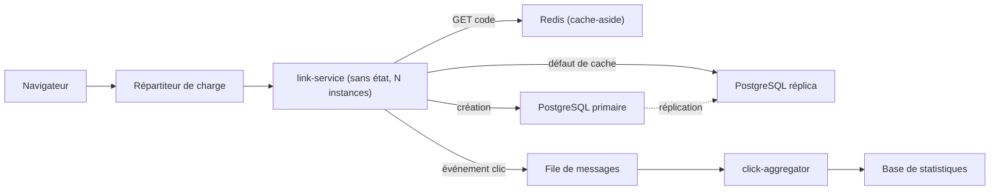
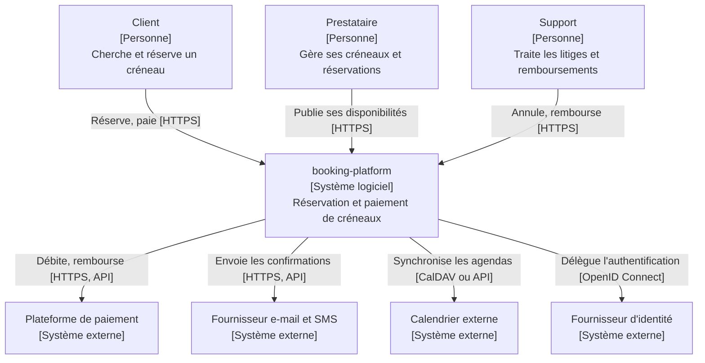
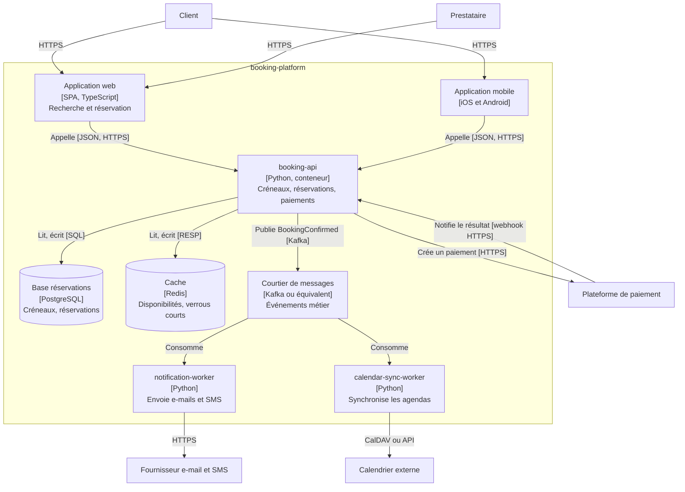
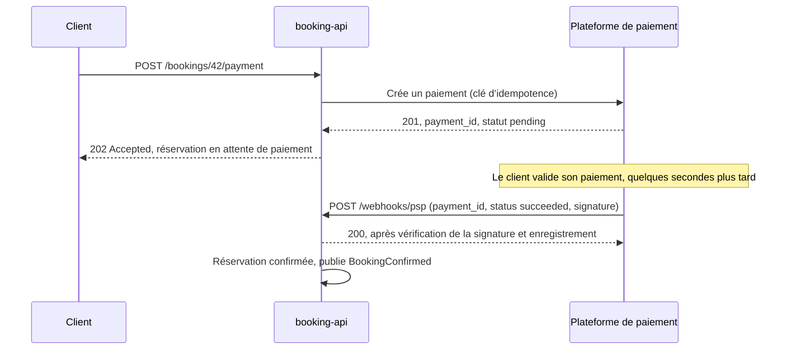
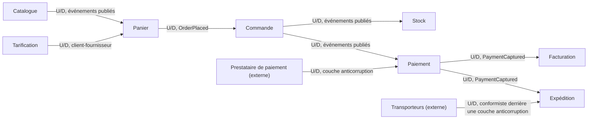
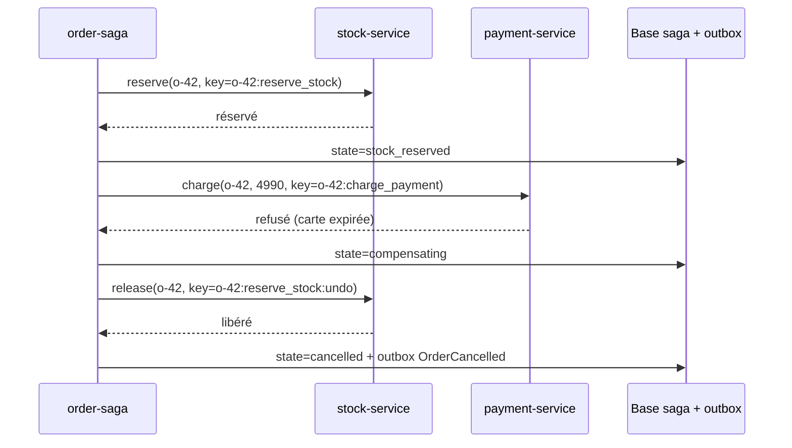
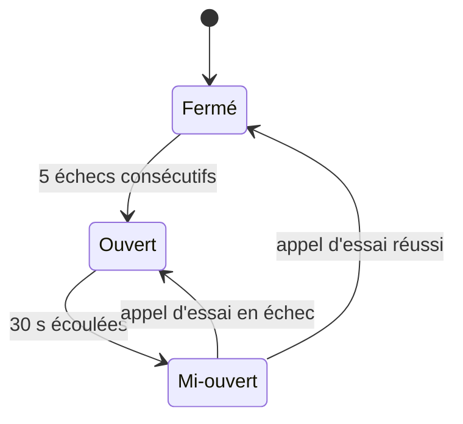
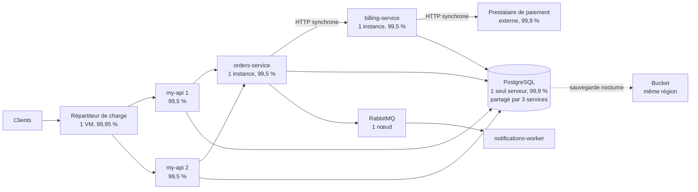
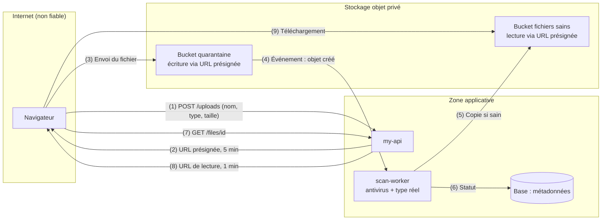
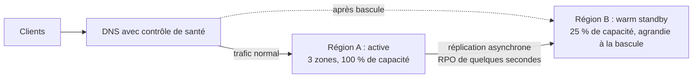

# Entretien Software Architect : les exercices en direct

!!! warning "Avertissement"
    Ces notes sont des pense-bêtes personnels, pas une source de vérité. Elles reflètent ma compréhension et mes choix : leur contenu reste subjectif, malgré les citations et les références qu'il contient. Il peut être incomplet, simplifié, inexact ou dépassé. Vérifiez toujours dans la documentation officielle avant de l'appliquer. Ce contenu est fourni tel quel, sans aucune garantie : son utilisation se fait sous votre seule responsabilité.

!!! audience "Pour qui, pour quoi"
    - **Métiers** : architecte logiciel, architecte de solution, Staff Engineer, tech lead, développeur senior qui vise un poste d'architecte.
    - **Usages** : je prépare un exercice de conception au tableau, comme le raccourcisseur d'URL, et je veux un corrigé complet ; je m'entraîne à écrire un ADR en vingt minutes ; je révise le calcul de disponibilité composée avant une revue d'architecture ; je veux un code de saga ou de client résilient que je sais expliquer à voix haute.

Cette page rassemble des exercices pratiques avec leurs corrigés détaillés. Elle complète [la page des questions](questions.md) : là où les questions demandent un raisonnement, les exercices demandent un résultat au tableau. Il n'existe pas de réponse unique ; je cherche plutôt des **réponses de référence concrètes** : schémas, estimations, décisions écrites, code de résilience et formulation orale.

Le poste visé est celui d'une personne qui conçoit des systèmes répartis sur plusieurs équipes et qui défend ses compromis. Les exercices sont donc surtout des exercices de conception au tableau, avec quelques morceaux de code là où l'architecture se joue dans le détail (saga, client résilient, règles de dépendances). Chaque exercice renvoie, par une ligne **À relire**, aux sections de Knowledge qui expliquent les notions dont il a besoin.

## Comment utiliser cette page

Un exercice d'architecture en direct (conception au tableau, « system design », revue d'un schéma) ne se juge pas sur le dessin final. Le recruteur regarde comment je passe d'un besoin flou à une solution argumentée, et si je sais dire ce que ma solution sacrifie. Pour chaque exercice :

1. **Je clarifie le besoin avant de dessiner** (5 minutes) : qui utilise le système, pour quoi faire, et surtout les <span class="term" data-term="quality-attribute">attributs de qualité</span> attendus (disponibilité, latence, cohérence, coût, sécurité). Je les écris au tableau : ils serviront à justifier chaque choix.
2. **J'estime les ordres de grandeur** (5 minutes) : requêtes par seconde en moyenne et en pic, volume stocké sur la durée de vie, rapport lectures sur écritures. J'arrondis franchement et j'annonce mes hypothèses à voix haute.
3. **Je dessine des boîtes simples, puis je zoome** (15 minutes) : d'abord une version qui marche pour le besoin de base, ensuite seulement la mise à l'échelle. Chaque flèche porte un verbe et un protocole.
4. **Je discute les <span class="term" data-term="trade-off">compromis</span>** (10 minutes) : pour chaque choix fort, je nomme l'option écartée et pourquoi. « J'ai choisi X parce que l'attribut Y compte plus que Z ici. »
5. **Je dis ce que je ne ferais pas** (5 minutes) : la file de messages inutile, le découpage en services prématuré, le cache sans stratégie d'invalidation. Refuser une complexité est une compétence d'architecte.
6. **Je garde 5 minutes pour les limites** : points de défaillance, ce qui casse en premier si le trafic est multiplié par dix, ce que je mesurerais.

Au total, je vise 45 minutes. Si le recruteur m'emmène sur un détail, je le suis : il teste souvent ma profondeur sur un point précis (génération d'identifiants, cohérence, reprise après panne). Les chiffres des corrigés sont des exemples pour l'exercice, pas des références de production. Le code est en Python, volontairement court.

---

## Exercice 1. Concevoir un raccourcisseur d’URL

### Énoncé

On me demande de concevoir un service qui transforme une URL longue en lien court (`https://sho.rt/aZ3k9Qx`) et qui redirige quiconque ouvre le lien court vers l’URL d’origine. Les liens sont créés par des utilisateurs connectés, ouverts par n’importe qui. Le produit veut aussi savoir combien de fois chaque lien est ouvert.

**À relire** : [Estimer la capacité](../../knowledge/architecture.md#estimer-la-capacite), [Où placer un cache](../../knowledge/architecture.md#ou-placer-un-cache), [Les codes de réponse](../../knowledge/api-rest-async.md#les-codes-de-reponse), [Des réplicas en lecture](../../knowledge/sql.md#des-replicas-en-lecture), [Exemple : un raccourcisseur d'URL](../../knowledge/architecture.md#exemple-un-raccourcisseur-durl), [Énumération des comptes](../../knowledge/securite.md#enumeration-des-comptes)

### Corrigé attendu

#### 1. Clarifier les exigences

<span class="term" data-term="requirements">Exigences</span> fonctionnelles à confirmer :

- Créer un lien court pour une URL longue, avec un alias personnalisé optionnel.
- Rediriger le lien court vers l’URL longue.
- Expiration optionnelle, suppression par le propriétaire.
- Compter les clics par lien (statistiques consultables avec quelques minutes de retard).

<span class="term" data-term="non-functional-requirement">Exigences non fonctionnelles</span>, celles qui dessinent l’architecture :

- La redirection est le chemin critique : très disponible, rapide (exemple de cible : p99 sous 50 ms côté serveur).
- Le code ne doit pas être devinable : on ne veut pas qu’un tiers énumère tous les liens.
- Un lien créé doit être utilisable immédiatement par son créateur.
- Les statistiques peuvent être en retard et légèrement approximatives.

#### 2. Estimer les ordres de grandeur

Hypothèses d’exemple, à annoncer comme telles : 100 millions de liens créés par mois, 100 lectures pour une écriture, conservation 5 ans, 500 octets par lien.

| Grandeur | <span class="term" data-term="back-of-envelope">Calcul de coin de table</span> | Résultat |
|---|---|---|
| Écritures | 100 M / (30 j x 86 400 s) | environ 40 par seconde |
| Lectures | 40 x 100 | environ 4 000 par seconde, 12 000 en pic (x3) |
| Liens sur 5 ans | 100 M x 12 x 5 | 6 milliards |
| Stockage | 6 milliards x 500 octets | environ 3 To |
| Espace des codes | 62 puissance 7 | environ 3 500 milliards de codes |

Conclusion à dire à voix haute : le système est très orienté lecture, l’écriture est modeste, le volume tient dans une base bien dimensionnée. Le vrai sujet est la latence et la disponibilité de la redirection.

#### 3. L’API

``` { .http .ex-ref title="Référence · création d'un lien" }
POST /api/links
Authorization: Bearer <token>
Content-Type: application/json

{"url": "https://example.com/a/very/long/path", "alias": null, "expires_at": null}

201 Created
{"code": "aZ3k9Qx", "short_url": "https://sho.rt/aZ3k9Qx"}
```

``` { .http .ex-ref title="Référence · redirection" }
GET /aZ3k9Qx

302 Found
Location: https://example.com/a/very/long/path
```

Le choix du code de <span class="term" data-term="http-redirect">redirection</span> est un vrai compromis (RFC 9110, 2022) : `301` (permanente) est mise en cache par les navigateurs, donc moins de charge mais des clics invisibles et une destination impossible à changer ; `302` (temporaire) fait passer chaque clic par le service, donc des statistiques justes. Comme le produit veut compter les clics, je prendrais `302`.

#### 4. Le modèle de données

``` { .sql .ex-illus title="Illustration · table des liens" }
-- Exemple : une ligne par lien, lue par son code
CREATE TABLE links (
    code        VARCHAR(16) PRIMARY KEY,
    long_url    TEXT        NOT NULL,
    owner_id    BIGINT      NOT NULL,
    created_at  TIMESTAMPTZ NOT NULL DEFAULT now(),
    expires_at  TIMESTAMPTZ NULL
);
-- Exemple : lister les liens d'un propriétaire
CREATE INDEX links_owner_idx ON links (owner_id, created_at);
```

Le seul accès critique est « trouver `long_url` par `code` » : une lecture par clé. Une base relationnelle suffit à ce volume ; une <span class="term" data-term="key-value-store">base clé-valeur</span> distribuée devient intéressante si le volume ou la répartition géographique l’exigent.

#### 5. Générer le code court

| Méthode | Principe | Avantage | Limite |
|---|---|---|---|
| Hachage de l’URL tronqué | Les 7 premiers caractères d’un hachage | Même URL, même code | Collisions à gérer, code lié au contenu |
| Compteur + <span class="term" data-term="base62">Base62</span> | Un compteur global encodé en Base62 | Aucune collision, codes courts | Codes devinables, compteur central à protéger |
| Blocs de compteur par instance | Chaque instance réserve 1 000 identifiants d’un coup | Pas d’appel central à chaque création | Trous dans la séquence, toujours devinable sans brouillage |
| Aléatoire + contrainte d’unicité | Tirer 7 caractères au hasard, insérer, retirer en cas de conflit | Simple, non devinable | Une requête de plus en cas de collision |

Je prendrais l’aléatoire avec une <span class="term" data-term="unique-constraint">contrainte d’unicité</span> : avec 6 milliards de liens dans 3 500 milliards de codes possibles, la probabilité de collision à l’insertion reste sous 0,2 % en fin de vie, donc un second essai de temps en temps.

La première idée, à éviter : un compteur encodé en Base62 donne des codes qui se suivent, donc n'importe qui énumère tous les liens en incrémentant le dernier code reçu.

``` { .python .ex-bad title="À éviter" }
# À éviter : des codes qui se suivent, donc devinables
def new_code(counter) -> str:
    return to_base62(counter.next())
```

La version retenue : des codes aléatoires et une contrainte d'unicité.

``` { .python .ex-good title="Recommandé" }
import secrets

ALPHABET = "0123456789abcdefghijklmnopqrstuvwxyzABCDEFGHIJKLMNOPQRSTUVWXYZ"
CODE_LENGTH = 7
MAX_ATTEMPTS = 5


# Bien : 7 caractères tirés au hasard, non devinables
def new_code() -> str:
    return "".join(secrets.choice(ALPHABET) for _ in range(CODE_LENGTH))


# Bien : insérer, et retirer un code seulement en cas de collision
def create_link(db, long_url: str, owner_id: int) -> str:
    for _ in range(MAX_ATTEMPTS):
        code = new_code()
        inserted = db.execute(
            "INSERT INTO links (code, long_url, owner_id) VALUES (%s, %s, %s) "
            "ON CONFLICT (code) DO NOTHING",
            (code, long_url, owner_id),
        ).rowcount
        if inserted == 1:
            return code
    raise RuntimeError("could not allocate a unique code")
```

#### 6. Tenir la charge en lecture

- **Instances <span class="term" data-term="stateless">sans état</span>** derrière un répartiteur de charge : on en ajoute selon la charge.
- **Cache en <span class="term" data-term="cache-aside">cache-aside</span>** devant la base : les liens récents et populaires concentrent l’essentiel des clics (hypothèse à vérifier sur les vraies données). 10 millions de liens chauds x 500 octets font 5 Go, une seule instance Redis suffit. Pas d’invalidation complexe : un lien ne change presque jamais, une suppression efface la clé.
- **Cache négatif** court pour les codes inexistants, sinon un robot qui teste des codes au hasard tape directement la base.
- **<span class="term" data-term="read-replica">Réplicas en lecture</span>** pour les défauts de cache. Le créateur qui ouvre son lien juste après l’avoir créé lit le primaire (ou le cache rempli à l’écriture), sinon il pourrait obtenir un `404` à cause du retard de réplication.
- **Clics hors du chemin critique** : la redirection publie un événement dans une file, un consommateur agrège les compteurs. Si la file est lente, la redirection ne l’est pas.
- **<span class="term" data-term="sharding">Partitionnement</span>** par hachage du code seulement si une base ne suffit plus en écriture ou en taille, ce que les estimations ne montrent pas.



#### Ce qu’un Software Architect doit ajouter

- Les abus : un raccourcisseur sert aussi à masquer du hameçonnage. Vérifier les URL soumises contre une liste de domaines malveillants, limiter le débit de création par compte.
- Ce que je ne ferais pas : des microservices séparés pour la création et la redirection dès le départ, une base NoSQL choisie « pour l’échelle » alors que 3 To et 40 écritures par seconde tiennent dans PostgreSQL.
- Ce qui casse en premier si le trafic est multiplié par dix : le cache (taille, nombre de connexions), puis la file des clics. La base primaire, elle, ne voit que les écritures.

#### Réponse orale possible

> « Je commence par les exigences : la redirection est le chemin critique, elle doit être rapide et disponible, les statistiques peuvent être en retard. À 100 millions de liens par mois, ça fait 40 écritures et 4 000 lectures par seconde : un système de lecture. Je génère des codes aléatoires de 7 caractères en Base62 avec une contrainte d’unicité, parce qu’ils sont non devinables et que les collisions restent rares. Je réponds en 302 pour compter les clics, je mets un cache devant la base et j’envoie les clics dans une file pour ne pas ralentir la redirection. Je ne partitionne pas la base tant que les chiffres ne le demandent pas. »

---

## Exercice 2. Rédiger un ADR : quelle base pour un catalogue produits ?

### Énoncé

`catalog-service` doit stocker 200 000 produits (exemple). Chaque catégorie a ses propres attributs : un livre a un ISBN et un nombre de pages, un vêtement une taille et une couleur, un téléviseur une diagonale et une classe énergétique. Deux équipes s’opposent : l’une veut PostgreSQL, que l’entreprise exploite déjà pour les commandes, l’autre veut une base orientée documents « parce que le schéma est variable ». Je dois rédiger l’<span class="term" data-term="adr">ADR</span> qui tranche.

**À relire** : [ADR](../../knowledge/architecture.md#adr), [Choisir le type de base](../../knowledge/architecture.md#choisir-le-type-de-base), [Concevoir avant de coder](../../knowledge/livraison.md#concevoir-avant-de-coder), [Remplacer un ADR dépassé](../../knowledge/architecture.md#remplacer-un-adr-depasse)

### Corrigé attendu

#### 1. Questions à poser avant d’écrire

- Qui lit le catalogue et comment ? Pages produit (lecture par identifiant), listes filtrées par attributs, recherche plein texte.
- La recherche à facettes (« taille M, couleur rouge, moins de 50 euros ») est-elle déjà confiée à un moteur de recherche ? Si oui, la base n’a pas à la servir.
- Faut-il des mises à jour transactionnelles avec d’autres données (prix, stock) ?
- Qui exploite la base la nuit ? Une nouvelle technologie, c’est une nouvelle astreinte.

#### 2. Les options

- **A. PostgreSQL** : colonnes typées pour les champs communs (nom, prix, catégorie), une colonne <span class="term" data-term="jsonb">JSONB</span> pour les attributs propres à la catégorie.
- **B. Une <span class="term" data-term="document-store">base orientée documents</span>** (par exemple MongoDB) : un document par produit, validé par un schéma JSON.
- **C. Modèle entité-attribut-valeur** dans PostgreSQL (une ligne par attribut et par produit). Je l’écarte d’emblée devant le recruteur : requêtes illisibles, aucun typage, jointures en cascade.

#### 3. La grille de critères

Les <span class="term" data-term="decision-criteria">critères de décision</span> et leurs poids sont posés avec les deux équipes **avant** de noter les options. Notes de 1 à 5, chiffres d’exemple.

| Critère | Poids | A. PostgreSQL + JSONB | B. Base documents |
|---|---|---|---|
| Attributs variables par catégorie | 3 | 4 (JSONB, validation par contrainte ou applicative) | 5 (natif, schéma JSON optionnel) |
| Requêtes sur les attributs | 2 | 4 (index GIN, opérateur `@>`) | 4 (index sur champs) |
| Transactions avec prix et stock | 2 | 5 (même base, une transaction) | 3 (transactions multi-documents depuis MongoDB 4.0, 2018) |
| Compétences et exploitation existantes | 3 | 5 (sauvegardes, astreinte, supervision déjà en place) | 2 (nouvelle technologie à exploiter) |
| Mise à l’échelle au-delà d’un serveur | 1 | 3 (réplicas en lecture, partitionnement plus coûteux) | 4 (partitionnement intégré) |
| **Total pondéré** | | **48** | **39** |

Le total n’est pas la décision : il rend la discussion explicite. Si l’équipe opposée conteste un poids, on discute le poids, pas la conclusion.

#### 4. L’ADR rempli

Format de Michael Nygard, « Documenting Architecture Decisions » (2011) : contexte, décision, conséquences.

``` { .markdown .ex-illus title="Illustration · ADR-012" }
# ADR-012 : Stocker le catalogue produits dans PostgreSQL avec une colonne JSONB

Statut : Accepté (2026-11-02, exemple)
Décideurs : ada (architecte), team-catalog, team-orders

## Contexte
- 200 000 produits, 30 catégories, attributs propres à chaque catégorie (exemples).
- La recherche à facettes est servie par le moteur de recherche existant, alimenté par événements.
- Le prix et le stock sont mis à jour avec le produit dans certains écrans d’administration.
- L’équipe plateforme exploite déjà PostgreSQL (sauvegardes, astreinte, supervision).

## Décision
Nous stockons les produits dans PostgreSQL : colonnes typées pour les champs communs,
une colonne `attributes JSONB` pour les attributs de catégorie, un index GIN sur cette colonne.
Le schéma de chaque catégorie est un JSON Schema versionné dans le dépôt et vérifié par l’application.

## Options écartées
- Base orientée documents : bien adaptée au schéma variable, mais une technologie de plus à exploiter,
  sans besoin de volume qui la justifie aujourd’hui.
- Entité-attribut-valeur : requêtes complexes, pas de typage.

## Conséquences
- Positives : une seule technologie de base, transactions avec prix et stock, outillage connu.
- Négatives : la validation des attributs est à notre charge ; les requêtes JSONB sont moins lisibles
  que des colonnes ; les attributs filtrés très souvent devront être promus en colonnes.
- À revoir si : le catalogue dépasse 50 millions de produits, ou si plus de la moitié des requêtes
  ne passent plus par le moteur de recherche.
```

#### 5. Ce que la décision donne en SQL

``` { .sql .ex-illus title="Illustration · le catalogue en SQL" }
-- Exemple : colonnes typées pour les champs communs, JSONB pour le reste
CREATE TABLE products (
    id          BIGINT PRIMARY KEY,
    name        TEXT          NOT NULL,
    category    TEXT          NOT NULL,
    price_cents INTEGER       NOT NULL CHECK (price_cents >= 0),
    attributes  JSONB         NOT NULL DEFAULT '{}'::jsonb,
    CHECK (jsonb_typeof(attributes) = 'object')
);
-- Exemple : un index GIN qui sert l'opérateur @>
CREATE INDEX products_attributes_gin ON products USING GIN (attributes jsonb_path_ops);

-- Exemple : les t-shirts rouges en taille M
SELECT id, name
FROM products
WHERE category = 'tshirt'
  AND attributes @> '{"color": "red", "size": "M"}';
```

L’<span class="term" data-term="gin-index">index GIN</span> avec `jsonb_path_ops` sert l’opérateur de contenance `@>`, plus compact que l’option par défaut mais limité à cet usage (documentation PostgreSQL, à vérifier pour la version utilisée). JSONB existe depuis PostgreSQL 9.4 (2014).

Le <span class="term" data-term="json-schema">JSON Schema</span> cité dans l’ADR : un document JSON qui décrit la forme attendue d’un autre document JSON (champs obligatoires, types, valeurs permises), ici dans sa version 2020-12. Celui de la catégorie `tshirt`, vérifié par l’application avant l’`INSERT` :

``` { .json .ex-ref title="Référence · JSON Schema de la catégorie tshirt" }
{
  "type": "object",
  "required": ["color", "size"],
  "properties": {
    "color": {"type": "string"},
    "size": {"enum": ["S", "M", "L", "XL"]}
  },
  "additionalProperties": false
}
```

Les attributs `{"color": "red", "size": "XXL"}` sont refusés avant d’atteindre la base, avec le message `'XXL' is not one of ['S', 'M', 'L', 'XL']` (bibliothèque Python `jsonschema`). Un champ inconnu, comme `{"colour": "red", ...}`, est refusé aussi grâce à `additionalProperties: false` : c’est ce qui évite qu’une faute de frappe crée un nouvel attribut en silence.

#### Ce qu’un Software Architect doit ajouter

- La clause « à revoir si » : une décision sans condition de révision devient un dogme. Les seuils doivent être mesurables.
- Le coût d’exploitation est un critère à part entière : il pèse souvent plus que la souplesse du modèle.
- Le risque de <span class="term" data-term="vendor-lock-in">dépendance au fournisseur</span> : JSONB et les opérateurs `@>` sont propres à PostgreSQL. C’est accepté, et écrit.
- Ce que je ne ferais pas : choisir une base pour un futur volume hypothétique, ou laisser chaque équipe choisir sa base sans ADR.

#### Réponse orale possible

> « Je pose d’abord les critères et leurs poids avec les deux équipes, avant de noter les options, pour que le débat porte sur ce qui compte. Le schéma variable est réel, mais JSONB le couvre, et la recherche à facettes est déjà dans le moteur de recherche. Ce qui fait pencher vers PostgreSQL, c’est l’exploitation existante et les transactions avec le prix et le stock. J’écris l’ADR avec les options écartées, les conséquences négatives assumées et des seuils de révision mesurables : au-delà, on rouvre la décision. »

---

## Exercice 3. Dessiner les vues C4 d’une plateforme de réservation

### Énoncé

`booking-platform` permet à des clients de réserver des créneaux chez des prestataires (coiffeurs, coachs, salles). Le client paie en ligne, reçoit une confirmation par e-mail ou SMS, et le prestataire voit ses réservations dans un agenda qu’il peut synchroniser avec un calendrier externe. Je dois dessiner les vues de contexte et de conteneurs, et expliquer à quoi sert chacune.

**À relire** : [Modèle C4](../../knowledge/architecture.md#modele-c4), [Webhook](../../knowledge/api-rest-async.md#webhook), [Écritures concurrentes](../../knowledge/sql.md#ecritures-concurrentes), [Contrainte d'exclusion : pas de créneaux qui se chevauchent](../../knowledge/sql.md#contrainte-dexclusion-pas-de-creneaux-qui-se-chevauchent)

### Corrigé attendu

#### 1. Le modèle C4 en deux phrases

Le <span class="term" data-term="c4-model">modèle C4</span> de Simon Brown (site c4model.com, popularisé au début des années 2010, date exacte à vérifier) décrit un logiciel en quatre niveaux de zoom : **contexte** (le système et son entourage), **conteneurs** (les applications et bases déployables), **composants** (les blocs à l’intérieur d’un conteneur), **code**. « Conteneur » ne veut pas dire conteneur Docker : c’est toute chose qui s’exécute ou stocke des données séparément (application web, API, base, file).

| Vue | Question à laquelle elle répond | Public | Durée de vie |
|---|---|---|---|
| Contexte | Qui utilise le système, de quoi dépend-il ? | Tout le monde, y compris le métier | Années |
| Conteneurs | Quelles briques techniques, comment communiquent-elles ? | Équipes techniques, sécurité, exploitation | Mois |
| Composants | Comment un conteneur est-il découpé ? | L’équipe du conteneur | Semaines (souvent généré ou omis) |
| Code | Classes et fonctions | Personne en entretien | Généré par l’outil, jamais dessiné à la main |

En entretien, les deux premières suffisent presque toujours.

#### 2. Vue de contexte



Cette vue tient sur une diapositive pour un comité de direction. Elle montre la <span class="term" data-term="system-boundary">frontière</span> du système et ses dépendances externes, donc les premiers risques : si la plateforme de paiement tombe, personne ne réserve. La synchronisation d’agenda passe par <span class="term" data-term="caldav">CalDAV</span>, le protocole standard d’échange d’agendas, ou par l’API du calendrier.

#### 3. Vue de conteneurs



Lecture à faire au recruteur : une seule API qui porte la logique métier, une base qui est la source de vérité des créneaux, et des tâches lentes ou peu fiables (e-mails, synchronisation d’agenda) sorties du chemin de réservation par un <span class="term" data-term="message-broker">courtier de messages</span>. Si le fournisseur de SMS est lent, la réservation ne l’est pas.

La flèche « <span class="term" data-term="webhook">webhook</span> » de la plateforme de paiement : un webhook est un appel HTTP que le prestataire fait vers nous quand un événement se produit, au lieu que nous l’interrogions en boucle. Le paiement devient donc asynchrone :



Pièges à citer : vérifier la signature (sinon n’importe qui confirme un paiement), traiter le webhook de façon idempotente (le prestataire le renvoie tant qu’il n’a pas reçu de 200), et ne pas dépendre du webhook seul : une tâche interroge le prestataire pour les paiements restés `pending` trop longtemps.

#### 4. La décision clé que la vue fait apparaître : pas de double réservation

Deux clients qui cliquent en même temps sur le même créneau, c'est le scénario qui compte. La version naïve vérifie puis insère, à éviter : deux instances de l'API passent la vérification au même instant, puis insèrent toutes les deux, donc deux clients obtiennent le même créneau.

``` { .python .ex-bad title="À éviter" }
# À éviter : vérifier puis insérer, en deux requêtes séparées
def book(db, provider_id: int, during) -> None:
    if not db.has_overlap(provider_id, during):
        db.insert_booking(provider_id, during)
```

La version qui tient : la base l'empêche, pas le cache ni le code applicatif.

``` { .sql .ex-good title="Recommandé" }
-- Bien : btree_gist permet de combiner = et && dans une contrainte
CREATE EXTENSION IF NOT EXISTS btree_gist;

-- Bien : la base refuse deux réservations actives qui se chevauchent
CREATE TABLE bookings (
    id          BIGINT PRIMARY KEY,
    provider_id BIGINT    NOT NULL,
    during      TSTZRANGE NOT NULL,
    status      TEXT      NOT NULL,
    EXCLUDE USING gist (provider_id WITH =, during WITH &&) WHERE (status <> 'cancelled')
);
```

La <span class="term" data-term="exclusion-constraint">contrainte d’exclusion</span> refuse deux réservations actives qui se chevauchent pour le même prestataire, même si deux instances de l’API écrivent en même temps.

#### 5. Règles de notation à respecter

- Chaque boîte a un nom, un type entre crochets, une technologie et une phrase de rôle.
- Chaque flèche a un verbe et un protocole. Une flèche sans libellé ne dit rien.
- Une légende et un titre par vue, la date ou la version du schéma.
- Les diagrammes vivent dans le dépôt, sous forme de texte (Mermaid, <span class="term" data-term="structurizr-dsl">Structurizr DSL</span>), et sont relus comme du code.

#### Ce qu’un Software Architect doit ajouter

- Une vue de déploiement (régions, zones, réseaux) quand la question porte sur la disponibilité, et une vue dynamique (diagramme de séquence) pour le parcours « réserver et payer ».
- Les <span class="term" data-term="spof">points de défaillance unique</span> visibles sur la vue de conteneurs : la base, la plateforme de paiement. Pour chacun, ce qui se passe s’il tombe.
- Ce que je ne ferais pas : découper `booking-api` en cinq services sur le schéma pour faire « moderne », ou dessiner la vue de code à la main.

#### Réponse orale possible

> « Je dessine d’abord la vue de contexte : trois types d’utilisateurs, quatre systèmes externes. Elle sert au métier et montre tout de suite nos dépendances critiques, comme le paiement. Puis la vue de conteneurs : une API, une base PostgreSQL source de vérité, un cache, et deux workers derrière un courtier de messages pour sortir les e-mails et la synchronisation d’agenda du chemin de réservation. Chaque flèche a un verbe et un protocole. La double réservation est empêchée par une contrainte d’exclusion dans la base, pas par le cache. Je ne descends au niveau composants que si on me le demande. »

---

## Exercice 4. Découper un monolithe e-commerce en bounded contexts

### Énoncé

`shop-monolith` est une application unique avec une base partagée de 20 tables : `customers`, `addresses`, `products`, `categories`, `product_images`, `prices`, `promotions`, `stock_levels`, `warehouses`, `carts`, `cart_items`, `orders`, `order_lines`, `payments`, `refunds`, `invoices`, `shipments`, `carriers`, `reviews`, `newsletter_subscriptions`. Quatre équipes y travaillent et se bloquent à chaque livraison. Je dois proposer un découpage, une carte des relations et l’ordre d’extraction.

**À relire** : [Découper le système](../../knowledge/architecture.md#decouper-le-systeme), [Event storming](../../knowledge/architecture.md#event-storming), [Carte de contextes](../../knowledge/architecture.md#carte-de-contextes), [Monolithe modulaire](../../knowledge/architecture.md#monolithe-modulaire), [Figuier étrangleur](../../knowledge/architecture.md#figuier-etrangleur)

### Corrigé attendu

#### 1. Questions à poser

- Quel problème veut-on résoudre : livraisons bloquées, charge inégale, fiabilité ? Le découpage ne se justifie que par un problème nommé.
- Quelles parties changent le plus souvent ? (L’historique Git le dit.)
- Quelles équipes existent, et pour quelles parties du métier ? D’après la <span class="term" data-term="conway-law">loi de Conway</span>, les frontières techniques suivront les frontières d’équipes.

#### 2. Résultat d’un atelier d’Event Storming

L’<span class="term" data-term="event-storming">Event Storming</span> (Alberto Brandolini, présenté à partir de 2013) réunit métier et technique devant un mur : on colle les <span class="term" data-term="domain-event">événements métier</span> dans l’ordre du temps, puis les commandes qui les déclenchent, puis on cherche où le vocabulaire change. Résultat condensé de l’atelier (exemple) :

| Commande | Événement métier | Données principales | Contexte candidat |
|---|---|---|---|
| Publier un produit | `ProductPublished` | `products`, `categories`, `product_images` | Catalogue |
| Changer un prix | `PriceChanged` | `prices`, `promotions` | Tarification |
| Recevoir du stock | `StockReceived` | `stock_levels`, `warehouses` | Stock |
| Ajouter au panier | `ItemAddedToCart` | `carts`, `cart_items` | Panier |
| Passer commande | `OrderPlaced` | `orders`, `order_lines` | Commande |
| Payer | `PaymentCaptured` | `payments`, `refunds` | Paiement |
| Facturer | `InvoiceIssued` | `invoices` | Facturation |
| Expédier | `ShipmentDispatched` | `shipments`, `carriers` | Expédition |
| Laisser un avis | `ReviewPosted` | `reviews` | Avis |
| S’inscrire | `CustomerRegistered` | `customers`, `addresses`, `newsletter_subscriptions` | Client |

Le signal le plus utile : le mot « produit » n’a pas le même sens partout. Pour le Catalogue, c’est une description et des images ; pour la Tarification, un prix et des règles ; pour le Stock, une référence et une quantité par entrepôt ; pour l’Expédition, un poids et des dimensions. Chaque sens distinct est un <span class="term" data-term="bounded-context">bounded context</span> candidat, avec son <span class="term" data-term="ubiquitous-language">langage omniprésent</span> (Eric Evans, « Domain-Driven Design », 2003). Erreur à éviter : un seul modèle `Product` partagé par tous.

#### 3. La carte de contextes

La <span class="term" data-term="context-map">carte de contextes</span> montre qui dépend de qui (U pour amont, D pour aval) et le type de relation, avec le vocabulaire d’Evans (2003).



Relations à nommer : **client-fournisseur** (l’aval exprime ses besoins, l’amont planifie), **conformiste** (l’aval subit le modèle de l’amont), **<span class="term" data-term="anti-corruption-layer">couche anticorruption</span>** (une traduction protège notre modèle d’un modèle externe), **langage publié** (des événements au format versionné). Je n’utiliserais pas de **noyau partagé** (un modèle commun à deux contextes) : c’est la base partagée sous un autre nom.

#### 4. Quoi extraire en premier, et pourquoi

| Critère | Expédition | Commande | Catalogue |
|---|---|---|---|
| Tables et <span class="term" data-term="foreign-key">clés étrangères</span> traversant la frontière | Peu (`shipments` lit l’adresse et les lignes) | Beaucoup (tout le monde lit `orders`) | Beaucoup (tout le monde lit `products`) |
| Couplage d’exécution | Asynchrone par nature (après paiement) | Synchrone au cœur du parcours | Lecture partout |
| Fréquence de changement | Élevée (nouveaux transporteurs) | Moyenne | Moyenne |
| Raison propre d’être séparé | Appels lents aux transporteurs, à isoler | Aucune immédiate | Charge de lecture, servie par un cache |
| Risque en cas d’erreur | Faible (retard d’expédition) | Élevé (perte de commandes) | Moyen |

Je commencerais par l’Expédition : peu de dépendances entrantes, un déclencheur naturel par événement (`PaymentCaptured`), une raison concrète de l’isoler, et un risque faible pour apprendre le chemin d’extraction. C’est le conseil de Sam Newman, « Monolith to Microservices » (2019) : commencer par un contexte facile et peu risqué, puis viser ceux qui rapportent le plus. La Commande, au centre de tout, passe en dernier, voire reste dans le monolithe.

#### 5. Le chemin d’extraction

1. **D’abord un <span class="term" data-term="modular-monolith">monolithe modulaire</span>** : chaque contexte devient un module, avec une règle qui interdit de lire les tables d’un autre module. Les violations se mesurent dans la CI (règles d’architecture) avant tout déploiement séparé.
2. **Remplacer les jointures par des appels ou des événements** : `shipments` ne joint plus `orders`, il reçoit les lignes et l’adresse dans l’événement `PaymentCaptured`.
3. **Étrangler progressivement** selon le <span class="term" data-term="strangler-fig">figuier étrangleur</span> (Martin Fowler, article « StranglerFigApplication », 2004) : le nouveau `shipping-service` reçoit d’abord les événements en parallèle, ses résultats sont comparés à ceux du monolithe, puis il prend la main transporteur par transporteur.
4. **Séparer les données** en dernier : copie initiale, synchronisation par <span class="term" data-term="cdc">CDC</span> pendant la transition, bascule, puis suppression des tables dans le monolithe.

#### Ce qu’un Software Architect doit ajouter

- Le piège du <span class="term" data-term="distributed-monolith">monolithe distribué</span> : extraire des services qui partagent encore la base ou s’appellent en chaîne donne tous les coûts du distribué sans aucun bénéfice.
- Une équipe propriétaire par contexte extrait, avec ses propres déploiements et astreintes. Sans propriétaire, pas d’extraction.
- Ce que je ne ferais pas : extraire les dix contextes. Avis, Client et Facturation peuvent très bien rester des modules du monolithe si rien ne les pousse dehors.

#### Réponse orale possible

> « Je demande d’abord quel problème on veut régler, parce qu’un découpage sans problème nommé ne fait qu’ajouter du réseau. Un atelier d’Event Storming fait apparaître les contextes : le mot produit n’a pas le même sens au catalogue, au stock et à l’expédition, c’est là que passent les frontières. Je dessine la carte de contextes avec des couches anticorruption vers les systèmes externes. J’extrairais l’Expédition en premier : peu de dépendances, un déclenchement par événement, un risque faible. Avant tout, je passerais par un monolithe modulaire pour vérifier les frontières dans le code, et je laisserais la Commande au centre tant qu’elle n’a pas de raison de partir. »

---

## Exercice 5. Saga de commande : paiement, stock, livraison et compensations

### Énoncé

Une commande traverse trois services : `stock-service` réserve les articles, `payment-service` débite le client, `shipping-service` crée l’expédition. Chaque service a sa propre base : une transaction unique est impossible. Je dois concevoir l’enchaînement, ce qui se passe quand une étape échoue, et comment le système survit à un redémarrage au mauvais moment, puis coder l’orchestrateur.

**À relire** : [Saga orchestrée ou chorégraphiée](../../knowledge/architecture.md#saga-orchestree-ou-choregraphiee), [Outbox](../../knowledge/architecture.md#outbox), [Idempotence](../../knowledge/architecture.md#idempotence), [Garanties de livraison](../../knowledge/api-rest-async.md#garanties-de-livraison), [Autorisation et capture du paiement](../../knowledge/architecture.md#autorisation-et-capture-du-paiement)

### Corrigé attendu

#### 1. Pourquoi une saga, et laquelle

Sans transaction distribuée, on enchaîne des transactions locales : c’est une <span class="term" data-term="saga-pattern">saga</span> (Hector Garcia-Molina et Kenneth Salem, « Sagas », 1987). Chaque étape réussie a une <span class="term" data-term="compensation">compensation</span> qui l’annule métier : on ne revient pas en arrière, on rembourse et on libère le stock.

| Style | Principe | Avantage | Limite |
|---|---|---|---|
| <span class="term" data-term="saga-orchestration">Orchestrée</span> | Un orchestrateur dit à chaque service quoi faire et garde l’état | Flux lisible en un seul endroit, état visible, facile à tester | Un composant de plus, risque d’y mettre de la logique métier des autres |
| <span class="term" data-term="saga-choreography">Chorégraphiée</span> | Chaque service réagit aux événements des autres | Pas de coordinateur | Flux éparpillé, cycles d’événements, difficile à suivre au-delà de trois étapes |

Avec trois étapes et des compensations, je choisirais l’orchestration : le flux et l’état de chaque commande se lisent à un seul endroit.

#### 2. L’ordre des étapes

Réserver le stock d’abord (facile à annuler, avec expiration automatique de la réservation), puis payer, puis expédier. L’étape la plus difficile à annuler (le paiement) passe le plus tard possible. Les compensations s’exécutent dans l’ordre inverse.

#### 3. L’orchestrateur comme machine à états

Les <span class="term" data-term="state-machine">états possibles</span> et les transitions autorisées sont explicites : une transition interdite lève une erreur au lieu de corrompre la commande.

``` { .python .ex-good title="Recommandé" }
from collections.abc import Callable
from dataclasses import dataclass, field
from enum import Enum


# Bien : les états de la saga, nommés
class SagaState(str, Enum):
    STARTED = "started"
    STOCK_RESERVED = "stock_reserved"
    PAID = "paid"
    COMPLETED = "completed"
    COMPENSATING = "compensating"
    CANCELLED = "cancelled"


# Bien : les transitions permises, tout le reste est refusé
ALLOWED = {
    SagaState.STARTED: {SagaState.STOCK_RESERVED, SagaState.COMPENSATING},
    SagaState.STOCK_RESERVED: {SagaState.PAID, SagaState.COMPENSATING},
    SagaState.PAID: {SagaState.COMPLETED, SagaState.COMPENSATING},
    SagaState.COMPENSATING: {SagaState.CANCELLED},
}


# Bien : un refus métier définitif, distinct d'un délai dépassé
class StepRejected(Exception):
    """Definitive business refusal: no retry, compensate."""


# Bien : une transition interdite lève une erreur
class InvalidTransition(Exception):
    pass


# Bien : l'état persistant d'une commande et les étapes déjà faites
@dataclass
class Saga:
    order_id: str
    amount_cents: int
    state: SagaState = SagaState.STARTED
    done: list[str] = field(default_factory=list)

    # Bien : refuser une transition non prévue
    def move_to(self, new_state: SagaState) -> None:
        if new_state not in ALLOWED.get(self.state, set()):
            raise InvalidTransition(f"{self.state} -> {new_state}")
        self.state = new_state


# Bien : une étape, sa compensation et l'état atteint
@dataclass(frozen=True)
class Step:
    name: str
    action: Callable[[Saga, str], None]
    compensation: Callable[[Saga, str], None] | None
    reached: SagaState


# Bien : l'orchestrateur, l'étape la plus dure à annuler en dernier
class OrderSaga:
    def __init__(self, stock, payment, shipping, store) -> None:
        self._store = store
        self._steps = [
            Step("reserve_stock",
                 lambda s, k: stock.reserve(s.order_id, key=k),
                 lambda s, k: stock.release(s.order_id, key=k),
                 SagaState.STOCK_RESERVED),
            Step("charge_payment",
                 lambda s, k: payment.charge(s.order_id, s.amount_cents, key=k),
                 lambda s, k: payment.refund(s.order_id, key=k),
                 SagaState.PAID),
            Step("create_shipment",
                 lambda s, k: shipping.create(s.order_id, key=k),
                 None,
                 SagaState.COMPLETED),
        ]

    # Bien : reprendre où la saga s'est arrêtée, compenser sur un refus
    def run(self, saga: Saga) -> Saga:
        if saga.state == SagaState.COMPENSATING:
            return self._compensate(saga)
        for step in self._steps:
            if step.name in saga.done:
                continue
            try:
                step.action(saga, f"{saga.order_id}:{step.name}")
            except StepRejected:
                saga.move_to(SagaState.COMPENSATING)
                self._store.save(saga)
                return self._compensate(saga)
            saga.done.append(step.name)
            saga.move_to(step.reached)
            event = "OrderConfirmed" if step.reached == SagaState.COMPLETED else None
            self._store.save(saga, event=event)
        return saga

    # Bien : compenser dans l'ordre inverse, puis publier OrderCancelled
    def _compensate(self, saga: Saga) -> Saga:
        by_name = {step.name: step for step in self._steps}
        for name in reversed(saga.done):
            step = by_name[name]
            if step.compensation is not None:
                step.compensation(saga, f"{saga.order_id}:{name}:undo")
        saga.move_to(SagaState.CANCELLED)
        self._store.save(saga, event="OrderCancelled")
        return saga
```

Deux types d’erreur, deux traitements : `StepRejected` (carte refusée, stock épuisé) est une réponse définitive, on compense. Un délai dépassé ne dit pas si l’étape a eu lieu : l’exception remonte, l’état sauvegardé reste celui d’avant, et une tâche de reprise relance `run` plus tard avec la même clé.

#### 4. L’étape idempotente, côté participant

Chaque appel porte une <span class="term" data-term="idempotency-key">clé d’idempotence</span> stable (`o-42:charge_payment`). Le participant la stocke avec une contrainte d’unicité et renvoie le résultat déjà enregistré si la clé revient :

``` { .sql .ex-good title="Recommandé" }
-- Bien : la clé d'idempotence est la clé primaire
CREATE TABLE charges (
    idempotency_key TEXT PRIMARY KEY,
    order_id        TEXT    NOT NULL,
    amount_cents    INTEGER NOT NULL,
    status          TEXT    NOT NULL
);
-- Bien : INSERT ... ON CONFLICT (idempotency_key) DO NOTHING, puis relire la ligne et renvoyer son statut
```

Les compensations suivent la même règle, et doivent accepter « rien à annuler » : rembourser un paiement qui n’a jamais eu lieu répond succès sans rien faire.

#### 5. L’outbox : changer l’état et publier sans perdre l’événement

Écrire en base puis publier dans le courtier est une <span class="term" data-term="dual-write">double écriture</span>, à éviter : un arrêt entre les deux perd l'événement.

``` { .python .ex-bad title="À éviter" }
# À éviter : écrire en base, puis publier dans le courtier
def save(db, broker, saga, event) -> None:
    db.update_saga(saga)
    broker.publish(event)
```

Avec le <span class="term" data-term="outbox-pattern">pattern outbox</span>, `store.save` fait les deux dans une seule transaction locale :

``` { .sql .ex-good title="Recommandé" }
-- Bien : l'état et l'événement dans la même transaction locale
BEGIN;
UPDATE sagas SET state = 'completed', done = '{reserve_stock,charge_payment,create_shipment}'
WHERE order_id = 'o-42';
INSERT INTO outbox (event_id, type, payload) VALUES (gen_random_uuid(), 'OrderConfirmed', '{"order_id": "o-42"}');
COMMIT;
```

Un relais lit `outbox` et publie. Il peut publier deux fois après un arrêt : la livraison est <span class="term" data-term="at-least-once">au moins une fois</span>, les consommateurs dédoublonnent sur `event_id`.

#### 6. Le chemin d’échec en séquence



#### 7. Chronologie d’un arrêt au pire moment

| Instant | Ce qui se passe | État sauvegardé |
|---|---|---|
| t0 | Stock réservé, état sauvegardé | `stock_reserved`, `done=[reserve_stock]` |
| t1 | `charge` envoyé, `payment-service` débite et enregistre la clé | `stock_reserved` |
| t2 | L’orchestrateur s’arrête avant de sauvegarder `paid` | `stock_reserved` |
| t3 | Redémarrage, la tâche de reprise relance `run` | `stock_reserved` |
| t4 | `charge` renvoyé avec la même clé : `payment-service` renvoie le résultat de t1 sans redébiter | `paid` |
| t5 | Expédition créée, `OrderConfirmed` dans l’outbox | `completed` |

Sans clé d’idempotence, t4 débiterait le client deux fois.

#### 8. Les tests

``` { .python .ex-good title="Recommandé" }
# Bien : un paiement refusé libère le stock et publie OrderCancelled
def test_declined_payment_releases_the_stock():
    saga_runner, journal, store = build(reject_payment=True)
    saga = saga_runner.run(Saga("o-2", 4990))
    assert saga.state == SagaState.CANCELLED
    assert journal == ["stock.reserve", "stock.release"]
    assert store.outbox == ["OrderCancelled"]


# Bien : les compensations passent dans l'ordre inverse
def test_shipping_failure_compensates_in_reverse_order():
    saga_runner, journal, _ = build(reject_shipping=True)
    saga_runner.run(Saga("o-3", 4990))
    assert journal[-2:] == ["payment.refund", "stock.release"]


# Bien : une reprise après arrêt ne refait pas les étapes finies
def test_resume_after_crash_does_not_redo_finished_steps():
    saga_runner, journal, _ = build()
    saga = Saga("o-4", 4990, state=SagaState.STOCK_RESERVED, done=["reserve_stock"])
    saga_runner.run(saga)
    assert journal == ["payment.charge", "shipping.create"]
```

`build` assemble l’orchestrateur avec des faux services qui journalisent chaque appel et ignorent une clé déjà vue, et un faux stockage qui garde les événements de l’outbox.

#### Ce qu’un Software Architect doit ajouter

- La <span class="term" data-term="eventual-consistency">cohérence à terme</span> se voit côté client : la commande passe par « en cours » avant « confirmée ». Le produit doit valider cet affichage.
- Une variante plus sûre pour le paiement : <span class="term" data-term="payment-authorization-capture">autoriser au moment de la commande, capturer à l’expédition</span>. Un échec d’expédition annule l’autorisation au lieu de rembourser.
- Une saga bloquée (compensation qui échoue encore et encore) doit alerter et finir dans une file de traitement manuel, avec un tableau de bord des sagas par état et par âge.
- Ce que je ne ferais pas : un <span class="term" data-term="two-phase-commit">commit à deux phases</span> entre trois services et un prestataire de paiement externe, qui ne le supporte de toute façon pas.

#### Réponse orale possible

> « Pas de transaction distribuée possible, donc une saga orchestrée : un orchestrateur, une machine à états explicite, l’étape la plus dure à annuler en dernier. Une réponse métier négative déclenche les compensations dans l’ordre inverse ; un délai dépassé ne prouve rien, donc on réessaie plus tard avec la même clé d’idempotence, et chaque participant ignore une clé déjà vue. L’état et l’événement de fin sont écrits dans la même transaction grâce à l’outbox, et les consommateurs dédoublonnent. Le scénario que je teste en priorité : un arrêt entre l’appel au paiement et la sauvegarde de l’état. »

**Voir aussi** : [Entretien Staff Engineer : les exercices](../staff-engineer/exercices.md), pour l'idempotence d'une API de création et la double soumission.

---

## Exercice 6. Client résilient : timeout, retry avec backoff et jitter, circuit breaker

### Énoncé

`orders-service` appelle `pricing-service` en HTTP à chaque commande. Hier, `pricing-service` a ralenti pendant dix minutes : les threads de `orders-service` ont tous attendu, puis `orders-service` est tombé à son tour, puis le site entier. Je dois écrire un client qui empêche que cela se reproduise, avec ses tests, et expliquer ce que sont les tempêtes de retries.

**À relire** : [Timeout](../../knowledge/architecture.md#timeout), [Retry, backoff exponentiel et gigue](../../knowledge/architecture.md#retry-backoff-exponentiel-et-gigue), [Budget de retry](../../knowledge/architecture.md#budget-de-retry), [Disjoncteur](../../knowledge/architecture.md#disjoncteur), [Les méthodes HTTP](../../knowledge/api-rest-async.md#les-methodes-http), [Simuler un tiers en erreur ou lent](../../knowledge/qualite.md#simuler-un-tiers-en-erreur-ou-lent)

### Corrigé attendu

#### 1. Ce qui s’est passé

Sans <span class="term" data-term="timeout">délai d’attente</span>, chaque appel lent garde un thread et une connexion. Quand tous sont occupés, `orders-service` ne répond plus, et ses propres appelants attendent à leur tour : ce sont des <span class="term" data-term="cascading-calls">appels en cascade</span>. Michael Nygard décrit ce scénario et ses parades dans « Release It! » (2007, 2e édition 2018).

#### 2. Les quatre parades, dans l’ordre

| Parade | Ce qu’elle évite | Réglage de départ (exemple) |
|---|---|---|
| Délai d’attente | Attendre indéfiniment | Un peu au-dessus du <span class="term" data-term="p999">p99.9</span> de la dépendance, par exemple 500 ms |
| Retry avec <span class="term" data-term="exponential-backoff">backoff exponentiel</span> et <span class="term" data-term="jitter">jitter</span> | Échouer sur une erreur passagère | 3 tentatives au plus, délai aléatoire entre 0 et 100 ms, 200 ms, plafonné à 2 s |
| <span class="term" data-term="retry-budget">Budget de retries</span> | Multiplier la charge quand la dépendance est malade | Retries limités à 10 % des requêtes |
| <span class="term" data-term="circuit-breaker">Disjoncteur</span> | Appeler une dépendance qu’on sait en panne | Ouvert après 5 échecs, essai après 30 s |

Règle absolue : on ne réessaie que les appels <span class="term" data-term="idempotency">idempotents</span>. Selon la RFC 9110 (2022), `GET`, `HEAD`, `PUT` et `DELETE` le sont, `POST` et `PATCH` non. Un `POST` devient réessayable s’il porte une clé d’idempotence que le serveur respecte.

#### 3. Le code

Le client d'hier, à éviter : aucun délai d'attente, donc chaque appel lent garde un thread jusqu'à ce que tous soient pris.

``` { .python .ex-bad title="À éviter" }
import requests


# À éviter : un appel sans délai d'attente ni retry borné
def get_price(product_id: str) -> int:
    response = requests.get(f"http://pricing-service/prices/{product_id}")
    return response.json()["cents"]
```

La version qui tient :

``` { .python .ex-good title="Recommandé" }
import random
import time
from collections.abc import Callable
from typing import TypeVar

T = TypeVar("T")


# Bien : seules les erreurs passagères sont réessayées
class TransientError(Exception):
    """Timeout, connection reset, 503: the call may succeed if repeated."""


# Bien : le disjoncteur refuse sans appeler la dépendance
class CircuitOpenError(Exception):
    """The breaker refuses the call without contacting the dependency."""


# Bien : fermé, ouvert ou mi-ouvert selon les échecs et le temps
class CircuitBreaker:
    # Bien : seuil, délai de réouverture et horloge injectée
    def __init__(
        self,
        failure_threshold: int = 5,
        reset_timeout: float = 30.0,
        clock: Callable[[], float] = time.monotonic,
    ) -> None:
        self._threshold = failure_threshold
        self._reset_timeout = reset_timeout
        self._clock = clock
        self._failures = 0
        self._opened_at: float | None = None

    # Bien : l'état se déduit de l'heure d'ouverture
    @property
    def state(self) -> str:
        if self._opened_at is None:
            return "closed"
        if self._clock() - self._opened_at >= self._reset_timeout:
            return "half_open"
        return "open"

    # Bien : refuser tant que le disjoncteur est ouvert
    def allow_request(self) -> bool:
        return self.state != "open"

    # Bien : un succès referme le disjoncteur
    def record_success(self) -> None:
        self._failures = 0
        self._opened_at = None

    # Bien : un échec en mi-ouvert rouvre, sinon il est compté
    def record_failure(self) -> None:
        if self.state == "half_open":
            self._opened_at = self._clock()
            return
        self._failures += 1
        if self._failures >= self._threshold:
            self._opened_at = self._clock()


# Bien : des retries plafonnés à une part du trafic
class RetryBudget:
    """Each request earns `ratio` token, each retry spends one."""

    # Bien : le budget part plein
    def __init__(self, ratio: float = 0.1, max_tokens: float = 10.0) -> None:
        self._ratio = ratio
        self._max = max_tokens
        self._tokens = max_tokens

    # Bien : chaque requête rapporte une fraction de jeton
    def record_request(self) -> None:
        self._tokens = min(self._max, self._tokens + self._ratio)

    # Bien : un retry coûte un jeton, plus de jeton, plus de retry
    def try_spend(self) -> bool:
        if self._tokens < 1:
            return False
        self._tokens -= 1
        return True


# Bien : jitter complet sous un plafond exponentiel
def backoff_delay(attempt: int, base: float, cap: float, rng: random.Random) -> float:
    """Full jitter: a random delay between 0 and the exponential ceiling."""
    return rng.uniform(0, min(cap, base * 2**attempt))


# Bien : délai d'attente, retries bornés, budget et disjoncteur réunis
class ResilientClient:
    # Bien : sleep et hasard injectés pour des tests sans attente
    def __init__(
        self,
        breaker: CircuitBreaker,
        budget: RetryBudget,
        timeout: float = 0.5,
        max_attempts: int = 3,
        base_delay: float = 0.1,
        max_delay: float = 2.0,
        sleep: Callable[[float], None] = time.sleep,
        rng: random.Random | None = None,
    ) -> None:
        self._breaker = breaker
        self._budget = budget
        self._timeout = timeout
        self._max_attempts = max_attempts
        self._base = base_delay
        self._cap = max_delay
        self._sleep = sleep
        self._rng = rng or random.Random()

    # Bien : un seul essai si l'appel n'est pas idempotent
    def call(self, operation: Callable[[float], T], *, idempotent: bool) -> T:
        self._budget.record_request()
        attempts = self._max_attempts if idempotent else 1
        for attempt in range(attempts):
            if not self._breaker.allow_request():
                raise CircuitOpenError("dependency marked as down")
            try:
                result = operation(self._timeout)
            except TransientError:
                self._breaker.record_failure()
                is_last = attempt == attempts - 1
                if is_last or not self._budget.try_spend():
                    raise
                self._sleep(backoff_delay(attempt, self._base, self._cap, self._rng))
                continue
            self._breaker.record_success()
            return result
        raise AssertionError("unreachable")
```

Choix à expliquer : `operation` reçoit le délai d’attente et le passe au client HTTP ; seules les erreurs passagères comptent pour le disjoncteur (un `400` est une erreur de l’appelant, pas une panne de la dépendance) ; l’horloge, le `sleep` et le générateur aléatoire sont injectés pour des tests sans attente réelle. Le jitter « complet » vient de Marc Brooker, « Exponential Backoff And Jitter », AWS Architecture Blog (2015).

#### 4. Les états du disjoncteur



Ouvert, le client échoue tout de suite sans appeler : `orders-service` peut répondre avec un prix en cache ou un message clair au lieu de s’effondrer. Cette version laisse passer tous les appels en mi-ouvert ; une version de production n’en laisserait passer qu’un nombre limité.

#### 5. Les tests

``` { .python .ex-good title="Recommandé" }
import pytest


# Bien : un appel idempotent est réessayé avec des délais croissants et bornés
def test_idempotent_call_is_retried_with_growing_bounded_delays():
    sleeps, now = [], [0.0]
    client, _ = make_client(sleeps, now)
    dependency = FlakyDependency(failures=2)

    assert client.call(dependency, idempotent=True) == "ok"
    assert dependency.calls == 3
    assert 0 <= sleeps[0] <= 0.1
    assert 0 <= sleeps[1] <= 0.2


# Bien : un appel non idempotent n'est jamais réessayé
def test_non_idempotent_call_is_never_retried():
    sleeps, now = [], [0.0]
    client, _ = make_client(sleeps, now)
    dependency = FlakyDependency(failures=1)

    with pytest.raises(TransientError):
        client.call(dependency, idempotent=False)
    assert dependency.calls == 1


# Bien : le disjoncteur s'ouvre, puis laisse passer un essai
def test_breaker_opens_then_lets_a_trial_through():
    sleeps, now = [], [0.0]
    client, breaker = make_client(sleeps, now, threshold=2)
    always_down = FlakyDependency(failures=100)
    for _ in range(2):
        with pytest.raises(TransientError):
            client.call(always_down, idempotent=False)

    with pytest.raises(CircuitOpenError):
        client.call(always_down, idempotent=False)
    assert always_down.calls == 2

    now[0] = 31.0
    assert client.call(FlakyDependency(failures=0), idempotent=True) == "ok"
    assert breaker.state == "closed"


# Bien : un budget vide arrête les retries
def test_empty_budget_stops_retries():
    sleeps, now = [], [0.0]
    client, _ = make_client(sleeps, now, budget=RetryBudget(ratio=0.1, max_tokens=0))
    dependency = FlakyDependency(failures=1)

    with pytest.raises(TransientError):
        client.call(dependency, idempotent=True)
    assert dependency.calls == 1
```

`FlakyDependency(failures=n)` échoue `n` fois puis répond `"ok"` ; `make_client` injecte une liste pour `sleep`, une horloge modifiable et un générateur aléatoire à graine fixe.

#### 6. Les tempêtes de retries

Une <span class="term" data-term="retry-storm">tempête de retries</span>, c’est quand les retries censés aider une dépendance fragile l’achèvent. Exemple : trois couches (`gateway`, `orders-service`, `pricing-service`) qui font chacune jusqu’à 3 retries, soit 4 tentatives. Quand la base derrière `pricing-service` sature, une requête utilisateur devient 4 x 4 x 4 = 64 requêtes sur cette base, au moment exact où elle a le moins de marge. Et sans jitter, tous les clients réessaient au même instant, par vagues.

Les parades se combinent :

- **Retry à un seul niveau** de la pile, celui qui appelle directement la dépendance ; les autres échouent vite.
- **Budget de retries** : Google, « Site Reliability Engineering » (2016), chapitre sur la surcharge, propose au plus 3 tentatives par requête et un ratio de retries de 10 % par client. Quand la dépendance est malade, le budget s’épuise et la charge reste à environ 1,1 fois le trafic normal au lieu de 3 fois.
- **Jitter** pour étaler les retries dans le temps.
- **Respecter `Retry-After`** et ne jamais réessayer un `429` ou un `503` avant le délai indiqué.
- **Propager une échéance** : si la requête d’origine a 2 s au total, inutile de lancer un retry à 1,9 s.

#### Ce qu’un Software Architect doit ajouter

- Le comportement dégradé est une décision produit : prix en cache de moins de 5 minutes, ou refus de la commande ? Il se décide avant l’incident.
- Les bibliothèques existent (Resilience4j en Java, Polly en .NET, tenacity en Python, ou un <span class="term" data-term="service-mesh">maillage de services</span> comme Envoy) : en production, j’en prendrais une plutôt que ce code, qui sert à montrer que je comprends le mécanisme.
- Des métriques par dépendance : taux de retries, état du disjoncteur, délais dépassés. Un disjoncteur qui s’ouvre doit être visible sur un tableau de bord.
- Ce que je ne ferais pas : des retries à chaque couche, un délai d’attente plus long que celui de l’appelant, ou des retries sur un `POST` sans clé d’idempotence.

#### Réponse orale possible

> « La panne vient de l’absence de délai d’attente : les threads ont attendu, et la lenteur s’est propagée. Je mets un délai calé sur le p99.9 de la dépendance, des retries uniquement sur les appels idempotents, avec backoff exponentiel et jitter complet, plafonnés par un budget de 10 %. Un disjoncteur coupe les appels après plusieurs échecs et laisse passer un essai après 30 secondes. Je ne réessaie qu’à un seul niveau de la pile, sinon trois couches de trois retries font 64 fois la charge sur la dépendance malade. Et je décide avec le produit ce qu’on affiche quand le disjoncteur est ouvert. »

---

## Exercice 7. Estimation de capacité : un service de notifications pour 10 millions d’utilisateurs

### Énoncé

On me demande de dimensionner `notifications-service` : il envoie des notifications push, e-mail et in-app aux 10 millions d’utilisateurs inscrits d’une application. Le marketing veut aussi pouvoir envoyer une campagne à tout le monde d’un coup. Je dois donner, en 20 minutes et au tableau, le nombre de requêtes par seconde (moyenne et pic), le stockage sur un an, la bande passante et le nombre d’instances. Pas de bonne réponse unique : on regarde mes hypothèses et mon raisonnement.

**À relire** : [QPS moyen et pic](../../knowledge/architecture.md#qps-moyen-et-pic), [Loi de Little](../../knowledge/architecture.md#loi-de-little), [Et la base de données](../../knowledge/architecture.md#et-la-base-de-donnees), [Quoi utiliser pour scaler](../../knowledge/kubernetes-echelle.md#quoi-utiliser-pour-scaler)

### Corrigé attendu

#### 1. Poser les hypothèses avant de calculer

Un <span class="term" data-term="back-of-envelope">calcul de coin de table</span> ne vaut que par ses hypothèses : les écrire au tableau, les faire valider, et garder des chiffres ronds. **Tous les chiffres ci-dessous sont des exemples**, à remplacer par ceux du contexte réel.

| Hypothèse | Valeur d’exemple | Question à poser pour la valider |
|---|---|---|
| Utilisateurs inscrits | 10 millions | Donnée de l’énoncé |
| Utilisateurs actifs par jour | 30 %, soit 3 millions | Quel ratio actifs / inscrits aujourd’hui ? |
| Notifications par utilisateur actif et par jour | 5 | Combien de types de notifications, quelle fréquence ? |
| Consultations de la boîte in-app | 4 par utilisateur actif et par jour | L’in-app est-il paginé, mis en cache ? |
| Facteur de pic journalier | × 5 la moyenne | Y a-t-il des heures creuses la nuit ? |
| Campagne à tous les inscrits | 10 millions en 10 minutes | Le délai de 10 minutes est-il un vrai besoin ? |
| Taille d’une notification stockée | 500 octets (identifiants, type, texte, statut, dates) | Texte riche, images, traductions ? |
| Taille d’un appel au fournisseur push | 2 Ko avec les en-têtes HTTP | Payload maximal du fournisseur (à vérifier dans sa documentation) |
| Latence d’un appel au fournisseur push | 100 ms | Mesurée ou supposée ? |

Astuce de calcul mental : une journée compte 86 400 secondes, qu’on arrondit à 100 000 (10^5). Diviser un volume journalier par 10^5 donne une moyenne par seconde légèrement sous-estimée, ce qui est acceptable pour un ordre de grandeur.

#### 2. Requêtes par seconde : moyenne, pic, campagne

On compte en <span class="term" data-term="qps">QPS</span>, séparément pour l’écriture (envoi) et la lecture (boîte in-app), parce qu’elles ne se dimensionnent pas pareil.

| Grandeur | Calcul | Résultat (exemple) |
|---|---|---|
| Notifications par jour | 3 M actifs × 5 | 15 millions |
| Envois, moyenne | 15 M / 86 400 s | ≈ 175 /s |
| Envois, pic journalier | 175 × 5 | ≈ 870 /s |
| Envois, campagne en 10 min | 10 M / 600 s | ≈ 16 700 /s |
| Envois, campagne en 1 h | 10 M / 3 600 s | ≈ 2 800 /s |
| Lectures in-app, moyenne | 3 M × 4 / 86 400 s | ≈ 140 /s |
| Lectures in-app, pic | 140 × 5 | ≈ 700 /s |

Le chiffre qui dimensionne le système n’est ni la moyenne ni le pic journalier, mais **la campagne** : 20 fois le pic normal. C’est la première chose à dire au recruteur, et la première décision à faire remonter : étaler la campagne sur une heure divise le besoin par six.

#### 3. Stockage sur un an

| Grandeur | Calcul | Résultat (exemple) |
|---|---|---|
| Notifications, brut par jour | 15 M × 500 o | 7,5 Go |
| Notifications, brut par an | 7,5 Go × 365 | ≈ 2,7 To |
| Avec les index (+ 50 %) | 2,7 To × 1,5 | ≈ 4,1 To |
| Avec 3 copies (réplication) | 4,1 To × 3 | ≈ 12,3 To |
| Si on ne garde que 90 jours en base | 7,5 Go × 90 × 1,5 × 3 | ≈ 3 To |
| Événements de suivi (envoyé, reçu, ouvert) | 15 M × 3 × 200 o × 365 | ≈ 3,3 To par an, en stockage objet |

La décision qui change le plus le résultat est la **durée de conservation** : personne ne relit une notification d’il y a deux ans. Je proposerais 90 jours en base, puis un archivage en stockage objet (moins cher, interrogeable si besoin).

#### 4. Bande passante sortante

| Grandeur | Calcul | Résultat (exemple) |
|---|---|---|
| Moyenne | 175 /s × 2 Ko × 8 bits | ≈ 2,8 Mbit/s |
| Campagne en 10 min | 16 700 /s × 2 Ko × 8 bits | ≈ 270 Mbit/s |

La bande passante n’est pas le problème ici. La vraie limite sera plutôt celle du fournisseur push (quotas, <span class="term" data-term="rate-limit">limite de débit</span>), à vérifier dans son contrat.

#### 5. Nombre d’instances

Les envois partent dans un <span class="term" data-term="message-broker">broker de messages</span> et sont consommés par des <span class="term" data-term="worker">workers</span>. Pour savoir combien d’appels sont en vol en même temps, on utilise la <span class="term" data-term="littles-law">loi de Little</span> (John D. C. Little, 1961) : requêtes en cours = débit × durée de chaque requête.

| Grandeur | Calcul | Résultat (exemple) |
|---|---|---|
| Appels en vol pendant la campagne | 16 700 /s × 0,1 s | ≈ 1 700 appels simultanés |
| Capacité d’un worker asynchrone | 200 appels simultanés / 0,1 s | 2 000 /s en théorie |
| Capacité utile (cible 50 % d’utilisation) | 2 000 × 0,5 | 1 000 /s par worker |
| Workers pour la campagne en 10 min | 16 700 / 1 000, + 2 de marge | ≈ 19 |
| Workers pour la campagne en 1 h | 2 800 / 1 000, + 2 de marge | ≈ 5 |
| Instances de l’API de lecture in-app | 700 /s / 250 /s utiles par instance | 3, minimum 3 pour couvrir trois zones |
| Messages en attente dans le broker au départ d’une campagne | 10 M × 1 Ko | ≈ 10 Go |

La capacité d’une instance (200 appels simultanés, 250 requêtes utiles par seconde) est une hypothèse : elle se mesure avec un test de charge, jamais au tableau. Je le dirais explicitement.

#### 6. Ce que les chiffres changent dans la conception

- **Écriture en base pendant la campagne** : 16 700 insertions par seconde sur une seule base relationnelle est un risque. Options : insérer par lots, ne créer la ligne in-app qu’à l’ouverture de l’application, ou partitionner par `user_id`.
- **Absorber le pic** : le broker sert de tampon, l’<span class="term" data-term="autoscaling">autoscaling</span> des workers se règle sur la profondeur de la file, pas sur le CPU.
- **Doublons** : un broker livre <span class="term" data-term="at-least-once">au moins une fois</span>, donc un envoi doit être <span class="term" data-term="idempotency">idempotent</span> (clé `campaign_id` + `user_id`), sinon un redémarrage renvoie la notification.

#### Ce qu’un Software Architect doit ajouter

- Faire valider les trois hypothèses qui pèsent le plus (durée de campagne, conservation, ratio d’actifs) par le produit, et les écrire dans l’ADR.
- Mettre les chiffres en regard du coût : 19 workers pendant 10 minutes ou 5 workers pendant une heure, c’est une décision produit, pas technique.
- Prévoir un test de charge qui rejoue une campagne à l’échelle 1/10 avant la première vraie campagne.

#### Réponse orale possible

> « Je pose d’abord mes hypothèses : 30 % d’actifs, 5 notifications par jour, 500 octets par notification, ce sont des exemples à valider. Cela donne environ 175 envois par seconde en moyenne, 870 au pic, mais une campagne à 10 millions en 10 minutes monte à 16 700 par seconde : c’est elle qui dimensionne tout. Avec la loi de Little et 100 ms par appel, j’ai 1 700 appels en vol, soit une vingtaine de workers. Étaler la campagne sur une heure ramène ça à cinq : je poserais la question au produit. Côté stockage, 2,7 To bruts par an, mais 90 jours de conservation suffisent sans doute. Et je validerais la capacité réelle d’une instance par un test de charge. »

---

## Exercice 8. Revue d’architecture : trouver les points de défaillance unique

### Énoncé

Voici l’architecture actuelle de la prise de commande. L’équipe demande une revue avant un salon commercial qui doit tripler le trafic. Je dois trouver les points faibles, chiffrer la disponibilité actuelle et proposer un plan, classé par rapport coût / bénéfice. Les disponibilités indiquées sont des exemples.



Le tout tourne dans une seule zone d’une seule région (zone : 99,9 %, exemple).

**À relire** : [Point unique de défaillance](../../knowledge/architecture.md#point-unique-de-defaillance), [Disponibilité composée](../../knowledge/architecture.md#disponibilite-composee), [Zones et régions](../../knowledge/architecture.md#zones-et-regions), [S'entraîner : game days et chaos engineering](../../knowledge/incidents.md#sentrainer-game-days-et-chaos-engineering)

### Corrigé attendu

#### 1. Lister les points de défaillance unique

Un <span class="term" data-term="spof">point de défaillance unique</span> (SPOF) est un élément dont la panne seule arrête le service. Je les cherche en suivant le chemin d’une commande, de gauche à droite.

| Élément | Pourquoi c’est un SPOF | Conséquence s’il tombe |
|---|---|---|
| Répartiteur de charge sur 1 VM | Aucune copie | Plus rien ne rentre |
| `orders-service`, 1 instance | Aucune copie, et chaque déploiement le coupe | Plus de commande |
| `billing-service`, 1 instance | Idem, et il est sur le chemin synchrone | Plus de commande |
| Prestataire de paiement | Externe, appelé en synchrone | Plus de commande, alors qu’on pourrait accepter et payer plus tard |
| PostgreSQL, 1 serveur | Aucune réplique, partagé par 3 services | Tout s’arrête, et une requête lente de l’un ralentit les autres : <span class="term" data-term="blast-radius">rayon d’impact</span> maximal |
| RabbitMQ, 1 nœud | Pas de cluster | Les notifications s’arrêtent, et la commande échoue si `orders-service` publie de façon bloquante |
| La zone (et la région) | Tout est au même endroit | Panne totale |
| Sauvegarde dans la même région | La sauvegarde partage le sort de la base | Perte de données en cas de sinistre régional |

À ajouter à voix haute, les SPOF cachés : le DNS, le certificat TLS (son expiration coupe tout), le compte cloud unique, le pipeline de déploiement, et la personne qui est la seule à savoir restaurer la base.

#### 2. Calculer la disponibilité composite

La <span class="term" data-term="composite-availability">disponibilité composite</span> se calcule avec deux règles :

- **En série** (il faut A **et** B) : on multiplie. A × B.
- **En parallèle** (il faut A **ou** B) : 1 moins le produit des indisponibilités. 1 - (1 - A) × (1 - B).

Les deux instances de `my-api` en parallèle : 1 - 0,005 × 0,005 = 99,9975 %.

Le chemin d’une commande est en série : répartiteur × paire `my-api` × `orders` × `billing` × prestataire × base × zone.

| Composant | Disponibilité (exemple) |
|---|---|
| Répartiteur | 0,9995 |
| Paire `my-api` | 0,999975 |
| `orders-service` | 0,995 |
| `billing-service` | 0,995 |
| Prestataire | 0,999 |
| Base | 0,999 |
| Zone | 0,999 |
| **Produit** | **≈ 0,9865, soit 98,65 %** |

98,65 %, c’est environ **118 heures d’indisponibilité par an**, alors que chaque brique affiche « au moins 99,5 % ». Une chaîne d’<span class="term" data-term="cascading-calls">appels en cascade</span> cumule les pannes : sa disponibilité est toujours inférieure à celle de son maillon le plus faible.

RabbitMQ n’est pas dans le produit : la notification est asynchrone. Il n’y entre que si `orders-service` échoue quand il ne peut pas publier. C’est un point à vérifier dans le code.

[À prendre avec précaution : la formule en parallèle suppose des pannes indépendantes. Deux instances qui reçoivent le même déploiement défectueux, ou qui sont dans la même zone, tombent ensemble. Le gain réel est plus faible que le calcul.]

#### 3. Proposer les corrections, classées par coût / bénéfice

| Rang | Correction | Coût (exemple) | Disponibilité du chemin après | Indisponibilité par an |
|---|---|---|---|---|
| 0 | Situation actuelle | | 98,65 % | ≈ 118 h |
| 1 | 2 instances de `orders` et `billing`, <span class="term" data-term="rolling-update">déploiement progressif</span> | Faible : 2 instances de plus | 99,64 % | ≈ 31 h |
| 2 | Répartir les instances sur 2 zones | Faible : configuration, un peu de trafic inter-zones | 99,74 % | ≈ 22 h |
| 3 | Base managée avec réplique synchrone dans une autre zone et <span class="term" data-term="failover">bascule</span> automatique | Moyen : environ × 2 sur le coût de la base | 99,84 % | ≈ 14 h |
| 4 | Sortir le paiement du chemin synchrone : commande acceptée, paiement par message (<span class="term" data-term="outbox-pattern">outbox</span> puis broker) | Moyen : changement produit (« paiement en cours ») et de code | 99,95 % | ≈ 5 h |
| 5 | Répartiteur managé multi-zones (99,99 %, exemple) | Faible | 99,985 % | ≈ 1,3 h |

Corrections qui ne changent pas ce chiffre mais sont indispensables :

- **Délais d’attente et <span class="term" data-term="circuit-breaker">disjoncteur</span>** sur chaque appel synchrone (Michael Nygard, « Release It! », 2007, 2e édition 2018) : sans eux, un `billing` lent bloque tous les threads de `orders`, et la panne se propage au lieu de rester locale. Coût très faible, à faire en premier.
- **RabbitMQ en cluster de 3 nœuds** sur 3 zones avec des files « <span class="term" data-term="quorum">quorum</span> » (réplication par consensus Raft), et l’outbox pour ne jamais perdre un message si le broker est indisponible. Concrètement, avec 3 nœuds, un message n’est confirmé à l’émetteur qu’une fois écrit sur 2 d’entre eux (la majorité) : la perte d’un nœud ne fait perdre aucun message confirmé, et la file reste disponible.
- **Une base par service**, à terme : chaque service possède ses tables, les autres passent par son API ou ses événements.
- **Copier les sauvegardes dans une autre région** et **tester une restauration** chaque trimestre : une sauvegarde jamais restaurée n’est pas une sauvegarde.

La bascule de base n’est pas instantanée : compter une à deux minutes par bascule (à vérifier selon le fournisseur). Elle ne doit pas non plus créer un <span class="term" data-term="split-brain">split-brain</span> : c’est pour cela que je préférerais un service managé qui gère la promotion de la réplique plutôt qu’un script maison.

#### 4. Ce que je ferais avant le salon

Le salon arrive vite : je ferais les rangs 1, 2 et 5 et les délais d’attente (quelques jours de travail), la base HA si le budget le permet, et je garderais le rang 4 pour après, car il change l’expérience client et demande l’accord du produit. Puis un test de charge à × 3 et un exercice de <span class="term" data-term="chaos-engineering">chaos engineering</span> simple : couper une instance de chaque service pendant le test.

#### Ce qu’un Software Architect doit ajouter

- Comparer le résultat au <span class="term" data-term="slo">SLO</span> visé : si le métier demande 99,9 %, les rangs 1 à 4 sont nécessaires, le rang 5 est un confort.
- Écrire la revue comme un ADR : SPOF, calcul, options, décision, risques acceptés (par exemple la région unique, voir l’exercice 12).
- Rappeler que la disponibilité mesurée (incidents réels, déploiements compris) vaut mieux que les chiffres des fournisseurs.

#### Réponse orale possible

> « Je suis le chemin d’une commande et je cherche ce qui n’a pas de copie : le répartiteur, `orders`, `billing`, la base, le broker, la zone, et la sauvegarde dans la même région. Les disponibilités en série se multiplient : avec des briques à 99,5 % ou plus, le chemin tombe à 98,65 %, environ 118 heures de panne par an. Je classe les corrections par coût : doubler les instances sur deux zones, des délais d’attente et un disjoncteur, une base managée avec réplique dans une autre zone, puis sortir le paiement du chemin synchrone. On passe à environ 99,95 %. Je préviens que le calcul en parallèle suppose des pannes indépendantes, donc il est optimiste, et je validerais par un test de charge où l’on coupe des instances. »

---

## Exercice 9. Renommer une colonne sans interruption de service

### Énoncé

La table `users` (40 millions de lignes, exemple) a une colonne `mail`. L’équipe veut la renommer en `email`. L’application tourne sur 6 instances déployées progressivement, et l’entreprise ne tolère pas d’interruption. Un développeur propose `ALTER TABLE users RENAME COLUMN mail TO email;` dans la prochaine release. Je dois expliquer pourquoi c’est risqué et donner le plan complet, avec le retour arrière à chaque étape. Base : PostgreSQL.

**À relire** : [Migrer un schéma sans interruption](../../knowledge/sql.md#migrer-un-schema-sans-interruption), [Backfill par lots](../../knowledge/sql.md#backfill-par-lots), [Les verrous : lock_timeout](../../knowledge/sql.md#les-verrous-lock_timeout), [Index et contraintes sans bloquer](../../knowledge/sql.md#index-et-contraintes-sans-bloquer), [Changer sans casser : expand and contract](../../knowledge/architecture.md#changer-sans-casser-expand-and-contract)

### Corrigé attendu

#### 1. Pourquoi le renommage direct casse

La proposition du développeur, à éviter pendant un déploiement progressif :

``` { .sql .ex-bad title="À éviter" }
-- À éviter : renommer en une seule étape
ALTER TABLE users RENAME COLUMN mail TO email;
```

Le `RENAME COLUMN` est instantané en base. Le problème est ailleurs : pendant un déploiement progressif, l’ancienne et la nouvelle version de l’application tournent **en même temps**.

| Moment | Instances v1 (lisent `mail`) | Instances v2 (lisent `email`) |
|---|---|---|
| Migration lancée avant le déploiement | Erreur : colonne `mail` inconnue | Pas encore déployées |
| Migration lancée après le déploiement | Fonctionnent | Erreur : colonne `email` inconnue |

Quel que soit l’ordre, une partie du parc est en erreur. Et le <span class="term" data-term="rollback">rollback</span> de l’application ne répare rien, puisque la base a déjà changé.

La solution est le pattern <span class="term" data-term="expand-contract">expand / contract</span> (décrit sous le nom « parallel change » par Danilo Sato, martinfowler.com, 2014, et dans Scott Ambler et Pramod Sadalage, « Refactoring Databases », 2006) : ajouter le nouveau, migrer, puis retirer l’ancien, en restant <span class="term" data-term="backward-compatibility">rétrocompatible</span> à chaque étape.

#### 2. Le plan, étape par étape

| Étape | Base | Version de l’application | Lit | Écrit | Retour arrière |
|---|---|---|---|---|---|
| 1. Expand | Ajout de `email`, nullable | v1 | `mail` | `mail` | `DROP COLUMN email` |
| 2. Double écriture | | v2 | `mail` | `mail` et `email` | Redéployer v1 |
| 3. Backfill | Copie par lots | v2 | `mail` | les deux | Rien à défaire, `mail` reste la référence |
| 4. Contraintes | `NOT NULL`, index unique sur `email` | v2 | `mail` | les deux | Supprimer index et contrainte |
| 5. Bascule de lecture | | v3 | `email` | les deux | Redéployer v2 |
| 6. Fin de double écriture | | v4 | `email` | `email` | Redéployer v3 (qui relit `email`) |
| 7. Contract | `DROP COLUMN mail` | v4 | `email` | `email` | Restauration de sauvegarde seulement |

#### 3. Les migrations SQL

Étape 1, ajout de la colonne :

``` { .sql .ex-good title="Recommandé" }
-- Bien : ajouter la colonne, en abandonnant après 3 s si un verrou bloque
SET lock_timeout = '3s';
ALTER TABLE users ADD COLUMN email text;
```

Sans valeur par défaut, l’ajout ne réécrit pas la table : c’est une modification des métadonnées. Mais `ALTER TABLE` prend quand même un verrou exclusif : si une longue transaction tient la table, l’`ALTER` attend, et toutes les requêtes suivantes attendent derrière lui. Le `lock_timeout` fait échouer la migration au bout de 3 secondes au lieu de bloquer la production. On la relance plus tard.

Étape 3, le <span class="term" data-term="backfill">backfill</span> par lots, lancé **seulement quand 100 % des instances sont en v2** (sinon une instance v1 écrit `mail` sans `email` après le passage du lot) :

``` { .python .ex-good title="Recommandé" }
import time

BATCH_SIZE = 5_000
PAUSE_SECONDS = 0.2

# Bien : un lot par plage d'id, qui saute les lignes déjà copiées
BACKFILL_BATCH = """
    UPDATE users
    SET email = mail
    WHERE id > %s AND id <= %s
      AND email IS DISTINCT FROM mail
"""


# Bien : des lots courts avec une pause, reprenables
def backfill_email(conn) -> None:
    max_id = conn.execute("SELECT max(id) FROM users").fetchone()[0] or 0
    last_id = 0
    while last_id < max_id:
        upper = last_id + BATCH_SIZE
        with conn.transaction():
            conn.execute(BACKFILL_BATCH, (last_id, upper))
        last_id = upper
        time.sleep(PAUSE_SECONDS)
```

- **Lots par plage de `id`** : chaque lot utilise la clé primaire, la transaction est courte, les verrous sont posés sur 5 000 lignes au plus.
- **La pause** laisse respirer la base et les réplicas : je surveillerais le <span class="term" data-term="replication-lag">retard de réplication</span> et j’arrêterais le script s’il dépasse quelques secondes.
- **Le script est reprenable** : `IS DISTINCT FROM` saute les lignes déjà copiées, on peut le relancer sans dommage.

Vérification avant de continuer :

``` { .sql .ex-good title="Recommandé" }
-- Bien : compter les lignes encore différentes, le résultat doit être 0
SELECT count(*) FROM users WHERE email IS DISTINCT FROM mail;
```

Le résultat doit être 0.

Étape 4, contraintes sans bloquer :

``` { .sql .ex-good title="Recommandé" }
-- Bien : l'index unique construit sans bloquer les écritures
CREATE UNIQUE INDEX CONCURRENTLY users_email_key ON users (email);

-- Bien : NOT NULL en deux temps, sans verrou long
ALTER TABLE users ADD CONSTRAINT users_email_not_null
    CHECK (email IS NOT NULL) NOT VALID;
ALTER TABLE users VALIDATE CONSTRAINT users_email_not_null;
ALTER TABLE users ALTER COLUMN email SET NOT NULL;
```

- `CONCURRENTLY` construit l’index sans bloquer les écritures. Il ne peut pas tourner dans une transaction, et s’il échoue il laisse un index invalide à supprimer.
- `NOT VALID` puis `VALIDATE` vérifie les lignes existantes sans bloquer les écritures. Depuis PostgreSQL 12, `SET NOT NULL` réutilise la contrainte validée et évite de reparcourir la table (à vérifier dans la documentation de la version utilisée).

Étape 7, retrait de l’ancienne colonne, après une période d’observation (par exemple une release complète) :

``` { .sql .ex-good title="Recommandé" }
-- Bien : retirer l'ancienne colonne, seule étape irréversible, après une sauvegarde
SET lock_timeout = '3s';
ALTER TABLE users DROP COLUMN mail;
```

#### 4. Les pièges côté application

- **L’ORM** : si le modèle déclare encore `mail`, chaque `SELECT` généré le cite et casse après l’étape 7. La v4 doit avoir retiré `mail` du modèle avant le `DROP`.
- **Les autres lecteurs** : rapports, exports, entrepôt de données, <span class="term" data-term="cdc">CDC</span>. Les chercher avant l’étape 7, ce sont eux qui cassent en silence.
- **Une alternative à la double écriture applicative** : un <span class="term" data-term="db-trigger">trigger</span> en base (une fonction que la base exécute d’elle-même à chaque `INSERT` ou `UPDATE` de la table) qui recopie `mail` dans `email`. Il couvre aussi les instances v1 et les scripts, mais c’est de la logique cachée dans la base, à retirer à la fin : avant la v4, qui n’écrit plus `mail` et verrait sinon `email` remis à `NULL` à chaque insertion.

    ``` { .sql .ex-illus title="Illustration · alternative par trigger" }
    -- Exemple : la fonction recopie mail dans email
    CREATE FUNCTION users_copy_mail() RETURNS trigger AS $$
    BEGIN
        NEW.email := NEW.mail;
        RETURN NEW;
    END $$ LANGUAGE plpgsql;

    -- Exemple : déclenchée à chaque écriture de mail
    CREATE TRIGGER users_copy_mail BEFORE INSERT OR UPDATE OF mail ON users
        FOR EACH ROW EXECUTE FUNCTION users_copy_mail();
    ```

#### Ce qu’un Software Architect doit ajouter

- Faire de ce plan le standard de l’équipe pour toute migration destructive (renommage, changement de type, découpage de table), et ajouter un contrôle en CI qui refuse un `RENAME COLUMN` ou `DROP COLUMN` sans validation explicite.
- Accepter le coût : quatre versions de l’application pour un renommage. Si la colonne n’est lue que par un service et qu’une courte coupure est acceptable, un renommage simple en maintenance peut suffire : c’est un arbitrage, pas un dogme.
- Prendre une sauvegarde juste avant l’étape 7, la seule irréversible.

#### Réponse orale possible

> « Le renommage direct casse pendant le déploiement progressif : l’ancienne et la nouvelle version tournent ensemble, et l’une des deux cherche une colonne qui n’existe pas. J’utiliserais expand / contract : j’ajoute `email`, la v2 écrit les deux colonnes, je recopie l’existant par lots de 5 000 avec une pause et en surveillant la réplication, je vérifie qu’il n’y a plus d’écart, j’ajoute les contraintes sans bloquer. Puis la v3 lit `email`, la v4 n’écrit plus que `email`, et je supprime `mail` une release plus tard. Chaque étape a son retour arrière, sauf la dernière, que je fais après une sauvegarde. »

---

## Exercice 10. Modélisation des menaces STRIDE d’une API d’upload de fichiers

### Énoncé

`my-api` va permettre aux utilisateurs d’envoyer des documents (PDF, images, 20 Mo au plus, exemple), que les autres membres de la même organisation pourront télécharger. On me demande une <span class="term" data-term="threat-model">modélisation des menaces</span> avant le développement : diagramme des flux, menaces, mesures de protection, et l’ordre dans lequel les traiter.

**À relire** : [Modéliser les menaces (STRIDE)](../../knowledge/securite.md#modeliser-les-menaces-stride), [Les failles les plus courantes des API](../../knowledge/securite.md#les-failles-les-plus-courantes-des-api), [XSS, CSRF, CORS : les failles côté navigateur](../../knowledge/securite.md#xss-csrf-cors-les-failles-cote-navigateur), [Envoi de fichiers : URL présignée, quarantaine et domaine séparé](../../knowledge/securite.md#envoi-de-fichiers-url-presignee-quarantaine-et-domaine-separe)

### Corrigé attendu

#### 1. Dessiner le flux de données

On commence par un <span class="term" data-term="data-flow-diagram">diagramme de flux de données</span> : qui envoie quoi à qui. Les <span class="term" data-term="trust-boundary">frontières de confiance</span> (les endroits où la donnée passe d’une zone à une autre moins sûre) sont là où se cachent les menaces.

La conception proposée utilise des <span class="term" data-term="presigned-url">URL présignées</span> : le client envoie le fichier directement au stockage objet, sans le faire passer par l’API.



#### 2. Appliquer STRIDE à chaque flux

<span class="term" data-term="stride">STRIDE</span> (Loren Kohnfelder et Praerit Garg, Microsoft, « The threats to our products », 1999) donne six familles de menaces à passer en revue sur chaque élément du diagramme.

| Famille | Menace concrète | Élément | Protection |
|---|---|---|---|
| **S**poofing (usurpation) | Un jeton volé permet d’envoyer au nom d’un autre ; une URL présignée fuitée est réutilisée | 1, 3 | Authentification forte, URL valable 5 minutes, clé d’objet générée par le serveur (UUID), un seul objet par URL |
| **T**ampering (altération) | Le fichier est remplacé après le scan ; un nom `../../config` vise un autre chemin ; le type déclaré ment | 3, 5 | Le client n’écrit que dans la quarantaine, jamais dans le bucket sain ; le nom du client n’est jamais utilisé comme chemin ; somme de contrôle SHA-256 signée dans la requête |
| **R**epudiation (contestation) | Un utilisateur nie avoir envoyé un fichier malveillant | 1, 6 | Journal d’audit : qui, quand, adresse IP, empreinte SHA-256, clé d’objet ; journaux non modifiables |
| **I**nformation disclosure (fuite) | Un utilisateur change l’`id` dans `GET /files/id` et lit le fichier d’une autre organisation (<span class="term" data-term="bola">BOLA</span>) ; bucket public ; coordonnées GPS dans les métadonnées d’une photo ; URL de lecture dans les logs | 7, 8, 9 | Vérifier l’organisation du fichier à chaque lecture, buckets privés avec blocage de l’accès public, URL de lecture courte, suppression des métadonnées EXIF, pas d’URL présignée dans les logs |
| **D**enial of service (déni de service) | Fichiers énormes, milliers d’envois, archive zip qui se décompresse en 100 Go | 1, 3, 4 | Taille maximale imposée par le stockage, <span class="term" data-term="rate-limit">limite de débit</span> et quota par utilisateur, limites de décompression dans le scanner, suppression automatique de la quarantaine après 24 h |
| **E**levation of privilege (élévation) | Un SVG ou un HTML contenant du script, servi depuis le domaine de l’application, devient une faille <span class="term" data-term="xss">XSS</span> ; une faille dans la bibliothèque d’images donne la main sur le scanner | 4, 9 | Liste blanche de types vérifiés par les <span class="term" data-term="magic-bytes">octets magiques</span>, téléchargement servi depuis un autre domaine avec `Content-Disposition: attachment` et `X-Content-Type-Options: nosniff`, scanner isolé avec le <span class="term" data-term="least-privilege">moindre privilège</span> |

Les deux en-têtes de la dernière ligne, sur la réponse de `GET /files/id` :

``` { .http .ex-ref title="Référence · en-têtes de téléchargement" }
HTTP/1.1 200 OK
Content-Type: image/svg+xml
Content-Disposition: attachment; filename="logo.svg"
X-Content-Type-Options: nosniff
```

| En-tête | Sans | Avec |
|---|---|---|
| `Content-Disposition: attachment` | Le navigateur affiche le SVG dans l’onglet, son `<script>` s’exécute avec les droits du domaine qui le sert | Le navigateur enregistre le fichier sans l’afficher, rien ne s’exécute |
| `X-Content-Type-Options: nosniff` | Le navigateur peut deviner le type d’après le contenu (« <span class="term" data-term="mime-sniffing">MIME sniffing</span> ») : un fichier déclaré `text/plain` qui ressemble à du HTML risque d’être rendu comme une page | Le navigateur s’en tient au `Content-Type` déclaré et refuse de charger comme script ou feuille de style une ressource au type incohérent |

Comportement des navigateurs à vérifier sur la documentation MDN de chaque en-tête. Ces en-têtes ne remplacent pas le domaine séparé : ils limitent les dégâts si un fichier piégé passe le scanner.

#### 3. Le code des deux points critiques

La taille maximale doit être imposée **par le stockage**, pas seulement vérifiée par l’API, puisque le fichier ne passe pas par l’API. Avec S3, un « presigned POST » accepte une condition de taille (exemple avec boto3) :

``` { .python .ex-good title="Recommandé" }
import uuid

# Bien : 20 Mo au plus, trois types permis, URL valable 5 minutes
MAX_UPLOAD_BYTES = 20 * 1024 * 1024
ALLOWED_TYPES = {"application/pdf", "image/png", "image/jpeg"}
UPLOAD_URL_TTL_SECONDS = 300


# Bien : la taille maximale imposée par le stockage, pas seulement par l'API
def create_upload(s3, org_id: str, content_type: str) -> dict:
    if content_type not in ALLOWED_TYPES:
        raise ValueError(f"type refusé : {content_type}")
    key = f"{org_id}/{uuid.uuid4()}"
    return s3.generate_presigned_post(
        Bucket="my-api-uploads-quarantine",
        Key=key,
        Fields={"Content-Type": content_type},
        Conditions=[
            {"Content-Type": content_type},
            ["content-length-range", 1, MAX_UPLOAD_BYTES],
        ],
        ExpiresIn=UPLOAD_URL_TTL_SECONDS,
    )
```

Une URL présignée en `PUT` ne permet pas de fixer une plage de taille (on peut seulement signer une taille exacte, à vérifier selon le fournisseur) : c’est pour cela que je choisirais le POST ici.

Le scanner ne fait jamais confiance au type déclaré. Il lit les premiers octets du fichier :

``` { .python .ex-good title="Recommandé" }
# Bien : les premiers octets de chaque type permis
SIGNATURES = {
    b"%PDF-": "application/pdf",
    b"\x89PNG\r\n\x1a\n": "image/png",
    b"\xff\xd8\xff": "image/jpeg",
}


# Bien : le type réel, lu dans le fichier
def detect_type(head: bytes) -> str | None:
    for signature, content_type in SIGNATURES.items():
        if head.startswith(signature):
            return content_type
    return None


# Bien : refuser si le type réel diffère du type déclaré
def is_acceptable(head: bytes, declared_type: str) -> bool:
    return detect_type(head) == declared_type
```

Puis l’antivirus (par exemple ClamAV, logiciel libre), puis la copie dans le bucket sain. Le statut `pending`, `clean` ou `rejected` est stocké en base, et `GET /files/id` refuse tout fichier qui n’est pas `clean`.

#### 4. Prioriser

Toutes les menaces ne se valent pas. Je classerais par probabilité × impact :

1. **BOLA sur le téléchargement** : très probable (il suffit de changer un identifiant), impact fort (fuite entre clients). C’est le premier risque de l’OWASP API Security Top 10 (édition 2023). Test automatique obligatoire.
2. **Fichier actif servi depuis le domaine de l’application** : XSS stockée, impact fort.
3. **Taille et quotas** : facile à exploiter, coût cloud et panne.
4. **Malware** : impact sur les autres utilisateurs qui téléchargent.
5. **Contestation** : le journal d’audit, peu coûteux s’il est prévu dès le départ.

#### Ce qu’un Software Architect doit ajouter

- Garder le modèle dans le dépôt, à côté du code, et le relire à chaque changement du flux (nouveau type de fichier, partage public). Adam Shostack, « Threat Modeling: Designing for Security » (2014), résume la démarche en quatre questions : que construit-on, qu’est-ce qui peut mal tourner, que fait-on, a-t-on bien travaillé ?
- Transformer chaque protection en critère d’acceptation testable (« un utilisateur de l’organisation B reçoit 404 sur un fichier de l’organisation A »).
- S’appuyer sur l’OWASP File Upload Cheat Sheet (date de mise à jour non indiquée, à vérifier) pour la liste complète.

#### Réponse orale possible

> « Je dessine d’abord le flux : le client demande une URL présignée, envoie le fichier dans un bucket de quarantaine, un worker le scanne et le copie dans un bucket sain, et la lecture passe par l’API qui donne une URL courte. Puis je passe STRIDE sur chaque flèche. Les deux risques prioritaires sont l’accès au fichier d’une autre organisation en changeant l’identifiant, et un fichier actif comme un SVG servi depuis notre domaine. J’impose la taille par le stockage avec un presigned POST, je vérifie le type réel par les premiers octets, et je sers les téléchargements depuis un autre domaine en pièce jointe. Chaque protection devient un test. »

---

## Exercice 11. Écrire une fitness function qui protège les dépendances entre couches

### Énoncé

Le service `orders` suit une <span class="term" data-term="hexagonal-architecture">architecture hexagonale</span> (Alistair Cockburn, 2005). En revue, on retrouve régulièrement des imports de la base de données ou du framework HTTP dans le domaine. Je dois écrire un test automatique qui fait échouer la CI quand la règle est violée, puis expliquer comment l’introduire dans un code qui a déjà des violations.

Structure du code :

``` { .text .ex-illus title="Illustration · arborescence du service" }
orders/
├── domain/          # entités, règles métier, ports (interfaces)
├── application/     # cas d’usage, orchestre le domaine
├── infrastructure/  # adaptateurs : base, broker, clients HTTP
└── http/            # contrôleurs, point d’entrée
```

**À relire** : [Fitness functions](../../knowledge/architecture.md#fitness-functions), [Architecture hexagonale et clean architecture](../../knowledge/architecture.md#architecture-hexagonale-et-clean-architecture), [D : inversion des dépendances](../../knowledge/principes-conception.md#d-inversion-des-dependances)

### Corrigé attendu

#### 1. Écrire les règles en phrases d’abord

Une <span class="term" data-term="fitness-function">fitness function</span> (Neal Ford, Rebecca Parsons et Patrick Kua, « Building Evolutionary Architectures », 2017, 2e édition 2023) est une vérification automatique d’une caractéristique de l’architecture. Ici, c’est une <span class="term" data-term="architecture-rule">règle d’architecture</span> sur le sens des dépendances :

1. `domain` n’importe ni `application`, ni `infrastructure`, ni `http`, ni les bibliothèques techniques (SQLAlchemy, requests, FastAPI).
2. `application` n’importe ni `infrastructure` ni `http`.
3. `infrastructure` peut importer `domain` : c’est l’adaptateur qui implémente le port (<span class="term" data-term="dependency-inversion">inversion des dépendances</span>).

#### 2. Le code de la règle

=== "Python"

    Avec import-linter, dans `pyproject.toml` :

    ``` { .toml .ex-good title="Recommandé" }
    # Bien : import-linter analyse le paquet orders et les paquets externes
    [tool.importlinter]
    root_package = "orders"
    include_external_packages = true

    # Bien : les couches ne dépendent que vers le bas
    [[tool.importlinter.contracts]]
    name = "Couches dans un seul sens"
    type = "layers"
    layers = [
        "orders.http",
        "orders.application",
        "orders.domain",
    ]

    # Bien : aucune bibliothèque technique dans le domaine
    [[tool.importlinter.contracts]]
    name = "Le domaine ne dépend d'aucune technique"
    type = "forbidden"
    source_modules = ["orders.domain", "orders.application"]
    forbidden_modules = [
        "orders.infrastructure",
        "sqlalchemy",
        "requests",
        "fastapi",
    ]
    ```

    Et un test pytest, pour que la règle tourne avec les autres tests et soit visible dans le rapport :

    ``` { .python .ex-good title="Recommandé" }
    import subprocess


    # Bien : la règle tourne avec les autres tests et casse la CI
    def test_architecture_contracts_are_kept():
        result = subprocess.run(
            ["lint-imports"], capture_output=True, text=True, check=False
        )
        assert result.returncode == 0, result.stdout
    ```

=== "Java"

    Avec ArchUnit et JUnit 5, dans `src/test/java` :

    ``` { .java .ex-good title="Recommandé" }
    import com.tngtech.archunit.core.importer.ImportOption;
    import com.tngtech.archunit.junit.AnalyzeClasses;
    import com.tngtech.archunit.junit.ArchTest;
    import com.tngtech.archunit.lang.ArchRule;

    import static com.tngtech.archunit.lang.syntax.ArchRuleDefinition.noClasses;
    import static com.tngtech.archunit.library.Architectures.layeredArchitecture;

    // Bien : analyser le code de production, pas les tests
    @AnalyzeClasses(
        packages = "com.example.orders",
        importOptions = ImportOption.DoNotIncludeTests.class)
    class ArchitectureTest {

        // Bien : les couches dans un seul sens
        @ArchTest
        static final ArchRule layersGoOneWay = layeredArchitecture()
            .consideringOnlyDependenciesInLayers()
            .layer("Http").definedBy("..http..")
            .layer("Application").definedBy("..application..")
            .layer("Domain").definedBy("..domain..")
            .layer("Infrastructure").definedBy("..infrastructure..")
            .whereLayer("Http").mayNotBeAccessedByAnyLayer()
            .whereLayer("Application").mayOnlyBeAccessedByLayers("Http")
            .whereLayer("Infrastructure").mayNotBeAccessedByAnyLayer();

        // Bien : aucune dépendance technique dans le domaine
        @ArchTest
        static final ArchRule domainHasNoTechnicalDependency = noClasses()
            .that().resideInAnyPackage("..domain..", "..application..")
            .should().dependOnClassesThat().resideInAnyPackage(
                "..infrastructure..",
                "jakarta.persistence..",
                "org.springframework..");
    }
    ```

Points à expliquer :

- **Le câblage** : il faut bien un endroit qui connaît à la fois l’adaptateur et le port (la configuration Spring, ou la fonction qui construit l’application en Python). Ce point d’assemblage est hors des couches contrôlées, ou déclaré explicitement comme exception.
- **Tester la règle elle-même** : ajouter volontairement `from orders.infrastructure.db import Session` dans `orders/domain/order.py`, vérifier que le test échoue avec un message lisible, puis retirer l’import. Une règle qui ne casse jamais ne protège rien.
- **Syntaxe à vérifier** selon la version d’import-linter et d’ArchUnit (exemple écrit pour ArchUnit 1.x).

#### 3. L’introduire dans un code qui a déjà des violations

Si le code compte déjà 37 violations (exemple), la règle ne peut pas être bloquante dès le premier jour. On fige l’existant et on interdit les nouvelles :

=== "Python"

    ``` { .toml .ex-good title="Recommandé" }
    # Bien : les violations existantes listées, la liste ne fait que diminuer
    [[tool.importlinter.contracts]]
    name = "Le domaine ne dépend d'aucune technique"
    type = "forbidden"
    source_modules = ["orders.domain", "orders.application"]
    forbidden_modules = ["orders.infrastructure", "sqlalchemy"]
    ignore_imports = [
        "orders.domain.invoice -> orders.infrastructure.pdf",
        "orders.application.export -> sqlalchemy",
    ]
    ```

=== "Java"

    ``` { .java .ex-good title="Recommandé" }
    import static com.tngtech.archunit.library.freeze.FreezingArchRule.freeze;

    // Bien : freeze enregistre l'existant et ne bloque que les nouvelles violations
    @ArchTest
    static final ArchRule domainHasNoTechnicalDependency = freeze(
        noClasses()
            .that().resideInAnyPackage("..domain..", "..application..")
            .should().dependOnClassesThat().resideInAnyPackage(
                "..infrastructure..", "jakarta.persistence.."));
    ```

La liste des exceptions est versionnée dans le dépôt : elle ne doit que diminuer. Je suivrais sa taille comme un indicateur, et chaque correction retire une ligne. `FreezingArchRule` d’ArchUnit enregistre les violations existantes dans un fichier et ne fait échouer que les nouvelles.

#### 4. Corriger une violation : passer par un port

La violation typique, à éviter : le domaine importe SQLAlchemy, donc tester une règle métier demande une base, et changer d'ORM touche au métier.

``` { .python .ex-bad title="À éviter" }
# orders/domain/order.py
# À éviter : le domaine importe la technique et valide la transaction
from sqlalchemy.orm import Session


def confirm(order, session: Session) -> None:
    order.status = "confirmed"
    session.commit()
```

La correction : le domaine déclare un port, l'infrastructure le fournit.

``` { .python .ex-good title="Recommandé" }
# orders/domain/ports.py
from typing import Protocol

from orders.domain.order import Order


# Bien : le port, ce dont le domaine a besoin
class OrderRepository(Protocol):
    def save(self, order: Order) -> None: ...


# orders/infrastructure/sql_order_repository.py
from orders.domain.order import Order
from orders.domain.ports import OrderRepository


# Bien : l'adaptateur SQL implémente le port
class SqlOrderRepository(OrderRepository):
    def __init__(self, session) -> None:
        self._session = session

    def save(self, order: Order) -> None:
        self._session.execute(...)
```

Le domaine déclare ce dont il a besoin (`OrderRepository`), l’infrastructure le fournit. La flèche d’import va de l’infrastructure vers le domaine, jamais l’inverse.

#### Ce qu’un Software Architect doit ajouter

- Mettre la règle dans le <span class="term" data-term="ci-pipeline">pipeline CI</span> comme <span class="term" data-term="quality-gate">quality gate</span> bloquante, et la documenter dans l’ADR qui a choisi l’architecture hexagonale : la règle est la décision, rendue exécutable.
- Ne pas en écrire trop : trois ou quatre règles qui protègent les décisions importantes valent mieux que trente qui figent des détails.
- Réutiliser le même principe pour d’autres caractéristiques : un test de performance avec seuil, un contrôle de taille d’image Docker, un test de contrat d’API sont aussi des fitness functions.

#### Réponse orale possible

> « J’écris d’abord la règle en une phrase : le domaine et l’application n’importent rien de technique, et l’infrastructure dépend du domaine, pas l’inverse. En Python, je la traduis en contrats import-linter, lancés par un test pytest en CI ; en Java, en règles ArchUnit. Je vérifie que la règle casse vraiment en ajoutant un import interdit. Si le code a déjà des violations, je les fige dans une liste d’exceptions versionnée qui ne peut que diminuer, et la règle bloque uniquement les nouvelles. Pour corriger une violation, le domaine déclare un port et l’infrastructure fournit l’adaptateur. »

---

## Exercice 12. Arbitrer un coût : passer en multi-région ou non ?

### Énoncé

Après la panne régionale très médiatisée d’un fournisseur cloud, le comité de direction demande : « Faut-il passer `orders-service` en multi-région ? ». Aujourd’hui, le service tourne dans une région, sur trois zones, avec une disponibilité mesurée de 99,95 %. Je dois préparer la décision, chiffrée, et la présenter à des personnes non techniques. **Tous les montants sont des exemples.**

| Donnée (exemple) | Valeur |
|---|---|
| Chiffre d’affaires passant par le service | 50 M€ par an |
| Coût actuel de l’infrastructure | 400 k€ par an |
| Part des ventes perdues pendant une panne (le reste revient plus tard) | 50 % |
| Coût fixe d’un incident majeur (support, pénalités, communication) | 20 k€ |

**À relire** : [RTO et RPO](../../knowledge/architecture.md#rto-et-rpo), [Stratégies de reprise](../../knowledge/architecture.md#strategies-de-reprise), [CAP et PACELC](../../knowledge/architecture.md#cap-et-pacelc), [Présenter un compromis technique en termes métier](../../knowledge/culture-entreprise.md#presenter-un-compromis-technique-en-termes-metier)

### Corrigé attendu

#### 1. Poser les deux questions avant de chiffrer

- **Contre quoi veut-on se protéger ?** Une panne de zone (déjà couverte par les trois zones), une panne de région entière, une perte de données (erreur humaine, rançongiciel), ou une exigence légale ? Ce ne sont pas les mêmes réponses.
- **Combien de temps peut-on être arrêté, et combien de données peut-on perdre ?** C’est le <span class="term" data-term="rto">RTO</span> (durée maximale pour revenir en service) et le <span class="term" data-term="rpo">RPO</span> (quantité maximale de données perdues, exprimée en durée). C’est au métier de les fixer, avec leur prix en face.

Une précision qui surprend souvent : **le multi-région ne protège pas de tout**. Un mauvais déploiement est déployé dans les deux régions, une suppression de données est répliquée en quelques millisecondes, et certains services du fournisseur sont globaux (identité, DNS). Contre la corruption de données, ce sont les sauvegardes qui protègent, pas une deuxième région.

#### 2. Chiffrer le coût d’une panne

| Grandeur | Calcul | Résultat (exemple) |
|---|---|---|
| Chiffre d’affaires moyen par heure | 50 M€ / 8 760 h | ≈ 5 700 €/h |
| Pondération heures ouvrées (les pannes en journée coûtent plus) | × 1,5 | ≈ 8 600 €/h |
| <span class="term" data-term="cost-of-downtime">Coût d’indisponibilité</span> réel (50 % des ventes perdues) | 8 600 × 0,5 | ≈ 4 300 €/h |
| Panne régionale de 6 h | 6 × 4 300 + 20 000 | ≈ 46 k€ par incident |
| Fréquence supposée d’une panne régionale | 1 tous les 3 ans | 0,33 par an |
| **Perte annuelle attendue** | 0,33 × 46 k€ | **≈ 15 k€ par an** |

[À prendre avec précaution : il n’existe pas de statistique officielle de fréquence des pannes régionales par fournisseur. La fréquence et la durée viennent ici d’une lecture des post-mortems publics, à refaire pour le fournisseur réel.]

#### 3. Comparer les options

Les quatre stratégies classiques sont décrites dans le livre blanc AWS « Disaster Recovery of Workloads on AWS: Recovery in the Cloud » (2021, à vérifier), et s’appliquent à tous les fournisseurs.

| Option | Principe | RPO typique | RTO typique | Surcoût infra (exemple) | Protège contre |
|---|---|---|---|---|---|
| Sauvegarde et restauration | Sauvegardes copiées dans une autre région, infrastructure recréée par <span class="term" data-term="infrastructure-as-code">infrastructure as code</span> | Heures | Heures à 1 jour | + 3 %, ≈ 12 k€ | Perte de région définitive, corruption, rançongiciel |
| <span class="term" data-term="pilot-light">Pilot light</span> | Base répliquée en continu dans la 2e région, serveurs applicatifs éteints | Minutes | Dizaines de minutes à quelques heures | + 10 %, ≈ 40 k€ | Panne régionale longue |
| <span class="term" data-term="warm-standby">Warm standby</span> | Copie complète réduite et allumée dans la 2e région, agrandie au moment de la bascule | Secondes à minutes | Minutes | + 35 %, ≈ 140 k€ | Panne régionale de quelques heures |
| <span class="term" data-term="active-active">Actif-actif</span> | Les deux régions servent du trafic en permanence | Proche de 0 à quelques secondes | Proche de 0 à quelques minutes | + 90 %, ≈ 360 k€, plus ≈ 200 k€ de travail d’ingénierie une fois | Panne régionale, et latence pour des clients éloignés |

[À prendre avec précaution : les RPO et RTO dépendent de l’implémentation et doivent être mesurés par un exercice de bascule réel. Les surcoûts sont des ordres de grandeur d’exemple.]

Le seuil de rentabilité se calcule simplement : le warm standby coûte 140 k€ par an, une heure de panne coûte 4 300 €. Il faudrait éviter **environ 33 heures de panne régionale par an** pour qu’il se rembourse, alors que l’hypothèse en donne 2 en moyenne.

#### 4. Ce que cache l’actif-actif

C’est l’option la plus demandée et la plus difficile, car c’est un problème de système distribué :

- **Le théorème <span class="term" data-term="cap-theorem">CAP</span>** (Eric Brewer, 2000, démontré par Seth Gilbert et Nancy Lynch, 2002) : si le lien entre les régions est coupé, chaque région doit choisir entre refuser les écritures (cohérence) ou les accepter et diverger (disponibilité). Le modèle PACELC (Daniel Abadi, 2012) ajoute : même sans coupure, il faut choisir entre latence et cohérence.
- **La réplication synchrone entre régions** ajoute un aller-retour réseau à chaque écriture (environ 10 à 20 ms entre deux régions européennes voisines, 70 à 100 ms entre l’Europe et la côte est des États-Unis, ordres de grandeur à mesurer). La réplication asynchrone évite ce coût mais perd les dernières écritures en cas de bascule (RPO non nul).
- **Les conflits d’écriture** : si la même commande est modifiée dans les deux régions, « la dernière écriture gagne » perd silencieusement une modification. La solution habituelle est qu’une seule région soit propriétaire de chaque entité (par exemple par client), ce qui demande de revoir le modèle de données.
- **La bascule elle-même** : éviter le <span class="term" data-term="split-brain">split-brain</span>, compter avec le TTL DNS et les clients qui gardent l’ancienne adresse, et vérifier que la région de secours aura de la capacité alors que tous les clients du fournisseur basculent en même temps. Une bascule jamais testée ne marche pas le jour venu.



#### 5. Présenter la décision à des non-techniques

Une page, sans jargon, avec le chiffre en premier :

``` { .text .ex-illus title="Illustration · note d'une page" }
Question : faut-il doubler notre infrastructure dans une deuxième région ?

Recommandation : non pour l'instant. Oui pour des sauvegardes
dans une deuxième région (12 k€ par an).

Pourquoi :
- Une panne de région nous coûterait environ 46 k€ (6 heures, ventes
  perdues et support). Si elle arrive une fois tous les trois ans, cela
  représente environ 15 k€ par an.
- Repartir en quelques minutes dans une autre région coûte 140 k€
  par an, environ 10 fois ce qu'on éviterait.
- Nos pannes des deux dernières années (à reprendre de l'historique
  réel) venaient de nos déploiements, pas du fournisseur. Une deuxième
  région ne les aurait pas évitées.

Ce que nous acceptons : en cas de panne de région, jusqu'à 6 heures
d'arrêt (on attend le fournisseur). En cas de destruction de la
région, jusqu'à 24 heures pour repartir, avec au plus 1 heure de
données perdues.

Ce qui changerait la décision : une obligation légale ou contractuelle,
un chiffre d'affaires par heure 10 fois plus élevé, ou des clients sur
un autre continent. Nous revoyons ce choix chaque année.
```

L’espérance de perte ne suffit pas toujours : si une seule panne longue pouvait mettre l’entreprise en danger (contrat perdu, sanction), on raisonne comme pour une assurance, sur le pire cas et pas sur la moyenne. Et une obligation réglementaire peut trancher indépendamment du calcul : par exemple le règlement européen DORA (Digital Operational Resilience Act, règlement (UE) 2022/2554, applicable depuis janvier 2025) pour les entités financières.

#### Ce qu’un Software Architect doit ajouter

- Faire valider par écrit le RTO et le RPO acceptés : c’est un risque accepté par le métier, pas une décision technique cachée.
- Tester la sauvegarde et restauration chaque trimestre, chronomètre en main : le RTO réel est celui de l’exercice, pas celui du document.
- Investir d’abord là où les pannes arrivent vraiment : déploiements progressifs, <span class="term" data-term="feature-flag">feature flags</span>, temps de rétablissement (<span class="term" data-term="mttr">MTTR</span>).

#### Réponse orale possible

> « Je demande d’abord contre quoi on veut se protéger, et quel RTO et RPO le métier accepte. Puis je chiffre : une heure de panne nous coûte environ 4 300 €, une panne régionale de six heures environ 46 k€, et à une tous les trois ans, cela fait 15 k€ par an. En face, un warm standby coûte 140 k€ par an et l’actif-actif plus du double, avec des problèmes de cohérence entre régions qui touchent le modèle de données. Je recommanderais donc des sauvegardes dans une autre région, testées chaque trimestre, et j’écrirais ce que l’on accepte et ce qui ferait changer la décision : une obligation légale, des pénalités contractuelles ou des clients sur un autre continent. »

---

## Mesurer le succès

Je sais que ma préparation marche quand je finis un exercice dans le temps, à voix haute, sans relire le corrigé. Avant de commencer, je note une base : je fais deux exercices chronométrés à froid (par exemple le raccourcisseur d'URL et la revue de points de défaillance unique) et je relève le temps passé et les étapes oubliées (hypothèses non annoncées, compromis non nommé, limites non dites). Je refais la même mesure deux semaines plus tard sur deux autres exercices. La métrique garde-fou est le temps de préparation : si je passe mes soirées à apprendre des corrigés par cœur, je récite au lieu de raisonner, et le recruteur le voit dès qu'il change une hypothèse.

Je suis un <span class="term" data-term="sli">SLI</span> (le chiffre mesuré), je me fixe un <span class="term" data-term="slo">SLO</span> (ma cible interne), et le <span class="term" data-term="sla">SLA</span> (la promesse contractuelle faite à un client) n'a pas de sens ici.

| Solution | Indicateur de succès (SLI) | SLO probable | SLA probable |
|---|---|---|---|
| faire chaque exercice chronométré, à voix haute | part des exercices finis en 45 minutes | 10 exercices sur 12 | sans objet : pas de contrat externe |
| annoncer les hypothèses et les ordres de grandeur avant de dessiner | part des exercices où les chiffres sont posés dans les 10 premières minutes | 100 % des exercices de conception | sans objet : pas de contrat externe |
| nommer l'option écartée à chaque choix fort | nombre de compromis nommés par exercice, relevés en me réécoutant | au moins trois par exercice | sans objet : pas de contrat externe |
| dire ce que je ne ferais pas et ce qui casse à dix fois la charge | part des exercices terminés par les limites | 100 % | sans objet : pas de contrat externe |
| refaire un exercice raté une semaine plus tard | temps gagné entre le premier et le second essai | au moins 10 minutes de moins | sans objet : pas de contrat externe |

[À prendre avec précaution : ordres de grandeur d'exemple, à ajuster à mon niveau de départ et au format annoncé par le recruteur]

## Pièges à éviter

| Piège | Ce qui se passe | Solution |
| --- | --- | --- |
| **Dessiner tout de suite** : je trace des boîtes avant d'avoir posé les attributs de qualité. | Je ne peux justifier aucun choix, et le recruteur me demande « pourquoi ? » à chaque flèche. | Je clarifie le besoin et j'écris les attributs de qualité au tableau d'abord ([Comment utiliser cette page](#comment-utiliser-cette-page)). |
| **Calculer sans hypothèses** : j'annonce « 10 000 requêtes par seconde » sans dire d'où vient le chiffre. | Le recruteur change une hypothèse et je ne sais plus refaire le calcul. | J'écris chaque hypothèse dans un tableau avant de calculer, comme dans l'[estimation de capacité](#exercice-7-estimation-de-capacite-un-service-de-notifications-pour-10-millions-dutilisateurs). |
| **Sur-concevoir pour impressionner** : j'ajoute microservices, Kafka et sharding dès la première version. | Je montre que je ne sais pas refuser une complexité, alors que 40 écritures par seconde tiennent dans une base. | Je commence par la version la plus simple et je dis ce que je ne ferais pas ([Exercice 1](#exercice-1-concevoir-un-raccourcisseur-durl)). |
| **Oublier les pannes** : mon schéma ne parle que du cas nominal. | Le recruteur coupe la base ou le prestataire de paiement, et mon système tombe en entier. | Je cherche les points de défaillance unique et je calcule la disponibilité composée ([Exercice 8](#exercice-8-revue-darchitecture-trouver-les-points-de-defaillance-unique)). |
| **Réciter le corrigé** : j'apprends ces réponses par cœur. | Je bloque dès que l'énoncé diffère un peu, et ma réponse sonne apprise. | Je refais chaque exercice avec d'autres chiffres et je compare mon raisonnement au corrigé, pas mes mots. |
| **Décider seul ce qui revient au métier** : je fixe le RTO, la durée de conservation ou le comportement dégradé moi-même. | Je cache un risque que le métier n'a jamais accepté. | Je pose la question et je fais valider par écrit, comme dans le [choix multi-région](#exercice-12-arbitrer-un-cout-passer-en-multi-region-ou-non). |
| **Coder sans test** : je montre une saga ou un client résilient sans dire comment je le vérifie. | Le recruteur ne sait pas si je maîtrise le cas d'échec, qui est tout l'intérêt du code. | Je cite le scénario d'échec testé en priorité, comme l'arrêt entre l'appel au paiement et la sauvegarde de l'état ([Exercice 5](#exercice-5-saga-de-commande-paiement-stock-livraison-et-compensations)). |
