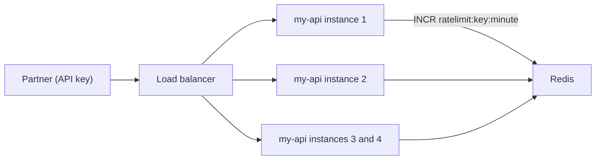

# Software Engineer interview: live exercises

!!! warning "Disclaimer"
    These notes are personal cheat sheets, not a source of truth. They reflect my own understanding and choices: their content remains subjective, despite the quotes and references it contains. It may be incomplete, simplified, inaccurate or outdated. Always check the official documentation before applying it. This content is provided as is, without any warranty: you use it at your own risk.

!!! audience "Who and what for"
    - **Roles**: back-end developer, full-stack developer, developer aiming for a Software Engineer position, QA engineer moving to development, tech lead who runs interviews.
    - **Uses**: I practice a live coding exercise against the clock (refactoring, TDD, N+1); I prepare a design exercise (REST endpoint, rate limiter) and want a reference answer; I rehearse out loud the oral answer of an exercise; I run an interview and look for an exercise with its answer and its traps.

Hands-on exercises with detailed answers. This page complements the [questions](questions.md) page. There is no single answer: these are **concrete reference answers**, with the code, the tests, the API contracts, the slicing and the oral phrasing.

The target position is a developer who writes, tests, reviews and ships their own code, within a team. The exercises are therefore mostly hands-on: refactoring, tests, database, API, concurrency, code review and slicing the work.

## How to use this page

In a live interview (live coding, pair programming, whiteboard exercise), the interviewer mostly watches **how** I work, not only whether the final code compiles. For each exercise:

1. I read the statement without looking at the answer, and I time myself (20 to 40 minutes depending on the exercise).
2. **I ask two or three questions before coding**: "which inputs are possible?", "what should happen on error?", "what volume?". I show I do not rush in head down.
3. **I think out loud**: I say what I am going to do before doing it, and why.
4. **I start with a test or an example**: it pins down what "correct" means, and it saves me if I go astray.
5. I first give a simple solution that works, then I improve it. An unfinished optimal solution is worth less than a simple one that is finished and tested.
6. **I finish with the limits**: unhandled cases, performance, what I would do with more time.

The code examples are deliberately small so they fit in an interview. When the same code is shown in several languages, `PHP`, `Python` and `Java` tabs let me pick mine: the choice is kept from one exercise to the next and across the whole site. The other exercises are in Python, easy to translate.

## Exercise 1. Refactor a long function without changing its behavior

### Statement

The interviewer shows me a function that computes an order total. It works, but nobody dares to touch it. They ask me to make it readable without changing its behavior, then to explain how I make sure I broke nothing.

=== "PHP"

    ``` { .php .ex-bad title="Avoid" }
    // Avoid: meaningless names, three levels of nesting, magic numbers
    function calc($o, $t) {
        if ($o !== null) {
            if (count($o['items']) > 0) {
                $s = 0;
                foreach ($o['items'] as $i) {
                    $s = $s + $i['price'] * $i['qty'];
                }
                if ($t === 'gold') {
                    $s = $s - $s * 0.2;
                } elseif ($t === 'silver') {
                    $s = $s - $s * 0.1;
                }
                if ($s < 50) {
                    $s = $s + 4.9;
                }
                $s = $s * 1.2;
                return round($s, 2);
            } else {
                return 0;
            }
        } else {
            throw new Exception('error');
        }
    }
    ```

=== "Python"

    ``` { .python .ex-bad title="Avoid" }
    # Avoid: meaningless names, three levels of nesting, magic numbers
    def calc(o, t):
        if o is not None:
            if len(o["items"]) > 0:
                s = 0
                for i in o["items"]:
                    s = s + i["price"] * i["qty"]
                if t == "gold":
                    s = s - s * 0.2
                elif t == "silver":
                    s = s - s * 0.1
                if s < 50:
                    s = s + 4.9
                s = s * 1.2
                return round(s, 2)
            else:
                return 0
        else:
            raise Exception("error")
    ```

=== "Java"

    ``` { .java .ex-bad title="Avoid" }
    // Avoid: meaningless names, three levels of nesting, magic numbers
    static double calc(Map<String, Object> o, String t) {
        if (o != null) {
            List<Map<String, Number>> items = (List<Map<String, Number>>) o.get("items");
            if (items.size() > 0) {
                double s = 0;
                for (Map<String, Number> i : items) {
                    s = s + i.get("price").doubleValue() * i.get("qty").intValue();
                }
                if ("gold".equals(t)) {
                    s = s - s * 0.2;
                } else if ("silver".equals(t)) {
                    s = s - s * 0.1;
                }
                if (s < 50) {
                    s = s + 4.9;
                }
                s = s * 1.2;
                return Math.round(s * 100) / 100.0;
            } else {
                return 0;
            }
        } else {
            throw new RuntimeException("error");
        }
    }
    ```

### Expected answer

#### Problems to point out

- **Meaningless names**: `calc`, `o`, `t`, `s`, `i` force me to read all the code to understand.
- **Nesting**: three levels of `if` for a simple flow. <span class="term" data-term="guard-clause">Guard clauses</span> flatten it.
- **<span class="term" data-term="magic-number">Magic numbers</span>**: `0.2`, `0.1`, `50`, `4.9`, `1.2` do not say what they stand for (discount, free shipping threshold, fee, VAT).
- **Several responsibilities**: subtotal, discount, shipping and VAT in a single block.
- **Generic exception**: `Exception("error")` tells the caller nothing.
- **Money as floating point numbers**: a source of rounding errors. It is a real problem, but fixing it **changes the behavior**: it will be a separate commit, not part of the refactoring.

#### Step 1: freeze the current behavior

Before touching the code, <span class="term" data-term="characterization-test">characterization tests</span> record what the function returns today:

``` { .python .ex-good title="Recommended" }
import pytest

# Good: one case per branch, with the value the function returns today
@pytest.mark.parametrize(
    ("order", "tier", "expected"),
    [
        ({"items": [{"price": 10, "qty": 2}]}, "gold", 25.08),
        ({"items": [{"price": 30, "qty": 2}]}, "silver", 64.8),
        ({"items": [{"price": 25, "qty": 2}]}, None, 60.0),
        ({"items": [{"price": 49.99, "qty": 1}]}, "bronze", 65.87),
        ({"items": []}, "gold", 0),
    ],
)
def test_current_behavior(order, tier, expected):
    assert calc(order, tier) == expected


# Good: a missing order still raises an error
def test_none_order_raises():
    with pytest.raises(Exception):
        calc(None, "gold")
```

The cases cover every branch: each discount tier, an unknown tier, below and above the free shipping threshold, the empty list, the missing order.

#### Step 2: refactor in small steps

Order of the transformations, with the tests run after each one: rename, replace the numbers with constants, flatten with guard clauses, extract the subtotal and the shipping fee.

=== "PHP"

    ``` { .php .ex-good title="Recommended" }
    <?php

    declare(strict_types=1);

    // Good: each number carries a business name
    const DISCOUNT_BY_TIER = ['gold' => 0.20, 'silver' => 0.10];
    const FREE_SHIPPING_THRESHOLD = 50;
    const SHIPPING_FEE = 4.90;
    const VAT_RATE = 0.20;

    // Good: guard clauses, then a calculation that reads like the business rule
    function orderTotal(?array $order, ?string $tier): float
    {
        if ($order === null) {
            throw new InvalidArgumentException('Order is required.');
        }
        if ($order['items'] === []) {
            return 0;
        }

        $subtotal = itemsSubtotal($order['items']);
        $discounted = $subtotal * (1 - (DISCOUNT_BY_TIER[$tier] ?? 0));
        $withShipping = $discounted + shippingFee($discounted);

        return round($withShipping * (1 + VAT_RATE), 2);
    }

    // Good: the subtotal extracted into its own function
    function itemsSubtotal(array $items): float
    {
        return array_sum(array_map(fn (array $item) => $item['price'] * $item['qty'], $items));
    }

    // Good: the shipping fee rule, isolated and named
    function shippingFee(float $amount): float
    {
        return $amount < FREE_SHIPPING_THRESHOLD ? SHIPPING_FEE : 0;
    }
    ```

=== "Python"

    ``` { .python .ex-good title="Recommended" }
    # Good: each number carries a business name
    DISCOUNT_BY_TIER = {"gold": 0.20, "silver": 0.10}
    FREE_SHIPPING_THRESHOLD = 50
    SHIPPING_FEE = 4.90
    VAT_RATE = 0.20


    # Good: guard clauses, then a calculation that reads like the business rule
    def order_total(order: dict | None, tier: str | None) -> float:
        if order is None:
            raise ValueError("order is required")
        if not order["items"]:
            return 0

        subtotal = items_subtotal(order["items"])
        discounted = subtotal * (1 - DISCOUNT_BY_TIER.get(tier, 0))
        with_shipping = discounted + shipping_fee(discounted)

        return round(with_shipping * (1 + VAT_RATE), 2)


    # Good: the subtotal extracted into its own function
    def items_subtotal(items: list[dict]) -> float:
        return sum(item["price"] * item["qty"] for item in items)


    # Good: the shipping fee rule, isolated and named
    def shipping_fee(amount: float) -> float:
        return SHIPPING_FEE if amount < FREE_SHIPPING_THRESHOLD else 0
    ```

=== "Java"

    ``` { .java .ex-good title="Recommended" }
    // Good: a class that groups the named constants and the steps of the calculation
    final class OrderPricing {
        private static final Map<String, Double> DISCOUNT_BY_TIER = Map.of("gold", 0.20, "silver", 0.10);
        private static final double FREE_SHIPPING_THRESHOLD = 50;
        private static final double SHIPPING_FEE = 4.90;
        private static final double VAT_RATE = 0.20;

        record Item(double price, int qty) {}

        // Good: guard clauses, then a calculation that reads like the business rule
        static double orderTotal(List<Item> items, String tier) {
            if (items == null) {
                throw new IllegalArgumentException("Order is required.");
            }
            if (items.isEmpty()) {
                return 0;
            }

            double subtotal = itemsSubtotal(items);
            double discounted = subtotal * (1 - discountRate(tier));
            double withShipping = discounted + shippingFee(discounted);

            return Math.round(withShipping * (1 + VAT_RATE) * 100) / 100.0;
        }

        // Good: an unknown or missing tier gives no discount
        private static double discountRate(String tier) {
            return tier == null ? 0.0 : DISCOUNT_BY_TIER.getOrDefault(tier, 0.0);
        }

        // Good: the subtotal extracted into its own method
        private static double itemsSubtotal(List<Item> items) {
            return items.stream().mapToDouble(item -> item.price() * item.qty()).sum();
        }

        // Good: the shipping fee rule, isolated and named
        private static double shippingFee(double amount) {
            return amount < FREE_SHIPPING_THRESHOLD ? SHIPPING_FEE : 0;
        }
    }
    ```

`InvalidArgumentException`, `ValueError` and `IllegalArgumentException` all inherit from the original generic exception: a caller that caught `Exception` keeps working. The characterization tests, adapted to the new name, stay green.

#### Step 3: prove the equivalence more broadly

For a calculation function, I can compare the old and the new version on many random inputs, for the duration of the refactoring:

``` { .python .ex-good title="Recommended" }
import random


# Good: the old and new versions compared on 10,000 random orders
def test_refactoring_is_equivalent():
    for _ in range(10_000):
        items = [
            {"price": round(random.uniform(0, 100), 2), "qty": random.randint(1, 5)}
            for _ in range(random.randint(1, 4))
        ]
        tier = random.choice(["gold", "silver", None, "unknown"])
        assert order_total({"items": items}, tier) == calc({"items": items}, tier)
```

Once the refactoring is merged, I delete `calc` and this test.

#### What I add on top

- I make **one `refactor:` commit per transformation**, or at least a refactoring commit separate from the next one.
- I flag the business questions I discovered, without fixing them on the sly: does VAT apply to the shipping fee? Is the free shipping threshold computed before or after the discount?
- I then propose, in a separate MR with its own tests, switching amounts to integer cents: it is a **behavior change** (roundings move), it must be visible and approved.

#### Possible oral answer

> "I do not touch the code before I have tests that freeze its current behavior, one branch per case. Then I make small transformations, running the tests each time: rename, name the constants, flatten with guard clauses, extract the subtotal and the shipping fee. I do not fix the use of floats in this refactoring, because it changes the roundings: I flag it and propose it in a separate MR. And I write down the business questions I found, like VAT on the shipping fee."

**Read next**: [Refactoring in small steps](../../knowledge/principes-conception.md#refactoring-in-small-steps), [Guard clauses](../../knowledge/principes-conception.md#guard-clauses), [Characterization tests and golden master](../../knowledge/conception-tests.md#characterization-tests-and-golden-master), [No magic value](../../knowledge/qualite.md#no-magic-value), [Money in integer cents](../../knowledge/qualite.md#money-in-integer-cents), [Naming by intent](../../knowledge/principes-conception.md#naming-by-intent).

## Exercise 2. Fix a bug from a failing test

### Statement

A customer reports that splitting a bill between friends "loses cents". A colleague wrote the test that reproduces the problem, and it fails. The interviewer asks me to fix the function.

``` { .python .ex-bad title="Avoid" }
# Avoid: integer division loses the remainder
def split_bill(total_cents: int, people: int) -> list[int]:
    share = total_cents // people
    return [share] * people


# Example: the colleague's test, which reproduces the bug
def test_split_keeps_the_total():
    shares = split_bill(1000, 3)
    assert sum(shares) == 1000
```

``` { .text .ex-ref title="Reference · pytest output" }
FAILED test_split_keeps_the_total - assert 999 == 1000
```

### Expected answer

#### 1. Read the failure before coding

`1000 // 3` is `333`, and `333 x 3` is `999`. The remaining cent is lost. The test is right: the sum of the shares must always equal the total. It is an <span class="term" data-term="invariant">invariant</span> of the function.

#### 2. Ask the business questions

- Who pays the extra cent? By convention, the first people in the list.
- What to do with `people = 0` or a negative total? Reject with a clear error.
- Must the shares differ by at most one cent? Yes, otherwise the split is not fair.

#### 3. Fix with the minimal change

``` { .python .ex-good title="Recommended" }
# Good: invalid inputs are rejected, the remainder is spread over the first shares
def split_bill(total_cents: int, people: int) -> list[int]:
    if people <= 0:
        raise ValueError("people must be positive")
    if total_cents < 0:
        raise ValueError("total must not be negative")
    share, remainder = divmod(total_cents, people)
    return [share + 1 if index < remainder else share for index in range(people)]
```

`divmod(1000, 3)` gives `(333, 1)`: the first person pays 334, the other two 333.

#### 4. Add the missing tests

``` { .python .ex-good title="Recommended" }
import pytest


# Good: the business convention is written in a test
def test_split_gives_the_extra_cents_to_the_first_people():
    assert split_bill(1000, 3) == [334, 333, 333]


# Good: the case with no remainder
def test_split_exact_division():
    assert split_bill(900, 3) == [300, 300, 300]


# Good: the zero people edge case
def test_split_rejects_zero_people():
    with pytest.raises(ValueError):
        split_bill(1000, 0)
```

#### 5. Test the invariant on many cases

A property-based test checks the rule on hundreds of generated inputs, instead of a few hand-picked examples:

``` { .python .ex-good title="Recommended" }
from hypothesis import given, strategies as st


# Good: the three invariants checked on hundreds of generated inputs
@given(st.integers(min_value=0, max_value=10**9), st.integers(min_value=1, max_value=100))
def test_split_invariants(total_cents, people):
    shares = split_bill(total_cents, people)
    assert sum(shares) == total_cents
    assert len(shares) == people
    assert max(shares) - min(shares) <= 1
```

#### What I add on top

- I check whether the same mistake exists elsewhere: any split of an amount (partial refund, payment in installments) has the same risk.
- I check whether data already stored is wrong (bills split with a lost cent), and I propose a fix if the gap has an impact.
- I put the failing test in the same commit as the fix: `fix(bill): keep the total when splitting`.

#### Possible oral answer

> "I read the failure first: 999 instead of 1000, the remainder of the integer division is lost. I ask the business question of who pays the cent, then make the minimal fix with `divmod`. I add the edge cases, zero people and exact division, and a property-based test that checks the invariant: the sum of the shares always equals the total, and the shares differ by at most one cent. Finally, I look for the same pattern in the other amount calculations."

**Read next**: [Property-based testing](../../knowledge/conception-tests.md#property-based-testing), [Equivalence partitions and boundary values](../../knowledge/conception-tests.md#equivalence-partitioning-and-boundary-values), [Money in integer cents](../../knowledge/qualite.md#money-in-integer-cents), [Finding the cause: debugging methodically](../../knowledge/incidents.md#finding-the-cause-debugging-methodically).

## Exercise 3. Write a pure function with TDD

### Statement

A city library wants to compute late fees:

- returned on time or early: 0;
- 50 cents per day late;
- a cap of 10 € per loan;
- premium members never pay a fee.

The interviewer asks me to write the function with TDD, showing the steps.

### Expected answer

#### 1. Write the list of tests before the first test

<span class="term" data-term="tdd">TDD</span> starts with a list of scenarios, from the simplest to the richest:

1. 0 days late: 0.
2. 1 day: 50.
3. 3 days: 150.
4. 20 days: 1,000 (exactly the cap).
5. 30 days: 1,000 (capped).
6. Returned early (negative days): 0.
7. Premium member, 30 days: 0.

#### 2. Make the tests pass one by one

Round 1: the "0 days" test fails (the function does not exist), I write `return 0`. Round 2: the "1 day" test fails, I write `return days_late * 50`, the "0 days" test stays green. Rounds 3 and 4 pass without change. Round 5 fails: I add the cap. Round 6 fails (a negative value): I add `max(0, ...)`. Round 7 fails: I add the premium rule. At each green, I check whether the code deserves a cleanup, for example naming the constants.

#### 3. Result: the code and its tests

=== "PHP"

    ``` { .php .ex-good title="Recommended" }
    <?php

    declare(strict_types=1);

    // Good: a pure function, amounts in integer cents, named constants
    final class LateFee
    {
        private const CENTS_PER_DAY = 50;
        private const CAP_CENTS = 1000;

        // Good: premium and on-time return first, then the cap
        public static function cents(int $daysLate, bool $isPremium): int
        {
            if ($isPremium || $daysLate <= 0) {
                return 0;
            }

            return min($daysLate * self::CENTS_PER_DAY, self::CAP_CENTS);
        }
    }
    ```

    ``` { .php .ex-good title="Recommended" }
    <?php

    use PHPUnit\Framework\Attributes\DataProvider;
    use PHPUnit\Framework\TestCase;

    // Good: the list of scenarios becomes a readable data provider
    final class LateFeeTest extends TestCase
    {
        // Good: one named case per scenario, including the exact edge of the cap
        public static function cases(): array
        {
            return [
                'on time' => [0, false, 0],
                'one day' => [1, false, 50],
                'three days' => [3, false, 150],
                'exactly the cap' => [20, false, 1000],
                'above the cap' => [30, false, 1000],
                'returned early' => [-2, false, 0],
                'premium member' => [30, true, 0],
            ];
        }

        // Good: a single parameterized test
        #[DataProvider('cases')]
        public function testLateFee(int $daysLate, bool $isPremium, int $expected): void
        {
            self::assertSame($expected, LateFee::cents($daysLate, $isPremium));
        }
    }
    ```

=== "Python"

    ``` { .python .ex-good title="Recommended" }
    # Good: amounts in integer cents, named constants
    CENTS_PER_DAY = 50
    CAP_CENTS = 1000


    # Good: a pure function, premium and on-time return first, then the cap
    def late_fee_cents(days_late: int, is_premium: bool) -> int:
        if is_premium or days_late <= 0:
            return 0
        return min(days_late * CENTS_PER_DAY, CAP_CENTS)
    ```

    ``` { .python .ex-good title="Recommended" }
    import pytest


    # Good: one named case per scenario, including the exact edge of the cap
    @pytest.mark.parametrize(
        ("days_late", "is_premium", "expected"),
        [
            pytest.param(0, False, 0, id="on time"),
            pytest.param(1, False, 50, id="one day"),
            pytest.param(3, False, 150, id="three days"),
            pytest.param(20, False, 1000, id="exactly the cap"),
            pytest.param(30, False, 1000, id="above the cap"),
            pytest.param(-2, False, 0, id="returned early"),
            pytest.param(30, True, 0, id="premium member"),
        ],
    )
    def test_late_fee(days_late, is_premium, expected):
        assert late_fee_cents(days_late, is_premium) == expected
    ```

=== "Java"

    ``` { .java .ex-good title="Recommended" }
    // Good: a pure function, amounts in integer cents, named constants
    final class LateFee {
        private static final int CENTS_PER_DAY = 50;
        private static final int CAP_CENTS = 1000;

        // Good: premium and on-time return first, then the cap
        static int cents(int daysLate, boolean isPremium) {
            if (isPremium || daysLate <= 0) {
                return 0;
            }
            return Math.min(daysLate * CENTS_PER_DAY, CAP_CENTS);
        }
    }
    ```

    ``` { .java .ex-good title="Recommended" }
    import static org.junit.jupiter.api.Assertions.assertEquals;

    import org.junit.jupiter.params.ParameterizedTest;
    import org.junit.jupiter.params.provider.CsvSource;

    // Good: the list of scenarios becomes a parameterized test
    class LateFeeTest {
        // Good: one case per row, including the exact edge of the cap
        @ParameterizedTest(name = "{0} days, premium={1}: {2} cents")
        @CsvSource({
            "0, false, 0",
            "1, false, 50",
            "3, false, 150",
            "20, false, 1000",
            "30, false, 1000",
            "-2, false, 0",
            "30, true, 0"
        })
        void lateFee(int daysLate, boolean isPremium, int expected) {
            assertEquals(expected, LateFee.cents(daysLate, isPremium));
        }
    }
    ```

#### 4. The choices to explain

- **Amounts in integer cents**: no floating point rounding.
- **<span class="term" data-term="pure-function">Pure function</span>**: it receives the number of days, it does not read the clock. Computing the number of days (with time zones and closing days) is another function, tested separately.
- **One test per edge**: 20 days lands exactly on the cap, the <span class="term" data-term="edge-case">boundary value</span> where a `<` instead of `<=` mistake hides.

#### What I add on top

- I ask for the missing rules: is the cap per loan or per member? Do closing days count?
- I show the list of tests to the Product Owner: it reads like a specification.

#### Possible oral answer

> "I first write the list of cases, from the simplest to the richest, then turn them one by one into a failing test, with the minimal code to make it pass. Amounts are in cents, and the function does not read the clock so it stays pure and easy to test. I test the exact value of the cap, because that is where a comparison mistake hides. In the end, the list of tests is the specification, and I have the business review it."

**Read next**: [TDD in practice](../../knowledge/conception-tests.md#tdd-in-practice), [Equivalence partitions and boundary values](../../knowledge/conception-tests.md#equivalence-partitioning-and-boundary-values), [Money in integer cents](../../knowledge/qualite.md#money-in-integer-cents).

## Exercise 4. Fix an N+1 query

### Statement

The order admin page takes 3 seconds to load. The interviewer shows me the function that prepares the data and asks me to find the problem, fix it, and prevent it from coming back.

``` { .python .ex-bad title="Avoid" }
# Avoid: two queries per order inside the loop
def orders_page(conn, limit: int = 50) -> list[dict]:
    orders = conn.execute(
        "SELECT id, customer_id, total_cents FROM orders ORDER BY id DESC LIMIT %s",
        (limit,),
    ).fetchall()
    result = []
    for order in orders:
        customer = conn.execute(
            "SELECT name FROM customers WHERE id = %s", (order.customer_id,)
        ).fetchone()
        item_count = conn.execute(
            "SELECT COUNT(*) FROM order_items WHERE order_id = %s", (order.id,)
        ).fetchone()[0]
        result.append(
            {"id": order.id, "customer": customer.name,
             "total_cents": order.total_cents, "items": item_count}
        )
    return result
```

### Expected answer

#### 1. Name the problem and put a number on it

For 50 orders: 1 query for the list, 50 for the customers, 50 for the item counts, that is 101 <span class="term" data-term="round-trip">round trips</span> to the database. It is a double <span class="term" data-term="n-plus-one">N+1 problem</span>. Each query is fast, but their number grows with the page size, and each network round trip costs a few milliseconds.

First thing to do in the interview: say it, then propose to measure it (SQL logs, or a query counter in a test).

#### 2. Option A: a single query

``` { .python .ex-good title="Recommended" }
# Good: the page of 50 orders is picked first, then joined and counted in one query
ORDERS_PAGE = """
    WITH page AS (
        SELECT id, customer_id, total_cents
        FROM orders
        ORDER BY id DESC
        LIMIT %s
    )
    SELECT p.id, p.total_cents, c.name AS customer_name, COUNT(i.id) AS item_count
    FROM page p
    JOIN customers c ON c.id = p.customer_id
    LEFT JOIN order_items i ON i.order_id = p.id
    GROUP BY p.id, p.total_cents, c.name
    ORDER BY p.id DESC
"""


# Good: a single round trip, whatever the page size
def orders_page(conn, limit: int = 50) -> list[dict]:
    rows = conn.execute(ORDERS_PAGE, (limit,)).fetchall()
    return [
        {"id": row.id, "customer": row.customer_name,
         "total_cents": row.total_cents, "items": row.item_count}
        for row in rows
    ]
```

Points to explain:

- The page of 50 orders is picked **first** (`WITH page`), then I join: I only count the items of these 50 orders, not of the whole table.
- `LEFT JOIN` and `COUNT(i.id)`: an order with no item shows 0 instead of disappearing.
- An index on `order_items(order_id)` is essential, otherwise each count scans the table. I check it with the <span class="term" data-term="execution-plan">execution plan</span>.

#### 3. Option B: two or three batched queries

If the single query gets too complex, I keep simple queries but **in a fixed number**, with `IN` or `ANY`:

``` { .python .ex-good title="Recommended" }
# Good: three batched queries, their number no longer depends on the number of rows
def orders_page(conn, limit: int = 50) -> list[dict]:
    orders = conn.execute(
        "SELECT id, customer_id, total_cents FROM orders ORDER BY id DESC LIMIT %s",
        (limit,),
    ).fetchall()
    customer_ids = list({order.customer_id for order in orders})
    order_ids = [order.id for order in orders]

    names = dict(conn.execute(
        "SELECT id, name FROM customers WHERE id = ANY(%s)", (customer_ids,)
    ).fetchall())
    counts = dict(conn.execute(
        "SELECT order_id, COUNT(*) FROM order_items WHERE order_id = ANY(%s) GROUP BY order_id",
        (order_ids,),
    ).fetchall())

    return [
        {"id": order.id, "customer": names[order.customer_id],
         "total_cents": order.total_cents, "items": counts.get(order.id, 0)}
        for order in orders
    ]
```

Three queries, whatever the page size. It is also what an ORM does with batched <span class="term" data-term="eager-loading">eager loading</span> (`selectinload` in SQLAlchemy).

#### 4. Prevent the problem from coming back

``` { .python .ex-good title="Recommended" }
import pytest


# Good: a connection that counts queries, for the test
class CountingConnection:
    def __init__(self, conn) -> None:
        self._conn = conn
        self.queries = 0

    # Good: each call is counted then passed on to the real connection
    def execute(self, *args, **kwargs):
        self.queries += 1
        return self._conn.execute(*args, **kwargs)


# Good: the number of queries stays the same with 5 and 50 orders
@pytest.mark.parametrize("orders_count", [5, 50])
def test_orders_page_uses_a_constant_number_of_queries(db, orders_count):
    create_orders(db, count=orders_count, items_per_order=3)
    conn = CountingConnection(db)

    page = orders_page(conn)

    assert len(page) == orders_count
    assert conn.queries == 1
```

The test fails with the old version (11 then 101 queries) and stays green as long as the number of queries does not depend on the number of rows.

#### What I add on top

- I measure before and after on realistic data, and give the number in the MR (for example "101 queries, 3 s; 1 query, 40 ms", example figures).
- I look for other loops that run one query per item in the same module.
- If the project uses an ORM, I turn on SQL logs in development to see these loops right away.

#### Possible oral answer

> "I see a query inside a loop: 101 queries for 50 orders, a double N+1. I would pick the page of orders first, then a join for the customers and a grouped `COUNT` for the items, in a single query, with an index on `order_items.order_id`. If the query gets too complex, three batched queries with `ANY` are fine too: what matters is that their number no longer depends on the number of rows. And I add a test that counts the queries with 5 and 50 orders, so the problem does not come back."

**Read next**: [The N+1 problem](../../knowledge/sql.md#the-n1-problem), [Lazy or eager loading](../../knowledge/sql.md#lazy-or-eager-loading), [EXPLAIN](../../knowledge/sql.md#explain), [When an index helps](../../knowledge/sql.md#when-an-index-helps), [Subquery and CTE](../../knowledge/sql.md#subquery-and-cte-with).

## Exercise 5. Design a small REST endpoint with errors and pagination

### Statement

The mobile app must show a customer's order history, newest first, with an optional filter by status. A B2B customer can have tens of thousands of orders. The interviewer asks me to propose the API contract, then code the endpoint.

### Expected answer

#### 1. Questions to ask

- Does the customer only see their own orders? (Yes: <span class="term" data-term="authorization">authorization</span> is mandatory.)
- Does the mobile app need to jump straight to page 37, or only to "load more"? (Load more: <span class="term" data-term="cursor-pagination">cursor pagination</span> fits.)
- Which fields are shown in the list? (So as not to return the whole order.)

#### 2. The contract

``` { .http .ex-ref title="Reference · HTTP request" }
GET /customers/42/orders?status=shipped&limit=20&cursor=eyJjIjoi...
Authorization: Bearer <token>
```

| Situation | Code | Body |
|---|---|---|
| Success | `200` | `{"items": [...], "next_cursor": "..."}`, `next_cursor` set to `null` on the last page |
| No token or invalid token | `401` | Problem Details |
| Customer 42 differs from the caller | `404` | Problem Details (do not confirm the customer exists) |
| `limit` outside 1 to 200, unknown `status` | `422` | Problem Details with the fields in error |
| Unreadable cursor | `400` | Problem Details |

Choices to justify:

- **Cursor pagination**, sorted by `(created_at, id)`: stable even if new orders arrive while the user scrolls, and fast even far back in the history.
- **Server-side maximum limit** (200), even if the client asks for more.
- **Errors in <span class="term" data-term="problem-details">Problem Details</span> format** (RFC 9457, 2023) for the whole API.

#### 3. The SQL query

``` { .sql .ex-good title="Recommended" }
-- Good: filter by customer, optional status, (created_at, id) cursor, one row more than the limit
SELECT id, status, total_cents, created_at
FROM orders
WHERE customer_id = %(customer_id)s
  AND (%(status)s::text IS NULL OR status = %(status)s)
  AND (%(after_created_at)s::timestamptz IS NULL
       OR (created_at, id) < (%(after_created_at)s, %(after_id)s))
ORDER BY created_at DESC, id DESC
LIMIT %(limit_plus_one)s;
```

With a <span class="term" data-term="composite-index">composite index</span> on `(customer_id, created_at DESC, id DESC)`. I ask for `limit + 1` rows: if one more comes back, there is a next page, with no extra `COUNT` query.

#### 4. The code (example with FastAPI)

``` { .python .ex-good title="Recommended" }
import base64
import json

from fastapi import FastAPI, Query, Request
from fastapi.responses import JSONResponse

app = FastAPI()
MAX_LIMIT = 200
ALLOWED_STATUSES = {"pending", "paid", "shipped", "cancelled"}


# Good: a single business exception carries everything a Problem Details response needs
class ProblemError(Exception):
    def __init__(self, status: int, slug: str, title: str, detail: str) -> None:
        super().__init__(detail)
        self.status, self.slug, self.title, self.detail = status, slug, title, detail


# Good: one handler translates the exception into application/problem+json
@app.exception_handler(ProblemError)
async def problem_handler(request: Request, exc: ProblemError) -> JSONResponse:
    return JSONResponse(
        status_code=exc.status,
        media_type="application/problem+json",
        content={
            "type": f"https://my-api.example.com/problems/{exc.slug}",
            "title": exc.title,
            "status": exc.status,
            "detail": exc.detail,
            "instance": request.url.path,
        },
    )


# Good: an opaque cursor, which the mobile app does not build itself
def encode_cursor(created_at: str, order_id: int) -> str:
    raw = json.dumps({"c": created_at, "i": order_id}).encode()
    return base64.urlsafe_b64encode(raw).decode()


# Good: an unreadable cursor gives a clear 400, not a 500 error
def decode_cursor(cursor: str) -> tuple[str, int]:
    try:
        data = json.loads(base64.urlsafe_b64decode(cursor.encode()))
        return data["c"], int(data["i"])
    except (ValueError, KeyError, TypeError) as exc:
        raise ProblemError(400, "invalid-cursor", "Invalid cursor", "The cursor is malformed.") from exc


# Good: authorization first, validation, then one extra row to know whether more follows
@app.get("/customers/{customer_id}/orders")
def list_orders(
    customer_id: int,
    request: Request,
    status: str | None = None,
    limit: int = Query(20, ge=1, le=MAX_LIMIT),
    cursor: str | None = None,
):
    if current_customer_id(request) != customer_id:
        raise ProblemError(404, "not-found", "Customer not found", "No such customer.")
    if status is not None and status not in ALLOWED_STATUSES:
        raise ProblemError(422, "validation-error", "Invalid status", f"Unknown status: {status}")

    after = decode_cursor(cursor) if cursor else None
    rows = order_repository.page(customer_id, status, after, limit + 1)

    has_more = len(rows) > limit
    rows = rows[:limit]
    next_cursor = encode_cursor(rows[-1].created_at, rows[-1].id) if has_more else None

    return {
        "items": [
            {"id": row.id, "status": row.status, "total_cents": row.total_cents,
             "created_at": row.created_at}
            for row in rows
        ],
        "next_cursor": next_cursor,
    }
```

`current_customer_id` reads the identity from the token already checked by authentication. FastAPI's own validation errors (`limit=500`) have their own default format: in production, I would add a handler to convert them into Problem Details too.

#### 5. Tests to plan

1. Three successive pages return all the orders, with no duplicate and no gap, even if an order is created between two calls.
2. The last page returns `next_cursor: null`.
3. Customer A asking for customer B's orders gets `404`.
4. `limit=500` is rejected, a missing `limit` defaults to 20.
5. A cursor edited by hand returns `400` with `application/problem+json`.
6. The `status=shipped` filter only returns shipped orders.

#### What I add on top

- I write the contract (OpenAPI) before the code and share it with the mobile team: they can move forward with a fake server meanwhile.
- I keep the cursor **opaque**: the mobile app must not build it itself, so I can change its content later.

#### Possible oral answer

> "I start with authorization: a customer only sees their own orders, otherwise `404`. For pagination, the mobile app does 'load more', so I take a cursor sorted by date and identifier, with a composite index: it is stable when new orders arrive and fast even far back in the history. I ask for one row more than the limit to know whether more follows, without a `COUNT`. The limit is capped on the server side. All errors follow Problem Details, and the OpenAPI contract is written before the code for the mobile team."

**Read next**: [Pagination](../../knowledge/api-rest-async.md#pagination), [Error format](../../knowledge/api-rest-async.md#error-format), [Response codes](../../knowledge/api-rest-async.md#response-codes), [OpenAPI](../../knowledge/api-rest-async.md#openapi), [API first](../../knowledge/api-rest-async.md#api-first), [Testing a REST API](../../knowledge/api-rest-async.md#testing-a-rest-api), [The most common API flaws](../../knowledge/securite.md#the-most-common-api-vulnerabilities), [Composite index: column order and covering index](../../knowledge/sql.md#composite-index-column-order-and-covering-index).

## Exercise 6. Code an LRU cache

### Statement

The interviewer asks me to implement a cache of limited size that, when full, removes the least recently used item (LRU). `get` and `put` must run in constant time.

### Expected answer

#### 1. Clarify before coding

- What does `get` return for a missing key? (`null` or `None`.)
- Does a `put` on an existing key count as a use? (Yes.)
- Is the cache used by several threads? (If so, a lock will be needed: to mention, not necessarily to code.)

#### 2. The idea

Two things are needed: find a value by its key in constant time (a hash table), and know the order of use to remove the oldest (a doubly linked list). All three languages have a structure that combines both: `OrderedDict` in Python, `LinkedHashMap` in Java, and PHP arrays, which keep insertion order.

The picture, with a capacity of 3, after `put("a", 1)`, `put("b", 2)`, `put("c", 3)`:

``` { .text .ex-illus title="Illustration" }
hash table (key -> list node)
  "a" -> node a     "b" -> node b     "c" -> node c

doubly linked list, from least recent (after the head) to most recent (before the tail)
  [head] <-> [a:1] <-> [b:2] <-> [c:3] <-> [tail]
```

What `get("a")` does:

1. The table gives the node `a` directly, without walking the list.
2. I unlink `a` by connecting its two neighbors: `head.next = b`, `b.prev = head`.
3. I link it back just before the tail: `[head] <-> [b:2] <-> [c:3] <-> [a:1] <-> [tail]`.
4. I return `1`. A `put("d", 4)` would now evict `b`, the node after the head, and remove `"b"` from the table.

Each step changes a fixed number of pointers, whatever the cache size.

The expected <span class="term" data-term="time-complexity">complexity</span>: `get` and `put` in O(1).

#### 3. Implementation

=== "PHP"

    ``` { .php .ex-good title="Recommended" }
    <?php

    declare(strict_types=1);

    // Good: a PHP array keeps insertion order, the first item is the least recent
    final class LruCache
    {
        private array $items = [];

        // Good: an invalid capacity is rejected at construction
        public function __construct(private readonly int $capacity)
        {
            if ($capacity <= 0) {
                throw new InvalidArgumentException('Capacity must be positive.');
            }
        }

        // Good: reading a key moves it to the end, as the most recent
        public function get(string $key): mixed
        {
            if (!array_key_exists($key, $this->items)) {
                return null;
            }
            $value = $this->items[$key];
            unset($this->items[$key]);
            $this->items[$key] = $value;

            return $value;
        }

        // Good: writing moves the key to the end, then evicts the oldest if needed
        public function put(string $key, mixed $value): void
        {
            unset($this->items[$key]);
            $this->items[$key] = $value;
            if (count($this->items) > $this->capacity) {
                unset($this->items[array_key_first($this->items)]);
            }
        }
    }
    ```

    A PHP array keeps insertion order: removing then reinserting a key puts it at the end. The first item is therefore always the least recently used.

=== "Python"

    ``` { .python .ex-good title="Recommended" }
    from collections import OrderedDict
    from typing import Any


    # Good: OrderedDict combines a hash table and the order of use
    class LRUCache:
        # Good: an invalid capacity is rejected at construction
        def __init__(self, capacity: int) -> None:
            if capacity <= 0:
                raise ValueError("capacity must be positive")
            self._capacity = capacity
            self._items: OrderedDict[str, Any] = OrderedDict()

        # Good: reading a key moves it to the end of the list, as the most recent
        def get(self, key: str) -> Any | None:
            if key not in self._items:
                return None
            self._items.move_to_end(key)
            return self._items[key]

        # Good: writing moves the key to the end of the list, then evicts the oldest if needed
        def put(self, key: str, value: Any) -> None:
            if key in self._items:
                self._items.move_to_end(key)
            self._items[key] = value
            if len(self._items) > self._capacity:
                self._items.popitem(last=False)
    ```

    `move_to_end` and `popitem(last=False)` run in constant time. For a function cache, `functools.lru_cache` already exists: in the interview, I say so, then code the requested version.

=== "Java"

    ``` { .java .ex-good title="Recommended" }
    import java.util.LinkedHashMap;
    import java.util.Map;

    // Good: the class wraps a LinkedHashMap instead of inheriting from it, and only exposes get and put
    final class LruCache<K, V> {
        private final Map<K, V> items;

        // Good: access order (true) and automatic eviction of the eldest entry
        LruCache(int capacity) {
            if (capacity <= 0) {
                throw new IllegalArgumentException("Capacity must be positive.");
            }
            this.items = new LinkedHashMap<>(16, 0.75f, true) {
                // Good: called after each insert, removes the least recent entry beyond the capacity
                @Override
                protected boolean removeEldestEntry(Map.Entry<K, V> eldest) {
                    return size() > capacity;
                }
            };
        }

        // Good: reading updates the access order
        V get(K key) {
            return items.get(key);
        }

        // Good: writing may trigger the eviction
        void put(K key, V value) {
            items.put(key, value);
        }
    }
    ```

    The third argument `true` orders entries by access, and `removeEldestEntry` removes the eldest after each insert. The class wraps the `LinkedHashMap` instead of inheriting from it, so it only exposes `get` and `put`.

#### 4. Tests

=== "PHP"

    ``` { .php .ex-good title="Recommended" }
    // Good: the eviction scenario, a is read again so b is evicted
    public function testEvictsTheLeastRecentlyUsedKey(): void
    {
        $cache = new LruCache(2);
        $cache->put('a', 1);
        $cache->put('b', 2);
        $cache->get('a');
        $cache->put('c', 3);

        self::assertNull($cache->get('b'));
        self::assertSame(1, $cache->get('a'));
        self::assertSame(3, $cache->get('c'));
    }
    ```

=== "Python"

    ``` { .python .ex-good title="Recommended" }
    # Good: the eviction scenario, a is read again so b is evicted
    def test_evicts_the_least_recently_used_key():
        cache = LRUCache(2)
        cache.put("a", 1)
        cache.put("b", 2)
        cache.get("a")
        cache.put("c", 3)

        assert cache.get("b") is None
        assert cache.get("a") == 1
        assert cache.get("c") == 3
    ```

=== "Java"

    ``` { .java .ex-good title="Recommended" }
    // Good: the eviction scenario, a is read again so b is evicted
    @Test
    void evictsTheLeastRecentlyUsedKey() {
        LruCache<String, Integer> cache = new LruCache<>(2);
        cache.put("a", 1);
        cache.put("b", 2);
        cache.get("a");
        cache.put("c", 3);

        assertNull(cache.get("b"));
        assertEquals(1, cache.get("a"));
        assertEquals(3, cache.get("c"));
    }
    ```

Other cases to test: updating an existing key (no eviction, new value), capacity 1, capacity 0 rejected.

#### What I add on top

- If the interviewer forbids `OrderedDict` or `LinkedHashMap`, I explain the structure by hand: a hash table pointing to the nodes of a doubly linked list, with two sentinel nodes at head and tail to avoid special cases.
- I talk about concurrency: these implementations are not thread-safe. A lock around `get` and `put` is enough to start with.
- I recall that in production, a <span class="term" data-term="cache-data">cache</span> shared between several instances rather goes into Redis, which offers an approximate LRU eviction policy.

#### Possible oral answer

> "I need constant-time access by key and the order of use: a hash table plus a doubly linked list. The language gives me both with `OrderedDict` or `LinkedHashMap`, so I use it and say so. `get` moves the key to the end of the list, `put` too, then removes the head if we go over capacity. I test the eviction scenario, updating an existing key and the invalid capacity. I point out that it is not thread-safe, and I can code the linked list by hand if asked."

**Read next**: [Where to put a cache](../../knowledge/architecture.md#where-to-put-a-cache), [Cache: Redis](../../knowledge/outils.md#cache-redis), [Composition over inheritance](../../knowledge/principes-conception.md#composition-over-inheritance), [Algorithmic complexity (Big O)](../../knowledge/lois-et-principes.md#algorithmic-complexity-big-o).

## Exercise 7. Debug a double payment

### Statement

Support reports that some customers are charged twice for the same order. The payment provider's logs show two charges 120 ms apart. The interviewer shows me the code and asks me to find the cause, fix it, and prove the fix.

``` { .python .ex-bad title="Avoid" }
# Avoid: check then act, two simultaneous requests both read pending
def pay_order(conn, gateway, order_id: int) -> None:
    order = conn.execute(
        "SELECT id, status, amount_cents, card_token FROM orders WHERE id = %s",
        (order_id,),
    ).fetchone()
    if order.status == "paid":
        return
    gateway.charge(order.card_token, order.amount_cents)
    conn.execute("UPDATE orders SET status = 'paid' WHERE id = %s", (order_id,))
```

### Expected answer

#### 1. Rebuild the scenario

Two requests arrive almost at the same time: a double click, or the app resending the request after a timeout.

| Time | Request A | Request B |
|---|---|---|
| 0 ms | reads the order: `pending` | |
| 5 ms | | reads the order: `pending` |
| 10 ms | calls `gateway.charge` | |
| 15 ms | | calls `gateway.charge` |
| 300 ms | writes `paid` | |
| 310 ms | | writes `paid` |

Both read `pending` before either wrote `paid`. It is a "check then act" <span class="term" data-term="race-condition">race condition</span>: the `if` protects against a second click a minute later, not against two simultaneous requests. A disabled button in the UI is not enough either: the request can be resent by the network or the app.

#### 2. Fix: claim the order atomically

``` { .python .ex-good title="Recommended" }
# Good: a dedicated exception tells the caller the payment is already in progress
class PaymentInProgress(Exception):
    """The order is already being paid or already paid."""


# Good: the database lets only one request go from pending to paying, then the provider call
def pay_order(conn, gateway, order_id: int) -> None:
    with conn.transaction():
        claimed = conn.execute(
            "UPDATE orders SET status = 'paying' "
            "WHERE id = %s AND status IN ('pending', 'payment_failed') "
            "RETURNING amount_cents, card_token",
            (order_id,),
        ).fetchone()
    if claimed is None:
        raise PaymentInProgress(order_id)

    try:
        gateway.charge(
            claimed.card_token,
            claimed.amount_cents,
            idempotency_key=f"order-{order_id}",
        )
    except gateway.DeclinedError:
        conn.execute("UPDATE orders SET status = 'payment_failed' WHERE id = %s", (order_id,))
        raise

    conn.execute("UPDATE orders SET status = 'paid' WHERE id = %s", (order_id,))
```

The same two requests, sessions A and B, with the fix:

| Time | Session A | Session B |
|---|---|---|
| 0 ms | `UPDATE ... WHERE id = 42 AND status IN (...)`: locks the row and sets it to `paying` | |
| 5 ms | | same `UPDATE`: waits for the lock on row 42 |
| 8 ms | end of the transaction: `paying` is written, the lock is released | |
| 9 ms | | rechecks the row: `paying` no longer matches the `WHERE`, 0 rows changed |
| 10 ms | calls `gateway.charge` | `fetchone()` returns `None`: `PaymentInProgress`, no charge |

`RETURNING` returns the columns of the rows the `UPDATE` just changed, in the same statement: A gets `amount_cents` and `card_token` without a separate `SELECT` (which would reopen a window between read and write), B gets an empty result. PostgreSQL and SQLite (since version 3.35, 2021) support it, MySQL does not: to check for the engine in use.

What changed:

- **The `UPDATE ... WHERE status IN (...)` is <span class="term" data-term="atomic-operation">atomic</span>**: the database lets only one request go from `pending` to `paying`. The second changes no row, and stops before calling the provider.
- **The transaction is short**: it ends before the HTTP call to the provider, so as not to hold a lock during a network call.
- **An <span class="term" data-term="idempotency-key">idempotency key</span> is sent to the provider** (if its API allows it, to check in its documentation): if the process dies after the charge but before writing `paid`, a retry with the same key does not charge a second time.
- **A decline puts the order back to `payment_failed`**, which allows a retry with another card.
- **A timeout leaves the order in `paying`**: I do not know whether the charge happened. A <span class="term" data-term="reconciliation">reconciliation</span> job asks the provider about orders stuck in `paying` for more than a few minutes.

#### 3. Prove the fix with a concurrent test

``` { .python .ex-good title="Recommended" }
import threading
import time


# Good: a slow fake provider, which widens the concurrency window and records the charges
class SlowFakeGateway:
    DeclinedError = RuntimeError

    def __init__(self) -> None:
        self.charges: list[str] = []
        self._lock = threading.Lock()

    # Good: a 50 ms wait, then the charge is recorded under a lock
    def charge(self, card_token: str, amount_cents: int, idempotency_key: str) -> None:
        time.sleep(0.05)
        with self._lock:
            self.charges.append(idempotency_key)


# Good: two simultaneous payments on a real database, a single charge expected
def test_two_simultaneous_payments_charge_once(db_factory, pending_order_id):
    gateway = SlowFakeGateway()
    errors: list[Exception] = []

    # Example: each thread opens its own connection
    def attempt():
        try:
            pay_order(db_factory(), gateway, pending_order_id)
        except PaymentInProgress as exc:
            errors.append(exc)

    threads = [threading.Thread(target=attempt) for _ in range(2)]
    for thread in threads:
        thread.start()
    for thread in threads:
        thread.join()

    assert gateway.charges == [f"order-{pending_order_id}"]
    assert len(errors) == 1
```

The fake provider waits 50 ms to widen the concurrency window. With the old version, the test sees two charges. Each thread uses its own connection (`db_factory`) on a real disposable database: a fake object would not reproduce the behavior of the concurrent `UPDATE`.

#### What I add on top

- I find the customers already charged twice (by matching the provider's charges with the orders) and start the refunds with support.
- I add an alert on orders stuck in `paying` for too long.
- On the client side, I generate the idempotency key once per intent to pay, and resend it on every retry.

#### Possible oral answer

> "Two requests read `pending` at the same time, each one charges: a non-atomic 'check then act'. I replace the read with a conditional `UPDATE` that moves the order from `pending` to `paying`: the database lets only one through. The transaction ends before the provider call, and I send an idempotency key so a retry after a crash does not charge twice. I prove it with a test that fires two payments in parallel on a real database, and I do not forget to refund the customers already affected."

**Read next**: [Race condition and lost update](../../knowledge/sql.md#race-condition-and-lost-update), [Pessimistic lock](../../knowledge/sql.md#pessimistic-lock-for-update), [Idempotency](../../knowledge/architecture.md#idempotency), [HTTP methods](../../knowledge/api-rest-async.md#http-methods), [Integration tests with Testcontainers](../../knowledge/qualite.md#integration-tests-with-testcontainers), [State](../../knowledge/design-patterns-comportement.md#state).

## Exercise 8. Design: a rate limiter for an API

### Statement

`my-api` is exposed to partners, each with an API key. Yesterday a partner saturated the service with a badly written script. The interviewer asks me to limit each key to 100 requests per minute. The API runs on four instances behind a load balancer.

### Expected answer

#### 1. Questions to ask

- Is the limit strict (never 101 requests in a sliding minute) or approximate? (Approximate is often enough.)
- What to do beyond it: reject (`429`) or slow down? (Reject, with the time of the next possible attempt.)
- If the counter storage goes down, do I let traffic through or block everything? (A product decision, to raise.)

#### 2. Choose the algorithm

| Algorithm | Principle | Advantage | Limit |
|---|---|---|---|
| Fixed window | One counter per key and per calendar minute | Very simple, one `INCR` | Up to 200 requests around the minute change |
| Sliding window (log) | Keep the time of each request | Exact | Memory proportional to the number of requests |
| Sliding window (counter) | Weight the previous and the current minute | Good compromise | Approximate |
| <span class="term" data-term="token-bucket">Token bucket</span> | A bucket fills at a fixed rate, each request takes a token | Allows small bursts, smooths the rate | A bit more computation, state to store |

To start, a fixed window in Redis is often enough. The token bucket is the right choice if I want to allow short bursts.

#### 3. The token bucket, in memory, with an injected clock

``` { .python .ex-good title="Recommended" }
import time
from collections.abc import Callable


# Good: the clock is injected, the bucket is tested without real waiting
class TokenBucket:
    def __init__(
        self,
        capacity: int,
        refill_per_second: float,
        clock: Callable[[], float] = time.monotonic,
    ) -> None:
        self._capacity = capacity
        self._refill_per_second = refill_per_second
        self._clock = clock
        self._tokens = float(capacity)
        self._updated_at = clock()

    # Good: refill from the elapsed time, cap, then take a token if one is left
    def allow(self) -> bool:
        now = self._clock()
        elapsed = now - self._updated_at
        self._tokens = min(self._capacity, self._tokens + elapsed * self._refill_per_second)
        self._updated_at = now
        if self._tokens >= 1:
            self._tokens -= 1
            return True
        return False


# Good: the clock moves by hand, the test is deterministic
def test_bucket_refills_over_time():
    now = [0.0]
    bucket = TokenBucket(capacity=2, refill_per_second=1, clock=lambda: now[0])

    assert bucket.allow() is True
    assert bucket.allow() is True
    assert bucket.allow() is False

    now[0] = 1.0
    assert bucket.allow() is True
    assert bucket.allow() is False
```

The injected clock makes the test deterministic: no real waiting.

#### 4. Share the counter between the four instances

An in-memory bucket only works for one instance: with four instances, a partner would get 400 requests. The counter must be shared, for example in Redis:

``` { .python .ex-good title="Recommended" }
WINDOW_SECONDS = 60
LIMIT_PER_WINDOW = 100


# Good: a shared fixed window, atomic INCR and an expiry that cleans up old windows
def check_rate_limit(redis, api_key: str, now: float) -> tuple[bool, int]:
    window = int(now // WINDOW_SECONDS)
    key = f"ratelimit:{api_key}:{window}"
    pipe = redis.pipeline()
    pipe.incr(key)
    pipe.expire(key, WINDOW_SECONDS * 2)
    count, _ = pipe.execute()
    retry_after = WINDOW_SECONDS - int(now % WINDOW_SECONDS)
    return count <= LIMIT_PER_WINDOW, retry_after
```

`INCR` is atomic in Redis: two instances incrementing at the same time get two different values. The expiry cleans up old windows on its own. For a shared token bucket, I would write the calculation as a Lua script run by Redis, so it stays atomic.



#### 5. The response to the client

``` { .http .ex-ref title="Reference · HTTP 429 response" }
HTTP/1.1 429 Too Many Requests
Retry-After: 23
Content-Type: application/problem+json

{
  "type": "https://my-api.example.com/problems/rate-limited",
  "title": "Too many requests",
  "status": 429,
  "detail": "Limit is 100 requests per minute for this API key."
}
```

`Retry-After` is defined by RFC 9110 (2022). Standard `RateLimit` headers (limit, remaining, reset) are being standardized at the IETF (draft, status to check).

#### What I add on top

- I decide and write down the behavior if Redis goes down: let traffic through (the service stays available, unprotected) or reject (protection, but a visible outage). For a partner API, letting through with an alert is often preferred.
- I measure the number of `429` per key, to spot a misconfigured partner before they complain.
- I check whether the API gateway or the reverse proxy already does it: a <span class="term" data-term="rate-limit">rate limit</span> configured in front of the application avoids writing code.

#### Possible oral answer

> "I start with the questions: strict or approximate limit, and what to do if the storage goes down. With four instances, the counter must be shared: a fixed window in Redis with `INCR` and an expiry is enough to start, it is atomic and simple. If we want to tolerate bursts, I switch to the token bucket, written in Lua on the Redis side. Beyond the limit, I return `429` with `Retry-After` and a Problem Details body. And I first check whether the API gateway can already do it."

**Read next**: [Rate limiting](../../knowledge/architecture.md#rate-limiting), [Response codes](../../knowledge/api-rest-async.md#response-codes), [API gateway](../../knowledge/outils.md#api-gateway-krakend-nginx), [Cache: Redis](../../knowledge/outils.md#cache-redis), [Graceful degradation](../../knowledge/architecture.md#graceful-degradation).

## Exercise 9. Code review of a junior developer's MR

### Statement

A developer who joined a month ago opens their first MR: a sign-up endpoint. The interviewer asks me to review it, then explain how I communicate the review.

``` { .php .ex-bad title="Avoid" }
// Avoid: SQL injection, MD5, hardcoded credentials, exceptions returned to the client
public function register(Request $request)
{
    try {
        $email = $_POST['email'];
        $password = $_POST['password'];
        $db = new PDO('mysql:host=localhost;dbname=shop', 'root', 'root');
        $exists = $db->query("SELECT id FROM users WHERE email = '$email'")->fetch();
        if ($exists) {
            return new Response('Email already used', 200);
        }
        $db->exec("INSERT INTO users (email, password) VALUES ('$email', '" . md5($password) . "')");
        mail($email, 'Welcome', 'Welcome to the shop!');
        return new Response('OK', 200);
    } catch (Exception $e) {
        return new Response($e->getMessage(), 500);
    }
}
```

### Expected answer

#### 1. Rank the problems by severity

| Severity | Problem | Why it matters |
|---|---|---|
| Blocking | <span class="term" data-term="sql-injection">SQL injection</span> in both queries | `email = ' OR '1'='1` reads or changes the database |
| Blocking | Password hashed with MD5 | MD5 is cracked at scale with common hardware; a slow algorithm made for passwords is needed |
| Blocking | Database credentials hardcoded (`root` / `root`) | The secret ends up in the Git history |
| Important | No validation of the e-mail nor of the password length | Invalid data in the database |
| Important | Check then insert: two simultaneous sign-ups go through | A unique constraint in the database is needed |
| Important | `200` for "e-mail already used", `500` with the exception message | The client cannot tell the cases apart; the message may reveal internal details |
| Suggestion | `mail()` inside the request | Slow, and if sending fails after the insert, the user sees an error while being signed up |
| Suggestion | `new PDO` in the controller | Impossible to test without a real database; inject the connection |
| Question | Saying "e-mail already used" reveals who has an account | Product choice to confirm (<span class="term" data-term="account-enumeration">account enumeration</span>) |
| Missing | No test | At least: success, invalid e-mail, e-mail already taken |

#### 2. The review comments

``` { .text .ex-illus title="Illustration · review comments" }
issue (blocking): both queries concatenate $email.
With email = "' OR '1'='1", the first one returns a random user.
Proposal: prepared statement, $db->prepare('... WHERE email = :email').
Link: Security page of our wiki, injection section.

issue (blocking): md5() is not meant for passwords, it computes
too fast. password_hash($password, PASSWORD_DEFAULT) makes the
right choice (and password_verify at login).

issue (blocking): hardcoded root/root credentials. They will be in
the Git history even if removed later. We inject the connection
configured through environment variables, like in OrderController.

issue: "check then insert" lets two simultaneous sign-ups through.
A UNIQUE constraint on users.email fixes that, and the database
error becomes our 409.

suggestion (non-blocking): the e-mail could go through the message
queue, like order confirmations. Shall we talk about it live?

question: answering "e-mail already used" tells anyone whether an
address has an account. A script can test a list of e-mails and keep
those that exist (account enumeration), then target them with
phishing or password guessing. The usual fix: always answer "Check
your inbox" with the same code and the same delay, and send the
already registered address an e-mail "You already have an account,
forgot your password?". Product choice: shall we discuss it with the PO?

praise: checking for an e-mail already taken is a good idea, many
forget it. Only the safety net in the database is missing.
```

#### 3. The fixed version, to propose as an example

``` { .php .ex-good title="Recommended" }
// Good: validation, prepared statement, proper hashing, uniqueness enforced by the database, queued e-mail
public function register(Request $request): Response
{
    $email = filter_var($request->request->get('email'), FILTER_VALIDATE_EMAIL);
    $password = (string) $request->request->get('password', '');
    if ($email === false || strlen($password) < 12) {
        return $this->problem(422, 'Invalid email or password shorter than 12 characters.');
    }

    try {
        $statement = $this->db->prepare(
            'INSERT INTO users (email, password_hash) VALUES (:email, :hash)'
        );
        $statement->execute([
            'email' => $email,
            'hash' => password_hash($password, PASSWORD_DEFAULT),
        ]);
    } catch (PDOException $e) {
        if ($e->getCode() === '23000') {
            return $this->problem(409, 'Email already used.');
        }
        throw $e;
    }

    $this->mailer->queueWelcomeEmail($email);

    return new Response('', 201);
}
```

The connection `$this->db` and `$this->mailer` are <span class="term" data-term="dependency-injection">injected through the constructor</span>. An unexpected error bubbles up to the global handler, which logs it and returns a generic error, with no internal detail. `PASSWORD_ARGON2ID` is an alternative to `PASSWORD_DEFAULT` if the extension is available.

#### 4. Communicate the review

- **I call or go and see the person** for a first MR with three blockers, rather than leaving fifteen written comments without context.
- **I start with what is good**, then the three blockers, explaining the why (the concrete risk) and a link to learn.
- **I offer to fix the first set together**, in <span class="term" data-term="pair-programming">pair programming</span>, then let them do the rest alone.
- **I separate the essential from the optional**: suggestions can wait for another MR.
- **I ask myself why it happened**: if the person did not know prepared statements, maybe an example is missing from the team guide, or an automated check (<span class="term" data-term="sast">SAST</span>) from the CI.

#### What I add on top

- I check whether the mistake exists elsewhere in the code (a `query(` with a variable between quotes): it may have been copied from an existing example.
- I propose an automated analysis rule that blocks concatenation in queries, so the next review does not have to spot it by hand.

#### Possible oral answer

> "I rank first: three security blockers (SQL injection, MD5, hardcoded credentials), then the important problems (validation, uniqueness, HTTP codes), then the suggestions. I write each comment with the concrete risk and a proposal, labelled blocking or not. For a first MR with that many points, I go and talk about it live, I start with what is good, and I offer to fix the first point together. And I look for why it happened: often, an example or a CI check is missing."

**Read next**: [Code review](../../knowledge/qualite.md#code-review), [Prove every comment](../../knowledge/qualite.md#proving-every-comment), [Injection](../../knowledge/securite.md#injection), [Storing a password](../../knowledge/securite.md#storing-a-password), [Secrets](../../knowledge/securite.md#secrets), [Security: SQL injection](../../knowledge/sql.md#security-sql-injection), [Dependency injection](../../knowledge/design-patterns.md#dependency-injection), [Preparing my MR and receiving a review](../../knowledge/qualite.md#preparing-my-mr-and-receiving-a-review), [Constraints: the database keeps the rules](../../knowledge/sql.md#constraints-the-database-keeps-the-rules), [Account enumeration](../../knowledge/securite.md#account-enumeration).

## Exercise 10. Estimate and split a feature

### Statement

The Product Owner wants customers to find their cart on all their devices (computer, mobile): "a synced cart". They ask for an estimate to plan the quarter. Today, the cart is stored in the browser (`localStorage`) and does not exist on the server side.

### Expected answer

#### 1. Questions before estimating

- Only for logged-in customers, or also for anonymous visitors? (Merging an anonymous cart with a logged-in cart is the hardest part.)
- What if the same product is added on two devices at the same time? (Add up the quantities, or keep the last change?)
- How long is an abandoned cart kept?
- Is the price of an item in the cart frozen or recomputed? (Recomputed on display, usually.)
- Which apps are involved: web only, or also the mobile app, which has its own release cycle?

#### 2. Split into vertical slices

A <span class="term" data-term="vertical-slice">vertical slice</span> goes through every layer (database, API, screen) to deliver a small usable piece. Horizontal slicing, layer by layer, delivers nothing usable before the last task:

| Horizontal slicing (avoid) | Vertical slicing (kept below) |
|---|---|
| 1. Cart tables in the database | 1. Server-side cart for logged-in customers on the web: table, API and screen |
| 2. All the cart API routes | 2. Mobile app plugged into this cart |
| 3. Web and mobile screens | 3. Merging the anonymous cart at login |
| Nothing to show or measure before the end of step 3 | Each row ships, demos and gets measured on its own |

| Slice | What the user gets | Estimate | Risk or unknown |
|---|---|---|---|
| 1. Server-side cart for logged-in customers, on the web | The cart survives a change of browser | 4 to 6 d | Migrating the existing `localStorage` cart at first login |
| 2. Mobile app plugged into the same cart | Finding on mobile what was put in on the web | 3 to 5 d | App release schedule |
| 3. Merging the anonymous cart at login | Losing nothing when logging in at checkout | 3 to 8 d | Merge rules to define with the PO: a one-day <span class="term" data-term="spike">spike</span> |
| 4. Live update between open devices | Seeing the cart change without reloading | 5 to 10 d | Probably useless: to validate with usage data |
| 5. Cleaning up abandoned carts | A database that does not grow forever | 1 d | Retention period to decide |

These estimates are examples. Wide ranges signal the unknowns, and each slice can be shipped and measured on its own.

#### 3. Acceptance criteria of the first slice

<span class="term" data-term="gherkin">Gherkin</span> is a text format that describes a behavior as `Given` (the context), `When` (the action) and `Then` (the expected result): the PO can read it, and tools like Cucumber or pytest-bdd can run it as a test.

``` { .gherkin .ex-illus title="Illustration" }
# Example: the acceptance criteria of slice 1, readable by the PO
Feature: cart kept on the server side

  Scenario: find my cart on another browser
    Given ada is logged in on her computer
    And she adds 2 "Mechanical keyboard" to her cart
    When she logs in on another browser
    Then her cart contains 2 "Mechanical keyboard"

  Scenario: a product removed from the catalog
    Given a product in ada's cart is no longer for sale
    When she opens her cart
    Then the product is shown as unavailable
    And it is not counted in the total
```

#### 4. Communicate the estimate

- I give a **range per slice**, not a single number for everything: "slice 1 in about a week, the whole thing between three and six weeks depending on the merge rules".
- I **name what would move the estimate**: merging the carts, the mobile app release.
- I **propose to ship slice 1 first** and measure how many customers really use several devices before investing in slice 4.
- I **re-estimate** after the spike on merging, and warn as soon as an assumption falls.

#### What I add on top

- I think about what is not in the request but takes time: migrating existing carts, load tests if the cart is read on every page, data cleanup, updating the personal data policy.
- I think about <span class="term" data-term="feature-flag">feature flags</span>: ship the server-side cart disabled, then turn it on progressively.

#### Possible oral answer

> "Before estimating, I ask the questions that change the size: anonymous visitors or logged-in only, the rule when the cart changes on two devices, mobile app involved or not. Then I split into vertical slices: first the server-side cart for logged-in customers on the web, shippable alone in about a week, then mobile, then merging the anonymous cart, which deserves a spike because its rules are unclear. I give a range per slice, I say what could move it, and I propose to measure usage before building live sync."

**Read next**: [Estimating and splitting a feature](../../knowledge/culture-entreprise.md#estimating-and-slicing-a-feature), [Gherkin with a "Goal"](../../knowledge/conception-tests.md#gherkin-with-a-goal), [Planning fallacy](../../knowledge/lois-et-principes.md#planning-fallacy), [Separating deploy and release](../../knowledge/architecture.md#separating-deploy-from-release), [Feature flags: Unleash](../../knowledge/outils.md#feature-flags-unleash).

## Exercise 11. Spot the design flaws of a class and refactor it

### Statement

The interviewer shows me the order module of a small online shop. It works, but every change breaks something and nobody manages to test it. They ask me to list the design flaws I see, naming them with <span class="term" data-term="solid">SOLID</span> and <span class="term" data-term="stupid-code">STUPID</span>, to propose a refactoring order, then show the resulting code, and to say what I would not change.

``` { .python .ex-bad title="Avoid" }
import smtplib
import sqlite3


# Avoid: a Singleton that hides a global connection shared by all the code
class Database:
    _instance = None

    # Avoid: the connection is created on first call, impossible to replace in tests
    @classmethod
    def get(cls):
        if cls._instance is None:
            cls._instance = sqlite3.connect("shop.db")
        return cls._instance


# Avoid: a base class one of whose subclasses does not honor the signature
class Discount:
    def apply(self, total, order):
        return total


# Avoid: 10 and 0.9 are magic numbers
class LoyaltyDiscount(Discount):
    def apply(self, total, order):
        if order["customer"]["orders_count"] > 10:
            return total * 0.9
        return total


# Avoid: one more argument than the parent, the caller has to check the type
class CouponDiscount(Discount):
    def apply(self, total, order, code):
        if code == "ETE10":
            return total * 0.9
        return total


# Avoid: a class that checks stock, computes, saves and sends an e-mail
class OrderManager:
    # Avoid: four responsibilities, an isinstance, a database and an SMTP server created here
    def process(self, order, discount, code=None):
        db = Database.get()
        for item in order["items"]:
            row = db.execute(
                "SELECT stock FROM products WHERE id = ?", (item["id"],)
            ).fetchone()
            if row[0] < item["qty"]:
                raise Exception("stock")
        total = 0
        for item in order["items"]:
            total += item["price"] * item["qty"]
        if isinstance(discount, CouponDiscount):
            total = discount.apply(total, order, code)
        else:
            total = discount.apply(total, order)
        total = round(total * 1.2, 2)
        db.execute(
            "INSERT INTO orders (customer_id, total) VALUES (?, ?)",
            (order["customer"]["id"], total),
        )
        db.commit()
        server = smtplib.SMTP("smtp.example.com")
        server.sendmail("shop@example.com", order["customer"]["email"], f"Total : {total} EUR")
        return total

    # Avoid: the VAT-inclusive calculation duplicated from process
    def quote(self, order):
        total = 0
        for item in order["items"]:
            total += item["price"] * item["qty"]
        return round(total * 1.2, 2)
```

### Expected answer

#### 1. Questions before touching the code

- Are there any tests, even end-to-end? (Here no: an entry point will have to be created to write some.)
- Should the quote (`quote`) really ignore discounts, or is it an oversight? (Business question: I do not change this behavior without an answer.)
- Do other modules use `Database.get()` or `OrderManager`? (This sets what I can rename without breaking.)
- How many discount types are planned? (This says whether an extension mechanism is worth it, or whether two classes are enough.)

#### 2. Name the flaws

Both acronyms, letter by letter, with an example taken from this code:

| SOLID (to aim for) | Example | STUPID (to avoid) | Example |
|---|---|---|---|
| **S**: <span class="term" data-term="single-responsibility">single responsibility</span> | `price_with_vat` computes, it does not send e-mails | **S**: Singleton | `Database.get()` hands the same connection to everyone |
| **O**: open/closed | A new discount is a new class, `process` does not change | **T**: <span class="term" data-term="tight-coupling">tight coupling</span> | `process` creates `smtplib.SMTP(...)` itself |
| **L**: Liskov substitution | Every discount is called with `apply(subtotal, order)` | **U**: untestable | No test possible without a real SMTP server |
| **I**: <span class="term" data-term="interface-segregation">interface segregation</span> | `Notifier` only exposes `order_confirmed` | **P**: <span class="term" data-term="premature-optimization">premature optimization</span> | A cache added without measuring |
| **D**: dependency inversion | `PlaceOrder` receives an `OrderStore`, not `sqlite3` | **I**: indescriptive naming | `OrderManager`, `1.2` |
| | | **D**: duplication | The VAT-inclusive calculation written in `process` and in `quote` |

| Flaw spotted | Principle at stake | Where | Fix |
|---|---|---|---|
| A hidden global connection, shared by all the tests | STUPID: Singleton | `Database.get()` | Create the connection once at startup and pass it to the constructor |
| The business code builds the database and the SMTP server itself | STUPID: tight coupling; SOLID: <span class="term" data-term="dependency-inversion">dependency inversion</span> | `Database.get()` and `smtplib.SMTP(...)` in `process` | Receive an `OrderStore` and a `Notifier` through the constructor |
| Impossible to test without a `shop.db` file and an SMTP server | STUPID: untestable | the whole `process` method | Consequence of the two rows above: fakes in tests |
| `CouponDiscount.apply` requires one more argument than its parent, the caller checks the type | SOLID: <span class="term" data-term="liskov-substitution">Liskov</span> substitution | `isinstance(discount, CouponDiscount)` | Pass the code to the `CouponDiscount` constructor, same signature for every discount |
| Adding a discount forces a change to `process` | SOLID: <span class="term" data-term="open-closed">open/closed</span> | the `isinstance` branch | Disappears with the Liskov fix |
| One method checks stock, computes, saves and sends an e-mail | SOLID: single responsibility | `OrderManager.process` | Extract the price calculation into a pure function, keep a short orchestration |
| The subtotal and VAT are written twice | STUPID: duplication; DRY | `process` and `quote` | A single `price_with_vat` function |
| `OrderManager`, `process`, `Exception("stock")`, `1.2`, `10`, `0.9` | STUPID: indescriptive naming | everywhere | `PlaceOrder`, `OutOfStockError`, named constants |
| Premature optimization | STUPID: nothing to report | | Do not add any: no cache, no batched query without measuring |

#### 3. Refactoring order

1. **Extract `price_with_vat` as a pure function** and test it right away: it is the only piece testable without changing anything else, and it removes the duplication.
2. **Fix the coupon discount** (code in the constructor): removes the `isinstance` and the latent bug if someone passes a coupon without a code.
3. **Inject the storage and the e-mail sending** through the constructor, which removes the Singleton: `process` becomes testable with fakes.
4. **Rename and name the constants**, once the tests are in place.

Each step is a small MR, the tests stay green in between. The visible behavior does not change: same total, same row in the database, same e-mail. `OutOfStockError` inherits from `Exception`, so a caller that caught `Exception` keeps working.

#### 4. The code after refactoring

Two words to read this code. A **<span class="term" data-term="port-adapter">port</span>** is an interface described by the business code, in its own words (`OrderStore`, `Notifier`). An **adapter** is the class that plugs this port into a real technology (`SqliteOrderStore` on SQLite, `FakeStore` in tests). In Python, a port is written with a `Protocol`: any class with the right methods fits, without inheritance. Constructor injection means passing these adapters to `PlaceOrder(store, notifier)` instead of creating them inside. It is the vocabulary of <span class="term" data-term="hexagonal-architecture">hexagonal architecture</span>.

``` { .text .ex-illus title="Illustration" }
PlaceOrder --calls--> OrderStore (port) <--implements-- SqliteOrderStore (prod), FakeStore (test)
PlaceOrder --calls--> Notifier (port)   <--implements-- SmtpNotifier (prod), FakeNotifier (test)
```

``` { .python .ex-good title="Recommended" }
import sqlite3
from typing import Protocol

# What changes: the magic numbers become named constants
VAT_RATE = 0.20
LOYALTY_MIN_ORDERS = 10
DISCOUNT_FACTOR = 0.9


# What changes: a named business error, which still inherits from Exception
class OutOfStockError(Exception):
    pass


# What changes: a single contract for every discount
class Discount(Protocol):
    def apply(self, subtotal: float, order: dict) -> float: ...


# Good: no discount is a discount like any other
class NoDiscount:
    def apply(self, subtotal: float, order: dict) -> float:
        return subtotal


# Good: the loyalty discount honors the contract
class LoyaltyDiscount:
    def apply(self, subtotal: float, order: dict) -> float:
        if order["customer"]["orders_count"] > LOYALTY_MIN_ORDERS:
            return subtotal * DISCOUNT_FACTOR
        return subtotal


# What changes: the coupon code moves to the constructor, the signature is the same for all
class CouponDiscount:
    def __init__(self, code: str) -> None:
        self._code = code

    def apply(self, subtotal: float, order: dict) -> float:
        if self._code == "ETE10":
            return subtotal * DISCOUNT_FACTOR
        return subtotal


# What changes: the VAT-inclusive calculation is written once, as a pure function
def price_with_vat(order: dict, discount: Discount) -> float:
    subtotal = sum(item["price"] * item["qty"] for item in order["items"])
    return round(discount.apply(subtotal, order) * (1 + VAT_RATE), 2)


# What changes: the storage port, described in business words
class OrderStore(Protocol):
    def stock_of(self, product_id: int) -> int: ...
    def save(self, customer_id: int, total: float) -> None: ...


# What changes: the notification port only exposes what the business needs
class Notifier(Protocol):
    def order_confirmed(self, email: str, total: float) -> None: ...


# What changes: a short orchestration that receives its dependencies
class PlaceOrder:
    def __init__(self, store: OrderStore, notifier: Notifier) -> None:
        self._store = store
        self._notifier = notifier

    # Good: check stock, compute, save, notify, in that order
    def execute(self, order: dict, discount: Discount) -> float:
        for item in order["items"]:
            if self._store.stock_of(item["id"]) < item["qty"]:
                raise OutOfStockError(item["id"])
        total = price_with_vat(order, discount)
        self._store.save(order["customer"]["id"], total)
        self._notifier.order_confirmed(order["customer"]["email"], total)
        return total


# Good: the SQLite adapter receives its connection instead of creating it
class SqliteOrderStore:
    def __init__(self, connection: sqlite3.Connection) -> None:
        self._connection = connection

    # Good: one parameterized query per call
    def stock_of(self, product_id: int) -> int:
        row = self._connection.execute(
            "SELECT stock FROM products WHERE id = ?", (product_id,)
        ).fetchone()
        return row[0]

    # Good: the write and its commit stay in the adapter
    def save(self, customer_id: int, total: float) -> None:
        self._connection.execute(
            "INSERT INTO orders (customer_id, total) VALUES (?, ?)", (customer_id, total)
        )
        self._connection.commit()
```

The old `quote(order)` becomes `price_with_vat(order, NoDiscount())`, identically. `SmtpNotifier` follows the same model as `SqliteOrderStore`: it receives the SMTP host through its constructor. The real objects are wired once, at application startup:

``` { .python .ex-good title="Recommended" }
# Good: the real adapters are wired once, at startup
place_order = PlaceOrder(SqliteOrderStore(sqlite3.connect("shop.db")), SmtpNotifier("smtp.example.com"))
```

And the test needs neither a database nor a server:

``` { .python .ex-good title="Recommended" }
# Good: a fake store that keeps stock in memory and records the saves
class FakeStore:
    def __init__(self, stock: dict[int, int]) -> None:
        self.stock = stock
        self.saved: list[tuple[int, float]] = []

    def stock_of(self, product_id: int) -> int:
        return self.stock[product_id]

    def save(self, customer_id: int, total: float) -> None:
        self.saved.append((customer_id, total))


# Good: a fake notifier that records the e-mails instead of sending them
class FakeNotifier:
    def __init__(self) -> None:
        self.sent: list[tuple[str, float]] = []

    def order_confirmed(self, email: str, total: float) -> None:
        self.sent.append((email, total))


# Good: the coupon then VAT, checked without a database or an SMTP server
def test_coupon_is_applied_then_vat() -> None:
    store, notifier = FakeStore({1: 5}), FakeNotifier()
    order = {"customer": {"id": 7, "email": "ada@example.com", "orders_count": 0},
             "items": [{"id": 1, "price": 50.0, "qty": 2}]}

    total = PlaceOrder(store, notifier).execute(order, CouponDiscount("ETE10"))

    assert total == 108.0
    assert store.saved == [(7, 108.0)]
    assert notifier.sent == [("ada@example.com", 108.0)]
```

#### 5. What I would not change

- **No interface in front of the discounts beyond the `Protocol`**, no discount factory, no plugin registry: three ten-line classes are enough until there is a tenth discount type (<span class="term" data-term="yagni">YAGNI</span>).
- **No interface in front of `price_with_vat`**: it is a pure function, testable directly.
- **No split into eight files nor abstract layers** (`AbstractRepository`, `BaseService`): two ports, `OrderStore` and `Notifier`, justified by the tests and by the external dependencies.
- **No fix of floats for money in this refactoring**: switching to integer cents changes the roundings, hence the behavior. I flag it and propose it in a separate MR, like the business question about discounts on the quote.

#### What I add on top

- I look for the other calls to `Database.get()` in the code: the Singleton only really disappears once the last call is migrated.
- I send the e-mail after the transaction commits, ideally through a queue, so a slow SMTP server does not block the order. It is an evolution, not a refactoring: separate MR.

#### Possible oral answer

> "I see four families of problems. A Singleton and two `new` hidden in the method: that is tight coupling, and it is why nothing is testable. A coupon discount that does not honor the contract of the other discounts, hence the `isinstance`: a Liskov violation, and every new discount will force a change to `process`. A method that does four things. And the VAT-inclusive calculation written twice. I start by extracting the price calculation as a pure function, tested right away, then I fix the discount signature, then I inject the storage and the e-mail sending so I can test `process` with fakes. I do not add a factory nor an interface for every class: two ports are enough, because they are the two external dependencies."

**Read next**: [SOLID](../../knowledge/principes-conception.md#solid), [STUPID: the six smells to avoid](../../knowledge/principes-conception.md#stupid-the-six-smells-to-avoid), [L: Liskov substitution](../../knowledge/principes-conception.md#l-liskov-substitution), [YAGNI and the rule of three](../../knowledge/principes-conception.md#yagni-and-rule-of-three), [Singleton](../../knowledge/design-patterns.md#singleton), [Dependency injection](../../knowledge/design-patterns.md#dependency-injection), [Strategy](../../knowledge/design-patterns-comportement.md#strategy), [Hexagonal architecture and clean architecture](../../knowledge/architecture.md#hexagonal-and-clean-architecture), [Naming by intent](../../knowledge/principes-conception.md#naming-by-intent).

## Preparation grid for a live exercise

Before wrapping up an answer, I check that I covered:

- [ ] **Clarification**: did I ask about inputs, errors and volume?
- [ ] **Example or test first**: did I pin down what "correct" means before coding?
- [ ] **Simple solution**: do I have a working version before optimizing?
- [ ] **Edge cases**: empty list, zero, negative value, exact boundary, duplicate?
- [ ] **Errors**: what happens if a dependency fails or answers slowly?
- [ ] **Concurrency**: can two simultaneous requests break a rule?
- [ ] **Security**: inputs validated, queries parameterized, rights checked?
- [ ] **Readability**: names, short functions, named constants?
- [ ] **Limits and next steps**: did I say what I would do with more time?

### If I get stuck during the interview

I can say out loud:

> "I will first write a simple example by hand to make sure I understand what is expected, then a naive version that works. Then I will look at the edge cases, and only after that at performance."

It is better than silence or a rushed answer. Going back to a concrete example often unblocks the situation. Asking for a hint is not a failure: most interviewers also assess how I use help.

### Revision priority if I am short on time

1. Safe refactoring and characterization tests (exercise 1).
2. Design flaws named with SOLID and STUPID (exercise 11, and the [Readable code and design](questions.md#readable-code-and-design) theme).
3. Tests and TDD on a pure function (exercises 2 and 3).
4. N+1, indexes and transactions (exercise 4, and the [APIs and databases](questions.md#apis-and-databases) theme).
5. Race condition and double payment (exercise 7).
6. REST endpoint design, errors and pagination (exercise 5).
7. Code review (exercise 9).
8. Classic data structures: LRU, token bucket (exercises 6 and 8).
9. Slicing and estimating (exercise 10).

The goal is not to recite these answers word for word. I use them as structures, I practice redoing them out loud against the clock, then I connect them to my own experience: a refactoring I led, a bug I found, a review that made me improve.

## Measuring success

My practice works when I finish an unknown exercise, tested, within the time limit, while thinking out loud. Before starting, I record a baseline: out of three exercises drawn at random, how many I finish with green tests in 30 minutes, and how many questions I ask before coding. I take the same measure again, on three other exercises, two weeks later. The guard metric is the number of forgotten edge cases (empty list, zero, exact boundary, concurrency): finishing faster while forgetting them is not progress.

| Solution | Success indicator (<span class="term" data-term="sli">SLI</span>) | Likely <span class="term" data-term="slo">SLO</span> | Likely <span class="term" data-term="sla">SLA</span> |
|---|---|---|---|
| timed exercises | share of exercises finished with green tests within the time limit | at least 3 out of 4, between 20 and 40 minutes depending on the exercise | not applicable: no external contract |
| questions before coding | number of clarifying questions asked in the first five minutes | at least two per exercise | not applicable: no external contract |
| test or example first | share of exercises where the first code written is a test or an example | 100% of the coding exercises | not applicable: no external contract |
| preparation grid | number of grid boxes ticked at the end of the exercise | at least 7 out of 9 | not applicable: no external contract |
| rehearsed oral answer | length of the final oral answer | between 45 seconds and 1 minute 30 | not applicable: no external contract |

[Take with caution: example orders of magnitude, to adapt to the announced interview format]

## Pitfalls to avoid

| Pitfall | What happens | Solution |
|---|---|---|
| **Coding in silence**: I write the code without saying anything. | The interviewer does not see my reasoning and cannot help when I go astray. | I say what I am going to do before doing it ([How to use this page](#how-to-use-this-page)). |
| **Rewriting in one go**: I redo the whole function without a test. | I change a rounding or an edge case without noticing. | I freeze the behavior with characterization tests, then refactor in small steps ([exercise 1](#exercise-1-refactor-a-long-function-without-changing-its-behavior)). |
| **Aiming for optimal first**: I look for the best complexity before having a working version. | Time runs out and I hand in an unfinished solution. | I deliver a simple, tested version, then improve it ([Preparation grid](#preparation-grid-for-a-live-exercise)). |
| **Forgetting concurrency**: I protect a payment with a plain `if`. | Two simultaneous requests go through and the customer is charged twice. | I make the operation atomic in the database and prove it with a concurrent test ([exercise 7](#exercise-7-debug-a-double-payment)). |
| **Mixing refactoring and behavior change**: I switch to cents during the cleanup. | Roundings move in an MR that claims to change nothing, and the review misses it. | I flag it and propose it in a separate MR ([Money in integer cents](../../knowledge/qualite.md#money-in-integer-cents)). |
| **A review in fifteen written comments**: I leave everything in writing on a junior's first MR. | The person gets discouraged and does not see the priorities. | I rank by severity, start with what is good and talk about it live ([exercise 9](#exercise-9-code-review-of-a-junior-developers-mr)). |
| **Over-designing**: I add a factory and an interface for every class. | The code gets longer to read, with no second use. | I only add the ports justified by the tests and the external dependencies ([YAGNI and the rule of three](../../knowledge/principes-conception.md#yagni-and-rule-of-three)). |
