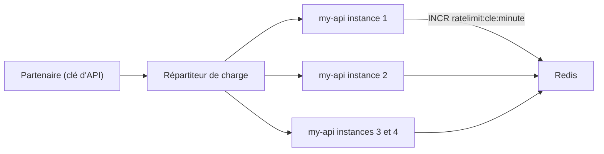

# Entretien Software Engineer : les exercices en direct

!!! warning "Avertissement"
    Ces notes sont des pense-bêtes personnels, pas une source de vérité. Elles reflètent ma compréhension et mes choix : leur contenu reste subjectif, malgré les citations et les références qu'il contient. Il peut être incomplet, simplifié, inexact ou dépassé. Vérifiez toujours dans la documentation officielle avant de l'appliquer. Ce contenu est fourni tel quel, sans aucune garantie : son utilisation se fait sous votre seule responsabilité.

!!! audience "Pour qui, pour quoi"
    - **Métiers** : développeur back-end, développeur full-stack, développeur qui vise un poste de Software Engineer, QA qui passe au développement, tech lead qui fait passer des entretiens.
    - **Usages** : je m'entraîne en temps limité à un exercice de live coding (refactoring, TDD, N+1) ; je prépare un exercice de conception (endpoint REST, limiteur de débit) et je veux un corrigé de référence ; je répète à voix haute la réponse orale d'un exercice ; je fais passer un entretien et je cherche un exercice avec son corrigé et ses pièges.

Exercices pratiques avec corrigés détaillés. Cette page complète la page [les questions](questions.md). Il n'existe pas de réponse unique : ce sont des **réponses de référence concrètes**, avec le code, les tests, les contrats d'API, le découpage et la formulation orale.

Le poste visé est celui d'un développeur qui écrit, teste, relit et met en production son propre code, au sein d'une équipe. Les exercices sont donc surtout pratiques : refactoring, tests, base de données, API, concurrence, revue de code et découpage du travail.

## Comment utiliser cette page

En entretien en direct (live coding, pair programming, exercice au tableau), le recruteur regarde surtout **comment** je travaille, pas seulement si le code final compile. Pour chaque exercice :

1. Je lis l'énoncé sans regarder le corrigé, et je me chronomètre (20 à 40 minutes selon l'exercice).
2. **Je pose deux ou trois questions avant de coder** : « quelles entrées possibles ? », « que faire en cas d'erreur ? », « quel volume ? ». Je montre que je ne fonce pas tête baissée.
3. **Je pense à voix haute** : je dis ce que je vais faire avant de le faire, et pourquoi.
4. **Je commence par un test ou un exemple** : il fixe ce que « juste » veut dire, et il me sauve si je m'égare.
5. Je donne d'abord une solution simple qui marche, puis je l'améliore. Une solution optimale inachevée vaut moins qu'une solution simple terminée et testée.
6. **Je termine par les limites** : cas non gérés, performance, ce que je ferais avec plus de temps.

Les exemples de code sont volontairement petits pour être réalisables en entretien. Quand le même code est montré en plusieurs langages, des onglets `PHP`, `Python` et `Java` permettent de choisir le mien : le choix est gardé d'un exercice à l'autre et sur tout le site. Les autres exercices sont en Python, facile à transposer.

## Exercice 1. Refactorer une fonction longue sans changer son comportement

### Énoncé

Le recruteur me montre une fonction qui calcule le total d'une commande. Elle fonctionne, mais personne n'ose la modifier. Il me demande de la rendre lisible sans changer son comportement, puis d'expliquer comment je m'assure de ne rien avoir cassé.

=== "PHP"

    ``` { .php .ex-bad title="À éviter" }
    // À éviter : noms sans sens, trois niveaux d'imbrication, nombres magiques
    function calc($o, $t) {
        if ($o !== null) {
            if (count($o['items']) > 0) {
                $s = 0;
                foreach ($o['items'] as $i) {
                    $s = $s + $i['price'] * $i['qty'];
                }
                if ($t === 'gold') {
                    $s = $s - $s * 0.2;
                } elseif ($t === 'silver') {
                    $s = $s - $s * 0.1;
                }
                if ($s < 50) {
                    $s = $s + 4.9;
                }
                $s = $s * 1.2;
                return round($s, 2);
            } else {
                return 0;
            }
        } else {
            throw new Exception('error');
        }
    }
    ```

=== "Python"

    ``` { .python .ex-bad title="À éviter" }
    # À éviter : noms sans sens, trois niveaux d'imbrication, nombres magiques
    def calc(o, t):
        if o is not None:
            if len(o["items"]) > 0:
                s = 0
                for i in o["items"]:
                    s = s + i["price"] * i["qty"]
                if t == "gold":
                    s = s - s * 0.2
                elif t == "silver":
                    s = s - s * 0.1
                if s < 50:
                    s = s + 4.9
                s = s * 1.2
                return round(s, 2)
            else:
                return 0
        else:
            raise Exception("error")
    ```

=== "Java"

    ``` { .java .ex-bad title="À éviter" }
    // À éviter : noms sans sens, trois niveaux d'imbrication, nombres magiques
    static double calc(Map<String, Object> o, String t) {
        if (o != null) {
            List<Map<String, Number>> items = (List<Map<String, Number>>) o.get("items");
            if (items.size() > 0) {
                double s = 0;
                for (Map<String, Number> i : items) {
                    s = s + i.get("price").doubleValue() * i.get("qty").intValue();
                }
                if ("gold".equals(t)) {
                    s = s - s * 0.2;
                } else if ("silver".equals(t)) {
                    s = s - s * 0.1;
                }
                if (s < 50) {
                    s = s + 4.9;
                }
                s = s * 1.2;
                return Math.round(s * 100) / 100.0;
            } else {
                return 0;
            }
        } else {
            throw new RuntimeException("error");
        }
    }
    ```

### Corrigé attendu

#### Problèmes à relever

- **Noms sans sens** : `calc`, `o`, `t`, `s`, `i` obligent à lire tout le code pour comprendre.
- **Imbrication** : trois niveaux de `if` pour un flux simple. Des <span class="term" data-term="guard-clause">clauses de garde</span> l'aplatissent.
- **<span class="term" data-term="magic-number">Nombres magiques</span>** : `0.2`, `0.1`, `50`, `4.9`, `1.2` ne disent pas ce qu'ils représentent (remise, seuil de livraison gratuite, frais, TVA).
- **Plusieurs responsabilités** : sous-total, remise, livraison et TVA dans un seul bloc.
- **Exception générique** : `Exception("error")` ne dit rien à l'appelant.
- **Argent en nombres flottants** : source d'erreurs d'arrondi. C'est un vrai problème, mais le corriger **change le comportement** : ce sera un commit séparé, pas une partie du refactoring.

#### Étape 1 : figer le comportement actuel

Avant de toucher au code, des <span class="term" data-term="characterization-test">tests de caractérisation</span> enregistrent ce que la fonction renvoie aujourd'hui :

``` { .python .ex-good title="Recommandé" }
import pytest

# Bien : un cas par branche, avec la valeur que la fonction renvoie aujourd'hui
@pytest.mark.parametrize(
    ("order", "tier", "expected"),
    [
        ({"items": [{"price": 10, "qty": 2}]}, "gold", 25.08),
        ({"items": [{"price": 30, "qty": 2}]}, "silver", 64.8),
        ({"items": [{"price": 25, "qty": 2}]}, None, 60.0),
        ({"items": [{"price": 49.99, "qty": 1}]}, "bronze", 65.87),
        ({"items": []}, "gold", 0),
    ],
)
def test_current_behavior(order, tier, expected):
    assert calc(order, tier) == expected


# Bien : l'absence de commande lève toujours une erreur
def test_none_order_raises():
    with pytest.raises(Exception):
        calc(None, "gold")
```

Les cas couvrent chaque branche : chaque niveau de remise, un niveau inconnu, sous le seuil de livraison gratuite et au-dessus, la liste vide, l'absence de commande.

#### Étape 2 : refactorer en petits pas

Ordre des transformations, avec les tests lancés après chacune : renommer, remplacer les nombres par des constantes, aplatir avec des clauses de garde, extraire le sous-total et les frais de port.

=== "PHP"

    ``` { .php .ex-good title="Recommandé" }
    <?php

    declare(strict_types=1);

    // Bien : chaque nombre porte un nom métier
    const DISCOUNT_BY_TIER = ['gold' => 0.20, 'silver' => 0.10];
    const FREE_SHIPPING_THRESHOLD = 50;
    const SHIPPING_FEE = 4.90;
    const VAT_RATE = 0.20;

    // Bien : clauses de garde, puis un calcul qui se lit comme la règle métier
    function orderTotal(?array $order, ?string $tier): float
    {
        if ($order === null) {
            throw new InvalidArgumentException('Order is required.');
        }
        if ($order['items'] === []) {
            return 0;
        }

        $subtotal = itemsSubtotal($order['items']);
        $discounted = $subtotal * (1 - (DISCOUNT_BY_TIER[$tier] ?? 0));
        $withShipping = $discounted + shippingFee($discounted);

        return round($withShipping * (1 + VAT_RATE), 2);
    }

    // Bien : le sous-total extrait dans sa propre fonction
    function itemsSubtotal(array $items): float
    {
        return array_sum(array_map(fn (array $item) => $item['price'] * $item['qty'], $items));
    }

    // Bien : la règle des frais de port, isolée et nommée
    function shippingFee(float $amount): float
    {
        return $amount < FREE_SHIPPING_THRESHOLD ? SHIPPING_FEE : 0;
    }
    ```

=== "Python"

    ``` { .python .ex-good title="Recommandé" }
    # Bien : chaque nombre porte un nom métier
    DISCOUNT_BY_TIER = {"gold": 0.20, "silver": 0.10}
    FREE_SHIPPING_THRESHOLD = 50
    SHIPPING_FEE = 4.90
    VAT_RATE = 0.20


    # Bien : clauses de garde, puis un calcul qui se lit comme la règle métier
    def order_total(order: dict | None, tier: str | None) -> float:
        if order is None:
            raise ValueError("order is required")
        if not order["items"]:
            return 0

        subtotal = items_subtotal(order["items"])
        discounted = subtotal * (1 - DISCOUNT_BY_TIER.get(tier, 0))
        with_shipping = discounted + shipping_fee(discounted)

        return round(with_shipping * (1 + VAT_RATE), 2)


    # Bien : le sous-total extrait dans sa propre fonction
    def items_subtotal(items: list[dict]) -> float:
        return sum(item["price"] * item["qty"] for item in items)


    # Bien : la règle des frais de port, isolée et nommée
    def shipping_fee(amount: float) -> float:
        return SHIPPING_FEE if amount < FREE_SHIPPING_THRESHOLD else 0
    ```

=== "Java"

    ``` { .java .ex-good title="Recommandé" }
    // Bien : une classe qui regroupe les constantes nommées et les étapes du calcul
    final class OrderPricing {
        private static final Map<String, Double> DISCOUNT_BY_TIER = Map.of("gold", 0.20, "silver", 0.10);
        private static final double FREE_SHIPPING_THRESHOLD = 50;
        private static final double SHIPPING_FEE = 4.90;
        private static final double VAT_RATE = 0.20;

        record Item(double price, int qty) {}

        // Bien : clauses de garde, puis un calcul qui se lit comme la règle métier
        static double orderTotal(List<Item> items, String tier) {
            if (items == null) {
                throw new IllegalArgumentException("Order is required.");
            }
            if (items.isEmpty()) {
                return 0;
            }

            double subtotal = itemsSubtotal(items);
            double discounted = subtotal * (1 - discountRate(tier));
            double withShipping = discounted + shippingFee(discounted);

            return Math.round(withShipping * (1 + VAT_RATE) * 100) / 100.0;
        }

        // Bien : un niveau inconnu ou absent ne donne aucune remise
        private static double discountRate(String tier) {
            return tier == null ? 0.0 : DISCOUNT_BY_TIER.getOrDefault(tier, 0.0);
        }

        // Bien : le sous-total extrait dans sa propre méthode
        private static double itemsSubtotal(List<Item> items) {
            return items.stream().mapToDouble(item -> item.price() * item.qty()).sum();
        }

        // Bien : la règle des frais de port, isolée et nommée
        private static double shippingFee(double amount) {
            return amount < FREE_SHIPPING_THRESHOLD ? SHIPPING_FEE : 0;
        }
    }
    ```

`InvalidArgumentException`, `ValueError` et `IllegalArgumentException` héritent toutes de l'exception générique d'origine : un appelant qui attrapait `Exception` continue de fonctionner. Les tests de caractérisation, adaptés au nouveau nom, restent verts.

#### Étape 3 : prouver l'équivalence plus largement

Pour une fonction de calcul, je peux comparer l'ancienne et la nouvelle version sur beaucoup d'entrées aléatoires, le temps du refactoring :

``` { .python .ex-good title="Recommandé" }
import random


# Bien : l'ancienne et la nouvelle version comparées sur 10 000 commandes aléatoires
def test_refactoring_is_equivalent():
    for _ in range(10_000):
        items = [
            {"price": round(random.uniform(0, 100), 2), "qty": random.randint(1, 5)}
            for _ in range(random.randint(1, 4))
        ]
        tier = random.choice(["gold", "silver", None, "unknown"])
        assert order_total({"items": items}, tier) == calc({"items": items}, tier)
```

Une fois le refactoring fusionné, je supprime `calc` et ce test.

#### Ce que j'ajoute en plus

- Je fais **un commit `refactor:` par transformation**, ou au moins un commit de refactoring séparé du suivant.
- Je signale les questions métier découvertes, sans les corriger en douce : la TVA s'applique-t-elle aux frais de port ? Le seuil de livraison gratuite se calcule-t-il avant ou après remise ?
- Je propose ensuite, dans une MR séparée avec ses propres tests, le passage des montants en centimes entiers : c'est un **changement de comportement** (les arrondis bougent), il doit être visible et validé.

#### Réponse orale possible

> « Je ne touche pas au code avant d'avoir des tests qui figent son comportement actuel, une branche par cas. Ensuite je fais de petites transformations, tests lancés à chaque fois : renommer, nommer les constantes, aplatir avec des clauses de garde, extraire le sous-total et les frais de port. Je ne corrige pas l'usage des flottants dans ce refactoring, parce que ça change les arrondis : je le signale et je le propose dans une MR séparée. Et je note les questions métier que j'ai découvertes, comme la TVA sur les frais de port. »

**À relire** : [Refactoring en petits pas](../../knowledge/principes-conception.md#refactoring-en-petits-pas), [Clauses de garde](../../knowledge/principes-conception.md#clauses-de-garde), [Tests de caractérisation et golden master](../../knowledge/conception-tests.md#tests-de-caracterisation-et-golden-master), [Pas de valeur magique](../../knowledge/qualite.md#pas-de-valeur-magique), [L'argent en centimes entiers](../../knowledge/qualite.md#largent-en-centimes-entiers), [Nommer selon l'intention](../../knowledge/principes-conception.md#nommer-selon-lintention).

## Exercice 2. Corriger un bug à partir d'un test qui échoue

### Énoncé

Un client signale qu'un partage d'addition entre amis « perd des centimes ». Un collègue a écrit le test qui reproduit le problème, il échoue. Le recruteur me demande de corriger la fonction.

``` { .python .ex-bad title="À éviter" }
# À éviter : la division entière perd le reste
def split_bill(total_cents: int, people: int) -> list[int]:
    share = total_cents // people
    return [share] * people


# Exemple : le test du collègue, qui reproduit le bug
def test_split_keeps_the_total():
    shares = split_bill(1000, 3)
    assert sum(shares) == 1000
```

``` { .text .ex-ref title="Référence · sortie de pytest" }
FAILED test_split_keeps_the_total - assert 999 == 1000
```

### Corrigé attendu

#### 1. Lire l'échec avant de coder

`1000 // 3` vaut `333`, et `333 x 3` vaut `999`. Le centime restant est perdu. Le test est juste : la somme des parts doit toujours être égale au total. C'est un <span class="term" data-term="invariant">invariant</span> de la fonction.

#### 2. Poser les questions métier

- Qui paie le centime en plus ? Par convention, les premières personnes de la liste.
- Que faire avec `people = 0` ou un total négatif ? Refuser avec une erreur claire.
- Les parts doivent-elles différer d'au plus un centime ? Oui, sinon le partage n'est pas équitable.

#### 3. Corriger avec le changement minimal

``` { .python .ex-good title="Recommandé" }
# Bien : les entrées invalides sont refusées, le reste est réparti sur les premières parts
def split_bill(total_cents: int, people: int) -> list[int]:
    if people <= 0:
        raise ValueError("people must be positive")
    if total_cents < 0:
        raise ValueError("total must not be negative")
    share, remainder = divmod(total_cents, people)
    return [share + 1 if index < remainder else share for index in range(people)]
```

`divmod(1000, 3)` donne `(333, 1)` : la première personne paie 334, les deux autres 333.

#### 4. Ajouter les tests qui manquaient

``` { .python .ex-good title="Recommandé" }
import pytest


# Bien : la convention métier est écrite dans un test
def test_split_gives_the_extra_cents_to_the_first_people():
    assert split_bill(1000, 3) == [334, 333, 333]


# Bien : le cas sans reste
def test_split_exact_division():
    assert split_bill(900, 3) == [300, 300, 300]


# Bien : le cas limite zéro personne
def test_split_rejects_zero_people():
    with pytest.raises(ValueError):
        split_bill(1000, 0)
```

#### 5. Tester l'invariant sur beaucoup de cas

Un test par propriété vérifie la règle sur des centaines d'entrées générées, au lieu de quelques exemples choisis à la main :

``` { .python .ex-good title="Recommandé" }
from hypothesis import given, strategies as st


# Bien : les trois invariants vérifiés sur des centaines d'entrées générées
@given(st.integers(min_value=0, max_value=10**9), st.integers(min_value=1, max_value=100))
def test_split_invariants(total_cents, people):
    shares = split_bill(total_cents, people)
    assert sum(shares) == total_cents
    assert len(shares) == people
    assert max(shares) - min(shares) <= 1
```

#### Ce que j'ajoute en plus

- Je cherche si la même erreur existe ailleurs : toute division d'un montant (remboursement partiel, paiement en plusieurs fois) a le même risque.
- Je vérifie si des données déjà enregistrées sont fausses (des additions partagées avec un centime perdu), et je propose une correction si l'écart a un impact.
- Je mets le test qui échouait dans le même commit que la correction : `fix(bill): keep the total when splitting`.

#### Réponse orale possible

> « Je lis d'abord l'échec : 999 au lieu de 1000, c'est le reste de la division entière qui est perdu. Je pose la question métier de qui paie le centime, puis je fais la correction minimale avec `divmod`. J'ajoute les cas limites, zéro personne et division exacte, et un test par propriété qui vérifie l'invariant : la somme des parts est toujours égale au total, et les parts diffèrent d'au plus un centime. Enfin, je cherche le même motif dans les autres calculs de montants. »

**À relire** : [Test par propriétés](../../knowledge/conception-tests.md#test-par-proprietes-property-based-testing), [Partitions d'équivalence et valeurs limites](../../knowledge/conception-tests.md#partitions-dequivalence-et-valeurs-limites), [L'argent en centimes entiers](../../knowledge/qualite.md#largent-en-centimes-entiers), [Trouver la cause : déboguer méthodiquement](../../knowledge/incidents.md#trouver-la-cause-deboguer-methodiquement).

## Exercice 3. Écrire une fonction pure en TDD

### Énoncé

Une bibliothèque municipale veut calculer les pénalités de retard :

- rendu à temps ou en avance : 0 ;
- 50 centimes par jour de retard ;
- plafond de 10 € par emprunt ;
- les abonnés premium ne paient jamais de pénalité.

Le recruteur me demande d'écrire la fonction en TDD, en montrant les étapes.

### Corrigé attendu

#### 1. Écrire la liste des tests avant le premier test

Le <span class="term" data-term="tdd">TDD</span> commence par une liste de scénarios, du plus simple au plus riche :

1. 0 jour de retard : 0.
2. 1 jour : 50.
3. 3 jours : 150.
4. 20 jours : 1 000 (exactement le plafond).
5. 30 jours : 1 000 (plafonné).
6. Rendu en avance (jours négatifs) : 0.
7. Abonné premium, 30 jours : 0.

#### 2. Faire passer les tests un par un

Tour 1 : le test « 0 jour » échoue (la fonction n'existe pas), j'écris `return 0`. Tour 2 : le test « 1 jour » échoue, j'écris `return days_late * 50`, le test « 0 jour » reste vert. Tours 3 et 4 passent sans changement. Tour 5 échoue : j'ajoute le plafond. Tour 6 échoue (une valeur négative) : j'ajoute `max(0, ...)`. Tour 7 échoue : j'ajoute la règle premium. À chaque vert, je regarde si le code mérite un nettoyage, par exemple nommer les constantes.

#### 3. Résultat : le code et ses tests

=== "PHP"

    ``` { .php .ex-good title="Recommandé" }
    <?php

    declare(strict_types=1);

    // Bien : une fonction pure, montants en centimes entiers, constantes nommées
    final class LateFee
    {
        private const CENTS_PER_DAY = 50;
        private const CAP_CENTS = 1000;

        // Bien : premium et retour à temps d'abord, puis le plafond
        public static function cents(int $daysLate, bool $isPremium): int
        {
            if ($isPremium || $daysLate <= 0) {
                return 0;
            }

            return min($daysLate * self::CENTS_PER_DAY, self::CAP_CENTS);
        }
    }
    ```

    ``` { .php .ex-good title="Recommandé" }
    <?php

    use PHPUnit\Framework\Attributes\DataProvider;
    use PHPUnit\Framework\TestCase;

    // Bien : la liste des scénarios devient un fournisseur de données lisible
    final class LateFeeTest extends TestCase
    {
        // Bien : un cas nommé par scénario, dont le bord exact du plafond
        public static function cases(): array
        {
            return [
                'on time' => [0, false, 0],
                'one day' => [1, false, 50],
                'three days' => [3, false, 150],
                'exactly the cap' => [20, false, 1000],
                'above the cap' => [30, false, 1000],
                'returned early' => [-2, false, 0],
                'premium member' => [30, true, 0],
            ];
        }

        // Bien : un seul test paramétré
        #[DataProvider('cases')]
        public function testLateFee(int $daysLate, bool $isPremium, int $expected): void
        {
            self::assertSame($expected, LateFee::cents($daysLate, $isPremium));
        }
    }
    ```

=== "Python"

    ``` { .python .ex-good title="Recommandé" }
    # Bien : montants en centimes entiers, constantes nommées
    CENTS_PER_DAY = 50
    CAP_CENTS = 1000


    # Bien : une fonction pure, premium et retour à temps d'abord, puis le plafond
    def late_fee_cents(days_late: int, is_premium: bool) -> int:
        if is_premium or days_late <= 0:
            return 0
        return min(days_late * CENTS_PER_DAY, CAP_CENTS)
    ```

    ``` { .python .ex-good title="Recommandé" }
    import pytest


    # Bien : un cas nommé par scénario, dont le bord exact du plafond
    @pytest.mark.parametrize(
        ("days_late", "is_premium", "expected"),
        [
            pytest.param(0, False, 0, id="on time"),
            pytest.param(1, False, 50, id="one day"),
            pytest.param(3, False, 150, id="three days"),
            pytest.param(20, False, 1000, id="exactly the cap"),
            pytest.param(30, False, 1000, id="above the cap"),
            pytest.param(-2, False, 0, id="returned early"),
            pytest.param(30, True, 0, id="premium member"),
        ],
    )
    def test_late_fee(days_late, is_premium, expected):
        assert late_fee_cents(days_late, is_premium) == expected
    ```

=== "Java"

    ``` { .java .ex-good title="Recommandé" }
    // Bien : une fonction pure, montants en centimes entiers, constantes nommées
    final class LateFee {
        private static final int CENTS_PER_DAY = 50;
        private static final int CAP_CENTS = 1000;

        // Bien : premium et retour à temps d'abord, puis le plafond
        static int cents(int daysLate, boolean isPremium) {
            if (isPremium || daysLate <= 0) {
                return 0;
            }
            return Math.min(daysLate * CENTS_PER_DAY, CAP_CENTS);
        }
    }
    ```

    ``` { .java .ex-good title="Recommandé" }
    import static org.junit.jupiter.api.Assertions.assertEquals;

    import org.junit.jupiter.params.ParameterizedTest;
    import org.junit.jupiter.params.provider.CsvSource;

    // Bien : la liste des scénarios devient un test paramétré
    class LateFeeTest {
        // Bien : un cas par ligne, dont le bord exact du plafond
        @ParameterizedTest(name = "{0} days, premium={1}: {2} cents")
        @CsvSource({
            "0, false, 0",
            "1, false, 50",
            "3, false, 150",
            "20, false, 1000",
            "30, false, 1000",
            "-2, false, 0",
            "30, true, 0"
        })
        void lateFee(int daysLate, boolean isPremium, int expected) {
            assertEquals(expected, LateFee.cents(daysLate, isPremium));
        }
    }
    ```

#### 4. Les choix à expliquer

- **Montants en centimes entiers** : pas d'arrondi de nombre flottant.
- **<span class="term" data-term="pure-function">Fonction pure</span>** : elle reçoit le nombre de jours, elle ne lit pas l'horloge. Le calcul du nombre de jours (avec les fuseaux horaires et les jours de fermeture) est une autre fonction, testée à part.
- **Un test pour chaque bord** : 20 jours tombe exactement sur le plafond, c'est la <span class="term" data-term="edge-case">valeur limite</span> où une erreur `<` au lieu de `<=` se cache.

#### Ce que j'ajoute en plus

- Je demande les règles qui manquent : le plafond est-il par emprunt ou par abonné ? Les jours de fermeture comptent-ils ?
- Je montre la liste des tests au Product Owner : elle se lit comme une spécification.

#### Réponse orale possible

> « J'écris d'abord la liste des cas, du plus simple au plus riche, puis je les transforme un par un en test qui échoue, avec le code minimal pour le faire passer. Les montants sont en centimes, et la fonction ne lit pas l'horloge pour rester pure et facile à tester. Je teste exactement la valeur du plafond, parce que c'est là qu'une erreur de comparaison se cache. À la fin, la liste des tests est la spécification, et je la fais relire par le métier. »

**À relire** : [TDD en pratique](../../knowledge/conception-tests.md#tdd-en-pratique), [Partitions d'équivalence et valeurs limites](../../knowledge/conception-tests.md#partitions-dequivalence-et-valeurs-limites), [L'argent en centimes entiers](../../knowledge/qualite.md#largent-en-centimes-entiers).

## Exercice 4. Corriger une requête N+1

### Énoncé

La page d'administration des commandes met 3 secondes à s'afficher. Le recruteur me montre la fonction qui prépare les données et me demande de trouver le problème, de le corriger et de l'empêcher de revenir.

``` { .python .ex-bad title="À éviter" }
# À éviter : deux requêtes par commande dans la boucle
def orders_page(conn, limit: int = 50) -> list[dict]:
    orders = conn.execute(
        "SELECT id, customer_id, total_cents FROM orders ORDER BY id DESC LIMIT %s",
        (limit,),
    ).fetchall()
    result = []
    for order in orders:
        customer = conn.execute(
            "SELECT name FROM customers WHERE id = %s", (order.customer_id,)
        ).fetchone()
        item_count = conn.execute(
            "SELECT COUNT(*) FROM order_items WHERE order_id = %s", (order.id,)
        ).fetchone()[0]
        result.append(
            {"id": order.id, "customer": customer.name,
             "total_cents": order.total_cents, "items": item_count}
        )
    return result
```

### Corrigé attendu

#### 1. Nommer le problème et le chiffrer

Pour 50 commandes : 1 requête pour la liste, 50 pour les clients, 50 pour le nombre d'articles, soit 101 <span class="term" data-term="round-trip">allers-retours</span> avec la base. C'est un double <span class="term" data-term="n-plus-one">problème N+1</span>. Chaque requête est rapide, mais leur nombre grandit avec la taille de la page, et chaque aller-retour réseau coûte quelques millisecondes.

Première chose à faire en entretien : le dire, puis proposer de le mesurer (logs SQL, ou un compteur de requêtes dans un test).

#### 2. Option A : une seule requête

``` { .python .ex-good title="Recommandé" }
# Bien : la page de 50 commandes est choisie d'abord, puis jointe et comptée en une requête
ORDERS_PAGE = """
    WITH page AS (
        SELECT id, customer_id, total_cents
        FROM orders
        ORDER BY id DESC
        LIMIT %s
    )
    SELECT p.id, p.total_cents, c.name AS customer_name, COUNT(i.id) AS item_count
    FROM page p
    JOIN customers c ON c.id = p.customer_id
    LEFT JOIN order_items i ON i.order_id = p.id
    GROUP BY p.id, p.total_cents, c.name
    ORDER BY p.id DESC
"""


# Bien : un seul aller-retour, quelle que soit la taille de la page
def orders_page(conn, limit: int = 50) -> list[dict]:
    rows = conn.execute(ORDERS_PAGE, (limit,)).fetchall()
    return [
        {"id": row.id, "customer": row.customer_name,
         "total_cents": row.total_cents, "items": row.item_count}
        for row in rows
    ]
```

Points à expliquer :

- La page de 50 commandes est choisie **d'abord** (`WITH page`), puis je joins : je ne compte les articles que de ces 50 commandes, pas de toute la table.
- `LEFT JOIN` et `COUNT(i.id)` : une commande sans article affiche 0 au lieu de disparaître.
- Un index sur `order_items(order_id)` est indispensable, sinon chaque comptage parcourt la table. Je le vérifie avec le <span class="term" data-term="execution-plan">plan d'exécution</span>.

#### 3. Option B : deux ou trois requêtes groupées

Si la requête unique devient trop complexe, je garde des requêtes simples mais **en nombre fixe**, avec `IN` ou `ANY` :

``` { .python .ex-good title="Recommandé" }
# Bien : trois requêtes groupées, leur nombre ne dépend plus du nombre de lignes
def orders_page(conn, limit: int = 50) -> list[dict]:
    orders = conn.execute(
        "SELECT id, customer_id, total_cents FROM orders ORDER BY id DESC LIMIT %s",
        (limit,),
    ).fetchall()
    customer_ids = list({order.customer_id for order in orders})
    order_ids = [order.id for order in orders]

    names = dict(conn.execute(
        "SELECT id, name FROM customers WHERE id = ANY(%s)", (customer_ids,)
    ).fetchall())
    counts = dict(conn.execute(
        "SELECT order_id, COUNT(*) FROM order_items WHERE order_id = ANY(%s) GROUP BY order_id",
        (order_ids,),
    ).fetchall())

    return [
        {"id": order.id, "customer": names[order.customer_id],
         "total_cents": order.total_cents, "items": counts.get(order.id, 0)}
        for order in orders
    ]
```

Trois requêtes, quelle que soit la taille de la page. C'est aussi ce que fait un ORM avec un <span class="term" data-term="eager-loading">chargement anticipé</span> « par lot » (`selectinload` en SQLAlchemy).

#### 4. Empêcher le retour du problème

``` { .python .ex-good title="Recommandé" }
import pytest


# Bien : une connexion qui compte les requêtes, pour le test
class CountingConnection:
    def __init__(self, conn) -> None:
        self._conn = conn
        self.queries = 0

    # Bien : chaque appel est compté puis transmis à la vraie connexion
    def execute(self, *args, **kwargs):
        self.queries += 1
        return self._conn.execute(*args, **kwargs)


# Bien : le nombre de requêtes reste le même avec 5 et 50 commandes
@pytest.mark.parametrize("orders_count", [5, 50])
def test_orders_page_uses_a_constant_number_of_queries(db, orders_count):
    create_orders(db, count=orders_count, items_per_order=3)
    conn = CountingConnection(db)

    page = orders_page(conn)

    assert len(page) == orders_count
    assert conn.queries == 1
```

Le test échoue avec l'ancienne version (11 puis 101 requêtes) et reste vert tant que le nombre de requêtes ne dépend pas du nombre de lignes.

#### Ce que j'ajoute en plus

- Je mesure avant et après sur des données réalistes, et je donne le chiffre dans la MR (par exemple « 101 requêtes, 3 s ; 1 requête, 40 ms », chiffres d'exemple).
- Je cherche les autres boucles qui font une requête par élément dans le même module.
- Si le projet utilise un ORM, j'active les logs SQL en développement pour voir ces boucles tout de suite.

#### Réponse orale possible

> « Je vois une requête dans une boucle : 101 requêtes pour 50 commandes, c'est un double N+1. Je choisirais d'abord la page de commandes, puis une jointure pour les clients et un `COUNT` groupé pour les articles, en une seule requête, avec un index sur `order_items.order_id`. Si la requête devient trop complexe, trois requêtes groupées avec `ANY` conviennent aussi : ce qui compte, c'est que leur nombre ne dépende plus du nombre de lignes. Et j'ajoute un test qui compte les requêtes avec 5 et 50 commandes, pour que le problème ne revienne pas. »

**À relire** : [Le problème N+1](../../knowledge/sql.md#le-probleme-n1), [Chargement paresseux ou anticipé](../../knowledge/sql.md#chargement-paresseux-ou-anticipe), [EXPLAIN](../../knowledge/sql.md#explain), [Quand un index aide](../../knowledge/sql.md#quand-un-index-aide), [Sous-requête et CTE](../../knowledge/sql.md#sous-requete-et-cte-with).

## Exercice 5. Concevoir un petit endpoint REST avec erreurs et pagination

### Énoncé

L'application mobile doit afficher l'historique des commandes d'un client, du plus récent au plus ancien, avec un filtre optionnel par statut. Un client B2B peut avoir des dizaines de milliers de commandes. Le recruteur me demande de proposer le contrat de l'API, puis de coder l'endpoint.

### Corrigé attendu

#### 1. Questions à poser

- Le client ne voit-il que ses propres commandes ? (Oui : <span class="term" data-term="authorization">autorisation</span> obligatoire.)
- Le mobile a-t-il besoin d'aller à la page 37 directement, ou seulement de « charger plus » ? (Charger plus : la <span class="term" data-term="cursor-pagination">pagination par curseur</span> convient.)
- Quels champs sont affichés dans la liste ? (Pour ne pas renvoyer toute la commande.)

#### 2. Le contrat

``` { .http .ex-ref title="Référence · requête HTTP" }
GET /customers/42/orders?status=shipped&limit=20&cursor=eyJjIjoi...
Authorization: Bearer <token>
```

| Situation | Code | Corps |
|---|---|---|
| Succès | `200` | `{"items": [...], "next_cursor": "..."}`, `next_cursor` à `null` sur la dernière page |
| Pas de jeton ou jeton invalide | `401` | Problem Details |
| Client 42 différent de l'appelant | `404` | Problem Details (ne pas confirmer que le client existe) |
| `limit` hors de 1 à 200, `status` inconnu | `422` | Problem Details avec les champs en erreur |
| Curseur illisible | `400` | Problem Details |

Choix à justifier :

- **Pagination par curseur**, triée par `(created_at, id)` : stable même si de nouvelles commandes arrivent pendant que l'utilisateur fait défiler, et rapide même loin dans l'historique.
- **Limite maximale côté serveur** (200), même si le client demande plus.
- **Erreurs au format <span class="term" data-term="problem-details">Problem Details</span>** (RFC 9457, 2023) pour toute l'API.

#### 3. La requête SQL

``` { .sql .ex-good title="Recommandé" }
-- Bien : filtre par client, statut optionnel, curseur (created_at, id), une ligne de plus que la limite
SELECT id, status, total_cents, created_at
FROM orders
WHERE customer_id = %(customer_id)s
  AND (%(status)s::text IS NULL OR status = %(status)s)
  AND (%(after_created_at)s::timestamptz IS NULL
       OR (created_at, id) < (%(after_created_at)s, %(after_id)s))
ORDER BY created_at DESC, id DESC
LIMIT %(limit_plus_one)s;
```

Avec un <span class="term" data-term="composite-index">index composite</span> sur `(customer_id, created_at DESC, id DESC)`. Je demande `limit + 1` lignes : s'il en revient une de plus, il existe une page suivante, sans requête `COUNT` supplémentaire.

#### 4. Le code (exemple avec FastAPI)

``` { .python .ex-good title="Recommandé" }
import base64
import json

from fastapi import FastAPI, Query, Request
from fastapi.responses import JSONResponse

app = FastAPI()
MAX_LIMIT = 200
ALLOWED_STATUSES = {"pending", "paid", "shipped", "cancelled"}


# Bien : une seule exception métier porte tout ce qu'il faut pour une réponse Problem Details
class ProblemError(Exception):
    def __init__(self, status: int, slug: str, title: str, detail: str) -> None:
        super().__init__(detail)
        self.status, self.slug, self.title, self.detail = status, slug, title, detail


# Bien : un gestionnaire unique traduit l'exception au format application/problem+json
@app.exception_handler(ProblemError)
async def problem_handler(request: Request, exc: ProblemError) -> JSONResponse:
    return JSONResponse(
        status_code=exc.status,
        media_type="application/problem+json",
        content={
            "type": f"https://my-api.example.com/problems/{exc.slug}",
            "title": exc.title,
            "status": exc.status,
            "detail": exc.detail,
            "instance": request.url.path,
        },
    )


# Bien : un curseur opaque, que le mobile ne construit pas lui-même
def encode_cursor(created_at: str, order_id: int) -> str:
    raw = json.dumps({"c": created_at, "i": order_id}).encode()
    return base64.urlsafe_b64encode(raw).decode()


# Bien : un curseur illisible donne un 400 clair, pas une erreur 500
def decode_cursor(cursor: str) -> tuple[str, int]:
    try:
        data = json.loads(base64.urlsafe_b64decode(cursor.encode()))
        return data["c"], int(data["i"])
    except (ValueError, KeyError, TypeError) as exc:
        raise ProblemError(400, "invalid-cursor", "Invalid cursor", "The cursor is malformed.") from exc


# Bien : autorisation d'abord, validation, puis une ligne de plus pour savoir s'il y a une suite
@app.get("/customers/{customer_id}/orders")
def list_orders(
    customer_id: int,
    request: Request,
    status: str | None = None,
    limit: int = Query(20, ge=1, le=MAX_LIMIT),
    cursor: str | None = None,
):
    if current_customer_id(request) != customer_id:
        raise ProblemError(404, "not-found", "Customer not found", "No such customer.")
    if status is not None and status not in ALLOWED_STATUSES:
        raise ProblemError(422, "validation-error", "Invalid status", f"Unknown status: {status}")

    after = decode_cursor(cursor) if cursor else None
    rows = order_repository.page(customer_id, status, after, limit + 1)

    has_more = len(rows) > limit
    rows = rows[:limit]
    next_cursor = encode_cursor(rows[-1].created_at, rows[-1].id) if has_more else None

    return {
        "items": [
            {"id": row.id, "status": row.status, "total_cents": row.total_cents,
             "created_at": row.created_at}
            for row in rows
        ],
        "next_cursor": next_cursor,
    }
```

`current_customer_id` lit l'identité dans le jeton déjà vérifié par l'authentification. Les erreurs de validation propres à FastAPI (`limit=500`) ont leur propre format par défaut : en production, j'ajouterais un gestionnaire pour les convertir aussi en Problem Details.

#### 5. Tests à prévoir

1. Trois pages successives renvoient toutes les commandes, sans doublon ni trou, même si une commande est créée entre deux appels.
2. La dernière page renvoie `next_cursor: null`.
3. Le client A qui demande les commandes du client B reçoit `404`.
4. `limit=500` est refusé, `limit` absent vaut 20.
5. Un curseur modifié à la main renvoie `400` avec `application/problem+json`.
6. Le filtre `status=shipped` ne renvoie que des commandes expédiées.

#### Ce que j'ajoute en plus

- J'écris le contrat (OpenAPI) avant le code et je le partage avec l'équipe mobile : elle peut avancer avec un faux serveur pendant ce temps.
- Je garde le curseur **opaque** : le mobile ne doit pas le construire lui-même, pour que je puisse changer son contenu plus tard.

#### Réponse orale possible

> « Je commence par l'autorisation : un client ne voit que ses commandes, sinon `404`. Pour la pagination, le mobile fait du “charger plus”, donc je prends un curseur trié par date et identifiant, avec un index composite : c'est stable quand de nouvelles commandes arrivent et rapide même loin dans l'historique. Je demande une ligne de plus que la limite pour savoir s'il y a une suite, sans `COUNT`. La limite est plafonnée côté serveur. Toutes les erreurs suivent Problem Details, et le contrat OpenAPI est écrit avant le code pour l'équipe mobile. »

**À relire** : [Pagination](../../knowledge/api-rest-async.md#pagination), [Format d'erreur](../../knowledge/api-rest-async.md#format-derreur), [Les codes de réponse](../../knowledge/api-rest-async.md#les-codes-de-reponse), [OpenAPI](../../knowledge/api-rest-async.md#openapi), [API first](../../knowledge/api-rest-async.md#api-first), [Tester une API REST](../../knowledge/api-rest-async.md#tester-une-api-rest), [Les failles les plus courantes des API](../../knowledge/securite.md#les-failles-les-plus-courantes-des-api), [Index composite : l'ordre des colonnes et l'index couvrant](../../knowledge/sql.md#index-composite-lordre-des-colonnes-et-lindex-couvrant).

## Exercice 6. Coder un cache LRU

### Énoncé

Le recruteur me demande d'implémenter un cache de taille limitée qui, quand il est plein, supprime l'élément utilisé le moins récemment (LRU, Least Recently Used). `get` et `put` doivent être en temps constant.

### Corrigé attendu

#### 1. Clarifier avant de coder

- Que renvoie `get` sur une clé absente ? (`null` ou `None`.)
- Un `put` sur une clé existante compte-t-il comme une utilisation ? (Oui.)
- Le cache est-il utilisé par plusieurs threads ? (Si oui, il faudra un verrou : à mentionner, pas forcément à coder.)

#### 2. L'idée

Il faut deux choses : retrouver une valeur par sa clé en temps constant (une table de hachage), et connaître l'ordre d'utilisation pour supprimer la plus ancienne (une liste doublement chaînée). Les trois langages ont une structure qui combine les deux : `OrderedDict` en Python, `LinkedHashMap` en Java, et les tableaux PHP, qui gardent l'ordre d'insertion.

Le schéma, avec une capacité de 3, après `put("a", 1)`, `put("b", 2)`, `put("c", 3)` :

``` { .text .ex-illus title="Illustration" }
table de hachage (clé -> nœud de la liste)
  "a" -> nœud a     "b" -> nœud b     "c" -> nœud c

liste doublement chaînée, de la moins récente (après la tête) à la plus récente (avant la queue)
  [tête] <-> [a:1] <-> [b:2] <-> [c:3] <-> [queue]
```

Ce que fait `get("a")` :

1. La table donne directement le nœud `a`, sans parcourir la liste.
2. Je détache `a` en reliant ses deux voisins : `tête.suivant = b`, `b.précédent = tête`.
3. Je le raccroche juste avant la queue : `[tête] <-> [b:2] <-> [c:3] <-> [a:1] <-> [queue]`.
4. Je renvoie `1`. Un `put("d", 4)` évincerait maintenant `b`, le nœud qui suit la tête, et retirerait `"b"` de la table.

Chaque étape modifie un nombre fixe de pointeurs, quelle que soit la taille du cache.

La <span class="term" data-term="time-complexity">complexité</span> attendue : `get` et `put` en O(1).

#### 3. Implémentation

=== "PHP"

    ``` { .php .ex-good title="Recommandé" }
    <?php

    declare(strict_types=1);

    // Bien : un tableau PHP garde l'ordre d'insertion, le premier élément est le moins récent
    final class LruCache
    {
        private array $items = [];

        // Bien : une capacité invalide est refusée dès la construction
        public function __construct(private readonly int $capacity)
        {
            if ($capacity <= 0) {
                throw new InvalidArgumentException('Capacity must be positive.');
            }
        }

        // Bien : lire une clé la replace à la fin, comme la plus récente
        public function get(string $key): mixed
        {
            if (!array_key_exists($key, $this->items)) {
                return null;
            }
            $value = $this->items[$key];
            unset($this->items[$key]);
            $this->items[$key] = $value;

            return $value;
        }

        // Bien : écrire replace la clé à la fin, puis évince la plus ancienne si besoin
        public function put(string $key, mixed $value): void
        {
            unset($this->items[$key]);
            $this->items[$key] = $value;
            if (count($this->items) > $this->capacity) {
                unset($this->items[array_key_first($this->items)]);
            }
        }
    }
    ```

    Un tableau PHP garde l'ordre d'insertion : supprimer puis réinsérer une clé la place à la fin. Le premier élément est donc toujours le moins récemment utilisé.

=== "Python"

    ``` { .python .ex-good title="Recommandé" }
    from collections import OrderedDict
    from typing import Any


    # Bien : OrderedDict combine table de hachage et ordre d'utilisation
    class LRUCache:
        # Bien : une capacité invalide est refusée dès la construction
        def __init__(self, capacity: int) -> None:
            if capacity <= 0:
                raise ValueError("capacity must be positive")
            self._capacity = capacity
            self._items: OrderedDict[str, Any] = OrderedDict()

        # Bien : lire une clé la déplace en fin de liste, comme la plus récente
        def get(self, key: str) -> Any | None:
            if key not in self._items:
                return None
            self._items.move_to_end(key)
            return self._items[key]

        # Bien : écrire déplace la clé en fin de liste, puis évince la plus ancienne si besoin
        def put(self, key: str, value: Any) -> None:
            if key in self._items:
                self._items.move_to_end(key)
            self._items[key] = value
            if len(self._items) > self._capacity:
                self._items.popitem(last=False)
    ```

    `move_to_end` et `popitem(last=False)` sont en temps constant. Pour un cache de fonction, `functools.lru_cache` existe déjà : en entretien, je le dis, puis je code la version demandée.

=== "Java"

    ``` { .java .ex-good title="Recommandé" }
    import java.util.LinkedHashMap;
    import java.util.Map;

    // Bien : la classe enveloppe une LinkedHashMap au lieu d'en hériter, et n'expose que get et put
    final class LruCache<K, V> {
        private final Map<K, V> items;

        // Bien : ordre d'accès (true) et éviction automatique de la plus ancienne entrée
        LruCache(int capacity) {
            if (capacity <= 0) {
                throw new IllegalArgumentException("Capacity must be positive.");
            }
            this.items = new LinkedHashMap<>(16, 0.75f, true) {
                // Bien : appelé après chaque ajout, supprime l'entrée la moins récente au-delà de la capacité
                @Override
                protected boolean removeEldestEntry(Map.Entry<K, V> eldest) {
                    return size() > capacity;
                }
            };
        }

        // Bien : la lecture met à jour l'ordre d'accès
        V get(K key) {
            return items.get(key);
        }

        // Bien : l'écriture peut déclencher l'éviction
        void put(K key, V value) {
            items.put(key, value);
        }
    }
    ```

    Le troisième argument `true` range les entrées par ordre d'accès, et `removeEldestEntry` supprime la plus ancienne après chaque ajout. La classe enveloppe la `LinkedHashMap` au lieu d'en hériter, pour n'exposer que `get` et `put`.

#### 4. Tests

=== "PHP"

    ``` { .php .ex-good title="Recommandé" }
    // Bien : le scénario d'éviction, a est relu donc b est évincé
    public function testEvictsTheLeastRecentlyUsedKey(): void
    {
        $cache = new LruCache(2);
        $cache->put('a', 1);
        $cache->put('b', 2);
        $cache->get('a');
        $cache->put('c', 3);

        self::assertNull($cache->get('b'));
        self::assertSame(1, $cache->get('a'));
        self::assertSame(3, $cache->get('c'));
    }
    ```

=== "Python"

    ``` { .python .ex-good title="Recommandé" }
    # Bien : le scénario d'éviction, a est relu donc b est évincé
    def test_evicts_the_least_recently_used_key():
        cache = LRUCache(2)
        cache.put("a", 1)
        cache.put("b", 2)
        cache.get("a")
        cache.put("c", 3)

        assert cache.get("b") is None
        assert cache.get("a") == 1
        assert cache.get("c") == 3
    ```

=== "Java"

    ``` { .java .ex-good title="Recommandé" }
    // Bien : le scénario d'éviction, a est relu donc b est évincé
    @Test
    void evictsTheLeastRecentlyUsedKey() {
        LruCache<String, Integer> cache = new LruCache<>(2);
        cache.put("a", 1);
        cache.put("b", 2);
        cache.get("a");
        cache.put("c", 3);

        assertNull(cache.get("b"));
        assertEquals(1, cache.get("a"));
        assertEquals(3, cache.get("c"));
    }
    ```

Autres cas à tester : mise à jour d'une clé existante (pas d'éviction, nouvelle valeur), capacité 1, capacité 0 refusée.

#### Ce que j'ajoute en plus

- Si le recruteur interdit `OrderedDict` ou `LinkedHashMap`, j'explique la structure à la main : une table de hachage qui pointe vers les nœuds d'une liste doublement chaînée, avec deux nœuds sentinelles en tête et en queue pour éviter les cas particuliers.
- Je parle de la concurrence : ces implémentations ne sont pas sûres entre threads. Un verrou autour de `get` et `put` suffit pour commencer.
- Je rappelle qu'en production, un <span class="term" data-term="cache-data">cache</span> partagé entre plusieurs instances se met plutôt dans Redis, qui propose une politique d'éviction LRU approximative.

#### Réponse orale possible

> « Il me faut un accès par clé en temps constant et l'ordre d'utilisation : une table de hachage plus une liste doublement chaînée. Le langage me donne les deux avec `OrderedDict` ou `LinkedHashMap`, donc je m'en sers et je le dis. `get` déplace la clé en fin de liste, `put` aussi, puis supprime la tête si on dépasse la capacité. Je teste le scénario d'éviction, la mise à jour d'une clé existante et la capacité invalide. Je précise que ce n'est pas sûr entre threads, et je peux coder la liste chaînée à la main si on me le demande. »

**À relire** : [Où placer un cache](../../knowledge/architecture.md#ou-placer-un-cache), [Cache : Redis](../../knowledge/outils.md#cache-redis), [Composition plutôt qu'héritage](../../knowledge/principes-conception.md#composition-plutot-quheritage), [Complexité algorithmique (notation O)](../../knowledge/lois-et-principes.md#complexite-algorithmique-notation-o).

## Exercice 7. Déboguer un double paiement

### Énoncé

Le support signale que certains clients sont débités deux fois pour la même commande. Les logs du prestataire de paiement montrent deux débits à 120 ms d'intervalle. Le recruteur me montre le code et me demande de trouver la cause, de la corriger et de prouver la correction.

``` { .python .ex-bad title="À éviter" }
# À éviter : vérifier puis agir, deux requêtes simultanées lisent toutes les deux pending
def pay_order(conn, gateway, order_id: int) -> None:
    order = conn.execute(
        "SELECT id, status, amount_cents, card_token FROM orders WHERE id = %s",
        (order_id,),
    ).fetchone()
    if order.status == "paid":
        return
    gateway.charge(order.card_token, order.amount_cents)
    conn.execute("UPDATE orders SET status = 'paid' WHERE id = %s", (order_id,))
```

### Corrigé attendu

#### 1. Reconstituer le scénario

Deux requêtes arrivent presque en même temps : un double clic, ou l'application qui renvoie la requête après un délai dépassé.

| Temps | Requête A | Requête B |
|---|---|---|
| 0 ms | lit la commande : `pending` | |
| 5 ms | | lit la commande : `pending` |
| 10 ms | appelle `gateway.charge` | |
| 15 ms | | appelle `gateway.charge` |
| 300 ms | écrit `paid` | |
| 310 ms | | écrit `paid` |

Les deux ont lu `pending` avant que l'une écrive `paid`. C'est une <span class="term" data-term="race-condition">race condition</span> du type « vérifier puis agir » : le `if` protège contre un second clic une minute plus tard, pas contre deux requêtes simultanées. Le bouton grisé côté interface ne suffit pas non plus : la requête peut être renvoyée par le réseau ou l'application.

#### 2. Corriger : réserver la commande de façon atomique

``` { .python .ex-good title="Recommandé" }
# Bien : une exception dédiée dit à l'appelant que le paiement est déjà en cours
class PaymentInProgress(Exception):
    """La commande est déjà en cours de paiement ou déjà payée."""


# Bien : la base ne laisse passer qu'une requête de pending à paying, puis l'appel au prestataire
def pay_order(conn, gateway, order_id: int) -> None:
    with conn.transaction():
        claimed = conn.execute(
            "UPDATE orders SET status = 'paying' "
            "WHERE id = %s AND status IN ('pending', 'payment_failed') "
            "RETURNING amount_cents, card_token",
            (order_id,),
        ).fetchone()
    if claimed is None:
        raise PaymentInProgress(order_id)

    try:
        gateway.charge(
            claimed.card_token,
            claimed.amount_cents,
            idempotency_key=f"order-{order_id}",
        )
    except gateway.DeclinedError:
        conn.execute("UPDATE orders SET status = 'payment_failed' WHERE id = %s", (order_id,))
        raise

    conn.execute("UPDATE orders SET status = 'paid' WHERE id = %s", (order_id,))
```

Les mêmes deux requêtes, sessions A et B, avec la correction :

| Temps | Session A | Session B |
|---|---|---|
| 0 ms | `UPDATE ... WHERE id = 42 AND status IN (...)` : verrouille la ligne et la passe à `paying` | |
| 5 ms | | même `UPDATE` : attend le verrou de la ligne 42 |
| 8 ms | fin de la transaction : `paying` est écrit, le verrou est libéré | |
| 9 ms | | revérifie la ligne : `paying` ne correspond plus au `WHERE`, 0 ligne modifiée |
| 10 ms | appelle `gateway.charge` | `fetchone()` renvoie `None` : `PaymentInProgress`, aucun débit |

`RETURNING` renvoie les colonnes des lignes que l'`UPDATE` vient de modifier, dans la même instruction : A reçoit `amount_cents` et `card_token` sans faire de `SELECT` séparé (qui rouvrirait une fenêtre entre la lecture et l'écriture), B reçoit un résultat vide. PostgreSQL et SQLite (depuis la version 3.35, 2021) le proposent, MySQL non : à vérifier pour le moteur utilisé.

Ce qui a changé :

- **L'`UPDATE ... WHERE status IN (...)` est <span class="term" data-term="atomic-operation">atomique</span>** : la base ne laisse qu'une seule requête passer de `pending` à `paying`. La seconde ne modifie aucune ligne, et s'arrête avant d'appeler le prestataire.
- **La transaction est courte** : elle se termine avant l'appel HTTP au prestataire, pour ne pas garder un verrou pendant un appel réseau.
- **Une <span class="term" data-term="idempotency-key">clé d'idempotence</span> est envoyée au prestataire** (si son API le permet, à vérifier dans sa documentation) : si le processus tombe après le débit mais avant l'écriture de `paid`, une nouvelle tentative avec la même clé ne débite pas une seconde fois.
- **Un refus remet la commande en `payment_failed`**, ce qui permet de réessayer avec une autre carte.
- **Un délai dépassé laisse la commande en `paying`** : je ne sais pas si le débit a eu lieu. Une tâche de <span class="term" data-term="reconciliation">réconciliation</span> interroge le prestataire pour les commandes restées en `paying` depuis plus de quelques minutes.

#### 3. Prouver la correction par un test concurrent

``` { .python .ex-good title="Recommandé" }
import threading
import time


# Bien : un faux prestataire lent, qui élargit la fenêtre de concurrence et enregistre les débits
class SlowFakeGateway:
    DeclinedError = RuntimeError

    def __init__(self) -> None:
        self.charges: list[str] = []
        self._lock = threading.Lock()

    # Bien : 50 ms d'attente, puis le débit est noté sous verrou
    def charge(self, card_token: str, amount_cents: int, idempotency_key: str) -> None:
        time.sleep(0.05)
        with self._lock:
            self.charges.append(idempotency_key)


# Bien : deux paiements simultanés sur une vraie base, un seul débit attendu
def test_two_simultaneous_payments_charge_once(db_factory, pending_order_id):
    gateway = SlowFakeGateway()
    errors: list[Exception] = []

    # Exemple : chaque thread ouvre sa propre connexion
    def attempt():
        try:
            pay_order(db_factory(), gateway, pending_order_id)
        except PaymentInProgress as exc:
            errors.append(exc)

    threads = [threading.Thread(target=attempt) for _ in range(2)]
    for thread in threads:
        thread.start()
    for thread in threads:
        thread.join()

    assert gateway.charges == [f"order-{pending_order_id}"]
    assert len(errors) == 1
```

Le faux prestataire attend 50 ms pour élargir la fenêtre de concurrence. Avec l'ancienne version, le test voit deux débits. Chaque thread utilise sa propre connexion (`db_factory`) sur une vraie base jetable : un faux objet ne reproduirait pas le comportement de l'`UPDATE` concurrent.

#### Ce que j'ajoute en plus

- Je retrouve les clients déjà débités deux fois (en croisant les débits du prestataire et les commandes) et je lance les remboursements avec le support.
- J'ajoute une alerte sur les commandes restées en `paying` trop longtemps.
- Côté client, je génère la clé d'idempotence une seule fois par intention de payer, et je la renvoie à chaque nouvelle tentative.

#### Réponse orale possible

> « Deux requêtes lisent `pending` en même temps, chacune débite : c'est un “vérifier puis agir” non atomique. Je remplace la lecture par un `UPDATE` conditionnel qui fait passer la commande de `pending` à `paying` : la base n'en laisse passer qu'une. La transaction se termine avant l'appel au prestataire, et j'envoie une clé d'idempotence pour qu'une nouvelle tentative après une panne ne débite pas deux fois. Je le prouve avec un test qui lance deux paiements en parallèle sur une vraie base, et je n'oublie pas de rembourser les clients déjà touchés. »

**À relire** : [Race condition et mise à jour perdue](../../knowledge/sql.md#race-condition-et-mise-a-jour-perdue), [Verrou pessimiste](../../knowledge/sql.md#verrou-pessimiste-for-update), [Idempotence](../../knowledge/architecture.md#idempotence), [Les méthodes HTTP](../../knowledge/api-rest-async.md#les-methodes-http), [Tests d'intégration avec Testcontainers](../../knowledge/qualite.md#tests-dintegration-avec-testcontainers), [State](../../knowledge/design-patterns-comportement.md#state-etat).

## Exercice 8. Conception : un limiteur de débit pour une API

### Énoncé

`my-api` est exposée à des partenaires, chacun avec une clé d'API. Un partenaire a saturé le service hier avec un script mal écrit. Le recruteur me demande de limiter chaque clé à 100 requêtes par minute. L'API tourne sur quatre instances derrière un répartiteur de charge.

### Corrigé attendu

#### 1. Questions à poser

- La limite est-elle stricte (jamais 101 requêtes dans une minute glissante) ou approximative ? (Approximative suffit souvent.)
- Que faire au-delà : refuser (`429`) ou ralentir ? (Refuser, avec l'heure de la prochaine tentative possible.)
- Si le stockage du compteur tombe, je laisse passer ou je bloque tout ? (C'est une décision produit, à poser.)

#### 2. Choisir l'algorithme

| Algorithme | Principe | Avantage | Limite |
|---|---|---|---|
| Fenêtre fixe | Un compteur par clé et par minute calendaire | Très simple, un `INCR` | Jusqu'à 200 requêtes autour du changement de minute |
| Fenêtre glissante (journal) | Garder l'heure de chaque requête | Exact | Mémoire proportionnelle au nombre de requêtes |
| Fenêtre glissante (compteur) | Pondérer la minute précédente et la minute en cours | Bon compromis | Approximatif |
| <span class="term" data-term="token-bucket">Seau à jetons</span> | Un seau se remplit à vitesse fixe, chaque requête prend un jeton | Autorise de petites rafales, lisse le débit | Un peu plus de calcul, état à stocker |

Pour commencer, la fenêtre fixe dans Redis est souvent suffisante. Le seau à jetons est le bon choix si je veux autoriser des rafales courtes.

#### 3. Le seau à jetons, en mémoire, avec une horloge injectée

``` { .python .ex-good title="Recommandé" }
import time
from collections.abc import Callable


# Bien : l'horloge est injectée, le seau se teste sans attente réelle
class TokenBucket:
    def __init__(
        self,
        capacity: int,
        refill_per_second: float,
        clock: Callable[[], float] = time.monotonic,
    ) -> None:
        self._capacity = capacity
        self._refill_per_second = refill_per_second
        self._clock = clock
        self._tokens = float(capacity)
        self._updated_at = clock()

    # Bien : remplir selon le temps écoulé, plafonner, puis prendre un jeton s'il en reste
    def allow(self) -> bool:
        now = self._clock()
        elapsed = now - self._updated_at
        self._tokens = min(self._capacity, self._tokens + elapsed * self._refill_per_second)
        self._updated_at = now
        if self._tokens >= 1:
            self._tokens -= 1
            return True
        return False


# Bien : l'horloge avance à la main, le test est déterministe
def test_bucket_refills_over_time():
    now = [0.0]
    bucket = TokenBucket(capacity=2, refill_per_second=1, clock=lambda: now[0])

    assert bucket.allow() is True
    assert bucket.allow() is True
    assert bucket.allow() is False

    now[0] = 1.0
    assert bucket.allow() is True
    assert bucket.allow() is False
```

L'horloge injectée rend le test déterministe : aucune attente réelle.

#### 4. Partager le compteur entre les quatre instances

Un seau en mémoire ne marche que pour une instance : avec quatre instances, un partenaire aurait droit à 400 requêtes. Le compteur doit être partagé, par exemple dans Redis :

``` { .python .ex-good title="Recommandé" }
WINDOW_SECONDS = 60
LIMIT_PER_WINDOW = 100


# Bien : fenêtre fixe partagée, INCR atomique et expiration qui nettoie les anciennes fenêtres
def check_rate_limit(redis, api_key: str, now: float) -> tuple[bool, int]:
    window = int(now // WINDOW_SECONDS)
    key = f"ratelimit:{api_key}:{window}"
    pipe = redis.pipeline()
    pipe.incr(key)
    pipe.expire(key, WINDOW_SECONDS * 2)
    count, _ = pipe.execute()
    retry_after = WINDOW_SECONDS - int(now % WINDOW_SECONDS)
    return count <= LIMIT_PER_WINDOW, retry_after
```

`INCR` est atomique dans Redis : deux instances qui incrémentent en même temps obtiennent deux valeurs différentes. L'expiration nettoie les anciennes fenêtres toutes seules. Pour un seau à jetons partagé, j'écrirais le calcul en script Lua exécuté par Redis, pour qu'il reste atomique.



#### 5. La réponse au client

``` { .http .ex-ref title="Référence · réponse HTTP 429" }
HTTP/1.1 429 Too Many Requests
Retry-After: 23
Content-Type: application/problem+json

{
  "type": "https://my-api.example.com/problems/rate-limited",
  "title": "Too many requests",
  "status": 429,
  "detail": "Limit is 100 requests per minute for this API key."
}
```

`Retry-After` est défini par la RFC 9110 (2022). Des en-têtes `RateLimit` standardisés (limite, restant, remise à zéro) sont en cours de normalisation à l'IETF (brouillon, statut à vérifier).

#### Ce que j'ajoute en plus

- Je décide et j'écris le comportement si Redis tombe : laisser passer (le service reste disponible, sans protection) ou refuser (protection, mais panne visible). Pour une API partenaire, laisser passer avec une alerte est souvent préféré.
- Je mesure le nombre de `429` par clé, pour repérer un partenaire mal configuré avant qu'il ne se plaigne.
- Je vérifie si la passerelle d'API ou le reverse proxy le fait déjà : une <span class="term" data-term="rate-limit">limite de débit</span> configurée devant l'application évite d'écrire du code.

#### Réponse orale possible

> « Je commence par les questions : limite stricte ou approximative, et que faire si le stockage tombe. Avec quatre instances, le compteur doit être partagé : une fenêtre fixe dans Redis avec `INCR` et une expiration suffit pour commencer, c'est atomique et simple. Si on veut tolérer des rafales, je passe au seau à jetons, écrit en Lua côté Redis. Au-delà de la limite, je renvoie `429` avec `Retry-After` et un corps Problem Details. Et je vérifie d'abord si la passerelle d'API ne sait pas déjà le faire. »

**À relire** : [Limitation de débit](../../knowledge/architecture.md#limitation-de-debit), [Les codes de réponse](../../knowledge/api-rest-async.md#les-codes-de-reponse), [Passerelle d'API](../../knowledge/outils.md#passerelle-dapi-krakend-nginx), [Cache : Redis](../../knowledge/outils.md#cache-redis), [Dégradation contrôlée](../../knowledge/architecture.md#degradation-controlee).

## Exercice 9. Revue de code d'une MR de développeur junior

### Énoncé

Un développeur arrivé il y a un mois ouvre sa première MR : un endpoint d'inscription. Le recruteur me demande d'en faire la revue, puis d'expliquer comment je la communique.

``` { .php .ex-bad title="À éviter" }
// À éviter : injection SQL, MD5, identifiants en dur, exceptions renvoyées au client
public function register(Request $request)
{
    try {
        $email = $_POST['email'];
        $password = $_POST['password'];
        $db = new PDO('mysql:host=localhost;dbname=shop', 'root', 'root');
        $exists = $db->query("SELECT id FROM users WHERE email = '$email'")->fetch();
        if ($exists) {
            return new Response('Email already used', 200);
        }
        $db->exec("INSERT INTO users (email, password) VALUES ('$email', '" . md5($password) . "')");
        mail($email, 'Welcome', 'Welcome to the shop!');
        return new Response('OK', 200);
    } catch (Exception $e) {
        return new Response($e->getMessage(), 500);
    }
}
```

### Corrigé attendu

#### 1. Classer les problèmes par gravité

| Gravité | Problème | Pourquoi c'est grave |
|---|---|---|
| Bloquant | <span class="term" data-term="sql-injection">Injection SQL</span> dans les deux requêtes | `email = ' OR '1'='1` lit ou modifie la base |
| Bloquant | Mot de passe haché en MD5 | MD5 se casse en masse avec du matériel courant ; il faut un algorithme lent prévu pour les mots de passe |
| Bloquant | Identifiants de base écrits en dur (`root` / `root`) | Le secret part dans l'historique Git |
| Important | Aucune validation de l'e-mail ni de la longueur du mot de passe | Données invalides en base |
| Important | Vérifier puis insérer : deux inscriptions simultanées passent | Il faut une contrainte d'unicité en base |
| Important | `200` pour « e-mail déjà utilisé », `500` avec le message d'exception | Le client ne peut pas distinguer les cas ; le message peut révéler des détails internes |
| Suggestion | `mail()` dans la requête | Lent, et si l'envoi échoue après l'insertion, l'utilisateur voit une erreur alors qu'il est inscrit |
| Suggestion | `new PDO` dans le contrôleur | Impossible à tester sans vraie base ; injecter la connexion |
| Question | Dire « e-mail déjà utilisé » permet de savoir qui a un compte | Choix produit à confirmer (<span class="term" data-term="account-enumeration">énumération des comptes</span>) |
| Manquant | Aucun test | Au moins : succès, e-mail invalide, e-mail déjà pris |

#### 2. Les commentaires de revue

``` { .text .ex-illus title="Illustration · commentaires de revue" }
issue (blocking): les deux requêtes concatènent $email.
Avec email = "' OR '1'='1", la première renvoie un utilisateur au hasard.
Proposition : requête préparée, $db->prepare('... WHERE email = :email').
Lien : page Sécurité de notre wiki, section injection.

issue (blocking): md5() n'est pas fait pour les mots de passe, il se
calcule trop vite. password_hash($password, PASSWORD_DEFAULT) fait le
bon choix (et password_verify à la connexion).

issue (blocking): identifiants root/root en dur. Ils seront dans
l'historique Git même si on les retire ensuite. On injecte la connexion
configurée par variables d'environnement, comme dans OrderController.

issue: "vérifier puis insérer" laisse passer deux inscriptions
simultanées. Une contrainte UNIQUE sur users.email règle ça, et
l'erreur de la base devient notre 409.

suggestion (non-blocking): l'envoi d'e-mail pourrait passer par la file
de messages, comme les confirmations de commande. On en parle de vive voix ?

question: répondre "e-mail déjà utilisé" dit à n'importe qui si une
adresse a un compte. Un script peut tester une liste d'e-mails et
garder ceux qui existent (énumération des comptes), puis les viser par
hameçonnage ou par essais de mots de passe. La parade habituelle :
toujours répondre "Vérifiez votre boîte mail" avec le même code et le
même délai, et envoyer à l'adresse déjà inscrite un e-mail "Vous avez
déjà un compte, mot de passe oublié ?". Choix produit : on en parle
avec le PO ?

praise: la vérification de l'e-mail déjà pris est une bonne idée,
beaucoup l'oublient. Il manque juste le filet en base.
```

#### 3. La version corrigée, à proposer en exemple

``` { .php .ex-good title="Recommandé" }
// Bien : validation, requête préparée, hachage adapté, unicité portée par la base, e-mail en file
public function register(Request $request): Response
{
    $email = filter_var($request->request->get('email'), FILTER_VALIDATE_EMAIL);
    $password = (string) $request->request->get('password', '');
    if ($email === false || strlen($password) < 12) {
        return $this->problem(422, 'Invalid email or password shorter than 12 characters.');
    }

    try {
        $statement = $this->db->prepare(
            'INSERT INTO users (email, password_hash) VALUES (:email, :hash)'
        );
        $statement->execute([
            'email' => $email,
            'hash' => password_hash($password, PASSWORD_DEFAULT),
        ]);
    } catch (PDOException $e) {
        if ($e->getCode() === '23000') {
            return $this->problem(409, 'Email already used.');
        }
        throw $e;
    }

    $this->mailer->queueWelcomeEmail($email);

    return new Response('', 201);
}
```

La connexion `$this->db` et `$this->mailer` sont <span class="term" data-term="dependency-injection">injectées par le constructeur</span>. Une erreur inattendue remonte au gestionnaire global, qui journalise et renvoie une erreur générique, sans détail interne. `PASSWORD_ARGON2ID` est une alternative à `PASSWORD_DEFAULT` si l'extension est disponible.

#### 4. Communiquer la revue

- **J'appelle ou je passe voir la personne** pour une première MR avec trois bloquants, plutôt que de laisser quinze commentaires écrits sans contexte.
- **Je commence par ce qui est bien**, puis les trois bloquants, en expliquant le pourquoi (le risque concret) et un lien pour apprendre.
- **Je propose de corriger le premier ensemble**, en <span class="term" data-term="pair-programming">pair programming</span>, puis je la laisse faire les autres seule.
- **Je sépare l'essentiel du facultatif** : les suggestions peuvent attendre une autre MR.
- **Je me demande pourquoi c'est arrivé** : si la personne ne connaissait pas les requêtes préparées, il manque peut-être un exemple dans le guide de l'équipe ou un contrôle automatique (<span class="term" data-term="sast">SAST</span>) dans la CI.

#### Ce que j'ajoute en plus

- Je vérifie si l'erreur existe ailleurs dans le code (un `query(` avec une variable entre guillemets) : elle a peut-être été copiée d'un exemple existant.
- Je propose une règle d'analyse automatique qui bloque la concaténation dans les requêtes, pour que la prochaine revue n'ait pas à le repérer à la main.

#### Réponse orale possible

> « Je classe d'abord : trois bloquants de sécurité (injection SQL, MD5, identifiants en dur), puis les problèmes importants (validation, unicité, codes HTTP), puis les suggestions. J'écris chaque commentaire avec le risque concret et une proposition, étiqueté bloquant ou non. Pour une première MR avec autant de points, je passe en parler de vive voix, je commence par ce qui est bien, et je propose de corriger le premier point ensemble. Et je cherche pourquoi c'est arrivé : souvent, il manque un exemple ou un contrôle dans la CI. »

**À relire** : [Revue de code](../../knowledge/qualite.md#revue-de-code), [Prouver chaque remarque](../../knowledge/qualite.md#prouver-chaque-remarque), [Injection](../../knowledge/securite.md#injection), [Stocker un mot de passe](../../knowledge/securite.md#stocker-un-mot-de-passe), [Les secrets](../../knowledge/securite.md#les-secrets), [Sécurité : l'injection SQL](../../knowledge/sql.md#securite-linjection-sql), [Injection de dépendances](../../knowledge/design-patterns.md#injection-de-dependances), [Préparer ma MR et recevoir une revue](../../knowledge/qualite.md#preparer-ma-mr-et-recevoir-une-revue), [Les contraintes : la base garde les règles](../../knowledge/sql.md#les-contraintes-la-base-garde-les-regles), [Énumération des comptes](../../knowledge/securite.md#enumeration-des-comptes).

## Exercice 10. Estimer et découper une fonctionnalité

### Énoncé

Le Product Owner veut que les clients retrouvent leur panier sur tous leurs appareils (ordinateur, mobile) : « un panier synchronisé ». Il demande une estimation pour planifier le trimestre. Aujourd'hui, le panier est stocké dans le navigateur (`localStorage`) et n'existe pas côté serveur.

### Corrigé attendu

#### 1. Questions avant d'estimer

- Seulement pour les clients connectés, ou aussi pour les visiteurs anonymes ? (Fusionner un panier anonyme avec un panier connecté est la partie la plus difficile.)
- Que faire si le même produit est ajouté sur deux appareils en même temps ? (Additionner les quantités, ou garder la dernière modification ?)
- Combien de temps garde-t-on un panier abandonné ?
- Le prix d'un article dans le panier est-il figé ou recalculé ? (Recalculé à l'affichage, en général.)
- Quelles applications sont concernées : web seulement, ou aussi l'application mobile, qui a son propre cycle de publication ?

#### 2. Découper en tranches verticales

Une <span class="term" data-term="vertical-slice">tranche verticale</span> traverse toutes les couches (base, API, écran) pour livrer un petit morceau utilisable. Le découpage horizontal, couche par couche, ne livre rien d'utilisable avant la dernière tâche :

| Découpage horizontal (à éviter) | Découpage vertical (retenu ci-dessous) |
|---|---|
| 1. Tables du panier en base | 1. Panier serveur pour les clients connectés sur le web : table, API et écran |
| 2. Toutes les routes d'API du panier | 2. Application mobile branchée sur ce panier |
| 3. Écrans web et mobile | 3. Fusion du panier anonyme à la connexion |
| Rien à montrer ni à mesurer avant la fin de l'étape 3 | Chaque ligne se livre, se montre et se mesure seule |

| Tranche | Ce que l'utilisateur obtient | Estimation | Risque ou inconnue |
|---|---|---|---|
| 1. Panier serveur pour les clients connectés, sur le web | Le panier survit à un changement de navigateur | 4 à 6 j | Migration du panier `localStorage` existant à la première connexion |
| 2. Application mobile branchée sur le même panier | Retrouver sur mobile ce qu'on a mis sur le web | 3 à 5 j | Calendrier de publication de l'application |
| 3. Fusion du panier anonyme à la connexion | Ne rien perdre en se connectant au moment de payer | 3 à 8 j | Règles de fusion à définir avec le PO : <span class="term" data-term="spike">spike</span> d'une journée |
| 4. Mise à jour en direct entre appareils ouverts | Voir le panier changer sans recharger | 5 à 10 j | Probablement inutile : à valider avec les données d'usage |
| 5. Nettoyage des paniers abandonnés | Base qui ne grossit pas indéfiniment | 1 j | Durée de conservation à décider |

Ces estimations sont des exemples. Les fourchettes larges signalent les inconnues, et chaque tranche peut être livrée et mesurée seule.

#### 3. Critères d'acceptation de la première tranche

<span class="term" data-term="gherkin">Gherkin</span> est un format texte qui décrit un comportement en `Étant donné` (le contexte), `Quand` (l'action) et `Alors` (le résultat attendu) : le PO peut le lire, et des outils comme Cucumber ou pytest-bdd peuvent l'exécuter comme un test.

``` { .gherkin .ex-illus title="Illustration" }
# language: fr
# Exemple : les critères d'acceptation de la tranche 1, lisibles par le PO
Fonctionnalité : panier conservé côté serveur

  Scénario : retrouver son panier sur un autre navigateur
    Étant donné qu'ada est connectée sur son ordinateur
    Et qu'elle ajoute 2 "Clavier mécanique" à son panier
    Quand elle se connecte sur un autre navigateur
    Alors son panier contient 2 "Clavier mécanique"

  Scénario : un produit retiré du catalogue
    Étant donné qu'un produit du panier d'ada n'est plus en vente
    Quand elle ouvre son panier
    Alors le produit est affiché comme indisponible
    Et il n'est pas compté dans le total
```

#### 4. Communiquer l'estimation

- Je donne une **fourchette par tranche**, pas un chiffre unique pour tout : « la tranche 1 en environ une semaine, l'ensemble entre trois et six semaines selon les règles de fusion ».
- Je **nomme ce qui ferait bouger l'estimation** : la fusion des paniers, la publication de l'application mobile.
- Je **propose de livrer la tranche 1 d'abord** et de mesurer combien de clients utilisent vraiment plusieurs appareils avant d'investir dans la tranche 4.
- Je **réestime** après le spike sur la fusion, et je préviens dès qu'une hypothèse tombe.

#### Ce que j'ajoute en plus

- Je pense à ce qui n'est pas dans la demande mais coûte du temps : migration des paniers existants, tests de charge si le panier est lu à chaque page, nettoyage des données, mise à jour de la politique de données personnelles.
- Je pense aux <span class="term" data-term="feature-flag">feature flags</span> : livrer le panier serveur désactivé, puis l'activer progressivement.

#### Réponse orale possible

> « Avant d'estimer, je pose les questions qui changent la taille : visiteurs anonymes ou seulement connectés, règle en cas de modification sur deux appareils, application mobile concernée ou non. Ensuite je découpe en tranches verticales : d'abord le panier serveur pour les clients connectés sur le web, livrable seul en environ une semaine, puis le mobile, puis la fusion du panier anonyme, qui mérite un spike parce que ses règles ne sont pas claires. Je donne une fourchette par tranche, je dis ce qui peut la faire bouger, et je propose de mesurer l'usage avant de construire la synchronisation en direct. »

**À relire** : [Estimer et découper une fonctionnalité](../../knowledge/culture-entreprise.md#estimer-et-decouper-une-fonctionnalite), [Gherkin avec un « Goal »](../../knowledge/conception-tests.md#gherkin-avec-un-goal), [Erreur de planification](../../knowledge/lois-et-principes.md#erreur-de-planification), [Séparer déployer et activer](../../knowledge/architecture.md#separer-deployer-et-activer), [Feature flags : Unleash](../../knowledge/outils.md#feature-flags-unleash).

## Exercice 11. Repérer les défauts de conception d'une classe et la refactorer

### Énoncé

Le recruteur me montre le module de commande d'une petite boutique en ligne. Il marche, mais chaque évolution casse quelque chose et personne n'arrive à le tester. Il me demande de lister les défauts de conception que je vois, en les nommant avec <span class="term" data-term="solid">SOLID</span> et <span class="term" data-term="stupid-code">STUPID</span>, de proposer un ordre de refactoring, puis de montrer le code obtenu, et de dire ce que je ne changerais pas.

``` { .python .ex-bad title="À éviter" }
import smtplib
import sqlite3


# À éviter : un Singleton qui cache une connexion globale partagée par tout le code
class Database:
    _instance = None

    # À éviter : la connexion est créée au premier appel, impossible à remplacer en test
    @classmethod
    def get(cls):
        if cls._instance is None:
            cls._instance = sqlite3.connect("shop.db")
        return cls._instance


# À éviter : une classe de base dont une sous-classe ne respecte pas la signature
class Discount:
    def apply(self, total, order):
        return total


# À éviter : 10 et 0.9 sont des nombres magiques
class LoyaltyDiscount(Discount):
    def apply(self, total, order):
        if order["customer"]["orders_count"] > 10:
            return total * 0.9
        return total


# À éviter : un argument de plus que le parent, l'appelant doit tester le type
class CouponDiscount(Discount):
    def apply(self, total, order, code):
        if code == "ETE10":
            return total * 0.9
        return total


# À éviter : une classe qui vérifie le stock, calcule, enregistre et envoie un e-mail
class OrderManager:
    # À éviter : quatre responsabilités, un isinstance, une base et un serveur SMTP créés ici
    def process(self, order, discount, code=None):
        db = Database.get()
        for item in order["items"]:
            row = db.execute(
                "SELECT stock FROM products WHERE id = ?", (item["id"],)
            ).fetchone()
            if row[0] < item["qty"]:
                raise Exception("stock")
        total = 0
        for item in order["items"]:
            total += item["price"] * item["qty"]
        if isinstance(discount, CouponDiscount):
            total = discount.apply(total, order, code)
        else:
            total = discount.apply(total, order)
        total = round(total * 1.2, 2)
        db.execute(
            "INSERT INTO orders (customer_id, total) VALUES (?, ?)",
            (order["customer"]["id"], total),
        )
        db.commit()
        server = smtplib.SMTP("smtp.example.com")
        server.sendmail("shop@example.com", order["customer"]["email"], f"Total : {total} EUR")
        return total

    # À éviter : le calcul TTC dupliqué depuis process
    def quote(self, order):
        total = 0
        for item in order["items"]:
            total += item["price"] * item["qty"]
        return round(total * 1.2, 2)
```

### Corrigé attendu

#### 1. Questions avant de toucher au code

- Existe-t-il des tests, même de bout en bout ? (Ici non : il faudra créer un point d'entrée pour en écrire.)
- Le calcul du devis (`quote`) doit-il vraiment ignorer les remises, ou est-ce un oubli ? (Question métier : je ne change pas ce comportement sans réponse.)
- D'autres modules utilisent-ils `Database.get()` ou `OrderManager` ? (Cela fixe ce que je peux renommer sans casser.)
- Combien de types de remise sont prévus ? (Cela dit si un mécanisme d'extension vaut la peine, ou si deux classes suffisent.)

#### 2. Nommer les défauts

Les deux acronymes, lettre par lettre, avec un exemple tiré de ce code :

| SOLID (à viser) | Exemple | STUPID (à éviter) | Exemple |
|---|---|---|---|
| **S** : <span class="term" data-term="single-responsibility">responsabilité unique</span> | `price_with_vat` calcule, il n'envoie pas d'e-mail | **S** : Singleton | `Database.get()` rend la même connexion à tout le monde |
| **O** : ouvert/fermé | Une nouvelle remise est une nouvelle classe, `process` ne change pas | **T** : <span class="term" data-term="tight-coupling">couplage fort</span> | `process` crée lui-même `smtplib.SMTP(...)` |
| **L** : substitution de Liskov | Toute remise s'appelle avec `apply(subtotal, order)` | **U** : non testable | Aucun test possible sans vrai serveur SMTP |
| **I** : <span class="term" data-term="interface-segregation">ségrégation des interfaces</span> | `Notifier` n'expose que `order_confirmed` | **P** : <span class="term" data-term="premature-optimization">optimisation prématurée</span> | Un cache ajouté sans mesure |
| **D** : inversion des dépendances | `PlaceOrder` reçoit un `OrderStore`, pas `sqlite3` | **I** : noms peu parlants | `OrderManager`, `1.2` |
| | | **D** : duplication | Le calcul TTC écrit dans `process` et dans `quote` |

| Défaut repéré | Principe en cause | Où | Correction |
|---|---|---|---|
| Une connexion globale cachée, partagée par tous les tests | STUPID : Singleton | `Database.get()` | Créer la connexion une fois au démarrage et la passer au constructeur |
| Le code métier fabrique lui-même la base et le serveur SMTP | STUPID : couplage fort ; SOLID : <span class="term" data-term="dependency-inversion">inversion des dépendances</span> | `Database.get()` et `smtplib.SMTP(...)` dans `process` | Recevoir un `OrderStore` et un `Notifier` par le constructeur |
| Impossible de tester sans fichier `shop.db` ni serveur SMTP | STUPID : non testable | toute la méthode `process` | Conséquence des deux lignes précédentes : des faux en test |
| `CouponDiscount.apply` exige un argument de plus que son parent, l'appelant teste le type | SOLID : substitution de <span class="term" data-term="liskov-substitution">Liskov</span> | `isinstance(discount, CouponDiscount)` | Passer le code au constructeur de `CouponDiscount`, même signature pour toutes les remises |
| Ajouter une remise oblige à modifier `process` | SOLID : <span class="term" data-term="open-closed">ouvert/fermé</span> | la branche `isinstance` | Disparaît avec la correction de Liskov |
| Une méthode vérifie le stock, calcule, enregistre et envoie un e-mail | SOLID : responsabilité unique | `OrderManager.process` | Extraire le calcul du prix en fonction pure, garder une orchestration courte |
| Le sous-total et la TVA sont écrits deux fois | STUPID : duplication ; DRY | `process` et `quote` | Une seule fonction `price_with_vat` |
| `OrderManager`, `process`, `Exception("stock")`, `1.2`, `10`, `0.9` | STUPID : noms peu parlants | partout | `PlaceOrder`, `OutOfStockError`, constantes nommées |
| Optimisation prématurée | STUPID : rien à signaler | | Ne pas en ajouter : pas de cache, pas de requête groupée sans mesure |

#### 3. Ordre de refactoring

1. **Extraire `price_with_vat` en fonction pure** et la tester tout de suite : c'est le seul morceau testable sans rien changer d'autre, et il supprime la duplication.
2. **Corriger la remise par coupon** (code dans le constructeur) : supprime le `isinstance` et le bug latent si quelqu'un passe un coupon sans code.
3. **Injecter le stockage et l'envoi d'e-mail** par le constructeur, ce qui supprime le Singleton : `process` devient testable avec des faux.
4. **Renommer et nommer les constantes**, une fois les tests en place.

Chaque étape est une petite MR, les tests restent verts entre deux. Le comportement visible ne change pas : même total, même ligne en base, même e-mail. `OutOfStockError` hérite d'`Exception`, donc un appelant qui attrapait `Exception` continue de fonctionner.

#### 4. Le code après refactoring

Deux mots pour lire ce code. Un **<span class="term" data-term="port-adapter">port</span>** est une interface décrite par le code métier, avec ses propres mots (`OrderStore`, `Notifier`). Un **adaptateur** est la classe qui branche ce port sur une vraie technologie (`SqliteOrderStore` sur SQLite, `FakeStore` en test). En Python, un port s'écrit avec un `Protocol` : toute classe qui a les bonnes méthodes convient, sans héritage. L'injection par le constructeur consiste à passer ces adaptateurs à `PlaceOrder(store, notifier)` au lieu de les créer à l'intérieur. C'est le vocabulaire de l'<span class="term" data-term="hexagonal-architecture">architecture hexagonale</span>.

``` { .text .ex-illus title="Illustration" }
PlaceOrder --appelle--> OrderStore (port) <--implémente-- SqliteOrderStore (prod), FakeStore (test)
PlaceOrder --appelle--> Notifier (port)   <--implémente-- SmtpNotifier (prod), FakeNotifier (test)
```

``` { .python .ex-good title="Recommandé" }
import sqlite3
from typing import Protocol

# Ce qui change : les nombres magiques deviennent des constantes nommées
VAT_RATE = 0.20
LOYALTY_MIN_ORDERS = 10
DISCOUNT_FACTOR = 0.9


# Ce qui change : une erreur métier nommée, qui hérite toujours d'Exception
class OutOfStockError(Exception):
    pass


# Ce qui change : un seul contrat pour toutes les remises
class Discount(Protocol):
    def apply(self, subtotal: float, order: dict) -> float: ...


# Bien : l'absence de remise est une remise comme les autres
class NoDiscount:
    def apply(self, subtotal: float, order: dict) -> float:
        return subtotal


# Bien : la remise fidélité respecte le contrat
class LoyaltyDiscount:
    def apply(self, subtotal: float, order: dict) -> float:
        if order["customer"]["orders_count"] > LOYALTY_MIN_ORDERS:
            return subtotal * DISCOUNT_FACTOR
        return subtotal


# Ce qui change : le code du coupon passe au constructeur, la signature est la même pour tous
class CouponDiscount:
    def __init__(self, code: str) -> None:
        self._code = code

    def apply(self, subtotal: float, order: dict) -> float:
        if self._code == "ETE10":
            return subtotal * DISCOUNT_FACTOR
        return subtotal


# Ce qui change : le calcul TTC n'est écrit qu'une fois, en fonction pure
def price_with_vat(order: dict, discount: Discount) -> float:
    subtotal = sum(item["price"] * item["qty"] for item in order["items"])
    return round(discount.apply(subtotal, order) * (1 + VAT_RATE), 2)


# Ce qui change : le port de stockage, décrit avec les mots du métier
class OrderStore(Protocol):
    def stock_of(self, product_id: int) -> int: ...
    def save(self, customer_id: int, total: float) -> None: ...


# Ce qui change : le port de notification n'expose que ce dont le métier a besoin
class Notifier(Protocol):
    def order_confirmed(self, email: str, total: float) -> None: ...


# Ce qui change : une orchestration courte, qui reçoit ses dépendances
class PlaceOrder:
    def __init__(self, store: OrderStore, notifier: Notifier) -> None:
        self._store = store
        self._notifier = notifier

    # Bien : vérifier le stock, calculer, enregistrer, notifier, dans cet ordre
    def execute(self, order: dict, discount: Discount) -> float:
        for item in order["items"]:
            if self._store.stock_of(item["id"]) < item["qty"]:
                raise OutOfStockError(item["id"])
        total = price_with_vat(order, discount)
        self._store.save(order["customer"]["id"], total)
        self._notifier.order_confirmed(order["customer"]["email"], total)
        return total


# Bien : l'adaptateur SQLite reçoit sa connexion au lieu de la créer
class SqliteOrderStore:
    def __init__(self, connection: sqlite3.Connection) -> None:
        self._connection = connection

    # Bien : une requête paramétrée par appel
    def stock_of(self, product_id: int) -> int:
        row = self._connection.execute(
            "SELECT stock FROM products WHERE id = ?", (product_id,)
        ).fetchone()
        return row[0]

    # Bien : l'écriture et sa validation restent dans l'adaptateur
    def save(self, customer_id: int, total: float) -> None:
        self._connection.execute(
            "INSERT INTO orders (customer_id, total) VALUES (?, ?)", (customer_id, total)
        )
        self._connection.commit()
```

L'ancien `quote(order)` devient `price_with_vat(order, NoDiscount())`, à l'identique. `SmtpNotifier` suit le même modèle que `SqliteOrderStore` : il reçoit l'hôte SMTP par son constructeur. Les objets réels sont assemblés une seule fois, au démarrage de l'application :

``` { .python .ex-good title="Recommandé" }
# Bien : les adaptateurs réels sont assemblés une seule fois, au démarrage
place_order = PlaceOrder(SqliteOrderStore(sqlite3.connect("shop.db")), SmtpNotifier("smtp.example.com"))
```

Et le test n'a besoin ni de base ni de serveur :

``` { .python .ex-good title="Recommandé" }
# Bien : un faux stockage qui garde le stock en mémoire et note les enregistrements
class FakeStore:
    def __init__(self, stock: dict[int, int]) -> None:
        self.stock = stock
        self.saved: list[tuple[int, float]] = []

    def stock_of(self, product_id: int) -> int:
        return self.stock[product_id]

    def save(self, customer_id: int, total: float) -> None:
        self.saved.append((customer_id, total))


# Bien : un faux notifieur qui note les e-mails au lieu de les envoyer
class FakeNotifier:
    def __init__(self) -> None:
        self.sent: list[tuple[str, float]] = []

    def order_confirmed(self, email: str, total: float) -> None:
        self.sent.append((email, total))


# Bien : le coupon puis la TVA, vérifiés sans base ni serveur SMTP
def test_coupon_is_applied_then_vat() -> None:
    store, notifier = FakeStore({1: 5}), FakeNotifier()
    order = {"customer": {"id": 7, "email": "ada@example.com", "orders_count": 0},
             "items": [{"id": 1, "price": 50.0, "qty": 2}]}

    total = PlaceOrder(store, notifier).execute(order, CouponDiscount("ETE10"))

    assert total == 108.0
    assert store.saved == [(7, 108.0)]
    assert notifier.sent == [("ada@example.com", 108.0)]
```

#### 5. Ce que je ne changerais pas

- **Pas d'interface devant les remises au-delà du `Protocol`**, pas de fabrique de remises, pas de registre de plugins : trois classes de dix lignes suffisent tant qu'il n'y a pas de dixième type de remise (<span class="term" data-term="yagni">YAGNI</span>).
- **Pas d'interface devant `price_with_vat`** : c'est une fonction pure, testable directement.
- **Pas de découpage en huit fichiers ni de couches abstraites** (`AbstractRepository`, `BaseService`) : deux ports, `OrderStore` et `Notifier`, justifiés par les tests et par les dépendances externes.
- **Pas de correction des flottants pour l'argent dans ce refactoring** : passer en centimes entiers change les arrondis, donc le comportement. Je le signale et je le propose dans une MR séparée, comme la question métier sur les remises du devis.

#### Ce que j'ajoute en plus

- Je cherche les autres appels à `Database.get()` dans le code : le Singleton ne disparaît vraiment que quand le dernier appel est migré.
- J'envoie l'e-mail après la validation de la transaction, et idéalement par une file, pour qu'un serveur SMTP lent ne bloque pas la commande. C'est une évolution, pas un refactoring : MR séparée.

#### Réponse orale possible

> « Je vois quatre familles de problèmes. Un Singleton et deux `new` cachés dans la méthode : c'est du couplage fort, et c'est pour ça que rien n'est testable. Une remise par coupon qui ne respecte pas le contrat des autres remises, d'où le `isinstance` : c'est une violation de Liskov, et chaque nouvelle remise obligera à modifier `process`. Une méthode qui fait quatre choses. Et le calcul TTC écrit deux fois. Je commence par extraire le calcul du prix en fonction pure, testée tout de suite, puis je corrige la signature de la remise, puis j'injecte le stockage et l'envoi d'e-mail pour pouvoir tester `process` avec des faux. Je n'ajoute pas de fabrique ni d'interface pour chaque classe : deux ports suffisent, parce que ce sont les deux dépendances externes. »

**À relire** : [SOLID](../../knowledge/principes-conception.md#solid), [STUPID : les six odeurs à éviter](../../knowledge/principes-conception.md#stupid-les-six-odeurs-a-eviter), [L : substitution de Liskov](../../knowledge/principes-conception.md#l-substitution-de-liskov), [YAGNI et règle de trois](../../knowledge/principes-conception.md#yagni-et-regle-de-trois), [Singleton](../../knowledge/design-patterns.md#singleton), [Injection de dépendances](../../knowledge/design-patterns.md#injection-de-dependances), [Strategy](../../knowledge/design-patterns-comportement.md#strategy-strategie), [Architecture hexagonale et clean architecture](../../knowledge/architecture.md#architecture-hexagonale-et-clean-architecture), [Nommer selon l'intention](../../knowledge/principes-conception.md#nommer-selon-lintention).

## Grille de préparation pour un exercice en direct

Avant de conclure une réponse, je vérifie que j'ai abordé :

- [ ] **Clarification** : ai-je posé les questions sur les entrées, les erreurs et le volume ?
- [ ] **Exemple ou test d'abord** : ai-je fixé ce que « juste » veut dire avant de coder ?
- [ ] **Solution simple** : ai-je une version qui marche avant d'optimiser ?
- [ ] **Cas limites** : liste vide, zéro, valeur négative, valeur au bord exact, doublon ?
- [ ] **Erreurs** : que se passe-t-il si une dépendance échoue ou répond lentement ?
- [ ] **Concurrence** : deux requêtes simultanées peuvent-elles casser une règle ?
- [ ] **Sécurité** : entrées validées, requêtes paramétrées, droits vérifiés ?
- [ ] **Lisibilité** : noms, fonctions courtes, constantes nommées ?
- [ ] **Limites et suite** : ai-je dit ce que je ferais avec plus de temps ?

### Si je bloque pendant l'entretien

Je peux verbaliser :

> « Je vais d'abord écrire un exemple simple à la main pour être sûr de comprendre ce qu'on attend, puis une version naïve qui marche. Ensuite je regarderai les cas limites, et seulement après la performance. »

C'est préférable à un silence ou à une réponse précipitée. Revenir à un exemple concret débloque souvent la situation. Demander un indice n'est pas un échec : la plupart des recruteurs évaluent aussi la façon dont j'utilise une aide.

### Priorité de révision si je manque de temps

1. Refactoring sûr et tests de caractérisation (exercice 1).
2. Défauts de conception nommés avec SOLID et STUPID (exercice 11, et le thème [Code lisible et conception](questions.md#code-lisible-et-conception)).
3. Tests et TDD sur une fonction pure (exercices 2 et 3).
4. N+1, index et transactions (exercice 4, et le thème [API et bases de données](questions.md#api-et-bases-de-donnees)).
5. Race condition et double paiement (exercice 7).
6. Conception d'endpoint REST, erreurs et pagination (exercice 5).
7. Revue de code (exercice 9).
8. Structures de données classiques : LRU, seau à jetons (exercices 6 et 8).
9. Découpage et estimation (exercice 10).

Le but n'est pas de réciter ces corrigés mot pour mot. Je les utilise comme structures, je m'entraîne à les refaire à voix haute en temps limité, puis je les relie à mes propres expériences : un refactoring que j'ai mené, un bug que j'ai trouvé, une revue qui m'a fait progresser.

## Mesurer le succès

Mon entraînement marche quand je termine un exercice inconnu, testé, dans le temps imparti, en parlant à voix haute. Avant de commencer, je note une base : sur trois exercices tirés au hasard, combien je termine avec des tests verts en 30 minutes, et combien de questions je pose avant de coder. Je refais la même mesure, sur trois autres exercices, deux semaines plus tard. La métrique garde-fou est le nombre de cas limites oubliés (liste vide, zéro, bord exact, concurrence) : finir plus vite en les oubliant n'est pas un progrès.

| Solution | Indicateur de succès (<span class="term" data-term="sli">SLI</span>) | <span class="term" data-term="slo">SLO</span> probable | <span class="term" data-term="sla">SLA</span> probable |
|---|---|---|---|
| exercices chronométrés | part des exercices terminés avec des tests verts dans le temps imparti | au moins 3 sur 4, entre 20 et 40 minutes selon l'exercice | sans objet : pas de contrat externe |
| questions avant de coder | nombre de questions de clarification posées dans les cinq premières minutes | au moins deux par exercice | sans objet : pas de contrat externe |
| test ou exemple d'abord | part des exercices où le premier code écrit est un test ou un exemple | 100 % des exercices de code | sans objet : pas de contrat externe |
| grille de préparation | nombre de cases de la grille cochées à la fin de l'exercice | au moins 7 sur 9 | sans objet : pas de contrat externe |
| réponse orale répétée | durée de la réponse orale finale | entre 45 secondes et 1 minute 30 | sans objet : pas de contrat externe |

[À prendre avec précaution : ordres de grandeur d'exemple, à adapter au format d'entretien annoncé]

## Pièges à éviter

| Piège | Ce qui se passe | Solution |
|---|---|---|
| **Coder en silence** : j'écris le code sans rien dire. | Le recruteur ne voit pas mon raisonnement et ne peut pas m'aider quand je m'égare. | Je dis ce que je vais faire avant de le faire ([Comment utiliser cette page](#comment-utiliser-cette-page)). |
| **Réécrire d'un bloc** : je refais toute la fonction sans test. | Je change un arrondi ou un cas limite sans le voir. | Je fige le comportement par des tests de caractérisation, puis je refactore en petits pas ([exercice 1](#exercice-1-refactorer-une-fonction-longue-sans-changer-son-comportement)). |
| **Viser l'optimal d'abord** : je cherche la meilleure complexité avant d'avoir une version qui marche. | Le temps s'écoule et je rends une solution inachevée. | Je livre une version simple et testée, puis je l'améliore ([Grille de préparation](#grille-de-preparation-pour-un-exercice-en-direct)). |
| **Oublier la concurrence** : je protège un paiement par un simple `if`. | Deux requêtes simultanées passent et le client est débité deux fois. | Je rends l'opération atomique en base et je le prouve par un test concurrent ([exercice 7](#exercice-7-deboguer-un-double-paiement)). |
| **Mélanger refactoring et changement de comportement** : je passe aux centimes pendant le nettoyage. | Les arrondis bougent dans une MR censée ne rien changer, et la revue ne le voit pas. | Je le signale et je le propose dans une MR séparée ([L'argent en centimes entiers](../../knowledge/qualite.md#largent-en-centimes-entiers)). |
| **Une revue en quinze commentaires écrits** : je laisse tout par écrit sur la première MR d'un junior. | La personne se décourage et ne comprend pas les priorités. | Je classe par gravité, je commence par ce qui est bien et j'en parle de vive voix ([exercice 9](#exercice-9-revue-de-code-dune-mr-de-developpeur-junior)). |
| **Sur-concevoir** : j'ajoute une fabrique et une interface pour chaque classe. | Le code devient plus long à lire, sans deuxième usage. | Je n'ajoute que les ports justifiés par les tests et les dépendances externes ([YAGNI et règle de trois](../../knowledge/principes-conception.md#yagni-et-regle-de-trois)). |
