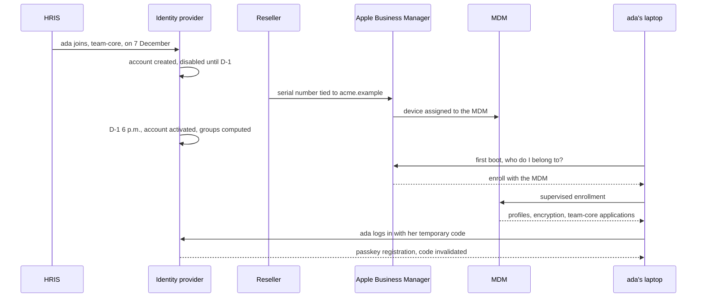
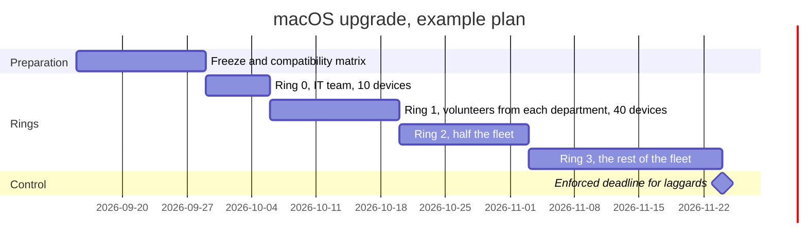

# Workplace Engineer interview: the exercises

!!! warning "Disclaimer"
    These notes are personal cheat sheets, not a source of truth. They reflect my own understanding and choices: their content remains subjective, despite the quotes and references it contains. It may be incomplete, simplified, inaccurate or outdated. Always check the official documentation before applying it. This content is provided as is, without any warranty: you use it at your own risk.

!!! audience "Who and what for"
    - **Roles**: workplace engineer (or corporate engineer), system administrator, IT engineer who automates support, security engineer focused on identity and devices.
    - **Uses**: I practise a live exercise where I am asked to write the joiner and leaver automation; I want a reference answer for an osquery query or a Terraform module for the identity provider; I prepare an oral case study, like a compromised account at 2 a.m.; I check with the final checklist that my answer forgets neither the rollback nor the audit evidence.

This page gathers practical exercises with detailed worked answers. It complements [Workplace Engineer interview: the questions](questions.md). There is no single right answer: what I have here are **concrete reference answers** (scripts, queries, configurations, plans and timelines) and an oral phrasing.

The role aims at making identity, devices and support correct and fast for every employee. The exercises therefore mix code (Python, SQL for osquery, Terraform), debugging, and case studies where the hard part is the order of the steps, the rollback and the coordination with security and HR. The company `acme.example`, the team `team-core` and the people `ada` and `grace` are fictitious; all numbers are examples.

## How to use these exercises

In a live interview, the interviewer mostly watches **how** I search, not only what I find. For each exercise:

1. I read the statement without looking at the answer.
2. **I ask two or three questions before answering**: "what is the source of truth?", "how many people and devices?", "what is already automated?". Each exercise lists the questions I ask first.
3. **I think about failure before the happy path**: what happens if the call fails halfway, if the event arrives twice, if the address is wrong?
4. **I think out loud**: I explain what I check and why, even while I write code.
5. I give a simple solution, then its rollback, its security and privacy risks, and how to measure it.
6. **I end with a lived example**: "in my current job, I brought access cut-off down from three days to one hour...". The answers are theoretical; my own experience with numbers is what makes the difference.

The examples are deliberately small to fit in an interview. The Python targets version 3.12; API names, osquery tables and Terraform resources are to check in the documentation of the version in use.

## Exercise 1. Automating joiners and leavers from the HRIS

### Statement

The <span class="term" data-term="hris">HRIS</span> of `acme.example` sends a <span class="term" data-term="webhook">webhook</span> for every joiner and every leaver. I write the handler that creates or deactivates the account in the identity provider, through its <span class="term" data-term="scim">SCIM</span> API. Example of a received event:

``` { .json .ex-illus title="Illustration · webhook body sent by the HRIS" }
{
  "event_id": "evt-2026-11-04-0017",
  "type": "leaver",
  "employee_id": "hris-10051",
  "email": "grace@acme.example",
  "team": "team-core",
  "effective_at": "2026-11-30T18:00:00+00:00"
}
```

The HRIS signs the body with a shared key (header `X-Hris-Signature: sha256=...`) and resends the event until it gets a 2xx answer.

### Questions I ask first

- "Can the HRIS send the same event twice, or out of order?" (almost always yes).
- "Does a departure arrive in advance with a future date, or at the time of the departure?"
- "What about groups: does the script manage them, or do identity provider rules compute them from the team?"
- "Do contractors go through the HRIS?"

### Expected answer

#### The naive version

``` { .python .ex-bad title="Avoid" }
# Avoid: no signature checked, no safe replay, immediate deletion
@app.post("/hris/events")
def hris_event(event: dict) -> dict:
    if event["type"] == "joiner":
        requests.post(f"{IDP}/scim/v2/Users", json={"userName": event["email"]})
    elif event["type"] == "leaver":
        found = requests.get(
            f"{IDP}/scim/v2/Users",
            params={"filter": f'userName eq "{event["email"]}"'},
        ).json()
        requests.delete(f"{IDP}/scim/v2/Users/{found['Resources'][0]['id']}")
    return {"ok": True}
```

What concretely happens: anyone on the internet can send a fake departure and delete the CFO's account; a resent event creates an error or a duplicate; grace's departure, planned for 30 November, cuts her access as soon as it is entered on the 4th; deletion erases the history and breaks the sharing of her files; a failed call still returns `ok`, so the HRIS never retries and nobody knows.

#### The recommended version

``` { .python .ex-good title="Recommended · jml.py" }
"""Apply HRIS joiner and leaver events to the identity provider through SCIM."""

import hashlib
import hmac
import json
import logging
import re
from collections.abc import MutableSet
from dataclasses import dataclass
from datetime import datetime, timedelta
from typing import Protocol

log = logging.getLogger("jml")

SUPPORTED_TYPES = ("joiner", "leaver")
EMPLOYEE_ID = re.compile(r"^hris-\d{1,10}$")
ACTIVATION_LEAD = timedelta(hours=15)
ENTERPRISE_SCHEMA = "urn:ietf:params:scim:schemas:extension:enterprise:2.0:User"


# Good: a validated, typed event before any action
@dataclass(frozen=True)
class HrisEvent:
    """One lifecycle event sent by the HRIS."""

    event_id: str
    type: str
    employee_id: str
    email: str
    team: str
    effective_at: datetime

    @classmethod
    def parse(cls, body: bytes) -> "HrisEvent":
        """Build an event from the raw webhook body, or raise ValueError."""
        data = json.loads(body)
        if data.get("type") not in SUPPORTED_TYPES:
            raise ValueError(f"unknown type: {data.get('type')!r}")
        if not EMPLOYEE_ID.match(data.get("employee_id", "")):
            raise ValueError("invalid employee_id")
        return cls(
            event_id=data["event_id"],
            type=data["type"],
            employee_id=data["employee_id"],
            email=data["email"].strip().lower(),
            team=data["team"],
            effective_at=datetime.fromisoformat(data["effective_at"]),
        )


# Good: the signature is checked on the raw body, in constant time
def verify_signature(body: bytes, header: str, secret: bytes) -> bool:
    """Check the HMAC-SHA256 signature the HRIS puts in a header."""
    expected = hmac.new(secret, body, hashlib.sha256).hexdigest()
    return hmac.compare_digest(header, f"sha256={expected}")


# Example: what the handler expects from a SCIM client, replaceable in tests
class ScimClient(Protocol):
    """Minimal SCIM operations used by the lifecycle job."""

    def find_by_external_id(self, external_id: str) -> dict | None: ...

    def create_user(self, payload: dict) -> dict: ...

    def set_active(self, user_id: str, active: bool) -> None: ...


@dataclass(frozen=True)
class Action:
    """One change to apply, readable in dry-run output and in the logs."""

    kind: str
    target: str
    payload: dict


# Good: the account is created with its team, groups are computed by a rule
def scim_user(event: HrisEvent, active: bool) -> dict:
    """Build the SCIM user payload for a joiner (RFC 7643 core and enterprise schemas)."""
    return {
        "schemas": ["urn:ietf:params:scim:schemas:core:2.0:User", ENTERPRISE_SCHEMA],
        "userName": event.email,
        "externalId": event.employee_id,
        "emails": [{"value": event.email, "primary": True}],
        "active": active,
        ENTERPRISE_SCHEMA: {"department": event.team},
    }


# Good: a pure function decides, with no network call, so it is easy to test
def plan_actions(event: HrisEvent, existing: dict | None, now: datetime) -> list[Action]:
    """Decide which SCIM changes an event needs, given the current account."""
    if event.type == "leaver":
        if now < event.effective_at:
            return [Action("defer", event.email, {"until": event.effective_at.isoformat()})]
        if existing is None or existing.get("active") is False:
            return []
        return [Action("deactivate", event.email, {"id": existing["id"]})]
    should_be_active = now >= event.effective_at - ACTIVATION_LEAD
    if existing is None:
        return [Action("create", event.email, scim_user(event, active=should_be_active))]
    if should_be_active and existing.get("active") is False:
        return [Action("activate", event.email, {"id": existing["id"]})]
    return []


# Good: every action is logged; in dry-run mode, nothing is changed
def apply(actions: list[Action], client: ScimClient, dry_run: bool) -> None:
    """Apply planned actions, or only log them in dry-run mode."""
    for action in actions:
        log.info("action=%s target=%s dry_run=%s", action.kind, action.target, dry_run)
        if dry_run or action.kind == "defer":
            continue
        if action.kind == "create":
            client.create_user(action.payload)
        else:
            client.set_active(action.payload["id"], action.kind == "activate")


# Good: an event already applied is ignored, the HRIS can resend it safely
def handle_event(
    body: bytes,
    signature: str,
    secret: bytes,
    client: ScimClient,
    processed: MutableSet[str],
    now: datetime,
    dry_run: bool = False,
) -> str:
    """Verify, deduplicate, plan and apply one HRIS event; return its outcome."""
    if not verify_signature(body, signature, secret):
        log.warning("invalid signature, event rejected")
        return "rejected"
    event = HrisEvent.parse(body)
    if event.event_id in processed:
        log.info("event=%s already applied", event.event_id)
        return "duplicate"
    actions = plan_actions(event, client.find_by_external_id(event.employee_id), now)
    apply(actions, client, dry_run)
    if any(a.kind == "defer" for a in actions):
        return "deferred"
    if not dry_run:
        processed.add(event.event_id)
    return "applied"
```

The web layer, a few lines around `handle_event`, turns the outcome into an HTTP status:

| Outcome | Answer to the HRIS | Why |
|---|---|---|
| `rejected` | 401 | a fake call must trigger nothing, and I get an alert |
| `duplicate`, `applied` | 200 | the HRIS stops resending |
| `deferred` | 202 | the event is kept in a queue; a job every 15 minutes replays the events that have come due |
| exception (SCIM error, timeout) | 500 | the HRIS resends later; since the handler is <span class="term" data-term="idempotency">idempotent</span>, the replay creates no duplicate |

The real SCIM client, with a timeout and an explicit error:

``` { .python .ex-good title="Recommended · scim_client.py" }
"""SCIM 2.0 client for the identity provider."""

import requests

PATCH_SCHEMA = "urn:ietf:params:scim:api:messages:2.0:PatchOp"


# Good: a timeout on every call, and an HTTP error raises an exception
class HttpScimClient:
    """SCIM client over HTTPS, authenticated with a bearer token."""

    def __init__(self, base_url: str, token: str, timeout: float = 10.0) -> None:
        self.base_url = base_url.rstrip("/")
        self.timeout = timeout
        self.session = requests.Session()
        self.session.headers.update(
            {"Authorization": f"Bearer {token}", "Content-Type": "application/scim+json"}
        )

    def find_by_external_id(self, external_id: str) -> dict | None:
        """Return the user whose externalId matches, or None."""
        response = self.session.get(
            f"{self.base_url}/Users",
            params={"filter": f'externalId eq "{external_id}"'},
            timeout=self.timeout,
        )
        response.raise_for_status()
        resources = response.json().get("Resources", [])
        return resources[0] if resources else None

    def create_user(self, payload: dict) -> dict:
        """Create a user and return the representation sent back."""
        response = self.session.post(
            f"{self.base_url}/Users", json=payload, timeout=self.timeout
        )
        response.raise_for_status()
        return response.json()

    def set_active(self, user_id: str, active: bool) -> None:
        """Activate or deactivate a user without deleting it."""
        body = {
            "schemas": [PATCH_SCHEMA],
            "Operations": [{"op": "replace", "path": "active", "value": active}],
        }
        response = self.session.patch(
            f"{self.base_url}/Users/{user_id}", json=body, timeout=self.timeout
        )
        response.raise_for_status()
```

#### What each choice brings

| Choice | What it prevents |
|---|---|
| <span class="term" data-term="webhook-signature">webhook signature</span> checked in constant time | a fake departure sent by anyone |
| `employee_id` validated by a regular expression | a crafted value slipped into the SCIM filter |
| lookup by `externalId`, the HRIS identifier | confusion after an email address change (marriage, corrected typo) |
| events already applied are remembered | a duplicate when the HRIS resends |
| future departure deferred | access cut three weeks too early |
| deactivation, never deletion | the loss of history and shared files |
| <span class="term" data-term="dry-run">dry-run</span> mode | a first real run without review |
| team sent in `department`, groups computed by a rule | a script that must know every group (see [exercise 9](#exercise-9-managing-identity-provider-groups-in-terraform)) |

`processed` is an in-memory set for the example; for real, it is a table with a uniqueness constraint on `event_id`, to survive a restart.

#### Tests

``` { .python .ex-good title="Recommended · test_jml.py" }
"""Tests for the HRIS lifecycle job, with an in-memory SCIM fake."""

import hashlib
import hmac
import json
from datetime import datetime, timezone

from jml import handle_event

SECRET = b"test-secret"
NOW = datetime(2026, 11, 30, 18, 5, tzinfo=timezone.utc)


# Example: an in-memory fake SCIM client, no network call
class FakeScim:
    """In-memory stand-in for the identity provider's SCIM API."""

    def __init__(self) -> None:
        self.users: dict[str, dict] = {}

    def find_by_external_id(self, external_id: str) -> dict | None:
        """Return the stored user with this externalId, if any."""
        return next(
            (u for u in self.users.values() if u["externalId"] == external_id), None
        )

    def create_user(self, payload: dict) -> dict:
        """Store a user and give it an id."""
        user = {**payload, "id": f"u{len(self.users) + 1}"}
        self.users[user["id"]] = user
        return user

    def set_active(self, user_id: str, active: bool) -> None:
        """Flip the active flag of a stored user."""
        self.users[user_id]["active"] = active


def signed(event: dict) -> tuple[bytes, str]:
    """Serialize an event and sign it like the HRIS does."""
    body = json.dumps(event).encode()
    digest = hmac.new(SECRET, body, hashlib.sha256).hexdigest()
    return body, f"sha256={digest}"


def event(kind: str, effective_at: str, event_id: str = "evt-1") -> dict:
    """Build a test event for grace."""
    return {
        "event_id": event_id,
        "type": kind,
        "employee_id": "hris-10051",
        "email": "grace@acme.example",
        "team": "team-core",
        "effective_at": effective_at,
    }


# Good: the same event received twice creates a single account
def test_same_joiner_twice_creates_one_account() -> None:
    scim, processed = FakeScim(), set()
    body, sig = signed(event("joiner", "2026-12-01T09:00:00+00:00"))
    assert handle_event(body, sig, SECRET, scim, processed, NOW) == "applied"
    assert handle_event(body, sig, SECRET, scim, processed, NOW) == "duplicate"
    assert len(scim.users) == 1


# Good: a departure dated in the future cuts nothing today
def test_future_leaver_is_deferred() -> None:
    scim = FakeScim()
    scim.create_user({"externalId": "hris-10051", "active": True})
    body, sig = signed(event("leaver", "2026-12-15T18:00:00+00:00"))
    assert handle_event(body, sig, SECRET, scim, set(), NOW) == "deferred"
    assert scim.users["u1"]["active"] is True


# Good: a wrong signature touches nothing
def test_bad_signature_changes_nothing() -> None:
    scim = FakeScim()
    body, _ = signed(event("joiner", "2026-12-01T09:00:00+00:00"))
    assert handle_event(body, "sha256=forged", SECRET, scim, set(), NOW) == "rejected"
    assert scim.users == {}


# Good: dry-run changes nothing and does not mark the event as applied
def test_dry_run_changes_nothing() -> None:
    scim, processed = FakeScim(), set()
    body, sig = signed(event("joiner", "2026-12-01T09:00:00+00:00"))
    handle_event(body, sig, SECRET, scim, processed, NOW, dry_run=True)
    assert scim.users == {} and processed == set()
```

#### What a Workplace Engineer adds

- A **nightly reconciliation**: I compare the list of active people in the HRIS with the identity provider's, to catch a lost webhook. It stops and asks for human approval if it wants to deactivate more than 20 accounts at once [example threshold]: an empty HRIS export must not cut off the whole company.
- An **emergency gesture** for an immediate departure (dismissal), which calls the same function with an effective date of now.
- The **measures**: delay between departure time and deactivation, number of failed events per week, active accounts with no active person in the HRIS.

#### Possible oral answer

> "The HRIS is the source of truth, so I start from its webhook. I check the signature first, otherwise anyone can cut off an account. I look the account up by the HRIS identifier, not by email. The decision is a pure function, tested without a network: create, activate the day before, deactivate at the departure time, never delete. The handler is idempotent, because the HRIS resends events, and it has a dry-run mode. A nightly reconciliation catches lost events, with a cap that blocks a suspicious mass departure."

**Read next**: [Joiner, mover, leaver](../../knowledge/workplace.md#joiner-mover-leaver-the-lifecycle-driven-by-the-hris), [Automatic provisioning: SCIM](../../knowledge/workplace.md#automatic-provisioning-scim), [Scripts against admin APIs](../../knowledge/workplace.md#scripts-against-admin-apis), [Webhook](../../knowledge/api-rest-async.md#webhook), [Idempotency](../../knowledge/architecture.md#idempotency)

## Exercise 2. Debugging a failing SAML login

### Statement

Since Monday 9 a.m., nobody can log in to the expense tool `expenses.acme.example`: the page shows "SAML response invalid". All the other SSO applications work. I have the identity provider's console, the application's logs and ada's browser. I describe my approach, then handle two variants the interviewer adds afterwards.

### Questions I ask first

- "Is everyone affected, or only some people? Since when exactly?"
- "What changed this weekend: certificate, domain, application version, servers?"
- "Does the application have several servers behind a load balancer?"

### Expected answer

#### The approach

1. **Scope**: a single application, everyone, since a precise time. It is a configuration mismatch between the identity provider and this application, not a general outage.
2. **Read the <span class="term" data-term="saml-assertion">SAML assertion</span>**: in the identity provider's log, or by capturing the response in ada's browser (developer tools, network tab, POST request to the application's ACS address, `SAMLResponse` field).
3. **Compare field by field** with what the application expects: issuer, audience, return address, dates, identifier, signing certificate.
4. **Read the application's log**: it often names the refused field.
5. **Fix the cause**, not the symptom, then check with a real login.

#### Reading the response without trusting it

The `SAMLResponse` value is base64-encoded XML. I decode it to read it; this script does not check the signature, that is the application's job.

``` { .python .ex-bad title="Avoid" }
# Avoid: the standard XML parser on data coming from outside
from xml.etree import ElementTree

root = ElementTree.fromstring(base64.b64decode(saml_response))
```

The standard library's `xml.etree` module is not protected against malicious XML documents (entity expansion that fills the memory): the Python documentation recommends `defusedxml` for untrusted data.

``` { .python .ex-good title="Recommended · saml_inspect.py" }
"""Print the SAML response fields that usually explain a refused login."""

import base64
import hashlib
import sys
from datetime import datetime, timezone

from defusedxml.ElementTree import fromstring

NS = {
    "saml": "urn:oasis:names:tc:SAML:2.0:assertion",
    "samlp": "urn:oasis:names:tc:SAML:2.0:protocol",
    "ds": "http://www.w3.org/2000/09/xmldsig#",
}


# Good: a missing field shows as missing, instead of raising an error
def text(root, path: str) -> str:
    """Return the text of the first element matching path, or a marker."""
    node = root.find(path, NS)
    return node.text.strip() if node is not None and node.text else "(missing)"


# Good: the certificate fingerprint is compared with the one the application stored
def cert_fingerprint(root) -> str:
    """Return the SHA-256 fingerprint of the signing certificate in the response."""
    node = root.find(".//ds:X509Certificate", NS)
    if node is None or not node.text:
        return "(missing)"
    der = base64.b64decode("".join(node.text.split()))
    return hashlib.sha256(der).hexdigest()


# Example: decode, then print the fields to compare and the clock gap
def main(saml_response: str) -> None:
    """Decode a base64 SAMLResponse and print the fields to compare."""
    root = fromstring(base64.b64decode(saml_response))
    conditions = root.find(".//saml:Conditions", NS)
    confirmation = root.find(".//saml:SubjectConfirmationData", NS)
    print("Issuer      ", text(root, ".//saml:Issuer"))
    print("Destination ", root.get("Destination", "(missing)"))
    print("Audience    ", text(root, ".//saml:Audience"))
    print("Recipient   ", confirmation.get("Recipient") if confirmation is not None else "(missing)")
    print("NameID      ", text(root, ".//saml:NameID"))
    if conditions is not None:
        not_before = datetime.fromisoformat(conditions.get("NotBefore"))
        print("NotBefore   ", not_before.isoformat())
        print("NotOnOrAfter", conditions.get("NotOnOrAfter"))
        skew = (datetime.now(timezone.utc) - not_before).total_seconds()
        print(f"Seconds since NotBefore on this machine: {skew:.0f}")
    print("Certificate ", cert_fingerprint(root))


if __name__ == "__main__":
    main(sys.argv[1])
```

#### The statement's case: a certificate renewed on one side only

The application's log says `Signature validation failed`. The fingerprint printed by the script does not match the one stored in the application. In the identity provider's console, a new signing <span class="term" data-term="x509-certificate">certificate</span> became active on Sunday at midnight: someone activated it before publishing it in the application.

``` { .bash .ex-ref title="Reference · reading the certificate published by the identity provider" }
# Example: subject, expiry date and SHA-256 fingerprint of the certificate
openssl x509 -in idp-signing.pem -noout -subject -enddate -fingerprint -sha256
```

The fix: publish the new certificate in the application (or make it reread the metadata), check a login, then put the next expiry date in the team's calendar. A clean rotation happens in two steps: the new certificate is published next to the old one, and the switch only happens once every application is ready.

#### Variant A: every other login fails

The log says `Assertion is not yet valid`, on only one of the application's two servers. `NotBefore` is 09:04:58, and the faulty server thinks it is 09:02:11: its clock is almost three minutes behind, this is <span class="term" data-term="clock-skew">clock skew</span>. The load balancer sends every other login to that server.

``` { .bash .ex-ref title="Reference · checking clock synchronization (Linux with chrony)" }
# Example: gap with the time source and synchronization status
chronyc tracking
timedatectl status
```

The fix: repair the server's NTP synchronization. I do not raise the application's tolerance to one hour: a stolen assertion would stay replayable for longer.

#### Variant B: only ada fails

The log says `User not found`. `NameID` is `Ada.Lovelace@acme.example` while the application knows `ada@acme.example`: the address changed after a name change, and the application compares the identifier as is. The fix: send a stable identifier (the identity provider's internal ID, or the lowercase address), and let SCIM update the address in the application.

| Symptom | Where to look first | Likely cause |
|---|---|---|
| everyone, one application, since a precise time | signature and certificate | certificate renewed on one side only |
| every other login, or only some servers | `NotBefore`, `NotOnOrAfter`, server clocks | clock skew |
| everyone, after a domain change | `Audience`, `Recipient`, `Destination` | entity ID or ACS address not updated |
| a single person | `NameID`, account status in the application | identifier changed, account disabled or missing |

#### What a Workplace Engineer adds

- A **list of SAML applications** with their certificate's expiry date and an alert 30 days before; ideally, applications reread the metadata on their own.
- A **knowledge base article** for support: how to capture a SAML response without pasting it into a public ticket, since it stays usable until it expires.
- A **probe** that logs in to critical applications every hour with a test account, to detect the outage before employees do.

#### Possible oral answer

> "A single application and everyone: it is a configuration mismatch, not the identity provider. I capture the SAML response, decode it with a safe parser, and compare issuer, audience, return address, dates, identifier and certificate. Here, the certificate fingerprint does not match: it was renewed on Sunday on one side only. I publish the new certificate, check, and put the expiry dates in a calendar with an alert. If every other login failed, I would look at server clocks; if a single person failed, at their identifier."

**Read next**: [Debugging a SAML login](../../knowledge/workplace.md#debugging-a-saml-login), [Identity provider and SSO](../../knowledge/workplace.md#identity-provider-and-sso), [Finding the cause: debugging methodically](../../knowledge/incidents.md#finding-the-cause-debugging-methodically)

## Exercise 3. Finding non-compliant devices with osquery

### Statement

An auditor asks for proof that every Mac at `acme.example` has an encrypted disk and an up-to-date macOS version. The same day, security asks how many devices still run a vulnerable version of Google Chrome, below 131 [example version]. The fleet has 420 Macs, with <span class="term" data-term="osquery">osquery</span> deployed through Fleet. I write the queries and the compliance policies.

### Questions I ask first

- "Is the whole fleet under osquery, and how do I know?" (I compare with the MDM and the purchase records).
- "Which macOS version is the target, and from when is a device late?"
- "Who reads the results, and what happens to a non-compliant device: alert, ticket, conditional access?"

### Expected answer

#### Disk encryption

<span class="term" data-term="disk-encryption">Disk encryption</span> is read from the `disk_encryption` table. I only look at the volume mounted at the root, otherwise an external disk or a system volume shows up as a false positive.

``` { .sql .ex-ref title="Reference · osquery, is the root volume encrypted? (macOS and Linux)" }
-- Example: one row per device, with the state of the root volume
SELECT m.path, d.name, d.type, d.encrypted
FROM mounts AS m
JOIN disk_encryption AS d ON m.device_alias = d.name
WHERE m.path = '/';
```

#### Versions: the string comparison trap

``` { .sql .ex-bad title="Avoid" }
-- Avoid: string comparison, '99.0' is "greater" than '131.0'
SELECT name, bundle_short_version
FROM apps
WHERE bundle_identifier = 'com.google.Chrome'
  AND bundle_short_version < '131.0';
```

As strings, `'99.0' < '131.0'` is false, because `9` comes after `1`: the most outdated devices vanish from the result, exactly the ones I am looking for. I compare the major version number as a number.

``` { .sql .ex-good title="Recommended" }
-- Good: the major version is extracted then compared as a number
SELECT name, bundle_short_version
FROM apps
WHERE bundle_identifier = 'com.google.Chrome'
  AND CAST(split(bundle_short_version, '.', 0) AS INTEGER) < 131;
```

`split` is one of the SQL functions added by osquery (to check for the deployed version). For macOS itself, the `os_version` table already gives the separate numbers:

``` { .sql .ex-ref title="Reference · osquery, macOS version" }
-- Example: full version and separate numbers
SELECT version, major, minor, patch, build FROM os_version;
```

#### Compliance policies in Fleet

In Fleet, a policy **passes if the query returns at least one row**. So I write each policy as "I return a row when the device is compliant". The configuration lives in Git, like the rest.

``` { .yaml .ex-good title="Recommended · policies.yml (Fleet GitOps structure, to check)" }
# Good: one policy per control, with the fix for the employee
policies:
  - name: macOS - disk encrypted (FileVault)
    platform: darwin
    critical: true
    query: >
      SELECT 1 FROM mounts AS m
      JOIN disk_encryption AS d ON m.device_alias = d.name
      WHERE m.path = '/' AND d.encrypted = 1;
    description: The root volume must be encrypted.
    resolution: Open the application portal and run "Turn on FileVault".

  - name: macOS - version 15.6 or later
    platform: darwin
    critical: false
    query: >
      SELECT 1 FROM os_version
      WHERE major > 15 OR (major = 15 AND minor >= 6);
    description: The system must have received the latest approved update.
    resolution: Apple menu, System Settings, Software Update.

  - name: Chrome - version 131 or later
    platform: darwin
    critical: false
    query: >
      SELECT 1 WHERE NOT EXISTS (
        SELECT 1 FROM apps
        WHERE bundle_identifier = 'com.google.Chrome'
          AND CAST(split(bundle_short_version, '.', 0) AS INTEGER) < 131
      );
    description: No vulnerable version of Chrome may remain installed.
    resolution: Restart Chrome to apply the update.
```

The Chrome policy is written as "no vulnerable version", not "Chrome is up to date": a device without Chrome is compliant, whereas a query `SELECT 1 FROM apps WHERE ... >= 131` would mark it non-compliant.

#### What I answer the auditor

| Control | Compliant devices | Non-compliant devices | Devices silent for 7 days |
|---|---|---|---|
| disk encrypted | 414 | 2 | 4 |
| macOS 15.6 or later | 391 | 25 | 4 |
| Chrome 131 or later | 409 | 7 | 4 |

Example figures. The four silent devices count as much as the non-compliant ones: a device that no longer reports may be lost, switched off in a drawer or out of management. I match them against the MDM inventory and the purchase records, and I export the dated report for the audit.

#### What a Workplace Engineer adds

- I connect the critical policies to **conditional access**: an unencrypted device loses access to sensitive applications, with a message that says what to do.
- I send the people concerned the **self-service fix**, before involving their manager.
- I measure the share of compliant devices every week, and I publish the trend rather than a list of names.

#### Possible oral answer

> "First I check the fleet is fully covered, comparing osquery with the MDM and the purchase records. For encryption, I only look at the root volume. For versions, I avoid string comparison, which hides the most outdated devices; I compare the major version as a number. In Fleet, a policy passes when the query returns a row, so I write 'no vulnerable version' rather than 'Chrome up to date'. I give the auditor compliant, non-compliant and silent devices, with the date, and I connect critical policies to conditional access."

**Read next**: [EDR and osquery](../../knowledge/workplace.md#edr-and-osquery), [Disk encryption](../../knowledge/workplace.md#disk-encryption), [Compliance and evidence](../../knowledge/workplace.md#compliance-and-evidence), [Device trust and conditional access](../../knowledge/workplace.md#device-trust-and-conditional-access)

## Exercise 4. Designing zero-touch onboarding for a remote hire

### Statement

ada joins `team-core` on Monday 7 December 2026. She lives 600 km from the office and will not come in for a month. I design everything that happens between her signature and the end of her first week, so that she is ready at 9 a.m. on day one, without anyone from support touching her laptop.

### Questions I ask first

- "How many days before the start date does HR enter the hire in the HRIS?"
- "Are laptops bought through a channel that ties them to the company automatically?"
- "How does the person prove her identity the first time, without a password sent by email?"

### Expected answer

#### The timeline

``` { .text .ex-illus title="Illustration · ada joins on Monday 7 December" }
D-15  HR enters the hire in the HRIS: team-core, manager grace, developer role
D-15  the identity provider creates the account, disabled; team sent in department
D-14  the laptop order goes to the reseller, serial number tied to acme.example
D-10  email to ada's personal address: date, planned equipment, contact, nothing secret
D-4   laptop delivered to ada, still wrapped, tracked delivery
D-1   6 p.m.: account activated, team-core groups and applications created by the rules
D0    8:45 a.m.: 10-minute video call with support, ID shown on screen
D0    8:55 a.m.: ada receives a single-use temporary access code, valid for 1 hour
D0    9 a.m.: ada turns the laptop on, it enrolls in the MDM, ada registers her passkey
D0    9:30 a.m.: encryption on, applications installed, device ready
D+1   the manager confirms the access; ada requests two more through the portal
D+30  three questions about her onboarding
```

#### The technical path



#### The first secret: how ada logs in the first time

This is the weak point of every remote onboarding. The usual version sends a password where an attacker can read it.

``` { .text .ex-bad title="Avoid" }
D-3  support sends the initial password to ada's personal email address
D0   ada logs in with it, then registers her MFA
```

What happens: the password sits for three days in a personal mailbox, maybe already compromised, and anyone who reads it can register their own MFA before ada. It is also exactly the scenario an attacker imitates when calling support pretending to be a new hire.

``` { .text .ex-good title="Recommended" }
D0  video call with support or the manager, ID compared with the HR file
D0  temporary access code, single use, valid for one hour, given during the call
D0  ada registers a passkey on the managed laptop; the code is no longer usable
```

Identity providers offer this kind of code (Entra ID's *Temporary Access Pass*, for example, to check depending on the tool).

#### The cases that break the promise

| Situation | Consequence | What I plan |
|---|---|---|
| HR enters the hire three days before | the laptop does not arrive in time | an agreed entry delay (10 business days) and a published compliance indicator |
| the laptop is stuck with the carrier | ada has nothing on day one | a stock of loan laptops already tied to the company, sent by express |
| the laptop was bought on a consumer website | it is not tied, automatic enrollment does not happen | mandatory purchasing channel; failing that, manual enrollment with support |
| ada has no ID to show on the call | no safe first secret | approval by the manager who knows her, or a security key sent by tracked mail |

#### What a Workplace Engineer adds

- The measured promise: <span class="term" data-term="day-one-readiness">day-one readiness</span>, the share of joiners ready at 9 a.m., and the number of tickets opened in the first week.
- A **welcome message** on the laptop that says where to find help, and a short article per frequent first-week question.
- For a developer, what comes next (getting a project running, first change in production) belongs to the onboarding of development teams.

#### Possible oral answer

> "I start from the HRIS, fifteen days ahead. The account is created disabled, the laptop is bought through a channel that ties it to the company by serial number, and delivered wrapped to ada. The day before, the account activates and the group rules give the team-core access. In the morning, the delicate point is the first secret: no password by email, but a video call with ID and a one-hour temporary code, then a passkey on the managed device. I plan the failures: late entry, stuck parcel, laptop outside the channel. And I measure the share of joiners ready at 9 a.m."

**Read next**: [Zero-touch enrollment](../../knowledge/workplace.md#zero-touch-enrollment), [Joining and leaving as a product](../../knowledge/workplace.md#joining-and-leaving-as-a-product), [Phishing-resistant MFA](../../knowledge/workplace.md#phishing-resistant-mfa), [Social engineering](../../knowledge/cybersecurite.md#social-engineering), [Onboarding (DevX)](../../knowledge/devx.md#onboarding)

## Exercise 5. Planning a major macOS upgrade

### Statement

Apple releases a new major macOS version in mid-September. `acme.example` has 420 Macs managed by an MDM. Security wants the whole fleet on the new version before the end of the year; teams fear breaking their tools. I present the plan, the rings, and the success and stop criteria.

### Questions I ask first

- "Which tools are critical and depend on the system: EDR, ZTNA or VPN client, video tool, printer drivers, developer tools?"
- "Can the MDM delay the update and enforce a date, and through which mechanism?"
- "Are there periods to avoid (financial close, trade show)?"

### Expected answer

#### Step 1: freeze, then check compatibility

On release day, I defer the major update in the MDM (Apple lets supervised devices defer updates for up to 90 days, to check for the current version), so nobody starts it alone before the checks. Then a compatibility matrix of the critical tools:

| Tool | Compatibility announced by the vendor | Tested by the team | Decision |
|---|---|---|---|
| EDR | yes, version 7.18 [example] | yes, ring 0 | prerequisite: EDR on 7.18 before the upgrade |
| ZTNA client | yes | yes | no change |
| video tool | yes | screen sharing to re-authorize | knowledge base article ready |
| office printer driver | not announced | failed | print through the generic driver, ticket opened with the vendor |
| developer tools (Docker, compilers) | yes | yes on 5 volunteers' devices | no change |

#### Step 2: the rings



``` { .yaml .ex-illus title="Illustration · ring rollout plan" }
change: macOS, new major version
prerequisites:
  - EDR on version 7.18 or later on the device
  - at least 25 GB free
rings:
  - name: ring-0-it            # 10 devices from the IT team
    wait: 7 days
    stop_if: a critical tool broken
  - name: ring-1-volunteers    # 40 devices, at least one per department
    wait: 14 days
    stop_if: more than 4 related tickets, or a business tool broken with no workaround
  - name: ring-2-half          # 50% of the fleet, finance excluded during the close
    wait: 14 days
    stop_if: "update" tickets up by more than 30%
  - name: ring-3-all           # the rest
enforcement: deadline 30 days after the ring opens, forced restart with 24 h notice
rollback: no version rollback, so stop the ring and document a workaround
```

An important difference with a configuration profile: a major macOS version cannot be uninstalled. "Rollback" means **stopping the next rings** and giving a workaround to the devices already upgraded. That is why rings 0 and 1 are longer.

#### Step 3: enforcing the date without brutality

With <span class="term" data-term="declarative-device-management">declarative device management</span>, the MDM sends the target version and a deadline; the Mac warns the person, then installs at the set time.

``` { .json .ex-ref title="Reference · enforced update declaration (Apple documentation structure, to check)" }
{
  "Type": "com.apple.configuration.softwareupdate.enforcement.specific",
  "Identifier": "com.acme.example.macos-major",
  "Payload": {
    "TargetOSVersion": "26.1",
    "TargetLocalDateTime": "2026-11-20T19:00:00"
  }
}
```

Example version number. The date falls on a weekday evening, never before a weekend, and after the message that announces the deadline.

#### Step 4: the success criteria

| Indicator | Where I read it | Example target |
|---|---|---|
| share of the fleet on the new version | MDM or osquery (`os_version`) | 95% on 15 December |
| upgrade-related tickets per ring | ticketing tool, dedicated label | under 10% of upgraded devices |
| devices with a failed installation | MDM report | under 2% |
| guardrail: logins refused by conditional access | identity provider logs | no increase |

[Take with caution: example targets, to set with security and according to fleet size]

#### What a Workplace Engineer adds

- **Communication in three steps**: announcement with the schedule, reminder in the ring's week, message the day before the deadline, each with the link to the article that answers frequent questions.
- **Ring 1 volunteers** get a direct channel; their feedback feeds the knowledge base before ring 2.
- A **review** at the end, with the numbers, to shorten the freeze next time.

#### Possible oral answer

> "On release day, I defer the update in the MDM so nobody starts it alone. I build a compatibility matrix of critical tools, the EDR first. Then four rings, with stop criteria written beforehand, longer at the start because a major version cannot be uninstalled: my rollback is stopping the rings and documenting a workaround. I then enforce a date through declarative management, on a weekday evening, after three messages. I follow the share of the fleet upgraded and the tickets per ring, with access refusals as the guardrail."

**Read next**: [Patching: cadence and deadlines](../../knowledge/workplace.md#patching-cadence-and-deadlines), [Rollout rings](../../knowledge/workplace.md#rollout-rings), [Apple declarative device management](../../knowledge/workplace.md#apple-declarative-device-management), [Progressive deployment](../../knowledge/livraison.md#progressive-deployment)

## Exercise 6. Responding to a compromised account

### Statement

Tuesday, 2:10 a.m. The identity provider's alert reports a login to grace's account, an accountant, from another continent, 40 minutes after her last login from Lyon. The log shows twenty refused MFA notifications between 1:55 and 2:02, then one accepted. At 2:18, a rule in grace's mailbox forwards to an outside address every message containing "invoice". I am on call. I walk through the first hour, then what follows.

### Questions I ask first

- "Is there a runbook, and who is on call in security?"
- "Do I have the rights to suspend the account and revoke sessions, or must I wake someone up?"
- "How long are login and mail logs kept?"

### Expected answer

#### Reading the signals

Three signals agree: <span class="term" data-term="impossible-travel">impossible travel</span>, <span class="term" data-term="mfa-fatigue">MFA fatigue</span> (grace ended up accepting to make the notifications stop, or by mistake), and a forwarding rule that prepares a payment fraud. I do not try to be sure before acting: suspending a healthy account costs grace an hour of work, leaving a stolen account open can cost a wire transfer.

#### The first hour

``` { .text .ex-illus title="Illustration · response timeline" }
02:12  I open the incident, alert security on call, note every action with its time
02:15  account suspended (not deleted)
02:16  sessions and refresh tokens revoked, identity provider and mail
02:18  MFA method registered tonight removed; tonight's OAuth consents removed
02:20  forwarding rule deleted, screenshot and export of the rule kept
02:25  log export: logins over 7 days, sent messages, sharing, rules
02:40  scope: 3 messages read, none sent, 1 shared document viewed
03:00  check-in with security: no other account hit from the same IP address
08:30  grace called on her phone, explanation, new passkey registered on a video call
09:00  account reactivated; accounting told to check any change of bank details
```

#### The containment script

``` { .python .ex-bad title="Avoid" }
# Avoid: change the password and consider it done
def respond(email: str) -> None:
    workplace.idp.reset_password(email)
```

Open sessions stay valid, the application authorized through OAuth still reads the mailbox, the forwarding rule keeps sending the invoices. The attacker does not even need the new password.

``` { .python .ex-good title="Recommended · contain.py" }
"""Contain a compromised employee account, step by step, and record every result."""

import logging
from collections.abc import Callable
from datetime import datetime, timezone

log = logging.getLogger("contain")


# Good: each step is independent; a failure does not stop the next ones
def run_step(name: str, step: Callable[[], object], report: list[dict]) -> None:
    """Run one containment step and record its outcome with a timestamp."""
    started = datetime.now(timezone.utc).isoformat()
    try:
        step()
        report.append({"step": name, "at": started, "ok": True})
    except Exception as error:  # noqa: BLE001, every failure is recorded and reported
        log.error("step %s failed: %s", name, error)
        report.append({"step": name, "at": started, "ok": False, "error": str(error)})


# Good: contain in order, then preserve evidence, without deleting anything
def contain(email: str, since: datetime, incident_id: str) -> list[dict]:
    """Suspend, revoke, clean persistence and export evidence for one account."""
    user = workplace.idp.get_user(email)
    report: list[dict] = []
    run_step("suspend", lambda: workplace.idp.suspend_user(user.id), report)
    run_step("revoke sessions and tokens",
             lambda: workplace.idp.revoke_sessions(user.id, include_oauth_tokens=True), report)
    run_step("revoke suite sessions",
             lambda: workplace.mail.revoke_sessions(email), report)
    run_step("remove recent MFA",
             lambda: workplace.idp.remove_factors(user.id, registered_after=since), report)
    run_step("remove recent OAuth consents",
             lambda: workplace.mail.remove_oauth_grants(email, granted_after=since), report)
    run_step("export then delete forwarding rules",
             lambda: workplace.mail.export_and_delete_forwarding_rules(email, incident_id), report)
    run_step("export logs",
             lambda: workplace.audit.export(email, since=since, case=incident_id), report)
    workplace.tickets.attach(incident_id, report)
    return report
```

`workplace` is a fictitious client that wraps the admin APIs, as on the Knowledge page. The real calls exist at the providers, for example:

``` { .http .ex-ref title="Reference · revoking sessions (Microsoft Graph and Okta, to check)" }
POST https://graph.microsoft.com/v1.0/users/grace@acme.example/revokeSignInSessions

DELETE https://acme.okta.com/api/v1/users/00u5grace/sessions?oauthTokens=true
```

#### What I do not do

| Reflex | Why I avoid it |
|---|---|
| delete the account | I erase evidence and break the sharing of her files |
| email grace on her mailbox | the attacker reads the message and knows they have been spotted |
| do everything alone without telling security | I can damage evidence or miss other affected accounts |
| reactivate with the same push-notification MFA | the same attack starts again the next night |

#### What follows, after the first hour

- With security: look for other accounts targeted from the same IP address or by the same phishing message.
- With accounting: check that no supplier's bank details were changed based on an email received this week.
- A blameless postmortem: grace is not the cause, push-notification MFA is. Actions: phishing-resistant MFA for finance first, an automatic alert on any new external forwarding rule.

#### What a Workplace Engineer adds

- The script above, **tested every quarter** on a fictitious account, like the emergency accounts: a runbook never practised does not work at 2 a.m.
- **Automatic external forwarding forbidden** by default in the suite, which removes this step from most incidents.
- A measure: the delay between the alert and session revocation, tracked incident after incident.

#### Possible oral answer

> "The signals agree, so I act without waiting to be sure. I contain first: suspend without deleting, revoke sessions and tokens, remove the MFA registered tonight, the OAuth consents and the forwarding rule. Changing the password alone is useless. Then I preserve: export the logs before they expire. Then the scope, with security, who leads the investigation. I warn grace by phone, not by email. I restore with a passkey registered on a video call, and the postmortem targets push-notification MFA, not grace."

**Read next**: [Compromised account: contain, then investigate](../../knowledge/workplace.md#compromised-account-contain-then-investigate), [The lifecycle of an incident](../../knowledge/incidents.md#the-lifecycle-of-an-incident), [Roles during the incident](../../knowledge/incidents.md#roles-during-the-incident), [The blameless postmortem](../../knowledge/incidents.md#the-blameless-postmortem), [Phishing-resistant MFA](../../knowledge/workplace.md#phishing-resistant-mfa)

## Exercise 7. Choosing what to automate from a ticket export

### Statement

The IT team at `acme.example` (4 people, 380 employees) says it is overwhelmed. I have the CSV export of last quarter's tickets: identifier, date, category, handling minutes, reopened or not. I am asked which three automations to build first, and what they will bring.

### Questions I ask first

- "Are the categories reliable, or picked at random by employees?" (I reread a sample of 50 tickets).
- "Is handling time entered, or computed between opening and closing?" (the second measures waiting, not work).
- "What is already automated, and what costs the company outside support, like a person blocked for a day?"

### Expected answer

#### Ranking by time spent, not by count

``` { .python .ex-bad title="Avoid" }
# Avoid: ranking by number of tickets only
from collections import Counter

counts = Counter(row["category"] for row in rows)
print(counts.most_common(3))
```

The count alone puts password resets on top, which take three minutes, and hides the "application access" category, which takes twenty and blocks the person for half a day.

``` { .python .ex-good title="Recommended · tickets_report.py" }
"""Rank ticket categories by total handling time, from a CSV export."""

import csv
import sys
from collections import defaultdict
from dataclasses import dataclass, field
from statistics import median


# Good: one aggregate per category, with total time and reopen rate
@dataclass
class CategoryStats:
    """Aggregated figures for one ticket category."""

    minutes: list[int] = field(default_factory=list)
    reopened: int = 0

    @property
    def count(self) -> int:
        """Number of tickets in the category."""
        return len(self.minutes)

    @property
    def total_hours(self) -> float:
        """Total handling time in hours."""
        return sum(self.minutes) / 60


# Good: a badly filled row is counted apart, not silently ignored
def load(path: str) -> tuple[dict[str, CategoryStats], int]:
    """Read the export and aggregate it per category; return stats and skipped rows."""
    stats: dict[str, CategoryStats] = defaultdict(CategoryStats)
    skipped = 0
    with open(path, newline="", encoding="utf-8") as handle:
        for row in csv.DictReader(handle):
            try:
                minutes = int(row["handling_minutes"])
            except (KeyError, ValueError):
                skipped += 1
                continue
            entry = stats[row.get("category") or "uncategorized"]
            entry.minutes.append(minutes)
            entry.reopened += row.get("reopened") == "true"
    return stats, skipped


# Example: the table sorted by total hours, the basis for the decision
def main(path: str) -> None:
    """Print categories ranked by total handling hours."""
    stats, skipped = load(path)
    ranked = sorted(stats.items(), key=lambda item: item[1].total_hours, reverse=True)
    print(f"{'category':<32}{'tickets':>8}{'hours':>8}{'median min':>13}{'reopened':>10}")
    for name, entry in ranked:
        print(
            f"{name:<32}{entry.count:>8}{entry.total_hours:>8.0f}"
            f"{median(entry.minutes):>13.0f}{entry.reopened / entry.count:>10.0%}"
        )
    print(f"skipped rows: {skipped}")


if __name__ == "__main__":
    main(sys.argv[1])
```

#### The result and how to read it

| Category | Tickets over 3 months | Support hours | Median (min) | Reopened | Repetitive gesture? |
|---|---|---|---|---|---|
| application access | 410 | 137 | 20 | 6% | yes |
| hardware (screen, headset, cable) | 160 | 80 | 30 | 3% | yes |
| employee onboarding | 36 | 72 | 120 | 25% | yes |
| MFA reset | 170 | 23 | 8 | 2% | yes |
| Wi-Fi and network | 105 | 53 | 25 | 18% | no |
| other | 320 | 107 | 15 | 9% | to check |

Example figures. Three readings:

1. **Application access** weighs the most: 410 tickets at 20 minutes. The gesture is repetitive, so automatable: groups computed from the HRIS for obvious access, a form with the owner's approval for the rest.
2. **Employee onboarding** has only 36 tickets, but two hours each and a quarter reopened: every badly prepared onboarding also costs the person's first day. It is the best ratio, even with little volume.
3. **Wi-Fi and network** is not a repetitive gesture: 18% reopened rather signals a problem in the ITIL sense, a single cause to find, not an automation.

The <span class="term" data-term="pareto-principle">Pareto principle</span> often holds: the first two or three categories make up half the time.

#### Costing the gain

| Automation | Hours per quarter today | Estimated share avoided | Hours saved per quarter | Estimated cost |
|---|---|---|---|---|
| computed groups and access form | 137 | 70% | 96 | 3 weeks |
| onboarding driven by the HRIS | 72 | 80% | 58, plus the joiners' first day | 5 weeks |
| hardware catalog with delivery | 80 | 50% | 40 | 2 weeks |

[Take with caution: estimated avoided shares, to measure afterwards; the gain for blocked employees is not counted]

Over a 13-week quarter, the three automations give back about 194 hours per quarter, a bit more than a month of one person's work, for 10 weeks of one-off work. The <span class="term" data-term="roi">return on investment</span> comes in under a year, and the time given back goes to the "other" category, which deserves a review.

#### What a Workplace Engineer adds

- I **fix the categories** before deciding: I reread 50 random tickets, and I merge overlapping categories.
- I measure afterwards: the same query on the next quarter, <span class="term" data-term="ticket-deflection">ticket deflection</span> per category, and satisfaction as a guardrail.
- I also look at what the table does not show: requests made by direct message, outside the ticketing tool.

#### Possible oral answer

> "I do not rank by number of tickets, but by time spent, and I look at the reopen rate. Application access weighs the most: it becomes computed groups and a form with approval. Onboardings are few but expensive, and they also cost the person's first day. Wi-Fi is not to automate: reopenings say there is a cause to find. I cost the gain in hours with written assumptions, compare it with the cost, and take the same measure the next quarter."

**Read next**: [Ticket queues, self-service portal and knowledge base](../../knowledge/workplace.md#ticket-queues-self-service-portal-and-knowledge-base), [ITIL 4: incident, request, problem, change](../../knowledge/workplace.md#itil-4-incident-request-problem-change), [Return on investment](../../knowledge/culture-entreprise.md#return-on-investment)

## Exercise 8. Designing SaaS offboarding with data transfer

### Statement

grace leaves `acme.example` on 30 November; her manager is ada. She uses about twenty applications: the office suite, the ticketing tool, the BI tool, and a survey tool bought with a card, without SSO, of which she is the only administrator. I design the departure process for all applications, not just for her, while keeping the data the team needs.

### Questions I ask first

- "Is there an inventory of applications, with SSO, SCIM and the owner for each?"
- "What is the retention policy, and is a legal hold in progress?"
- "Who receives the files and the mailbox: the manager, or a person designated by HR?"

### Expected answer

#### Sorting applications by case

| Case | Example | What happens at departure |
|---|---|---|
| SSO and SCIM | office suite, ticketing tool | the identity provider deactivates the account and frees the licence |
| SSO without SCIM | BI tool | no more login possible, but the account and licence remain: deactivation task |
| no SSO | survey tool | grace can still log in with her password: closing task, before the departure time if possible |
| the person is the only owner or administrator | survey tool, BI dashboards | deactivating first would lose administration: **transfer before deactivating** |

#### Planning in the right order

``` { .python .ex-bad title="Avoid" }
# Avoid: deactivate everything at once, without looking at who owns what
def offboard(email: str) -> None:
    for app in inventory.apps_of(email):
        app.deactivate(email)
```

If grace is the only administrator of the survey tool, deactivating her first leaves a paid tool that nobody can administer, with the customer list inside; the vendor will ask for weeks of proof before giving access back.

``` { .python .ex-good title="Recommended · offboarding_plan.py" }
"""Build an ordered offboarding plan for one leaver, from the application inventory."""

from dataclasses import dataclass


@dataclass(frozen=True)
class AppAccount:
    """One account of the leaver in one application."""

    app: str
    has_sso: bool
    has_scim: bool
    sole_owner: bool


@dataclass(frozen=True)
class Task:
    """One offboarding task, in execution order."""

    when: str
    action: str


# Good: transfer ownership before any deactivation, and delete nothing on the day
def plan(leaver: str, manager: str, accounts: list[AppAccount], legal_hold: bool) -> list[Task]:
    """Return the ordered tasks for a leaver, from transfers to final deletion."""
    tasks = [
        Task(f"D{offset}", f"transfer administration of {acc.app} to {manager}")
        for acc, offset in ((a, "-5") for a in accounts if a.sole_owner)
    ]
    tasks.append(Task("D0 18:00", f"suspend {leaver}, revoke sessions and tokens"))
    tasks += [
        Task("D0 18:05", f"check SCIM deactivation in {acc.app}")
        for acc in accounts if acc.has_scim
    ]
    tasks += [
        Task("D0 18:05", f"deactivate the account in {acc.app} (no SCIM)")
        for acc in accounts if not acc.has_scim
    ]
    tasks += [
        Task("D+1", f"transfer the files and share the mailbox of {leaver} with {manager}"),
        Task("D+1", "check that no active account remains, local accounts included"),
    ]
    final = "keep: legal hold in progress" if legal_hold else "archive then delete"
    tasks.append(Task("D+60", f"{final} ({leaver})"))
    return tasks
```

Example plan produced for grace:

``` { .text .ex-illus title="Illustration · grace's departure plan" }
D-5       transfer administration of surveys to ada@acme.example
D0 18:00  suspend grace@acme.example, revoke sessions and tokens
D0 18:05  check SCIM deactivation in suite
D0 18:05  check SCIM deactivation in tickets
D0 18:05  deactivate the account in bi (no SCIM)
D0 18:05  deactivate the account in surveys (no SCIM)
D+1       transfer the files and share the mailbox of grace@acme.example with ada@acme.example
D+1       check that no active account remains, local accounts included
D+60      archive then delete (grace@acme.example)
```

#### The data

- **Files**: ownership goes to the manager within the week; the suite does it in bulk (ownership transfer in Google Workspace, OneDrive access in Microsoft 365).
- **Mailbox**: automatic reply and delegated access for a few weeks, limited to what the policy allows, because it can hold private or HR exchanges.
- **Retention**: a <span class="term" data-term="legal-hold">legal hold</span> suspends any deletion; the plan checks it before D+60.
- **Licences**: an archive licence when the suite offers one, rather than a full licence for a suspended account.

#### What a Workplace Engineer adds

- The "only owner" case is handled **before** departures: a monthly alert lists applications with a single administrator, and I ask for a second one.
- The survey tool, discovered through spending, is <span class="term" data-term="shadow-it">shadow IT</span>: it gets a team owner, and I offer to connect it to SSO or replace it.
- The D+1 check becomes an indicator: departures with at least one active account left, kept at zero.

#### Possible oral answer

> "I sort applications into four cases: SSO and SCIM, SSO only, no SSO, and only owner. The trap is the last one: I transfer administration before deactivating, otherwise the tool becomes orphaned with customer data inside. At the departure time, I suspend and revoke, SCIM deactivates what it can, tasks cover the rest. Files go to the manager, the mailbox is shared for a few weeks within the policy, and I check for a legal hold before deleting. A D+1 check confirms nothing is left."

**Read next**: [Departure: retaining and transferring data](../../knowledge/workplace.md#departure-retaining-and-transferring-data), [SaaS sprawl and shadow IT](../../knowledge/workplace.md#saas-sprawl-and-shadow-it), [Joiner, mover, leaver](../../knowledge/workplace.md#joiner-mover-leaver-the-lifecycle-driven-by-the-hris), [Scripts against admin APIs](../../knowledge/workplace.md#scripts-against-admin-apis)

## Exercise 9. Managing identity provider groups in Terraform

### Statement

Okta groups and application assignments are created by hand in the console: nobody knows why `team-core` has access to the BI tool, and an administrator deleted a group by mistake last month. I propose moving team groups and their applications to Terraform, with a review that prevents an accidental deletion.

### Questions I ask first

- "Which HRIS attribute reaches the identity provider for the team?" (here `department`, fed by [exercise 1](#exercise-1-automating-joiners-and-leavers-from-the-hris)).
- "Who must review an access change: the IT team alone, or the application owner too?"
- "What about groups already created by hand: import them, or recreate them?"

### Expected answer

#### The code

``` { .hcl .ex-bad title="Avoid" }
# Avoid: one block copied per team, people listed by hand
resource "okta_group" "team_core" {
  name = "team-core"
}

resource "okta_group_memberships" "team_core" {
  group_id = okta_group.team_core.id
  users    = ["00u1ada", "00u2grace"]
}
```

What happens: the list does not follow departures or team changes, and each new team adds a copied block, so one more copy error.

``` { .hcl .ex-good title="Recommended · teams.tf" }
# Good: a single table of teams, reviewed in a merge request
locals {
  teams = {
    "team-core" = { apps = ["expenses", "bi"] }
    "team-data" = { apps = ["expenses", "bi", "warehouse"] }
  }
  app_ids = {
    expenses  = data.okta_app_saml.expenses.id
    bi        = data.okta_app_saml.bi.id
    warehouse = data.okta_app_saml.warehouse.id
  }
  assignments = merge([
    for team, cfg in local.teams : {
      for app in cfg.apps : "${team}/${app}" => { team = team, app = app }
    }
  ]...)
}

# Good: one group per team, protected against destruction
resource "okta_group" "team" {
  for_each    = local.teams
  name        = each.key
  description = "Members of ${each.key}, computed from the HRIS"

  lifecycle {
    prevent_destroy = true
  }
}

# Good: membership comes from a rule on the HRIS attribute, not from a list
resource "okta_group_rule" "team" {
  for_each          = local.teams
  name              = "${each.key}-from-hris"
  status            = "ACTIVE"
  group_assignments = [okta_group.team[each.key].id]
  expression_type   = "urn:okta:expression:1.0"
  expression_value  = "user.department==\"${each.key}\""
}

# Good: applications are assigned to groups, never to people
resource "okta_app_group_assignment" "team" {
  for_each = local.assignments
  app_id   = local.app_ids[each.value.app]
  group_id = okta_group.team[each.value.team].id
}
```

The `data "okta_app_saml"` blocks that find the applications by name are omitted. Resource names and arguments to check in the Okta provider documentation for the version in use.

#### The review in the CI

Every merge request runs a <span class="term" data-term="terraform-plan">plan</span>. A colleague reviews the summary, and an automatic check blocks any deletion of a group or a rule.

``` { .yaml .ex-good title="Recommended · .gitlab-ci.yml" }
# Good: the plan is produced in the MR, reviewed, and checked by a script
stages: [plan, apply]

plan:
  stage: plan
  image: hashicorp/terraform:1.9
  script:
    - terraform init -input=false
    - terraform plan -input=false -out=plan.tfplan
    - terraform show -json plan.tfplan > plan.json
    - python3 check_plan.py plan.json
  artifacts:
    paths: [plan.tfplan, plan.json]
  rules:
    - if: $CI_PIPELINE_SOURCE == "merge_request_event"
    - if: $CI_COMMIT_BRANCH == $CI_DEFAULT_BRANCH

# Good: apply only on the main branch, after review
apply:
  stage: apply
  image: hashicorp/terraform:1.9
  script:
    - terraform init -input=false
    - terraform apply -input=false plan.tfplan
  needs: [plan]
  rules:
    - if: $CI_COMMIT_BRANCH == $CI_DEFAULT_BRANCH
      when: manual
```

The `hashicorp/terraform` image does not contain Python: for real, the check runs in a separate job with a Python image, or the team builds its own image. Example image versions.

``` { .python .ex-good title="Recommended · check_plan.py" }
"""Fail the pipeline when a Terraform plan deletes a protected identity resource."""

import json
import sys

PROTECTED_TYPES = {"okta_group", "okta_group_rule"}


# Good: read the official JSON plan, not the text output meant for humans
def protected_deletions(plan: dict) -> list[str]:
    """Return the addresses of protected resources the plan would delete."""
    return [
        change["address"]
        for change in plan.get("resource_changes", [])
        if change["type"] in PROTECTED_TYPES and "delete" in change["change"]["actions"]
    ]


# Example: non-zero exit code to block the MR
def main(path: str) -> int:
    """Print protected deletions and return the exit code for the CI."""
    with open(path, encoding="utf-8") as handle:
        deletions = protected_deletions(json.load(handle))
    for address in deletions:
        print(f"deletion forbidden without approval: {address}")
    return 1 if deletions else 0


if __name__ == "__main__":
    sys.exit(main(sys.argv[1]))
```

Renaming a key in `local.teams` shows in the plan as a destruction followed by a creation: that is exactly what the check must catch, since the destruction removes the whole team's access while the change is applied. To rename, I use a `moved` block.

#### Taking over the existing setup and watching drift

- Groups created by hand are **imported** (`import` blocks, Terraform 1.5 and later), not recreated: recreating changes their identifier and breaks the assignments.
- A nightly `terraform plan` reports <span class="term" data-term="configuration-drift">drift</span>: a group changed in the console shows up as a change to apply.
- Console rights are reduced for objects managed by Terraform; the Terraform token lives in a secret manager.

#### What a Workplace Engineer adds

- A `CODEOWNERS` file that adds the application owner as a mandatory reviewer when their application changes.
- A **trial in a test organization** of the identity provider, with fictitious accounts, for rule changes.
- An indicator: the share of groups and assignments managed as code, and the number of drifts detected per week.

#### Possible oral answer

> "I describe the teams in a single table, and Terraform creates one group per team, a rule that fills it from the HRIS attribute, and the application assignments to the group. Never a list of people. Every MR produces a plan, reviewed by a colleague, and a script blocks any group deletion, which also catches clumsy renames. Existing groups are imported, not recreated. A nightly plan detects changes made by hand in the console."

**Read next**: [Configuration in Git](../../knowledge/workplace.md#configuration-in-git), [Groups, roles and access reviews](../../knowledge/workplace.md#groups-roles-and-access-reviews), [Secret managers](../../knowledge/securite.md#secret-managers-for-machines-and-for-humans), [Modeling permissions: RBAC](../../knowledge/securite.md#modeling-permissions-rbac-abac-rebac)

## Preparation checklist for a live exercise

Before wrapping up an answer, I check that I covered:

- [ ] **Source of truth**: did I say where the triggering information comes from (HRIS, MDM, ticket)?
- [ ] **Full chain**: did I walk through the steps end to end, in the right order?
- [ ] **Failure and replay**: did I say what happens if a step fails or an event arrives twice?
- [ ] **Rollback**: did I plan how to roll back, or say why it is not possible?
- [ ] **Security**: did I talk about rights, secrets and social engineering?
- [ ] **Privacy**: did I say what is collected about employees, and who reads it?
- [ ] **Measure**: did I define the starting number, the number after and a guardrail?
- [ ] **Evidence**: did I say what trace remains for the audit?

### If I get stuck during the interview

I can say out loud:

> "I will start from the person concerned and the source of truth, walk through the chain step by step, then look at what happens when a step fails, and how I measure it."

That beats a rushed answer. For a workplace engineer, the order of the steps and the rollback matter as much as the exact command.

### Revision priority if I am short on time

1. Automated joiners and leavers ([exercise 1](#exercise-1-automating-joiners-and-leavers-from-the-hris)).
2. Compromised account ([exercise 6](#exercise-6-responding-to-a-compromised-account)).
3. Failing SAML login ([exercise 2](#exercise-2-debugging-a-failing-saml-login)).
4. Remote zero-touch onboarding ([exercise 4](#exercise-4-designing-zero-touch-onboarding-for-a-remote-hire)).
5. Major macOS version in rings ([exercise 5](#exercise-5-planning-a-major-macos-upgrade)).
6. Non-compliant devices with osquery ([exercise 3](#exercise-3-finding-non-compliant-devices-with-osquery)).
7. Groups in Terraform ([exercise 9](#exercise-9-managing-identity-provider-groups-in-terraform)).
8. Ticket export and SaaS offboarding ([exercises 7](#exercise-7-choosing-what-to-automate-from-a-ticket-export) and [8](#exercise-8-designing-saas-offboarding-with-data-transfer)).

I do not recite these answers word for word. I use them as structures, then link them to my own experiences: a departure I automated, an account incident I handled, an update I rolled out, with my numbers.

## Measuring success

I know my practice works when I solve an exercise in limited time without forgetting failure or measurement, not when I have read every answer. Before starting, I take a **baseline**: I do three exercises cold, timed, and count the checklist boxes I covered. I take **the same measure** a week later on three other exercises. The **guardrail metric** is the share of my answers that rest on a lived story: if it drops while my speed rises, I am reciting the answers.

| Solution | Success indicator (<span class="term" data-term="sli">SLI</span>) | Likely <span class="term" data-term="slo">SLO</span> | Likely <span class="term" data-term="sla">SLA</span> |
|---|---|---|---|
| timed exercise, out loud | minutes to reach a complete, explained solution | 20 minutes at most for a coding exercise [Take with caution: example duration, depending on the interview format] | not applicable: no external contract |
| checklist reread at the end of the answer | checklist boxes covered, out of 8 | at least 7 out of 8, three exercises out of three [Take with caution: example threshold] | not applicable: no external contract |
| questions asked before answering | number of clarifying questions asked at the start | at least two per exercise | not applicable: no external contract |
| failure handled before the happy path | share of answers that mention replay, rollback or safety cap | 100% of exercises 1, 5, 6 and 9 | not applicable: no external contract |
| lived story at the end | share of exercises closed with a lived example with numbers | 100% of the top five priorities | not applicable: no external contract |

## Pitfalls to avoid

| Pitfall | What happens | Solution |
|---|---|---|
| **Coding right away**: I write the webhook handler as soon as the statement ends. | I forget duplicates, future dates and the signature, which the interviewer expected. | I ask the exercise's questions first ([How to use these exercises](#how-to-use-these-exercises)). |
| **Deleting instead of deactivating**: my script deletes the account at departure. | History and shared files lost, and no rollback in case of a mistake. | I deactivate, then delete after the retention period ([Exercise 1](#exercise-1-automating-joiners-and-leavers-from-the-hris)). |
| **Fixing SAML by lowering the guard**: I turn off signature checking or raise the clock tolerance. | Login works again, and anyone can forge or replay an assertion. | I fix the certificate or the clock ([Exercise 2](#exercise-2-debugging-a-failing-saml-login)). |
| **Comparing versions as strings**: `'99.0' < '131.0'` in a query. | The most outdated devices vanish from the report. | I compare the major version as a number ([Exercise 3](#exercise-3-finding-non-compliant-devices-with-osquery)). |
| **Initial password by email**: I send the first secret to the personal address. | Anyone who reads the mailbox can register their MFA before the new hire. | Video call with ID and a one-hour temporary code ([Exercise 4](#exercise-4-designing-zero-touch-onboarding-for-a-remote-hire)). |
| **Only changing the password**: I handle a compromised account with a reset. | Sessions, OAuth tokens and the forwarding rule keep serving the attacker. | Contain in order, then preserve evidence ([Exercise 6](#exercise-6-responding-to-a-compromised-account)). |
| **Ranking tickets by count**: I automate the most frequent category. | I save few hours and miss onboardings, rare but expensive. | I rank by time spent and reopen rate ([Exercise 7](#exercise-7-choosing-what-to-automate-from-a-ticket-export)). |
| **Deactivating the only administrator**: I cut every account at once. | A paid tool is left with no administrator, data inside. | I transfer ownership before deactivating ([Exercise 8](#exercise-8-designing-saas-offboarding-with-data-transfer)). |
