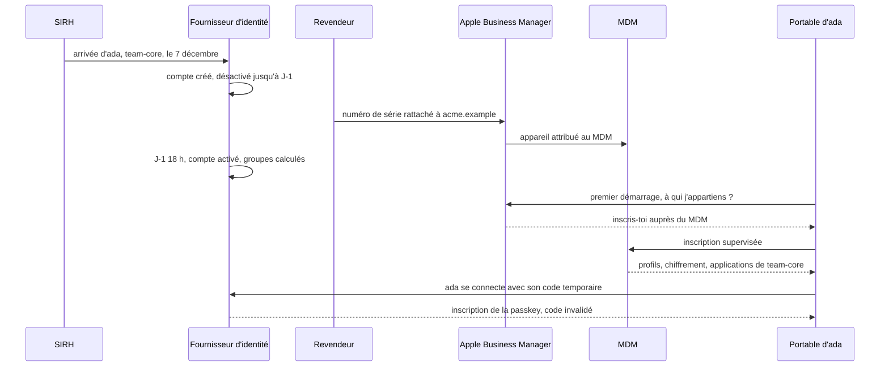
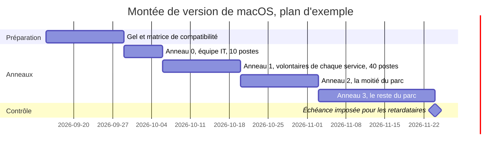

# Entretien Workplace Engineer : les exercices

!!! warning "Avertissement"
    Ces notes sont des pense-bêtes personnels, pas une source de vérité. Elles reflètent ma compréhension et mes choix : leur contenu reste subjectif, malgré les citations et les références qu'il contient. Il peut être incomplet, simplifié, inexact ou dépassé. Vérifiez toujours dans la documentation officielle avant de l'appliquer. Ce contenu est fourni tel quel, sans aucune garantie : son utilisation se fait sous votre seule responsabilité.

!!! audience "Pour qui, pour quoi"
    - **Métiers** : workplace engineer (ou corporate engineer), administrateur systèmes, ingénieur IT qui automatise le support, ingénieur sécurité tourné vers l'identité et les postes.
    - **Usages** : je m'entraîne à un exercice en direct où l'on me demande d'écrire l'automatisation des arrivées et des départs ; je veux un corrigé de référence pour une requête osquery ou un module Terraform du fournisseur d'identité ; je prépare une étude de cas orale, comme un compte compromis à 2 h du matin ; je vérifie avec la grille finale que ma réponse n'oublie ni le retour arrière ni la preuve pour l'audit.

Cette page rassemble des exercices pratiques avec corrigés détaillés. Elle complète [Entretien Workplace Engineer : les questions](questions.md). Il n'existe pas de réponse unique : je dispose ici de **réponses de référence concrètes** (scripts, requêtes, configurations, plans et chronologies) et d'une formulation orale.

Le poste vise à rendre justes et rapides l'identité, les postes et le support de tous les salariés. Les exercices mêlent donc du code (Python, SQL pour osquery, Terraform), du débogage, et des études de cas où la difficulté est l'ordre des étapes, le retour arrière et la coordination avec la sécurité et la RH. L'entreprise `acme.example`, l'équipe `team-core` et les personnes `ada` et `grace` sont fictives ; tous les chiffres sont des exemples.

## Comment utiliser ces exercices

En entretien en direct, le recruteur regarde surtout **comment** je cherche, pas seulement ce que je trouve. Pour chaque exercice :

1. Je lis l'énoncé sans regarder le corrigé.
2. **Je pose deux ou trois questions avant de répondre** : « quelle est la source de vérité ? », « combien de personnes et d'appareils ? », « qu'est-ce qui est déjà automatisé ? ». Chaque exercice liste les questions que je pose d'abord.
3. **Je pense à l'échec avant le cas nominal** : que se passe-t-il si l'appel échoue à mi-chemin, si l'événement arrive deux fois, si l'adresse est fausse ?
4. **Je pense à voix haute** : j'explique ce que je vérifie et pourquoi, même pendant que j'écris du code.
5. Je donne une solution simple, puis son retour arrière, ses risques pour la sécurité et la vie privée, et la façon de la mesurer.
6. **Je termine par un exemple vécu** : « dans mon poste actuel, j'ai ramené la coupure des accès de trois jours à une heure... ». Les corrigés sont théoriques, c'est mon expérience chiffrée qui fait la différence.

Les exemples sont volontairement petits pour tenir dans un entretien. Le Python vise la version 3.12 ; les noms d'API, de tables osquery et de ressources Terraform sont à vérifier dans la documentation de la version utilisée.

## Exercice 1. Automatiser arrivées et départs depuis le SIRH

### Énoncé

Le <span class="term" data-term="hris">SIRH</span> de `acme.example` envoie un <span class="term" data-term="webhook">webhook</span> à chaque arrivée et à chaque départ. J'écris le traitement qui crée ou désactive le compte dans le fournisseur d'identité, par son API <span class="term" data-term="scim">SCIM</span>. Exemple d'événement reçu :

``` { .json .ex-illus title="Illustration · corps du webhook envoyé par le SIRH" }
{
  "event_id": "evt-2026-11-04-0017",
  "type": "leaver",
  "employee_id": "hris-10051",
  "email": "grace@acme.example",
  "team": "team-core",
  "effective_at": "2026-11-30T18:00:00+00:00"
}
```

Le SIRH signe le corps avec une clé partagée (en-tête `X-Hris-Signature: sha256=...`) et renvoie l'événement tant qu'il ne reçoit pas une réponse 2xx.

### Questions que je pose d'abord

- « Le SIRH peut-il envoyer deux fois le même événement, ou dans le désordre ? » (presque toujours oui).
- « Un départ arrive-t-il à l'avance avec une date future, ou à l'heure du départ ? »
- « Que fait-on des groupes : le script les gère-t-il, ou des règles du fournisseur d'identité les calculent-elles depuis l'équipe ? »
- « Les prestataires passent-ils par le SIRH ? »

### Corrigé attendu

#### La version naïve

``` { .python .ex-bad title="À éviter" }
# À éviter : aucune signature vérifiée, aucun rejeu possible, suppression immédiate
@app.post("/hris/events")
def hris_event(event: dict) -> dict:
    if event["type"] == "joiner":
        requests.post(f"{IDP}/scim/v2/Users", json={"userName": event["email"]})
    elif event["type"] == "leaver":
        found = requests.get(
            f"{IDP}/scim/v2/Users",
            params={"filter": f'userName eq "{event["email"]}"'},
        ).json()
        requests.delete(f"{IDP}/scim/v2/Users/{found['Resources'][0]['id']}")
    return {"ok": True}
```

Ce qui se passe concrètement : n'importe qui sur internet peut envoyer un faux départ et supprimer le compte du directeur financier ; un événement renvoyé crée une erreur ou un doublon ; le départ de grace, prévu le 30 novembre, coupe ses accès dès sa saisie le 4 ; la suppression efface l'historique et casse le partage de ses fichiers ; un appel qui échoue renvoie quand même `ok`, donc le SIRH ne réessaie jamais et personne ne le sait.

#### La version recommandée

``` { .python .ex-good title="Recommandé · jml.py" }
"""Apply HRIS joiner and leaver events to the identity provider through SCIM."""

import hashlib
import hmac
import json
import logging
import re
from collections.abc import MutableSet
from dataclasses import dataclass
from datetime import datetime, timedelta
from typing import Protocol

log = logging.getLogger("jml")

SUPPORTED_TYPES = ("joiner", "leaver")
EMPLOYEE_ID = re.compile(r"^hris-\d{1,10}$")
ACTIVATION_LEAD = timedelta(hours=15)
ENTERPRISE_SCHEMA = "urn:ietf:params:scim:schemas:extension:enterprise:2.0:User"


# Bien : un événement validé et typé avant toute action
@dataclass(frozen=True)
class HrisEvent:
    """One lifecycle event sent by the HRIS."""

    event_id: str
    type: str
    employee_id: str
    email: str
    team: str
    effective_at: datetime

    @classmethod
    def parse(cls, body: bytes) -> "HrisEvent":
        """Build an event from the raw webhook body, or raise ValueError."""
        data = json.loads(body)
        if data.get("type") not in SUPPORTED_TYPES:
            raise ValueError(f"type inconnu : {data.get('type')!r}")
        if not EMPLOYEE_ID.match(data.get("employee_id", "")):
            raise ValueError("employee_id invalide")
        return cls(
            event_id=data["event_id"],
            type=data["type"],
            employee_id=data["employee_id"],
            email=data["email"].strip().lower(),
            team=data["team"],
            effective_at=datetime.fromisoformat(data["effective_at"]),
        )


# Bien : la signature est vérifiée sur le corps brut, en temps constant
def verify_signature(body: bytes, header: str, secret: bytes) -> bool:
    """Check the HMAC-SHA256 signature the HRIS puts in a header."""
    expected = hmac.new(secret, body, hashlib.sha256).hexdigest()
    return hmac.compare_digest(header, f"sha256={expected}")


# Exemple : ce que le traitement attend d'un client SCIM, remplaçable dans les tests
class ScimClient(Protocol):
    """Minimal SCIM operations used by the lifecycle job."""

    def find_by_external_id(self, external_id: str) -> dict | None: ...

    def create_user(self, payload: dict) -> dict: ...

    def set_active(self, user_id: str, active: bool) -> None: ...


@dataclass(frozen=True)
class Action:
    """One change to apply, readable in dry-run output and in the logs."""

    kind: str
    target: str
    payload: dict


# Bien : le compte est créé avec l'équipe, les groupes sont calculés par une règle
def scim_user(event: HrisEvent, active: bool) -> dict:
    """Build the SCIM user payload for a joiner (RFC 7643 core and enterprise schemas)."""
    return {
        "schemas": ["urn:ietf:params:scim:schemas:core:2.0:User", ENTERPRISE_SCHEMA],
        "userName": event.email,
        "externalId": event.employee_id,
        "emails": [{"value": event.email, "primary": True}],
        "active": active,
        ENTERPRISE_SCHEMA: {"department": event.team},
    }


# Bien : une fonction pure décide, sans appel réseau, donc facile à tester
def plan_actions(event: HrisEvent, existing: dict | None, now: datetime) -> list[Action]:
    """Decide which SCIM changes an event needs, given the current account."""
    if event.type == "leaver":
        if now < event.effective_at:
            return [Action("defer", event.email, {"until": event.effective_at.isoformat()})]
        if existing is None or existing.get("active") is False:
            return []
        return [Action("deactivate", event.email, {"id": existing["id"]})]
    should_be_active = now >= event.effective_at - ACTIVATION_LEAD
    if existing is None:
        return [Action("create", event.email, scim_user(event, active=should_be_active))]
    if should_be_active and existing.get("active") is False:
        return [Action("activate", event.email, {"id": existing["id"]})]
    return []


# Bien : chaque action est journalisée ; en simulation, rien n'est modifié
def apply(actions: list[Action], client: ScimClient, dry_run: bool) -> None:
    """Apply planned actions, or only log them in dry-run mode."""
    for action in actions:
        log.info("action=%s target=%s dry_run=%s", action.kind, action.target, dry_run)
        if dry_run or action.kind == "defer":
            continue
        if action.kind == "create":
            client.create_user(action.payload)
        else:
            client.set_active(action.payload["id"], action.kind == "activate")


# Bien : un événement déjà appliqué est ignoré, le SIRH peut le renvoyer sans risque
def handle_event(
    body: bytes,
    signature: str,
    secret: bytes,
    client: ScimClient,
    processed: MutableSet[str],
    now: datetime,
    dry_run: bool = False,
) -> str:
    """Verify, deduplicate, plan and apply one HRIS event; return its outcome."""
    if not verify_signature(body, signature, secret):
        log.warning("signature invalide, événement rejeté")
        return "rejected"
    event = HrisEvent.parse(body)
    if event.event_id in processed:
        log.info("event=%s déjà appliqué", event.event_id)
        return "duplicate"
    actions = plan_actions(event, client.find_by_external_id(event.employee_id), now)
    apply(actions, client, dry_run)
    if any(a.kind == "defer" for a in actions):
        return "deferred"
    if not dry_run:
        processed.add(event.event_id)
    return "applied"
```

La couche web, quelques lignes autour de `handle_event`, traduit le résultat en code HTTP :

| Résultat | Réponse au SIRH | Pourquoi |
|---|---|---|
| `rejected` | 401 | un faux appel ne doit rien déclencher, et je reçois une alerte |
| `duplicate`, `applied` | 200 | le SIRH arrête de renvoyer |
| `deferred` | 202 | l'événement est gardé dans une file ; un job toutes les 15 minutes rejoue les événements arrivés à échéance |
| exception (SCIM en erreur, délai dépassé) | 500 | le SIRH renvoie plus tard ; comme le traitement est <span class="term" data-term="idempotency">idempotent</span>, le rejeu ne crée rien en double |

Le client SCIM réel, avec un délai maximal et une erreur explicite :

``` { .python .ex-good title="Recommandé · scim_client.py" }
"""SCIM 2.0 client for the identity provider."""

import requests

PATCH_SCHEMA = "urn:ietf:params:scim:api:messages:2.0:PatchOp"


# Bien : délai maximal sur chaque appel, et une erreur HTTP lève une exception
class HttpScimClient:
    """SCIM client over HTTPS, authenticated with a bearer token."""

    def __init__(self, base_url: str, token: str, timeout: float = 10.0) -> None:
        self.base_url = base_url.rstrip("/")
        self.timeout = timeout
        self.session = requests.Session()
        self.session.headers.update(
            {"Authorization": f"Bearer {token}", "Content-Type": "application/scim+json"}
        )

    def find_by_external_id(self, external_id: str) -> dict | None:
        """Return the user whose externalId matches, or None."""
        response = self.session.get(
            f"{self.base_url}/Users",
            params={"filter": f'externalId eq "{external_id}"'},
            timeout=self.timeout,
        )
        response.raise_for_status()
        resources = response.json().get("Resources", [])
        return resources[0] if resources else None

    def create_user(self, payload: dict) -> dict:
        """Create a user and return the representation sent back."""
        response = self.session.post(
            f"{self.base_url}/Users", json=payload, timeout=self.timeout
        )
        response.raise_for_status()
        return response.json()

    def set_active(self, user_id: str, active: bool) -> None:
        """Activate or deactivate a user without deleting it."""
        body = {
            "schemas": [PATCH_SCHEMA],
            "Operations": [{"op": "replace", "path": "active", "value": active}],
        }
        response = self.session.patch(
            f"{self.base_url}/Users/{user_id}", json=body, timeout=self.timeout
        )
        response.raise_for_status()
```

#### Ce que chaque choix apporte

| Choix | Ce qu'il évite |
|---|---|
| <span class="term" data-term="webhook-signature">signature du webhook</span> vérifiée en temps constant | un faux départ envoyé par n'importe qui |
| `employee_id` validé par une expression régulière | une valeur piégée glissée dans le filtre SCIM |
| recherche par `externalId`, l'identifiant du SIRH | la confusion après un changement d'adresse mail (mariage, faute de frappe corrigée) |
| événements déjà appliqués mémorisés | un doublon quand le SIRH renvoie |
| départ futur différé | des accès coupés trois semaines trop tôt |
| désactivation, jamais suppression | la perte de l'historique et des fichiers partagés |
| <span class="term" data-term="dry-run">mode simulation</span> | une première exécution réelle sans relecture |
| équipe envoyée dans `department`, groupes calculés par règle | un script qui doit connaître chaque groupe (voir l'[exercice 9](#exercice-9-gerer-les-groupes-du-fournisseur-didentite-en-terraform)) |

`processed` est un ensemble en mémoire pour l'exemple ; en vrai, c'est une table avec une contrainte d'unicité sur `event_id`, pour survivre à un redémarrage.

#### Tests

``` { .python .ex-good title="Recommandé · test_jml.py" }
"""Tests for the HRIS lifecycle job, with an in-memory SCIM fake."""

import hashlib
import hmac
import json
from datetime import datetime, timezone

from jml import handle_event

SECRET = b"test-secret"
NOW = datetime(2026, 11, 30, 18, 5, tzinfo=timezone.utc)


# Exemple : un faux client SCIM en mémoire, aucun appel réseau
class FakeScim:
    """In-memory stand-in for the identity provider's SCIM API."""

    def __init__(self) -> None:
        self.users: dict[str, dict] = {}

    def find_by_external_id(self, external_id: str) -> dict | None:
        """Return the stored user with this externalId, if any."""
        return next(
            (u for u in self.users.values() if u["externalId"] == external_id), None
        )

    def create_user(self, payload: dict) -> dict:
        """Store a user and give it an id."""
        user = {**payload, "id": f"u{len(self.users) + 1}"}
        self.users[user["id"]] = user
        return user

    def set_active(self, user_id: str, active: bool) -> None:
        """Flip the active flag of a stored user."""
        self.users[user_id]["active"] = active


def signed(event: dict) -> tuple[bytes, str]:
    """Serialize an event and sign it like the HRIS does."""
    body = json.dumps(event).encode()
    digest = hmac.new(SECRET, body, hashlib.sha256).hexdigest()
    return body, f"sha256={digest}"


def event(kind: str, effective_at: str, event_id: str = "evt-1") -> dict:
    """Build a test event for grace."""
    return {
        "event_id": event_id,
        "type": kind,
        "employee_id": "hris-10051",
        "email": "grace@acme.example",
        "team": "team-core",
        "effective_at": effective_at,
    }


# Bien : le même événement reçu deux fois ne crée qu'un compte
def test_same_joiner_twice_creates_one_account() -> None:
    scim, processed = FakeScim(), set()
    body, sig = signed(event("joiner", "2026-12-01T09:00:00+00:00"))
    assert handle_event(body, sig, SECRET, scim, processed, NOW) == "applied"
    assert handle_event(body, sig, SECRET, scim, processed, NOW) == "duplicate"
    assert len(scim.users) == 1


# Bien : un départ daté du futur ne coupe rien aujourd'hui
def test_future_leaver_is_deferred() -> None:
    scim = FakeScim()
    scim.create_user({"externalId": "hris-10051", "active": True})
    body, sig = signed(event("leaver", "2026-12-15T18:00:00+00:00"))
    assert handle_event(body, sig, SECRET, scim, set(), NOW) == "deferred"
    assert scim.users["u1"]["active"] is True


# Bien : une signature fausse ne touche à rien
def test_bad_signature_changes_nothing() -> None:
    scim = FakeScim()
    body, _ = signed(event("joiner", "2026-12-01T09:00:00+00:00"))
    assert handle_event(body, "sha256=forged", SECRET, scim, set(), NOW) == "rejected"
    assert scim.users == {}


# Bien : la simulation ne modifie rien et ne marque pas l'événement comme appliqué
def test_dry_run_changes_nothing() -> None:
    scim, processed = FakeScim(), set()
    body, sig = signed(event("joiner", "2026-12-01T09:00:00+00:00"))
    handle_event(body, sig, SECRET, scim, processed, NOW, dry_run=True)
    assert scim.users == {} and processed == set()
```

#### Ce qu'un Workplace Engineer ajoute

- Une **réconciliation nocturne** : je compare la liste des personnes actives du SIRH à celle du fournisseur d'identité, pour rattraper un webhook perdu. Elle s'arrête et demande une validation humaine si elle veut désactiver plus de 20 comptes d'un coup [seuil d'exemple] : un export SIRH vide ne doit pas couper toute l'entreprise.
- Un **geste d'urgence** pour un départ immédiat (licenciement), qui appelle la même fonction avec une date effective à maintenant.
- Les **mesures** : délai entre l'heure de départ et la désactivation, nombre d'événements en erreur par semaine, comptes actifs sans personne active dans le SIRH.

#### Réponse orale possible

> « Le SIRH est la source de vérité, donc je pars de son webhook. Je vérifie d'abord la signature, sinon n'importe qui peut couper un compte. Je cherche le compte par l'identifiant du SIRH, pas par l'adresse mail. La décision est une fonction pure, testée sans réseau : créer, activer la veille, désactiver à l'heure du départ, jamais supprimer. Le traitement est idempotent, parce que le SIRH renvoie les événements, et il a un mode simulation. Une réconciliation chaque nuit rattrape les événements perdus, avec un plafond qui bloque un départ massif suspect. »

**À relire** : [Joiner, mover, leaver](../../knowledge/workplace.md#joiner-mover-leaver-le-cycle-de-vie-pilote-par-le-sirh), [Provisioning automatique : SCIM](../../knowledge/workplace.md#provisioning-automatique-scim), [Scripts sur les API d'administration](../../knowledge/workplace.md#scripts-sur-les-api-dadministration), [Webhook](../../knowledge/api-rest-async.md#webhook), [Idempotence](../../knowledge/architecture.md#idempotence)

## Exercice 2. Déboguer une connexion SAML qui échoue

### Énoncé

Depuis lundi 9 h, plus personne ne se connecte à l'outil de notes de frais `expenses.acme.example` : la page affiche « SAML response invalid ». Toutes les autres applications du SSO marchent. Je dispose de la console du fournisseur d'identité, des journaux de l'application et du navigateur d'ada. Je décris ma démarche, puis je traite deux variantes que le recruteur ajoute ensuite.

### Questions que je pose d'abord

- « Tout le monde est touché, ou seulement certaines personnes ? Depuis quand exactement ? »
- « Qu'est-ce qui a changé ce week-end : certificat, domaine, version de l'application, serveurs ? »
- « L'application a-t-elle plusieurs serveurs derrière un répartiteur de charge ? »

### Corrigé attendu

#### La démarche

1. **Périmètre** : une seule application, tout le monde, depuis une heure précise. C'est un écart de configuration entre le fournisseur d'identité et cette application, pas une panne générale.
2. **Lire l'<span class="term" data-term="saml-assertion">assertion SAML</span>** : dans le journal du fournisseur d'identité, ou en capturant la réponse dans le navigateur d'ada (outils de développement, onglet réseau, requête POST vers l'adresse ACS de l'application, champ `SAMLResponse`).
3. **Comparer champ par champ** avec ce que l'application attend : émetteur, audience, adresse de retour, dates, identifiant, certificat de signature.
4. **Lire le journal de l'application** : il nomme souvent le champ refusé.
5. **Corriger la cause**, pas le symptôme, puis vérifier avec une connexion réelle.

#### Lire la réponse sans la faire confiance

La valeur `SAMLResponse` est du XML encodé en base64. Je la décode pour la lire ; je ne vérifie pas la signature avec ce script, c'est le rôle de l'application.

``` { .python .ex-bad title="À éviter" }
# À éviter : le parseur XML standard sur une donnée venue de l'extérieur
from xml.etree import ElementTree

root = ElementTree.fromstring(base64.b64decode(saml_response))
```

Le module `xml.etree` de la bibliothèque standard n'est pas protégé contre les documents XML malveillants (expansion d'entités qui sature la mémoire) : la documentation Python recommande `defusedxml` pour une donnée non fiable.

``` { .python .ex-good title="Recommandé · saml_inspect.py" }
"""Print the SAML response fields that usually explain a refused login."""

import base64
import hashlib
import sys
from datetime import datetime, timezone

from defusedxml.ElementTree import fromstring

NS = {
    "saml": "urn:oasis:names:tc:SAML:2.0:assertion",
    "samlp": "urn:oasis:names:tc:SAML:2.0:protocol",
    "ds": "http://www.w3.org/2000/09/xmldsig#",
}


# Bien : un champ absent s'affiche comme absent, au lieu de lever une erreur
def text(root, path: str) -> str:
    """Return the text of the first element matching path, or a marker."""
    node = root.find(path, NS)
    return node.text.strip() if node is not None and node.text else "(absent)"


# Bien : l'empreinte du certificat se compare à celle que l'application a enregistrée
def cert_fingerprint(root) -> str:
    """Return the SHA-256 fingerprint of the signing certificate in the response."""
    node = root.find(".//ds:X509Certificate", NS)
    if node is None or not node.text:
        return "(absent)"
    der = base64.b64decode("".join(node.text.split()))
    return hashlib.sha256(der).hexdigest()


# Exemple : décoder, puis afficher les champs à comparer et l'écart d'horloge
def main(saml_response: str) -> None:
    """Decode a base64 SAMLResponse and print the fields to compare."""
    root = fromstring(base64.b64decode(saml_response))
    conditions = root.find(".//saml:Conditions", NS)
    confirmation = root.find(".//saml:SubjectConfirmationData", NS)
    print("Issuer      ", text(root, ".//saml:Issuer"))
    print("Destination ", root.get("Destination", "(absent)"))
    print("Audience    ", text(root, ".//saml:Audience"))
    print("Recipient   ", confirmation.get("Recipient") if confirmation is not None else "(absent)")
    print("NameID      ", text(root, ".//saml:NameID"))
    if conditions is not None:
        not_before = datetime.fromisoformat(conditions.get("NotBefore"))
        print("NotBefore   ", not_before.isoformat())
        print("NotOnOrAfter", conditions.get("NotOnOrAfter"))
        skew = (datetime.now(timezone.utc) - not_before).total_seconds()
        print(f"Secondes depuis NotBefore sur ce poste : {skew:.0f}")
    print("Certificat  ", cert_fingerprint(root))


if __name__ == "__main__":
    main(sys.argv[1])
```

#### Le cas de l'énoncé : un certificat renouvelé d'un seul côté

Le journal de l'application dit `Signature validation failed`. L'empreinte affichée par le script ne correspond pas à celle enregistrée dans l'application. Dans la console du fournisseur d'identité, un nouveau <span class="term" data-term="x509-certificate">certificat</span> de signature est devenu actif dimanche à minuit : quelqu'un l'a activé avant de le publier dans l'application.

``` { .bash .ex-ref title="Référence · lire le certificat publié par le fournisseur d'identité" }
# Exemple : sujet, date d'expiration et empreinte SHA-256 du certificat
openssl x509 -in idp-signing.pem -noout -subject -enddate -fingerprint -sha256
```

La correction : publier le nouveau certificat dans l'application (ou lui faire relire les métadonnées), vérifier une connexion, puis inscrire l'échéance du suivant dans le calendrier de l'équipe. La rotation propre se fait en deux temps : le nouveau certificat est publié à côté de l'ancien, et la bascule n'a lieu qu'une fois toutes les applications prêtes.

#### Variante A : une connexion sur deux échoue

Le journal dit `Assertion is not yet valid`, sur un seul des deux serveurs de l'application. `NotBefore` vaut 09:04:58, et le serveur fautif pense qu'il est 09:02:11 : son horloge retarde de près de trois minutes, c'est un <span class="term" data-term="clock-skew">décalage d'horloge</span>. Le répartiteur de charge envoie une connexion sur deux vers ce serveur.

``` { .bash .ex-ref title="Référence · vérifier la synchronisation de l'horloge (Linux avec chrony)" }
# Exemple : écart avec la source de temps et état de la synchronisation
chronyc tracking
timedatectl status
```

La correction : réparer la synchronisation NTP du serveur. Je ne monte pas la tolérance de l'application à une heure : une assertion volée resterait rejouable plus longtemps.

#### Variante B : seule ada échoue

Le journal dit `User not found`. `NameID` vaut `Ada.Lovelace@acme.example` alors que l'application connaît `ada@acme.example` : l'adresse a changé après un changement de nom, et l'application compare l'identifiant tel quel. La correction : envoyer un identifiant stable (l'identifiant interne du fournisseur d'identité, ou l'adresse en minuscules), et laisser SCIM mettre à jour l'adresse dans l'application.

| Symptôme | Où regarder en premier | Cause probable |
|---|---|---|
| tout le monde, une application, depuis une heure précise | signature et certificat | certificat renouvelé d'un seul côté |
| une connexion sur deux, ou certains serveurs seulement | `NotBefore`, `NotOnOrAfter`, horloge des serveurs | décalage d'horloge |
| tout le monde, après un changement de domaine | `Audience`, `Recipient`, `Destination` | identifiant d'entité ou adresse ACS pas à jour |
| une seule personne | `NameID`, statut du compte dans l'application | identifiant changé, compte désactivé ou absent |

#### Ce qu'un Workplace Engineer ajoute

- Une **liste des applications SAML** avec l'échéance de leur certificat et une alerte 30 jours avant ; idéalement, les applications relisent les métadonnées seules.
- Un **article de la base de connaissances** pour le support : comment capturer une réponse SAML sans la coller dans un ticket public, puisqu'elle reste utilisable jusqu'à son expiration.
- Une **sonde** qui se connecte chaque heure aux applications critiques avec un compte de test, pour détecter la panne avant les salariés.

#### Réponse orale possible

> « Une seule application et tout le monde : c'est un écart de configuration, pas le fournisseur d'identité. Je capture la réponse SAML, je la décode avec un parseur sûr, et je compare émetteur, audience, adresse de retour, dates, identifiant et certificat. Ici, l'empreinte du certificat ne correspond pas : il a été renouvelé dimanche d'un seul côté. Je publie le nouveau certificat, je vérifie, et je mets les échéances dans un calendrier avec alerte. Si une connexion sur deux échouait, je regarderais l'horloge des serveurs ; si une seule personne échouait, son identifiant. »

**À relire** : [Déboguer une connexion SAML](../../knowledge/workplace.md#deboguer-une-connexion-saml), [Fournisseur d'identité et SSO](../../knowledge/workplace.md#fournisseur-didentite-et-sso), [Trouver la cause : déboguer méthodiquement](../../knowledge/incidents.md#trouver-la-cause-deboguer-methodiquement)

## Exercice 3. Trouver les postes non conformes avec osquery

### Énoncé

Un auditeur demande la preuve que tous les Mac de `acme.example` ont leur disque chiffré et une version de macOS à jour. Le même jour, la sécurité demande combien de postes ont encore une version vulnérable de Google Chrome, inférieure à 131 [version d'exemple]. Le parc compte 420 Mac, avec <span class="term" data-term="osquery">osquery</span> déployé par Fleet. J'écris les requêtes et les règles de conformité.

### Questions que je pose d'abord

- « Le parc est-il entièrement sous osquery, et comment le sais-je ? » (je compare au MDM et aux achats).
- « Quelle version de macOS est la cible, et à partir de quand un poste est-il en retard ? »
- « Qui lit les résultats, et que fait-on d'un poste non conforme : alerte, ticket, accès conditionnel ? »

### Corrigé attendu

#### Le chiffrement du disque

Le <span class="term" data-term="disk-encryption">chiffrement du disque</span> se lit dans la table `disk_encryption`. Je ne regarde que le volume monté à la racine, sinon un disque externe ou un volume système remonte comme un faux positif.

``` { .sql .ex-ref title="Référence · osquery, le volume racine est-il chiffré ? (macOS et Linux)" }
-- Exemple : une ligne par poste, avec l'état du volume racine
SELECT m.path, d.name, d.type, d.encrypted
FROM mounts AS m
JOIN disk_encryption AS d ON m.device_alias = d.name
WHERE m.path = '/';
```

#### Les versions : le piège de la comparaison de textes

``` { .sql .ex-bad title="À éviter" }
-- À éviter : comparaison de chaînes, '99.0' est « plus grand » que '131.0'
SELECT name, bundle_short_version
FROM apps
WHERE bundle_identifier = 'com.google.Chrome'
  AND bundle_short_version < '131.0';
```

En comparaison de textes, `'99.0' < '131.0'` est faux, parce que `9` vient après `1` : les postes les plus en retard disparaissent du résultat, exactement ceux que je cherche. Je compare le numéro de version majeure comme un nombre.

``` { .sql .ex-good title="Recommandé" }
-- Bien : la version majeure est extraite puis comparée comme un nombre
SELECT name, bundle_short_version
FROM apps
WHERE bundle_identifier = 'com.google.Chrome'
  AND CAST(split(bundle_short_version, '.', 0) AS INTEGER) < 131;
```

`split` fait partie des fonctions SQL ajoutées par osquery (à vérifier pour la version déployée). Pour macOS lui-même, la table `os_version` donne déjà les numéros séparés :

``` { .sql .ex-ref title="Référence · osquery, version de macOS" }
-- Exemple : version complète et numéros séparés
SELECT version, major, minor, patch, build FROM os_version;
```

#### Les règles de conformité dans Fleet

Dans Fleet, une règle (*policy*) **passe si la requête renvoie au moins une ligne**. J'écris donc chaque règle comme « je renvoie une ligne quand le poste est conforme ». La configuration vit dans Git, comme le reste.

``` { .yaml .ex-good title="Recommandé · policies.yml (structure GitOps de Fleet, à vérifier)" }
# Bien : une règle par contrôle, avec la correction pour le salarié
policies:
  - name: macOS - disque chiffré (FileVault)
    platform: darwin
    critical: true
    query: >
      SELECT 1 FROM mounts AS m
      JOIN disk_encryption AS d ON m.device_alias = d.name
      WHERE m.path = '/' AND d.encrypted = 1;
    description: Le volume racine doit être chiffré.
    resolution: Ouvrir le portail d'applications et lancer « Activer FileVault ».

  - name: macOS - version 15.6 ou plus récente
    platform: darwin
    critical: false
    query: >
      SELECT 1 FROM os_version
      WHERE major > 15 OR (major = 15 AND minor >= 6);
    description: Le système doit avoir reçu la dernière mise à jour validée.
    resolution: Menu Pomme, Réglages Système, Mise à jour de logiciels.

  - name: Chrome - version 131 ou plus récente
    platform: darwin
    critical: false
    query: >
      SELECT 1 WHERE NOT EXISTS (
        SELECT 1 FROM apps
        WHERE bundle_identifier = 'com.google.Chrome'
          AND CAST(split(bundle_short_version, '.', 0) AS INTEGER) < 131
      );
    description: Aucune version vulnérable de Chrome ne doit rester installée.
    resolution: Redémarrer Chrome pour appliquer la mise à jour.
```

La règle Chrome est écrite « aucune version vulnérable », pas « Chrome est à jour » : un poste sans Chrome est conforme, alors qu'une requête `SELECT 1 FROM apps WHERE ... >= 131` le marquerait non conforme.

#### Ce que je réponds à l'auditeur

| Contrôle | Postes conformes | Postes non conformes | Postes sans réponse depuis 7 jours |
|---|---|---|---|
| disque chiffré | 414 | 2 | 4 |
| macOS 15.6 ou plus | 391 | 25 | 4 |
| Chrome 131 ou plus | 409 | 7 | 4 |

Chiffres d'exemple. Les quatre postes muets comptent autant que les non conformes : un poste qui ne répond plus est peut-être perdu, éteint dans un tiroir ou sorti de la gestion. Je les rapproche de l'inventaire du MDM et des achats, et j'exporte le rapport daté pour l'audit.

#### Ce qu'un Workplace Engineer ajoute

- Je branche les règles critiques sur l'**accès conditionnel** : un poste non chiffré perd l'accès aux applications sensibles, avec un message qui dit quoi faire.
- J'envoie aux personnes concernées la **correction en libre-service**, avant de solliciter leur manager.
- Je mesure chaque semaine la part de postes conformes, et je publie la tendance plutôt qu'une liste de noms.

#### Réponse orale possible

> « Je vérifie d'abord que le parc est entièrement couvert, en comparant osquery au MDM et aux achats. Pour le chiffrement, je ne regarde que le volume racine. Pour les versions, j'évite la comparaison de textes, qui fait disparaître les postes les plus en retard ; je compare la version majeure comme un nombre. Dans Fleet, une règle passe quand la requête renvoie une ligne, donc j'écris « aucune version vulnérable » plutôt que « Chrome à jour ». Je donne à l'auditeur conformes, non conformes et muets, avec la date, et je branche les règles critiques sur l'accès conditionnel. »

**À relire** : [EDR et osquery](../../knowledge/workplace.md#edr-et-osquery), [Chiffrement du disque](../../knowledge/workplace.md#chiffrement-du-disque), [Conformité et preuves](../../knowledge/workplace.md#conformite-et-preuves), [Confiance de l'appareil et accès conditionnel](../../knowledge/workplace.md#confiance-de-lappareil-et-acces-conditionnel)

## Exercice 4. Concevoir l'arrivée zero-touch d'une recrue à distance

### Énoncé

ada rejoint `team-core` le lundi 7 décembre 2026. Elle habite à 600 km du bureau et ne viendra pas avant un mois. Je conçois tout ce qui se passe entre sa signature et la fin de sa première semaine, pour qu'elle soit prête à 9 h le premier jour, sans que personne du support ne touche son portable.

### Questions que je pose d'abord

- « Combien de jours avant l'arrivée la RH saisit-elle l'embauche dans le SIRH ? »
- « Les portables sont-ils achetés par un circuit qui les rattache automatiquement à l'entreprise ? »
- « Comment la personne prouve-t-elle son identité la première fois, sans mot de passe envoyé par mail ? »

### Corrigé attendu

#### La chronologie

``` { .text .ex-illus title="Illustration · arrivée d'ada, lundi 7 décembre" }
J-15  la RH saisit l'arrivée dans le SIRH : team-core, manager grace, poste développeuse
J-15  le fournisseur d'identité crée le compte, désactivé ; équipe envoyée dans department
J-14  la commande du portable part chez le revendeur, numéro de série rattaché à acme.example
J-10  mail sur l'adresse personnelle d'ada : date, matériel prévu, contact, rien de secret
J-4   portable livré chez ada, encore emballé, livraison suivie
J-1   18 h : compte activé, groupes et applications de team-core créés par les règles
J0    8 h 45 : visio de 10 minutes avec le support, pièce d'identité montrée à l'écran
J0    8 h 55 : ada reçoit un code d'accès temporaire à usage unique, valable 1 heure
J0    9 h : ada allume le portable, il s'inscrit au MDM, ada inscrit sa passkey
J0    9 h 30 : chiffrement actif, applications installées, poste prêt
J+1   le manager confirme les accès ; ada demande deux accès en plus via le portail
J+30  trois questions sur son arrivée
```

#### Le parcours technique



#### Le premier secret : comment ada se connecte la première fois

C'est le point faible de toute arrivée à distance. La version courante envoie un mot de passe là où un attaquant peut le lire.

``` { .text .ex-bad title="À éviter" }
J-3  le support envoie le mot de passe initial sur l'adresse mail personnelle d'ada
J0   ada se connecte avec, puis inscrit sa MFA
```

Ce qui se passe : le mot de passe dort trois jours dans une boîte personnelle, peut-être déjà compromise, et quiconque le lit peut inscrire sa propre MFA avant ada. C'est aussi exactement le scénario qu'imite un attaquant qui appelle le support en se faisant passer pour une nouvelle recrue.

``` { .text .ex-good title="Recommandé" }
J0  visio avec le support ou le manager, pièce d'identité comparée au dossier RH
J0  code d'accès temporaire, à usage unique, valable une heure, donné pendant la visio
J0  ada inscrit une passkey sur le portable géré ; le code ne sert plus
```

Les fournisseurs d'identité proposent ce type de code (le *Temporary Access Pass* d'Entra ID, par exemple, à vérifier selon l'outil).

#### Les cas qui cassent la promesse

| Situation | Conséquence | Ce que je prévois |
|---|---|---|
| la RH saisit l'arrivée trois jours avant | le portable n'arrive pas à temps | un délai de saisie convenu (10 jours ouvrés) et un indicateur de respect publié |
| le portable est bloqué chez le transporteur | ada n'a rien le premier jour | un stock de portables de prêt déjà rattachés, envoyés en express |
| le portable a été acheté sur un site grand public | il n'est pas rattaché, l'inscription automatique ne se fait pas | circuit d'achat imposé ; à défaut, inscription manuelle avec le support |
| ada n'a pas de pièce d'identité à montrer en visio | pas de premier secret sûr | validation par le manager qui la connaît, ou envoi d'une clé de sécurité par courrier suivi |

#### Ce qu'un Workplace Engineer ajoute

- La promesse mesurée : la <span class="term" data-term="day-one-readiness">préparation du premier jour</span>, part des arrivants prêts à 9 h, et le nombre de tickets ouverts dans la première semaine.
- Un **message d'accueil** sur le portable qui dit où trouver de l'aide, et un article court par question fréquente de la première semaine.
- Pour une développeuse, la suite (mettre un projet en route, premier changement en production) relève de l'onboarding des équipes de développement.

#### Réponse orale possible

> « Je pars du SIRH, quinze jours avant. Le compte est créé désactivé, le portable est acheté par un circuit qui le rattache à l'entreprise par numéro de série, et livré emballé chez ada. La veille, le compte s'active et les règles de groupe donnent les accès de team-core. Le matin, le point délicat est le premier secret : pas de mot de passe par mail, mais une visio avec pièce d'identité et un code temporaire d'une heure, puis une passkey sur le poste géré. Je prévois les échecs : saisie tardive, colis bloqué, portable hors circuit. Et je mesure la part d'arrivants prêts à 9 h. »

**À relire** : [Enrôlement zero-touch](../../knowledge/workplace.md#enrolement-zero-touch), [Arrivée et départ comme un produit](../../knowledge/workplace.md#arrivee-et-depart-comme-un-produit), [MFA résistante au phishing](../../knowledge/workplace.md#mfa-resistante-au-phishing), [Ingénierie sociale](../../knowledge/cybersecurite.md#ingenierie-sociale), [Onboarding (DevX)](../../knowledge/devx.md#onboarding)

## Exercice 5. Planifier une montée de version majeure de macOS

### Énoncé

Apple publie une nouvelle version majeure de macOS mi-septembre. `acme.example` a 420 Mac gérés par un MDM. La sécurité veut le parc entier sur la nouvelle version avant la fin de l'année ; les équipes ont peur de casser leurs outils. Je présente le plan, les anneaux, les critères de succès et d'arrêt.

### Questions que je pose d'abord

- « Quels outils sont critiques et dépendent du système : EDR, client ZTNA ou VPN, outil de visio, pilotes d'imprimante, outils des développeurs ? »
- « Le MDM peut-il retarder la mise à jour et imposer une date, et par quel mécanisme ? »
- « Y a-t-il des périodes à éviter (clôture comptable, salon commercial) ? »

### Corrigé attendu

#### Étape 1 : geler, puis vérifier la compatibilité

Le jour de la sortie, je retarde la mise à jour majeure dans le MDM (Apple permet de différer les mises à jour jusqu'à 90 jours sur les appareils supervisés, à vérifier pour la version courante), pour que personne ne la lance seul avant les vérifications. Puis une matrice de compatibilité des outils critiques :

| Outil | Compatible annoncé par l'éditeur | Testé par l'équipe | Décision |
|---|---|---|---|
| EDR | oui, version 7.18 [exemple] | oui, anneau 0 | prérequis : EDR en 7.18 avant la mise à jour |
| client ZTNA | oui | oui | aucun changement |
| outil de visio | oui | partage d'écran à réautoriser | article de la base de connaissances prêt |
| pilote de l'imprimante du bureau | non annoncé | échec | impression par le pilote générique, ticket ouvert chez l'éditeur |
| outils des développeurs (Docker, compilateurs) | oui | oui sur 5 postes de volontaires | aucun changement |

#### Étape 2 : les anneaux



``` { .yaml .ex-illus title="Illustration · plan de déploiement par anneaux" }
change: macOS, nouvelle version majeure
prerequisites:
  - EDR en version 7.18 ou plus sur le poste
  - au moins 25 Go libres
rings:
  - name: ring-0-it            # 10 postes de l'équipe IT
    wait: 7 jours
    stop_if: un outil critique cassé
  - name: ring-1-volunteers    # 40 postes, au moins un par service
    wait: 14 jours
    stop_if: plus de 4 tickets liés, ou un outil métier cassé sans contournement
  - name: ring-2-half          # 50 % du parc, hors finance pendant la clôture
    wait: 14 jours
    stop_if: tickets « mise à jour » en hausse de plus de 30 %
  - name: ring-3-all           # le reste
enforcement: date limite 30 jours après l'ouverture de l'anneau, redémarrage imposé avec 24 h de préavis
rollback: pas de retour arrière de version, donc arrêt de l'anneau et contournement documenté
```

Différence importante avec un profil de configuration : une version majeure de macOS ne se désinstalle pas. Le « retour arrière » consiste à **arrêter les anneaux suivants** et à fournir un contournement aux postes déjà migrés. C'est pour cela que les anneaux 0 et 1 sont plus longs.

#### Étape 3 : imposer la date sans brutaliser

Avec la <span class="term" data-term="declarative-device-management">gestion déclarative</span>, le MDM envoie la version cible et une date limite ; le Mac prévient la personne, puis installe à l'heure dite.

``` { .json .ex-ref title="Référence · déclaration de mise à jour imposée (structure de la doc Apple, à vérifier)" }
{
  "Type": "com.apple.configuration.softwareupdate.enforcement.specific",
  "Identifier": "com.acme.example.macos-major",
  "Payload": {
    "TargetOSVersion": "26.1",
    "TargetLocalDateTime": "2026-11-20T19:00:00"
  }
}
```

Numéro de version d'exemple. La date tombe un soir de semaine, jamais avant un week-end, et après le message qui annonce l'échéance.

#### Étape 4 : les critères de succès

| Indicateur | Où je le lis | Cible d'exemple |
|---|---|---|
| part du parc sur la nouvelle version | MDM ou osquery (`os_version`) | 95 % au 15 décembre |
| tickets liés à la mise à jour par anneau | outil de tickets, étiquette dédiée | moins de 10 % des postes migrés |
| postes en échec d'installation | rapport du MDM | moins de 2 % |
| garde-fou : connexions refusées par l'accès conditionnel | journaux du fournisseur d'identité | pas de hausse |

[À prendre avec précaution : cibles d'exemple, à fixer avec la sécurité et selon la taille du parc]

#### Ce qu'un Workplace Engineer ajoute

- Une **communication en trois temps** : annonce avec le calendrier, rappel la semaine de l'anneau, message la veille de l'échéance, chacun avec le lien vers l'article qui répond aux questions fréquentes.
- Les **volontaires de l'anneau 1** reçoivent un canal direct ; leurs retours alimentent la base de connaissances avant l'anneau 2.
- Un **bilan** à la fin, avec les chiffres, pour raccourcir le gel la fois suivante.

#### Réponse orale possible

> « Le jour de la sortie, je diffère la mise à jour dans le MDM pour que personne ne la lance seul. Je construis une matrice de compatibilité des outils critiques, l'EDR en premier. Puis quatre anneaux, avec des critères d'arrêt écrits avant, plus longs au début parce qu'une version majeure ne se désinstalle pas : mon retour arrière, c'est arrêter les anneaux et documenter un contournement. J'impose ensuite une date par la gestion déclarative, un soir de semaine, après trois messages. Je suis la part du parc migré et les tickets par anneau, avec les refus d'accès comme garde-fou. »

**À relire** : [Correctifs : cadence et délais](../../knowledge/workplace.md#correctifs-cadence-et-delais), [Déploiement par anneaux](../../knowledge/workplace.md#deploiement-par-anneaux), [Gestion déclarative des appareils Apple](../../knowledge/workplace.md#gestion-declarative-des-appareils-apple), [Déploiement progressif](../../knowledge/livraison.md#deploiement-progressif)

## Exercice 6. Répondre à un compte compromis

### Énoncé

Mardi, 2 h 10. L'alerte du fournisseur d'identité signale une connexion au compte de grace, responsable comptable, depuis un autre continent, 40 minutes après sa dernière connexion depuis Lyon. Le journal montre vingt notifications MFA refusées entre 1 h 55 et 2 h 02, puis une acceptée. À 2 h 18, une règle de la boîte mail de grace transfère vers une adresse extérieure tous les messages qui contiennent « facture ». Je suis d'astreinte. Je déroule la première heure, puis la suite.

### Questions que je pose d'abord

- « Existe-t-il un runbook, et qui est d'astreinte à la sécurité ? »
- « Ai-je les droits pour suspendre le compte et révoquer les sessions, ou dois-je réveiller quelqu'un ? »
- « Combien de temps les journaux de connexion et de messagerie sont-ils conservés ? »

### Corrigé attendu

#### Lire les signaux

Trois signaux concordent : un <span class="term" data-term="impossible-travel">voyage impossible</span>, une <span class="term" data-term="mfa-fatigue">fatigue de MFA</span> (grace a fini par accepter pour faire cesser les notifications, ou par erreur), et une règle de transfert qui prépare une fraude au virement. Je ne cherche pas à être sûr avant d'agir : suspendre un compte sain coûte une heure de travail à grace, laisser un compte volé ouvert peut coûter un virement.

#### La première heure

``` { .text .ex-illus title="Illustration · chronologie de la réponse" }
02:12  j'ouvre l'incident, je préviens l'astreinte sécurité, je note chaque action avec l'heure
02:15  compte suspendu (pas supprimé)
02:16  sessions et jetons de rafraîchissement révoqués, fournisseur d'identité et messagerie
02:18  méthode MFA inscrite cette nuit retirée ; consentements OAuth de la nuit retirés
02:20  règle de transfert supprimée, capture d'écran et export de la règle gardés
02:25  export des journaux : connexions depuis 7 jours, messages envoyés, partages, règles
02:40  étendue : 3 messages lus, aucun envoyé, 1 document partagé consulté
03:00  point avec la sécurité : pas d'autre compte touché par la même adresse IP
08:30  grace appelée sur son téléphone, explication, nouvelle passkey inscrite en visio
09:00  compte réactivé ; la comptabilité prévenue de vérifier tout changement de coordonnées bancaires
```

#### Le script de confinement

``` { .python .ex-bad title="À éviter" }
# À éviter : changer le mot de passe et considérer que c'est réglé
def respond(email: str) -> None:
    workplace.idp.reset_password(email)
```

Les sessions ouvertes restent valides, l'application autorisée par OAuth lit toujours la boîte, la règle de transfert continue d'envoyer les factures. L'attaquant n'a même pas besoin du nouveau mot de passe.

``` { .python .ex-good title="Recommandé · contain.py" }
"""Contain a compromised employee account, step by step, and record every result."""

import logging
from collections.abc import Callable
from datetime import datetime, timezone

log = logging.getLogger("contain")


# Bien : chaque étape est indépendante ; un échec n'empêche pas les suivantes
def run_step(name: str, step: Callable[[], object], report: list[dict]) -> None:
    """Run one containment step and record its outcome with a timestamp."""
    started = datetime.now(timezone.utc).isoformat()
    try:
        step()
        report.append({"step": name, "at": started, "ok": True})
    except Exception as error:  # noqa: BLE001, chaque échec est consigné et signalé
        log.error("étape %s en échec : %s", name, error)
        report.append({"step": name, "at": started, "ok": False, "error": str(error)})


# Bien : contenir dans l'ordre, puis préserver les preuves, sans rien supprimer
def contain(email: str, since: datetime, incident_id: str) -> list[dict]:
    """Suspend, revoke, clean persistence and export evidence for one account."""
    user = workplace.idp.get_user(email)
    report: list[dict] = []
    run_step("suspendre", lambda: workplace.idp.suspend_user(user.id), report)
    run_step("révoquer sessions et jetons",
             lambda: workplace.idp.revoke_sessions(user.id, include_oauth_tokens=True), report)
    run_step("révoquer sessions de la suite",
             lambda: workplace.mail.revoke_sessions(email), report)
    run_step("retirer MFA récentes",
             lambda: workplace.idp.remove_factors(user.id, registered_after=since), report)
    run_step("retirer consentements OAuth récents",
             lambda: workplace.mail.remove_oauth_grants(email, granted_after=since), report)
    run_step("exporter puis supprimer règles de transfert",
             lambda: workplace.mail.export_and_delete_forwarding_rules(email, incident_id), report)
    run_step("exporter journaux",
             lambda: workplace.audit.export(email, since=since, case=incident_id), report)
    workplace.tickets.attach(incident_id, report)
    return report
```

`workplace` est un client fictif qui enveloppe les API d'administration, comme dans la page Knowledge. Les appels réels existent chez les fournisseurs, par exemple :

``` { .http .ex-ref title="Référence · révoquer les sessions (Microsoft Graph et Okta, à vérifier)" }
POST https://graph.microsoft.com/v1.0/users/grace@acme.example/revokeSignInSessions

DELETE https://acme.okta.com/api/v1/users/00u5grace/sessions?oauthTokens=true
```

#### Ce que je ne fais pas

| Réflexe | Pourquoi je l'évite |
|---|---|
| supprimer le compte | j'efface des preuves et je casse le partage de ses fichiers |
| écrire à grace sur sa boîte mail | l'attaquant lit le message et sait qu'il est repéré |
| tout faire seul sans prévenir la sécurité | je peux abîmer les preuves ou rater d'autres comptes touchés |
| réactiver avec la même méthode MFA par notification | la même attaque recommence la nuit suivante |

#### La suite, après la première heure

- Avec la sécurité : chercher d'autres comptes visés depuis la même adresse IP ou par le même message de phishing.
- Avec la comptabilité : vérifier qu'aucune coordonnée bancaire de fournisseur n'a été modifiée sur la base d'un mail reçu cette semaine.
- Un postmortem sans recherche de coupable : grace n'est pas la cause, la MFA par notification l'est. Action : MFA résistante au phishing pour la finance d'abord, alerte automatique sur toute nouvelle règle de transfert externe.

#### Ce qu'un Workplace Engineer ajoute

- Le script ci-dessus, **testé chaque trimestre** sur un compte fictif, comme les comptes de secours : un runbook jamais exercé ne marche pas à 2 h du matin.
- Le **transfert externe automatique interdit** par défaut dans la suite, ce qui retire cette étape de la plupart des incidents.
- Une mesure : le délai entre l'alerte et la révocation des sessions, suivi incident après incident.

#### Réponse orale possible

> « Les signaux concordent, donc j'agis sans attendre d'être sûr. Je contiens d'abord : suspendre sans supprimer, révoquer les sessions et les jetons, retirer la MFA inscrite cette nuit, les consentements OAuth et la règle de transfert. Changer le mot de passe seul ne sert à rien. Ensuite je préserve : export des journaux avant qu'ils n'expirent. Puis l'étendue avec la sécurité, qui pilote l'enquête. Je préviens grace par téléphone, pas par mail. Je rétablis avec une passkey inscrite en visio, et le postmortem vise la MFA par notification, pas grace. »

**À relire** : [Compte compromis : contenir, puis enquêter](../../knowledge/workplace.md#compte-compromis-contenir-puis-enqueter), [Le cycle de vie d'un incident](../../knowledge/incidents.md#le-cycle-de-vie-dun-incident), [Les rôles pendant l'incident](../../knowledge/incidents.md#les-roles-pendant-lincident), [Le postmortem sans recherche de coupable](../../knowledge/incidents.md#le-postmortem-sans-recherche-de-coupable), [MFA résistante au phishing](../../knowledge/workplace.md#mfa-resistante-au-phishing)

## Exercice 7. Choisir quoi automatiser à partir d'un export de tickets

### Énoncé

L'équipe IT de `acme.example` (4 personnes, 380 salariés) se dit débordée. J'ai l'export CSV des tickets du dernier trimestre : identifiant, date, catégorie, minutes de traitement, ticket rouvert ou non. On me demande quelles trois automatisations faire en premier, et ce qu'elles rapporteront.

### Questions que je pose d'abord

- « Les catégories sont-elles fiables, ou choisies au hasard par les salariés ? » (je relis un échantillon de 50 tickets).
- « Le temps de traitement est-il saisi, ou calculé entre ouverture et fermeture ? » (le second mesure l'attente, pas le travail).
- « Qu'est-ce qui est déjà automatisé, et qu'est-ce qui coûte cher à l'entreprise en dehors du support, comme une personne bloquée une journée ? »

### Corrigé attendu

#### Classer par temps passé, pas par nombre

``` { .python .ex-bad title="À éviter" }
# À éviter : classer par nombre de tickets seulement
from collections import Counter

counts = Counter(row["category"] for row in rows)
print(counts.most_common(3))
```

Le nombre seul met en tête les réinitialisations de mot de passe, qui prennent trois minutes, et cache la catégorie « accès à une application » qui en prend vingt et bloque la personne une demi-journée.

``` { .python .ex-good title="Recommandé · tickets_report.py" }
"""Rank ticket categories by total handling time, from a CSV export."""

import csv
import sys
from collections import defaultdict
from dataclasses import dataclass, field
from statistics import median


# Bien : un agrégat par catégorie, avec le temps total et le taux de réouverture
@dataclass
class CategoryStats:
    """Aggregated figures for one ticket category."""

    minutes: list[int] = field(default_factory=list)
    reopened: int = 0

    @property
    def count(self) -> int:
        """Number of tickets in the category."""
        return len(self.minutes)

    @property
    def total_hours(self) -> float:
        """Total handling time in hours."""
        return sum(self.minutes) / 60


# Bien : une ligne mal remplie est comptée à part, pas silencieusement ignorée
def load(path: str) -> tuple[dict[str, CategoryStats], int]:
    """Read the export and aggregate it per category; return stats and skipped rows."""
    stats: dict[str, CategoryStats] = defaultdict(CategoryStats)
    skipped = 0
    with open(path, newline="", encoding="utf-8") as handle:
        for row in csv.DictReader(handle):
            try:
                minutes = int(row["handling_minutes"])
            except (KeyError, ValueError):
                skipped += 1
                continue
            entry = stats[row.get("category") or "non classé"]
            entry.minutes.append(minutes)
            entry.reopened += row.get("reopened") == "true"
    return stats, skipped


# Exemple : le tableau trié par heures totales, la base de la décision
def main(path: str) -> None:
    """Print categories ranked by total handling hours."""
    stats, skipped = load(path)
    ranked = sorted(stats.items(), key=lambda item: item[1].total_hours, reverse=True)
    print(f"{'catégorie':<32}{'tickets':>8}{'heures':>8}{'médiane min':>13}{'rouverts':>10}")
    for name, entry in ranked:
        print(
            f"{name:<32}{entry.count:>8}{entry.total_hours:>8.0f}"
            f"{median(entry.minutes):>13.0f}{entry.reopened / entry.count:>10.0%}"
        )
    print(f"lignes ignorées : {skipped}")


if __name__ == "__main__":
    main(sys.argv[1])
```

#### Le résultat et sa lecture

| Catégorie | Tickets sur 3 mois | Heures de support | Médiane (min) | Rouverts | Geste répétitif ? |
|---|---|---|---|---|---|
| accès à une application | 410 | 137 | 20 | 6 % | oui |
| matériel (écran, casque, câble) | 160 | 80 | 30 | 3 % | oui |
| arrivée d'un salarié | 36 | 72 | 120 | 25 % | oui |
| réinitialisation de MFA | 170 | 23 | 8 | 2 % | oui |
| Wi-Fi et réseau | 105 | 53 | 25 | 18 % | non |
| autres | 320 | 107 | 15 | 9 % | à voir |

Chiffres d'exemple. Trois lectures :

1. **Accès à une application** pèse le plus : 410 tickets à 20 minutes. Le geste est répétitif, donc automatisable : groupes calculés depuis le SIRH pour les accès évidents, formulaire avec validation du propriétaire pour les autres.
2. **Arrivée d'un salarié** n'a que 36 tickets, mais deux heures chacun et un quart de réouvertures : chaque arrivée mal préparée coûte aussi la première journée de la personne. C'est le meilleur rapport, même avec peu de volume.
3. **Wi-Fi et réseau** n'est pas un geste répétitif : 18 % de réouvertures signalent plutôt un problème au sens d'ITIL, une cause unique à trouver, pas une automatisation.

Le <span class="term" data-term="pareto-principle">principe de Pareto</span> se vérifie souvent : les deux ou trois premières catégories font la moitié du temps.

#### Chiffrer le gain

| Automatisation | Heures par trimestre aujourd'hui | Part évitée estimée | Heures gagnées par trimestre | Coût estimé |
|---|---|---|---|---|
| groupes calculés et formulaire d'accès | 137 | 70 % | 96 | 3 semaines |
| arrivée pilotée par le SIRH | 72 | 80 % | 58, plus la première journée des arrivants | 5 semaines |
| catalogue de matériel avec livraison | 80 | 50 % | 40 | 2 semaines |

[À prendre avec précaution : parts évitées estimées, à mesurer après coup ; le gain pour les salariés bloqués n'est pas compté]

Avec un trimestre de 13 semaines, les trois automatisations rendent environ 194 heures par trimestre, soit un peu plus d'un mois de travail d'une personne, pour 10 semaines de travail une seule fois. Le <span class="term" data-term="roi">retour sur investissement</span> se compte en moins d'un an, et le temps rendu sert à la catégorie « autres », qui mérite une revue.

#### Ce qu'un Workplace Engineer ajoute

- Je **corrige les catégories** avant de décider : je relis 50 tickets au hasard, et je fusionne les catégories qui se recouvrent.
- Je mesure après : la même requête sur le trimestre suivant, la <span class="term" data-term="ticket-deflection">déviation des tickets</span> par catégorie, et la satisfaction en garde-fou.
- Je regarde aussi ce que le tableau ne montre pas : les demandes faites par message direct, hors de l'outil de tickets.

#### Réponse orale possible

> « Je ne classe pas par nombre de tickets, mais par temps passé, et je regarde le taux de réouverture. Les accès aux applications pèsent le plus : ils deviennent des groupes calculés et un formulaire avec validation. Les arrivées sont peu nombreuses mais chères, et elles coûtent aussi la première journée de la personne. Le Wi-Fi n'est pas à automatiser : les réouvertures disent qu'il y a une cause à trouver. Je chiffre le gain en heures avec des hypothèses écrites, je compare au coût, et je refais la même mesure le trimestre suivant. »

**À relire** : [Files de tickets, portail en libre-service et base de connaissances](../../knowledge/workplace.md#files-de-tickets-portail-en-libre-service-et-base-de-connaissances), [ITIL 4 : incident, demande, problème, changement](../../knowledge/workplace.md#itil-4-incident-demande-probleme-changement), [Retour sur investissement](../../knowledge/culture-entreprise.md#retour-sur-investissement)

## Exercice 8. Concevoir le départ côté SaaS, avec transfert des données

### Énoncé

grace quitte `acme.example` le 30 novembre ; son manager est ada. Elle utilise une vingtaine d'applications : la suite bureautique, l'outil de tickets, l'outil de BI, et un outil de sondage acheté par carte, sans SSO, dont elle est la seule administratrice. Je conçois le processus de départ pour toutes les applications, pas seulement pour elle, en gardant les données utiles à l'équipe.

### Questions que je pose d'abord

- « Existe-t-il un inventaire des applications, avec pour chacune le SSO, SCIM et le propriétaire ? »
- « Quelle est la politique de conservation, et une conservation légale est-elle en cours ? »
- « Qui reçoit les fichiers et la boîte mail : le manager, ou une personne désignée par la RH ? »

### Corrigé attendu

#### Ranger les applications par cas

| Cas | Exemple | Ce qui se passe au départ |
|---|---|---|
| SSO et SCIM | suite bureautique, outil de tickets | le fournisseur d'identité désactive le compte et libère la licence |
| SSO sans SCIM | outil de BI | plus de connexion possible, mais le compte et la licence restent : tâche de désactivation |
| sans SSO | outil de sondage | grace peut encore se connecter avec son mot de passe : tâche de fermeture, avant l'heure du départ si possible |
| la personne est seule propriétaire ou administratrice | outil de sondage, tableaux de BI | désactiver d'abord ferait perdre l'administration : **transférer avant de désactiver** |

#### Planifier dans le bon ordre

``` { .python .ex-bad title="À éviter" }
# À éviter : tout désactiver en même temps, sans regarder qui possède quoi
def offboard(email: str) -> None:
    for app in inventory.apps_of(email):
        app.deactivate(email)
```

Si grace est la seule administratrice de l'outil de sondage, la désactiver d'abord laisse un outil payé que plus personne ne peut administrer, avec la liste des clients dedans ; l'éditeur demandera des semaines de preuves pour rendre l'accès.

``` { .python .ex-good title="Recommandé · offboarding_plan.py" }
"""Build an ordered offboarding plan for one leaver, from the application inventory."""

from dataclasses import dataclass


@dataclass(frozen=True)
class AppAccount:
    """One account of the leaver in one application."""

    app: str
    has_sso: bool
    has_scim: bool
    sole_owner: bool


@dataclass(frozen=True)
class Task:
    """One offboarding task, in execution order."""

    when: str
    action: str


# Bien : transférer la propriété avant toute désactivation, et ne rien supprimer le jour même
def plan(leaver: str, manager: str, accounts: list[AppAccount], legal_hold: bool) -> list[Task]:
    """Return the ordered tasks for a leaver, from transfers to final deletion."""
    tasks = [
        Task(f"J{offset}", f"transférer l'administration de {acc.app} à {manager}")
        for acc, offset in ((a, "-5") for a in accounts if a.sole_owner)
    ]
    tasks.append(Task("J0 18:00", f"suspendre {leaver}, révoquer sessions et jetons"))
    tasks += [
        Task("J0 18:05", f"vérifier la désactivation par SCIM dans {acc.app}")
        for acc in accounts if acc.has_scim
    ]
    tasks += [
        Task("J0 18:05", f"désactiver le compte de {acc.app} (pas de SCIM)")
        for acc in accounts if not acc.has_scim
    ]
    tasks += [
        Task("J+1", f"transférer les fichiers et partager la boîte de {leaver} à {manager}"),
        Task("J+1", "vérifier qu'aucun compte actif ne reste, comptes locaux compris"),
    ]
    final = "garder : conservation légale en cours" if legal_hold else "archiver puis supprimer"
    tasks.append(Task("J+60", f"{final} ({leaver})"))
    return tasks
```

Exemple de plan produit pour grace :

``` { .text .ex-illus title="Illustration · plan de départ de grace" }
J-5       transférer l'administration de sondages à ada@acme.example
J0 18:00  suspendre grace@acme.example, révoquer sessions et jetons
J0 18:05  vérifier la désactivation par SCIM dans suite
J0 18:05  vérifier la désactivation par SCIM dans tickets
J0 18:05  désactiver le compte de bi (pas de SCIM)
J0 18:05  désactiver le compte de sondages (pas de SCIM)
J+1       transférer les fichiers et partager la boîte de grace@acme.example à ada@acme.example
J+1       vérifier qu'aucun compte actif ne reste, comptes locaux compris
J+60      archiver puis supprimer (grace@acme.example)
```

#### Les données

- **Fichiers** : la propriété passe au manager dans la semaine ; la suite le fait en masse (transfert de propriété dans Google Workspace, accès au OneDrive dans Microsoft 365).
- **Boîte mail** : réponse automatique et accès délégué quelques semaines, limité à ce que prévoit la politique, parce qu'elle peut contenir des échanges privés ou RH.
- **Conservation** : la <span class="term" data-term="legal-hold">conservation légale</span> suspend toute suppression ; le plan la vérifie avant J+60.
- **Licences** : une licence d'archivage quand la suite en propose, plutôt qu'une licence complète pour un compte suspendu.

#### Ce qu'un Workplace Engineer ajoute

- Le cas « seule propriétaire » se traite **avant** les départs : une alerte mensuelle liste les applications qui n'ont qu'un administrateur, et je demande un second administrateur.
- L'outil de sondage, découvert par les dépenses, est du <span class="term" data-term="shadow-it">shadow IT</span> : il reçoit un propriétaire d'équipe, et je propose de le brancher au SSO ou de le remplacer.
- La vérification à J+1 devient un indicateur : départs avec au moins un compte actif restant, à zéro.

#### Réponse orale possible

> « Je range les applications en quatre cas : SSO et SCIM, SSO seul, sans SSO, et seule propriétaire. Le piège est le dernier : je transfère l'administration avant de désactiver, sinon l'outil devient orphelin avec les données clients dedans. À l'heure du départ, je suspends et je révoque, SCIM désactive ce qu'il peut, des tâches couvrent le reste. Les fichiers passent au manager, la boîte est partagée quelques semaines dans la limite de la politique, et je vérifie la conservation légale avant de supprimer. Une vérification à J+1 confirme qu'il ne reste rien. »

**À relire** : [Départ : conserver et transférer les données](../../knowledge/workplace.md#depart-conserver-et-transferer-les-donnees), [Prolifération SaaS et shadow IT](../../knowledge/workplace.md#proliferation-saas-et-shadow-it), [Joiner, mover, leaver](../../knowledge/workplace.md#joiner-mover-leaver-le-cycle-de-vie-pilote-par-le-sirh), [Scripts sur les API d'administration](../../knowledge/workplace.md#scripts-sur-les-api-dadministration)

## Exercice 9. Gérer les groupes du fournisseur d'identité en Terraform

### Énoncé

Les groupes et les affectations d'applications d'Okta sont créés à la main dans la console : personne ne sait pourquoi `team-core` a accès à l'outil de BI, et un administrateur a supprimé un groupe par erreur le mois dernier. Je propose de passer les groupes des équipes et leurs applications en Terraform, avec une revue qui empêche une suppression accidentelle.

### Questions que je pose d'abord

- « Quel attribut du SIRH arrive dans le fournisseur d'identité pour l'équipe ? » (ici `department`, alimenté par l'[exercice 1](#exercice-1-automatiser-arrivees-et-departs-depuis-le-sirh)).
- « Qui doit relire un changement d'accès : l'équipe IT seule, ou aussi le propriétaire de l'application ? »
- « Que fait-on des groupes déjà créés à la main : on les importe, ou on les recrée ? »

### Corrigé attendu

#### Le code

``` { .hcl .ex-bad title="À éviter" }
# À éviter : un bloc copié par équipe, des personnes listées à la main
resource "okta_group" "team_core" {
  name = "team-core"
}

resource "okta_group_memberships" "team_core" {
  group_id = okta_group.team_core.id
  users    = ["00u1ada", "00u2grace"]
}
```

Ce qui se passe : la liste ne suit pas les départs ni les changements d'équipe, et chaque nouvelle équipe ajoute un bloc copié, donc une erreur de copie de plus.

``` { .hcl .ex-good title="Recommandé · teams.tf" }
# Bien : une seule table des équipes, relue en merge request
locals {
  teams = {
    "team-core" = { apps = ["expenses", "bi"] }
    "team-data" = { apps = ["expenses", "bi", "warehouse"] }
  }
  app_ids = {
    expenses  = data.okta_app_saml.expenses.id
    bi        = data.okta_app_saml.bi.id
    warehouse = data.okta_app_saml.warehouse.id
  }
  assignments = merge([
    for team, cfg in local.teams : {
      for app in cfg.apps : "${team}/${app}" => { team = team, app = app }
    }
  ]...)
}

# Bien : un groupe par équipe, protégé contre la destruction
resource "okta_group" "team" {
  for_each    = local.teams
  name        = each.key
  description = "Membres de ${each.key}, calculé depuis le SIRH"

  lifecycle {
    prevent_destroy = true
  }
}

# Bien : l'appartenance vient d'une règle sur l'attribut du SIRH, pas d'une liste
resource "okta_group_rule" "team" {
  for_each          = local.teams
  name              = "${each.key}-from-hris"
  status            = "ACTIVE"
  group_assignments = [okta_group.team[each.key].id]
  expression_type   = "urn:okta:expression:1.0"
  expression_value  = "user.department==\"${each.key}\""
}

# Bien : les applications sont affectées aux groupes, jamais aux personnes
resource "okta_app_group_assignment" "team" {
  for_each = local.assignments
  app_id   = local.app_ids[each.value.app]
  group_id = okta_group.team[each.value.team].id
}
```

Les blocs `data "okta_app_saml"` qui retrouvent les applications par leur nom sont omis. Noms de ressources et arguments à vérifier dans la documentation du fournisseur Okta pour la version utilisée.

#### La revue dans la CI

Chaque merge request lance un <span class="term" data-term="terraform-plan">plan</span>. Un collègue relit le résumé, et un contrôle automatique bloque toute suppression d'un groupe ou d'une règle.

``` { .yaml .ex-good title="Recommandé · .gitlab-ci.yml" }
# Bien : le plan est produit dans la MR, relu, et vérifié par un script
stages: [plan, apply]

plan:
  stage: plan
  image: hashicorp/terraform:1.9
  script:
    - terraform init -input=false
    - terraform plan -input=false -out=plan.tfplan
    - terraform show -json plan.tfplan > plan.json
    - python3 check_plan.py plan.json
  artifacts:
    paths: [plan.tfplan, plan.json]
  rules:
    - if: $CI_PIPELINE_SOURCE == "merge_request_event"
    - if: $CI_COMMIT_BRANCH == $CI_DEFAULT_BRANCH

# Bien : l'application se fait seulement sur la branche principale, après relecture
apply:
  stage: apply
  image: hashicorp/terraform:1.9
  script:
    - terraform init -input=false
    - terraform apply -input=false plan.tfplan
  needs: [plan]
  rules:
    - if: $CI_COMMIT_BRANCH == $CI_DEFAULT_BRANCH
      when: manual
```

L'image `hashicorp/terraform` ne contient pas Python : en vrai, le contrôle tourne dans un job séparé avec une image Python, ou l'équipe construit sa propre image. Versions d'images d'exemple.

``` { .python .ex-good title="Recommandé · check_plan.py" }
"""Fail the pipeline when a Terraform plan deletes a protected identity resource."""

import json
import sys

PROTECTED_TYPES = {"okta_group", "okta_group_rule"}


# Bien : on lit le plan JSON officiel, pas la sortie texte destinée aux humains
def protected_deletions(plan: dict) -> list[str]:
    """Return the addresses of protected resources the plan would delete."""
    return [
        change["address"]
        for change in plan.get("resource_changes", [])
        if change["type"] in PROTECTED_TYPES and "delete" in change["change"]["actions"]
    ]


# Exemple : code de sortie non nul pour bloquer la MR
def main(path: str) -> int:
    """Print protected deletions and return the exit code for the CI."""
    with open(path, encoding="utf-8") as handle:
        deletions = protected_deletions(json.load(handle))
    for address in deletions:
        print(f"suppression interdite sans validation : {address}")
    return 1 if deletions else 0


if __name__ == "__main__":
    sys.exit(main(sys.argv[1]))
```

Un renommage de clé dans `local.teams` apparaît dans le plan comme une destruction suivie d'une création : c'est exactement ce que le contrôle doit attraper, puisque la destruction retire l'accès de toute l'équipe le temps de l'application. Pour renommer, j'utilise un bloc `moved`.

#### Reprendre l'existant et surveiller la dérive

- Les groupes créés à la main sont **importés** (blocs `import`, Terraform 1.5 et plus), pas recréés : une recréation change leur identifiant et casse les affectations.
- Un `terraform plan` chaque nuit signale la <span class="term" data-term="configuration-drift">dérive</span> : un groupe modifié dans la console apparaît comme un changement à appliquer.
- Les droits de la console sont réduits pour les objets gérés par Terraform ; le jeton de Terraform vit dans un gestionnaire de secrets.

#### Ce qu'un Workplace Engineer ajoute

- Un fichier `CODEOWNERS` qui ajoute le propriétaire de l'application comme relecteur obligatoire quand son application change.
- Un **essai dans une organisation de test** du fournisseur d'identité, avec des comptes fictifs, pour les changements de règles.
- Un indicateur : la part des groupes et des affectations gérés en code, et le nombre de dérives détectées par semaine.

#### Réponse orale possible

> « Je décris les équipes dans une seule table, et Terraform crée un groupe par équipe, une règle qui le remplit depuis l'attribut du SIRH, et les affectations d'applications au groupe. Jamais de liste de personnes. Chaque MR produit un plan, relu par un collègue, et un script bloque toute suppression de groupe, ce qui attrape aussi les renommages maladroits. Les groupes existants sont importés, pas recréés. Un plan chaque nuit détecte les changements faits à la main dans la console. »

**À relire** : [La configuration dans Git](../../knowledge/workplace.md#la-configuration-dans-git), [Groupes, rôles et revues d'accès](../../knowledge/workplace.md#groupes-roles-et-revues-dacces), [Gestionnaires de secrets](../../knowledge/securite.md#gestionnaires-de-secrets-pour-les-machines-et-pour-les-humains), [Modéliser les droits : RBAC](../../knowledge/securite.md#modeliser-les-droits-rbac-abac-rebac)

## Grille de préparation pour un exercice en direct

Avant de conclure une réponse, je vérifie que j'ai abordé :

- [ ] **Source de vérité** : ai-je dit d'où vient l'information qui déclenche (SIRH, MDM, ticket) ?
- [ ] **Chaîne complète** : ai-je déroulé les étapes de bout en bout, dans le bon ordre ?
- [ ] **Échec et rejeu** : ai-je dit ce qui se passe si une étape échoue ou si un événement arrive deux fois ?
- [ ] **Retour arrière** : ai-je prévu comment revenir en arrière, ou dit pourquoi ce n'est pas possible ?
- [ ] **Sécurité** : ai-je parlé des droits, des secrets et de l'ingénierie sociale ?
- [ ] **Vie privée** : ai-je dit ce qui est collecté sur les salariés, et qui le lit ?
- [ ] **Mesure** : ai-je défini le chiffre de départ, le chiffre après et un garde-fou ?
- [ ] **Preuve** : ai-je dit quelle trace reste pour l'audit ?

### Si je bloque pendant l'entretien

Je peux verbaliser :

> « Je vais partir de la personne concernée et de la source de vérité, dérouler la chaîne étape par étape, puis regarder ce qui se passe quand une étape échoue, et comment je le mesure. »

C'est préférable à une réponse précipitée. Pour un workplace engineer, l'ordre des étapes et le retour arrière comptent autant que la commande exacte.

### Priorité de révision si je manque de temps

1. Arrivées et départs automatisés ([exercice 1](#exercice-1-automatiser-arrivees-et-departs-depuis-le-sirh)).
2. Compte compromis ([exercice 6](#exercice-6-repondre-a-un-compte-compromis)).
3. Connexion SAML qui échoue ([exercice 2](#exercice-2-deboguer-une-connexion-saml-qui-echoue)).
4. Arrivée zero-touch à distance ([exercice 4](#exercice-4-concevoir-larrivee-zero-touch-dune-recrue-a-distance)).
5. Version majeure de macOS par anneaux ([exercice 5](#exercice-5-planifier-une-montee-de-version-majeure-de-macos)).
6. Postes non conformes avec osquery ([exercice 3](#exercice-3-trouver-les-postes-non-conformes-avec-osquery)).
7. Groupes en Terraform ([exercice 9](#exercice-9-gerer-les-groupes-du-fournisseur-didentite-en-terraform)).
8. Export de tickets et départ côté SaaS ([exercices 7](#exercice-7-choisir-quoi-automatiser-a-partir-dun-export-de-tickets) et [8](#exercice-8-concevoir-le-depart-cote-saas-avec-transfert-des-donnees)).

Je ne récite pas ces réponses mot pour mot. Je les utilise comme structures, puis je les relie à mes propres expériences : un départ que j'ai automatisé, un incident de compte que j'ai traité, une mise à jour que j'ai déployée, avec mes chiffres.

## Mesurer le succès

Je sais que mon entraînement marche quand je résous un exercice en temps limité sans oublier l'échec ni la mesure, pas quand j'ai lu tous les corrigés. Avant de commencer, je note une **base** : je fais trois exercices à blanc, chronométrés, et je compte les cases de la grille que j'ai couvertes. Je refais **la même mesure** une semaine plus tard sur trois autres exercices. La **métrique garde-fou** est la part de mes réponses qui s'appuient sur une histoire vécue : si elle baisse pendant que ma vitesse monte, je suis en train de réciter les corrigés.

| Solution | Indicateur de succès (<span class="term" data-term="sli">SLI</span>) | <span class="term" data-term="slo">SLO</span> probable | <span class="term" data-term="sla">SLA</span> probable |
|---|---|---|---|
| exercice chronométré, à voix haute | minutes pour arriver à une solution complète et expliquée | 20 minutes au plus pour un exercice de code [À prendre avec précaution : durée d'exemple, selon le format de l'entretien] | sans objet : pas de contrat externe |
| grille de préparation relue en fin de réponse | cases de la grille couvertes, sur 8 | au moins 7 sur 8, trois exercices sur trois [À prendre avec précaution : seuil d'exemple] | sans objet : pas de contrat externe |
| questions posées avant de répondre | nombre de questions de clarification posées au début | au moins deux à chaque exercice | sans objet : pas de contrat externe |
| échec traité avant le cas nominal | part des réponses qui citent rejeu, retour arrière ou plafond de sécurité | 100 % des exercices 1, 5, 6 et 9 | sans objet : pas de contrat externe |
| histoire vécue en conclusion | part des exercices conclus par un exemple vécu et chiffré | 100 % des cinq premières priorités | sans objet : pas de contrat externe |

## Pièges à éviter

| Piège | Ce qui se passe | Solution |
|---|---|---|
| **Coder tout de suite** : j'écris le traitement du webhook dès la fin de l'énoncé. | J'oublie les doublons, les dates futures et la signature, que le recruteur attendait. | Je pose d'abord les questions de l'exercice ([Comment utiliser ces exercices](#comment-utiliser-ces-exercices)). |
| **Supprimer au lieu de désactiver** : mon script supprime le compte au départ. | Historique et fichiers partagés perdus, et aucun retour arrière en cas d'erreur. | Je désactive, puis je supprime après la durée de conservation ([Exercice 1](#exercice-1-automatiser-arrivees-et-departs-depuis-le-sirh)). |
| **Réparer SAML en baissant la garde** : je désactive la vérification de signature ou je monte la tolérance d'horloge. | La connexion remarche, et n'importe qui peut fabriquer ou rejouer une assertion. | Je corrige le certificat ou l'horloge ([Exercice 2](#exercice-2-deboguer-une-connexion-saml-qui-echoue)). |
| **Comparer des versions comme des textes** : `'99.0' < '131.0'` dans une requête. | Les postes les plus en retard disparaissent du rapport. | Je compare la version majeure comme un nombre ([Exercice 3](#exercice-3-trouver-les-postes-non-conformes-avec-osquery)). |
| **Mot de passe initial par mail** : j'envoie le premier secret sur l'adresse personnelle. | Quiconque lit la boîte peut inscrire sa MFA avant la recrue. | Visio avec pièce d'identité et code temporaire d'une heure ([Exercice 4](#exercice-4-concevoir-larrivee-zero-touch-dune-recrue-a-distance)). |
| **Changer seulement le mot de passe** : je traite un compte compromis par une réinitialisation. | Sessions, jetons OAuth et règle de transfert continuent de servir l'attaquant. | Contenir dans l'ordre, puis préserver les preuves ([Exercice 6](#exercice-6-repondre-a-un-compte-compromis)). |
| **Classer les tickets par nombre** : j'automatise la catégorie la plus fréquente. | Je gagne peu d'heures et je rate les arrivées, rares mais chères. | Je classe par temps passé et taux de réouverture ([Exercice 7](#exercice-7-choisir-quoi-automatiser-a-partir-dun-export-de-tickets)). |
| **Désactiver la seule administratrice** : je coupe tous les comptes d'un coup. | Un outil payé reste sans administrateur, avec les données dedans. | Je transfère la propriété avant de désactiver ([Exercice 8](#exercice-8-concevoir-le-depart-cote-saas-avec-transfert-des-donnees)). |
