# API: REST and asynchronous

!!! warning "Disclaimer"
    These notes are personal cheat sheets, not a source of truth. They reflect my own understanding and choices: their content remains subjective, despite the quotes and references it contains. It may be incomplete, simplified, inaccurate or outdated. Always check the official documentation before applying it. This content is provided as is, without any warranty: you use it at your own risk.

!!! abstract "Scales"
    The colored badges under the headings say at which scale a notion applies:

    - <span class="pill pill-scope pill-scope-code">Code</span> the classes, functions and modules of one program;
    - <span class="pill pill-scope pill-scope-app">Application</span> one service or application and its internal split;
    - <span class="pill pill-scope pill-scope-system">System</span> several services talking to each other over the network;
    - <span class="pill pill-scope pill-scope-infra">Infrastructure</span> servers, network, zones and clusters, physical or virtual;
    - <span class="pill pill-scope pill-scope-enterprise">Enterprise</span> the whole information system and its organization.

    Details and ambiguous words: [map of scales](architecture.md#map-of-scales).

Two services can talk to each other in two ways. Either one **asks** and waits for the answer (<span class="term" data-term="rest-api">REST</span>, synchronous). Or one **announces** that something happened, and whoever cares reacts when they can (messages and events, asynchronous). This page explains both, GraphQL, how to describe them (<span class="term" data-term="openapi">OpenAPI</span>, <span class="term" data-term="asyncapi">AsyncAPI</span>), and how to choose.

The services `orders-service`, `payment-service` and `email-service` are fictitious.

:material-swap-horizontal: The tools mentioned on this page: which ones replace each other, which ones combine? See [Complementary or competing](outils.md#complementary-or-competing).
{ .doc-ref }

## Terminology

**API**: a service's front door for other programs. **Client**: the program that calls. **Server**: the one that answers.

**Synchronous**: the client waits for the answer before moving on, like a phone call. **Asynchronous**: the client drops off a message and moves on, like a text message: the answer will come later, or never.

```
synchronous  : orders-service  ── "pay €30" ──>  payment-service
                               <── "OK, paid" ───
               (orders-service waits in the meantime)

asynchronous : orders-service  ── "order 42 created" ──>  [broker]
               (moves on right away)                          ├─> payment-service
                                                              └─> email-service
```

**Contract**: the description of what an <span class="term" data-term="api">API</span> accepts and returns. **Schema**: the expected shape of a piece of data (<span class="term" data-term="api-field">fields</span>, types, required fields).

**JSON**: the most common text format for exchanged data.
```json
{"id": 42, "status": "paid", "total_cents": 3000}
```

:material-book-open-variant: Reference docs: [MDN, HTTP](https://developer.mozilla.org/en-US/docs/Web/HTTP) (accessed November 2026)
{ .doc-ref }

## REST

<a class="pill pill-scope pill-scope-app" href="../architecture/#map-of-scales">Scale · Application</a> <a class="pill pill-scope pill-scope-system" href="../architecture/#map-of-scales">Scale · System</a>

### Resource and URL
<span class="pill pill-status pill-status-ok" title="Still valid, checked November 2026">Current · 11/2026</span>

In REST, I work with **resources** (an order, a customer), each with its own address.

```
/orders              the collection of orders
/orders/42           order 42
/orders/42/items     the items of order 42
```
<span class="term" data-term="url">URLs</span> are plural nouns, never verbs: `/orders/42`, not `/getOrder?id=42`.

:material-book-open-variant: Reference docs: [Roy Fielding, dissertation, chapter 5: REST](https://ics.uci.edu/~fielding/pubs/dissertation/rest_arch_style.htm) (2000)
{ .doc-ref }

### HTTP methods
<span class="pill pill-status pill-status-ok" title="Still valid, checked November 2026">Current · 11/2026</span>

| Method   | Role                               | Example                     | Idempotent?   |
|----------|------------------------------------|-----------------------------|---------------|
| `GET`    | read                               | `GET /orders/42`            | yes           |
| `POST`   | create, or trigger an action       | `POST /orders`              | **no**        |
| `PUT`    | replace entirely                   | `PUT /orders/42`            | yes           |
| `PATCH`  | modify part of it                  | `PATCH /orders/42` `{"status": "cancelled"}` | not necessarily |
| `DELETE` | delete                             | `DELETE /orders/42`         | yes           |

**Idempotent**: sending the same <span class="term" data-term="http-request">request</span> once or ten times gives the same result. `DELETE /orders/42` twice: the order is deleted, only once. `POST /orders` twice: two orders. That is why a `POST` replayed by mistake (double click, network resending) is dangerous, and why we add an `Idempotency-Key` <span class="term" data-term="http-header">header</span> to it:
```
POST /payments
Idempotency-Key: 7f3c9a2e-1b4d-4e8f-9a6c-2d5e8f1a3b7c
```
The server keeps the key: if the same key comes back, it returns the first result without paying a second time.

!!! noob "As noob"
    Flipping the "off" switch twice leaves the light off: that is idempotent. Putting a coin in a vending machine twice gets me two cans: it is not. The idempotency key is the ticket number the machine remembers to recognize a request it has already served. The one thing to remember: **anything that can be replayed by accident must give the same result the second time.**

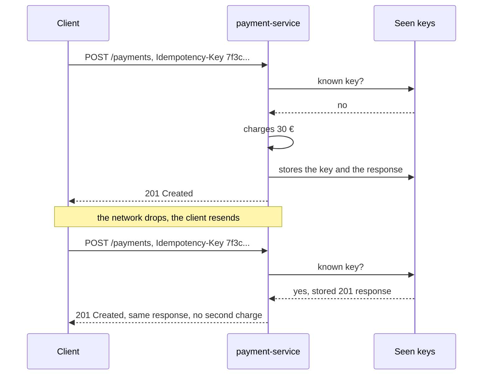

:material-book-open-variant: Reference docs: [RFC 9110, HTTP Semantics, methods](https://www.rfc-editor.org/rfc/rfc9110#section-9) (2022); [IETF, The Idempotency-Key HTTP Header Field](https://datatracker.ietf.org/doc/draft-ietf-httpapi-idempotency-key-header/) (draft, accessed November 2026)
{ .doc-ref }

### Response codes
<span class="pill pill-status pill-status-ok" title="Still valid, checked November 2026">Current · 11/2026</span>

| Code  | Meaning                                 | Example                                         |
|-------|-----------------------------------------|-------------------------------------------------|
| `200` | OK                                      | `GET /orders/42` returns the order              |
| `201` | created                                 | `POST /orders` created order 43                 |
| `204` | OK, no content                          | `DELETE /orders/42`                             |
| `400` | malformed request                       | invalid JSON                                    |
| `401` | not <span class="term" data-term="authentication">authenticated</span>                       | no <span class="term" data-term="token-oauth">token</span>, or expired token                      |
| `403` | authenticated but not <span class="term" data-term="authorization">authorized</span>        | ada tries to read grace's order                 |
| `404` | not found                               | `GET /orders/999`                               |
| `409` | conflict with the current state         | cancelling an order already delivered           |
| `422` | well formed but invalid                 | `quantity: -3`                                  |
| `429` | too many requests                       | <span class="term" data-term="rate-limit">rate limit</span> reached                              |
| `500` | internal error                          | server-side bug                                 |
| `502` | the service called behind it answered badly | `payment-service` returned an error         |
| `503` | unavailable for now                     | <span class="term" data-term="database">database</span> unreachable                            |

The family tells whose fault it is: `4xx`, the client asked wrong; `5xx`, the server could not answer.

Classic trap: my API returns `200` with `{"error": "not found"}` in the <span class="term" data-term="http-body">body</span>. Clients, monitoring tools and tests rely on the code, not on the text: the frontend thinks all is well, monitoring counts no error and the tests go green.

:material-book-open-variant: Reference docs: [RFC 9110, status codes](https://www.rfc-editor.org/rfc/rfc9110#section-15) (2022); [MDN, HTTP response status codes](https://developer.mozilla.org/en-US/docs/Web/HTTP/Status) (accessed November 2026)
{ .doc-ref }

### Error format
<span class="pill pill-status pill-status-ok" title="Still valid, checked November 2026">Current · 11/2026</span>

A standard shape exists: **Problem Details** (RFC 9457, 2023).
```json
{
  "type": "https://api.example.com/errors/out-of-stock",
  "title": "Out of stock",
  "status": 409,
  "detail": "Only 2 items of BK-0004 left, 5 requested.",
  "instance": "/orders/43"
}
```
If every route invents its own error shape, the frontend team must write one handler per route. With the same format everywhere, a single piece of code is enough to display every error, like this out-of-stock message.

:material-book-open-variant: Reference docs: [RFC 9457, Problem Details for HTTP APIs](https://www.rfc-editor.org/rfc/rfc9457) (2023)
{ .doc-ref }

### Pagination
<span class="pill pill-status pill-status-ok" title="Still valid, checked November 2026">Current · 11/2026</span>

My order list can hold millions of orders: returning everything at once would give a huge, slow response, for a screen that shows only twenty. So it is returned in pages.

| Type     | Request                              | Advantage                       | Limit                                         |
|----------|--------------------------------------|---------------------------------|-----------------------------------------------|
| <span class="term" data-term="offset-pagination">offset</span>   | `GET /orders?offset=40&limit=20`     | simple, I can jump to page 5  | slow on large tables, items skipped or duplicated if rows are added between two pages |
| <span class="term" data-term="cursor-pagination">cursor</span>   | `GET /orders?cursor=eyJpZCI6NjB9&limit=20` | stable and fast           | I cannot jump straight to page 5              |

!!! noob "As noob"
    An offset says "skip the first 40 lines of the list": if someone adds a line at the top between two pages, everything shifts and I see an item twice or miss one. A cursor is a bookmark placed on the last item read: the next page starts right after it, whatever happens at the start of the list. The one thing to remember: **an offset counts positions, a cursor remembers an item.**

```json
{
  "data": [ ... 20 orders ... ],
  "next_cursor": "eyJpZCI6ODB9"
}
```
Testing trap: a test that reads `items[0]` depends on the order. If the database one day returns the rows in another order, the test fails although nothing is broken. Always sort explicitly (`?sort=created_at`) or look the item up by its identifier.

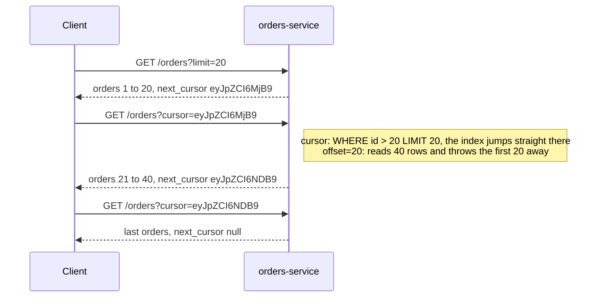

:material-book-open-variant: Reference docs: [JSON:API, Pagination](https://jsonapi.org/format/#fetching-pagination) (version 1.1, 2022)
{ .doc-ref }

### Filtering and sorting
<span class="pill pill-status pill-status-ok" title="Still valid, checked November 2026">Current · 11/2026</span>

```
GET /orders?status=paid&created_after=2026-10-01&sort=-created_at
```
`-created_at`: newest to oldest.

:material-book-open-variant: Reference docs: [JSON:API, Sorting](https://jsonapi.org/format/#fetching-sorting) (version 1.1, 2022)
{ .doc-ref }

### Versioning
<span class="pill pill-status pill-status-ok" title="Still valid, checked November 2026">Current · 11/2026</span>

<a class="pill pill-practice" href="../api-rest-async/#api-management" title="level 1: the practice is in place, even by hand">Practice · API management · L1</a>
<a class="pill pill-dora" href="https://dora.dev/capabilities/loosely-coupled-teams/">DORA · Loosely coupled teams</a>

Applications already call my API. If I change the shape of a response, for example by renaming a field, they crash. When a change breaks existing clients like this, I need a new version.

| Change                                     | Breaks clients?             |
|--------------------------------------------|-----------------------------|
| adding a field to a response               | no, usually                 |
| adding an optional parameter               | no                          |
| renaming or removing a field               | **yes**                     |
| making an optional parameter required      | **yes**                     |
| changing a field's type (`int` to `string`) | **yes**                    |
| adding a value to an <span class="term" data-term="enum">enum</span>                  | **maybe**: a client that does not know it may crash |

Two common ways:
```
GET /v2/orders/42                      (version in the URL, the most readable)
GET /orders/42   Accept: application/vnd.example.v2+json   (version in a header)
```
To remove something without breaking anyone: I add the new one next to the old one, let clients migrate, then remove the old one ("<span class="term" data-term="expand-contract">expand / contract</span>"). For example, the response returns both `total` and `total_cents` for a while, then only `total_cents`. I announce the removal date with the `Deprecation` and `Sunset` headers (standardized in 2025 and 2019).

:material-book-open-variant: Reference docs: [RFC 9745, Deprecation header](https://www.rfc-editor.org/rfc/rfc9745) (2025); [RFC 8594, Sunset header](https://www.rfc-editor.org/rfc/rfc8594) (2019)
{ .doc-ref }

### OpenAPI
<span class="pill pill-status pill-status-ok" title="Still valid, checked November 2026">Current · 11/2026</span>

<a class="pill pill-practice" href="../api-rest-async/#api-management" title="level 3: it decides without a human">Practice · API management · L3</a>

The teams calling my API need to know which routes exist, what they accept and what they return, without reading my code. OpenAPI is the standard format to write that down, in <span class="term" data-term="yaml">YAML</span> or JSON. The same file serves as documentation, as a basis to generate clients, and as a contract the tests check.

```yaml
# Example: OpenAPI contract for the GET /orders/{id} route and the Order schema
openapi: 3.1.0
info:
  title: Orders API
  version: 1.4.0
paths:
  /orders/{id}:
    get:
      parameters:
        - name: id
          in: path
          required: true
          schema: { type: integer }
      responses:
        "200":
          description: The order
          content:
            application/json:
              schema: { $ref: "#/components/schemas/Order" }
        "404":
          description: Unknown order
components:
  schemas:
    Order:
      type: object
      required: [id, status, total_cents]
      properties:
        id: { type: integer }
        status: { type: string, enum: [pending, paid, cancelled] }
        total_cents: { type: integer }
```

Good practice: generate this file **from the code** (FastAPI and NestJS do it), and check in <span class="term" data-term="ci">CI</span> that the committed file is exactly the one the code produces. A hand-written contract ends up lying: someone adds a field in the code, forgets the file, and the documentation announces a shape the API no longer returns.

:material-book-open-variant: Reference docs: [OpenAPI Specification 3.1.0](https://spec.openapis.org/oas/v3.1.0) (2021)
{ .doc-ref }

### Linting an OpenAPI contract
<span class="pill pill-status pill-status-ok" title="Still valid, checked November 2026">Current · 11/2026</span>

An **<span class="term" data-term="api-linting">API linter</span>** reads the OpenAPI file the way ESLint reads code: it checks style rules (kebab-case paths, an `operationId` on every operation, every error described) and flags deviations before the API is coded or published. The most widespread tool is Spectral (Stoplight, open source, first release date to check); Redocly CLI does the same.

*ESLint: complements Prettier*
{ .tool-rel }


**Why.** Ten teams writing APIs without shared rules produce ten styles: `/orderItems`, `/order_items`, errors without a body. A guideline written in a wiki is not read; a rule that fails the MR is.

**When.** As soon as there are several APIs or several teams, and especially with [API first](#api-first), where the contract is reviewed before the code. For a single internal API, the default rules are enough.

**How.**

1. start from the standard ruleset, then add a few house rules;
2. run the linter in CI on every MR that touches the contract, failing on errors only;
3. add breaking change detection between the published version and the new one (oasdiff, for example): the linter judges style, not compatibility.

```yaml
# Example: the standard rule set plus one house rule (kebab-case paths)
extends: ["spectral:oas"]
rules:
  operation-operationId: error
  paths-kebab-case:
    description: Paths are kebab-case.
    severity: error
    given: "$.paths[*]~"
    then:
      function: pattern
      functionOptions:
        match: "^(/([a-z0-9-]+|\\{[a-zA-Z]+\\}))+$"
```

```
$ npx @stoplight/spectral-cli lint openapi.yaml --fail-severity=error
$ oasdiff breaking openapi-main.yaml openapi.yaml --fail-on ERR
```

Options and command names to check in each tool's documentation.

| I want to... | I use... |
|---|---|
| all the team's APIs to look alike (same field names, same error format) without checking everything by hand in review | a linter (Spectral, Redocly) run in CI, with a shared ruleset |
| no application already plugged into the API to break when someone changes the contract, for example by renaming a field | breaking change detection (oasdiff) between the published version and the MR's |
| to be sure the code does what the contract promises, for example that a field declared required is always there | a contract test (see [Quality](qualite.md#contract-tests-and-api-mocks)) |

:material-book-open-variant: Reference docs: [Spectral](https://github.com/stoplightio/spectral) (accessed November 2026); [oasdiff](https://github.com/oasdiff/oasdiff) (accessed November 2026)
{ .doc-ref }

### API first
<span class="pill pill-status pill-status-ok" title="Still valid, checked November 2026">Current · 11/2026</span>

<a class="pill pill-practice" href="../livraison/#design-before-coding" title="level 1: the practice is in place, even by hand">Practice · Technical design · L1</a> <a class="pill pill-practice" href="../api-rest-async/#api-management" title="level 1: the practice is in place, even by hand">Practice · API management · L1</a>
<a class="pill pill-dora" href="https://dora.dev/capabilities/loosely-coupled-teams/">DORA · Loosely coupled teams</a> <a class="pill pill-dora" href="https://dora.dev/capabilities/documentation-quality/">DORA · Documentation quality</a>

<span class="term" data-term="api-first">API first</span>: I write the contract **before** the code, have it reviewed by the people who will use it, then everyone works in parallel from that same file. The opposite, "code first", writes the code first and generates the contract from it.

```
code first   days 1 to 10  the back end codes GET /orders/{id}
             day 11        OpenAPI generated, the front end discovers the data shape
             day 12        "the currency field is missing": back to the back end

API first    day 1         OpenAPI contract written, reviewed by front end, back end and QA
             days 2 to 10  the back end codes the route, the front end codes against a mock
                           of the contract (Prism), QA writes the contract tests
             day 11        wiring: both sides already follow the same contract
```

This does not contradict the good practice above: with API first, the contract written first becomes the reference, and CI checks that the OpenAPI produced by the code stays identical to it. The difference is when the shape of the API is discussed: before the code, when changing it costs almost nothing.

| Situation                                                   | API first | Code first |
|-------------------------------------------------------------|-----------|------------|
| my API will be called by people I cannot easily warn about a change, such as partners or the public | yes | |
| a frontend team and a backend team want to move at the same time, without the frontend waiting for the backend to finish | yes | |
| several consumers (the mobile app, the website, the billing service) must agree on the shape of the API before anyone writes code | yes | |
| I am building, alone or with my own team, a prototype I will throw away in two weeks | | yes |
| the route has a single client, which lives in the same repo and which I change in the same MR | | yes |

Source: the "Follow API first principle" rule of the [Zalando RESTful API Guidelines (first version in 2015, continuously updated)](https://opensource.zalando.com/restful-api-guidelines/) (to check).

### API management
<span class="pill pill-status pill-status-ok" title="Still valid, checked November 2026">Current · 11/2026</span>

<a class="pill pill-practice" href="../api-rest-async/#api-management" title="level 2: it is automated">Practice · API management · L2</a>

I open my API to partners or to the public: I need to know who calls, slow down those who abuse it and let them get started on their own. <span class="term" data-term="api-management">API management</span> groups what I put in front of APIs for that: a <span class="term" data-term="api-gateway">gateway</span> that receives every call, keys and quotas per client, a developer portal (documentation, key requests) and usage statistics. Common tools: Kong, Apigee, AWS API Gateway, Azure API Management.

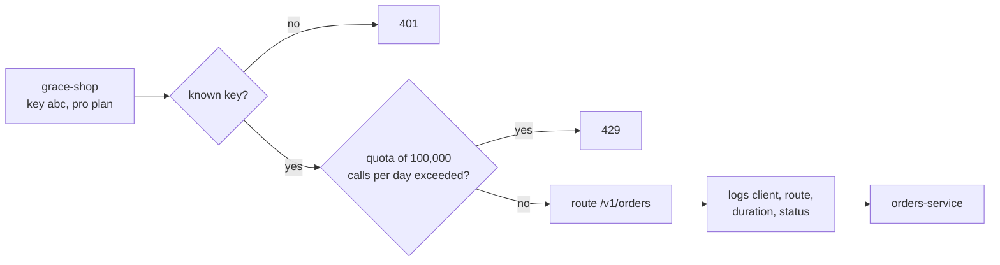

A client's plan sets its quotas and, often, the <span class="term" data-term="sla">SLA</span> it is promised (see [SLA and tolerated downtime](observabilite.md#sla-and-tolerated-downtime-ita)):

| Plan       | Quota               | Promised SLA (example)          |
|------------|---------------------|---------------------------------|
| free       | 1,000 calls/day     | none                            |
| pro        | 100,000 calls/day   | 99.5% per month                 |
| enterprise | by contract         | 99.9% per month, with penalties |

The gateway checks **who** is calling, not **what they are allowed to read**: `orders-service` must still check that order 42 really belongs to this client. Otherwise, a client with a valid key can read another client's orders.

For tests: a test that calls `orders-service` directly sees neither the gateway's `401` nor its `429`. I need at least a few tests that go through it, with a test key.

| Situation                                                | Gateway or API management?                 |
|----------------------------------------------------------|--------------------------------------------|
| partners or the public call my API, and I need to know who calls, how often, and be able to cut off abuse | yes: keys, quotas, portal, statistics |
| several services hide behind a single address: `api.example.com/orders` goes to the orders service, `/users` to the users service | at least a gateway |
| I sell access to my API in plans (free, pro, enterprise), each with its own quota | yes |
| two internal services of the same cluster talk to each other, with nobody from outside involved | often not: a direct call is enough |

:material-book-open-variant: Reference docs: [Chris Richardson, API Gateway pattern](https://microservices.io/patterns/apigateway.html) (accessed November 2026)
{ .doc-ref }

### Testing a REST API
<span class="pill pill-status pill-status-ok" title="Still valid, checked November 2026">Current · 11/2026</span>

| I want to check...                                    | How                                                  |
|-------------------------------------------------------|------------------------------------------------------|
| the route returns the right code and the right body   | <span class="term" data-term="integration-test">integration test</span>: real request against the running app |
| errors: 401, 403, 404, 422                            | one test per case, with a real token (valid, expired, wrong permissions) |
| the response matches the contract                     | <span class="term" data-term="schemathesis">schemathesis</span> or an <span class="term" data-term="openapi">OpenAPI</span> schema validation         |
| the service called behind it goes down                | contract-based <span class="term" data-term="mock">mock</span> (Microcks, Prism) that returns 500 |
| a replayed `POST` does not create a duplicate         | send the same `Idempotency-Key` twice                |

```
$ curl -i -X POST localhost:8000/orders \
    -H 'Authorization: Bearer eyJ...' \
    -H 'Content-Type: application/json' \
    -d '{"items": [{"sku": "BK-0004", "quantity": 1}]}'
HTTP/1.1 201 Created
Location: /orders/43
```

:material-book-open-variant: Reference docs: [Schemathesis](https://schemathesis.readthedocs.io/) (accessed November 2026)
{ .doc-ref }

## GraphQL

<a class="pill pill-scope pill-scope-app" href="../architecture/#map-of-scales">Scale · Application</a> <span class="pill pill-status pill-status-ok" title="Still valid, checked November 2026">Current · 11/2026</span>

<span class="term" data-term="graphql">GraphQL</span> is another synchronous API style, published by Facebook in 2015 and handed over to the GraphQL Foundation (Linux Foundation) in 2018. Three differences with REST:

- **a single URL** (often `POST /graphql`) instead of one URL per resource;
- the server publishes a typed **schema** of everything that can be asked;
- the **client** writes a query that describes exactly the fields it wants, and the response has the same shape as the query.

!!! noob "As noob"
    Picture an order form. In REST, each URL is a ready-made dish: `GET /orders/42` serves the order with everything the kitchen decided to put in it. In GraphQL, I get the **list of every possible ingredient** (the schema) and I **tick** the ones I want. The server hands me a plate shaped exactly like what I ticked.

    The sentence to remember: **a GraphQL query is the JSON of the response without the values.** I write the keys, the server fills in the blanks.

<div class="grid" markdown>

```graphql title="What I send: the keys"
# Example: I only write the keys I want back
query {
  order(id: "42") {
    status
    customer {
      name
    }
  }
}
```

```json title="What I get: the same keys, filled in"
{
  "data": {
    "order": {
      "status": "paid",
      "customer": {
        "name": "Ada"
      }
    }
  }
}
```

</div>

### GraphQL terminology

**Schema**: the server's contract, written in SDL (Schema Definition Language). It lists the types, their fields, and the entry points.
```graphql
# Example: the data types the server exposes
type Order {
  id: ID!
  status: String!
  totalCents: Int!
  customer: Customer!
  items: [Item!]!
}

type Customer { id: ID!  name: String!  email: String!  orders: [Order!]! }
type Item     { sku: String!  name: String!  quantity: Int! }

# Example: the entry points, for reading (Query) and writing (Mutation)
type Query {
  order(id: ID!): Order
}

type Mutation {
  cancelOrder(id: ID!, reason: String): Order
}
```
The `!` means "never null". `[Item!]!`: a list that is always present, with no null element.

**Why "Graph".** The schema is a graph: each type is a node, each field that points to another type is an edge. A query picks a path through that graph, starting from an entry point of `Query`. In colour, the path taken by the order page query `OrderPage`; dotted, an edge that exists but that the query does not follow.

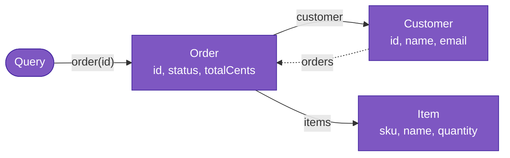

The `Customer.orders` edge leads back to `Order`: the graph has loops. That is handy ("this customer's other orders"), and it is also what allows the endlessly deep queries shown further down.

**Query**: a read. **Mutation**: a write (create, update, cancel). **Subscription**: a stream of updates pushed by the server, often over <span class="term" data-term="websocket">WebSocket</span>.

**Variables**: the query parameters, sent separately, like the parameters of a prepared SQL statement.
```json
{
  "query": "query OrderPage($id: ID!) { order(id: $id) { status } }",
  "variables": {"id": "42"}
}
```

**Resolver**: the server function that computes a field. The server calls the resolver of `order`, then the one of `customer` on the order it got, and so on.
```python
# Example: resolver of the order field, called first
def resolve_order(_, info, id):
    return orders_repo.get(id)

# Example: resolver of customer, called on the order obtained
def resolve_customer(order, info):
    return customers_repo.get(order.customer_id)
```

What the server does when the `OrderPage` query arrives:

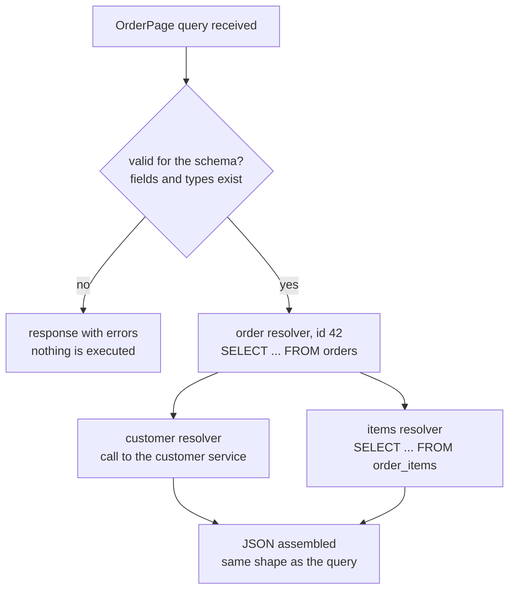

!!! noob "As noob"
    The server does not run "one big query". It walks down my query level by level and, for each field, calls the small function that knows how to fetch it: the resolver. A plain field such as `status` is read straight from the object already loaded; a field that leads to another type, such as `customer`, triggers a new lookup.

**<span class="term" data-term="over-fetching">Over-fetching</span>**: receiving more fields than the screen displays. **<span class="term" data-term="under-fetching">Under-fetching</span>**: having to make several calls to gather what a screen displays. GraphQL was created to solve both problems on mobile.

:material-book-open-variant: Reference docs: [GraphQL, Learn](https://graphql.org/learn/) (accessed November 2026)
{ .doc-ref }

### The same need in REST and in GraphQL

The "order page" screen shows the status, the total, the customer's name, and the name and quantity of each item.

**In REST**, three calls, two of which depend on the first one:
```
GET /orders/42
200 {"id": 42, "status": "paid", "total_cents": 3000, "customer_id": 7,
     "created_at": "2026-11-02T10:00:00Z", "shipping_address": {...}, "billing_address": {...}}

GET /customers/7
200 {"id": 7, "name": "Ada", "email": "ada@example.com", "phone": "...", "addresses": [...]}

GET /orders/42/items
200 [{"sku": "BK-0004", "name": "Book", "quantity": 1, "unit_price_cents": 3000, "weight_g": 450}]
```
The screen waits for three round trips (under-fetching) and receives addresses, phone and weight it does not need (over-fetching).

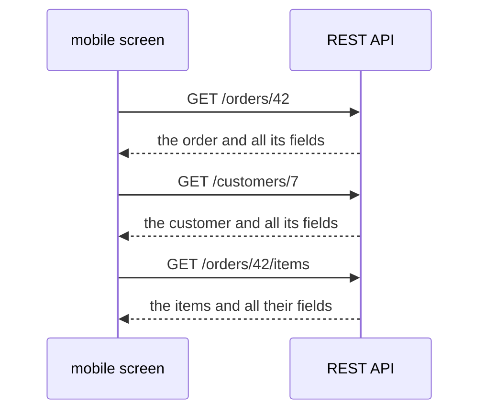

**In GraphQL**, a single call:
```graphql
# What changes: one call instead of three, and only the fields displayed
query OrderPage($id: ID!) {
  order(id: $id) {
    status
    totalCents
    customer { name }
    items { name quantity }
  }
}
```
```json
{
  "data": {
    "order": {
      "status": "paid",
      "totalCents": 3000,
      "customer": {"name": "Ada"},
      "items": [{"name": "Book", "quantity": 1}]
    }
  }
}
```
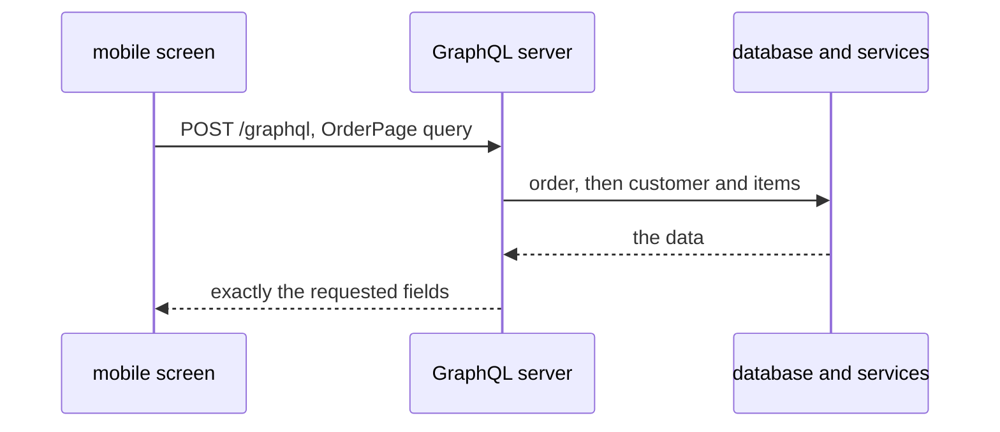

!!! noob "As noob"
    GraphQL does not make the three lookups disappear: it **moves them to the server**, close to the data, where a call costs a few milliseconds instead of a round trip over a mobile network. And it only sends back what the screen shows.

A mobile screen that only shows the status asks for `order(id: $id) { status }` only, with no new route on the server.

The equivalent REST solution is often a <span class="term" data-term="bff">BFF</span>: a route `GET /screens/order-page/42` written for that screen, which makes the three calls on the server side.

**Writing**: the mutation replaces `POST /orders/42/cancel`.
```graphql
# Example: the mutation that replaces POST /orders/42/cancel
mutation {
  cancelOrder(id: "42", reason: "customer") { id status }
}
```
```json
{"data": {"cancelOrder": {"id": "42", "status": "cancelled"}}}
```
A mutation is not <span class="term" data-term="idempotency">idempotent</span> by default: the `Idempotency-Key` header seen above is still useful.

### What changes compared to REST

| Topic              | REST                                          | GraphQL                                            |
|--------------------|-----------------------------------------------|----------------------------------------------------|
| address            | one URL per resource: `/orders/42`            | a single one: `/graphql`                           |
| HTTP method        | `GET`, `POST`, `PUT`, `PATCH`, `DELETE`       | almost always `POST`                               |
| response shape     | set by the server                             | chosen by the client, field by field               |
| errors             | HTTP code: 404, 403, 422...                   | often `200`, with an `errors` array in the body    |
| HTTP cache, CDN    | built in on `GET` (the URL is the key)        | does not work as is: same URL for everything       |
| new version        | `/v2/orders`                                  | add fields, mark old ones `@deprecated`            |
| contract           | <span class="term" data-term="openapi">OpenAPI</span> | the SDL schema, which the client can read (introspection) |

**Errors.** If order 43 does not exist, REST answers `404`. A GraphQL server often answers `200`:
```json
{
  "data": {"order": null},
  "errors": [{
    "message": "Order 43 not found",
    "path": ["order"],
    "extensions": {"code": "NOT_FOUND"}
  }]
}
```
!!! noob "As noob"
    In GraphQL, a `200` often means "I received and understood your query", not "everything went fine". The real outcome is in the body: `data` for what worked, `errors` for what failed. A test that only checks the HTTP code lets errors through.

The response can also be **partial**: the order comes back, but `customer` is `null` because the customer service failed, with an entry in `errors`. The "GraphQL over HTTP" draft specification (in progress, to check) recommends 4xx codes for invalid requests with the `application/graphql-response+json` type, but many servers still answer `200` in every case.

**Introspection**: the client can ask the server for its own schema (`{ __schema { types { name } } }`). That is what powers autocompletion in tools. On a public API, it is often disabled in production so as not to expose the whole schema.

:material-book-open-variant: Reference docs: [GraphQL, Serving over HTTP](https://graphql.org/learn/serving-over-http/) (accessed November 2026)
{ .doc-ref }

### Server-side pitfalls

**The <span class="term" data-term="n-plus-one">N+1 problem</span>.** The query `orders(last: 50) { customer { name } }` calls the `customer` resolver 50 times:
```
-- Avoid: one query per customer, so 51 queries for 50 orders
SELECT * FROM orders ORDER BY id DESC LIMIT 50;
SELECT * FROM customers WHERE id = 7;
SELECT * FROM customers WHERE id = 9;
... (50 times)
```
The fix is a **DataLoader** (Facebook, 2015): it groups the loads of a single request into one call.

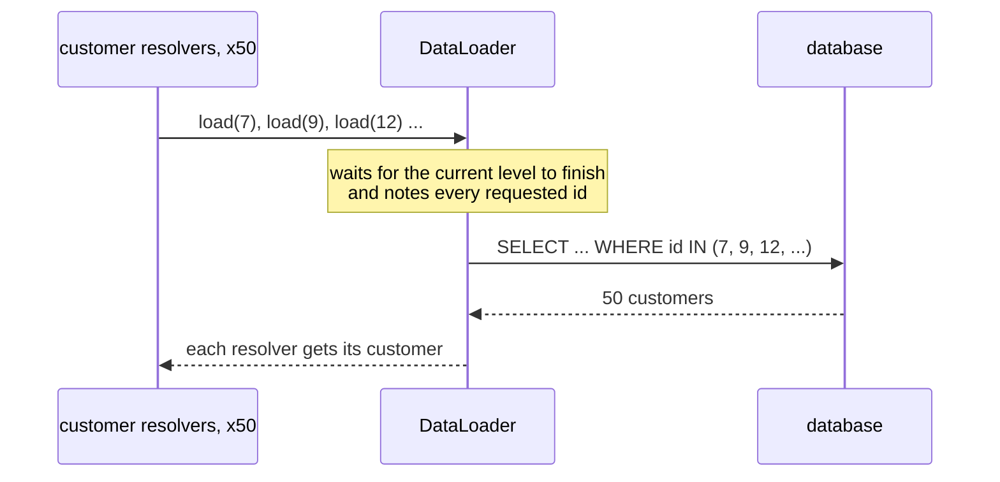

!!! noob "As noob"
    I ask for 50 orders with the customer's name: without care, the server does "go fetch customer n" 50 times. The DataLoader is an assistant who writes down the 50 requests, then makes **a single trip** with the full list.
```
-- What changes: with the DataLoader, a single SELECT ... IN for the 50 customers
SELECT * FROM orders ORDER BY id DESC LIMIT 50;
SELECT * FROM customers WHERE id IN (7, 9, 12, ...);
```

**Overly expensive queries.** The client chooses the query, so it can write a huge one:
```graphql
# Avoid: query too deep and costly, the server should refuse it
{ customers { orders { customer { orders { customer { orders { id } } } } } } }
```
Fixes: limit the depth (for example 6 levels), compute a cost per field and reject above a budget, or accept only **persisted queries**: the client sends the hash of a query registered in advance, not free text.

**Caching.** Everything goes through `POST /graphql`, so a CDN can no longer cache by URL. Persisted queries sent as `GET` (`/graphql?id=a1b2c3&variables=...`) give back a stable URL. On the client side, libraries like Apollo Client keep a cache per object (`Order:42`).

**Per-field permissions.** The same object can be reached through several paths: `order(id: 42) { customer { email } }` and `customer(id: 7) { email }`. If access control is only done on the `customer` entry point, the email leaks through `order`. The check belongs in the field's resolver or in the business layer, not only at the entry point.

### Testing a GraphQL API
<span class="pill pill-status pill-status-ok" title="Still valid, checked November 2026">Current · 11/2026</span>

| I want to check...                                   | How                                                           |
|------------------------------------------------------|---------------------------------------------------------------|
| the query returns the right data                     | check `data` **and** the absence of `errors`, not just the `200` |
| a business error                                     | check `errors[0].extensions.code` and `path`                  |
| a partial response                                   | <span class="term" data-term="mock">mock</span> of the customer service that fails: `customer` is `null`, one error in `errors` |
| the schema does not break clients                    | compare the branch's schema with the one on `main` (GraphQL Inspector, for example): a removed field or a field made required breaks clients |
| no N+1                                               | count the SQL queries during the test: 2, not 51              |
| too deep queries are rejected                        | send a 10-level query, expect an error                        |
| permissions                                          | ask for the same sensitive field through two different paths  |

```python
# Example: the GraphQL query sent by the test
ORDER_PAGE = """
query OrderPage($id: ID!) {
  order(id: $id) { status customer { name } }
}
"""

# Good: checks the 200, the absence of errors and the data
def test_order_page(client):
    resp = client.post("/graphql", json={"query": ORDER_PAGE, "variables": {"id": "42"}})
    body = resp.json()
    assert resp.status_code == 200
    assert "errors" not in body
    assert body["data"]["order"] == {"status": "paid", "customer": {"name": "Ada"}}
```

```
$ curl -s localhost:8000/graphql \
    -H 'Content-Type: application/json' \
    -d '{"query": "{ order(id: \"42\") { status } }"}'
{"data":{"order":{"status":"paid"}}}
```

### REST or GraphQL?

!!! noob "As noob"
    GraphQL shines when **several consumers (a website, a mobile app) each want a different piece of the same data**, spread over several services. For a simple, public or heavily cached API, REST stays easier to call, to cache and to monitor.

| Situation                                                        | Rather                    |
|------------------------------------------------------------------|---------------------------|
| partners or the public call my API with their own tools, which I do not know | REST: everyone knows how to call and cache it |
| I have a single website, with a few screens, built by the same team as the API | REST |
| I have several consumers with different needs, on a website or on a mobile app, who want different combinations of the same data: the website's order list shows the customer, the address and the line items, the app's only the number, the status and the total | GraphQL, or REST + BFF (a small API tailored to each frontend) |
| one screen needs data stored in several services, like an order page that gathers the order, the customer and the delivery tracking | GraphQL |
| I serve files or large volumes, or rely heavily on a CDN cache, like product images or CSV exports | REST |
| internal services call each other, with no screen at the end | REST or <span class="term" data-term="grpc">gRPC</span>, rarely GraphQL |

Sources: [GraphQL specification](https://spec.graphql.org/) (first public version in 2015, successive editions, the latest to check on the site), [GraphQL over HTTP](https://graphql.github.io/graphql-over-http/) (draft specification, publication date not stated), [DataLoader](https://github.com/graphql/dataloader) (Facebook, 2015).

## Asynchronous: messages and events

<a class="pill pill-scope pill-scope-system" href="../architecture/#map-of-scales">Scale · System</a> <a class="pill pill-scope pill-scope-infra" href="../architecture/#map-of-scales">Scale · Infrastructure</a>

### Message, event, command
- **Message**: any data sent from one service to another through an intermediary.
- **Event**: a message that says **what happened**, in the past tense. The sender does not know who is listening. `OrderCreated`, `PaymentFailed`.
- **Command**: a message that asks **to do** something, addressed to a specific recipient. `SendConfirmationEmail`.

```json
{
  "type": "OrderCreated",
  "id": "evt_01J9Z3",
  "occurred_at": "2026-10-20T10:42:00Z",
  "data": {"order_id": 42, "customer_id": 7, "total_cents": 3000}
}
```

:material-book-open-variant: Reference docs: [Hohpe and Woolf, Event Message](https://www.enterpriseintegrationpatterns.com/patterns/messaging/EventMessage.html) (2003); [Command Message](https://www.enterpriseintegrationpatterns.com/patterns/messaging/CommandMessage.html) (2003)
{ .doc-ref }

### Broker, producer, consumer
- **Broker**: the intermediary service that receives, stores and distributes messages. RabbitMQ, <span class="term" data-term="kafka">Kafka</span>, Google Pub/Sub, Amazon SQS.
- **Producer**: the one that publishes.
- **Consumer**: the one that reads and processes.

:material-book-open-variant: Reference docs: [Hohpe and Woolf, Message Broker](https://www.enterpriseintegrationpatterns.com/patterns/messaging/MessageBroker.html) (2003)
{ .doc-ref }

### Queue or topic
<span class="pill pill-status pill-status-ok" title="Still valid, checked November 2026">Current · 11/2026</span>

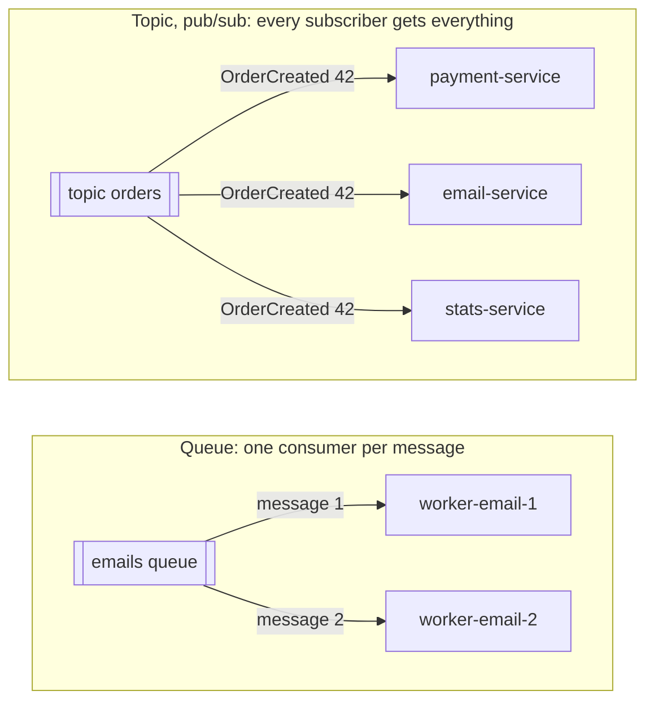

I have thousands of emails to send and two workers to do it: a queue spreads the work between them, and each email goes out only once. A new order must be known to payment, to the email sender and to statistics: a topic notifies each of these services of the same fact.

!!! noob "As noob"
    A queue is a pile of parcels shared between several couriers: each parcel goes out with one courier only. A topic is a newspaper sent to subscribers: each subscriber gets their own copy. The one thing to remember: **a queue to share the work, a topic so everyone hears the news.**

:material-book-open-variant: Reference docs: [Point-to-Point Channel](https://www.enterpriseintegrationpatterns.com/patterns/messaging/PointToPointChannel.html) (2003); [Publish-Subscribe Channel](https://www.enterpriseintegrationpatterns.com/patterns/messaging/PublishSubscribeChannel.html) (2003)
{ .doc-ref }

### Delivery guarantees
<span class="pill pill-status pill-status-ok" title="Still valid, checked November 2026">Current · 11/2026</span>

| Guarantee         | Meaning                                         | Consequence                                  |
|-------------------|-------------------------------------------------|----------------------------------------------|
| <span class="term" data-term="at-most-once">at-most-once</span>      | at most once                                    | a message can be lost                        |
| <span class="term" data-term="at-least-once">at-least-once</span>     | at least once                                   | a message can arrive **twice**               |
| <span class="term" data-term="exactly-once">exactly-once</span>      | exactly once                                    | rare, costly, often limited to a single system |

Most brokers are **at-least-once**. So every consumer must be **<span class="term" data-term="idempotency">idempotent</span>**: processing the same message twice must not have two effects.

!!! noob "As noob"
    The broker behaves like a careful postman: if he is not sure my letter arrived, he drops off a copy. I lose nothing, but I may get the same letter twice, so it is up to me to recognize the one I have already read. The one thing to remember: **"at least once" means "sometimes twice": the consumer must tolerate duplicates.**

```python
# Good: idempotent consumer, an event already processed is ignored
def handle_order_created(event):
    if processed_events.exists(event["id"]):
        return
    send_confirmation_email(event["data"]["order_id"])
    processed_events.add(event["id"])
```
Without this check, the customer gets two confirmation emails, or worse, is charged twice.

:material-book-open-variant: Reference docs: [Apache Kafka, Message Delivery Semantics](https://kafka.apache.org/documentation/#semantics) (accessed November 2026)
{ .doc-ref }

### Acknowledgment (ack)
<span class="pill pill-status pill-status-ok" title="Still valid, checked November 2026">Current · 11/2026</span>

The consumer tells the broker "it's processed" only **after** it has finished. If it crashes before that, the broker hands the message to someone else.

!!! noob "As noob"
    It is a recorded delivery letter, signed only once its content has been handled, not when the envelope is opened. Until the signature comes back, the sender assumes the letter did not arrive and will send it again. The one thing to remember: **confirm after finishing, never before.**

```
1. receives OrderCreated 42
2. sends the email
3. ack            (if the worker crashes before this step, the message will be redelivered)
```

:material-book-open-variant: Reference docs: [RabbitMQ, Consumer Acknowledgements and Publisher Confirms](https://www.rabbitmq.com/docs/confirms) (accessed November 2026)
{ .doc-ref }

### Dead letter queue (DLQ)
<span class="pill pill-status pill-status-ok" title="Still valid, checked November 2026">Current · 11/2026</span>

A message fails on every attempt, because of invalid data or a bug. If it is retried endlessly, it blocks the queue forever and the messages behind it stop moving. After N tries, it goes to a **dead letter queue**: it is set aside for analysis, and the other messages keep flowing.

!!! noob "As noob"
    At a counter, a customer whose file gets stuck on every attempt blocks the whole line behind them. They get sent to a side office, the line moves on, and someone comes to look at their file. The one thing to remember: **the DLQ sets aside what blocks, but someone has to go and look at it.**

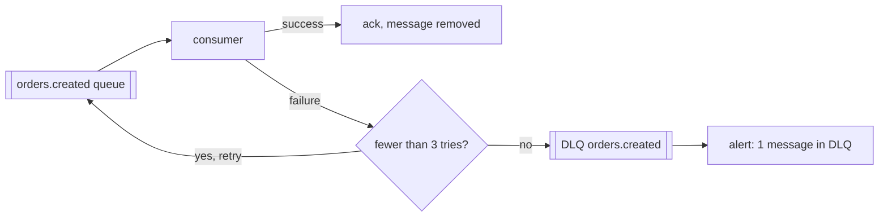
A <span class="term" data-term="dead-letter-queue">DLQ</span> that keeps growing with nobody looking at it means orders lost silently. It needs an alert.

### Message ordering
<span class="pill pill-status pill-status-ok" title="Still valid, checked November 2026">Current · 11/2026</span>

Four Kafka words (other brokers have equivalents):

- **Topic**: a named log that messages are published to, for example `orders.events`.
- **Partition**: a topic is split into several independent logs, read in parallel. Each message goes to exactly one partition.
- **Offset**: the position of a message in its partition (0, 1, 2...). The broker does not delete a message once read: the consumer remembers how far it has read.
- **Consumer group**: a set of instances of the same service that share the partitions. Each group keeps **its own offsets**, so each service reads the whole topic at its own pace and can go back to replay.

!!! noob "As noob"
    Picture a newspaper split into several sections (the partitions), each numbered page by page (the offsets). Each service that reads it is a group of readers who share out the sections and keep their own bookmark: one service may have finished while another is still at the start, or goes back to reread. The one thing to remember: **the log stays put, each group moves forward with its own bookmark.**

```
topic orders.events, 3 partitions, key = order_id

producer: send(key=42, OrderCreated)    hash(42) % 3 = 1
          send(key=42, OrderPaid)       same key, same partition 1
          send(key=7,  OrderCreated)    hash(7) % 3 = 0

partition 0: [7:Created]
partition 1: [42:Created] [42:Paid] [42:Cancelled]
              offset 0     offset 1   offset 2
partition 2: [13:Created] [13:Paid]

group billing  : partition 1 read up to offset 2
group warehouse: partition 1 read up to offset 0  (lagging, or replaying)
```

Order is guaranteed **within a partition only**. Across partitions there is no order: order 7 and order 42 can be processed in any order, which is fine. What is not fine is `OrderCancelled 42` processed before `OrderCreated 42`: hence the <span class="term" data-term="partition-key">partition key</span> `order_id`, which puts all events of an order in the same partition. Without a key, the producer spreads messages randomly (or round robin) and per-order ordering is lost. Same problem with a plain queue read by several workers in parallel.

Second countermeasure, when order cannot be guaranteed (several producers, replay, another broker): a **version number** in the event, and the consumer ignores anything that is not newer than what it has already applied.

```json
{"type": "OrderCancelled", "order_id": 42, "version": 3}
```

```python
# Good: ignores an event that is not newer than the version applied
def handle(event):
    last = versions.get(event["order_id"], 0)
    if event["version"] <= last:
        return  # already seen, or older than the known state
    apply(event)
    versions[event["order_id"]] = event["version"]
```

| Need                                     | Countermeasure                           |
|------------------------------------------|------------------------------------------|
| the messages of one order (or one customer) must be processed in order: "created" before "paid" before "shipped" | partition key = entity id |
| every message of the topic must be processed in exact arrival order, whatever the entity | a single partition (no more parallelism) |
| a message may arrive late, twice, or be replayed, like an old "paid" arriving after "cancelled" | version number, ignore `<=` last |

:material-book-open-variant: Reference docs: [Apache Kafka, Introduction](https://kafka.apache.org/intro) (accessed November 2026)
{ .doc-ref }

### The write-then-publish trap
<span class="pill pill-status pill-status-ok" title="Still valid, checked November 2026">Current · 11/2026</span>

```
1. orders-service saves the order in the database     OK
2. orders-service publishes OrderCreated              FAILURE (broker unreachable)
result: the order exists, but no other service is notified
```
Swapping the two steps fixes nothing: if publishing succeeds and the database write fails, the other services are told about an order that does not exist.

The solution is called the **<span class="term" data-term="outbox-pattern">outbox</span>** pattern (described by Chris Richardson, "Microservices Patterns", 2018): the event is written to the database in the **same <span class="term" data-term="db-transaction">transaction</span>** as the order, in an `outbox` table. Both rows exist, or neither does.

!!! noob "As noob"
    Instead of posting the letter myself right after filling in the file, at the risk of forgetting, I slip the letter into the file, and a courier regularly comes by to post whatever he finds. The file and the letter are stored together or not at all, and the courier may post the same letter twice if he is interrupted. The one thing to remember: **save the event with the data, publish it afterwards.**

```sql
-- Good: the outbox table, where the event waits to be published
CREATE TABLE outbox (
    id           UUID PRIMARY KEY,
    topic        TEXT NOT NULL,
    payload      JSONB NOT NULL,
    published_at TIMESTAMPTZ          -- NULL until published
);

-- Good: order and event in the same transaction, both or neither
BEGIN;
INSERT INTO orders (id, customer_id, total_cents) VALUES (42, 7, 3000);
INSERT INTO outbox (id, topic, payload)
VALUES ('6f1c...', 'orders.events',
        '{"type": "OrderCreated", "order_id": 42, "version": 1}');
COMMIT;
```

A separate process, the **relay**, then reads the table and publishes. Two ways to do it:

- **Polling**: it queries the table at regular intervals.
- **<span class="term" data-term="cdc">CDC</span>**: a tool such as <span class="term" data-term="debezium">Debezium</span> reads the database log and publishes each row inserted into `outbox`, with no polling query.

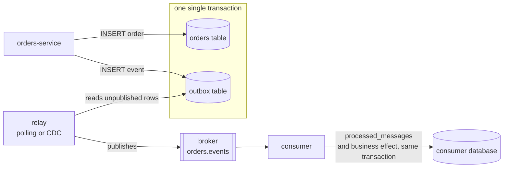
```python
# Example: polling relay, publishes then marks the row as published
while True:
    rows = db.query("SELECT * FROM outbox WHERE published_at IS NULL ORDER BY id LIMIT 100")
    for row in rows:
        broker.publish(row.topic, key=row.payload["order_id"], value=row.payload, headers={"message_id": row.id})
        db.execute("UPDATE outbox SET published_at = now() WHERE id = %s", row.id)
    sleep(1)
```

Consequence: if the relay crashes between `publish` and `UPDATE`, it will publish the same row again on restart. Delivery is therefore **at-least-once**, and the consumer must be idempotent. The safest way is to do it in the database, with a unique constraint on the message id, in the same transaction as the business effect:

```sql
-- Good: uniqueness on message_id blocks a second processing
CREATE TABLE processed_messages (
    message_id   UUID PRIMARY KEY,   -- uniqueness blocks the duplicate
    processed_at TIMESTAMPTZ NOT NULL DEFAULT now()
);
```

```python
# Good: deduplication and business effect in the same transaction
def handle_order_created(msg):
    with db.transaction():
        inserted = db.execute(
            "INSERT INTO processed_messages (message_id) VALUES (%s) ON CONFLICT DO NOTHING",
            msg.headers["message_id"],
        ).rowcount
        if inserted == 0:
            return  # duplicate: already processed, do nothing
        create_invoice(msg.value["order_id"])
```

If `create_invoice` fails, the transaction is rolled back, the `processed_messages` row too, and the message can be processed again.

:material-book-open-variant: Reference docs: [Chris Richardson, Transactional outbox](https://microservices.io/patterns/data/transactional-outbox.html) (accessed November 2026); [Debezium, Outbox Event Router](https://debezium.io/documentation/reference/stable/transformations/outbox-event-router.html) (accessed November 2026)
{ .doc-ref }

### AsyncAPI
<span class="pill pill-status pill-status-ok" title="Still valid, checked November 2026">Current · 11/2026</span>

My service publishes events, and three other services read them: each one must know which channel to listen to and which fields it will receive. AsyncAPI is the OpenAPI equivalent for messages: it describes the <span class="term" data-term="message-channel">channels</span>, the messages and their schema.

```yaml
# Example: AsyncAPI contract for the OrderCreated event published on orders.created
asyncapi: 3.0.0
info:
  title: Orders events
  version: 1.0.0
channels:
  orderCreated:
    address: orders.created
    messages:
      OrderCreated:
        payload:
          type: object
          required: [order_id, customer_id, total_cents]
          properties:
            order_id: { type: integer }
            customer_id: { type: integer }
            total_cents: { type: integer }
operations:
  publishOrderCreated:
    action: send
    channel:
      $ref: "#/channels/orderCreated"
```
It acts as the contract between producer and consumers: if the producer changes the schema, for example by renaming `order_id`, a <span class="term" data-term="contract-test">contract test</span> must break before <span class="term" data-term="production-env">production</span>, not the consumers afterwards.

:material-book-open-variant: Reference docs: [AsyncAPI Specification 3.0.0](https://www.asyncapi.com/docs/reference/specification/v3.0.0) (2023)
{ .doc-ref }

### Webhook
<span class="pill pill-status pill-status-ok" title="Still valid, checked November 2026">Current · 11/2026</span>

I want to know when a payment succeeded at my payment provider, without asking it every minute "so, is it paid?". With a webhook, the provider calls **my** URL when the event happens. It sits between the two styles: an event, carried over <span class="term" data-term="http">HTTP</span>.
```
POST https://my-api.example.com/webhooks/payments
X-Signature: sha256=8f3a...
{"type": "payment.succeeded", "payment_id": "pay_123"}
```
Three rules. Always check the <span class="term" data-term="webhook-signature">signature</span>: without it, anyone can call the URL and make me believe a payment succeeded. Answer fast (`200`) and process afterwards, otherwise the sender may think it failed and send again. Accept receiving the same webhook twice.

:material-book-open-variant: Reference docs: [Standard Webhooks](https://www.standardwebhooks.com/) (accessed November 2026)
{ .doc-ref }

### Testing asynchronous flows
<span class="pill pill-status pill-status-ok" title="Still valid, checked November 2026">Current · 11/2026</span>

| I want to check...                                      | How                                                           |
|---------------------------------------------------------|---------------------------------------------------------------|
| the published message has the right shape               | read the message on a real broker in a <span class="term" data-term="container">container</span> (<span class="term" data-term="testcontainers">Testcontainers</span>), validate it against the <span class="term" data-term="asyncapi">AsyncAPI</span> |
| the consumer processes a message                        | publish a test message, wait for the effect (with a max delay), not a fixed `sleep` |
| the consumer handles a <span class="term" data-term="duplicate-message">duplicate</span>                        | publish the same event twice, check there is only one effect  |
| an invalid message ends up in the DLQ                   | publish a broken message, check it lands in the DLQ and the queue keeps going |
| nothing is lost if the broker goes down                 | cut the broker between the database write and the publication (outbox) |

Waiting for an effect without `sleep`:
```python
# Good: waits for a condition with a maximum delay, instead of a fixed sleep
def wait_until(condition, timeout_s=10, step_s=0.2):
    deadline = time.monotonic() + timeout_s
    while time.monotonic() < deadline:
        if condition():
            return
        time.sleep(step_s)
    raise AssertionError("condition not met in time")

# Example: wait until Ada has received exactly one email
wait_until(lambda: mailbox.count(to="ada@example.com") == 1)
```

:material-book-open-variant: Reference docs: [Testcontainers](https://testcontainers.com/) (accessed November 2026)
{ .doc-ref }

## Pitfalls to avoid

- **A `200` that hides an error**: I return `200` with `{"error": "not found"}` in the body, so the front end thinks everything is fine, monitoring counts no error and the tests stay green. I return the real `4xx` or `5xx` code ([see response codes](#response-codes)).
- **A replayable `POST` with no protection**: I leave `POST /payments` without an `Idempotency-Key`, so a double click or a network that resends the request charges the customer twice. I require an idempotency key, and the server returns the first result when the same key comes back ([see HTTP methods](#http-methods)).
- **A breaking change without a new version**: I rename a response field, so the applications already wired to my API crash. I add the new field next to the old one, announce the removal date with `Deprecation` and `Sunset`, then remove the old one ([see Versioning](#versioning)).
- **A GraphQL test that only reads the HTTP code**: I only check the `200`, so the errors stored in `errors` go unnoticed. I check `data` **and** the absence of `errors` ([see Testing a GraphQL API](#testing-a-graphql-api)).
- **A GraphQL server with no safeguard**: I let each `customer` resolver run its own query and accept any depth, so 50 orders cost 51 SQL queries and one nested query can bring the server to its knees. I add a DataLoader and a depth or cost limit ([see server-side pitfalls](#server-side-pitfalls)).
- **A consumer that believes in single delivery**: I process each message as if it arrived only once, while most brokers deliver at-least-once, so the customer gets two emails or is charged twice. I record the ID of the processed message, in the same transaction as the business effect ([see Delivery guarantees](#delivery-guarantees)).
- **Writing to the database, then publishing**: I save the order then publish the event separately, so if the broker is unreachable the order exists but no other service is told. I write the event to an `outbox` table, in the same transaction as the order ([see the write-then-publish trap](#the-write-then-publish-trap)).
- **A DLQ nobody looks at**: I set failed messages aside without watching anything, so orders get lost silently. I put an alert on the DLQ and someone analyses what lands there ([see the dead letter queue](#dead-letter-queue-dlq)).

## What interviews ask

The typical questions:

- "What is the difference between `PUT` and `PATCH`?", "What is an idempotent method, and how do you make a `POST` safe to replay?" How I answer: I lean on the methods table, then on the idempotency key kept by the server ([HTTP methods](#http-methods)).
- "`401` or `403`? `400` or `422`?", "What do you return when an order does not exist?", "How do you protect an API from a client that calls it too often?" How I answer: I start from the code family, which says whose fault it is, and from a shared error format that avoids one handler per route; against a client that calls too often, I set a rate limit that returns `429` with a `Retry-After` header saying when to try again ([Response codes](#response-codes), [Error format](#error-format), [API management](#api-management)), and [Security terminology](securite.md#terminology).
- "How do you evolve an API without breaking its clients?", "Offset or cursor for pagination?" How I answer: I do an expand / contract announced with the `Deprecation` and `Sunset` headers, and I pick the cursor for a large list that keeps changing ([Versioning](#versioning), [Pagination](#pagination)), and [Hyrum's law](lois-et-principes.md#hyrums-law).
- "REST or GraphQL?", "What is the N+1 problem?" How I answer: I start from the consumers and their screens, then mention the DataLoader and the depth limit ([REST or GraphQL?](#rest-or-graphql), [Server-side pitfalls](#server-side-pitfalls)), and [The N+1 problem](sql.md#the-n1-problem).
- "Queue or topic?", "What happens if a message arrives twice?", "How do you make sure an event goes out when the order is saved?" How I answer: I choose between queue and topic depending on whether one reader or every subscriber must get the message, I make the consumer idempotent, then I save the event together with the order using the outbox pattern ([Queue or topic](#queue-or-topic), [Delivery guarantees](#delivery-guarantees), [The write-then-publish trap](#the-write-then-publish-trap)).
- "What is a webhook, and how do you secure it?" How I answer: the sender calls my URL when the event happens; I always check the signature, reply `200` quickly then process, and accept receiving the same webhook twice ([Webhook](#webhook)).
- "How do you test asynchronous processing without a fixed `sleep`?" How I answer: I wait for a condition with a maximum delay, and I also test the duplicate and the DLQ ([Testing asynchronous flows](#testing-asynchronous-flows)).

What makes a good answer: start from a concrete case (a replayed payment, a cancelled order processed before its creation), name the mechanism that fixes it, then say what it costs.

## Choosing

| Situation                                                            | Synchronous (REST) | Asynchronous (events)   |
|----------------------------------------------------------------------|--------------------|-------------------------|
| the screen waits for the answer before it can render, like a cart page that must show the total | yes | |
| I read data I need right away, like an account balance or a product page | yes | |
| several services must learn the same fact: a new order matters to billing, the warehouse and the email sender | | yes |
| the work takes time, like generating a PDF or encoding a video | accept the request (`202 Accepted`) | do the work |
| a traffic spike must not bring down the service behind, like a sale opening at midnight | | yes (the queue absorbs it) |
| the called service may be down for a few minutes, during its deployment for example | the client fails | the messages wait |
| the user must know right away whether their action succeeded, like a declined payment | yes | harder |

The mixed case is common. I ask for an export: the API answers right away "noted" (`202 Accepted`), a worker builds the file in the background, and my client comes back to ask how it is going until it is ready:
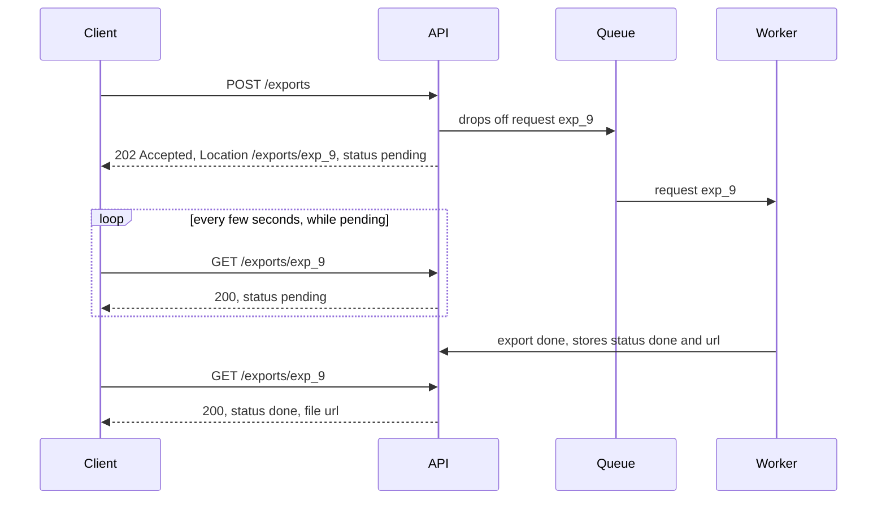

:material-book-open-variant: Reference docs: [Microsoft, Asynchronous Request-Reply pattern](https://learn.microsoft.com/en-us/azure/architecture/patterns/async-request-reply) (accessed November 2026); [RFC 9110, 202 Accepted](https://www.rfc-editor.org/rfc/rfc9110#section-15.3.3) (2022)
{ .doc-ref }

### Other styles, in one line
| Style      | Idea                                                          | When                                          |
|------------|---------------------------------------------------------------|-----------------------------------------------|
| <span class="term" data-term="graphql">GraphQL</span>    | a single URL, the client describes exactly the fields it wants ([details](#graphql)) | several frontends (website, mobile app) that each assemble data from several services their own way |
| <span class="term" data-term="grpc">gRPC</span>       | remote function calls, binary, very fast                      | internal services calling each other thousands of times per second |
| <span class="term" data-term="websocket">WebSocket</span>  | connection kept open in both directions                       | the server must push information without being asked, like a chat or live notifications |

:material-book-open-variant: Reference docs: [gRPC, Introduction](https://grpc.io/docs/what-is-grpc/introduction/) (accessed November 2026); [RFC 6455, The WebSocket Protocol](https://www.rfc-editor.org/rfc/rfc6455) (2011)
{ .doc-ref }
