# API : REST et asynchrone

!!! warning "Avertissement"
    Ces notes sont des pense-bêtes personnels, pas une source de vérité. Elles reflètent ma compréhension et mes choix : leur contenu reste subjectif, malgré les citations et les références qu'il contient. Il peut être incomplet, simplifié, inexact ou dépassé. Vérifiez toujours dans la documentation officielle avant de l'appliquer. Ce contenu est fourni tel quel, sans aucune garantie : son utilisation se fait sous votre seule responsabilité.

!!! abstract "Les échelles"
    Les pastilles de couleur sous les titres disent à quelle échelle une notion s'applique :

    - <span class="pill pill-scope pill-scope-code">Code</span> les classes, fonctions et modules d'un programme ;
    - <span class="pill pill-scope pill-scope-app">Application</span> un service ou une application et son découpage interne ;
    - <span class="pill pill-scope pill-scope-system">Système</span> plusieurs services qui communiquent par le réseau ;
    - <span class="pill pill-scope pill-scope-infra">Infrastructure</span> les serveurs, le réseau, les zones et les clusters, physiques ou virtuels ;
    - <span class="pill pill-scope pill-scope-enterprise">Entreprise</span> le système d'information entier et son organisation.

    Détail et mots ambigus : [carte des échelles](architecture.md#carte-des-echelles).

Deux services peuvent se parler de deux façons. Soit l'un **demande** et attend la réponse (<span class="term" data-term="rest-api">REST</span>, synchrone). Soit l'un **annonce** qu'il s'est passé quelque chose, et ceux que ça intéresse réagissent quand ils peuvent (messages et événements, asynchrone). Cette page explique les deux, GraphQL, comment les décrire (<span class="term" data-term="openapi">OpenAPI</span>, <span class="term" data-term="asyncapi">AsyncAPI</span>), et comment choisir.

Les services `orders-service`, `payment-service` et `email-service` sont fictifs.

:material-swap-horizontal: Les outils cités dans cette page : lesquels se remplacent, lesquels se combinent ? Voir [Complémentaires ou concurrents](outils.md#complementaires-ou-concurrents).
{ .doc-ref }

## Vocabulaire

**API** : la porte d'entrée d'un service pour les autres programmes. **Client** : le programme qui appelle. **Serveur** : celui qui répond.

**Synchrone** : le client attend la réponse avant de continuer, comme un appel téléphonique. **Asynchrone** : le client dépose un message et continue, comme un SMS : la réponse viendra plus tard, ou jamais.

```
synchrone   : orders-service  ── « paie 30 € » ──>  payment-service
                              <── « OK, payé » ───
              (orders-service attend pendant ce temps)

asynchrone  : orders-service  ── « commande 42 créée » ──>  [broker]
              (continue tout de suite)                          ├─> payment-service
                                                                └─> email-service
```

**Contrat** : la description de ce qu'une <span class="term" data-term="api">API</span> accepte et renvoie. **Schéma** : la forme attendue d'une donnée (<span class="term" data-term="api-field">champs</span>, types, champs obligatoires).

**JSON** : le format texte le plus courant pour les données échangées.
```json
{"id": 42, "status": "paid", "total_cents": 3000}
```

:material-book-open-variant: Doc de référence : [MDN, HTTP](https://developer.mozilla.org/en-US/docs/Web/HTTP) (consultée en novembre 2026)
{ .doc-ref }

## REST

<a class="pill pill-scope pill-scope-app" href="../architecture/#carte-des-echelles">Échelle · Application</a> <a class="pill pill-scope pill-scope-system" href="../architecture/#carte-des-echelles">Échelle · Système</a>

### Ressource et URL
<span class="pill pill-status pill-status-ok" title="Toujours valable, vérifié en novembre 2026">Valable · 11/2026</span>

En REST, on manipule des **ressources** (une commande, un client), chacune avec son adresse.

```
/orders              la collection des commandes
/orders/42           la commande 42
/orders/42/items     les articles de la commande 42
```
Les <span class="term" data-term="url">URL</span> sont des noms au pluriel, jamais des verbes : `/orders/42`, pas `/getOrder?id=42`.

:material-book-open-variant: Doc de référence : [Roy Fielding, thèse, chapitre 5 : REST](https://ics.uci.edu/~fielding/pubs/dissertation/rest_arch_style.htm) (2000)
{ .doc-ref }

### Les méthodes HTTP
<span class="pill pill-status pill-status-ok" title="Toujours valable, vérifié en novembre 2026">Valable · 11/2026</span>

| Méthode  | Rôle                               | Exemple                     | Idempotente ? |
|----------|------------------------------------|-----------------------------|---------------|
| `GET`    | lire                               | `GET /orders/42`            | oui           |
| `POST`   | créer, ou lancer une action        | `POST /orders`              | **non**       |
| `PUT`    | remplacer entièrement              | `PUT /orders/42`            | oui           |
| `PATCH`  | modifier une partie                | `PATCH /orders/42` `{"status": "cancelled"}` | pas forcément |
| `DELETE` | supprimer                          | `DELETE /orders/42`         | oui           |

**Idempotente** : envoyer la même <span class="term" data-term="http-request">requête</span> une ou dix fois donne le même résultat. `DELETE /orders/42` deux fois : la commande est supprimée, une seule fois. `POST /orders` deux fois : deux commandes. C'est pour ça qu'un `POST` rejoué par erreur (double clic, réseau qui renvoie) est dangereux, et qu'on lui ajoute un <span class="term" data-term="http-header">en-tête</span> `Idempotency-Key` :
```
POST /payments
Idempotency-Key: 7f3c9a2e-1b4d-4e8f-9a6c-2d5e8f1a3b7c
```
Le serveur garde la clé : si la même clé revient, il renvoie le premier résultat sans payer une deuxième fois.

!!! noob "As noob"
    Appuyer deux fois sur l'interrupteur « éteindre » laisse la lumière éteinte : c'est idempotent. Glisser deux fois une pièce dans un distributeur me donne deux canettes : ce ne l'est pas. La clé d'idempotence, c'est le numéro de ticket que le distributeur retient pour reconnaître qu'il a déjà servi cette demande. La phrase à retenir : **ce qui peut être rejoué par accident doit donner le même résultat la deuxième fois.**

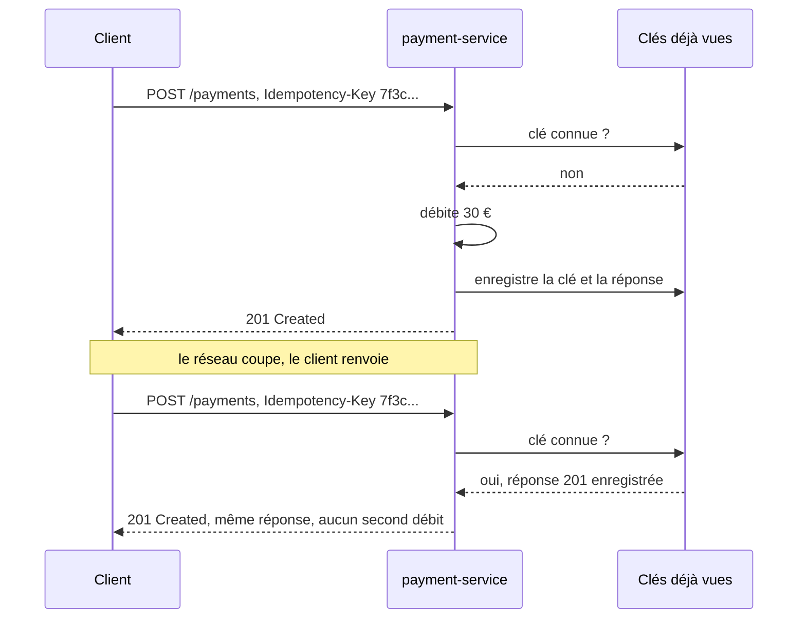

:material-book-open-variant: Doc de référence : [RFC 9110, HTTP Semantics, méthodes](https://www.rfc-editor.org/rfc/rfc9110#section-9) (2022) ; [IETF, The Idempotency-Key HTTP Header Field](https://datatracker.ietf.org/doc/draft-ietf-httpapi-idempotency-key-header/) (brouillon, consultée en novembre 2026)
{ .doc-ref }

### Les codes de réponse
<span class="pill pill-status pill-status-ok" title="Toujours valable, vérifié en novembre 2026">Valable · 11/2026</span>

| Code  | Sens                                    | Exemple                                         |
|-------|-----------------------------------------|-------------------------------------------------|
| `200` | OK                                      | `GET /orders/42` renvoie la commande            |
| `201` | créé                                    | `POST /orders` a créé la commande 43            |
| `204` | OK, sans contenu                        | `DELETE /orders/42`                             |
| `400` | requête mal formée                      | JSON invalide                                   |
| `401` | pas <span class="term" data-term="authentication">authentifié</span>                         | pas de <span class="term" data-term="token-oauth">jeton</span>, ou jeton expiré                   |
| `403` | authentifié mais pas <span class="term" data-term="authorization">autorisé</span>           | ada essaie de lire la commande de grace         |
| `404` | introuvable                             | `GET /orders/999`                               |
| `409` | conflit avec l'état actuel              | annuler une commande déjà livrée                |
| `422` | bien formée mais invalide               | `quantity: -3`                                  |
| `429` | trop de requêtes                        | <span class="term" data-term="rate-limit">limite de débit</span> atteinte                        |
| `500` | erreur interne                          | bug côté serveur                                |
| `502` | le service appelé derrière a mal répondu | `payment-service` a renvoyé une erreur         |
| `503` | indisponible pour l'instant             | <span class="term" data-term="database">base de données</span> injoignable                     |

La famille dit à qui est la faute : `4xx`, le client a mal demandé ; `5xx`, le serveur n'a pas su répondre.

Piège classique : mon API renvoie `200` avec `{"error": "not found"}` dans le <span class="term" data-term="http-body">corps</span>. Les clients, les outils de monitoring et les tests se fient au code, pas au texte : le front croit que tout va bien, le monitoring ne compte aucune erreur et les tests passent au vert.

:material-book-open-variant: Doc de référence : [RFC 9110, codes de statut](https://www.rfc-editor.org/rfc/rfc9110#section-15) (2022) ; [MDN, HTTP response status codes](https://developer.mozilla.org/en-US/docs/Web/HTTP/Status) (consultée en novembre 2026)
{ .doc-ref }

### Format d'erreur
<span class="pill pill-status pill-status-ok" title="Toujours valable, vérifié en novembre 2026">Valable · 11/2026</span>

Une forme standard existe : **Problem Details** (RFC 9457, 2023).
```json
{
  "type": "https://api.example.com/errors/out-of-stock",
  "title": "Out of stock",
  "status": 409,
  "detail": "Only 2 items of BK-0004 left, 5 requested.",
  "instance": "/orders/43"
}
```
Si chaque route invente sa propre forme d'erreur, l'équipe front doit écrire un traitement par route. Avec le même format partout, un seul bout de code suffit pour afficher toutes les erreurs, comme ce message de rupture de stock.

:material-book-open-variant: Doc de référence : [RFC 9457, Problem Details for HTTP APIs](https://www.rfc-editor.org/rfc/rfc9457) (2023)
{ .doc-ref }

### Pagination
<span class="pill pill-status pill-status-ok" title="Toujours valable, vérifié en novembre 2026">Valable · 11/2026</span>

Ma liste de commandes peut en contenir des millions : tout renvoyer d'un coup donnerait une réponse énorme et lente, pour un écran qui n'en affiche que vingt. On la renvoie donc par pages.

| Type     | Requête                              | Avantage                        | Limite                                        |
|----------|--------------------------------------|---------------------------------|-----------------------------------------------|
| <span class="term" data-term="offset-pagination">offset</span>   | `GET /orders?offset=40&limit=20`     | simple, on peut sauter à la page 5 | lent sur les grandes tables, éléments sautés ou doublés si des lignes sont ajoutées entre deux pages |
| <span class="term" data-term="cursor-pagination">curseur</span>  | `GET /orders?cursor=eyJpZCI6NjB9&limit=20` | stable et rapide           | on ne peut pas sauter directement à la page 5 |

!!! noob "As noob"
    L'offset, c'est dire « saute les 40 premières lignes de la liste » : si quelqu'un ajoute une ligne en haut entre deux pages, tout glisse et je revois un élément ou en rate un. Le curseur, c'est un marque-page posé sur le dernier élément lu : la page suivante repart juste après lui, quoi qu'il arrive au début de la liste. La phrase à retenir : **l'offset compte des positions, le curseur se souvient d'un élément.**

```json
{
  "data": [ ... 20 commandes ... ],
  "next_cursor": "eyJpZCI6ODB9"
}
```
Piège de test : un test qui lit `items[0]` dépend de l'ordre. Si la base renvoie un jour les lignes dans un autre ordre, le test échoue alors que rien n'est cassé. Toujours trier explicitement (`?sort=created_at`) ou chercher l'élément par son identifiant.

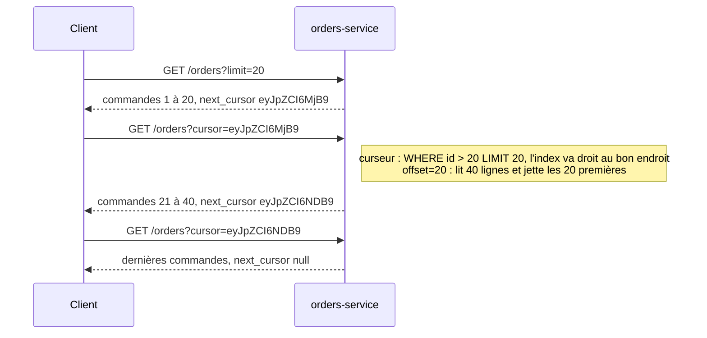

:material-book-open-variant: Doc de référence : [JSON:API, Pagination](https://jsonapi.org/format/#fetching-pagination) (version 1.1, 2022)
{ .doc-ref }

### Filtrer et trier
<span class="pill pill-status pill-status-ok" title="Toujours valable, vérifié en novembre 2026">Valable · 11/2026</span>

```
GET /orders?status=paid&created_after=2026-10-01&sort=-created_at
```
`-created_at` : du plus récent au plus ancien.

:material-book-open-variant: Doc de référence : [JSON:API, Sorting](https://jsonapi.org/format/#fetching-sorting) (version 1.1, 2022)
{ .doc-ref }

### Versionner
<span class="pill pill-status pill-status-ok" title="Toujours valable, vérifié en novembre 2026">Valable · 11/2026</span>

<a class="pill pill-practice" href="../api-rest-async/#api-management" title="niveau 1 : la pratique est en place, même à la main">Pratique · API management · N1</a>
<a class="pill pill-dora" href="https://dora.dev/capabilities/loosely-coupled-teams/">DORA · Loosely coupled teams</a>

Des applications appellent déjà mon API. Si je change la forme d'une réponse, par exemple en renommant un champ, elles plantent. Quand un changement casse ainsi les clients existants, il faut une nouvelle version.

| Changement                                 | Casse les clients ?         |
|--------------------------------------------|-----------------------------|
| ajouter un champ dans une réponse          | non, en général             |
| ajouter un paramètre optionnel             | non                         |
| renommer ou supprimer un champ             | **oui**                     |
| rendre obligatoire un paramètre optionnel  | **oui**                     |
| changer le type d'un champ (`int` en `string`) | **oui**                 |
| ajouter une valeur à un <span class="term" data-term="enum">enum</span>               | **peut-être** : un client qui ne la connaît pas peut planter |

Deux façons courantes :
```
GET /v2/orders/42                      (version dans l'URL, la plus lisible)
GET /orders/42   Accept: application/vnd.example.v2+json   (version dans un en-tête)
```
Pour retirer quelque chose sans casser personne : j'ajoute le nouveau à côté de l'ancien, je laisse les clients migrer, puis je retire l'ancien (« <span class="term" data-term="expand-contract">expand / contract</span> »). Par exemple, la réponse renvoie un temps `total` et `total_cents`, puis seulement `total_cents`. J'annonce la date de retrait avec les en-têtes `Deprecation` et `Sunset` (normalisés en 2025 et 2019).

:material-book-open-variant: Doc de référence : [RFC 9745, en-tête Deprecation](https://www.rfc-editor.org/rfc/rfc9745) (2025) ; [RFC 8594, en-tête Sunset](https://www.rfc-editor.org/rfc/rfc8594) (2019)
{ .doc-ref }

### OpenAPI
<span class="pill pill-status pill-status-ok" title="Toujours valable, vérifié en novembre 2026">Valable · 11/2026</span>

<a class="pill pill-practice" href="../api-rest-async/#api-management" title="niveau 3 : elle décide sans humain">Pratique · API management · N3</a>

Les équipes qui appellent mon API doivent savoir quelles routes existent, ce qu'elles acceptent et ce qu'elles renvoient, sans lire mon code. OpenAPI est le format standard pour l'écrire, en <span class="term" data-term="yaml">YAML</span> ou JSON. Le même fichier sert de documentation, de base pour générer des clients, et de contrat que les tests vérifient.

```yaml
# Exemple : contrat OpenAPI de la route GET /orders/{id} et du schéma Order
openapi: 3.1.0
info:
  title: Orders API
  version: 1.4.0
paths:
  /orders/{id}:
    get:
      parameters:
        - name: id
          in: path
          required: true
          schema: { type: integer }
      responses:
        "200":
          description: The order
          content:
            application/json:
              schema: { $ref: "#/components/schemas/Order" }
        "404":
          description: Unknown order
components:
  schemas:
    Order:
      type: object
      required: [id, status, total_cents]
      properties:
        id: { type: integer }
        status: { type: string, enum: [pending, paid, cancelled] }
        total_cents: { type: integer }
```

Bonne pratique : générer ce fichier **à partir du code** (FastAPI, NestJS le font), et vérifier en <span class="term" data-term="ci">CI</span> que le fichier commité est bien celui que le code produit. Un contrat écrit à la main finit par mentir : quelqu'un ajoute un champ dans le code, oublie le fichier, et la documentation annonce une forme que l'API ne renvoie plus.

:material-book-open-variant: Doc de référence : [OpenAPI Specification 3.1.0](https://spec.openapis.org/oas/v3.1.0) (2021)
{ .doc-ref }

### Linter un contrat OpenAPI
<span class="pill pill-status pill-status-ok" title="Toujours valable, vérifié en novembre 2026">Valable · 11/2026</span>

Un **<span class="term" data-term="api-linting">linter d'API</span>** relit le fichier OpenAPI comme ESLint relit du code : il vérifie des règles de forme (chemins en kebab-case, `operationId` présent, chaque erreur décrite) et signale les écarts avant que l'API soit codée ou publiée. L'outil le plus répandu est Spectral (Stoplight, open source, date de première version à vérifier) ; Redocly CLI fait la même chose.

*ESLint : complémentaire de Prettier*
{ .tool-rel }


**Pourquoi.** Dix équipes qui écrivent des API sans règle commune produisent dix styles : `/orderItems`, `/order_items`, des erreurs sans corps. Une guideline écrite dans un wiki n'est pas lue ; une règle qui casse la MR l'est.

**Quand.** Dès qu'il y a plusieurs API ou plusieurs équipes, et surtout en [API first](#api-first), où le contrat est relu avant le code. Pour une seule API interne, les règles par défaut suffisent.

**Comment.**

1. partir du jeu de règles standard, puis ajouter les règles de la maison, peu nombreuses ;
2. lancer le linter en CI sur chaque MR qui touche le contrat, en échec sur les erreurs seulement ;
3. compléter par une détection des changements cassants entre la version publiée et la nouvelle (oasdiff, par exemple) : le linter juge la forme, pas la compatibilité.

```yaml
# Exemple : le jeu de règles standard plus une règle maison (chemins en kebab-case)
extends: ["spectral:oas"]
rules:
  operation-operationId: error
  paths-kebab-case:
    description: Les chemins sont en kebab-case.
    severity: error
    given: "$.paths[*]~"
    then:
      function: pattern
      functionOptions:
        match: "^(/([a-z0-9-]+|\\{[a-zA-Z]+\\}))+$"
```

```
$ npx @stoplight/spectral-cli lint openapi.yaml --fail-severity=error
$ oasdiff breaking openapi-main.yaml openapi.yaml --fail-on ERR
```

Options et noms de commandes à vérifier dans la documentation de chaque outil.

| Je veux... | J'utilise... |
|---|---|
| que toutes les API de l'équipe se ressemblent (mêmes noms de champs, même format d'erreur) sans tout relire à la main en revue | un linter (Spectral, Redocly) lancé en CI, avec un jeu de règles partagé |
| qu'aucune application déjà branchée sur l'API ne casse quand quelqu'un modifie le contrat, par exemple en renommant un champ | une détection des changements cassants (oasdiff) entre la version publiée et celle de la MR |
| être sûr que le code fait ce que le contrat promet, par exemple qu'un champ annoncé obligatoire est toujours présent | un test de contrat (voir [Qualité](qualite.md#tests-de-contrat-et-mocks-dapi)) |

:material-book-open-variant: Doc de référence : [Spectral](https://github.com/stoplightio/spectral) (consultée en novembre 2026) ; [oasdiff](https://github.com/oasdiff/oasdiff) (consultée en novembre 2026)
{ .doc-ref }

### API first
<span class="pill pill-status pill-status-ok" title="Toujours valable, vérifié en novembre 2026">Valable · 11/2026</span>

<a class="pill pill-practice" href="../livraison/#concevoir-avant-de-coder" title="niveau 1 : la pratique est en place, même à la main">Pratique · Conception technique · N1</a> <a class="pill pill-practice" href="../api-rest-async/#api-management" title="niveau 1 : la pratique est en place, même à la main">Pratique · API management · N1</a>
<a class="pill pill-dora" href="https://dora.dev/capabilities/loosely-coupled-teams/">DORA · Loosely coupled teams</a> <a class="pill pill-dora" href="https://dora.dev/capabilities/documentation-quality/">DORA · Documentation quality</a>

<span class="term" data-term="api-first">API first</span> : on écrit le contrat **avant** le code, on le fait relire par ceux qui vont l'utiliser, puis tout le monde travaille en parallèle à partir de ce même fichier. L'inverse, « code first », écrit d'abord le code puis en génère le contrat.

```
code first   jours 1 à 10  le back code GET /orders/{id}
             jour 11       OpenAPI généré, le front découvre la forme des données
             jour 12       « il manque le champ currency » : retour au back

API first    jour 1        contrat OpenAPI écrit, relu par le front, le back et le QA
             jours 2 à 10  le back code la route, le front code sur un mock du contrat (Prism),
                           le QA écrit les tests de contrat
             jour 11       branchement : les deux côtés respectent déjà le même contrat
```

Ça ne contredit pas la bonne pratique ci-dessus : en API first, le contrat écrit en premier devient la référence, et la CI vérifie que l'OpenAPI produit par le code lui reste identique. La différence est le moment où l'on discute de la forme de l'API : avant le code, quand la changer ne coûte presque rien.

| Situation                                                   | API first | Code first |
|-------------------------------------------------------------|-----------|------------|
| mon API sera appelée par des gens que je ne peux pas prévenir facilement d'un changement, comme des partenaires ou le public | oui | |
| une équipe front et une équipe back veulent avancer en même temps, sans que le front attende que le back ait fini | oui | |
| plusieurs consommateurs (l'appli mobile, le site web, le service de facturation) doivent se mettre d'accord sur la forme de l'API avant que quiconque code | oui | |
| je fais seul, ou avec ma seule équipe, un prototype que je jetterai dans deux semaines | | oui |
| la route n'a qu'un seul client, qui vit dans le même repo et que je modifie dans la même MR | | oui |

Source : la règle « Follow API first principle » des [Zalando RESTful API Guidelines (première version en 2015, mises à jour en continu)](https://opensource.zalando.com/restful-api-guidelines/) (à vérifier).

### API management
<span class="pill pill-status pill-status-ok" title="Toujours valable, vérifié en novembre 2026">Valable · 11/2026</span>

<a class="pill pill-practice" href="../api-rest-async/#api-management" title="niveau 2 : elle est automatisée">Pratique · API management · N2</a>

J'ouvre mon API à des partenaires ou au public : je dois savoir qui appelle, freiner ceux qui abusent et leur permettre de démarrer seuls. L'<span class="term" data-term="api-management">API management</span> regroupe ce qu'on place devant des API pour ça : une <span class="term" data-term="api-gateway">passerelle</span> (gateway) qui reçoit tous les appels, des clés et des quotas par client, un portail développeur (documentation, demande de clé) et des statistiques d'usage. Outils courants : Kong, Apigee, AWS API Gateway, Azure API Management.

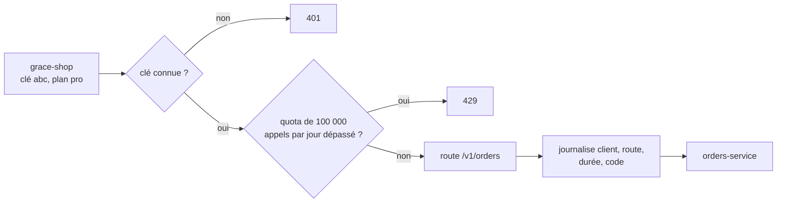

Le plan d'un client fixe ses quotas et, souvent, le <span class="term" data-term="sla">SLA</span> qu'on lui promet (voir [SLA et indisponibilité tolérée](observabilite.md#sla-et-indisponibilite-toleree-ita)) :

| Plan       | Quota               | SLA promis (exemple)            |
|------------|---------------------|---------------------------------|
| gratuit    | 1 000 appels/jour   | aucun                           |
| pro        | 100 000 appels/jour | 99,5 % par mois                 |
| entreprise | sur contrat         | 99,9 % par mois, avec pénalités |

La passerelle vérifie **qui** appelle, pas **ce qu'il a le droit de lire** : `orders-service` doit toujours vérifier que la commande 42 appartient bien à ce client. Sinon, un client muni d'une clé valide peut lire les commandes d'un autre.

Pour les tests : un test qui appelle `orders-service` directement ne voit ni les `401` ni les `429` de la passerelle. Il faut au moins quelques tests qui passent par elle, avec une clé de test.

| Situation                                                | Passerelle ou API management ?             |
|----------------------------------------------------------|--------------------------------------------|
| des partenaires ou le public appellent mon API, et je dois savoir qui appelle, combien de fois, et pouvoir couper un abus | oui : clés, quotas, portail, statistiques |
| plusieurs services se cachent derrière une seule adresse : `api.example.com/orders` mène au service commandes, `/users` au service utilisateurs | au moins une passerelle |
| je vends l'accès à mon API par formules (gratuit, pro, entreprise), chacune avec son quota | oui |
| deux services internes du même cluster se parlent, sans personne d'extérieur dans la boucle | souvent non : un appel direct suffit |

:material-book-open-variant: Doc de référence : [Chris Richardson, API Gateway pattern](https://microservices.io/patterns/apigateway.html) (consultée en novembre 2026)
{ .doc-ref }

### Tester une API REST
<span class="pill pill-status pill-status-ok" title="Toujours valable, vérifié en novembre 2026">Valable · 11/2026</span>

| Je veux vérifier...                                   | Comment                                              |
|-------------------------------------------------------|------------------------------------------------------|
| la route renvoie le bon code et le bon corps          | <span class="term" data-term="integration-test">test d'intégration</span> : vraie requête sur l'appli lancée |
| les erreurs : 401, 403, 404, 422                      | un test par cas, avec un vrai jeton (valide, expiré, mauvais droits) |
| la réponse respecte le contrat                        | <span class="term" data-term="schemathesis">schemathesis</span> ou une validation du schéma <span class="term" data-term="openapi">OpenAPI</span>     |
| le service appelé derrière tombe                      | <span class="term" data-term="mock">mock</span> par contrat (Microcks, Prism) qui renvoie 500   |
| un `POST` rejoué ne crée pas de doublon               | envoyer deux fois la même `Idempotency-Key`          |

```
$ curl -i -X POST localhost:8000/orders \
    -H 'Authorization: Bearer eyJ...' \
    -H 'Content-Type: application/json' \
    -d '{"items": [{"sku": "BK-0004", "quantity": 1}]}'
HTTP/1.1 201 Created
Location: /orders/43
```

:material-book-open-variant: Doc de référence : [Schemathesis](https://schemathesis.readthedocs.io/) (consultée en novembre 2026)
{ .doc-ref }

## GraphQL

<a class="pill pill-scope pill-scope-app" href="../architecture/#carte-des-echelles">Échelle · Application</a> <span class="pill pill-status pill-status-ok" title="Toujours valable, vérifié en novembre 2026">Valable · 11/2026</span>

<span class="term" data-term="graphql">GraphQL</span> est un autre style d'API synchrone, publié par Facebook en 2015 et confié à la GraphQL Foundation (Linux Foundation) en 2018. Trois différences avec REST :

- **une seule URL** (souvent `POST /graphql`) au lieu d'une URL par ressource ;
- le serveur publie un **schéma** typé de tout ce qu'on peut demander ;
- le **client** écrit une requête qui décrit exactement les champs voulus, et la réponse a la même forme que la requête.

!!! noob "As noob"
    Imaginons un formulaire de commande. En REST, chaque URL est un plat déjà composé : `GET /orders/42` me sert la commande avec tout ce que la cuisine a décidé d'y mettre. En GraphQL, je reçois la **liste de tous les ingrédients possibles** (le schéma) et je **coche** ceux que je veux. Le serveur me rend une assiette qui a exactement la forme de ce que j'ai coché.

    La phrase à retenir : **une requête GraphQL, c'est le JSON de la réponse sans les valeurs.** J'écris les clés, le serveur remplit les trous.

<div class="grid" markdown>

```graphql title="Ce que j'envoie : les clés"
# Exemple : je n'écris que les clés que je veux recevoir
query {
  order(id: "42") {
    status
    customer {
      name
    }
  }
}
```

```json title="Ce que je reçois : les mêmes clés, remplies"
{
  "data": {
    "order": {
      "status": "paid",
      "customer": {
        "name": "Ada"
      }
    }
  }
}
```

</div>

### Vocabulaire GraphQL

**Schéma** : le contrat du serveur, écrit en SDL (Schema Definition Language). Il liste les types, leurs champs, et les points d'entrée.
```graphql
# Exemple : les types de données que le serveur expose
type Order {
  id: ID!
  status: String!
  totalCents: Int!
  customer: Customer!
  items: [Item!]!
}

type Customer { id: ID!  name: String!  email: String!  orders: [Order!]! }
type Item     { sku: String!  name: String!  quantity: Int! }

# Exemple : les points d'entrée, en lecture (Query) et en écriture (Mutation)
type Query {
  order(id: ID!): Order
}

type Mutation {
  cancelOrder(id: ID!, reason: String): Order
}
```
Le `!` veut dire « jamais null ». `[Item!]!` : une liste toujours présente, dont aucun élément n'est null.

**Pourquoi « Graph ».** Le schéma est un graphe : chaque type est un nœud, chaque champ qui pointe vers un autre type est un lien. Une requête choisit un chemin dans ce graphe à partir d'un point d'entrée de `Query`. En couleur, le chemin pris par la requête `OrderPage` de la fiche commande ; en pointillé, un lien qui existe mais qu'elle n'emprunte pas.

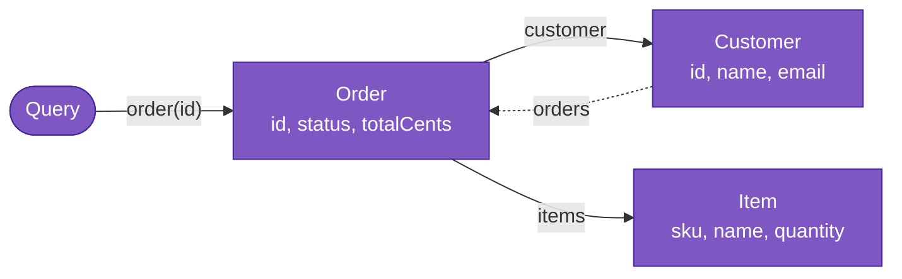

Le lien `Customer.orders` ramène vers `Order` : le graphe a des boucles. C'est pratique (« les autres commandes de ce client »), et c'est aussi ce qui permet les requêtes infiniment profondes vues plus bas.

**Query** : une lecture. **Mutation** : une écriture (créer, modifier, annuler). **Subscription** : un flux de mises à jour poussées par le serveur, souvent sur <span class="term" data-term="websocket">WebSocket</span>.

**Variables** : les paramètres de la requête, envoyés à part, comme les paramètres d'une requête SQL préparée.
```json
{
  "query": "query OrderPage($id: ID!) { order(id: $id) { status } }",
  "variables": {"id": "42"}
}
```

**Résolveur** : la fonction du serveur qui calcule un champ. Le serveur appelle le résolveur de `order`, puis celui de `customer` sur la commande obtenue, et ainsi de suite.
```python
# Exemple : résolveur du champ order, appelé en premier
def resolve_order(_, info, id):
    return orders_repo.get(id)

# Exemple : résolveur de customer, appelé sur la commande obtenue
def resolve_customer(order, info):
    return customers_repo.get(order.customer_id)
```

Ce que fait le serveur quand la requête `OrderPage` arrive :

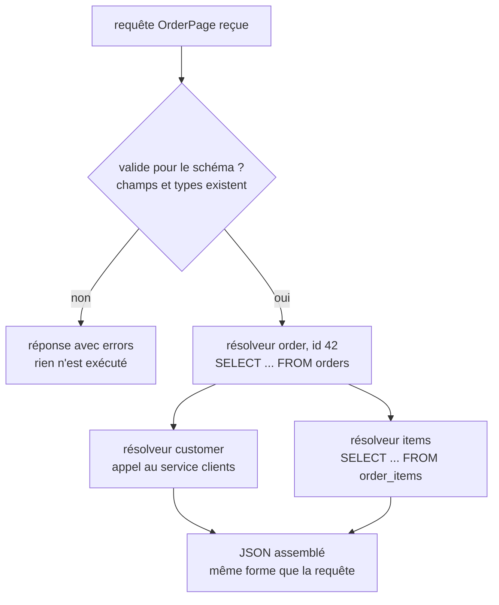

!!! noob "As noob"
    Le serveur ne lance pas « une grosse requête ». Il descend dans ma requête étage par étage et, pour chaque champ, appelle la petite fonction qui sait le chercher : le résolveur. Un champ simple comme `status` se lit directement sur l'objet déjà chargé ; un champ qui mène à un autre type comme `customer` déclenche une nouvelle recherche.

**<span class="term" data-term="over-fetching">Sur-récupération</span>** (over-fetching) : recevoir plus de champs que ce que l'écran affiche. **<span class="term" data-term="under-fetching">Sous-récupération</span>** (under-fetching) : devoir faire plusieurs appels pour réunir ce qu'un écran affiche. GraphQL est né pour résoudre ces deux problèmes sur mobile.

:material-book-open-variant: Doc de référence : [GraphQL, Learn](https://graphql.org/learn/) (consultée en novembre 2026)
{ .doc-ref }

### Le même besoin en REST et en GraphQL

L'écran « fiche commande » affiche le statut, le total, le nom du client, et le nom et la quantité de chaque article.

**En REST**, trois appels, dont deux qui dépendent du premier :
```
GET /orders/42
200 {"id": 42, "status": "paid", "total_cents": 3000, "customer_id": 7,
     "created_at": "2026-11-02T10:00:00Z", "shipping_address": {...}, "billing_address": {...}}

GET /customers/7
200 {"id": 7, "name": "Ada", "email": "ada@example.com", "phone": "...", "addresses": [...]}

GET /orders/42/items
200 [{"sku": "BK-0004", "name": "Livre", "quantity": 1, "unit_price_cents": 3000, "weight_g": 450}]
```
L'écran attend trois allers-retours (sous-récupération) et reçoit les adresses, le téléphone et le poids dont il n'a pas besoin (sur-récupération).

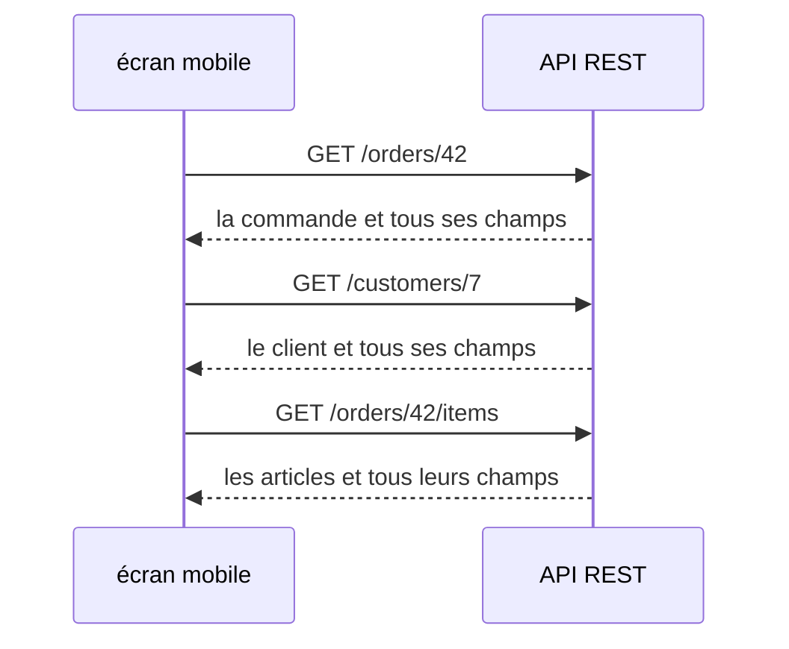

**En GraphQL**, un seul appel :
```graphql
# Ce qui change : un seul appel au lieu de trois, et seulement les champs affichés
query OrderPage($id: ID!) {
  order(id: $id) {
    status
    totalCents
    customer { name }
    items { name quantity }
  }
}
```
```json
{
  "data": {
    "order": {
      "status": "paid",
      "totalCents": 3000,
      "customer": {"name": "Ada"},
      "items": [{"name": "Livre", "quantity": 1}]
    }
  }
}
```
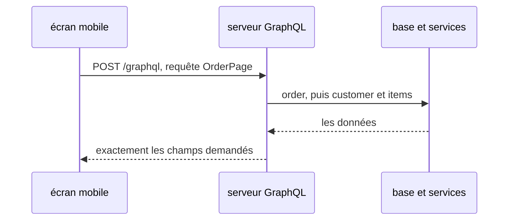

!!! noob "As noob"
    GraphQL ne fait pas disparaître les trois recherches : il les **déplace côté serveur**, près des données, où un appel coûte quelques millisecondes au lieu d'un aller-retour sur un réseau mobile. Et il ne renvoie que ce que l'écran affiche.

Un écran mobile qui n'affiche que le statut demande seulement `order(id: $id) { status }`, sans nouvelle route côté serveur.

La solution REST équivalente est souvent un <span class="term" data-term="bff">BFF</span> : une route `GET /screens/order-page/42` écrite pour cet écran, qui fait les trois appels côté serveur.

**Écrire** : la mutation remplace `POST /orders/42/cancel`.
```graphql
# Exemple : la mutation qui remplace POST /orders/42/cancel
mutation {
  cancelOrder(id: "42", reason: "client") { id status }
}
```
```json
{"data": {"cancelOrder": {"id": "42", "status": "cancelled"}}}
```
Une mutation n'est pas <span class="term" data-term="idempotency">idempotente</span> par défaut : l'en-tête `Idempotency-Key` vu plus haut reste utile.

### Ce qui change par rapport à REST

| Sujet              | REST                                          | GraphQL                                            |
|--------------------|-----------------------------------------------|----------------------------------------------------|
| adresse            | une URL par ressource : `/orders/42`          | une seule : `/graphql`                             |
| méthode HTTP       | `GET`, `POST`, `PUT`, `PATCH`, `DELETE`       | presque toujours `POST`                            |
| forme de la réponse | fixée par le serveur                         | choisie par le client, champ par champ             |
| erreurs            | code HTTP : 404, 403, 422...                  | souvent `200`, avec un tableau `errors` dans le corps |
| cache HTTP, CDN    | natif sur `GET` (l'URL sert de clé)            | ne marche plus tel quel : même URL pour tout        |
| nouvelle version   | `/v2/orders`                                  | on ajoute des champs, on marque les anciens `@deprecated` |
| contrat            | <span class="term" data-term="openapi">OpenAPI</span> | le schéma SDL, que le client peut lire (introspection) |

**Les erreurs.** Si la commande 43 n'existe pas, REST répond `404`. Un serveur GraphQL répond souvent `200` :
```json
{
  "data": {"order": null},
  "errors": [{
    "message": "Order 43 not found",
    "path": ["order"],
    "extensions": {"code": "NOT_FOUND"}
  }]
}
```
!!! noob "As noob"
    En GraphQL, un `200` veut souvent dire « j'ai bien reçu et compris ta requête », pas « tout s'est bien passé ». Le vrai résultat se lit dans le corps : `data` pour ce qui a marché, `errors` pour ce qui a raté. Un test qui ne vérifie que le code HTTP laisse passer les erreurs.

La réponse peut aussi être **partielle** : la commande revient, mais `customer` vaut `null` parce que le service clients a échoué, avec une entrée dans `errors`. Le projet de spécification « GraphQL over HTTP » (en cours, à vérifier) recommande des codes 4xx pour les requêtes invalides avec le type `application/graphql-response+json`, mais beaucoup de serveurs répondent encore `200` dans tous les cas.

**Introspection** : le client peut demander le schéma au serveur lui-même (`{ __schema { types { name } } }`). C'est ce qui alimente l'autocomplétion des outils. Sur une API publique, on la désactive souvent en production pour ne pas exposer tout le schéma.

:material-book-open-variant: Doc de référence : [GraphQL, Serving over HTTP](https://graphql.org/learn/serving-over-http/) (consultée en novembre 2026)
{ .doc-ref }

### Les pièges côté serveur

**Le <span class="term" data-term="n-plus-one">problème N+1</span>.** La requête `orders(last: 50) { customer { name } }` appelle le résolveur `customer` 50 fois :
```
-- À éviter : une requête par client, donc 51 requêtes pour 50 commandes
SELECT * FROM orders ORDER BY id DESC LIMIT 50;
SELECT * FROM customers WHERE id = 7;
SELECT * FROM customers WHERE id = 9;
... (50 fois)
```
La parade est un **DataLoader** (Facebook, 2015) : il regroupe les chargements d'une même requête en un seul appel.

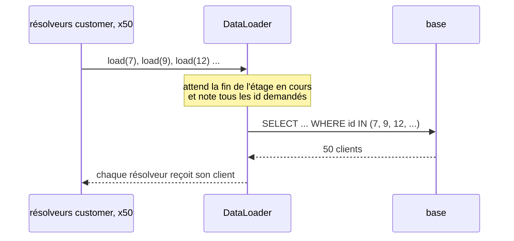

!!! noob "As noob"
    Je demande 50 commandes avec le nom du client : sans précaution, le serveur fait 50 fois « va chercher le client n ». Le DataLoader est un assistant qui note les 50 demandes, puis fait **une seule course** avec la liste complète.
```
-- Ce qui change : avec le DataLoader, un seul SELECT ... IN pour les 50 clients
SELECT * FROM orders ORDER BY id DESC LIMIT 50;
SELECT * FROM customers WHERE id IN (7, 9, 12, ...);
```

**Les requêtes trop coûteuses.** Le client choisit la requête, donc il peut en écrire une énorme :
```graphql
# À éviter : requête trop profonde et coûteuse, le serveur doit la refuser
{ customers { orders { customer { orders { customer { orders { id } } } } } } }
```
Parades : limiter la profondeur (par exemple 6 niveaux), calculer un coût par champ et refuser au-delà d'un budget, ou n'accepter que des **requêtes persistées** : le client envoie l'empreinte d'une requête enregistrée à l'avance, pas un texte libre.

**Le cache.** Tout passe par `POST /graphql`, donc un CDN ne peut plus mettre en cache par URL. Les requêtes persistées envoyées en `GET` (`/graphql?id=a1b2c3&variables=...`) redonnent une URL stable. Côté client, les bibliothèques comme Apollo Client gardent un cache par objet (`Order:42`).

**Les droits par champ.** Le même objet est accessible par plusieurs chemins : `order(id: 42) { customer { email } }` et `customer(id: 7) { email }`. Si le contrôle d'accès n'est fait que sur le point d'entrée `customer`, l'email fuit par `order`. Le contrôle se fait dans le résolveur du champ ou dans la couche métier, pas seulement à l'entrée.

### Tester une API GraphQL
<span class="pill pill-status pill-status-ok" title="Toujours valable, vérifié en novembre 2026">Valable · 11/2026</span>

| Je veux vérifier...                                  | Comment                                                       |
|------------------------------------------------------|---------------------------------------------------------------|
| la requête renvoie les bonnes données                | vérifier `data` **et** l'absence de `errors`, pas seulement le `200` |
| une erreur métier                                    | vérifier `errors[0].extensions.code` et `path`                |
| une réponse partielle                                | <span class="term" data-term="mock">mock</span> du service clients qui échoue : `customer` vaut `null`, une erreur dans `errors` |
| le schéma ne casse pas les clients                   | comparer le schéma de la branche à celui de `main` (GraphQL Inspector, par exemple) : un champ supprimé ou rendu obligatoire casse les clients |
| pas de N+1                                           | compter les requêtes SQL pendant le test : 2, pas 51          |
| les requêtes trop profondes sont refusées            | envoyer une requête de 10 niveaux, attendre une erreur        |
| les droits                                           | demander le même champ sensible par deux chemins différents   |

```python
# Exemple : la requête GraphQL envoyée par le test
ORDER_PAGE = """
query OrderPage($id: ID!) {
  order(id: $id) { status customer { name } }
}
"""

# Bien : vérifie le 200, l'absence de errors et les données
def test_order_page(client):
    resp = client.post("/graphql", json={"query": ORDER_PAGE, "variables": {"id": "42"}})
    body = resp.json()
    assert resp.status_code == 200
    assert "errors" not in body
    assert body["data"]["order"] == {"status": "paid", "customer": {"name": "Ada"}}
```

```
$ curl -s localhost:8000/graphql \
    -H 'Content-Type: application/json' \
    -d '{"query": "{ order(id: \"42\") { status } }"}'
{"data":{"order":{"status":"paid"}}}
```

### REST ou GraphQL ?

!!! noob "As noob"
    GraphQL brille quand **plusieurs consommateurs (un site web, une appli mobile) veulent chacun un morceau différent des mêmes données**, réparties dans plusieurs services. Pour une API simple, publique ou très mise en cache, REST reste plus facile à appeler, à cacher et à surveiller.

| Situation                                                        | Plutôt                    |
|------------------------------------------------------------------|---------------------------|
| des partenaires ou le public appellent mon API avec leurs propres outils, que je ne connais pas | REST : tout le monde sait l'appeler et la mettre en cache |
| j'ai un seul site web, avec quelques écrans, fait par la même équipe que l'API | REST |
| j'ai plusieurs consommateurs aux besoins différents, sur un site web ou sur une appli mobile, qui veulent des combinaisons différentes des mêmes données : la liste des commandes du site affiche le client, l'adresse et le détail des articles, celle de l'appli seulement le numéro, le statut et le total | GraphQL, ou REST + BFF (une petite API taillée pour chaque front) |
| un même écran a besoin de données rangées dans plusieurs services, comme une page commande qui réunit la commande, le client et le suivi de livraison | GraphQL |
| je sers des fichiers ou de gros volumes, ou je compte beaucoup sur le cache d'un CDN, comme des images produit ou des exports CSV | REST |
| ce sont des services internes qui s'appellent entre eux, sans écran au bout | REST ou <span class="term" data-term="grpc">gRPC</span>, rarement GraphQL |

Sources : [spécification GraphQL](https://spec.graphql.org/) (première version publique en 2015, éditions successives, la dernière à vérifier sur le site), [GraphQL over HTTP](https://graphql.github.io/graphql-over-http/) (projet de spécification, date de publication non indiquée), [DataLoader](https://github.com/graphql/dataloader) (Facebook, 2015).

## Asynchrone : messages et événements

<a class="pill pill-scope pill-scope-system" href="../architecture/#carte-des-echelles">Échelle · Système</a> <a class="pill pill-scope pill-scope-infra" href="../architecture/#carte-des-echelles">Échelle · Infrastructure</a>

### Message, événement, commande
- **Message** : n'importe quelle donnée envoyée d'un service à un autre via un intermédiaire.
- **Événement** : un message qui dit **ce qui s'est passé**, au passé. L'émetteur ne sait pas qui l'écoute. `OrderCreated`, `PaymentFailed`.
- **Commande** : un message qui demande **de faire** quelque chose, à un destinataire précis. `SendConfirmationEmail`.

```json
{
  "type": "OrderCreated",
  "id": "evt_01J9Z3",
  "occurred_at": "2026-10-20T10:42:00Z",
  "data": {"order_id": 42, "customer_id": 7, "total_cents": 3000}
}
```

:material-book-open-variant: Doc de référence : [Hohpe et Woolf, Event Message](https://www.enterpriseintegrationpatterns.com/patterns/messaging/EventMessage.html) (2003) ; [Command Message](https://www.enterpriseintegrationpatterns.com/patterns/messaging/CommandMessage.html) (2003)
{ .doc-ref }

### Broker, producteur, consommateur
- **Broker** : le service intermédiaire qui reçoit, stocke et distribue les messages. RabbitMQ, <span class="term" data-term="kafka">Kafka</span>, Google Pub/Sub, Amazon SQS.
- **Producteur** : celui qui publie.
- **Consommateur** : celui qui lit et traite.

:material-book-open-variant: Doc de référence : [Hohpe et Woolf, Message Broker](https://www.enterpriseintegrationpatterns.com/patterns/messaging/MessageBroker.html) (2003)
{ .doc-ref }

### File (queue) ou sujet (topic)
<span class="pill pill-status pill-status-ok" title="Toujours valable, vérifié en novembre 2026">Valable · 11/2026</span>

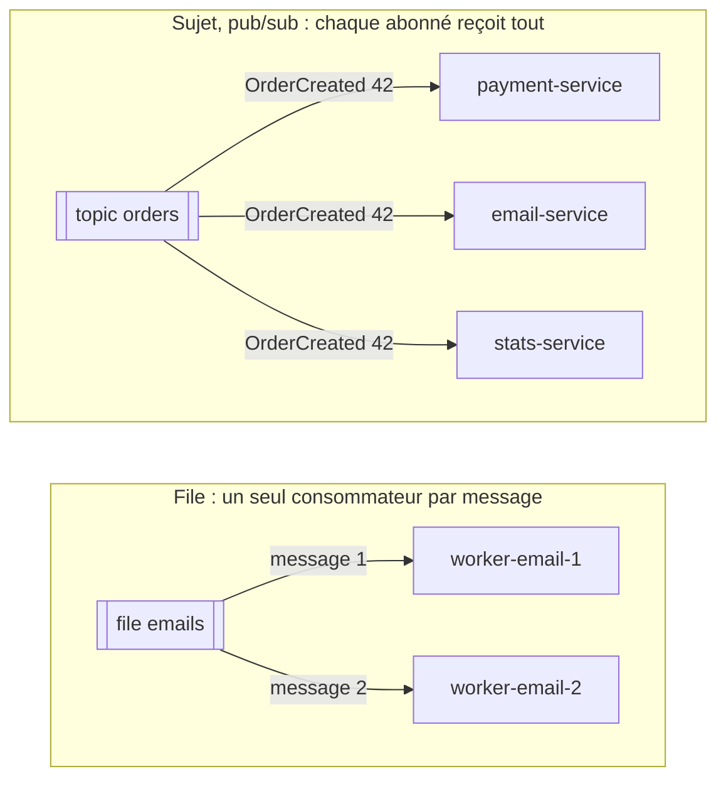

J'ai des milliers d'e-mails à envoyer et deux workers pour le faire : une file leur répartit le travail, et chaque e-mail part une seule fois. Une commande créée doit être connue du paiement, de l'envoi d'e-mails et des statistiques : un sujet prévient chacun de ces services du même fait.

!!! noob "As noob"
    Une file, c'est une pile de colis à livrer partagée entre plusieurs livreurs : chaque colis part avec un seul livreur. Un sujet, c'est un journal distribué par abonnement : chaque abonné reçoit son propre exemplaire. La phrase à retenir : **file pour se partager le travail, sujet pour que tout le monde soit prévenu.**

:material-book-open-variant: Doc de référence : [Point-to-Point Channel](https://www.enterpriseintegrationpatterns.com/patterns/messaging/PointToPointChannel.html) (2003) ; [Publish-Subscribe Channel](https://www.enterpriseintegrationpatterns.com/patterns/messaging/PublishSubscribeChannel.html) (2003)
{ .doc-ref }

### Garanties de livraison
<span class="pill pill-status pill-status-ok" title="Toujours valable, vérifié en novembre 2026">Valable · 11/2026</span>

| Garantie          | Sens                                            | Conséquence                                  |
|-------------------|-------------------------------------------------|----------------------------------------------|
| <span class="term" data-term="at-most-once">at-most-once</span>      | au plus une fois                                | un message peut être perdu                   |
| <span class="term" data-term="at-least-once">at-least-once</span>     | au moins une fois                               | un message peut arriver **deux fois**        |
| <span class="term" data-term="exactly-once">exactly-once</span>      | exactement une fois                             | rare, coûteux, souvent limité à un seul système |

La plupart des brokers sont en **at-least-once**. Donc chaque consommateur doit être **<span class="term" data-term="idempotency">idempotent</span>** : traiter deux fois le même message ne doit pas avoir deux effets.

!!! noob "As noob"
    Le broker se comporte comme un facteur prudent : s'il n'est pas sûr que ma lettre est arrivée, il en redépose une copie. Je ne perds rien, mais je peux recevoir deux fois la même lettre, donc c'est à moi de reconnaître celle que j'ai déjà lue. La phrase à retenir : **« au moins une fois » veut dire « parfois deux » : le consommateur doit tolérer les doublons.**

```python
# Bien : consommateur idempotent, un événement déjà traité est ignoré
def handle_order_created(event):
    if processed_events.exists(event["id"]):
        return
    send_confirmation_email(event["data"]["order_id"])
    processed_events.add(event["id"])
```
Sans ce contrôle, le client reçoit deux mails de confirmation, ou pire, est débité deux fois.

:material-book-open-variant: Doc de référence : [Apache Kafka, Message Delivery Semantics](https://kafka.apache.org/documentation/#semantics) (consultée en novembre 2026)
{ .doc-ref }

### Accusé de réception (ack)
<span class="pill pill-status pill-status-ok" title="Toujours valable, vérifié en novembre 2026">Valable · 11/2026</span>

Le consommateur dit au broker « c'est traité » seulement **après** avoir fini. S'il plante avant, le broker redonne le message à quelqu'un d'autre.

!!! noob "As noob"
    C'est un recommandé avec accusé de réception, signé seulement une fois le contenu traité, pas à l'ouverture de l'enveloppe. Tant que la signature n'est pas revenue, l'expéditeur considère que le courrier n'est pas arrivé et le renverra. La phrase à retenir : **on confirme après avoir fini, jamais avant.**

```
1. reçoit OrderCreated 42
2. envoie l'email
3. ack            (si le worker plante avant cette étape, le message sera redistribué)
```

:material-book-open-variant: Doc de référence : [RabbitMQ, Consumer Acknowledgements and Publisher Confirms](https://www.rabbitmq.com/docs/confirms) (consultée en novembre 2026)
{ .doc-ref }

### File des messages morts (DLQ)
<span class="pill pill-status pill-status-ok" title="Toujours valable, vérifié en novembre 2026">Valable · 11/2026</span>

Un message échoue à chaque tentative, à cause d'une donnée invalide ou d'un bug. Si on le réessaie sans fin, il bloque la file pour toujours et les messages derrière lui n'avancent plus. Après N essais, il part dans une **dead letter queue** : on le met de côté pour l'analyser, et les autres messages continuent.

!!! noob "As noob"
    Au guichet, un client dont le dossier coince à chaque essai bloque toute la file derrière lui. On le fait passer dans un bureau à part, la file avance, et quelqu'un vient étudier son dossier. La phrase à retenir : **la DLQ met de côté ce qui bloque, mais quelqu'un doit aller la regarder.**

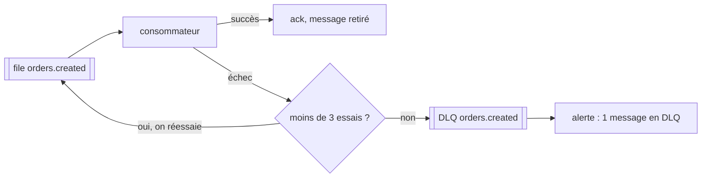
Une <span class="term" data-term="dead-letter-queue">DLQ</span> qui grossit sans que personne ne la regarde, ce sont des commandes perdues en silence. Il faut une alerte dessus.

### Ordre des messages
<span class="pill pill-status pill-status-ok" title="Toujours valable, vérifié en novembre 2026">Valable · 11/2026</span>

Quatre mots de Kafka (les autres brokers ont des équivalents) :

- **Topic** : un journal nommé où l'on publie, par exemple `orders.events`.
- **Partition** : un topic est découpé en plusieurs journaux indépendants, lus en parallèle. Chaque message va dans une seule partition.
- **Offset** : la position d'un message dans sa partition (0, 1, 2...). Le broker ne supprime pas un message lu : c'est le consommateur qui retient jusqu'où il a lu.
- **Groupe de consommateurs** (consumer group) : un ensemble d'instances d'un même service qui se partagent les partitions. Chaque groupe garde **ses propres offsets**, donc chaque service lit tout le topic à son rythme et peut revenir en arrière pour rejouer.

!!! noob "As noob"
    Imaginons un journal découpé en plusieurs cahiers (les partitions), chacun numéroté page par page (les offsets). Chaque service qui le lit est un groupe de lecteurs qui se répartissent les cahiers et posent leur propre marque-page : un service peut avoir fini pendant qu'un autre en est encore au début, ou revient en arrière pour relire. La phrase à retenir : **le journal reste en place, chaque groupe avance avec son propre marque-page.**

```
topic orders.events, 3 partitions, clé = order_id

producteur : send(key=42, OrderCreated)    hash(42) % 3 = 1
             send(key=42, OrderPaid)       même clé, même partition 1
             send(key=7,  OrderCreated)    hash(7) % 3 = 0

partition 0 : [7:Created]
partition 1 : [42:Created] [42:Paid] [42:Cancelled]
               offset 0     offset 1   offset 2
partition 2 : [13:Created] [13:Paid]

groupe billing   : partition 1 lue jusqu'à l'offset 2
groupe warehouse : partition 1 lue jusqu'à l'offset 0  (en retard, ou en train de rejouer)
```

L'ordre est garanti **à l'intérieur d'une partition seulement**. Entre deux partitions, aucun ordre : la commande 7 et la commande 42 peuvent être traitées dans n'importe quel ordre, ce qui est acceptable. Ce qui ne l'est pas, c'est `OrderCancelled 42` traité avant `OrderCreated 42` : d'où la <span class="term" data-term="partition-key">clé de partition</span> `order_id`, qui met tous les événements d'une commande dans la même partition. Sans clé, le producteur répartit les messages au hasard (ou en tourniquet) et l'ordre par commande est perdu. Même problème avec une file classique lue par plusieurs workers en parallèle.

Deuxième parade, quand l'ordre ne peut pas être garanti (plusieurs producteurs, rejeu, autre broker) : un **numéro de version** dans l'événement, et le consommateur ignore tout ce qui n'est pas plus récent que ce qu'il a déjà appliqué.

```json
{"type": "OrderCancelled", "order_id": 42, "version": 3}
```

```python
# Bien : ignore un événement qui n'est pas plus récent que la version appliquée
def handle(event):
    last = versions.get(event["order_id"], 0)
    if event["version"] <= last:
        return  # déjà vu, ou plus ancien que l'état connu
    apply(event)
    versions[event["order_id"]] = event["version"]
```

| Besoin                                   | Parade                                   |
|------------------------------------------|------------------------------------------|
| les messages d'une même commande (ou d'un même client) doivent être traités dans l'ordre : « créée » avant « payée » avant « expédiée » | clé de partition = id de l'entité |
| tous les messages du topic doivent être traités dans l'ordre exact d'arrivée, toutes entités confondues | une seule partition (on perd le parallélisme) |
| un message peut arriver en retard, en double ou être rejoué, comme un vieux « payée » qui arrive après « annulée » | numéro de version, ignorer `<=` dernier |

:material-book-open-variant: Doc de référence : [Apache Kafka, Introduction](https://kafka.apache.org/intro) (consultée en novembre 2026)
{ .doc-ref }

### Le piège de l'écriture puis de la publication
<span class="pill pill-status pill-status-ok" title="Toujours valable, vérifié en novembre 2026">Valable · 11/2026</span>

```
1. orders-service enregistre la commande en base     OK
2. orders-service publie OrderCreated                ÉCHEC (broker injoignable)
résultat : la commande existe, mais aucun autre service n'est prévenu
```
Inverser les deux étapes ne règle rien : si la publication réussit et que l'écriture en base échoue, les autres services sont prévenus d'une commande qui n'existe pas.

La solution s'appelle le motif **<span class="term" data-term="outbox-pattern">outbox</span>** (décrit par Chris Richardson, "Microservices Patterns", 2018) : l'événement est écrit en base dans la **même <span class="term" data-term="db-transaction">transaction</span>** que la commande, dans une table `outbox`. Les deux lignes existent, ou aucune.

!!! noob "As noob"
    Au lieu de poster la lettre moi-même juste après avoir rempli le dossier, au risque d'oublier, je glisse la lettre dans le dossier, et un coursier passe régulièrement poster tout ce qu'il y trouve. Le dossier et la lettre sont rangés ensemble ou pas du tout, et le coursier peut poster deux fois la même lettre s'il est interrompu. La phrase à retenir : **on enregistre l'événement avec la donnée, et on le publie ensuite.**

```sql
-- Bien : la table outbox, où l'événement attend d'être publié
CREATE TABLE outbox (
    id           UUID PRIMARY KEY,
    topic        TEXT NOT NULL,
    payload      JSONB NOT NULL,
    published_at TIMESTAMPTZ          -- NULL tant que non publié
);

-- Bien : commande et événement dans la même transaction, les deux ou aucun
BEGIN;
INSERT INTO orders (id, customer_id, total_cents) VALUES (42, 7, 3000);
INSERT INTO outbox (id, topic, payload)
VALUES ('6f1c...', 'orders.events',
        '{"type": "OrderCreated", "order_id": 42, "version": 1}');
COMMIT;
```

Un processus séparé, le **relais**, lit ensuite la table et publie. Deux façons de faire :

- **Polling** : il interroge la table à intervalle régulier.
- **<span class="term" data-term="cdc">CDC</span>** : un outil comme <span class="term" data-term="debezium">Debezium</span> lit le journal de la base et publie chaque ligne insérée dans `outbox`, sans requête de polling.

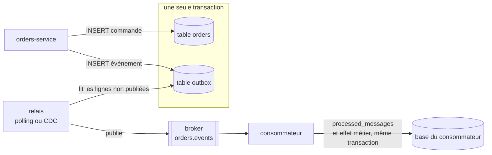
```python
# Exemple : relais par polling, publie puis marque la ligne comme publiée
while True:
    rows = db.query("SELECT * FROM outbox WHERE published_at IS NULL ORDER BY id LIMIT 100")
    for row in rows:
        broker.publish(row.topic, key=row.payload["order_id"], value=row.payload, headers={"message_id": row.id})
        db.execute("UPDATE outbox SET published_at = now() WHERE id = %s", row.id)
    sleep(1)
```

Conséquence : si le relais plante entre `publish` et `UPDATE`, il republiera la même ligne au redémarrage. La livraison est donc **at-least-once**, et le consommateur doit être idempotent. Le plus sûr est de le faire en base, avec une contrainte d'unicité sur l'identifiant du message, dans la même transaction que l'effet métier :

```sql
-- Bien : l'unicité sur message_id bloque un second traitement
CREATE TABLE processed_messages (
    message_id   UUID PRIMARY KEY,   -- l'unicité bloque le doublon
    processed_at TIMESTAMPTZ NOT NULL DEFAULT now()
);
```

```python
# Bien : dédoublonnage et effet métier dans la même transaction
def handle_order_created(msg):
    with db.transaction():
        inserted = db.execute(
            "INSERT INTO processed_messages (message_id) VALUES (%s) ON CONFLICT DO NOTHING",
            msg.headers["message_id"],
        ).rowcount
        if inserted == 0:
            return  # doublon : déjà traité, on ne refait rien
        create_invoice(msg.value["order_id"])
```

Si `create_invoice` échoue, la transaction est annulée, la ligne de `processed_messages` aussi, et le message pourra être retraité.

:material-book-open-variant: Doc de référence : [Chris Richardson, Transactional outbox](https://microservices.io/patterns/data/transactional-outbox.html) (consultée en novembre 2026) ; [Debezium, Outbox Event Router](https://debezium.io/documentation/reference/stable/transformations/outbox-event-router.html) (consultée en novembre 2026)
{ .doc-ref }

### AsyncAPI
<span class="pill pill-status pill-status-ok" title="Toujours valable, vérifié en novembre 2026">Valable · 11/2026</span>

Mon service publie des événements, et trois autres services les lisent : chacun doit savoir sur quel canal écouter et quels champs il va recevoir. AsyncAPI est l'équivalent d'OpenAPI pour les messages : il décrit les <span class="term" data-term="message-channel">canaux</span>, les messages et leur schéma.

```yaml
# Exemple : contrat AsyncAPI de l'événement OrderCreated publié sur orders.created
asyncapi: 3.0.0
info:
  title: Orders events
  version: 1.0.0
channels:
  orderCreated:
    address: orders.created
    messages:
      OrderCreated:
        payload:
          type: object
          required: [order_id, customer_id, total_cents]
          properties:
            order_id: { type: integer }
            customer_id: { type: integer }
            total_cents: { type: integer }
operations:
  publishOrderCreated:
    action: send
    channel:
      $ref: "#/channels/orderCreated"
```
Il sert de contrat entre producteur et consommateurs : si le producteur change le schéma, par exemple en renommant `order_id`, un <span class="term" data-term="contract-test">test de contrat</span> doit casser avant la <span class="term" data-term="production-env">production</span>, pas les consommateurs après.

:material-book-open-variant: Doc de référence : [AsyncAPI Specification 3.0.0](https://www.asyncapi.com/docs/reference/specification/v3.0.0) (2023)
{ .doc-ref }

### Webhook
<span class="pill pill-status pill-status-ok" title="Toujours valable, vérifié en novembre 2026">Valable · 11/2026</span>

Je veux savoir quand un paiement a réussi chez mon prestataire, sans lui demander toutes les minutes « alors, c'est payé ? ». Avec un webhook, c'est lui qui appelle **mon** URL quand l'événement se produit. C'est un intermédiaire entre les deux styles : un événement, transporté en <span class="term" data-term="http">HTTP</span>.
```
POST https://my-api.example.com/webhooks/payments
X-Signature: sha256=8f3a...
{"type": "payment.succeeded", "payment_id": "pay_123"}
```
Trois règles. Toujours vérifier la <span class="term" data-term="webhook-signature">signature</span> : sans elle, n'importe qui peut appeler l'URL et me faire croire qu'un paiement a réussi. Répondre vite (`200`) et traiter ensuite, sinon l'expéditeur peut croire à un échec et renvoyer. Accepter de recevoir le même webhook deux fois.

:material-book-open-variant: Doc de référence : [Standard Webhooks](https://www.standardwebhooks.com/) (consultée en novembre 2026)
{ .doc-ref }

### Tester l'asynchrone
<span class="pill pill-status pill-status-ok" title="Toujours valable, vérifié en novembre 2026">Valable · 11/2026</span>

| Je veux vérifier...                                     | Comment                                                       |
|---------------------------------------------------------|---------------------------------------------------------------|
| le message publié a la bonne forme                      | lire le message sur un vrai broker en <span class="term" data-term="container">conteneur</span> (<span class="term" data-term="testcontainers">Testcontainers</span>), le valider contre l'<span class="term" data-term="asyncapi">AsyncAPI</span> |
| le consommateur traite un message                       | publier un message de test, attendre l'effet (avec un délai max), pas un `sleep` fixe |
| le consommateur reçoit un <span class="term" data-term="duplicate-message">doublon</span> sans le traiter deux fois | publier deux fois le même événement, vérifier un seul effet   |
| un message invalide finit en DLQ                        | publier un message cassé, vérifier qu'il arrive en DLQ et que la file continue |
| rien ne se perd si le broker tombe                      | couper le broker entre l'écriture en base et la publication (outbox) |

Attendre un effet sans `sleep` :
```python
# Bien : attend une condition avec un délai maximal, au lieu d'un sleep fixe
def wait_until(condition, timeout_s=10, step_s=0.2):
    deadline = time.monotonic() + timeout_s
    while time.monotonic() < deadline:
        if condition():
            return
        time.sleep(step_s)
    raise AssertionError("condition not met in time")

# Exemple : attendre qu'Ada ait reçu exactement un mail
wait_until(lambda: mailbox.count(to="ada@example.com") == 1)
```

:material-book-open-variant: Doc de référence : [Testcontainers](https://testcontainers.com/) (consultée en novembre 2026)
{ .doc-ref }

## Pièges à éviter

- **Un `200` qui cache une erreur** : je renvoie `200` avec `{"error": "not found"}` dans le corps, donc le front croit que tout va bien, le monitoring ne compte aucune erreur et les tests passent au vert. Je renvoie le vrai code `4xx` ou `5xx` ([voir les codes de réponse](#les-codes-de-reponse)).
- **Un `POST` rejouable sans protection** : je laisse `POST /payments` sans `Idempotency-Key`, donc un double clic ou un réseau qui renvoie la requête débite le client deux fois. J'exige une clé d'idempotence, et le serveur renvoie le premier résultat quand la même clé revient ([voir les méthodes HTTP](#les-methodes-http)).
- **Un changement cassant sans nouvelle version** : je renomme un champ de la réponse, donc les applications déjà branchées sur mon API plantent. J'ajoute le nouveau champ à côté de l'ancien, j'annonce la date de retrait avec `Deprecation` et `Sunset`, puis je retire l'ancien ([voir Versionner](#versionner)).
- **Un test GraphQL qui ne lit que le code HTTP** : je vérifie seulement le `200`, donc les erreurs rangées dans `errors` passent inaperçues. Je vérifie `data` **et** l'absence de `errors` ([voir Tester une API GraphQL](#tester-une-api-graphql)).
- **Un serveur GraphQL sans garde-fou** : je laisse chaque résolveur `customer` faire sa propre requête et j'accepte n'importe quelle profondeur, donc 50 commandes coûtent 51 requêtes SQL et une requête imbriquée peut mettre le serveur à genoux. J'ajoute un DataLoader et une limite de profondeur ou de coût ([voir les pièges côté serveur](#les-pieges-cote-serveur)).
- **Un consommateur qui croit à la livraison unique** : je traite chaque message comme s'il n'arrivait qu'une fois, alors que la plupart des brokers livrent en at-least-once, donc le client reçoit deux mails ou est débité deux fois. J'enregistre l'identifiant du message traité, dans la même transaction que l'effet métier ([voir Garanties de livraison](#garanties-de-livraison)).
- **Écrire en base, puis publier** : j'enregistre la commande puis je publie l'événement à part, donc si le broker est injoignable la commande existe mais aucun autre service n'est prévenu. J'écris l'événement dans une table `outbox`, dans la même transaction que la commande ([voir le piège de l'écriture puis de la publication](#le-piege-de-lecriture-puis-de-la-publication)).
- **Une DLQ que personne ne regarde** : je mets de côté les messages en échec sans rien surveiller, donc des commandes se perdent en silence. Je pose une alerte sur la DLQ et quelqu'un analyse ce qui y arrive ([voir la file des messages morts](#file-des-messages-morts-dlq)).

## Ce qu'on demande en entretien

Les questions typiques :

- « Quelle différence entre `PUT` et `PATCH` ? », « Qu'est-ce qu'une méthode idempotente, et comment rendre un `POST` rejouable sans risque ? » Pour répondre : je m'appuie sur le tableau des méthodes, puis sur la clé d'idempotence gardée par le serveur ([Les méthodes HTTP](#les-methodes-http)).
- « `401` ou `403` ? `400` ou `422` ? », « Que renvoies-tu quand une commande n'existe pas ? », « Comment protèges-tu une API contre un client qui l'appelle trop ? » Pour répondre : je pars de la famille du code, qui dit à qui est la faute, et d'un format d'erreur commun qui évite un traitement par route ; contre un client qui appelle trop, je pose une limite de débit qui renvoie `429` avec un en-tête `Retry-After` pour dire quand réessayer ([Les codes de réponse](#les-codes-de-reponse), [Format d'erreur](#format-derreur), [API management](#api-management)), et [Vocabulaire de la sécurité](securite.md#vocabulaire).
- « Comment fais-tu évoluer une API sans casser ses clients ? », « Offset ou curseur pour paginer ? » Pour répondre : je fais un expand / contract annoncé par les en-têtes `Deprecation` et `Sunset`, et je choisis le curseur pour une grande liste qui bouge ([Versionner](#versionner), [Pagination](#pagination)), et [Loi de Hyrum](lois-et-principes.md#loi-de-hyrum).
- « REST ou GraphQL ? », « Qu'est-ce que le problème N+1 ? » Pour répondre : je pars des consommateurs et de leurs écrans, puis je cite le DataLoader et la limite de profondeur ([REST ou GraphQL ?](#rest-ou-graphql), [Les pièges côté serveur](#les-pieges-cote-serveur)), et [Le problème N+1](sql.md#le-probleme-n1).
- « File ou topic ? », « Que se passe-t-il si un message arrive deux fois ? », « Comment être sûr qu'un événement part quand la commande est enregistrée ? » Pour répondre : je choisis entre file et sujet selon qu'un seul lecteur ou chaque abonné doit recevoir le message, je rends le consommateur idempotent, puis j'enregistre l'événement avec la commande grâce au motif outbox ([File (queue) ou sujet (topic)](#file-queue-ou-sujet-topic), [Garanties de livraison](#garanties-de-livraison), [Le piège de l'écriture puis de la publication](#le-piege-de-lecriture-puis-de-la-publication)).
- « Qu'est-ce qu'un webhook, et comment le sécuriser ? » Pour répondre : c'est l'expéditeur qui appelle mon URL quand l'événement se produit ; je vérifie toujours la signature, je réponds `200` vite puis je traite, et j'accepte de recevoir le même webhook deux fois ([Webhook](#webhook)).
- « Comment testes-tu un traitement asynchrone sans `sleep` fixe ? » Pour répondre : j'attends une condition avec un délai maximal, et je teste aussi le doublon et la DLQ ([Tester l'asynchrone](#tester-lasynchrone)).

Ce qui fait une bonne réponse : partir d'un cas concret (un paiement rejoué, une commande annulée traitée avant sa création), nommer le mécanisme qui le règle, puis dire ce qu'il coûte.

## Choisir

| Situation                                                            | Synchrone (REST)   | Asynchrone (événements) |
|----------------------------------------------------------------------|--------------------|-------------------------|
| l'écran attend la réponse pour s'afficher, comme une page panier qui doit montrer le total | oui | |
| je lis une donnée dont j'ai besoin tout de suite, comme le solde d'un compte ou une fiche produit | oui | |
| plusieurs services doivent apprendre le même fait : une commande créée intéresse la facturation, l'entrepôt et l'envoi d'e-mails | | oui |
| le traitement prend du temps, comme générer un PDF ou encoder une vidéo | accepter la demande (`202 Accepted`) | faire le travail |
| un pic de trafic ne doit pas faire tomber le service derrière, comme l'ouverture des soldes à minuit | | oui (la file amortit) |
| le service appelé peut être indisponible quelques minutes, pendant son déploiement par exemple | le client échoue | les messages attendent |
| l'utilisateur doit savoir tout de suite si son action a réussi, comme un paiement refusé | oui | plus difficile |

Le cas mixte est fréquent. Je demande un export : l'API répond tout de suite « c'est noté » (`202 Accepted`), un worker fabrique le fichier en arrière-plan, et mon client revient demander où il en est jusqu'à ce qu'il soit prêt :
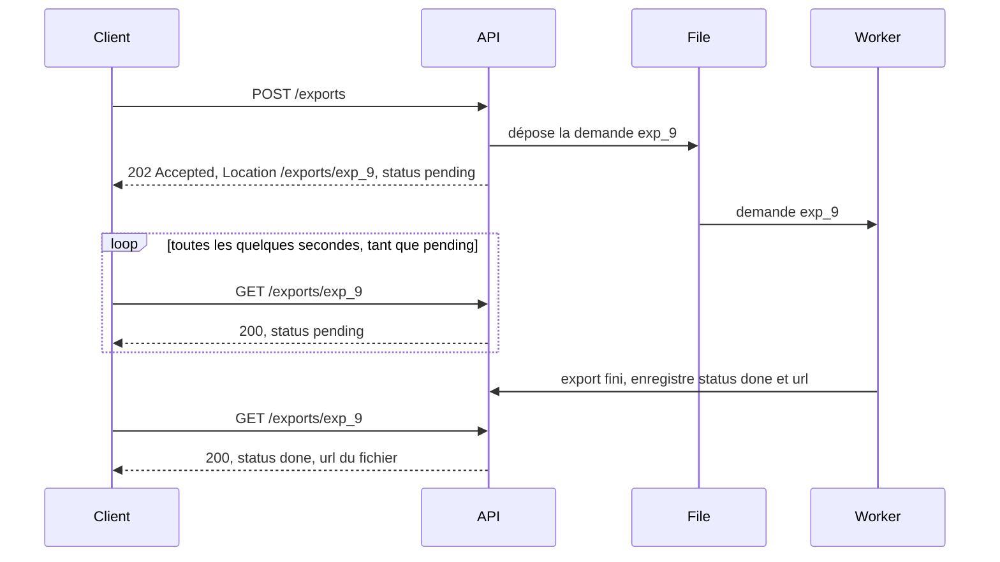

:material-book-open-variant: Doc de référence : [Microsoft, Asynchronous Request-Reply pattern](https://learn.microsoft.com/en-us/azure/architecture/patterns/async-request-reply) (consultée en novembre 2026) ; [RFC 9110, 202 Accepted](https://www.rfc-editor.org/rfc/rfc9110#section-15.3.3) (2022)
{ .doc-ref }

### Les autres styles, en une ligne
| Style      | Idée                                                          | Quand                                         |
|------------|---------------------------------------------------------------|-----------------------------------------------|
| <span class="term" data-term="graphql">GraphQL</span>    | une seule URL, le client décrit exactement les champs voulus ([détail](#graphql)) | plusieurs fronts (site web, appli mobile) qui assemblent chacun à leur façon des données venant de plusieurs services |
| <span class="term" data-term="grpc">gRPC</span>       | appels de fonctions à distance, binaire, très rapide          | des services internes qui s'appellent des milliers de fois par seconde |
| <span class="term" data-term="websocket">WebSocket</span>  | connexion ouverte dans les deux sens                          | le serveur doit envoyer l'info sans attendre qu'on la demande, comme un chat ou des notifications en direct |

:material-book-open-variant: Doc de référence : [gRPC, Introduction](https://grpc.io/docs/what-is-grpc/introduction/) (consultée en novembre 2026) ; [RFC 6455, The WebSocket Protocol](https://www.rfc-editor.org/rfc/rfc6455) (2011)
{ .doc-ref }
