# Architecture and distributed systems

!!! warning "Disclaimer"
    These notes are personal cheat sheets, not a source of truth. They reflect my own understanding and choices: their content remains subjective, despite the quotes and references it contains. It may be incomplete, simplified, inaccurate or outdated. Always check the official documentation before applying it. This content is provided as is, without any warranty: you use it at your own risk.

!!! audience "Who and what for"
    - **Roles**: back-end or front-end developer, tech lead, solution architect, SRE, QA engineer testing distributed systems.
    - **Uses**: I choose between a modular monolith and microservices for a new product; I understand why an order shows up twice after a network failure; I prepare a system design interview; I review an ADR and check that it says what it gives up; I size a service before a load peak, like a sales event.

!!! abstract "Scales"
    The colored badges under the headings say at which scale a notion applies:

    - <span class="pill pill-scope pill-scope-code">Code</span> the classes, functions and modules of one program;
    - <span class="pill pill-scope pill-scope-app">Application</span> one service or application and its internal split;
    - <span class="pill pill-scope pill-scope-system">System</span> several services talking to each other over the network;
    - <span class="pill pill-scope pill-scope-infra">Infrastructure</span> servers, network, zones and clusters, physical or virtual;
    - <span class="pill pill-scope pill-scope-enterprise">Enterprise</span> the whole information system and its organization.

    Details and ambiguous words: [map of scales](#map-of-scales).

This page gathers the basics for designing a system that holds under load and failures: the main architecture styles, how to split a system, what changes when it runs on several machines, how to share data between services, how to resist failures, how to estimate capacity, how to scale out (<span class="term" data-term="scale-cube">scale cube</span>, cache), how to design for continuous delivery, how to modernize an existing system, how to urbanize an application estate and how to document choices. The front end (React, web apps on mobile, micro front ends, design system, rendering, bundlers) has its own page: [Front end and web apps](front-end.md). The services `orders-service`, `billing-service`, `stock-service` and `my-api` are fictitious, and every number is an example unless stated otherwise.

## How to read this page

The word "architecture" mixes three things that are easily confused: the architecture of the **software** (how code and services are split), of the **data** (where data lives and how its copies stay in agreement) and of the **runtime** (machines, zones, capacity). A fourth one, the **organization** (teams, application estate), weighs on all three. And not every notion reads the same way: some are **choices** my team makes and records in an [ADR](#adr), others are **laws** nobody chooses, like CAP or Conway's law, but that I must know so as not to decide beside the point.

Under each heading, on top of the scale badges, two badges say which:

- <span class="pill pill-nature pill-nature-decide">Decide</span> a choice the team or the architects must make, writing down what it gives up;
- <span class="pill pill-nature pill-nature-know">Know</span> a phenomenon imposed on me: I do not choose it, I design around it;
- <span class="pill pill-topic pill-topic-data">Data</span> the notion is about data (copies, consistency, transactions, backups), not about how the code is split.

| Section | What it is about | What I do with it | Who usually decides |
|---|---|---|---|
| [Architecture styles](#architecture-styles) | software | I pick a style for my system | the team, with an architect when several teams are affected |
| [Splitting the system](#splitting-the-system) | software, organization | I draw boundaries; Conway's law is to know | the team and the domain experts |
| [Distributed systems](#distributed-systems) | data, network | mostly to know: what happens as soon as there is a network; only the desired consistency and idempotency are choices | nobody for the laws; the team for consistency and idempotency |
| [Data across services](#data-across-services) | data | I choose how to share data between services and keep it consistent | the team owning each service |
| [Resilience](#resilience) | software, network | I pick and tune mechanisms in the code of each call | the team writing the call |
| [High availability and recovery](#high-availability-and-recovery) | runtime, data | I set targets (RTO, RPO) and pick a recovery strategy | the team with the SREs and the business, who says what one hour of outage costs |
| [Estimating capacity](#estimating-capacity) | runtime | to know: a calculation method, not a choice | nobody, it is arithmetic |
| [Scaling out](#scaling-out) | runtime, data | I choose how to multiply the system and where to keep copies (cache) | the team, with the business for the acceptable age of the data |
| [Front end and web apps](front-end.md), on its own page | software | I choose a framework, a split and a rendering strategy | the front-end team, with the other teams when the front end is shared |
| [Designing for continuous delivery](#designing-for-continuous-delivery) | software, data | I choose an architecture that lets me ship often without breaking things | the team |
| [Modernizing an existing system](#modernizing-an-existing-system) | software | I choose between rewriting and redesigning, then I replace piece by piece | the team, with the business that pays and keeps asking for changes meanwhile |
| [Urbanizing the information system](#urbanizing-the-information-system) | organization | a company-wide approach: a team knows and respects it, without carrying it alone | the enterprise architects |
| [Documenting and governing](#documenting-and-governing) | everything | I document my choices and check them automatically | the team; the architects for the tech radar |
| [Measuring success](#measuring-success) | everything | I check that a solution works: an indicator (SLI), an internal target (SLO) and, when there is a customer, a contractual promise (SLA) | the team with the business; the SLA with sales and legal |

!!! noob "As noob"
    Building a house means deciding the floor plan, where the kitchen goes, the heating: those are choices. But gravity, frost and the slope of the land are not chosen: the architect knows them so that the choices hold. This page mixes both, and the badges say which is which. The one thing to remember: **before debating a notion, I check whether it is a choice to make or a constraint to respect.**

## Terminology

**Architecture**: the set of structuring decisions of a system, the ones that are expensive to change later: how it is split, how the pieces talk, where the data lives.

**<span class="term" data-term="quality-attribute">Quality attribute</span>**: a measurable property of the system other than what it does: performance, availability, security, cost, ease of change. They, more than features, drive the architecture. They are written as a measurable scenario, in six parts (details, utility tree and ATAM in [Quality scenarios, utility tree and ATAM](#quality-scenarios-utility-tree-and-atam)):

``` { .text .ex-illus title="Illustration" }
source         a peak of 2,000 simultaneous customers (sales)
stimulus       they place orders at the same time
environment    normal operation, peak load
artifact       orders-service and its database
response       orders-service accepts every order
measure        p99 under 800 ms, 0 lost orders
```

**<span class="term" data-term="software-component">Component</span>**: a piece of the system with a precise role and a clear boundary: an API, a message queue, a database, a code module.

**<span class="term" data-term="coupling">Coupling</span>**: how much a component depends on another one's details. Strong coupling: changing `billing-service` forces a change to `orders-service` the same day. **<span class="term" data-term="cohesion">Cohesion</span>**: how much what is grouped together serves the same purpose. The goal is low coupling and high cohesion.

**<span class="term" data-term="distributed-system">Distributed system</span>**: a system whose components run on several machines and talk over the network. As soon as there are two services and a database, I am in one: every call can be slow, lost or duplicated.

**<span class="term" data-term="broker">Broker</span>** (message broker): an intermediate server that receives messages from one service and keeps them until other services come and read them. The sender only talks to the broker, never directly to the recipients: it does not need to know who they are, nor whether they are online at that moment. Examples: Apache Kafka, RabbitMQ, Google Pub/Sub, Amazon SQS. Two shapes: the **queue** (each message is a task taken by a single consumer, then deleted) and the **topic** (each message is a fact that every subscriber reads, each at its own pace).

``` { .text .ex-illus title="Illustration" }
no broker     orders-service --HTTP--> email-service      email down: the call fails, so does the order
with broker   orders-service --publishes OrderPaid--> [broker] --> email-service reads when it is back
              the message waits in the broker during the outage, the order succeeds
```

!!! noob "As noob"
    A broker is a shared mailbox. I drop my letter and walk away: the recipient does not need to be home, they will pick it up when they come back. When several people must read the same news, it is more like a notice board: everyone comes and reads when they want. Limit of the picture: a broker can deliver the same letter twice after a failure, so the recipient must recognize a duplicate ([idempotency](#idempotency)). The one thing to remember: **the sender drops the message and moves on; the broker keeps it until someone handles it.**

**<span class="term" data-term="trade-off">Trade-off</span>**: in architecture, almost everything is a trade-off. Gaining availability costs consistency or money, gaining team autonomy costs operational complexity. A good decision says what it gives up.

**<span class="term" data-term="sli">SLI</span>** (service level indicator): the measured indicator that says whether the service is doing well from the user's point of view. Example: the share of `my-api` requests served without error in under 800 ms.

**<span class="term" data-term="slo">SLO</span>** (service level objective): the internal target the team sets on an SLI, over a time window. Example: 99.9% of those requests successful over a rolling 30 days.

**<span class="term" data-term="sla">SLA</span>** (service level agreement): the contractual promise made to a customer, with a penalty when it is not kept, usually looser than the SLO to keep a margin. Example: 99.5% per month, otherwise a 10% credit on the invoice.

| I want to... | I look at... |
|---|---|
| to settle between two options, like a single database or one per service, without the discussion turning into a matter of taste | the quality attributes it serves and the ones it degrades |
| to know whether two components are too tied, for example if every change to `billing-service` forces a change to `orders-service` the same day | how often they change together, how many calls they exchange |
| to understand why the system often goes down although each service works fine on its own | what goes over the network, and what happens when the network fails |

## Map of scales

The word "architecture" names the organization of a program's classes just as well as that of a datacenter's servers. The same notion does not mean the same thing at every scale: hexagonal architecture splits **code**, cell-based architecture splits **infrastructure**. Every notion on this site therefore carries one or more badges saying which scale it is about.

### The five scales

| Scale | What it is about | Logical or physical | What I draw | Example |
|---|---|---|---|---|
| <span class="pill pill-scope pill-scope-code">Scale · Code</span> | classes, functions, modules of one program | logical | class diagram, module tree | `PayOrder` only knows the `PaymentGateway` interface |
| <span class="pill pill-scope pill-scope-app">Scale · Application</span> | one service or application and its internal split | logical | components (C4 level 3) | `orders-service`: API, business, data access |
| <span class="pill pill-scope pill-scope-system">Scale · System</span> | several services talking to each other | logical, with the network between them | containers (C4 level 2), flows | `orders-service` publishes `OrderPaid`, `billing-service` consumes it |
| <span class="pill pill-scope pill-scope-infra">Scale · Infrastructure</span> | servers, network, zones, clusters, hardware | physical or virtual | deployment diagram | 3 Kubernetes nodes across 3 zones, one primary database and two replicas |
| <span class="pill pill-scope pill-scope-enterprise">Scale · Enterprise</span> | the whole information system | logical, organizational | map, capability map | 80 applications organized into zones and districts |

A notion can span two scales: a **retry** is written in code but only makes sense between two services; it then carries two badges. <span class="pill pill-scope pill-scope-all">All scales</span> marks documentation tools that apply everywhere (ADR).

### The notions on this page

| Notion | Code | Application | System | Infrastructure | Enterprise |
|---|---|---|---|---|---|
| monolith, modular monolith | x | x | | | |
| hexagonal architecture, clean architecture | x | x | | | |
| microservices, event-driven architecture, broker | | | x | | |
| serverless | | x | | x | |
| DDD, bounded context | | x | x | | |
| Conway's law | | | x | | x |
| CAP, replication, consensus | | | x | x | |
| saga, outbox, CQRS, event sourcing | | x | x | | |
| database type, polyglot persistence | | x | x | | |
| timeout, retry, circuit breaker | x | | x | | |
| bulkhead, load shedding | | x | x | x | |
| rate limiting | x | | x | | |
| zones and regions, RTO and RPO, recovery, cell-based architecture | | | x | x | |
| capacity estimation | | | x | x | |
| scale cube | | | x | x | |
| cache: layers, read and write patterns, invalidation | x | x | x | x | |
| continuous delivery: independent deployment, expand and contract, feature flags | x | x | x | | |
| rewrite, strangler fig, sacrificial architecture | | x | x | | |
| urbanization, TOGAF, Zachman | | | | | x |
| C4, arc42, fitness functions | x | x | x | | |
| quality scenarios, utility tree, ATAM | | x | x | | |
| company tech radar | | | | | x |

The front-end notions (React, web apps on mobile and PWA, micro front ends, design system, rendering strategies, bundlers) carry the same badges on their own page: [Front end and web apps](front-end.md).

### Words that change meaning with the scale

| Word | At code or application scale | At infrastructure scale |
|---|---|---|
| layer | a group of modules: presentation, business, data access | a tier of machines: web servers, application servers, database |
| adapter | a class that plugs the business into a tool (hexagonal architecture) | a device or service that converts a protocol |
| partition | a split of the data (a Kafka partition, a partitioned table) | a network cut between two groups of machines (the P in CAP) |
| cell | rarely used | a complete, isolated copy of the stack serving part of the customers |
| node | an element of a tree or graph | a machine in a cluster |
| instance | an object created from a class | a virtual machine or a running copy of a service |
| service | a class holding a business rule (`PricingService`) | a program deployed on its own, with its network address |
| bulkhead | a thread or connection pool reserved for one dependency | separate clusters or accounts to isolate a failure |

**When to use it.** Whenever an architecture discussion goes in circles: asking "which scale are we talking about?" settles half the misunderstandings. An enterprise architect, a solution architect and a developer who say "layered architecture" often do not mean the same thing.

## Architecture styles

### Monolith

<a class="pill pill-scope pill-scope-app" href="#map-of-scales">Scale · Application</a> <span class="pill pill-status pill-status-ok" title="Still valid, checked November 2026">Current · 11/2026</span> <a class="pill pill-nature pill-nature-decide" href="../architecture/#how-to-read-this-page" title="A choice the team or the architects must make, then record in an ADR">Decide</a>

A **<span class="term" data-term="monolith">monolith</span>** is a single application, a single deployment, often a single database. At first it is the simplest option: I develop, test and deploy one program. It becomes painful when dozens of people change the same code: the smallest fix waits for everything else to be ready, then everything redeploys together.

**Risks.** Without internal boundaries, the code becomes a "big ball of mud" where everything depends on everything: billing and the cart read the same `Order` class, so a field added for one breaks the display of the other, and every change forces a retest of the whole application. A single deployment also means that a memory leak in one corner takes the whole service down. I limit both by moving to a modular monolith as soon as several people work on it.

:material-book-open-variant: Reference docs: [Martin Fowler, "MonolithFirst"](https://martinfowler.com/bliki/MonolithFirst.html) (2015)
{ .doc-ref }

### Modular monolith

<a class="pill pill-scope pill-scope-code" href="#map-of-scales">Scale · Code</a> <a class="pill pill-scope pill-scope-app" href="#map-of-scales">Scale · Application</a> <span class="pill pill-status pill-status-ok" title="Still valid, checked November 2026">Current · 11/2026</span> <a class="pill pill-nature pill-nature-decide" href="../architecture/#how-to-read-this-page" title="A choice the team or the architects must make, then record in an ADR">Decide</a>

A **<span class="term" data-term="modular-monolith">modular monolith</span>** deploys as one block, but its code is split into modules with strict boundaries: each module exposes a public interface, and the others may not import its internal details.

``` { .text .ex-illus title="Illustration" }
my-api/
├── orders/      api.py (public), domain/, storage/ (private)
├── billing/     api.py (public), domain/, storage/ (private)
└── stock/       api.py (public), domain/, storage/ (private)
rule checked in CI: orders imports only billing.api, never billing.storage
```

It is often the best starting point: if a module must one day become a service, its boundary already exists.

**Risks.** A boundary no tool checks erodes within weeks: one "just this once" import of `billing.storage` from `orders`, and the split only exists on the diagram. The modules also share the same process and often the same database: a module that exhausts the connections slows all the others. I have the imports checked in CI and I give each module its own tables.

### Microservices

<a class="pill pill-scope pill-scope-system" href="#map-of-scales">Scale · System</a> <span class="pill pill-status pill-status-ok" title="Still valid, checked November 2026">Current · 11/2026</span> <a class="pill pill-nature pill-nature-decide" href="../architecture/#how-to-read-this-page" title="A choice the team or the architects must make, then record in an ADR">Decide</a>

**<span class="term" data-term="microservice">Microservices</span>**: several small services, each deployed alone, owning its data, maintained by one team. They bring autonomy (each team ships at its own pace) and per-service scaling, at the price of a distributed system: network, data consistency, observability, contract versions. The classic trap is the **<span class="term" data-term="distributed-monolith">distributed monolith</span>**: separate services that must all be deployed together because they share a database or call each other in chains. Reference: James Lewis and Martin Fowler, "Microservices" (2014).

:material-book-open-variant: Reference docs: [James Lewis and Martin Fowler, "Microservices"](https://martinfowler.com/articles/microservices.html) (2014); [Chris Richardson, microservices.io, "Microservice Architecture"](https://microservices.io/patterns/microservices.html) (accessed November 2026)
{ .doc-ref }

### Serverless

<a class="pill pill-scope pill-scope-app" href="#map-of-scales">Scale · Application</a> <a class="pill pill-scope pill-scope-infra" href="#map-of-scales">Scale · Infrastructure</a> <span class="pill pill-status pill-status-ok" title="Still valid, checked November 2026">Current · 11/2026</span> <a class="pill pill-nature pill-nature-decide" href="../architecture/#how-to-read-this-page" title="A choice the team or the architects must make, then record in an ADR">Decide</a>

I have tasks that only come once in a while, like a thumbnail to create when someone uploads a photo. With **<span class="term" data-term="serverless">serverless</span>**, the cloud provider runs my code only when there is work (a request, a message, an uploaded file) and bills me per use. I have no server to manage, and at night, with no traffic, nothing runs. In exchange: cold starts, limited execution time, provider dependency. Well suited to event processing and irregular traffic.

A **<span class="term" data-term="cold-start">cold start</span>** is the time the provider takes to create an instance when none is ready: download the code, start the runtime, run the initialization. It only hits the first request after a period without traffic. Example for a function that creates a thumbnail (example figures, they vary with the language, the package size and the provider):

``` { .text .ex-illus title="Illustration" }
10:00:00.000  photo.jpg uploaded to the bucket, the event triggers the function
10:00:00.000  no instance ready: cold start (1.5 s)
10:00:01.500  the function runs: 20 ms of work, thumbnail written
10:00:01.520  the instance stays warm; a 2nd file at 10:00:30 starts with no wait
10:15:00      no call for ~15 min: the provider removes the instance
bill          2 invocations and their duration, nothing for the 15 idle minutes
```

:material-book-open-variant: Reference docs: [Mike Roberts, "Serverless Architectures", martinfowler.com](https://martinfowler.com/articles/serverless.html) (2018)
{ .doc-ref }

### Event-driven architecture

<a class="pill pill-scope pill-scope-system" href="#map-of-scales">Scale · System</a> <span class="pill pill-status pill-status-ok" title="Still valid, checked November 2026">Current · 11/2026</span> <a class="pill pill-nature pill-nature-decide" href="../architecture/#how-to-read-this-page" title="A choice the team or the architects must make, then record in an ADR">Decide</a>

In an **<span class="term" data-term="event-driven-architecture">event-driven architecture</span>**, a service announces a fact ("order paid") on a [broker](#terminology), and the interested services react, without the sender knowing them.

``` { .text .ex-illus title="Illustration" }
direct call   orders-service calls billing, stock, email: if email is down, the order fails
events        orders-service publishes OrderPaid; billing, stock, email consume at their own pace
```

Gain: decoupling in time (the consumer may be down) and adding consumers without touching the sender. Cost: eventual consistency, flows harder to follow, duplicate messages. The mechanisms (queue, topic, delivery guarantees, DLQ) are in [API: REST and asynchronous](api-rest-async.md#asynchronous-messages-and-events).

:material-book-open-variant: Reference docs: [Martin Fowler, "What do you mean by Event-Driven?"](https://martinfowler.com/articles/201701-event-driven.html) (2017)
{ .doc-ref }

### Hexagonal and clean architecture

<a class="pill pill-scope pill-scope-code" href="#map-of-scales">Scale · Code</a> <a class="pill pill-scope pill-scope-app" href="#map-of-scales">Scale · Application</a> <span class="pill pill-status pill-status-ok" title="Still valid, checked November 2026">Current · 11/2026</span> <a class="pill pill-nature pill-nature-decide" href="../architecture/#how-to-read-this-page" title="A choice the team or the architects must make, then record in an ADR">Decide</a>

**<span class="term" data-term="hexagonal-architecture">Hexagonal architecture</span>** (Alistair Cockburn, 2005, also called "<span class="term" data-term="port-adapter">ports and adapters</span>") puts the business code at the center. It knows only interfaces (the ports); the database, the HTTP API and the broker are adapters plugged into those ports. **<span class="term" data-term="clean-architecture">Clean architecture</span>** (Robert C. Martin, 2012 article, 2017 book) pushes the same idea in circles: dependencies always point toward the business.

!!! noob "As noob"
    Picture a lamp and a wall socket: the lamp (the business code) does not know whether the power comes from a power plant or a generator, it only knows the shape of the socket (the port). In production I plug it into the real grid, in tests into a battery, without ever touching the lamp. The one thing to remember: **the business code draws its sockets, the rest of the world plugs into them.**

**At which scale.** Both models organize **the code of one service**: a port is an interface, an adapter is a class. They say nothing about the number of servers, the network or the zones; the same hexagonal service runs just as well on one machine as on a hundred pods. For the machine scale, see [High availability and recovery](#high-availability-and-recovery) and [cell-based architecture](#cell-based-architecture).

What hexagonal architecture avoids: a use case that calls the payment provider and the database itself. The day the company switches payment providers, the business rule must be rewritten, and every payment test needs the network and a real database.

``` { .python .ex-bad title="Avoid" }
# Avoid: the business rule knows the provider URL and the SQL
class PayOrder:
    def run(self, order_id: str, amount_cents: int) -> bool:
        response = requests.post(
            "https://api.acme-pay.example/v1/charges",
            json={"order": order_id, "amount": amount_cents},
            timeout=2,
        )
        db.execute("UPDATE orders SET status = 'paid' WHERE id = %s", (order_id,))
        return response.status_code == 201
```

The same thing with a port:

``` { .python .ex-good title="Recommended" }
# Good: the port, the interface the business code needs
class PaymentGateway(Protocol):
    def charge(self, order_id: str, amount_cents: int) -> bool: ...


# Good: the use case, which only knows the port
class PayOrder:
    def __init__(self, gateway: PaymentGateway) -> None:
        self.gateway = gateway

    def run(self, order_id: str, amount_cents: int) -> bool:
        return self.gateway.charge(order_id, amount_cents)
```

In tests, I plug in a fake `PaymentGateway`; in production, the payment provider's adapter. The underlying principles (<span class="term" data-term="dependency-inversion">dependency inversion</span>, SOLID) are in [Design principles](principes-conception.md).

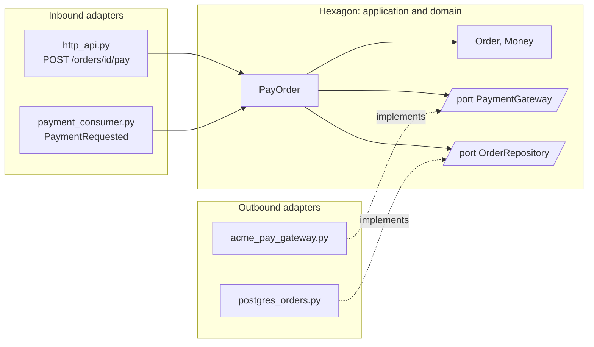

**Why.** The business changes slowly, technology changes fast: I switch databases, change payment provider, add a message queue. Without a boundary, a business rule ends up written in an HTTP controller or in an SQL query, and every technical change puts it at risk. With ports:

- the business is tested without a database or network, in milliseconds;
- swapping an adapter (moving from one provider to another) does not touch a line of business code;
- the same use case is triggered from several entry points: HTTP route, received message, command line.

**When to apply it.** The signals that justify the cost:

| Signal | Example |
|---|---|
| my business has rich rules that will live for years | discount calculation, order life cycle with its states and forbidden transitions |
| I know that a technical tool under my code will probably change | planned payment provider migration, two databases for the same role |
| the same use case must be triggerable through several entry doors | "pay an order" through the API and through a `PaymentRequested` message |
| my tests are slow or fragile because each one goes through the database | 12 minutes of tests to check calculation rules |

When not to apply it: a CRUD with no rules, a script, a throwaway prototype, a service that only transforms and forwards data. There, simple layers (route, service, data access) are enough; ports and adapters would only add files.

**How.** A typical tree:

``` { .text .ex-illus title="Illustration" }
orders_service/
├─ domain/                    pure rules, no technical import
│  └─ order.py                Order, Money, state transitions
├─ application/               use cases and ports
│  ├─ ports.py                PaymentGateway, OrderRepository
│  └─ pay_order.py            PayOrder
├─ adapters/
│  ├─ inbound/                what calls the business
│  │  ├─ http_api.py          POST /orders/{id}/pay
│  │  └─ payment_consumer.py  PaymentRequested message
│  └─ outbound/               what the business calls
│     ├─ acme_pay_gateway.py  payment provider (fictitious)
│     └─ postgres_orders.py   OrderRepository on Postgres
└─ main.py                    wiring: picks the adapters to plug in
```

The steps:

1. start from a use case ("pay an order"), not from technical layers;
2. write the business code without any framework, database or HTTP client import;
3. define each port from the business point of view: `charge(order_id, amount_cents)`, not `post_json(url, body)`;
4. write the adapter and test it separately against the real neighbour ([Testcontainers](qualite.md#integration-tests-with-testcontainers), contract test);
5. wire everything in one place (`main.py`), the only file that knows both the business and the adapters;
6. have the CI check the dependency rule, otherwise it erodes within weeks.

*Testcontainers: complements pytest*
{ .tool-rel }


The use case test, with a fake plugged into the port (this is not a mock across a network boundary: the boundary is the port, and the real adapter has its own integration tests):

``` { .python .ex-good title="Recommended" }
# Good: a fake plugged into the port, not a mock across the network
class FakeGateway:
    def __init__(self, accept: bool) -> None:
        self.accept = accept
        self.calls: list[tuple[str, int]] = []

    def charge(self, order_id: str, amount_cents: int) -> bool:
        self.calls.append((order_id, amount_cents))
        return self.accept


# Example: the test checks the result and the amount charged
def test_pay_order_charges_the_full_amount() -> None:
    gateway = FakeGateway(accept=True)
    assert PayOrder(gateway).run("o-42", 12_000) is True
    assert gateway.calls == [("o-42", 12_000)]
```

The dependency rule checked on every pipeline (import-linter, `layers` contract: an upper layer may import the lower ones, never the reverse):

``` { .ini .ex-ref title="Reference" }
# Example: layers contract, the top imports the bottom, never the reverse
[importlinter:contract:hexagon]
name = the business depends on no adapter
type = layers
layers =
    orders_service.adapters
    orders_service.application
    orders_service.domain
```

Common traps:

- a port that copies the tool (`execute_sql`, `get_bucket`) instead of expressing a business need: the business still depends on the technology;
- technical types leaking into the business (ORM object, HTTP response, client exception);
- applying the model to the whole system at once: keep it for the modules whose business justifies it, the others stay in simple layers.

| Variant | Picture | What it adds |
|---|---|---|
| hexagonal (Cockburn, 2005) | a hexagon, inputs on one side, outputs on the other | ports and adapters, symmetry between input and output |
| onion (Jeffrey Palermo, 2008) | concentric rings | the domain model at the core, services around it |
| clean architecture (Robert C. Martin, 2012) | circles | explicit use cases, dependency rule pointing inward |

All three say the same thing: dependencies point toward the business. The name matters less than the rule checked in CI.

<figure class="diagram"><svg viewBox="0 0 220 210" role="img" aria-label="Clean architecture circles"><circle class="layer layer-1" cx="110" cy="105" r="95"/><circle class="layer layer-1" cx="110" cy="105" r="70"/><circle class="layer layer-2" cx="110" cy="105" r="45"/><circle class="layer layer-3" cx="110" cy="105" r="20"/><text x="110" y="26" text-anchor="middle">frameworks, database, HTTP</text><text x="110" y="51" text-anchor="middle">adapters</text><text x="110" y="76" text-anchor="middle">use cases</text><text x="110" y="108" text-anchor="middle">entities</text></svg><figcaption>Clean architecture (Robert C. Martin, 2012): dependencies point to the center</figcaption></figure>

:material-book-open-variant: Reference docs: [Alistair Cockburn, "Hexagonal Architecture"](https://alistair.cockburn.us/hexagonal-architecture/) (2005); [Robert C. Martin, "The Clean Architecture"](https://blog.cleancoder.com/uncle-bob/2012/08/13/the-clean-architecture.html) (2012)
{ .doc-ref }

### Which style to choose

| I want to... | I use... |
|---|---|
| to start a new product with one or two teams, without knowing yet where the boundaries will be | modular monolith |
| several teams to ship each at its own pace: the payment team ships a fix in the morning without waiting for the catalog team to finish | microservices, split by business domain |
| to handle tasks that come in bursts, like a thumbnail to create when someone uploads a photo, without paying for a server that waits the rest of the time | serverless |
| billing, stock and email sending to learn that an order is paid, without the order waiting for their answer | events on a broker |
| to keep complex business rules (discounts, order states) intact when the database or payment provider changes | hexagonal architecture |
| an API that reads and writes records with no particular rules, like an address book, and that will change little | a layered monolith, no ceremony |

The cautious rule: start simple, split when a measured pain requires it (Martin Fowler, "MonolithFirst", 2015).

The same choice as a tree; serverless and events combine with any branch:

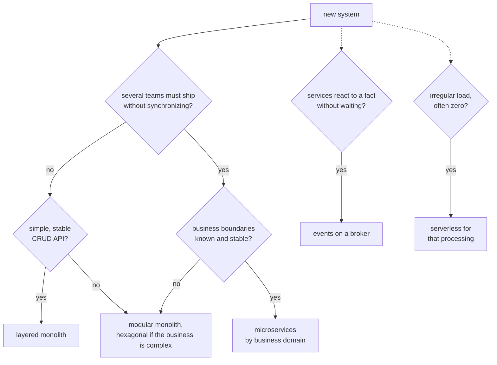

:material-book-open-variant: Reference docs: [Martin Fowler, "Microservice Premium"](https://martinfowler.com/bliki/MicroservicePremium.html) (2015)
{ .doc-ref }

!!! maturity "Measuring maturity"
    | Level | What I see in the team |
    |---|---|
    | N1 | the system's style was chosen, but orally: nobody can say why a modular monolith rather than microservices |
    | N2 | the style choice is written in an ADR with what it gives up, and module or service boundaries are checked in CI (import-linter, hexagonal dependency rule) |
    | N3 | a merge request that crosses a forbidden boundary or adds a database shared by two services is blocked by the pipeline, without waiting for a human review |
    | N4 | the team revisits its style from numbers it tracks: services that must ship together, waiting time between teams, share of changes touching several modules |

    **I measure**: the share of releases that require deploying more than one service or module together, read in the deployment history; the number of boundary violations blocked per month, read in the CI reports.

## Splitting the system

<a class="pill pill-practice" href="../livraison/#design-before-coding">Practice · Technical design</a>
<a class="pill pill-dora" href="https://dora.dev/capabilities/loosely-coupled-teams/">DORA · Loosely coupled teams</a>

### Domain-Driven Design

<a class="pill pill-scope pill-scope-app" href="#map-of-scales">Scale · Application</a> <a class="pill pill-scope pill-scope-system" href="#map-of-scales">Scale · System</a> <span class="pill pill-status pill-status-ok" title="Still valid, checked November 2026">Current · 11/2026</span> <a class="pill pill-nature pill-nature-decide" href="../architecture/#how-to-read-this-page" title="A choice the team or the architects must make, then record in an ADR">Decide</a>

**Domain-Driven Design** (DDD, Eric Evans, 2003) starts from one idea: the software should be split along business lines, not along tables or technical layers. It provides tools to find those boundaries.

**Risks.** Applying the whole toolkit (aggregates, entities, value objects) to modules without business rules weighs the code down for nothing, and spending months modelling before shipping freezes boundaries never tested against reality. I keep DDD for complex domains and I validate each boundary with a first release.

:material-book-open-variant: Reference docs: [Eric Evans, "Domain-Driven Design Reference"](https://www.domainlanguage.com/ddd/reference/) (2015); [Martin Fowler, "DomainDrivenDesign"](https://martinfowler.com/bliki/DomainDrivenDesign.html) (2020)
{ .doc-ref }

### Bounded context and ubiquitous language

<a class="pill pill-scope pill-scope-app" href="#map-of-scales">Scale · Application</a> <a class="pill pill-scope pill-scope-system" href="#map-of-scales">Scale · System</a> <span class="pill pill-status pill-status-ok" title="Still valid, checked November 2026">Current · 11/2026</span> <a class="pill pill-nature pill-nature-decide" href="../architecture/#how-to-read-this-page" title="A choice the team or the architects must make, then record in an ADR">Decide</a>

A **<span class="term" data-term="bounded-context">bounded context</span>** is a scope in which a word has one single meaning. In the same online shop, "order" does not mean the same thing everywhere:

| Context | An "order" is... |
|---|---|
| Sales | a validated cart, with prices and discounts |
| Billing | an amount due, a VAT, a payment method |
| Logistics | parcels, an address, a carrier |

Each context has its own model and its **<span class="term" data-term="ubiquitous-language">ubiquitous language</span>**: the business experts' words are the code's words (`Shipment`, not `OrderData2`). A bounded context is a good candidate for a module or a service.

!!! noob "As noob"
    In a company, the word "customer" does not mean the same thing to the salesperson, the accountant and the delivery driver, and each one is right in their own department. Rather than forcing one definition that suits nobody, I draw borders: each team keeps its meaning of the word, and I translate when information crosses from one side to the other. The one thing to remember: **one word, one meaning, inside a border.**

**Risks.** Contexts that are too small multiply translations and calls between services for the smallest feature. Conversely, a single `Customer` model shared by sales, billing and logistics ends up with forty fields of which each uses ten, and a change for one breaks the others. I split where the vocabulary really changes, not entity by entity.

:material-book-open-variant: Reference docs: [Martin Fowler, "BoundedContext"](https://martinfowler.com/bliki/BoundedContext.html) (2014); [Martin Fowler, "UbiquitousLanguage"](https://martinfowler.com/bliki/UbiquitousLanguage.html) (2006)
{ .doc-ref }

### Context map

<a class="pill pill-scope pill-scope-system" href="#map-of-scales">Scale · System</a> <span class="pill pill-status pill-status-ok" title="Still valid, checked November 2026">Current · 11/2026</span> <a class="pill pill-nature pill-nature-decide" href="../architecture/#how-to-read-this-page" title="A choice the team or the architects must make, then record in an ADR">Decide</a>

The **<span class="term" data-term="context-map">context map</span>** draws the relationships between contexts: who supplies, who consumes, who adapts. When I consume a system whose model does not suit me (an old piece of software, a vendor), I place an **<span class="term" data-term="anti-corruption-layer">anti-corruption layer</span>**: code that translates its model into mine, so its words do not spread.

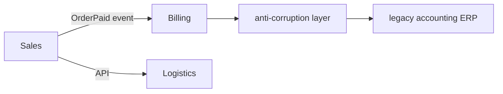

**Risks.** An anti-corruption layer is extra code, with its latency and translation bugs: when nobody maintains it, it lets the old system's fields through as they are and protects nothing any more. Without it, the ERP's names (`CUST_ID_02`, `FLG_X`) spread through my code. I give it an owner and contract tests against the external system.

:material-book-open-variant: Reference docs: [Microsoft, "Anti-corruption Layer pattern"](https://learn.microsoft.com/en-us/azure/architecture/patterns/anti-corruption-layer) (accessed November 2026)
{ .doc-ref }

### Event storming

<a class="pill pill-scope pill-scope-system" href="#map-of-scales">Scale · System</a> <span class="pill pill-status pill-status-ok" title="Still valid, checked November 2026">Current · 11/2026</span> <a class="pill pill-nature pill-nature-decide" href="../architecture/#how-to-read-this-page" title="A choice the team or the architects must make, then record in an ADR">Decide</a>

**<span class="term" data-term="event-storming">Event storming</span>** (Alberto Brandolini, introduced around 2013) is a workshop: business experts and developers stick on a wall, in time order, every business event in the past tense ("order placed", "payment accepted", "parcel shipped"). The areas where the vocabulary changes and where the actors change draw the bounded contexts.

``` { .text .ex-illus title="Illustration" }
time ──────────────────────────────────────────────────────────────────>
[customer]     cart created, item added, order placed
[customer]     payment accepted
               ───── pivot: people stop saying "cart" and say "invoice" ─────
[accountant]   invoice issued, VAT computed, invoice sent
               ───── pivot: people say "parcel" and "carrier" ─────
[warehouse]    parcel prepared, parcel handed to carrier, parcel delivered

contexts found: Sales | Billing | Logistics
```

**Risks.** A workshop without real domain experts draws the boundaries as developers imagine them, and those mistakes end up carved into services. A wall of sticky notes photographed and then forgotten only serves once. I bring in the people who do the work every day and I run a short workshop again when the business changes.

:material-book-open-variant: Reference docs: [Alberto Brandolini, EventStorming](https://www.eventstorming.com/) (accessed November 2026)
{ .doc-ref }

### Conway's law

<a class="pill pill-scope pill-scope-system" href="#map-of-scales">Scale · System</a> <a class="pill pill-scope pill-scope-enterprise" href="#map-of-scales">Scale · Enterprise</a> <a class="pill pill-nature pill-nature-know" href="../architecture/#how-to-read-this-page" title="A law or a phenomenon nobody chooses: knowing it prevents bad decisions">Know</a>

My company has a front-end team, a back-end team and a database team. Every new feature, like "show the delivery date in the cart", needs a ticket for each of the three, three priorities to align and three synchronized releases. This is not an accident of organization: it is what **<span class="term" data-term="conway-law">Conway's law</span>** describes (Melvin Conway, "How Do Committees Invent?", 1968): a system ends up mirroring how the teams that build it communicate. Wherever two teams must talk to move forward, a technical boundary appears (an API, a contract, a queue); wherever one team works alone, the code stays in one piece.

The mechanism is simple: for two pieces of code to fit together finely, their authors must talk often. A team cannot change code owned by another team every day, so it goes through an interface, and the architecture settles on the boundaries between teams. This is not a rule to apply: it is an observation, which holds whether I know it or not.

``` { .text .ex-illus title="Illustration" }
organization                       resulting architecture
front-end team                     one front-end app
back-end team                      a generic API, with no precise business focus
database team                      a shared schema everybody reads
one feature = 3 teams              one feature = 3 coordinated changes, shipped together
```

!!! noob "As noob"
    Ask four people who never talk to each other to write a novel, and I get four chapters that each make sense, but clumsy joins between them. If two of them share an office, their two chapters blend much better. Software does the same: it sticks together where people talk, and splits where they do not. The one thing to remember: **the architecture follows the org chart, whether I like it or not; I might as well pick the org chart that gives the architecture I want.**

**Why it matters.** If I draw a microservices architecture split by domain (cart, payment, delivery) but keep teams split by technical layer (front end, back end, database), Conway's law wins: every feature crosses every team, and the services end up coupled like the teams. The drawing does not survive the org chart.

**How to use it: the <span class="term" data-term="inverse-conway-maneuver">inverse Conway maneuver</span>.** Rather than suffering the law, I use it: I first organize the teams along the desired architecture, and the code follows (phrase that appeared around 2010 at Thoughtworks, written by Jonny LeRoy and Matt Simons, to check; developed by Matthew Skelton and Manuel Pais in "Team Topologies", 2019). The steps:

1. I draw the target boundaries, for example with an [event storming](#event-storming): Sales, Billing, Logistics;
2. I create one <span class="term" data-term="stream-aligned-team">stream-aligned team</span> per boundary, owning the front end, the back end and the data of its domain;
3. I give each team its own repositories, pipeline and database, so it ships without waiting for the others;
4. I define exchanges between teams as published contracts (APIs, events), and I limit mandatory meetings between them.

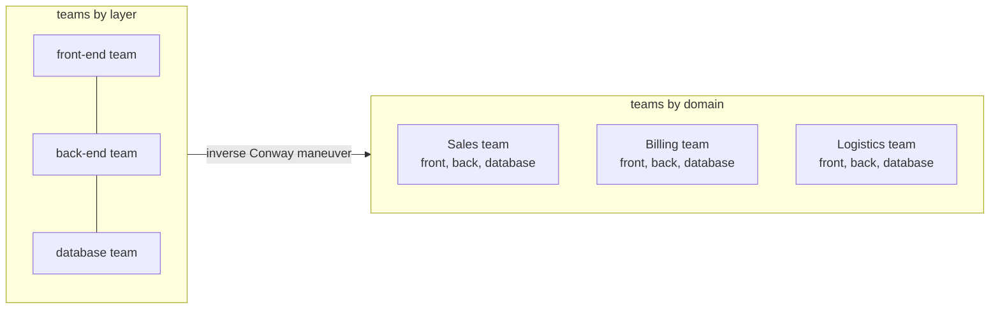

**When to think about it.** When every feature needs three teams, when a split into services does not hold because the teams do not match the services, or before launching a reorganization. When not to force it: a small company where everyone talks every day, or a system whose business boundaries are not known yet (reorganizing too early freezes the wrong boundaries). Limit: the law describes a strong tendency, not a mathematical certainty; very good communication between teams can soften it.

:material-book-open-variant: Reference docs: [Melvin Conway, "How Do Committees Invent?"](https://www.melconway.com/Home/Committees_Paper.html) (1968); [Martin Fowler, "Conway's Law"](https://martinfowler.com/bliki/ConwaysLaw.html) (2022)
{ .doc-ref }

| I want to... | I use... |
|---|---|
| to find where to split the software when I land in a business I do not know, like logistics | event storming with the business experts |
| "order" not to mean a cart in one module, an invoice in another and a parcel in a third, at the risk of each one breaking what the others expect | bounded contexts, ubiquitous language |
| to plug into an external system whose model does not fit mine, like an old accounting ERP, without its words spreading through my code | anti-corruption layer |
| the boundaries drawn today to still hold once the code and the teams have grown | align teams with contexts (Conway) |

!!! maturity "Measuring maturity"
    | Level | What I see in the team |
    |---|---|
    | N1 | one person drew the contexts once, often after an event storming, but the code only partly reflects them |
    | N2 | each bounded context has its module or service, its glossary and an owning team; exchanges with an external system go through an anti-corruption layer |
    | N3 | a new need goes through the context map by default in the design ritual, and CI refuses that a context imports another one's internal model |
    | N4 | the team re-splits from numbers: share of features that need several teams, share of changes that touch several contexts at once |

    **I measure**: the average number of teams involved per shipped feature, read in the linked tickets; the share of merge requests that modify more than one context, read in the Git history per folder.

## Distributed systems

This section is mostly about **data** and **network**: what happens to data as soon as it is copied onto several machines. Most notions are <span class="pill pill-nature pill-nature-know">Know</span>: I do not choose that the network fails, I only choose how my system behaves when it does.

### The eight fallacies

<a class="pill pill-scope pill-scope-system" href="#map-of-scales">Scale · System</a> <a class="pill pill-scope pill-scope-infra" href="#map-of-scales">Scale · Infrastructure</a> <a class="pill pill-nature pill-nature-know" href="../architecture/#how-to-read-this-page" title="A law or a phenomenon nobody chooses: knowing it prevents bad decisions">Know</a>

The **<span class="term" data-term="distributed-computing-fallacies">fallacies of distributed computing</span>** are eight false assumptions people naturally make when writing a network call (L. Peter Deutsch and colleagues at Sun, 1994, the eighth added by James Gosling around 1997, dates to check):

| Fallacy | What really happens |
|---|---|
| the network is reliable | packets get lost, connections drop |
| latency is zero | a call between regions costs tens of milliseconds |
| bandwidth is infinite | a 2 GB export saturates the link |
| the network is secure | every exchange must be encrypted and authenticated |
| topology does not change | pods change address at every deployment |
| there is one administrator | several teams, several providers |
| transport cost is zero | serialization, CPU, cloud egress fees |
| the network is homogeneous | different versions, protocols and hardware |

Each following section answers one of these fallacies.

**Risks.** Ignoring them means writing a network call like a function call: no timeout, no retry, no encryption, assuming a fixed address. The first outage then turns a network glitch of a few seconds into a failure of the whole service. I reread the list at every design review of a call between services.

:material-book-open-variant: Reference docs: [Wikipedia, "Fallacies of distributed computing"](https://en.wikipedia.org/wiki/Fallacies_of_distributed_computing) (accessed November 2026)
{ .doc-ref }

### CAP and PACELC

<a class="pill pill-scope pill-scope-system" href="#map-of-scales">Scale · System</a> <a class="pill pill-scope pill-scope-infra" href="#map-of-scales">Scale · Infrastructure</a> <a class="pill pill-nature pill-nature-know" href="../architecture/#how-to-read-this-page" title="A law or a phenomenon nobody chooses: knowing it prevents bad decisions">Know</a> <a class="pill pill-topic pill-topic-data" href="../architecture/#how-to-read-this-page" title="About where the data lives and how its copies stay in agreement">Data</a>

The **<span class="term" data-term="cap-theorem">CAP theorem</span>** (conjectured by Eric Brewer in 2000, proven by Seth Gilbert and Nancy Lynch in 2002): when a **<span class="term" data-term="network-partition">network partition</span>** cuts the system in two, I must choose between **consistency** (refuse to answer rather than answer wrong) and **availability** (answer with possibly stale data). Partitions are not optional: the real choice is C or A during the cut.

The three letters have a precise meaning in the 2002 proof, stricter than their everyday meaning, and that is what an architecture interview question checks:

| Letter | Formal meaning | What it rules out |
|---|---|---|
| C | **linearizability**: everything behaves as if there were a single copy; once a write is confirmed, every read, on any node, sees that value or a newer one | eventual consistency, or only "read your own writes" |
| A | **every request received by a non-failing node gets a response**, other than an error, with no time bound imposed | a system that only answers on the majority side of the cluster |
| P | the system keeps working when any number of messages between nodes are lost | nothing: on a real network, cuts happen |

Consequence: many databases are neither "CP" nor "AP" in the strict sense. A database with a leader and replicas read asynchronously is not linearizable (so not C), and refuses writes on the side cut off from the leader (so not A). Martin Kleppmann suggests, in "Please stop calling databases CP or AP" (2015), describing instead the consistency level offered and the behavior during a cut.

**<span class="term" data-term="pacelc">PACELC</span>** (Daniel Abadi, 2012) completes it: if there is a **P**artition, choose **A** or **C**; **E**lse (in normal times), choose between **L**atency and **C**onsistency. That is the most frequent case: waiting for every replica's confirmation makes each write slower.

!!! noob "As noob"
    Two branches of a bank keep the same ledger and sync it over the phone. If the line drops, each branch chooses: refuse operations until the line is back (consistency), or carry on with what it knows, at the risk of an out-of-date balance (availability). And even when the line works, calling the other branch before every operation takes time: that is PACELC's latency or consistency choice. The one thing to remember: **I do not choose the outage, I choose how to behave during it.**

``` { .text .ex-illus title="Illustration" }
cut between two data centers, a customer wants to read their balance
choice C   "service temporarily unavailable"   (a bank)
choice A   shows the balance from 3 seconds ago  (a like counter)
```

<figure class="diagram"><svg viewBox="0 0 260 190" role="img" aria-label="CAP triangle"><polygon class="set" points="130,25 30,160 230,160"/><circle class="hit" cx="130" cy="25" r="5"/><circle class="hit" cx="30" cy="160" r="5"/><circle class="hit" cx="230" cy="160" r="5"/><text x="130" y="14" text-anchor="middle" class="label-strong">C: consistency</text><text x="10" y="178" text-anchor="start" class="label-strong">A: availability</text><text x="250" y="178" text-anchor="end" class="label-strong">P: partition tolerance</text><text x="98" y="95" text-anchor="middle">CA</text><text x="162" y="95" text-anchor="middle">CP</text><text x="130" y="152" text-anchor="middle">AP</text></svg><figcaption>During a partition only CP or AP remain: CA assumes a network that never splits</figcaption></figure>

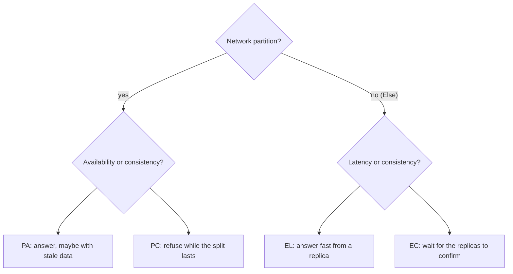

**Risks.** Ignoring it means promising the business a system that is "always available and always right", then finding out during the first partition that it answers wrong or not at all, without anyone having chosen which. I have the choice made in advance, data by data, between refusing and answering with a possibly stale value, and I write it down in an ADR.

:material-book-open-variant: Reference docs: [Seth Gilbert and Nancy Lynch, "Brewer's Conjecture and the Feasibility of Consistent, Available, Partition-Tolerant Web Services"](https://dl.acm.org/doi/10.1145/564585.564601) (2002); [Martin Kleppmann, "Please stop calling databases CP or AP"](https://martin.kleppmann.com/2015/05/11/please-stop-calling-databases-cp-or-ap.html) (May 2015); [Daniel Abadi, "Consistency Tradeoffs in Modern Distributed Database System Design"](https://www.cs.umd.edu/~abadi/papers/abadi-pacelc.pdf) (2012)
{ .doc-ref }

### Strong or eventual consistency

<a class="pill pill-scope pill-scope-system" href="#map-of-scales">Scale · System</a> <span class="pill pill-status pill-status-ok" title="Still valid, checked November 2026">Current · 11/2026</span> <a class="pill pill-nature pill-nature-decide" href="../architecture/#how-to-read-this-page" title="A choice the team or the architects must make, then record in an ADR">Decide</a> <a class="pill pill-topic pill-topic-data" href="../architecture/#how-to-read-this-page" title="About where the data lives and how its copies stay in agreement">Data</a>

**<span class="term" data-term="strong-consistency">Strong consistency</span>**: after a confirmed write, every read sees the new value. **<span class="term" data-term="eventual-consistency">Eventual consistency</span>**: the copies will end up identical, but a read right after the write may see the old value.

!!! noob "As noob"
    Picture a chain of shops changing a price: head office sends the new label, and each shop puts it up a few minutes later. For that short while, two shops show two different prices, but they all end up showing the same one. The one thing to remember: **eventual means "soon the same everywhere", not "right now".**

``` { .text .ex-illus title="Illustration" }
10:00:00.000  ada changes her address (written on the primary database)
10:00:00.050  ada reloads the page, read from a lagging replica: old address
10:00:00.300  the replica has caught up: new address
```

Common fix for this case: reading my own writes from the primary for a few seconds ("read your writes").

**Risks.** Requiring strong consistency everywhere makes every write slower and the service unavailable as soon as a replica is missing. Choosing eventual consistency without telling the business produces "impossible" bugs: a customer changes their address, reloads and sees the old one, so they type it again or call support. I choose data by data, and I add "read your writes" where the user rereads what they just wrote.

:material-book-open-variant: Reference docs: [Werner Vogels, "Eventually Consistent"](https://www.allthingsdistributed.com/2008/12/eventually_consistent.html) (2008)
{ .doc-ref }

### Replication and quorum

<a class="pill pill-scope pill-scope-system" href="#map-of-scales">Scale · System</a> <a class="pill pill-scope pill-scope-infra" href="#map-of-scales">Scale · Infrastructure</a> <span class="pill pill-status pill-status-ok" title="Still valid, checked November 2026">Current · 11/2026</span> <a class="pill pill-nature pill-nature-know" href="../architecture/#how-to-read-this-page" title="A law or a phenomenon nobody chooses: knowing it prevents bad decisions">Know</a> <a class="pill pill-topic pill-topic-data" href="../architecture/#how-to-read-this-page" title="About where the data lives and how its copies stay in agreement">Data</a>

**<span class="term" data-term="replication">Replication</span>** keeps several copies of a piece of data on several machines. With N copies, a write waits for W confirmations and a read queries R copies. If R + W > N, at least one copy read necessarily has the latest write: that is the **<span class="term" data-term="quorum">quorum</span>**.

!!! noob "As noob"
    Picture three notebooks holding the same list. If I always write in at least two of them and always read at least two, the two groups necessarily share one notebook, which holds the latest write: I just keep the most recent version among those I read. The one thing to remember: **if reads and writes always overlap on at least one copy, the read sees the latest write.**

| N | W | R | R + W > N? | Effect |
|---|---|---|---|---|
| 3 | 2 | 2 | yes | up-to-date read, tolerates one copy down |
| 3 | 1 | 1 | no | fast, but reads sometimes stale |
| 3 | 3 | 1 | yes | fast read, but one copy down blocks writes |

**Risks.** Ignoring the quorum means setting W and R at random: with W = 1 and R = 1 on three copies, a read can return a stale value while the team believes the database is consistent. I check R + W > N for every piece of data that must be up to date, and I measure replica lag.

:material-book-open-variant: Reference docs: [Giuseppe DeCandia et al., "Dynamo: Amazon's Highly Available Key-value Store"](https://www.allthingsdistributed.com/files/amazon-dynamo-sosp2007.pdf) (2007)
{ .doc-ref }

### Consensus and leader election

<a class="pill pill-scope pill-scope-infra" href="#map-of-scales">Scale · Infrastructure</a> <span class="pill pill-status pill-status-ok" title="Still valid, checked November 2026">Current · 11/2026</span> <a class="pill pill-nature pill-nature-know" href="../architecture/#how-to-read-this-page" title="A law or a phenomenon nobody chooses: knowing it prevents bad decisions">Know</a> <a class="pill pill-topic pill-topic-data" href="../architecture/#how-to-read-this-page" title="About where the data lives and how its copies stay in agreement">Data</a>

A **<span class="term" data-term="consensus-algorithm">consensus algorithm</span>** lets a group of machines agree on a value despite failures. The most taught today is **Raft** (Diego Ongaro and John Ousterhout, 2014), designed to be easier to understand than Paxos (Leslie Lamport, published in 1998). It is used for **<span class="term" data-term="leader-election">leader election</span>**: one machine writes, the others follow, and a new one is elected if the leader fails. A decision requires a majority:

| Nodes | Majority | Failures tolerated |
|---|---|---|
| 3 | 2 | 1 |
| 5 | 3 | 2 |
| 4 | 3 | 1 (a 4th node adds nothing) |

Hence odd numbers. The majority prevents **<span class="term" data-term="split-brain">split-brain</span>**: two halves cut apart cannot both elect a leader. I almost never write Raft myself: I rely on etcd, ZooKeeper, or the database that embeds it.

!!! noob "As noob"
    Picture a board of five people who must appoint a chair: it takes at least three votes. If the room is split into two groups, one of three and one of two, only the group of three can elect someone, so there are never two chairs at once. The one thing to remember: **requiring a majority guarantees one leader at a time.**

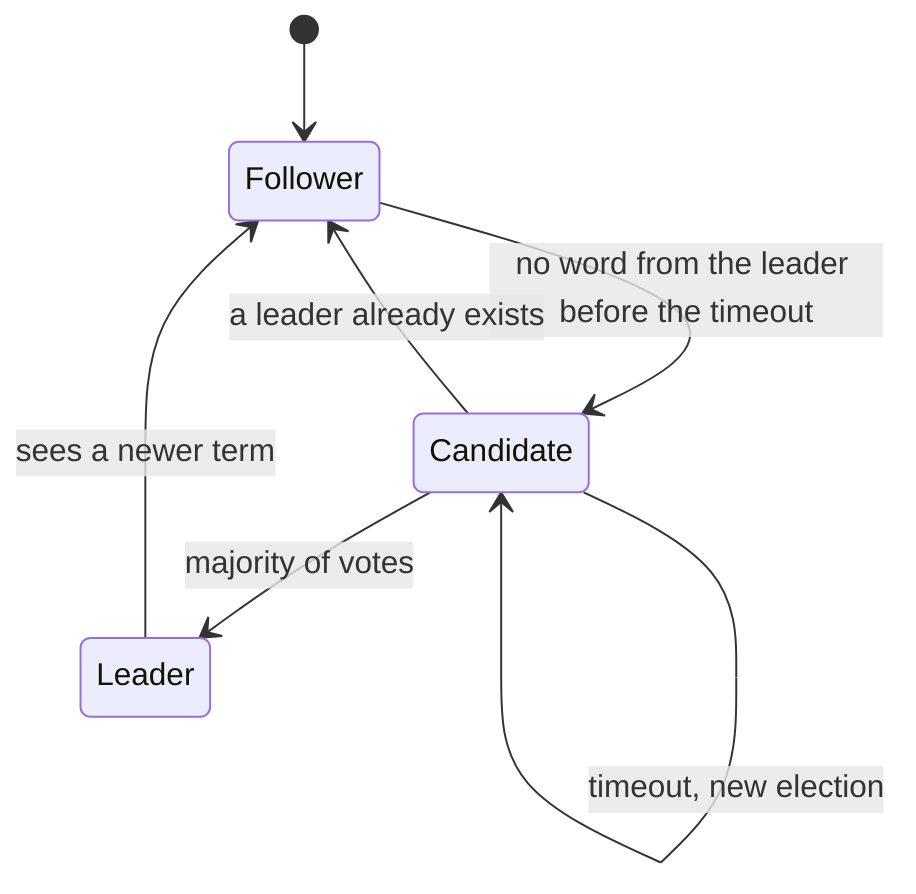

**Risks.** Ignoring it leads to writing one's own leader election with a lock and a delay: during a network partition, two machines believe they are leader and each writes on its own side (split-brain), so the data diverges. I rely on etcd, ZooKeeper or the database, with an odd number of nodes.

:material-book-open-variant: Reference docs: [The Raft site](https://raft.github.io/) (accessed November 2026); [Diego Ongaro and John Ousterhout, "In Search of an Understandable Consensus Algorithm"](https://raft.github.io/raft.pdf) (2014)
{ .doc-ref }

### Clocks and event order

<a class="pill pill-scope pill-scope-system" href="#map-of-scales">Scale · System</a> <span class="pill pill-status pill-status-ok" title="Still valid, checked November 2026">Current · 11/2026</span> <a class="pill pill-nature pill-nature-know" href="../architecture/#how-to-read-this-page" title="A law or a phenomenon nobody chooses: knowing it prevents bad decisions">Know</a> <a class="pill pill-topic pill-topic-data" href="../architecture/#how-to-read-this-page" title="About where the data lives and how its copies stay in agreement">Data</a>

Two machines' clocks are never perfectly synchronized: sorting events from different machines by their time can give the wrong order. Leslie Lamport ("Time, Clocks, and the Ordering of Events in a Distributed System", 1978) proposes a **<span class="term" data-term="lamport-clock">logical clock</span>**: a counter that respects causality (if A caused B, A has a smaller number).

!!! noob "As noob"
    Two people write down the time from their own watches, and one watch is two minutes fast: sorting their notes by time can put an answer before its question. A logical clock replaces the time with a number: when I receive a message, I take a number bigger than its number, so an answer always comes after its question. Limit: for two unrelated events, the numbers say nothing about the real order. The one thing to remember: **to order things that cause each other, count the exchanges instead of reading the clock.**

``` { .python .ex-illus title="Illustration" }
# Example: Lamport clock, a counter instead of the time of day
class LamportClock:
    def __init__(self) -> None:
        self.time = 0

    # Example: a local event moves the counter up by 1
    def tick(self) -> int:
        self.time += 1
        return self.time

    # Example: on receipt, I take a number greater than the one received
    def receive(self, remote_time: int) -> int:
        self.time = max(self.time, remote_time) + 1
        return self.time
```

In practice: a version number per object (ignore an update older than the one already applied) or a partition key that keeps order per order. See [message ordering](api-rest-async.md#message-ordering).

**Risks.** Sorting by machine time means accepting that an older update overwrites a newer one as soon as a clock runs a few milliseconds ahead: the customer sees their old address come back. I compare version numbers, not times, whenever I must decide which write wins.

:material-book-open-variant: Reference docs: [Leslie Lamport, "Time, Clocks, and the Ordering of Events in a Distributed System"](https://lamport.azurewebsites.net/pubs/time-clocks.pdf) (1978)
{ .doc-ref }

### Idempotency

<a class="pill pill-scope pill-scope-code" href="#map-of-scales">Scale · Code</a> <a class="pill pill-scope pill-scope-system" href="#map-of-scales">Scale · System</a> <span class="pill pill-status pill-status-ok" title="Still valid, checked November 2026">Current · 11/2026</span> <a class="pill pill-nature pill-nature-decide" href="../architecture/#how-to-read-this-page" title="A choice the team or the architects must make, then record in an ADR">Decide</a>

On a network, I do not always know whether a request succeeded: the response may have been lost. So I retry, so the server receives duplicates. **<span class="term" data-term="idempotency">Idempotency</span>** (doing the same operation twice has the same effect as once) is the condition for any safe retry. The mechanisms (`Idempotency-Key`, idempotent consumer) are in [API: REST and asynchronous](api-rest-async.md#delivery-guarantees).

!!! noob "As noob"
    Pressing the lift call button twice does not bring two lifts: that is idempotent. Paying twice at the till because the receipt did not print, on the other hand, costs me twice. The one thing to remember: **an idempotent operation can be replayed safely, and that is what makes a retry safe.**

Example: `POST` is not idempotent by nature (see [HTTP methods](api-rest-async.md#http-methods)), the client makes it safe with an **<span class="term" data-term="idempotency-key">idempotency key</span>** it generates once per payment.

``` { .text .ex-illus title="Illustration" }
1. client   POST /charges  Idempotency-Key: 7f3a...  {"order": "A42", "amount": 4990}
2. server   charges the card, stores (7f3a..., body hash, 201 response, created_at) in idempotency_keys
3. client   the response is lost: timeout after 2 s
4. client   retry: same request, same key 7f3a...
5. server   key found, same hash: returns the stored 201 response, without charging a 2nd time
6. client   same key but different body ("amount": 9990): 422, the key is already bound to another request
```

The `idempotency_keys(key, request_hash, response, created_at)` table is purged after a delay (24 h for example). Pitfall: write the key and perform the charge in the same transaction, otherwise two simultaneous retries both go through.

``` { .python .ex-bad title="Avoid" }
# Avoid: check then write in two steps, two simultaneous retries both go through
def charge(key: str, order: str, amount: int) -> Response:
    if db.find_key(key) is None:
        response = payment.debit(order, amount)
        db.save_key(key, response)
        return response
    return db.find_key(key).response
```

``` { .python .ex-good title="Recommended" }
# Good: the key is reserved by a unique constraint before charging
def charge(key: str, order: str, amount: int) -> Response:
    with db.transaction():
        inserted = db.insert_key_if_absent(key, status="in_progress")
        if not inserted:
            return db.find_key(key).response
        response = payment.debit(order, amount)
        db.store_response(key, response)
    return response
```

:material-book-open-variant: Reference docs: [IETF, "The Idempotency-Key HTTP Header Field"](https://datatracker.ietf.org/doc/draft-ietf-httpapi-idempotency-key-header/) (draft, accessed November 2026); [Stripe, "Idempotent requests"](https://docs.stripe.com/api/idempotent_requests) (accessed November 2026)
{ .doc-ref }

| I want to... | I use... |
|---|---|
| never to show wrong data, like a bank balance, even if it means answering "unavailable" | strong consistency, majority quorum |
| always to answer, even with data a few seconds old, like a like counter | eventual consistency, replicas |
| only one machine at a time to have the right to write, otherwise two machines make conflicting decisions at the same time | leader election through an existing consensus tool |
| to put back in order events from several machines whose clocks disagree, without a reply landing before its question | version number or logical clock, not wall-clock time |
| to retry after a timeout without risking doing the action twice, like charging twice for a payment whose response got lost | idempotent operations |

!!! maturity "Measuring maturity"
    | Level | What I see in the team |
    |---|---|
    | N1 | the team knows CAP and the fallacies, but every network call is written like a local call; an idempotency key is added once a duplicate has already hurt |
    | N2 | every write operation has an idempotency key, the intended consistency level is written down for each piece of data (strong for the balance, eventual for the counter), and consensus comes from a proven tool |
    | N3 | duplicates are rejected by a unique constraint in the database, and a network failure test (cut, injected latency) runs in pre-production without anyone stepping in |
    | N4 | the team tracks the rate of absorbed duplicates, replica lag and stale reads, and adjusts quorum or read routing from these numbers |

    **I measure**: the number of replayed requests absorbed by the idempotency key, read in the application log; replication lag at p99, read in the database metrics.

## Data across services

This section is about **data architecture**, not about how the code is split: where each piece of data lives, who may write it, and how two services stay in agreement without sharing a database. Everything here is <span class="pill pill-nature pill-nature-decide">Decide</span>, by the team owning each service.

### One database per service

<a class="pill pill-scope pill-scope-system" href="#map-of-scales">Scale · System</a> <span class="pill pill-status pill-status-ok" title="Still valid, checked November 2026">Current · 11/2026</span> <a class="pill pill-nature pill-nature-decide" href="../architecture/#how-to-read-this-page" title="A choice the team or the architects must make, then record in an ADR">Decide</a> <a class="pill pill-topic pill-topic-data" href="../architecture/#how-to-read-this-page" title="About where the data lives and how its copies stay in agreement">Data</a>

Each service alone owns its data: the others go through its API or its events, never through its tables. If three services read the same **<span class="term" data-term="shared-database">shared database</span>**, a simple column rename breaks all three, so nobody dares touch it any more. Consequence: a business operation touching several services can no longer fit in a single database transaction. **<span class="term" data-term="two-phase-commit">Two-phase commit</span>** (2PC) exists, but blocks everyone if the coordinator fails:

``` { .text .ex-illus title="Illustration" }
phase 1  coordinator -> stock, billing: "ready to commit?" (prepare)
         stock: yes (locks 1 item); billing: yes (locks the amount)
phase 2  coordinator -> stock, billing: "commit"; each one applies and releases its locks
failure  the coordinator crashes between the two phases: stock and billing voted yes, wait for the order and keep their locks
```

Between services, avoid it: each service would have to accept being locked by another, all must be available at the same time, and many databases and brokers do not offer it. The saga, below, only uses short local transactions and accepts visible intermediate states.

:material-book-open-variant: Reference docs: [Chris Richardson, microservices.io, "Database per service"](https://microservices.io/patterns/data/database-per-service.html) (accessed November 2026)
{ .doc-ref }

### Choosing the type of database

<a class="pill pill-scope pill-scope-app" href="#map-of-scales">Scale · Application</a> <a class="pill pill-scope pill-scope-system" href="#map-of-scales">Scale · System</a> <span class="pill pill-status pill-status-ok" title="Still valid, checked November 2026">Current · 11/2026</span> <a class="pill pill-nature pill-nature-decide" href="../architecture/#how-to-read-this-page" title="A choice the team or the architects must make, then record in an ADR">Decide</a> <a class="pill pill-topic pill-topic-data" href="../architecture/#how-to-read-this-page" title="About where the data lives and how its copies stay in agreement">Data</a>

My new service must store its data, and someone already suggests "a NoSQL database, because it is more modern". The right starting point is not a product name but the **access patterns**: how the service reads and writes (by key, by filter, by time range, following relationships, in free text), with which volumes and which consistency. Each database family is optimized for one pattern:

| Family | Stores data as... | Good for | Examples |
|---|---|---|---|
| <span class="term" data-term="relational-database">relational</span> | linked tables, with transactions, constraints and joins | the default case: orders, payments, anything that needs a transaction over several rows | PostgreSQL, MySQL |
| <span class="term" data-term="document-database">document</span> | JSON objects read and written as one block, with a variable structure | a product page whose attributes change with the category | MongoDB, Firestore |
| <span class="term" data-term="key-value-store">key-value</span> | an opaque value behind a key | very fast reads by key: sessions, carts, cache | Redis, DynamoDB |
| <span class="term" data-term="wide-column-store">wide-column</span> | very wide rows, spread by key | huge write volumes, read back by key and by time range: metrics, event logs | Cassandra, ScyllaDB |
| search engine | an <span class="term" data-term="inverted-index">inverted index</span>: each word points to the documents that contain it | free text, filters, typo tolerance | OpenSearch, Elasticsearch |
| <span class="term" data-term="graph-database">graph</span> | nodes and relationships | queries that follow relationships over several levels: "the friends of my friends" | Neo4j |

**When to switch family.** By default, I take a relational database: everybody knows how to run it, its transactions keep the data right and, with <span class="term" data-term="jsonb">JSONB</span> columns, it covers many "document" needs. I add another database only for an access pattern it serves badly, measured or estimated, never out of taste.

**Why.** Using several database types in one system is called **<span class="term" data-term="polyglot-persistence">polyglot persistence</span>** (Martin Fowler, 2011): each database serves what it does best. The cost is real: one more database means backups, upgrades, skills, alerts and a copy of data to keep in sync. Dan McKinley sums it up in "Choose Boring Technology" (2015): each team only has a few **innovation tokens**, a new technology spends one, and it had better be worth it. A "boring" technology has failure modes that are already known and documented.

**How.** Example of a fictitious marketplace: 5 million products with variable attributes, orders, full-text search and recommendations.

``` { .text .ex-illus title="Illustration" }
orders, payments   PostgreSQL: transactions over several tables, no debate
catalog            PostgreSQL, variable attributes in an indexed JSONB column
full-text search   OpenSearch, fed from PostgreSQL, rebuildable at any time
recommendations    a table of product pairs recomputed every night, no graph database
total              2 technologies instead of 4
```

The search engine is never the <span class="term" data-term="source-of-truth">source of truth</span>: it is fed by <span class="term" data-term="cdc">CDC</span> (reading the main database's log), not by a dual write in the code, which diverges the day the second write fails. If one day order writes exceed what the database can absorb, I first look at replicas and partitioning ([Scaling a database](sql.md#scaling-a-database)), before switching family.

:material-book-open-variant: Reference docs: [Dan McKinley, "Choose Boring Technology"](https://mcfunley.com/choose-boring-technology) (2015); [Martin Fowler, "PolyglotPersistence"](https://martinfowler.com/bliki/PolyglotPersistence.html) (2011)
{ .doc-ref }

### Orchestrated or choreographed saga

<a class="pill pill-scope pill-scope-system" href="#map-of-scales">Scale · System</a> <span class="pill pill-status pill-status-ok" title="Still valid, checked November 2026">Current · 11/2026</span> <a class="pill pill-nature pill-nature-decide" href="../architecture/#how-to-read-this-page" title="A choice the team or the architects must make, then record in an ADR">Decide</a> <a class="pill pill-topic pill-topic-data" href="../architecture/#how-to-read-this-page" title="About where the data lives and how its copies stay in agreement">Data</a>

A **<span class="term" data-term="saga-pattern">saga</span>** (Hector Garcia-Molina and Kenneth Salem, 1987) splits the operation into local steps, each with a **<span class="term" data-term="compensation">compensation</span>**: the action that undoes its effect if a later step fails.

!!! noob "As noob"
    Planning a trip means booking the train, then the hotel, then the car, with three vendors who do not know each other. If no car is available, I cannot erase the past: I cancel the hotel and then the train, sometimes with a fee. The one thing to remember: **between services there is no "undo everything" button, each step plans its own cancellation.**

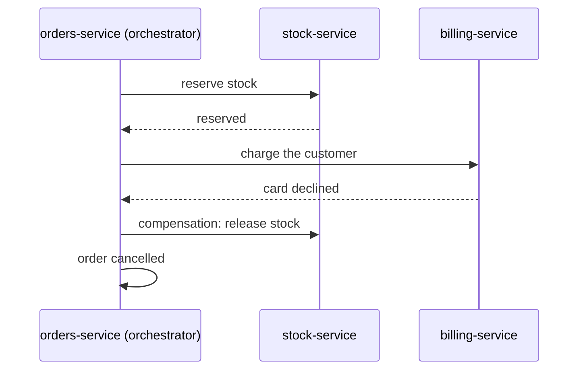

The same saga, choreographed: no coordinator, each service reacts to the events published on the broker.

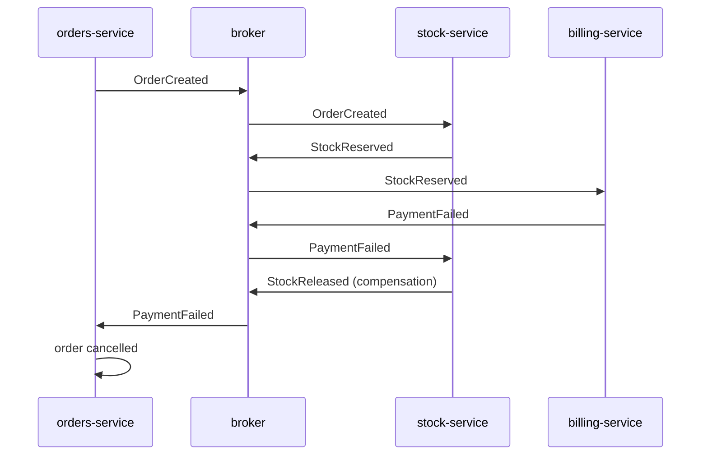

| Variant | How it works | Good when |
|---|---|---|
| <span class="term" data-term="saga-orchestration">orchestrated</span> | a coordinator calls each step and decides on compensations | more than three steps, need to see a saga's state in one place |
| <span class="term" data-term="saga-choreography">choreographed</span> | each service reacts to the others' events | two or three steps, very autonomous teams |

A compensation does not erase the past: a refund is not "never charged", the customer sees both lines. The business must validate these intermediate states.

**Risks.** In choreography, nobody sees a saga's state: when Lea's order 1042 stays stuck as "pending", I have to trace events back through three services to find the lost step; I propagate a correlation ID and switch to orchestration beyond three steps. In orchestration, the coordinator slowly attracts the other services' business rules and becomes the code everyone has to change; I limit it to sequencing the steps and the compensations. In both cases, a compensation that fails leaves the stock reserved for nothing: I make it safe to replay without double effect and I monitor sagas left open.

:material-book-open-variant: Reference docs: [Chris Richardson, microservices.io, "Saga"](https://microservices.io/patterns/data/saga.html) (accessed November 2026); [Microsoft, "Saga distributed transactions pattern"](https://learn.microsoft.com/en-us/azure/architecture/patterns/saga) (accessed November 2026)
{ .doc-ref }

### Outbox

<a class="pill pill-scope pill-scope-app" href="#map-of-scales">Scale · Application</a> <span class="pill pill-status pill-status-ok" title="Still valid, checked November 2026">Current · 11/2026</span> <a class="pill pill-nature pill-nature-decide" href="../architecture/#how-to-read-this-page" title="A choice the team or the architects must make, then record in an ADR">Decide</a> <a class="pill pill-topic pill-topic-data" href="../architecture/#how-to-read-this-page" title="About where the data lives and how its copies stay in agreement">Data</a>

Writing to the database then publishing an event are two operations that can half succeed. The **<span class="term" data-term="outbox-pattern">outbox</span>** pattern solves this: it is described in [the write-then-publish trap](api-rest-async.md#the-write-then-publish-trap).

**Risks.** The outbox guarantees an event goes out at least once, not exactly once: the relay can publish it twice after a restart, so every consumer must be idempotent. When the relay stops, the table grows and events go out late without anyone noticing. I purge published rows and I alert on the age of the oldest unpublished message.

:material-book-open-variant: Reference docs: [Chris Richardson, microservices.io, "Transactional outbox"](https://microservices.io/patterns/data/transactional-outbox.html) (accessed November 2026)
{ .doc-ref }

### CQRS

<a class="pill pill-scope pill-scope-app" href="#map-of-scales">Scale · Application</a> <a class="pill pill-scope pill-scope-system" href="#map-of-scales">Scale · System</a> <span class="pill pill-status pill-status-ok" title="Still valid, checked November 2026">Current · 11/2026</span> <a class="pill pill-nature pill-nature-decide" href="../architecture/#how-to-read-this-page" title="A choice the team or the architects must make, then record in an ADR">Decide</a> <a class="pill pill-topic pill-topic-data" href="../architecture/#how-to-read-this-page" title="About where the data lives and how its copies stay in agreement">Data</a>

**<span class="term" data-term="cqrs">CQRS</span>** (Command Query Responsibility Segregation, popularized by Greg Young around 2010) separates the model that writes from the model that reads. Writes go through a strict business model; reads go through views built for each screen, updated from the changes.

!!! noob "As noob"
    In a restaurant, the kitchen follows strict rules to prepare each order, and the specials board lets customers read what is available. The board is copied from the kitchen, in a shape designed to be read at a glance, and it can be one dish behind. The one thing to remember: **one model to write correctly, another to read fast, with a small lag between them.**

``` { .text .ex-illus title="Illustration" }
write   POST /orders           Order model (business rules)  orders table
read    GET /dashboard/sales   sales_by_day view (precomputed, updated by event)
```

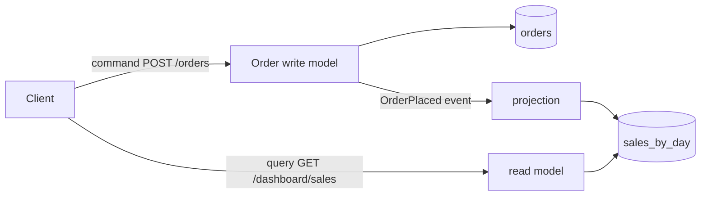

Useful when reads and writes have very different shapes or volumes. Cost: the view lags by a few moments.

**Risks.** On a plain CRUD, two models double the code for nothing. A bug in the projection gives a wrong view that nobody detects, since the write database is correct; and a customer who just ordered may not see their order for a few seconds. I keep CQRS for reads that really differ from writes and I keep a way to rebuild the view from scratch.

:material-book-open-variant: Reference docs: [Martin Fowler, "CQRS"](https://martinfowler.com/bliki/CQRS.html) (2011); [Microsoft, "CQRS pattern"](https://learn.microsoft.com/en-us/azure/architecture/patterns/cqrs) (accessed November 2026)
{ .doc-ref }

### Event sourcing

<a class="pill pill-scope pill-scope-app" href="#map-of-scales">Scale · Application</a> <span class="pill pill-status pill-status-ok" title="Still valid, checked November 2026">Current · 11/2026</span> <a class="pill pill-nature pill-nature-decide" href="../architecture/#how-to-read-this-page" title="A choice the team or the architects must make, then record in an ADR">Decide</a> <a class="pill pill-topic pill-topic-data" href="../architecture/#how-to-read-this-page" title="About where the data lives and how its copies stay in agreement">Data</a>

With **<span class="term" data-term="event-sourcing">event sourcing</span>** (described by Martin Fowler in 2005), I do not store the current state but the sequence of events; the state is recomputed by replaying them.

``` { .text .ex-illus title="Illustration" }
account 42: Opened(0); Credited(100); Debited(30); Debited(20)   recomputed state: 50
```

Gain: a complete, verifiable history, and the ability to build new views afterwards. High cost: evolving the event format, replaying large volumes, deleting personal data. Reserved for domains where history is the business (accounting, audit).

The event format always ends up changing, whereas the log itself is never rewritten: that is what makes it valuable. Example: `CreditIssued` version 1 carried `amount` in decimal euros; version 2 carries `amount_cents` and `currency`. The standard technique is **<span class="term" data-term="upcasting">upcasting</span>**: the reading code converts each old event to the current format just before applying it, and the log keeps the version 1 events as they are. Each event therefore carries a schema version number from day one.

``` { .python .ex-bad title="Avoid" }
# Avoid: rewriting the log in place, the authoritative history is modified
def migrate_journal(store):
    for event in store.all_events("CreditIssued"):
        event["amount_cents"] = round(event.pop("amount") * 100)
        store.overwrite(event)
```

``` { .python .ex-good title="Recommended" }
# Good: the log stays intact, reading converts the old versions
def upcast(raw: dict) -> dict:
    if raw["type"] != "CreditIssued" or raw.get("schema_version", 1) != 1:
        return raw
    v2 = {key: value for key, value in raw.items() if key != "amount"}
    return {**v2, "schema_version": 2,
            "amount_cents": round(raw["amount"] * 100), "currency": "EUR"}
```

Rewriting the log breaks what makes event sourcing worth it: the auditor can no longer check that the history has not moved, and a migration mistake damages the whole history with no way back. With upcasting, the code that applies events only knows the latest version (the example assumes every version 1 event was in euros). When conversions pile up over many versions, the log can be copied to a new transformed stream, with the old one archived.


:material-book-open-variant: Reference docs: [Martin Fowler, "Event Sourcing"](https://martinfowler.com/eaaDev/EventSourcing.html) (2005); [Microsoft, "Event Sourcing pattern"](https://learn.microsoft.com/en-us/azure/architecture/patterns/event-sourcing) (accessed November 2026); [Greg Young, "Versioning in an Event Sourced System"](https://leanpub.com/esversioning) (Leanpub, 2017, to check)
{ .doc-ref }

| I want to... | I use... |
|---|---|
| to carry out a business action that touches several services, like an order that reserves stock then charges the customer | saga with compensations |
| to write the order to the database then publish the event, without losing it if the service crashes in between | outbox |
| a heavy dashboard, like sales per day, that does not slow down order taking | CQRS with read views |
| a complete history that is authoritative, like the movements of an account in accounting | event sourcing, only where it is required |
| two services to use the same data, like the customer's address for billing and for shipping | API or events, never the other's database |
| to choose where a new service stores its data, while someone already suggests a trendy database | access patterns, relational database by default |

!!! maturity "Measuring maturity"
    | Level | What I see in the team |
    |---|---|
    | N1 | each service has its own database on paper, but a reporting script or another service still reads its tables |
    | N2 | no service reads another one's database (access denied by database permissions), sagas have their compensations written and the outbox publishes the events |
    | N3 | a stuck saga or an outbox message unpublished for several minutes triggers an alert and an automatic compensation, without waiting for a customer to complain |
    | N4 | the team tracks outbox lag, the share of compensated sagas and CQRS view lag, and adjusts its choices (orchestrate, rework a view) from these numbers |

    **I measure**: the age of the oldest unpublished outbox message, read with a query on the table; the share of sagas ending in a compensation, read in the orchestrator or the events.

## Resilience

A slow dependency is more dangerous than a dead one: requests pile up, hold threads and connections, and the slowness spreads to everything that calls the service. That is called a cascading failure. The mechanisms below stack; the classic reference is Michael Nygard, "Release It!" (2007, 2nd edition in 2018).

### Timeout

<a class="pill pill-scope pill-scope-code" href="#map-of-scales">Scale · Code</a> <a class="pill pill-scope pill-scope-system" href="#map-of-scales">Scale · System</a> <span class="pill pill-status pill-status-ok" title="Still valid, checked November 2026">Current · 11/2026</span> <a class="pill pill-nature pill-nature-decide" href="../architecture/#how-to-read-this-page" title="A choice the team or the architects must make, then record in an ADR">Decide</a>

Without a limit, my call to a slow service can wait for minutes, and my own service stays stuck with it. So every network call has a **<span class="term" data-term="timeout">timeout</span>**, chosen from measured latency (a bit above the dependency's p99), never the library default, which is often infinite or several minutes. The total timeout of a chain must fit inside the caller's.

**Risks.** Too short, the timeout cuts requests that would have succeeded, and the retries that follow load a dependency that is already slow even more. Too long, it leaves threads blocked and the slowness spreads. When the callee's timeout exceeds the caller's, work goes on for an answer nobody is waiting for any more. I set it from the measured p99 and I revisit it when latency changes.

:material-book-open-variant: Reference docs: [Marc Brooker, "Timeouts, retries, and backoff with jitter", Amazon Builders' Library](https://aws.amazon.com/builders-library/timeouts-retries-and-backoff-with-jitter/) (2019)
{ .doc-ref }

### Retry, exponential backoff and jitter

<a class="pill pill-scope pill-scope-code" href="#map-of-scales">Scale · Code</a> <a class="pill pill-scope pill-scope-system" href="#map-of-scales">Scale · System</a> <span class="pill pill-status pill-status-ok" title="Still valid, checked November 2026">Current · 11/2026</span> <a class="pill pill-nature pill-nature-decide" href="../architecture/#how-to-read-this-page" title="A choice the team or the architects must make, then record in an ADR">Decide</a>

Retrying helps with transient errors, as long as I wait longer and longer (**<span class="term" data-term="exponential-backoff">exponential backoff</span>**) and add randomness (**<span class="term" data-term="jitter">jitter</span>**), otherwise every client retries at the same millisecond (Marc Brooker, "Exponential Backoff And Jitter", AWS Architecture Blog, 2015).

``` { .python .ex-illus title="Illustration" }
import random
import time

# Example: base delay, ceiling and number of attempts, named
BASE_DELAY_S = 0.1
MAX_DELAY_S = 5.0
MAX_ATTEMPTS = 4
```

``` { .python .ex-bad title="Avoid" }
# Avoid: retries everything, immediately, forever
def call_with_naive_retry(call):
    while True:
        try:
            return call()
        except Exception:
            continue
```

``` { .python .ex-good title="Recommended" }
# Good: exponential backoff with jitter, only on a transient error
def call_with_retry(call):
    for attempt in range(MAX_ATTEMPTS):
        try:
            return call()
        except TimeoutError:
            if attempt == MAX_ATTEMPTS - 1:
                raise
            ceiling = min(MAX_DELAY_S, BASE_DELAY_S * 2**attempt)
            time.sleep(random.uniform(0, ceiling))
```

The naive version is the one that brings systems down: when the called service slows down, a thousand clients call it again in a loop without waiting, so it gets ten times more requests at the worst moment and never recovers. It also retries a `400` (the request is wrong and will stay wrong) and a non idempotent payment. Only retry transient errors (timeout, 503) and idempotent operations, never a 400.

:material-book-open-variant: Reference docs: [Marc Brooker, "Exponential Backoff And Jitter"](https://aws.amazon.com/blogs/architecture/exponential-backoff-and-jitter/) (2015); [Microsoft, "Retry pattern"](https://learn.microsoft.com/en-us/azure/architecture/patterns/retry) (accessed November 2026)
{ .doc-ref }

### Retry budget

<a class="pill pill-scope pill-scope-system" href="#map-of-scales">Scale · System</a> <span class="pill pill-status pill-status-ok" title="Still valid, checked November 2026">Current · 11/2026</span> <a class="pill pill-nature pill-nature-decide" href="../architecture/#how-to-read-this-page" title="A choice the team or the architects must make, then record in an ADR">Decide</a>

If each level of a three-service chain retries three times, one request can produce 27 on the last service: that is a **<span class="term" data-term="retry-storm">retry storm</span>**. A **<span class="term" data-term="retry-budget">retry budget</span>** caps retries at a share of normal traffic (Google's SRE book, 2016, mentions about 10% per client, to check), and only one level of the chain retries.

**Risks.** A budget that is too low lets transient errors reach the user that a single retry would have hidden; retrying at several levels despite the budget brings the storm back. I measure the retry rate per dependency and I write down which level of the chain is allowed to retry.

:material-book-open-variant: Reference docs: [Google SRE Book, "Handling Overload"](https://sre.google/sre-book/handling-overload/) (2016)
{ .doc-ref }

### Circuit breaker

<a class="pill pill-scope pill-scope-code" href="#map-of-scales">Scale · Code</a> <a class="pill pill-scope pill-scope-system" href="#map-of-scales">Scale · System</a> <span class="pill pill-status pill-status-ok" title="Still valid, checked November 2026">Current · 11/2026</span> <a class="pill pill-nature pill-nature-decide" href="../architecture/#how-to-read-this-page" title="A choice the team or the architects must make, then record in an ADR">Decide</a>

A **<span class="term" data-term="circuit-breaker">circuit breaker</span>** cuts calls to a failing dependency, to fail fast instead of waiting.

!!! noob "As noob"
    It is the circuit breaker in my house: when an appliance shorts, it cuts the power instead of letting the wires overheat. The difference: the software breaker resets itself after a delay, letting a few trial calls through. The one thing to remember: **failing right away beats waiting a long time only to fail anyway.**

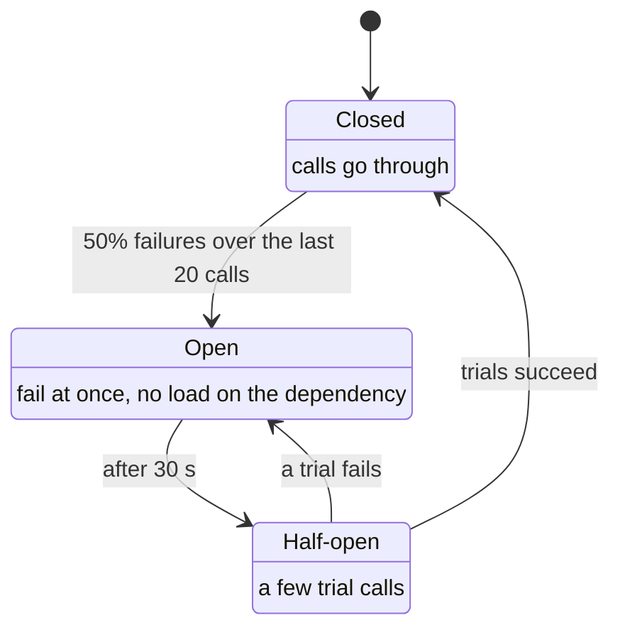

**Risks.** Badly tuned thresholds open the breaker on two errors when traffic is low, or make it flap between open and closed; a per-instance breaker also reacts differently from pod to pod. While it is open, a fallback answer is needed, otherwise the user sees a bare error. I base the thresholds on a minimum number of calls and I test the fallback.

:material-book-open-variant: Reference docs: [Martin Fowler, "CircuitBreaker"](https://martinfowler.com/bliki/CircuitBreaker.html) (2014); [Microsoft, "Circuit Breaker pattern"](https://learn.microsoft.com/en-us/azure/architecture/patterns/circuit-breaker) (accessed November 2026)
{ .doc-ref }

### Bulkhead

<a class="pill pill-scope pill-scope-app" href="#map-of-scales">Scale · Application</a> <a class="pill pill-scope pill-scope-system" href="#map-of-scales">Scale · System</a> <a class="pill pill-scope pill-scope-infra" href="#map-of-scales">Scale · Infrastructure</a> <span class="pill pill-status pill-status-ok" title="Still valid, checked November 2026">Current · 11/2026</span> <a class="pill pill-nature pill-nature-decide" href="../architecture/#how-to-read-this-page" title="A choice the team or the architects must make, then record in an ADR">Decide</a>

A **<span class="term" data-term="bulkhead">bulkhead</span>** (like a ship's compartments) reserves separate resources for each dependency: a pool of 20 connections for `billing-service`, another 20 for `stock-service`. If `billing-service` becomes slow, only its 20 connections are stuck, the rest of `my-api` answers.

**Risks.** Pools that are too small reject requests while the machine has room to spare; added up, pools that are too large exceed the number of connections the database accepts. I size each pool with [Little's law](#littles-law) and I check that their sum fits within the dependency's limit.

:material-book-open-variant: Reference docs: [Microsoft, "Bulkhead pattern"](https://learn.microsoft.com/en-us/azure/architecture/patterns/bulkhead) (accessed November 2026)
{ .doc-ref }

### Load shedding and backpressure

<a class="pill pill-scope pill-scope-system" href="#map-of-scales">Scale · System</a> <a class="pill pill-scope pill-scope-infra" href="#map-of-scales">Scale · Infrastructure</a> <span class="pill pill-status pill-status-ok" title="Still valid, checked November 2026">Current · 11/2026</span> <a class="pill pill-nature pill-nature-decide" href="../architecture/#how-to-read-this-page" title="A choice the team or the architects must make, then record in an ADR">Decide</a>

**<span class="term" data-term="load-shedding">Load shedding</span>** deliberately refuses part of the requests when the service saturates (a fast `503`, starting with the least important traffic) to serve the rest correctly. **<span class="term" data-term="backpressure">Backpressure</span>** pushes saturation back to the source: a full queue refuses new messages, and the producer slows down instead of filling memory. Reference: the "Handling Overload" and "Addressing Cascading Failures" chapters of Google's SRE book (2016).

Worked example (example figures):

``` { .text .ex-illus title="Illustration" }
load shedding   capacity 500 req/s, 700 arrive
                the 200 least important ones (recommendations, search) get an immediate 503
                checkout stays 100 % served, with no timeout for anyone
backpressure    the orders queue is capped at 1,000 messages
                the 1,001st publish is refused: the producer slows down or retries later
                without a cap, the queue grows until it fills the broker's memory
```

**Risks.** Badly ranked shedding refuses the wrong traffic, like payment instead of recommendations. Clients that retry every `503` right away double the load I wanted to reduce; backpressure, for its part, can block a producer which in turn blocks its own callers. I write down the priority of each route, I return `Retry-After` and I watch queue lengths.

:material-book-open-variant: Reference docs: [Google SRE Book, "Addressing Cascading Failures"](https://sre.google/sre-book/addressing-cascading-failures/) (2016)
{ .doc-ref }

### Rate limiting

<a class="pill pill-scope pill-scope-code" href="#map-of-scales">Scale · Code</a> <a class="pill pill-scope pill-scope-system" href="#map-of-scales">Scale · System</a> <span class="pill pill-status pill-status-ok" title="Still valid, checked November 2026">Current · 11/2026</span> <a class="pill pill-nature pill-nature-decide" href="../architecture/#how-to-read-this-page" title="A choice the team or the architects must make, then record in an ADR">Decide</a>

My API is open to partners, each with their own key. Yesterday, one partner's badly written script saturated `my-api`, and every other customer got timeouts. **<span class="term" data-term="rate-limit">Rate limiting</span>** caps the number of requests a caller can make over a period, for example 100 requests per minute per key. Beyond that, the API immediately answers `429 Too Many Requests` (RFC 6585, 2012) with a `Retry-After` header (RFC 9110, 2022) that says when to retry, instead of letting a single customer consume everyone's capacity. The difference with load shedding: load shedding protects the service when it saturates, whoever the caller; rate limiting protects customers from each other, even when the service is fine. The codes and the error format are in [Response codes](api-rest-async.md#response-codes).

**When.** A public or partner API, an expensive route (export, search), a login page to protect against mass password guessing. Between two internal services that trust each other, bulkheads and load shedding are often enough.

Five algorithms, from the simplest to the finest:

| Algorithm | Principle | Advantage | Limit |
|---|---|---|---|
| fixed window | one counter per key and per calendar minute | very simple: one `INCR` | up to 200 requests within a few seconds around the minute boundary |
| sliding window, log | keep the time of each request, count those in the last minute | exact | memory proportional to the number of requests |
| sliding window, counter | weight the previous minute's counter by the share still covered by the window | good trade-off, two counters per key | approximate |
| <span class="term" data-term="token-bucket">token bucket</span> | a bucket refills at a fixed rate, each request takes a token | allows small bursts, caps the average rate | a bit more computation, state to store |
| leaky bucket | requests enter a queue that drains at a constant rate | perfectly regular output rate | no bursts, the queue adds waiting time |

!!! noob "As noob"
    The token bucket is a transit card topped up automatically with one ticket every six seconds, with ten tickets at most. If I have not traveled for a while, I can chain ten rides (the burst); after that, I have to wait for tickets to come back. The one thing to remember: **the average rate is capped, but a small burst is still allowed.**

Sliding window counter example, at 10:01:15 (example numbers): the previous minute counted 84 requests, the current minute 30; the window still covers 75% of the previous minute, so 84 × 0.75 + 30 = 93, under the limit of 100. Cloudflare described this method in 2017.

**How.** To start, the fixed window is often enough; the token bucket is the right choice if I want to tolerate short bursts. The classic trap is the counter kept in the memory of each instance:

``` { .python .ex-illus title="Illustration" }
# Example: 100 requests per one-minute window
WINDOW_SECONDS = 60
LIMIT_PER_WINDOW = 100
```

``` { .python .ex-bad title="Avoid" }
# Avoid: a counter in the memory of each instance, never reset
local_counts: dict[str, int] = {}


def check_rate_limit_local(api_key: str) -> bool:
    local_counts[api_key] = local_counts.get(api_key, 0) + 1
    return local_counts[api_key] <= LIMIT_PER_WINDOW
```

``` { .python .ex-good title="Recommended" }
# Good: fixed window shared in Redis, INCR is atomic and expiry cleans up old windows
def check_rate_limit(redis, api_key: str, now: float) -> tuple[bool, int]:
    window = int(now // WINDOW_SECONDS)
    key = f"ratelimit:{api_key}:{window}"
    pipe = redis.pipeline()
    pipe.incr(key)
    pipe.expire(key, WINDOW_SECONDS * 2)
    count, _ = pipe.execute()
    retry_after = WINDOW_SECONDS - int(now % WINDOW_SECONDS)
    return count <= LIMIT_PER_WINDOW, retry_after
```

With four instances behind the load balancer, the local version gives the partner 400 requests per minute instead of 100, and it ends up blocking the key forever since its counter never goes down. With Redis, two instances incrementing at the same time get two different values, and `retry_after` fills the `Retry-After` header. For a shared token bucket, the computation is written as a Lua script run by Redis, to stay atomic. A product decision remains to be written down: if Redis goes down, do I let everything through or block everything? Standardized `RateLimit` headers (limit, remaining, reset) are being standardized at the IETF (draft, status to check).

:material-book-open-variant: Reference docs: [Stripe, "Scaling your API with rate limiters"](https://stripe.com/blog/rate-limiters) (2017); [Cloudflare, "Counting things, a lot of different things"](https://blog.cloudflare.com/counting-things-a-lot-of-different-things/) (2017)
{ .doc-ref }

### Graceful degradation

<a class="pill pill-scope pill-scope-app" href="#map-of-scales">Scale · Application</a> <a class="pill pill-scope pill-scope-system" href="#map-of-scales">Scale · System</a> <span class="pill pill-status pill-status-ok" title="Still valid, checked November 2026">Current · 11/2026</span> <a class="pill pill-nature pill-nature-decide" href="../architecture/#how-to-read-this-page" title="A choice the team or the architects must make, then record in an ADR">Decide</a>

**<span class="term" data-term="graceful-degradation">Graceful degradation</span>** delivers a reduced but useful service when a dependency fails: the recommendation engine is down, the product page shows cached "best sellers". It is decided at design time, screen by screen: what is essential, what can disappear.

**Risks.** A degraded mode never tested fails on the day it is needed: the fallback reads an empty cache or calls the same broken dependency. Fallback data presented as fresh misleads the user, for example stock shown "available" that no longer is. I test each fallback by cutting the dependency during a failure drill, and I clearly show what is approximate.

:material-book-open-variant: Reference docs: [AWS Well-Architected, "REL05-BP01 Implement graceful degradation"](https://docs.aws.amazon.com/wellarchitected/latest/reliability-pillar/rel_mitigate_interaction_failure_graceful_degradation.html) (accessed November 2026)
{ .doc-ref }

| I want to... | I use... |
|---|---|
| not to wait forever for a service that sometimes takes minutes to answer | timeout set from the measured p99 |
| a transient error, like a `503` while the called service restarts, not to make the user's request fail | retry with exponential backoff and jitter, on an idempotent operation |
| not to finish off an already struggling service under an avalanche of retries | retry budget, circuit breaker |
| the rest of `my-api` to keep answering when `billing-service` becomes slow | bulkhead (separate pools) |
| to hold a traffic peak beyond my capacity, like the start of a big sale, without the whole service going down | load shedding, backpressure on queues |
| the product page to still show when one piece fails, like the recommendation engine | graceful degradation, decided in advance |
| a single partner with a badly written script not to saturate the API for everyone else | per-key rate limit, shared counter, `429` with `Retry-After` |

!!! maturity "Measuring maturity"
    | Level | What I see in the team |
    |---|---|
    | N1 | a few calls have a timeout and a retry, added after an incident, with values copied from another service |
    | N2 | every network call goes through a shared client that enforces a timeout set from the p99, a retry with jitter on transient errors only, a circuit breaker and a pool per dependency |
    | N3 | during an outage, the breaker opens, shedding refuses secondary traffic and graceful degradation kicks in on their own, without anyone on call switching anything |
    | N4 | thresholds (timeouts, retry budget, rate limits) are reviewed every quarter from measured latencies, the retry rate and the results of failure drills |

    **I measure**: the share of outgoing calls without an explicit timeout, read in code review or by static analysis; the ratio of retries to initial requests per dependency, read in the HTTP client metrics.

## High availability and recovery

### Single point of failure

<a class="pill pill-scope pill-scope-system" href="#map-of-scales">Scale · System</a> <a class="pill pill-scope pill-scope-infra" href="#map-of-scales">Scale · Infrastructure</a> <span class="pill pill-status pill-status-ok" title="Still valid, checked November 2026">Current · 11/2026</span> <a class="pill pill-nature pill-nature-know" href="../architecture/#how-to-read-this-page" title="A law or a phenomenon nobody chooses: knowing it prevents bad decisions">Know</a>

A **<span class="term" data-term="spof">SPOF</span>** (single point of failure) is a component present in a single copy whose failure stops everything: a single database without a replica, a single load balancer, a certificate nobody renews, a single person who knows how to deploy. The first step of an availability review is to list them.

**Risks.** Ignoring them means doubling the servers while keeping a single load balancer, a single certificate or a single person who knows how to deploy: the outage comes through the piece nobody listed. I keep the list up to date at every availability review, people included.

### Composite availability

<a class="pill pill-scope pill-scope-system" href="#map-of-scales">Scale · System</a> <a class="pill pill-scope pill-scope-infra" href="#map-of-scales">Scale · Infrastructure</a> <a class="pill pill-nature pill-nature-know" href="../architecture/#how-to-read-this-page" title="A law or a phenomenon nobody chooses: knowing it prevents bad decisions">Know</a>

**<span class="term" data-term="availability">Availability</span>** is the share of time the system answers correctly. 99.9% allows about 8 h 45 min of downtime per year (43 min per month); 99.99%, about 53 min per year. **<span class="term" data-term="composite-availability">Composite availability</span>** is computed from the building blocks:

``` { .text .ex-illus title="Illustration" }
in series (needs A AND B)           A × B
  my-api 99.9% calls billing 99.9%      0.999 × 0.999 = 0.998    i.e. 99.8%

in parallel (A OR B is enough)      1 - (1 - A) × (1 - B)
  two replicas at 99% each              1 - 0.01 × 0.01 = 0.9999 i.e. 99.99%
```

Each synchronous dependency added in series lowers availability; redundancy raises it, as long as the copies do not fail for the same reason (same zone, same deployment, same bug).

**Risks.** Ignoring it means promising 99.9% for a 99.9% service that calls four 99.9% dependencies in series: the calculation gives about 99.5%, so the promise cannot be kept even before the first outage. I do the calculation before committing and I take synchronous dependencies off the critical path.

:material-book-open-variant: Reference docs: [Google SRE Book, "Embracing Risk"](https://sre.google/sre-book/embracing-risk/) (2016)
{ .doc-ref }

### Zones and regions

<a class="pill pill-scope pill-scope-infra" href="#map-of-scales">Scale · Infrastructure</a> <span class="pill pill-status pill-status-ok" title="Still valid, checked November 2026">Current · 11/2026</span> <a class="pill pill-nature pill-nature-decide" href="../architecture/#how-to-read-this-page" title="A choice the team or the architects must make, then record in an ADR">Decide</a>

An **<span class="term" data-term="availability-zone">availability zone</span>** is a data center (or group) isolated from the others in power and network, a few kilometers away, with latency around a millisecond between zones. A **<span class="term" data-term="cloud-region">region</span>** groups several zones in one geographic area; between regions, latency rises to tens of milliseconds. Spreading over three zones protects against a data center failure; protecting against the loss of a whole region costs much more.

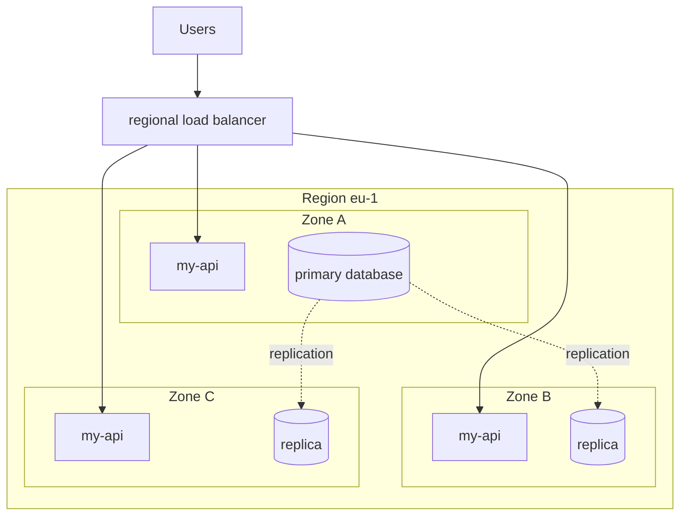


Spreading over three zones is not enough if recovery depends on an action during the failure. **<span class="term" data-term="static-stability">Static stability</span>** (Becky Weiss and Mike Furr, Amazon Builders' Library, 2020, to check) requires the system to keep working during a failure **without changing state**: without creating machines, without changing configuration, without calling the failed component. In practice, I provision the spare capacity in advance rather than relying on autoscaling at failure time, because the control plane (the API that creates machines) often suffers at the same time.

!!! noob "As noob"
    It is the spare wheel already in the trunk, rather than the tow truck's phone number: the day of the flat tire, I need nobody, and above all not a tow truck swamped by every driver broken down in the same place. The price: I always carry a wheel that is almost never used. The one thing to remember: **during the failure, I have nothing to create or ask for: everything needed is already running.**

``` { .text .ex-illus title="Illustration" }
dynamic   2 zones each carry 50% of the load; one zone fails
          autoscaling must create machines in the remaining zone, through an API that is itself saturated
          meanwhile, the surviving zone receives 100% of the load with 50% of the capacity
static    3 zones each sized for 50% of the load (150% in total, example numbers)
          one zone fails: the two remaining ones carry 100% without creating or reconfiguring anything
          cost: one third of capacity paid for all the time, useless on days without failure
```

:material-book-open-variant: Reference docs: [AWS, "Regions and Zones"](https://docs.aws.amazon.com/AWSEC2/latest/UserGuide/using-regions-availability-zones.html) (accessed November 2026); [Google Cloud, "Regions and zones"](https://cloud.google.com/compute/docs/regions-zones) (accessed November 2026); [Becky Weiss and Mike Furr, "Static stability using Availability Zones", Amazon Builders' Library](https://aws.amazon.com/builders-library/static-stability-using-availability-zones/) (2020, to check)
{ .doc-ref }

### RTO and RPO

<a class="pill pill-scope pill-scope-system" href="#map-of-scales">Scale · System</a> <a class="pill pill-scope pill-scope-infra" href="#map-of-scales">Scale · Infrastructure</a> <span class="pill pill-status pill-status-ok" title="Still valid, checked November 2026">Current · 11/2026</span> <a class="pill pill-nature pill-nature-decide" href="../architecture/#how-to-read-this-page" title="A choice the team or the architects must make, then record in an ADR">Decide</a> <a class="pill pill-topic pill-topic-data" href="../architecture/#how-to-read-this-page" title="About where the data lives and how its copies stay in agreement">Data</a>

Two numbers to set with the business before choosing a strategy: the **<span class="term" data-term="rto">RTO</span>** (how long the service may stay down) and the **<span class="term" data-term="rpo">RPO</span>** (how much recent data I accept to lose, expressed as a duration).

``` { .text .ex-illus title="Illustration" }
backup every 24 h, restore takes 4 h
failure at 18:00, last backup at 02:00
actual RPO: 16 h of orders lost    actual RTO: back at 22:00
```

<figure class="diagram"><svg viewBox="0 0 320 110" role="img" aria-label="RPO and RTO"><line class="set" x1="10" y1="55" x2="310" y2="55"/><rect class="layer layer-2" x="40" y="45" width="192" height="20"/><rect class="layer layer-3" x="232" y="45" width="48" height="20"/><line class="set" x1="40" y1="38" x2="40" y2="72"/><line class="set" x1="232" y1="38" x2="232" y2="72"/><line class="set" x1="280" y1="38" x2="280" y2="72"/><text x="136" y="34" text-anchor="middle" class="label-strong">RPO: 16 h of orders lost</text><text x="256" y="34" text-anchor="middle" class="label-strong">RTO: 4 h</text><text x="40" y="86" text-anchor="middle">02:00</text><text x="40" y="98" text-anchor="middle">backup</text><text x="232" y="86" text-anchor="middle">18:00</text><text x="232" y="98" text-anchor="middle">outage</text><text x="280" y="86" text-anchor="middle">22:00</text><text x="280" y="98" text-anchor="middle">recovered</text></svg><figcaption>RPO is measured before the outage, RTO after it (to scale, example above)</figcaption></figure>

**Risks.** Figures set without the business are costly both ways: a zero RPO required everywhere forces synchronous replication that slows every write, and a 24 h RTO never discussed reveals in the middle of an outage that a day of downtime costs thousands of orders. A target never measured in a drill remains a wish. I have them validated by the business and I check them with a recovery drill.

:material-book-open-variant: Reference docs: [AWS, "Disaster Recovery of Workloads on AWS"](https://docs.aws.amazon.com/whitepapers/latest/disaster-recovery-workloads-on-aws/disaster-recovery-workloads-on-aws.html) (2021)
{ .doc-ref }

### Recovery strategies

<a class="pill pill-scope pill-scope-infra" href="#map-of-scales">Scale · Infrastructure</a> <span class="pill pill-status pill-status-ok" title="Still valid, checked November 2026">Current · 11/2026</span> <a class="pill pill-nature pill-nature-decide" href="../architecture/#how-to-read-this-page" title="A choice the team or the architects must make, then record in an ADR">Decide</a> <a class="pill pill-topic pill-topic-data" href="../architecture/#how-to-read-this-page" title="About where the data lives and how its copies stay in agreement">Data</a>

Classification taken from the AWS whitepaper "Disaster Recovery of Workloads on AWS" (2021), from cheapest to most expensive:

| Strategy | What runs in the backup region | Typical RTO / RPO (order of magnitude) |
|---|---|---|
| backup and restore | nothing, only backups | hours / hours |
| <span class="term" data-term="pilot-light">pilot light</span> | replicated data, the rest switched off | tens of minutes / minutes |
| <span class="term" data-term="warm-standby">warm standby</span> | the whole system, scaled down | minutes / seconds |
| <span class="term" data-term="active-active">active-active</span> | everything, serving traffic all the time | near zero / near zero |

[Take with caution: generic orders of magnitude, each system measures its own during recovery drills.] An untested strategy does not exist: rehearse it regularly (recovery drill, game day). Handling the incident itself is covered in [Incidents](incidents.md).

### Cell-based architecture

<a class="pill pill-scope pill-scope-system" href="#map-of-scales">Scale · System</a> <a class="pill pill-scope pill-scope-infra" href="#map-of-scales">Scale · Infrastructure</a> <span class="pill pill-status pill-status-ok" title="Still valid, checked November 2026">Current · 11/2026</span> <a class="pill pill-nature pill-nature-decide" href="../architecture/#how-to-read-this-page" title="A choice the team or the architects must make, then record in an ADR">Decide</a>

**<span class="term" data-term="cell-based-architecture">Cell-based architecture</span>** duplicates the whole system into independent cells, each serving part of the customers (for example customers 0 to 999 in cell 1). A bad deployment or toxic data hits only one cell: the **<span class="term" data-term="blast-radius">blast radius</span>** is bounded. Cost: per-customer routing and more infrastructure to run.

:material-book-open-variant: Reference docs: [AWS, "Reducing the Scope of Impact with Cell-Based Architecture"](https://docs.aws.amazon.com/wellarchitected/latest/reducing-scope-of-impact-with-cell-based-architecture/reducing-scope-of-impact-with-cell-based-architecture.html) (2023)
{ .doc-ref }

| I want to... | I use... |
|---|---|
| to find the single piece whose failure stops everything, like a database without a replica or the only person who knows how to deploy | the list of SPOFs, dependency by dependency |
| to know whether the promised 99.9% is achievable when my service depends on several others | the composite availability of the chain |
| the service to keep running when a whole data center fails, for example on a power cut | three zones, replicas and a load balancer |
| to restart in another region when a whole cloud region becomes unreachable | pilot light or warm standby depending on the RTO |
| a bad deployment to hit only part of the customers, not all of them at once | cell-based architecture, deploying cell by cell |
| losing a zone not to depend on autoscaling, which may itself suffer during the failure | static stability: spare capacity provisioned in advance |

!!! maturity "Measuring maturity"
    | Level | What I see in the team |
    |---|---|
    | N1 | the list of SPOFs exists in a document, and a backup runs, but nobody has ever tried a restore |
    | N2 | RTO and RPO are set with the business, the service runs on three zones, and a backup restore is tested automatically every week |
    | N3 | losing a zone is absorbed with no human action (static stability, automatic database failover), and a faulty deployment stops after a single cell |
    | N4 | the team compares the RTO and RPO measured in drills with the targets, and adjusts the recovery strategy and the budget from the gap |

    **I measure**: the actual RTO and RPO of the last recovery drill, read in its report; the number of SPOFs still open, read in the availability review.

## Estimating capacity

### Orders of magnitude

<a class="pill pill-scope pill-scope-infra" href="#map-of-scales">Scale · Infrastructure</a> <a class="pill pill-nature pill-nature-know" href="../architecture/#how-to-read-this-page" title="A law or a phenomenon nobody chooses: knowing it prevents bad decisions">Know</a>

A **<span class="term" data-term="back-of-envelope">back-of-the-envelope calculation</span>** is often enough to rule out an option. It relies on a few orders of magnitude:

| Operation | Order of magnitude | Source reliability |
|---|---|---|
| memory read | ~100 ns | numbers popularized by Jeff Dean around 2009-2010, hardware is faster today |
| random SSD read | ~100 µs | same source, varies a lot by disk |
| round trip within a data center | ~0.5 ms | same source |
| round trip between zones of a region | ~1 ms | common order of magnitude, check with my provider |
| round trip Europe to US east coast | ~80 ms | bound by the speed of light in fiber |

[Take with caution: these numbers are dated and hardware-dependent; they are for comparing orders of magnitude, not for sizing.] A day has 86,400 seconds, rounded to 100,000 for mental math.

:material-book-open-variant: Reference docs: [Jonas Bonér, "Latency Numbers Every Programmer Should Know"](https://gist.github.com/jboner/2841832) (2012)
{ .doc-ref }

### Average and peak QPS

<a class="pill pill-scope pill-scope-system" href="#map-of-scales">Scale · System</a> <span class="pill pill-status pill-status-ok" title="Still valid, checked November 2026">Current · 11/2026</span> <a class="pill pill-nature pill-nature-know" href="../architecture/#how-to-read-this-page" title="A law or a phenomenon nobody chooses: knowing it prevents bad decisions">Know</a>

Average **<span class="term" data-term="qps">QPS</span>** (queries per second) is derived from usage; size for the peak.

``` { .text .ex-illus title="Illustration" }
1,000,000 daily active users × 20 requests each = 20,000,000 requests per day
20,000,000 / 86,400 s                            ≈ 230 QPS on average
peak (evening, sales): × 5 (example)             ≈ 1,200 QPS
storage: 50,000 orders per day × 2 KB            ≈ 100 MB per day, ≈ 36 GB per year
```

The flow of an estimate, from usage to validation:

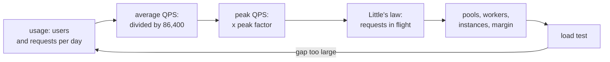

**Risks.** Ignoring the peak means sizing on the average and going down on the evening of the sales; forgetting storage and its growth means filling a disk after a few months. I size on the peak with a margin and I check the estimate against a load test.

:material-book-open-variant: Reference docs: [Google SRE Book, "Handling Overload"](https://sre.google/sre-book/handling-overload/) (2016)
{ .doc-ref }

### Little's law

<a class="pill pill-scope pill-scope-system" href="#map-of-scales">Scale · System</a> <a class="pill pill-scope pill-scope-infra" href="#map-of-scales">Scale · Infrastructure</a> <a class="pill pill-nature pill-nature-know" href="../architecture/#how-to-read-this-page" title="A law or a phenomenon nobody chooses: knowing it prevents bad decisions">Know</a>

**<span class="term" data-term="littles-law">Little's law</span>** (John Little, 1961): number of requests in flight = throughput × average duration. It sizes connection pools, threads and workers.

!!! noob "As noob"
    Picture a bakery: if 2 customers come in per minute and each stays 5 minutes, there are 10 people in the shop on average. If service slows to 10 minutes per customer, the shop holds 20, without a single extra customer coming in. The one thing to remember: **when processing slows down, the number of requests in flight climbs, even with constant traffic.**

``` { .text .ex-illus title="Illustration" }
1,200 requests/s × 0.2 s of processing = 240 requests in flight on average
if the database slows to 1 s: 1,200 × 1 = 1,200 requests in flight
a pool of 300 connections saturates: requests wait, latency climbs further
```

That is also why a short timeout protects: it caps duration, so the number of stuck requests.

**Risks.** Ignoring it means sizing a connection pool on normal latency: the day the database slows down, the number of in-flight requests climbs by as much and the pool saturates, while traffic has not moved. I size with the worst acceptable latency and I cap the duration with a timeout.

:material-book-open-variant: Reference docs: [John D. C. Little, "Little's Law as Viewed on Its 50th Anniversary", Operations Research](https://pubsonline.informs.org/doi/10.1287/opre.1110.0940) (2011)
{ .doc-ref }

### And the database

<a class="pill pill-scope pill-scope-infra" href="#map-of-scales">Scale · Infrastructure</a> <span class="pill pill-status pill-status-ok" title="Still valid, checked November 2026">Current · 11/2026</span> <a class="pill pill-nature pill-nature-know" href="../architecture/#how-to-read-this-page" title="A law or a phenomenon nobody chooses: knowing it prevents bad decisions">Know</a> <a class="pill pill-topic pill-topic-data" href="../architecture/#how-to-read-this-page" title="About where the data lives and how its copies stay in agreement">Data</a>

When load grows, the database is often the first limit. A bigger machine (vertical), read replicas, splitting data across several machines (horizontal): these choices have their own trade-offs, detailed in [Scaling a database](sql.md#scaling-a-database).

| I want to... | I use... |
|---|---|
| to know within minutes whether an option is realistic, before starting a prototype | back-of-the-envelope math with orders of magnitude |
| to choose how many servers to plan for, while traffic rises sharply in the evening or during sales | peak QPS, not the average, with a margin |
| to choose the size of a connection pool or the number of workers, knowing that the database can slow down | Little's law with the worst acceptable latency |
| to check that my calculations hold against real load | a load test, see [Quality and testing](qualite.md) |

!!! maturity "Measuring maturity"
    | Level | What I see in the team |
    |---|---|
    | N1 | one person does a back-of-the-envelope calculation before a major launch, on scrap paper |
    | N2 | every new service has a written estimate (average QPS, peak, Little's law for the pools), checked by a load test before going to production |
    | N3 | a load test runs every night and blocks delivery when the measured capacity drops below the expected peak plus the margin |
    | N4 | the team compares the estimate with real traffic every month and corrects its peak factor and margins from the gap |

    **I measure**: the gap between the estimated and observed peak, read in the traffic dashboard; the capacity margin left at peak, as a percentage, read by comparing the load test with real traffic.

## Scaling out

Capacity estimation says how much load must be held; this section says how to hold it when a single machine is no longer enough: the three ways to multiply a system (the scale cube), then the cache, the most common way to avoid redoing expensive work. Everything here is <span class="pill pill-nature pill-nature-decide">Decide</span>, and the cache is about copies of data.

### Scale cube

<a class="pill pill-scope pill-scope-system" href="#map-of-scales">Scale · System</a> <a class="pill pill-scope pill-scope-infra" href="#map-of-scales">Scale · Infrastructure</a> <span class="pill pill-status pill-status-ok" title="Still valid, checked November 2026">Current · 11/2026</span> <a class="pill pill-nature pill-nature-decide" href="../architecture/#how-to-read-this-page" title="A choice the team or the architects must make, then record in an ADR">Decide</a>

My service no longer holds the load on one machine. The **scale cube** (Martin Abbott and Michael Fisher, "The Art of Scalability", 2009) sorts the ways of adding more along three axes, which can be combined:

| Axis | What I do | Example with `orders-service` | Cost |
|---|---|---|---|
| X: duplicate | several identical copies behind a load balancer | 6 instances of `orders-service`, each able to do everything | easy if the service is stateless; the shared database remains the limit |
| Y: split by function | separate functions into different services | `billing-service` and `stock-service` move out of `orders-service` | boundaries to find, network calls, contracts to version |
| Z: partition by data | each copy serves only part of the customers or data | customers A to M on one partition, N to Z on another | routing by key, hard cross-partition queries, rebalancing |

!!! noob "As noob"
    An overwhelmed bakery has three options. Hire more sellers who all do the same thing (X). Split the trades: a pastry chef, a baker, a cashier (Y). Open a second shop in another district, serving its own customers (Z). The one thing to remember: **duplicate, split by function, split by customer: I start with the simplest, the X axis.**

**When.** The X axis first: it is the cheapest, provided the service keeps nothing in memory between two requests. The Y axis when one function has a load or a pace of change very different from the others: that is splitting into services ([Which style to choose](#which-style-to-choose)). The Z axis when the data itself no longer fits on one machine, last because it is the most expensive ([Sharding, last](sql.md#sharding-last)). [Cell-based architecture](#cell-based-architecture) is a Z axis applied to the whole stack.

**Why.** Naming the axis avoids answering "we add servers" to a problem that is elsewhere: duplicating `orders-service` six times is useless if the shared database is what saturates.

:material-book-open-variant: Reference docs: [AKF Partners, "The Scale Cube"](https://akfpartners.com/growth-blog/scale-cube) (accessed November 2026); Martin Abbott and Michael Fisher, "The Art of Scalability" (2009)
{ .doc-ref }

### Where to put a cache

<a class="pill pill-scope pill-scope-system" href="#map-of-scales">Scale · System</a> <a class="pill pill-scope pill-scope-infra" href="#map-of-scales">Scale · Infrastructure</a> <span class="pill pill-status pill-status-ok" title="Still valid, checked November 2026">Current · 11/2026</span> <a class="pill pill-nature pill-nature-decide" href="../architecture/#how-to-read-this-page" title="A choice the team or the architects must make, then record in an ADR">Decide</a> <a class="pill pill-topic pill-topic-data" href="../architecture/#how-to-read-this-page" title="About where the data lives and how its copies stay in agreement">Data</a>

The product page of `catalog-service` takes 800 ms to build and is read thousands of times per minute. A **<span class="term" data-term="cache-data">cache</span>** keeps a copy of the response so it is not recomputed. Before adding one, I measure: often, a missing index takes the query from 800 ms to 50 ms without any cache ([EXPLAIN](sql.md#explain)). A cache adds a copy that can lie and a part that can fail.

Caches stack in layers, from the closest to the user to the closest to the database. The closer the layer is to the user, the more it saves, but the less I control it: a response kept in a browser cannot be invalidated.

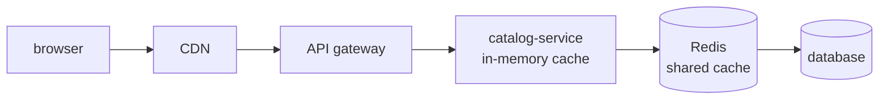

| Layer | What it keeps | How I control it | Can be invalidated? |
|---|---|---|---|
| browser | this person's responses | `Cache-Control` headers (RFC 9111, June 2022) | no: I wait for expiry, or I change the URL |
| <span class="term" data-term="cdn">CDN</span> | public responses, images, pages | `Cache-Control`, purge through the CDN's API | yes, within seconds to minutes |
| application, in memory | hot data of one instance | code, maximum size | only on that instance |
| shared cache (Redis) | data shared by all instances | code: key, lifetime, deletion | yes, for all instances |

A lifetime, the **<span class="term" data-term="ttl">TTL</span>**, bounds the age of a copy: it is a business decision ("is a price 60 seconds old acceptable on display?"), not a technical setting. A cache also has a limited size: when it is full, it evicts an entry, most often the least recently used one (**LRU**, least recently used; that is Redis's `allkeys-lru` policy). I measure the **hit ratio** (the share of reads served by the cache) layer by layer: a cache with a 30% hit ratio often costs more than it brings (example order of magnitude).

What never goes through a cache: decisions that commit. The displayed price can come from the CDN, the paid price is read again from the source at payment time; the displayed stock can be approximate, the reservation happens in `stock-service`. Example cache map of a product page (example numbers):

| Data | Layer | Lifetime | Invalidation |
|---|---|---|---|
| image, description | CDN | 1 year | new URL for each version |
| displayed price | CDN and Redis | 60 s, then 30 s of stale copy tolerated | `price.changed` event |
| price at payment | none | not applicable | direct read from the source |
| displayed stock | Redis | 5 s | none, cautious wording ("only a few left") |

The trap that touches security: a personalized page cached by the CDN is served to the next user ([Rendering strategies](front-end.md#rendering-strategies)).

:material-book-open-variant: Reference docs: [IETF, RFC 9111 "HTTP Caching"](https://www.rfc-editor.org/rfc/rfc9111) (June 2022)
{ .doc-ref }

### Reading and writing with a cache

<a class="pill pill-scope pill-scope-code" href="#map-of-scales">Scale · Code</a> <a class="pill pill-scope pill-scope-app" href="#map-of-scales">Scale · Application</a> <span class="pill pill-status pill-status-ok" title="Still valid, checked November 2026">Current · 11/2026</span> <a class="pill pill-nature pill-nature-decide" href="../architecture/#how-to-read-this-page" title="A choice the team or the architects must make, then record in an ADR">Decide</a> <a class="pill pill-topic pill-topic-data" href="../architecture/#how-to-read-this-page" title="About where the data lives and how its copies stay in agreement">Data</a>

Once the cache is placed, I still have to decide who fills it and what happens on write. Four classic patterns:

| Pattern | On read | On write | Good for | Risk |
|---|---|---|---|---|
| <span class="term" data-term="cache-aside">cache-aside</span> | the application reads the cache; if the data is missing, it reads the database and fills the cache | the application writes the database then deletes the entry | the default case, Redis in front of a database | a stale copy until deletion; slow first access |
| read-through | the application only talks to the cache, which fetches from the database itself | like cache-aside | a cache library or service able to read the source | the cache becomes a critical dependency |
| <span class="term" data-term="write-through">write-through</span> | from the cache | each write updates the database and the cache in the same operation | data read right after it is written | slower writes; data cached and never read again |
| write-behind (write-back) | from the cache | the write goes to the cache, the database is updated later, in batches | very frequent writes, like view counters | writes lost if the cache fails before the copy |

**When.** Cache-aside by default: simple, and the service keeps working without the cache. Write-through when data is almost always read right after being written. Write-behind only for data where losing a few seconds is acceptable (counters, statistics), never for an order or a payment.

**How.** Cache-aside in Python, with Redis:

``` { .python .ex-illus title="Illustration" }
import json

from redis.exceptions import RedisError

# Example: 10-minute lifetime, a safety net if an invalidation gets lost
PRICE_TTL_S = 600
```

``` { .python .ex-bad title="Avoid" }
# Avoid: no lifetime, and a Redis outage makes the whole page fail
def get_price_naive(redis, db, product_id: int) -> dict:
    cached = redis.get(f"price:{product_id}")
    if cached is None:
        cached = json.dumps(db.read_price(product_id))
        redis.set(f"price:{product_id}", cached)
    return json.loads(cached)
```

``` { .python .ex-good title="Recommended" }
# Good: bounded lifetime, and a direct read from the source if Redis is unavailable
def get_price(redis, db, product_id: int) -> dict:
    key = f"price:{product_id}"
    try:
        cached = redis.get(key)
    except RedisError:
        return db.read_price(product_id)
    if cached is not None:
        return json.loads(cached)
    price = db.read_price(product_id)
    redis.set(key, json.dumps(price), ex=PRICE_TTL_S)
    return price
```

Without a lifetime, a forgotten invalidation (a price changed by a nightly import that does not notify the cache) leaves the price wrong forever; without a fallback, the component added for performance becomes a cause of outage. On write, I delete the entry (`DEL price:42`) rather than rewrite it: two concurrent writes that rewrite the cache can leave the older value in it. Redis basics are in [Cache: Redis](outils.md#cache-redis).

:material-book-open-variant: Reference docs: [Microsoft, "Cache-Aside pattern"](https://learn.microsoft.com/en-us/azure/architecture/patterns/cache-aside) (accessed November 2026)
{ .doc-ref }

### Invalidation and cache stampede

<a class="pill pill-scope pill-scope-system" href="#map-of-scales">Scale · System</a> <span class="pill pill-status pill-status-ok" title="Still valid, checked November 2026">Current · 11/2026</span> <a class="pill pill-nature pill-nature-decide" href="../architecture/#how-to-read-this-page" title="A choice the team or the architects must make, then record in an ADR">Decide</a> <a class="pill pill-topic pill-topic-data" href="../architecture/#how-to-read-this-page" title="About where the data lives and how its copies stay in agreement">Data</a>

"There are only two hard things in Computer Science: cache invalidation and naming things" (attributed to Phil Karlton, date unknown). **<span class="term" data-term="cache-invalidation">Invalidation</span>** removes a copy when the source changes. Three ways, often combined:

- **by lifetime**: the entry expires on its own after its TTL; simple, but the copy can lie until then;
- **by event**: the owning service publishes `price.changed`, and each cache deletes the matching key; the TTL is then only a safety net;
- **by version in the key or URL**: `logo.3f9a2c.png`, `price:42:v7`; a new version creates a new key, the old one is never read again. It is the only reliable way for caches I do not control, like the browser.

The second problem is the **<span class="term" data-term="cache-stampede">cache stampede</span>**: the page of a popular product expires during sales, and the 500 requests arriving in the same second all find the cache empty and hit the database at once. The database slows down, requests pile up, and the cache never fills again because each rebuild ends in a timeout.

!!! noob "As noob"
    The office coffee machine is empty at 9 a.m.: everyone arrives at once, each notices it is empty and each starts a new pot. One person restarting it while the others waited two minutes would have been enough. The one thing to remember: **when a popular copy disappears, a single request must rebuild it, the others wait or make do with the old one.**

Four protections, which combine:

| Protection | Principle | Example |
|---|---|---|
| request coalescing | a single request per key goes to the database, the others wait for its result | a lock per key in each instance, or a "lease" handed out by the cache ("Scaling Memcache at Facebook", NSDI 2013) |
| jitter on the TTL | each entry gets a slightly random TTL, so keys do not all expire in the same second | 600 s plus or minus 10% instead of exactly 600 s |
| stale-while-revalidate | serve the slightly stale copy while a single request refreshes it in the background | `Cache-Control: public, max-age=60, stale-while-revalidate=30` (RFC 5861, 2010) |
| probabilistic early refresh | a request refreshes the entry a little before it expires, with a probability that grows as expiry nears | Vattani, Chierichetti and Lowenstein, VLDB 2015 |

``` { .python .ex-illus title="Illustration" }
import random
import threading

# Example: base TTL, 10% jitter and one lock per key
BASE_TTL_S = 600
TTL_JITTER = 0.1
_locks: dict[str, threading.Lock] = {}
_locks_guard = threading.Lock()
```

``` { .python .ex-bad title="Avoid" }
# Avoid: every request that finds the cache empty rebuilds the page, all at once and with the same TTL
def get_product_naive(cache, db, product_id: int) -> dict:
    key = f"product:{product_id}"
    product = cache.get(key)
    if product is None:
        product = db.build_product(product_id)
        cache.set(key, product, ex=BASE_TTL_S)
    return product
```

``` { .python .ex-good title="Recommended" }
# Good: a single rebuild per key and per instance, TTL with jitter
def get_product(cache, db, product_id: int) -> dict:
    key = f"product:{product_id}"
    product = cache.get(key)
    if product is not None:
        return product
    with _locks_guard:
        lock = _locks.setdefault(key, threading.Lock())
    with lock:
        product = cache.get(key)
        if product is None:
            product = db.build_product(product_id)
            ttl = int(BASE_TTL_S * random.uniform(1 - TTL_JITTER, 1 + TTL_JITTER))
            cache.set(key, product, ex=ttl)
    return product
```

The second `cache.get` inside the lock is what prevents the stampede: the requests that were waiting find the page already rebuilt by the first one. This lock only coalesces requests from the same instance: with 20 instances, the database gets at most 20 rebuilds instead of 500, which is often enough; otherwise, a lock shared in Redis (`SET ... NX EX`) lets only one rebuild through in total.

:material-book-open-variant: Reference docs: [IETF, RFC 5861 "HTTP Cache-Control Extensions for Stale Content"](https://www.rfc-editor.org/rfc/rfc5861) (2010); [Andrea Vattani, Flavio Chierichetti and Keegan Lowenstein, "Optimal Probabilistic Cache Stampede Prevention"](https://www.vldb.org/pvldb/vol8/p886-vattani.pdf) (VLDB, 2015)
{ .doc-ref }

| I want... | I use... |
|---|---|
| to hold more load on a stateless service, like an API that keeps nothing in memory between two requests | X axis: more copies behind the load balancer |
| a heavily used function, like search, not to slow down order taking | Y axis: move it into its own service |
| to store data that no longer fits on one machine, even after indexes, replicas and a bigger machine | Z axis: partition by customer, last |
| to speed up a product page read thousands of times per minute, after checking no index is missing | cache-aside in Redis, TTL decided with the business |
| to serve images and public pages as close to users as possible, without loading my servers | CDN, `Cache-Control`, versioned URLs |
| a popular key expiring during sales not to bring down the database | request coalescing, jitter on the TTL, stale-while-revalidate |
| the paid price to always be right, even if the displayed price comes from a cache | read the source at payment, never cache a decision that commits |

!!! maturity "Measuring maturity"
    | Level | What I see in the team |
    |---|---|
    | N1 | a cache was added on a slow page, with no TTL decided with the business and no measure of its hit rate |
    | N2 | every cache has a TTL validated by the business, a fallback when the cache goes down and a hit rate tracked layer by layer; instances are stateless so they can be duplicated |
    | N3 | autoscaling adds copies (X axis) on its own, and stampede protection (coalescing, jitter, stale-while-revalidate) keeps an expired key from overloading the database |
    | N4 | the team removes or resizes caches with too low a hit rate, and picks the X, Y or Z axis from the measured bottleneck |

    **I measure**: the hit rate of each cache layer, read in the Redis and CDN metrics; the database load during peaks, before and after the cache.

## Designing for continuous delivery

<a class="pill pill-practice" href="../livraison/#continuous-delivery-and-deployment">Practice · Continuous deployment</a>
<a class="pill pill-dora" href="https://dora.dev/capabilities/continuous-delivery/">DORA · Continuous delivery</a> <a class="pill pill-dora" href="https://dora.dev/capabilities/loosely-coupled-teams/">DORA · Loosely coupled teams</a>

My team wants to ship to production several times a day, but every release takes an evening, three teams on a call and a merge freeze the day before. The problem is not the pipeline: it is the architecture. **<span class="term" data-term="continuous-delivery">Continuous delivery</span>** (Jez Humble and David Farley, "Continuous Delivery", 2010) means that **every merged change can go to production at any time**, with no risk and no special effort; a human still decides when to press the button. <span class="term" data-term="continuous-deployment">Continuous deployment</span> goes one step further: nobody presses anything, every green change ships on its own. The practices (pipeline, checks, progressive deployment) are in [Delivery and engineering practices](livraison.md#continuous-delivery-and-deployment); this section says what the **architecture** must allow for those practices to work.

!!! noob "As noob"
    A bakery that bakes only one batch a week takes a big gamble every time: if the recipe fails, the whole week is lost. A bakery that bakes every hour tastes each small batch, and a failed batch only costs one hour. But baking every hour needs a bakehouse designed for it: several ovens, separate worktops. The one thing to remember: **continuous delivery means small changes, often; the architecture decides whether that is possible.**

### What architecture changes for delivery

<a class="pill pill-scope pill-scope-app" href="#map-of-scales">Scale · Application</a> <a class="pill pill-scope pill-scope-system" href="#map-of-scales">Scale · System</a> <span class="pill pill-status pill-status-ok" title="Still valid, checked in November 2026">Current · 11/2026</span> <a class="pill pill-nature pill-nature-decide" href="../architecture/#how-to-read-this-page" title="A choice the team or the architects must make, then record in an ADR">Decide</a>

The DORA research (Nicole Forsgren, Jez Humble, Gene Kim, "Accelerate", 2018) links delivery frequency to a **loosely coupled** architecture: a team can test and deploy its part without asking the others for permission or synchronizing with them. In practice, four properties:

| Property | What it means | What breaks without it |
|---|---|---|
| independent deployment | I deploy `orders-service` without redeploying `billing-service` | one shared release a week, and one team's bug blocks all the others |
| compatible contracts | a new API version still accepts the old calls (<span class="term" data-term="backward-compatibility">backward compatibility</span>) | I must deploy the server and all its clients in the same minute |
| zero-downtime database migrations | the schema changes in several steps that both the old and the new code support | a maintenance window at night, or 500 errors during the deployment |
| deploying is not releasing | the code goes to production switched off, behind a <span class="term" data-term="feature-flag">feature flag</span>, and is turned on later | a half-finished feature blocks the main branch, or goes visible too early |

A testable architecture matters too: if every test goes through the database and the network, the pipeline takes an hour and nobody ships ten times a day. [Hexagonal architecture](#hexagonal-and-clean-architecture) and [contract tests](qualite.md) keep the pipeline short.

### Changing without breaking: expand and contract

<a class="pill pill-scope pill-scope-app" href="#map-of-scales">Scale · Application</a> <a class="pill pill-scope pill-scope-system" href="#map-of-scales">Scale · System</a> <span class="pill pill-status pill-status-ok" title="Still valid, checked in November 2026">Current · 11/2026</span> <a class="pill pill-nature pill-nature-decide" href="../architecture/#how-to-read-this-page" title="A choice the team or the architects must make, then record in an ADR">Decide</a> <a class="pill pill-topic pill-topic-data" href="../architecture/#how-to-read-this-page" title="About where the data lives and how its copies stay in agreement">Data</a>

During a deployment, the old and the new version of the code run **at the same time** (progressive deployment, several pods). So the database and the contracts must suit both. The **<span class="term" data-term="expand-contract">expand and contract</span>** pattern (also called "parallel change", Danilo Sato, martinfowler.com, 2014) splits a breaking change into steps that break nothing: first I expand (add the new next to the old), I migrate, then I contract (remove the old).

Example: renaming the `customer_name` column to `full_name`.

``` { .sql .ex-bad title="Avoid" }
-- Avoid: renaming in one go, the pods still running the old version crash on customer_name
ALTER TABLE customers RENAME COLUMN customer_name TO full_name;

-- Good, deployment 1 (expand): add the new column, the code writes to both
ALTER TABLE customers ADD COLUMN full_name TEXT;

-- Good, deployment 2: copy the existing data, the code reads full_name
UPDATE customers SET full_name = customer_name WHERE full_name IS NULL;

-- Good, deployment 3 (contract): no code reads the old column any more, I drop it
ALTER TABLE customers DROP COLUMN customer_name;
```

``` { .text .ex-illus title="Illustration" }
Monday      deployment 1: full_name column added, the code writes to both columns
Tuesday     deployment 2: old rows copied, the code reads full_name
Wednesday   check: no query on customer_name any more (logs, code search)
Thursday    deployment 3: customer_name dropped
at any moment, going back to the previous version stays possible without data loss
```

The same idea works for an API: I add the new field or route, wait until every client has migrated (I measure it), then remove the old one.

**Risks.** The "contract" step is often forgotten: both columns stay forever and the code keeps writing twice. A backfill `UPDATE` on a very large table locks rows and slows production when it is not split into batches. I plan the removal from the start, with a date, and I backfill in batches.

### Separating deploy from release

<a class="pill pill-scope pill-scope-code" href="#map-of-scales">Scale · Code</a> <a class="pill pill-scope pill-scope-app" href="#map-of-scales">Scale · Application</a> <span class="pill pill-status pill-status-ok" title="Still valid, checked in November 2026">Current · 11/2026</span> <a class="pill pill-nature pill-nature-decide" href="../architecture/#how-to-read-this-page" title="A choice the team or the architects must make, then record in an ADR">Decide</a>

**Deploying** means putting the code on the servers; **releasing** means making it visible to users. A feature flag separates the two: I merge and deploy switched-off code every day, then the product team turns it on when it wants, first for 1% of customers (Pete Hodgson, "Feature Toggles", martinfowler.com, 2017).

``` { .python .ex-bad title="Avoid" }
# Avoid: activation hard-coded, impossible to switch off after a bug without redeploying
def shipping_fee(order: Order) -> Money:
    if date.today() >= date(2026, 12, 1):
        return new_shipping_fee(order)
    return legacy_shipping_fee(order)
```

``` { .python .ex-good title="Recommended" }
# Good: the new calculation goes to production switched off, and is turned on per customer
def shipping_fee(order: Order) -> Money:
    if flags.is_enabled("new-shipping-fee", customer_id=order.customer_id):
        return new_shipping_fee(order)
    return legacy_shipping_fee(order)
```

With the hard-coded date, on December 1st at midnight the new calculation turns on for everyone; if it is wrong, switching it off takes a fix, a review and a deployment. The flag switches off in one click.

Pitfall: a flag is debt. Every forgotten flag doubles the paths to test; I give it an owner and a removal date when I create it.

**When to start.** As soon as releases are scary, happen in the evening, or need several teams to synchronize. When not to overdo it: a prototype or an internal tool used by three people can afford a two-minute outage; the three deployments of an expand and contract cost more than they bring there.

| I want to... | I use... |
|---|---|
| ship `orders-service` without waiting for the billing team to finish its version | services or modules deployable alone, with compatible contracts |
| rename a column or an API field without downtime, while the old and the new version run side by side during the deployment | expand and contract |
| merge every day a feature that will only be ready in three weeks | a switched-off feature flag |
| know whether my architecture slows delivery down | the five DORA metrics, and the number of teams to coordinate per release |

:material-book-open-variant: Reference docs: [Jez Humble, continuousdelivery.com](https://continuousdelivery.com/) (accessed November 2026); [Danilo Sato, "ParallelChange"](https://martinfowler.com/bliki/ParallelChange.html) (2014)
{ .doc-ref }

!!! maturity "Measuring maturity"
    | Level | What I see in the team |
    |---|---|
    | N1 | the team knows how to do an expand and contract or add a feature flag, but only for changes that feel scary |
    | N2 | every schema change follows expand and contract, every unfinished feature ships behind a flag with an owner and a removal date, and every service deploys on its own |
    | N3 | CI refuses a breaking migration (renaming, dropping a column still read), and a flag past its removal date fails the pipeline |
    | N4 | the team tracks the five DORA metrics and the number of teams to coordinate per release, and tackles first the coupling that slows them |

    **I measure**: deployment frequency per service and the delay between merge and production, read in the CI/CD tool; the number of flags older than their removal date, read in the flag tool.

## Modernizing an existing system

My team inherits a twelve-year-old monolith that nobody dares touch any more, and the temptation is to throw everything away and start over. This section says how to decide between rewriting and redesigning, then how to replace a system piece by piece. Everything here is <span class="pill pill-nature pill-nature-decide">Decide</span>.

### Rewrite or redesign progressively

<a class="pill pill-scope pill-scope-app" href="#map-of-scales">Scale · Application</a> <a class="pill pill-scope pill-scope-system" href="#map-of-scales">Scale · System</a> <span class="pill pill-status pill-status-ok" title="Still valid, checked November 2026">Current · 11/2026</span> <a class="pill pill-nature pill-nature-decide" href="../architecture/#how-to-read-this-page" title="A choice the team or the architects must make, then record in an ADR">Decide</a>

A **<span class="term" data-term="rewrite">full rewrite</span>** rebuilds the system from scratch next to the old one, then switches over in one go. A **<span class="term" data-term="incremental-redesign">progressive redesign</span>** replaces or improves the system in small steps, each shipped to production. My default position is the progressive redesign. A rewrite must catch up with years of fixes and business rules written only in the code, while the old system keeps evolving, and it delivers no value before the switch. Joel Spolsky called it "the single worst strategic mistake that any software company can make" ("Things You Should Never Do, Part I", April 2000). It is also exposed to the **<span class="term" data-term="second-system-effect">second-system effect</span>** (Frederick Brooks, "The Mythical Man-Month", 1975): the second version piles up every idea held back in the first.

| Criterion | Pushes toward progressive redesign | Pushes toward rewrite |
|---|---|---|
| system size | large, many business rules | small, a few weeks of work |
| test coverage | low: the real behavior is poorly known | good: I can check equivalence |
| technology | maintained, upgrade path available | abandoned, no more security fixes |
| changes during the project | the business keeps asking for them | the scope can be frozen |
| business need | close to the existing one | very different from the existing one |
| intermediate delivery | possible, piece by piece | impossible before the switch |

**How.** The `orders-service` team wants to rewrite in eighteen months a monolith deemed unreadable, while the business keeps asking for changes. I first measure where changes and bugs concentrate (the Git history tells): usually, a small part of the code concentrates most of the pain. I replace those modules first, after freezing their current behavior with **<span class="term" data-term="characterization-test">characterization tests</span>**. I set a stop criterion before starting: if the first replaced module brings no measurable gain within three months, on lead time for example, we reassess. Even when a rewrite is justified, I cut it into slices that go to production early.

:material-book-open-variant: Reference docs: [Joel Spolsky, "Things You Should Never Do, Part I"](https://www.joelonsoftware.com/2000/04/06/things-you-should-never-do-part-i/) (April 2000)
{ .doc-ref }

### Strangler fig

<a class="pill pill-scope pill-scope-app" href="#map-of-scales">Scale · Application</a> <a class="pill pill-scope pill-scope-system" href="#map-of-scales">Scale · System</a> <span class="pill pill-status pill-status-ok" title="Still valid, checked November 2026">Current · 11/2026</span> <a class="pill pill-nature pill-nature-decide" href="../architecture/#how-to-read-this-page" title="A choice the team or the architects must make, then record in an ADR">Decide</a>

The **<span class="term" data-term="strangler-fig">strangler fig</span>** (Martin Fowler, 2004, after a fig that grows around a tree until it replaces it) builds the new system around the old one and moves functions over one by one, until the old one can be switched off. A routing point in front of the monolith sends some requests to the new component, the others stay on the old one. Between the two, an **<span class="term" data-term="anti-corruption-layer">anti-corruption layer</span>** translates the models, so that the old system's model does not contaminate the new one. In the code, **<span class="term" data-term="branch-by-abstraction">branch by abstraction</span>** puts an interface in front of the code to replace, builds the new version behind it, then switches with a <span class="term" data-term="feature-flag">feature flag</span>, without a long-lived Git branch.

!!! noob "As noob"
    I renovate the house I live in: rather than demolishing it and sleeping in a hotel for two years, I redo one room at a time and keep living in the others. In the end, nothing is left of the old house, and I was never without a roof. The one thing to remember: **the new system grows around the old one and replaces it route by route, with a way back at every step.**

**How.** Example: extracting billing from a monolith, because it changes most often (tax rules) and every change requires three weeks of manual testing on the whole monolith.

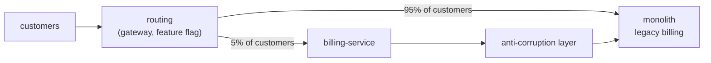

| Step | What changes | Rollback |
|---|---|---|
| 1 | routing is in place, 0% to `billing-service` | not needed |
| 2 | computation in parallel, amounts compared, answer still given by the monolith | stop the comparison |
| 3 | 5% of customers billed by `billing-service` | flag to 0% |
| 4 | 100% of customers | flag to 0% for a month |
| 5 | billing code removed from the monolith | restore from Git, more expensive: only done after a stable month |

The last step is the one people forget: a modernization that removes nothing only adds one more system to maintain. The same principle serves to migrate an old front end one route at a time ([Micro front ends](front-end.md#micro-front-ends)) and to change a database schema ([expand and contract](#changing-without-breaking-expand-and-contract)). **When not to use it.** A small system well covered by tests, rewritten in a few weeks: the routing then costs more than the rewrite.

:material-book-open-variant: Reference docs: [Martin Fowler, "Strangler Fig"](https://martinfowler.com/bliki/StranglerFigApplication.html) (2004, rewritten since, to check)
{ .doc-ref }

### Sacrificial architecture

<a class="pill pill-scope pill-scope-app" href="#map-of-scales">Scale · Application</a> <a class="pill pill-scope pill-scope-system" href="#map-of-scales">Scale · System</a> <span class="pill pill-status pill-status-ok" title="Still valid, checked November 2026">Current · 11/2026</span> <a class="pill pill-nature pill-nature-decide" href="../architecture/#how-to-read-this-page" title="A choice the team or the architects must make, then record in an ADR">Decide</a>

My team launches a product nobody knows will find its users. **<span class="term" data-term="sacrificial-architecture">Sacrificial architecture</span>** (Martin Fowler, "Sacrificial Architecture", 2014) accepts from the start that the code will be thrown away and replaced if the product succeeds, and designs it for that: well separated modules that can be replaced one by one, rather than an architecture planned for a hundred times the load. Fowler cites eBay, which went from Perl scripts in 1995 to C++ in 1997, then to Java in 2002 (to check).

**Why.** Designing right away for traffic I may never get delays the launch and costs a lot; a system that succeeds ends up rebuilt anyway, because needs change with scale. **How.** I write the choice down in an [ADR](#adr) with the signal that will trigger the replacement (for example: "beyond 1,000 orders per hour, we replace the stock module") and I keep clear boundaries between modules, to replace piece by piece with a strangler fig when the time comes. **When not to use it.** For what must last: a database schema or an event format is hard to throw away; it is the code that is sacrificed, not the data.

**Risks.** "Temporary" code often outlives the product's success: nobody triggers the replacement, and the prototype still carries the load years later. Conversely, sacrificing working code too early costs a needless rewrite. I follow the signal written in the ADR, like the number of orders per hour, and I reassess when it is reached.

:material-book-open-variant: Reference docs: [Martin Fowler, "Sacrificial Architecture"](https://martinfowler.com/bliki/SacrificialArchitecture.html) (2014)
{ .doc-ref }

| I want... | I use... |
|---|---|
| to decide whether to rewrite an old system deemed unreadable, while the business keeps asking for changes | the decision grid, progressive redesign by default |
| to replace a monolith's billing without stopping the service or switching everything at once | strangler fig, anti-corruption layer, feature flag |
| to freeze what an old module really does before replacing it | characterization tests |
| to launch an uncertain product fast without forbidding myself to rebuild it if it succeeds | sacrificial architecture, replacement signal written in an ADR |

!!! maturity "Measuring maturity"
    | Level | What I see in the team |
    |---|---|
    | N1 | the team talks about replacing the old system, with no stop criterion and no replacement order |
    | N2 | the replacement follows a strangler fig with routing, characterization tests in front of each module and a rollback planned at every step |
    | N3 | the routing automatically compares the old and new systems' answers, and goes back to 0% on the new one when the gap exceeds a threshold |
    | N4 | the team picks the next module to replace from the measured concentration of changes and bugs, and tracks the share of traffic and code still in the old system |

    **I measure**: the share of traffic served by the new system, read in the routing metrics; routes or lines of code removed from the old system per quarter, read in the Git history.

## Urbanizing the information system

<a class="pill pill-scope pill-scope-enterprise" href="#map-of-scales">Scale · Enterprise</a> <span class="pill pill-status pill-status-ok" title="Still valid, checked November 2026">Current · 11/2026</span>

**<span class="term" data-term="si-urbanization">Information system urbanization</span>** applies the picture of a city to a company's application estate: I do not rebuild the city, I make it evolve district by district, following a plan and shared rules. The term is mostly used in France (Jacques Sassoon, "Urbanisation des systèmes d'information", 1998, to check; Christophe Longépé, "Le projet d'urbanisation du SI", Dunod, first edition in 2001, to check). In the English speaking world, the closest name is **<span class="term" data-term="enterprise-architecture">enterprise architecture</span>**.

Where the rest of this page talks about one system, urbanization talks about **all** of them: 80 applications, 3 ERPs inherited from acquisitions, file exchanges nobody controls.

### Why

Without a plan, an information system grows like a city without a land registry:

- the same data (the customer, the product) lives in five applications, with five different values;
- every new project creates its own point to point links, and the map of exchanges turns into spaghetti;
- nobody knows which application can be switched off, nor what breaks if it is;
- budgets fund duplicates without knowing it.

Urbanization provides three things: a **map** of what exists, a **target** a few years out, and **rules** every project follows to move toward the target.

### The four views and the city metaphor

The information system is described in four layers, from the most stable to the most changing:

| View | Question | Example |
|---|---|---|
| business | what does the company do, through which processes? | "sell", "deliver", "invoice" |
| functional | which blocks of functions does that need? | "customer relationship" zone, "order" district, "quote" block |
| application | which applications provide those functions? | `crm-app`, `orders-service`, `billing-service` |
| technical | what do they run on? | Kubernetes, Postgres, message broker |

The functional view borrows the city vocabulary: **zones** (large domains), split into **districts**, split into **blocks** (the smallest unit a single application must own).

The classic urbanization rules:

1. every piece of reference data has **a single owner** (the customer referential, the product referential); the others read it or receive a copy;
2. a block belongs to **one** application only;
3. districts exchange through **published interfaces** (APIs, events on a broker), never by reading someone else's database;
4. a new application is first placed on the map: if its block is already taken, the duplicate is justified or the existing one is reused.

### Example: a fictitious map

``` { .text .ex-illus title="Illustration" }
Customer relationship zone
├─ Prospects district ........ crm-app
└─ Customer accounts district  customer-referential   (referential: the only writer of customers)
Sales zone
├─ Quotes district ........... crm-app, quote-tool    (duplicate to remove)
└─ Orders district ........... orders-service
Finance zone
├─ Invoicing district ........ billing-service, legacy-erp (migration in progress)
└─ Payment district .......... (empty: external provider through payment-adapter)
Steering zone
└─ Reporting district ........ data-warehouse          (reads copies, writes nothing)
```

Reading: two applications on "Quotes" (a duplicate to settle), a migration in progress on "Invoicing", and a single writer for customers.

### Reference frameworks

<span class="pill pill-status pill-status-ok" title="Still valid, checked November 2026">Current · 11/2026</span> <a class="pill pill-nature pill-nature-know" href="../architecture/#how-to-read-this-page" title="A law or a phenomenon nobody chooses: knowing it prevents bad decisions">Know</a>

| Framework | What it is | What it is for |
|---|---|---|
| **<span class="term" data-term="togaf">TOGAF</span>** (The Open Group, first version in 1995, TOGAF Standard 10th edition in 2022) | a method, the ADM: a cycle of phases (vision, business, systems, technology, opportunities, migration, governance) | running a transformation programme end to end |
| **<span class="term" data-term="zachman">Zachman Framework</span>** (John Zachman, IBM Systems Journal, 1987) | a grid: six questions (what, how, where, who, when, why) crossed with six viewpoints | checking that no facet is forgotten; it is not a method |
| **<span class="term" data-term="archimate">ArchiMate</span>** (The Open Group, version 3.2 in 2022, to check) | a modelling language, with standard symbols for the business, application and technology layers | drawing maps every architect reads the same way |
| **<span class="term" data-term="capability-map">capability map</span>** | the list of what the company can do, regardless of who does it | common starting point with leadership; often the business view above |
| French style urbanization (Sassoon, Longépé) | zones, districts, blocks and urbanization rules | splitting and organizing the application estate |

TOGAF and urbanization are not opposed: TOGAF says how to run the effort, urbanization says how to split and organize.

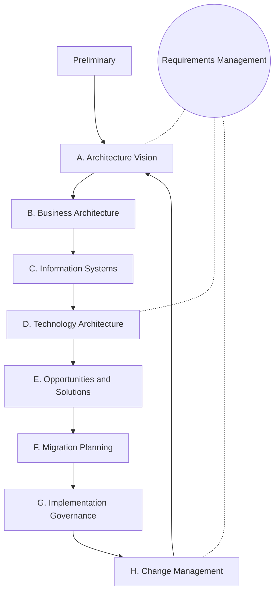

**Risks.** Applying TOGAF in full in a mid-sized company produces deliverables nobody reads and slows every project down; drawing in ArchiMate for an audience that does not know it makes the maps unreadable. I take from each framework what serves the question at hand and I lighten it.

:material-book-open-variant: Reference docs: [The Open Group, TOGAF Standard](https://www.opengroup.org/togaf) (10th edition, 2022); [The Open Group, ArchiMate](https://www.opengroup.org/archimate-forum/archimate-overview) (version 3.2, 2022)
{ .doc-ref }

### When and how

**When.** The approach makes sense from a few dozen applications on, or at one of these moments: merger or acquisition, leaving an ERP, cloud migration, the recurring complaint "nobody knows who does what". For a startup with three services, it is bureaucracy: a level 1 C4 diagram is enough.

**How.** A light approach that delivers something at each step:

1. **map what exists**: list the applications, their owner, the data they write and their exchanges (a spreadsheet is enough at first);
2. **draw the capability map** with the business, then project the applications onto it: duplicates and gaps show up on their own;
3. **set a few rules** (single owner for each piece of data, exchanges through APIs or events) and publish them;
4. **define the target** two or three years out and the steps, each step carried by a project that happens anyway;
5. **govern without blocking**: every new project places itself on the map, and a decision that departs from the rules is recorded in an [ADR](#adr);
6. **keep the map alive**: generate it from the service catalogue or the code when possible, otherwise it is wrong within six months.

| I want to... | I use... |
|---|---|
| to know which applications exist and who to talk to for each one | application inventory, then mapping |
| to talk about the information system with leadership, in terms of what the company does rather than software | capability map |
| to organize the estate and spot duplicates and gaps, like two quoting tools or an empty district | zones, districts, blocks |
| to run a transformation over several years, like a merger or leaving an ERP | TOGAF ADM cycle, lightened |
| to check that a big picture misses no facet (what, who, where, when, why) | Zachman grid |
| diagrams every architect reads the same way, with the same symbols | ArchiMate |
| to describe a single system or a few services, without heavy process | no urbanization: C4 and ADRs are enough |

!!! maturity "Measuring maturity"
    | Level | What I see in the team |
    |---|---|
    | N1 | a spreadsheet lists the applications, kept by one person, with no owner or exchanges for each |
    | N2 | the map covers every application with its owner, the data it writes and its exchanges, and urbanization rules are published |
    | N3 | every new project places itself on the map in the scoping ritual, without anyone asking, and the map is generated from the service catalog |
    | N4 | the architects track the number of duplicates, point-to-point exchanges and data without a single owner, and set the target from how they evolve |

    **I measure**: the number of blocks served by more than one application, read in the map; the share of applications whose catalog entry was updated in the last six months.

## Documenting and governing

<a class="pill pill-practice" href="../livraison/#design-before-coding">Practice · Technical design</a>
<a class="pill pill-dora" href="https://dora.dev/capabilities/documentation-quality/">DORA · Documentation quality</a>

### C4 model

<a class="pill pill-scope pill-scope-code" href="#map-of-scales">Scale · Code</a> <a class="pill pill-scope pill-scope-app" href="#map-of-scales">Scale · Application</a> <a class="pill pill-scope pill-scope-system" href="#map-of-scales">Scale · System</a> <span class="pill pill-status pill-status-ok" title="Still valid, checked November 2026">Current · 11/2026</span> <a class="pill pill-nature pill-nature-decide" href="../architecture/#how-to-read-this-page" title="A choice the team or the architects must make, then record in an ADR">Decide</a>

The **<span class="term" data-term="c4-model">C4 model</span>** (Simon Brown, c4model.com, creation date to check) draws an architecture at four zoom levels, each for an audience:

| Level | Shows | For whom |
|---|---|---|
| 1. Context | the system, its users, external systems | everyone, business included |
| 2. Containers | deployed applications and databases, and their exchanges | technical teams, operations |
| 3. Components | the main blocks of one container | developers of that container |
| 4. Code | classes and functions | rarely drawn by hand |

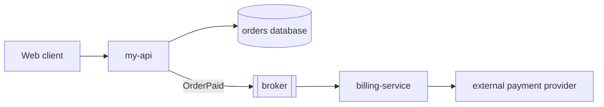

Levels 1 and 2 are enough in most cases. A diagram keeps its value if it lives in the repo, as text (Mermaid, Structurizr), next to the code.

**Risks.** A diagram drawn in a drawing tool, far from the code, is wrong after a few months, and a level 3 or 4 for every container costs more to maintain than it helps. I keep levels 1 and 2, as text in the repo, reviewed with the code.

:material-book-open-variant: Reference docs: [Simon Brown, "The C4 model"](https://c4model.com/) (accessed November 2026)
{ .doc-ref }

### arc42

<a class="pill pill-scope pill-scope-system" href="#map-of-scales">Scale · System</a> <span class="pill pill-status pill-status-ok" title="Still valid, checked November 2026">Current · 11/2026</span> <a class="pill pill-nature pill-nature-decide" href="../architecture/#how-to-read-this-page" title="A choice the team or the architects must make, then record in an ADR">Decide</a>

**<span class="term" data-term="arc42">arc42</span>** (Gernot Starke and Peter Hruschka, first version in 2005) is an architecture document template in twelve sections: goals, constraints, context, strategy, views, cross-cutting concepts, decisions, quality requirements, risks, glossary. Fill in only the useful sections; the template is mainly there so nothing is forgotten.

**Risks.** Filling in all twelve sections on principle gives a forty-page document that nobody reads or updates. I only fill in the sections that answer a real question, and I point to the ADRs for decisions.

:material-book-open-variant: Reference docs: [arc42, "Overview"](https://arc42.org/overview) (accessed November 2026)
{ .doc-ref }

### ADR

<a class="pill pill-scope pill-scope-all" href="#map-of-scales">All scales</a> <span class="pill pill-status pill-status-ok" title="Still valid, checked November 2026">Current · 11/2026</span> <a class="pill pill-nature pill-nature-decide" href="../architecture/#how-to-read-this-page" title="A choice the team or the architects must make, then record in an ADR">Decide</a>

A structuring decision is recorded in an **<span class="term" data-term="adr">ADR</span>**, one page per decision, in the repo. The format and an example are in [Delivery: design before coding](livraison.md#design-before-coding).

**Risks.** An ADR written after the fact justifies the choice instead of discussing it, and an ADR edited in place erases the original decision. Without ADRs, the team debates the same choice again every six months. I write the ADR before deciding, with the rejected options, and I replace an outdated ADR with a new one that marks it superseded.

:material-book-open-variant: Reference docs: [Michael Nygard, "Documenting Architecture Decisions"](https://cognitect.com/blog/2011/11/15/documenting-architecture-decisions) (2011); [Architectural Decision Records, adr.github.io](https://adr.github.io/) (accessed November 2026)
{ .doc-ref }

### Quality scenarios, utility tree and ATAM

<a class="pill pill-scope pill-scope-app" href="#map-of-scales">Scale · Application</a> <a class="pill pill-scope pill-scope-system" href="#map-of-scales">Scale · System</a> <span class="pill pill-status pill-status-ok" title="Still valid, checked November 2026">Current · 11/2026</span> <a class="pill pill-nature pill-nature-decide" href="../architecture/#how-to-read-this-page" title="A choice the team or the architects must make, then record in an ADR">Decide</a>

The business asks for "a reliable and fast booking platform". Those adjectives tell the architecture nothing: fast for whom, how much, in which situation? A **<span class="term" data-term="quality-attribute-scenario">quality attribute scenario</span>** (Len Bass, Paul Clements and Rick Kazman, "Software Architecture in Practice", 1st edition in 1998, 4th in 2021) turns each adjective into a verifiable sentence, in six parts:

| Part | Question | Example for "fast" |
|---|---|---|
| source | who or what triggers it? | customers, at a campaign launch |
| stimulus | what happens? | 200 bookings per second |
| environment | what state is the system in? | normal operation, peak load |
| artifact | which part is affected? | `booking-service` and its database |
| response | what must the system do? | confirm every booking |
| response measure | how do I check? | under one second at p99, no double booking |

!!! noob "As noob"
    Telling an architect "I want a well insulated house" says almost nothing; "19 °C in the living room when it is -5 °C outside, for less than 800 € of heating a year" is something they can design and check. A quality scenario does the same for software: it replaces the adjective with a situation and a number. The one thing to remember: **a quality attribute without a measure is a wish, not a requirement.**

**When.** At the start of a project, when requirements arrive as adjectives; before an expensive architecture choice; when two teams argue over a trade-off, like consistency against availability, without numbers. **Why.** The business and the team talk about the same numbers, load tests and SLOs follow from the scenarios, and I do not oversize for a requirement nobody asked for. A number picked at random sizes the whole system: I have it validated by those who will pay its cost.

**How.**

1. I ask the business concrete questions: what happens to the customer if booking is unavailable for ten minutes? What is worse, a refused booking or the same seat sold twice?
2. I write four to eight scenarios, at least one per important attribute.
3. I sort them into a **<span class="term" data-term="utility-tree">utility tree</span>**: the root "utility", then the attributes, then the scenarios, each rated by business importance and technical difficulty (H, M, L). Scenarios rated (H, H) drive the architecture.
4. I go over the list of characteristics of the ISO/IEC 25010 standard (2011, revised in 2023) so as not to forget a family, like security or maintainability.

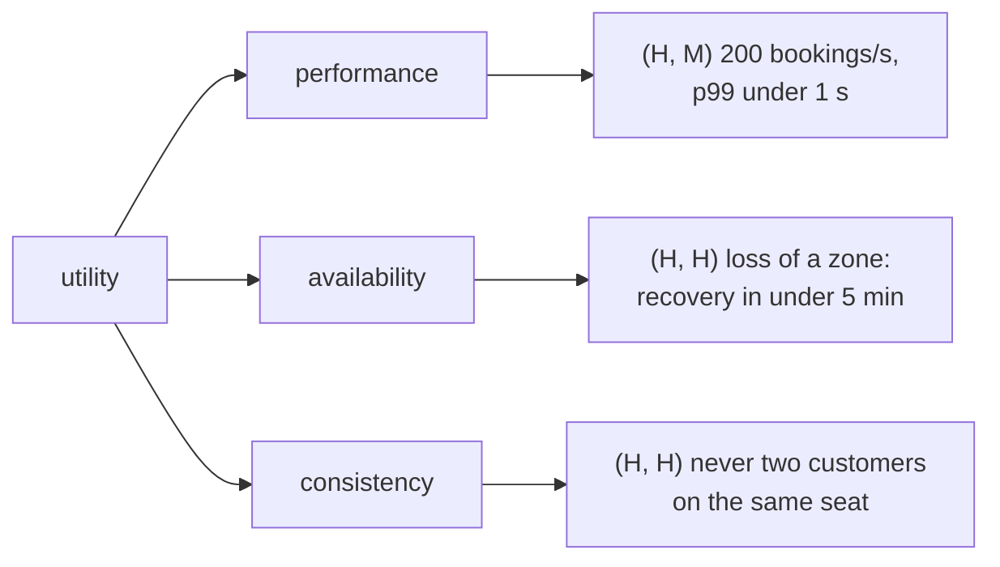

In this example, the business said without spelling it out that double booking is unacceptable: it is a strong consistency requirement on the seat stock, which will weigh more on the architecture than speed ([Strong or eventual consistency](#strong-or-eventual-consistency)).

Two methods from the Software Engineering Institute (SEI, Carnegie Mellon) go further. The **Quality Attribute Workshop** (QAW, 2003 report) is a one-day workshop with stakeholders to surface and rank the scenarios, before the architecture exists. **<span class="term" data-term="atam">ATAM</span>** (Architecture Tradeoff Analysis Method, 2000) evaluates a proposed architecture: architects and business walk through the tree's scenarios one by one and note the risks, sensitivity points and trade-offs each one reveals. A light version fits in half a day: the (H, H) scenarios, and for each "what in the design makes it achievable, and what would break it?". The retained scenarios then become automated checks ([Fitness functions](#fitness-functions)).

:material-book-open-variant: Reference docs: [SEI, "ATAM: Method for Architecture Evaluation"](https://insights.sei.cmu.edu/library/atam-method-for-architecture-evaluation/) (2000); [SEI, "Quality Attribute Workshops (QAWs), Third Edition"](https://insights.sei.cmu.edu/library/quality-attribute-workshops-qaws-third-edition/) (2003)
{ .doc-ref }

### Fitness functions

<a class="pill pill-scope pill-scope-code" href="#map-of-scales">Scale · Code</a> <a class="pill pill-scope pill-scope-system" href="#map-of-scales">Scale · System</a> <span class="pill pill-status pill-status-ok" title="Still valid, checked November 2026">Current · 11/2026</span> <a class="pill pill-nature pill-nature-decide" href="../architecture/#how-to-read-this-page" title="A choice the team or the architects must make, then record in an ADR">Decide</a>

A **<span class="term" data-term="fitness-function">fitness function</span>** (Neal Ford, Rebecca Parsons and Patrick Kua, "Building Evolutionary Architectures", 2017) is an automated check that continuously verifies an architecture decision still holds: a dependency rule, a latency threshold, an image size. Without it, the code drifts away from the diagram within months.

Example in Python with import-linter, `.importlinter` file checked in every pipeline:

``` { .ini .ex-ref title="Reference" }
# Example: orders cannot import billing.storage, checked in CI
[importlinter:contract:orders-isolation]
name = orders imports only the public API of billing
type = forbidden
source_modules = my_api.orders
forbidden_modules = my_api.billing.storage
```

**Risks.** A brittle check that fails at random ends up disabled, and the rule disappears with it. Too many rules block legitimate changes and push people to work around them. I start with two or three rules that protect a decision written in an ADR, and I remove those that no longer serve.

:material-book-open-variant: Reference docs: [Thoughtworks Technology Radar, "Architectural fitness function"](https://www.thoughtworks.com/radar/techniques/architectural-fitness-function) (accessed November 2026)
{ .doc-ref }

### Company tech radar

<a class="pill pill-scope pill-scope-enterprise" href="#map-of-scales">Scale · Enterprise</a> <span class="pill pill-status pill-status-ok" title="Still valid, checked in November 2026">Current · 11/2026</span> <a class="pill pill-nature pill-nature-decide" href="../architecture/#how-to-read-this-page" title="A choice the team or the architects must make, then record in an ADR">Decide</a>

In a company of twenty teams, each one picks its own tools: three logging libraries, two brokers, a service written in a language only one person masters. The day that person leaves, nobody can maintain the service, and the platform team has to plug CI, observability and security scans into every technology, one by one. A **company <span class="term" data-term="tech-radar">tech radar</span>** makes these choices visible: the list of technologies the company supports, tries, studies or no longer wants in a new project, each with its justification.

It is usually kept by the **architects**, or by a group of senior engineers covering every area (backend, front end, data, mobile, infrastructure). It is their tool to turn the technical strategy into rules each team applies on its own, without going through a committee for every project. Neal Ford, a member of Thoughtworks' Technology Advisory Board, advises keeping two: one for myself, for my career, and one for the company, for its technical choices ("Build your own Technology Radar", 2016). The tools to draw it are in [Tech tools landscape: tech radar](outils.md#tech-radar-thoughtworks-byor-zalando-aoe-cncf).

!!! noob "As noob"
    It is a restaurant's wine list, kept by the sommelier. The safe bets are at the top of the list (Adopt), the wine of the moment is served by the glass (Trial), the sommelier tastes new wines before offering them (Assess), and a bottle taken off the list is no longer ordered, but the open ones get finished (Hold). **The radar does not say what is forbidden: it says what the company knows how to serve, and why.**

<figure class="diagram radar">
<svg viewBox="-20 -20 280 285" role="img" aria-label="A radar: four rings from the centre to the edge, four quadrants by kind of technology (fictitious entries)">
<circle class="set" cx="120" cy="120" r="110"/>
<circle class="layer layer-1" cx="120" cy="120" r="82"/>
<circle class="layer layer-2" cx="120" cy="120" r="56"/>
<circle class="layer layer-3" cx="120" cy="120" r="30"/>
<line class="set" x1="120" y1="10" x2="120" y2="230"/>
<line class="set" x1="10" y1="120" x2="230" y2="120"/>
<text class="label-strong" x="135" y="130" text-anchor="middle">Adopt</text>
<text class="label-strong" x="163" y="130" text-anchor="middle">Trial</text>
<text class="label-strong" x="189" y="130" text-anchor="middle">Assess</text>
<text class="label-strong" x="216" y="130" text-anchor="middle">Hold</text>
<text class="label-strong" x="-15" y="-6">Techniques</text>
<text class="label-strong" x="255" y="-6" text-anchor="end">Tools</text>
<text class="label-strong" x="-15" y="258">Platforms</text>
<text class="label-strong" x="255" y="258" text-anchor="end">Languages &amp; Frameworks</text>
<circle class="hit" cx="140" cy="100" r="4"/>
<text x="146" y="97">Testcontainers</text>
<circle class="hit" cx="88" cy="82" r="4"/>
<text x="82" y="78" text-anchor="end">Pact</text>
<circle class="hit" cx="105" cy="140" r="4"/>
<text x="99" y="152" text-anchor="end">Kubernetes</text>
<circle class="hit" cx="185" cy="195" r="4"/>
<text x="185" y="210" text-anchor="middle">framework Y</text>
</svg>
<figcaption>A radar: four rings from the centre to the edge, four quadrants by kind of technology (fictitious entries)</figcaption>
</figure>

The four rings, with a meaning the company has to write down. Zalando, for example, redefined them in 2020 as follows:

| Ring | Meaning at Zalando (2020) | What it changes for a team |
|---|---|---|
| Adopt | broad adoption, the company commits to invest long term | I can use it without asking, the platform supports it |
| Trial | current experiments, in production | I try it on a real service, with someone accountable for the trial |
| Assess | active study of promising technologies, outside production | I can read, prototype, write feedback, not deploy |
| Hold | broad adoption discouraged; no new application may use it | I start nothing new with it; existing services keep running and migrate at their own pace |

**When.** The signals: several teams (from five or six, a personal rule of thumb), the same question coming back with every new project ("which broker?", "which database?"), a platform team that can no longer support every technology, an orphan service in a language nobody knows any more. No radar needed for one or two teams who talk every day: one [ADR](#adr) per decision is enough.

**Why.** The gain: consistent choices without a committee for every project; each team knows what is supported (CI, observability, security); fewer technologies to maintain and to teach newcomers; and an official path for new ideas (Assess, then Trial) instead of a quiet arrival in production. The cost: senior engineers' time at every review, and a risk of slowing innovation if Hold turns into "forbidden" without discussion.

**How.**

1. **Form the group**: architects and senior engineers from every area, with a clear mandate from technical leadership. Without a mandate, the radar gets ignored: it is the first problem Zalando describes in 2020, choices made by teams alone and entries added after the fact, once the technology was already in production.
2. **Start from what exists**: what really runs in production (service catalog, declared dependencies, a survey of developers), not the group's preferences.
3. **Write the criteria for each ring**: for example, for Adopt, the technology is plugged into CI, observability and security scans, at least two teams run it in production and the company can hire people who know it. For Trial, someone commits to removing the trial if it fails.
4. **Open proposals**: any team proposes an entry or a ring change, through a merge request or an RFC, with its justification.
5. **Review at a fixed pace**, every quarter or every six months, and publish: each entry keeps its history and the date of its last move.
6. **Plug the radar into daily work**: <span class="term" data-term="golden-path">golden paths</span> and project templates only use Adopt technologies, departing from the radar requires an ADR, and a [fitness function](#fitness-functions) or a CI rule flags a Hold dependency in a new repository.

The lifecycle of an entry:

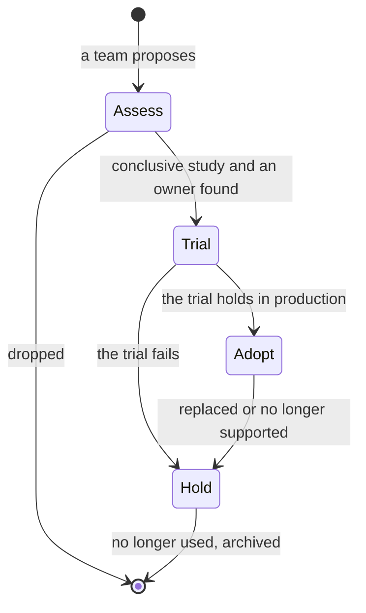

Example: an entry kept like code, one file per entry reviewed in a merge request (format inspired by the AOE generator, fictitious content):

``` { .text .ex-illus title="Illustration" }
radar/2026-11-01/consumer-driven-contracts.md
---
title: "Consumer-driven contracts (Pact)"
ring: trial
quadrant: techniques
---
Trial between orders-service and billing-service since September 2026.
Owner: team-core's tech lead.
Moves to Adopt if no integration regression reaches production
for three months. If the trial fails, team-core removes Pact from its two repositories.
```

The radar replaces neither the ADR nor the golden path, the three fit together:

| Tool | Scope | Question it answers |
|---|---|---|
| ADR | one decision, in one system | why this choice here, and not another? |
| company tech radar | the whole company | which technologies are supported, tried, studied or to avoid, and why? |
| golden path | a tooled path | how do I start a service with the Adopt choices already wired in? |

Pitfalls:

- **a radar without mandate or criteria**: kept by volunteers, with no rule to change rings, it only records after the fact what is already in production;
- **Hold read as "forbidden, migrate everything"**: teams rewrite services that work, instead of simply starting nothing new with it;
- **copying a public radar**: I take Thoughtworks' rings as company policy, while nobody where I work knows how to run the tool or supports it in CI;
- **a frozen radar**: never reviewed, it recommends tools the company dropped, and nobody reads it any more.

:material-book-open-variant: Reference docs: [Zalando Engineering, "Technology Choices at Zalando: Updating our Tech Radar Process"](https://engineering.zalando.com/posts/2020/07/technology-choices-at-zalando-tech-radar-update.html) (July 2020); [Neal Ford, "Build your own Technology Radar"](https://www.thoughtworks.com/insights/blog/build-your-own-technology-radar) (2016)
{ .doc-ref }

| I want to... | I use... |
|---|---|
| to explain the system to a newcomer or the business, without going into the code | C4 levels 1 and 2 |
| to write a complete architecture document without starting from a blank page | arc42 template, useful sections only |
| the team to still know a year from now why it picked one option over another | ADR in the repo |
| the code not to quietly contradict the architecture, like `orders` importing `billing`'s internals | fitness functions in CI |
| every new team to know which broker or database to pick, without a meeting, while the platform cannot support everything | company tech radar, kept by the architects |

!!! maturity "Measuring maturity"
    | Level | What I see in the team |
    |---|---|
    | N1 | a few ADRs and diagrams exist, written by one motivated person, often out of date |
    | N2 | every structural decision has its ADR in the repo, C4 level 1 and 2 diagrams live as text next to the code, and the tech radar is published |
    | N3 | merge request review requires an ADR for an architecture change, fitness functions block drift, and CI flags a dependency on Hold |
    | N4 | the team tracks blocked drift, the age of ADRs and diagrams and compliance with the radar, and adjusts its rules from these numbers |

    **I measure**: the share of architecture changes merged with a linked ADR, read in the merge request tool; the number of fitness functions and violations blocked per month, read in the CI reports.

## Measuring success

An architecture solution works when a number moves the right way without another one getting worse. Before changing anything, I record a baseline: availability, p99 latency or delivery frequency over the last four weeks, for example. After the change, I record the same measure, the same way, over a window of the same length, so I do not compare a week of sales with a quiet week. And I pick a guard metric that must not move: adding a cache must not make wrong prices appear, splitting into services must not lower the availability of the chain. The tracked number is an SLI, the target the team sets on it is an SLO, and the promise made to a customer with a penalty is an SLA, usually looser than the SLO.

| Solution or situation | Success indicator (SLI) | Likely SLO | Likely SLA |
|---|---|---|---|
| modular monolith or microservices ([Architecture styles](#architecture-styles)) | share of releases that require deploying several services or modules together | under 10% over a quarter | n/a: no external contract |
| idempotent payments ([Idempotency](#idempotency)) | number of payments charged twice | 0 per month, each duplicate is handled as an incident | no double charge left unrefunded after 5 business days (a double charge costs a customer and a bank dispute) |
| calls protected by timeout, retry and circuit breaker ([Resilience](#resilience)) | share of `my-api` requests served without a 5xx error in under 800 ms | 99.9% over a rolling 30 days | 99.5% per month, with a credit below it (looser to keep a margin before the penalty) |
| service spread over three zones ([Zones and regions](#zones-and-regions)) | availability measured from outside by a probe | 99.95% per month, about 22 min of downtime | 99.9% per month, about 43 min |
| disaster recovery ([RTO and RPO](#rto-and-rpo)) | actual RTO and RPO measured in a recovery drill | 1 h RTO and 5 min RPO, checked at each quarterly drill | 4 h RTO and 1 h RPO, written in the contract |
| cache in front of the product page ([Scaling out](#scaling-out)) | p95 latency of the product page; as a guard, paid prices that differ from the source price | p95 under 200 ms, 0 wrong price at payment | n/a: no external contract, the paid price is reread from the source |
| architecture for continuous delivery ([Designing for continuous delivery](#designing-for-continuous-delivery)) | median delay between merge and production, change failure rate | under one day, under 15% of changes needing a fix | n/a: no external contract |

[Take with caution: example orders of magnitude, to set with the business]

!!! noob "As noob"
    A carrier promises by contract a delivery before noon, otherwise it refunds the shipping fee: that is the SLA. Internally, its teams aim for 11 am: that is the SLO, stricter, so that small delays cost nothing. The SLI is the delivery time the scanner records for each parcel. The takeaway: **the SLO is my internal target, the SLA the paid promise to the customer, and I always aim better than what I promise.**

## Pitfalls to avoid

| Pitfall | What happens | Solution |
| --- | --- | --- |
| **Splitting too early**: I go for microservices on day one, before I know the business boundaries. | Every splitting mistake costs network calls, contracts to version and deployments to coordinate. | I start with a modular monolith and split when a measured pain calls for it ([Which style to choose](#which-style-to-choose)). |
| **The distributed monolith**: I separate the services but they read the same tables. | A column rename breaks three services at once, which must be deployed together. | Each service keeps its own data; the others go through its API or its events ([One database per service](#one-database-per-service)). |
| **The default timeout**: I keep the library's value, often infinite or several minutes long. | A slow dependency ties up my threads and the slowness spreads to everything that calls me. | I set a timeout a little above the dependency's measured p99 ([Timeout](#timeout)). |
| **Retrying everywhere, right away**: each level of a chain of three services retries three times, without waiting. | A single request turns into 27 on the last service, which collapses. | I retry at one level only, with exponential backoff, jitter and a retry budget ([Retry budget](#retry-budget)). |
| **Retrying a non idempotent operation**: I replay a payment after a timeout when only the response was lost. | The customer is charged twice. | I only retry an idempotent operation, with an idempotency key written in the same transaction as the charge ([Idempotency](#idempotency)). |
| **Believing a compensation erases the past**: I design a saga as if cancelling reset everything. | The customer sees the charge then the refund on their statement, and the business discovers this intermediate state in production. | I get the business to approve every visible intermediate state ([Orchestrated or choreographed saga](#orchestrated-or-choreographed-saga)). |
| **Sizing on the average**: I plan my servers from the day's average QPS. | In the evening or during sales, the peak exceeds capacity and the service goes down when it earns the most. | I size on the peak with a margin, then check with a load test ([Average and peak QPS](#average-and-peak-qps)). |
| **Forgetting non technical SPOFs**: I double the servers, but only one person knows how to deploy, or a certificate has no owner. | The day that person is away or the certificate expires, everything stops. | I list the SPOFs, technical and human, at the start of every availability review ([Single point of failure](#single-point-of-failure)). |

## What interviews ask

The typical questions:

- "Monolith or microservices for a new product?", "What is a distributed monolith?" How I answer: I start from the number of teams and how stable the business boundaries are ([Which style to choose](#which-style-to-choose)).
- "Explain the CAP theorem", "Strong or eventual consistency for a bank balance, and for a like counter?" How I answer: I recall that the choice only arises during a network partition, then compare the two cases ([CAP and PACELC](#cap-and-pacelc)), and [The CAP theorem](textes-fondateurs.md#brewer-2000-then-gilbert-and-lynch-2002-the-cap-theorem).
- "How do you keep data consistent across two services without a distributed transaction?", "How do you publish an event without losing it once the database has written?" How I answer: I describe a saga with its compensations, then the outbox ([Orchestrated or choreographed saga](#orchestrated-or-choreographed-saga), [Outbox](#outbox)).
- "A service you depend on becomes slow, what do you do?", "How do you stop a retry from charging twice?" How I answer: I stack timeout, retry with jitter, circuit breaker and idempotency ([Resilience](#resilience), [Idempotency](#idempotency)).
- "How do you approach a system design exercise?" How I answer: I first clarify the needs and the orders of magnitude, propose the simplest design that meets them, then look for its bottlenecks and the way it fails ([Estimating capacity](#estimating-capacity), [Resilience](#resilience)).
- "How many servers for one million daily active users?" How I answer: I walk through the back-of-the-envelope calculation, from average QPS to peak, then Little's law ([Average and peak QPS](#average-and-peak-qps), [Little's law](#littles-law)).
- "How do you ship several times a day without downtime?", "How do you rename a column in production?" How I answer: I talk about independent deployment, compatible contracts, expand and contract and feature flags, then point to the pipeline practices ([Designing for continuous delivery](#designing-for-continuous-delivery)).
- "What is Conway's law, and what do you do with it?" How I answer: I describe the front-end, back-end and database teams producing three coupled layers, then the inverse maneuver ([Conway's law](#conways-law)).
- "How do you choose a database?" How I answer: I start from the access patterns, I take a relational database by default and I add another family only for a pattern it serves badly, quoting innovation tokens ([Choosing the type of database](#choosing-the-type-of-database)).
- "Where do you put a cache, and how do you keep a popular key that expires from bringing down the database?" How I answer: I measure first, I reason in layers, cache-aside by default with a TTL decided by the business, then <span class="term" data-term="request-coalescing">request coalescing</span>, jitter and stale-while-revalidate against the stampede ([Scaling out](#scaling-out)).
- "Design a rate limiter for an API open to partners." How I answer: I compare fixed window, sliding window and token bucket, I share the counter in Redis across instances and I return `429` with `Retry-After` ([Rate limiting](#rate-limiting)).
- "The business wants a 'fast and reliable' system, what do you do?" How I answer: I turn each adjective into a six-part scenario, I sort them into a utility tree and I have the numbers validated ([Quality scenarios, utility tree and ATAM](#quality-scenarios-utility-tree-and-atam)).
- "Full rewrite or progressive redesign?" How I answer: progressive redesign by default, with the decision grid, then the strangler fig step by step with its rollback ([Modernizing an existing system](#modernizing-an-existing-system)).
- "How do you document an architecture decision?" How I answer: I show an ADR and the C4 views I draw ([ADR](#adr), [C4 model](#c4-model)).
- "How do you frame technology choices across several teams?", "Who decides that a tool is adopted?" How I answer: I describe a company radar kept by architects with a mandate, written criteria per ring, proposals open to every team and a review at a fixed pace, then I link it to ADRs and golden paths ([Company tech radar](#company-tech-radar)).
- "How do you know your new architecture works?", "What is the difference between an SLO and an SLA?" How I answer: I record a baseline before, the same measure after over a window of the same length and a guard metric, then I give an SLI, an internal SLO and a looser SLA with a penalty ([Measuring success](#measuring-success)).

What makes a good answer: it names the trade-off, what the choice brings, what it costs, and in which situation I would do the opposite. A style or pattern presented without its cost sounds like a learned answer.

## What to use in which situation

| Situation | I use |
|---|---|
| I am starting a new product with one or two teams, and I do not know yet where to split | modular monolith, boundaries checked in CI |
| several teams block each other on one deployment: one release a week, and a team that breaks the build blocks the others | split by bounded context, then services |
| my services are separate, but I must always deploy them together because they share a database or call each other in chains | revisit the boundaries: it is a distributed monolith |
| a fact, like a paid order, must reach other services without the sender waiting for them | events, outbox, idempotent consumers |
| a business action spans several services, like reserving stock then charging the customer | saga with compensations validated by the business |
| one slow service takes down, in a cascade, everything that calls it | timeout, circuit breaker, bulkhead |
| during an outage, every client's retries arrive at the same time and make things worse | exponential backoff with jitter, retry budget |
| the business sets me an availability target, like 99.9%, and I must know whether it is achievable | composite calculation, removing SPOFs, three zones |
| the business asks "how much time and data can we lose?" | set RTO and RPO, then pick the recovery strategy |
| I must estimate the load before building, to know how many servers and connections to plan for | back-of-the-envelope math, peak QPS, Little's law |
| every release takes an evening and several teams on a call, while I would like to ship every day | independent deployment, compatible contracts, expand and contract, feature flags |
| I am making a decision whose reason nobody will remember in a year | ADR |
| the code drifts little by little from the architecture diagram, without anyone noticing | fitness functions |
| nobody knows which systems exist, who owns them or where the duplicates are | urbanization: mapping, capability map, rules |
| each team picks its tools alone, and I discover in production a third broker or a language nobody else knows | company tech radar, wired into golden paths and ADRs |
| my business has rich rules, like discounts, that every change of database or provider puts at risk | hexagonal architecture, dependency rule checked in CI |
| a partner with a badly written script saturates my API, and every other customer gets timeouts | per-key rate limit, shared counter, `429` with `Retry-After` |
| a page read thousands of times per minute is slow, and I already checked that no index is missing | cache-aside, TTL decided with the business, stampede protection |
| I must choose the database of a new service, and someone already suggests a trendy technology | access patterns, relational database by default |
| the business describes its needs with adjectives, like "fast and reliable" | quality scenarios, utility tree |
| my team wants to rewrite an old system from scratch, while the business keeps asking for changes | progressive redesign, strangler fig |

## Sources

- Len Bass, Paul Clements and Rick Kazman, "Software Architecture in Practice", 4th edition (2021)
- Eric Evans, "Domain-Driven Design" (2003)
- [Melvin Conway, "How Do Committees Invent?" (1968)](https://www.melconway.com/Home/Committees_Paper.html)
- Matthew Skelton and Manuel Pais, "Team Topologies" (2019)
- [James Lewis and Martin Fowler, "Microservices" (2014)](https://martinfowler.com/articles/microservices.html)
- [Martin Fowler, "MonolithFirst" (2015)](https://martinfowler.com/bliki/MonolithFirst.html)
- [Alistair Cockburn, "Hexagonal Architecture" (2005)](https://alistair.cockburn.us/hexagonal-architecture/)
- [Neal Ford, "Build your own Technology Radar", Thoughtworks (2016, reposted from a 2013 post)](https://www.thoughtworks.com/insights/blog/build-your-own-technology-radar)
- [Zalando Engineering, "Technology Choices at Zalando: Updating our Tech Radar Process" (July 2020)](https://engineering.zalando.com/posts/2020/07/technology-choices-at-zalando-tech-radar-update.html)
- [Zalando Engineering, "Building a Better Tech Radar" (January 2018)](https://engineering.zalando.com/posts/2018/01/building-tech-radar.html)
- [Robert C. Martin, "The Clean Architecture" (2012)](https://blog.cleancoder.com/uncle-bob/2012/08/13/the-clean-architecture.html)
- Alberto Brandolini, "Introducing EventStorming" (Leanpub, published in parts since around 2015, to check)
- [Seth Gilbert and Nancy Lynch, "Brewer's Conjecture and the Feasibility of Consistent, Available, Partition-Tolerant Web Services" (2002)](https://dl.acm.org/doi/10.1145/564585.564601)
- [Daniel Abadi, "Consistency Tradeoffs in Modern Distributed Database System Design", IEEE Computer (2012)](https://www.cs.umd.edu/~abadi/papers/abadi-pacelc.pdf)
- [Diego Ongaro and John Ousterhout, "In Search of an Understandable Consensus Algorithm" (2014)](https://raft.github.io/raft.pdf)
- [Leslie Lamport, "Time, Clocks, and the Ordering of Events in a Distributed System" (1978)](https://lamport.azurewebsites.net/pubs/time-clocks.pdf)
- Hector Garcia-Molina and Kenneth Salem, "Sagas", ACM SIGMOD (1987)
- [Martin Fowler, "Event Sourcing" (2005)](https://martinfowler.com/eaaDev/EventSourcing.html)
- [Martin Fowler, "CQRS" (2011)](https://martinfowler.com/bliki/CQRS.html)
- Martin Kleppmann, "Designing Data-Intensive Applications" (2017)
- Michael Nygard, "Release It!", 2nd edition (2018)
- [Marc Brooker, "Exponential Backoff And Jitter", AWS Architecture Blog (2015)](https://aws.amazon.com/blogs/architecture/exponential-backoff-and-jitter/)
- [Betsy Beyer et al., "Site Reliability Engineering", Google (2016)](https://sre.google/sre-book/table-of-contents/)
- [AWS, "Disaster Recovery of Workloads on AWS" (2021)](https://docs.aws.amazon.com/whitepapers/latest/disaster-recovery-workloads-on-aws/disaster-recovery-workloads-on-aws.html)
- [AWS, "Reducing the Scope of Impact with Cell-Based Architecture" (2023, to check)](https://docs.aws.amazon.com/wellarchitected/latest/reducing-scope-of-impact-with-cell-based-architecture/reducing-scope-of-impact-with-cell-based-architecture.html)
- John D. C. Little, "A Proof for the Queuing Formula: L = λW", Operations Research (1961)
- [Simon Brown, The C4 model (publication date not stated)](https://c4model.com/)
- [arc42, architecture documentation template (first version in 2005)](https://arc42.org/)
- Neal Ford, Rebecca Parsons and Patrick Kua, "Building Evolutionary Architectures" (2017)
- Jacques Sassoon, "Urbanisation des systèmes d'information", Hermès (1998, to check)
- Christophe Longépé, "Le projet d'urbanisation du SI", Dunod (first edition in 2001, to check)
- [The Open Group, TOGAF Standard, 10th edition (2022)](https://www.opengroup.org/togaf)
- John Zachman, "A Framework for Information Systems Architecture", IBM Systems Journal (1987)
- [The Open Group, ArchiMate 3.2 (2022, to check)](https://www.opengroup.org/archimate-forum/archimate-overview)
- [Jeffrey Palermo, "The Onion Architecture" (2008)](https://jeffreypalermo.com/2008/07/the-onion-architecture-part-1/)
- [import-linter, documentation (publication date not stated)](https://import-linter.readthedocs.io/)
- Martin Abbott and Michael Fisher, "The Art of Scalability" (2009)
- [Dan McKinley, "Choose Boring Technology" (2015)](https://mcfunley.com/choose-boring-technology)
- [Martin Fowler, "PolyglotPersistence" (2011)](https://martinfowler.com/bliki/PolyglotPersistence.html)
- [SEI, "ATAM: Method for Architecture Evaluation" (2000)](https://insights.sei.cmu.edu/library/atam-method-for-architecture-evaluation/)
- [SEI, "Quality Attribute Workshops (QAWs), Third Edition" (2003)](https://insights.sei.cmu.edu/library/quality-attribute-workshops-qaws-third-edition/)
- [IETF, RFC 9111 "HTTP Caching" (June 2022)](https://www.rfc-editor.org/rfc/rfc9111)
- [IETF, RFC 5861 "HTTP Cache-Control Extensions for Stale Content" (2010)](https://www.rfc-editor.org/rfc/rfc5861)
- [Andrea Vattani, Flavio Chierichetti and Keegan Lowenstein, "Optimal Probabilistic Cache Stampede Prevention", VLDB (2015)](https://www.vldb.org/pvldb/vol8/p886-vattani.pdf)
- [Rajesh Nishtala et al., "Scaling Memcache at Facebook", NSDI (2013)](https://www.usenix.org/conference/nsdi13/technical-sessions/presentation/nishtala)
- [Stripe, "Scaling your API with rate limiters" (2017)](https://stripe.com/blog/rate-limiters)
- [Cloudflare, "Counting things, a lot of different things" (2017)](https://blog.cloudflare.com/counting-things-a-lot-of-different-things/)
- [Becky Weiss and Mike Furr, "Static stability using Availability Zones", Amazon Builders' Library (2020, to check)](https://aws.amazon.com/builders-library/static-stability-using-availability-zones/)
- [Greg Young, "Versioning in an Event Sourced System", Leanpub (2017, to check)](https://leanpub.com/esversioning)
- [Joel Spolsky, "Things You Should Never Do, Part I" (April 2000)](https://www.joelonsoftware.com/2000/04/06/things-you-should-never-do-part-i/)
- Frederick Brooks, "The Mythical Man-Month" (1975)
- [Martin Fowler, "Strangler Fig" (2004, rewritten since, to check)](https://martinfowler.com/bliki/StranglerFigApplication.html)
- [Martin Fowler, "Sacrificial Architecture" (2014)](https://martinfowler.com/bliki/SacrificialArchitecture.html)
