# Architecture and distributed systems

!!! warning "Disclaimer"
    These notes are personal cheat sheets, not a source of truth. They reflect my own understanding and choices: their content remains subjective, despite the quotes and references it contains. It may be incomplete, simplified, inaccurate or outdated. Always check the official documentation before applying it. This content is provided as is, without any warranty: you use it at your own risk.

!!! abstract "Scales"
    The colored badges under the headings say at which scale a notion applies:

    - <span class="pill pill-scope pill-scope-code">Code</span> the classes, functions and modules of one program;
    - <span class="pill pill-scope pill-scope-app">Application</span> one service or application and its internal split;
    - <span class="pill pill-scope pill-scope-system">System</span> several services talking to each other over the network;
    - <span class="pill pill-scope pill-scope-infra">Infrastructure</span> servers, network, zones and clusters, physical or virtual;
    - <span class="pill pill-scope pill-scope-enterprise">Enterprise</span> the whole information system and its organization.

    Details and ambiguous words: [map of scales](#map-of-scales).

This page gathers the basics for designing a system that holds under load and failures: the main architecture styles, how to split a system, what changes when it runs on several machines, how to share data between services, how to resist failures, how to estimate capacity, how to build the front end (micro front ends, design system, rendering, bundlers), how to urbanize an application estate and how to document choices. The services `orders-service`, `billing-service`, `stock-service` and `my-api` are fictitious, and every number is an example unless stated otherwise.

## Terminology

**Architecture**: the set of structuring decisions of a system, the ones that are expensive to change later: how it is split, how the pieces talk, where the data lives.

**<span class="term" data-term="quality-attribute">Quality attribute</span>**: a measurable property of the system other than what it does: performance, availability, security, cost, ease of change. They, more than features, drive the architecture. They are written as a measurable scenario:

```
source      a peak of 2,000 simultaneous customers (sales)
stimulus    they place orders at the same time
response    orders-service accepts every order
measure     p99 under 800 ms, 0 lost orders
```

**<span class="term" data-term="software-component">Component</span>**: a piece of the system with a precise role and a clear boundary: an API, a message queue, a database, a code module.

**<span class="term" data-term="coupling">Coupling</span>**: how much a component depends on another one's details. Strong coupling: changing `billing-service` forces a change to `orders-service` the same day. **<span class="term" data-term="cohesion">Cohesion</span>**: how much what is grouped together serves the same purpose. The goal is low coupling and high cohesion.

**<span class="term" data-term="distributed-system">Distributed system</span>**: a system whose components run on several machines and talk over the network. As soon as there are two services and a database, I am in one: every call can be slow, lost or duplicated.

**<span class="term" data-term="trade-off">Trade-off</span>**: in architecture, almost everything is a trade-off. Gaining availability costs consistency or money, gaining team autonomy costs operational complexity. A good decision says what it gives up.

| I want to... | I look at... |
|---|---|
| to settle between two options, like a single database or one per service, without the discussion turning into a matter of taste | the quality attributes it serves and the ones it degrades |
| to know whether two components are too tied, for example if every change to `billing-service` forces a change to `orders-service` the same day | how often they change together, how many calls they exchange |
| to understand why the system often goes down although each service works fine on its own | what goes over the network, and what happens when the network fails |

## Map of scales

The word "architecture" names the organization of a program's classes just as well as that of a datacenter's servers. The same notion does not mean the same thing at every scale: hexagonal architecture splits **code**, cell-based architecture splits **infrastructure**. Every notion on this site therefore carries one or more badges saying which scale it is about.

### The five scales

| Scale | What it is about | Logical or physical | What I draw | Example |
|---|---|---|---|---|
| <span class="pill pill-scope pill-scope-code">Scale · Code</span> | classes, functions, modules of one program | logical | class diagram, module tree | `PayOrder` only knows the `PaymentGateway` interface |
| <span class="pill pill-scope pill-scope-app">Scale · Application</span> | one service or application and its internal split | logical | components (C4 level 3) | `orders-service`: API, business, data access |
| <span class="pill pill-scope pill-scope-system">Scale · System</span> | several services talking to each other | logical, with the network between them | containers (C4 level 2), flows | `orders-service` publishes `OrderPaid`, `billing-service` consumes it |
| <span class="pill pill-scope pill-scope-infra">Scale · Infrastructure</span> | servers, network, zones, clusters, hardware | physical or virtual | deployment diagram | 3 Kubernetes nodes across 3 zones, one primary database and two replicas |
| <span class="pill pill-scope pill-scope-enterprise">Scale · Enterprise</span> | the whole information system | logical, organizational | map, capability map | 80 applications organized into zones and districts |

A notion can span two scales: a **retry** is written in code but only makes sense between two services; it then carries two badges. <span class="pill pill-scope pill-scope-all">All scales</span> marks documentation tools that apply everywhere (ADR).

### The notions on this page

| Notion | Code | Application | System | Infrastructure | Enterprise |
|---|---|---|---|---|---|
| monolith, modular monolith | x | x | | | |
| hexagonal architecture, clean architecture | x | x | | | |
| microservices, event-driven architecture | | | x | | |
| serverless | | x | | x | |
| DDD, bounded context | | x | x | | |
| Conway's law | | | x | | x |
| CAP, replication, consensus | | | x | x | |
| saga, outbox, CQRS, event sourcing | | x | x | | |
| timeout, retry, circuit breaker | x | | x | | |
| bulkhead, load shedding | | x | x | x | |
| zones and regions, RTO and RPO, recovery, cell-based architecture | | | x | x | |
| capacity estimation | | | x | x | |
| micro front ends | | | x | | |
| design system, bundlers | x | | | | |
| rendering strategies | | x | | | |
| urbanization, TOGAF, Zachman | | | | | x |
| C4, arc42, fitness functions | x | x | x | | |

### Words that change meaning with the scale

| Word | At code or application scale | At infrastructure scale |
|---|---|---|
| layer | a group of modules: presentation, business, data access | a tier of machines: web servers, application servers, database |
| adapter | a class that plugs the business into a tool (hexagonal architecture) | a device or service that converts a protocol |
| partition | a split of the data (a Kafka partition, a partitioned table) | a network cut between two groups of machines (the P in CAP) |
| cell | rarely used | a complete, isolated copy of the stack serving part of the customers |
| node | an element of a tree or graph | a machine in a cluster |
| instance | an object created from a class | a virtual machine or a running copy of a service |
| service | a class holding a business rule (`PricingService`) | a program deployed on its own, with its network address |
| bulkhead | a thread or connection pool reserved for one dependency | separate clusters or accounts to isolate a failure |

**When to use it.** Whenever an architecture discussion goes in circles: asking "which scale are we talking about?" settles half the misunderstandings. An enterprise architect, a solution architect and a developer who say "layered architecture" often do not mean the same thing.

## Architecture styles

### Monolith

<a class="pill pill-scope pill-scope-app" href="#map-of-scales">Scale · Application</a> <span class="pill pill-status pill-status-ok" title="Still valid, checked November 2026">Current · 11/2026</span>

A **<span class="term" data-term="monolith">monolith</span>** is a single application, a single deployment, often a single database. At first it is the simplest option: I develop, test and deploy one program. It becomes painful when dozens of people change the same code: the smallest fix waits for everything else to be ready, then everything redeploys together.

:material-book-open-variant: Reference docs: [Martin Fowler, "MonolithFirst"](https://martinfowler.com/bliki/MonolithFirst.html) (2015)
{ .doc-ref }

### Modular monolith

<a class="pill pill-scope pill-scope-code" href="#map-of-scales">Scale · Code</a> <a class="pill pill-scope pill-scope-app" href="#map-of-scales">Scale · Application</a> <span class="pill pill-status pill-status-ok" title="Still valid, checked November 2026">Current · 11/2026</span>

A **<span class="term" data-term="modular-monolith">modular monolith</span>** deploys as one block, but its code is split into modules with strict boundaries: each module exposes a public interface, and the others may not import its internal details.

```
my-api/
├── orders/      api.py (public), domain/, storage/ (private)
├── billing/     api.py (public), domain/, storage/ (private)
└── stock/       api.py (public), domain/, storage/ (private)
rule checked in CI: orders imports only billing.api, never billing.storage
```

It is often the best starting point: if a module must one day become a service, its boundary already exists.

### Microservices

<a class="pill pill-scope pill-scope-system" href="#map-of-scales">Scale · System</a> <span class="pill pill-status pill-status-ok" title="Still valid, checked November 2026">Current · 11/2026</span>

**<span class="term" data-term="microservice">Microservices</span>**: several small services, each deployed alone, owning its data, maintained by one team. They bring autonomy (each team ships at its own pace) and per-service scaling, at the price of a distributed system: network, data consistency, observability, contract versions. The classic trap is the **<span class="term" data-term="distributed-monolith">distributed monolith</span>**: separate services that must all be deployed together because they share a database or call each other in chains. Reference: James Lewis and Martin Fowler, "Microservices" (2014).

:material-book-open-variant: Reference docs: [James Lewis and Martin Fowler, "Microservices"](https://martinfowler.com/articles/microservices.html) (2014); [Chris Richardson, microservices.io, "Microservice Architecture"](https://microservices.io/patterns/microservices.html) (accessed November 2026)
{ .doc-ref }

### Serverless

<a class="pill pill-scope pill-scope-app" href="#map-of-scales">Scale · Application</a> <a class="pill pill-scope pill-scope-infra" href="#map-of-scales">Scale · Infrastructure</a> <span class="pill pill-status pill-status-ok" title="Still valid, checked November 2026">Current · 11/2026</span>

I have tasks that only come once in a while, like a thumbnail to create when someone uploads a photo. With **<span class="term" data-term="serverless">serverless</span>**, the cloud provider runs my code only when there is work (a request, a message, an uploaded file) and bills me per use. I have no server to manage, and at night, with no traffic, nothing runs. In exchange: cold starts, limited execution time, provider dependency. Well suited to event processing and irregular traffic.

A **<span class="term" data-term="cold-start">cold start</span>** is the time the provider takes to create an instance when none is ready: download the code, start the runtime, run the initialization. It only hits the first request after a period without traffic. Example for a function that creates a thumbnail (example figures, they vary with the language, the package size and the provider):

```
10:00:00.000  photo.jpg uploaded to the bucket, the event triggers the function
10:00:00.000  no instance ready: cold start (1.5 s)
10:00:01.500  the function runs: 20 ms of work, thumbnail written
10:00:01.520  the instance stays warm; a 2nd file at 10:00:30 starts with no wait
10:15:00      no call for ~15 min: the provider removes the instance
bill          2 invocations and their duration, nothing for the 15 idle minutes
```

:material-book-open-variant: Reference docs: [Mike Roberts, "Serverless Architectures", martinfowler.com](https://martinfowler.com/articles/serverless.html) (2018)
{ .doc-ref }

### Event-driven architecture

<a class="pill pill-scope pill-scope-system" href="#map-of-scales">Scale · System</a> <span class="pill pill-status pill-status-ok" title="Still valid, checked November 2026">Current · 11/2026</span>

In an **<span class="term" data-term="event-driven-architecture">event-driven architecture</span>**, a service announces a fact ("order paid") on a broker, and the interested services react, without the sender knowing them.

```
direct call   orders-service calls billing, stock, email: if email is down, the order fails
events        orders-service publishes OrderPaid; billing, stock, email consume at their own pace
```

Gain: decoupling in time (the consumer may be down) and adding consumers without touching the sender. Cost: eventual consistency, flows harder to follow, duplicate messages. The mechanisms (queue, topic, delivery guarantees, DLQ) are in [API: REST and asynchronous](api-rest-async.md#asynchronous-messages-and-events).

:material-book-open-variant: Reference docs: [Martin Fowler, "What do you mean by Event-Driven?"](https://martinfowler.com/articles/201701-event-driven.html) (2017)
{ .doc-ref }

### Hexagonal and clean architecture

<a class="pill pill-scope pill-scope-code" href="#map-of-scales">Scale · Code</a> <a class="pill pill-scope pill-scope-app" href="#map-of-scales">Scale · Application</a> <span class="pill pill-status pill-status-ok" title="Still valid, checked November 2026">Current · 11/2026</span>

**<span class="term" data-term="hexagonal-architecture">Hexagonal architecture</span>** (Alistair Cockburn, 2005, also called "<span class="term" data-term="port-adapter">ports and adapters</span>") puts the business code at the center. It knows only interfaces (the ports); the database, the HTTP API and the broker are adapters plugged into those ports. **<span class="term" data-term="clean-architecture">Clean architecture</span>** (Robert C. Martin, 2012 article, 2017 book) pushes the same idea in circles: dependencies always point toward the business.

!!! noob "As noob"
    Picture a lamp and a wall socket: the lamp (the business code) does not know whether the power comes from a power plant or a generator, it only knows the shape of the socket (the port). In production I plug it into the real grid, in tests into a battery, without ever touching the lamp. The one thing to remember: **the business code draws its sockets, the rest of the world plugs into them.**

**At which scale.** Both models organize **the code of one service**: a port is an interface, an adapter is a class. They say nothing about the number of servers, the network or the zones; the same hexagonal service runs just as well on one machine as on a hundred pods. For the machine scale, see [High availability and recovery](#high-availability-and-recovery) and [cell-based architecture](#cell-based-architecture).

```python
# Example: the port, the interface the business code needs
class PaymentGateway(Protocol):
    def charge(self, order_id: str, amount_cents: int) -> bool: ...


# Example: the use case, which only knows the port
class PayOrder:
    def __init__(self, gateway: PaymentGateway) -> None:
        self.gateway = gateway

    def run(self, order_id: str, amount_cents: int) -> bool:
        return self.gateway.charge(order_id, amount_cents)
```

In tests, I plug in a fake `PaymentGateway`; in production, the payment provider's adapter. The underlying principles (<span class="term" data-term="dependency-inversion">dependency inversion</span>, SOLID) are in [Design principles](principes-conception.md).

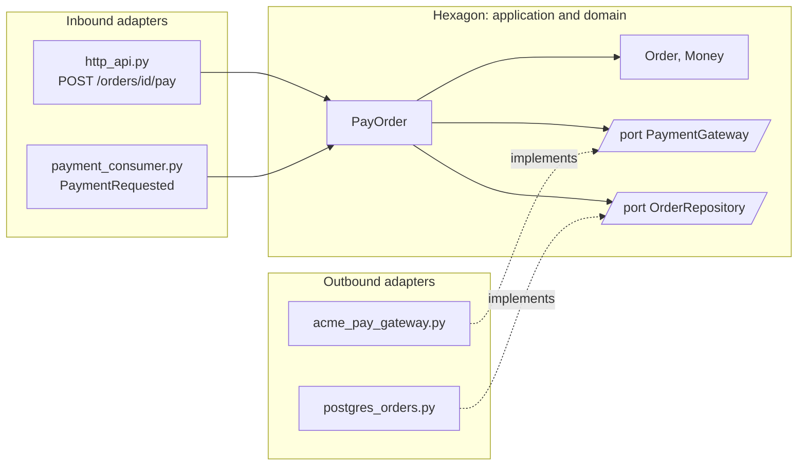

**Why.** The business changes slowly, technology changes fast: I switch databases, change payment provider, add a message queue. Without a boundary, a business rule ends up written in an HTTP controller or in an SQL query, and every technical change puts it at risk. With ports:

- the business is tested without a database or network, in milliseconds;
- swapping an adapter (moving from one provider to another) does not touch a line of business code;
- the same use case is triggered from several entry points: HTTP route, received message, command line.

**When to apply it.** The signals that justify the cost:

| Signal | Example |
|---|---|
| my business has rich rules that will live for years | discount calculation, order life cycle with its states and forbidden transitions |
| I know that a technical tool under my code will probably change | planned payment provider migration, two databases for the same role |
| the same use case must be triggerable through several entry doors | "pay an order" through the API and through a `PaymentRequested` message |
| my tests are slow or fragile because each one goes through the database | 12 minutes of tests to check calculation rules |

When not to apply it: a CRUD with no rules, a script, a throwaway prototype, a service that only transforms and forwards data. There, simple layers (route, service, data access) are enough; ports and adapters would only add files.

**How.** A typical tree:

```
orders_service/
├─ domain/                    pure rules, no technical import
│  └─ order.py                Order, Money, state transitions
├─ application/               use cases and ports
│  ├─ ports.py                PaymentGateway, OrderRepository
│  └─ pay_order.py            PayOrder
├─ adapters/
│  ├─ inbound/                what calls the business
│  │  ├─ http_api.py          POST /orders/{id}/pay
│  │  └─ payment_consumer.py  PaymentRequested message
│  └─ outbound/               what the business calls
│     ├─ acme_pay_gateway.py  payment provider (fictitious)
│     └─ postgres_orders.py   OrderRepository on Postgres
└─ main.py                    wiring: picks the adapters to plug in
```

The steps:

1. start from a use case ("pay an order"), not from technical layers;
2. write the business code without any framework, database or HTTP client import;
3. define each port from the business point of view: `charge(order_id, amount_cents)`, not `post_json(url, body)`;
4. write the adapter and test it separately against the real neighbour ([Testcontainers](qualite.md#integration-tests-with-testcontainers), contract test);
5. wire everything in one place (`main.py`), the only file that knows both the business and the adapters;
6. have the CI check the dependency rule, otherwise it erodes within weeks.

*Testcontainers: complements pytest*
{ .tool-rel }


The use case test, with a fake plugged into the port (this is not a mock across a network boundary: the boundary is the port, and the real adapter has its own integration tests):

```python
# Good: a fake plugged into the port, not a mock across the network
class FakeGateway:
    def __init__(self, accept: bool) -> None:
        self.accept = accept
        self.calls: list[tuple[str, int]] = []

    def charge(self, order_id: str, amount_cents: int) -> bool:
        self.calls.append((order_id, amount_cents))
        return self.accept


# Example: the test checks the result and the amount charged
def test_pay_order_charges_the_full_amount() -> None:
    gateway = FakeGateway(accept=True)
    assert PayOrder(gateway).run("o-42", 12_000) is True
    assert gateway.calls == [("o-42", 12_000)]
```

The dependency rule checked on every pipeline (import-linter, `layers` contract: an upper layer may import the lower ones, never the reverse):

```ini
# Example: layers contract, the top imports the bottom, never the reverse
[importlinter:contract:hexagon]
name = the business depends on no adapter
type = layers
layers =
    orders_service.adapters
    orders_service.application
    orders_service.domain
```

Common traps:

- a port that copies the tool (`execute_sql`, `get_bucket`) instead of expressing a business need: the business still depends on the technology;
- technical types leaking into the business (ORM object, HTTP response, client exception);
- applying the model to the whole system at once: keep it for the modules whose business justifies it, the others stay in simple layers.

| Variant | Picture | What it adds |
|---|---|---|
| hexagonal (Cockburn, 2005) | a hexagon, inputs on one side, outputs on the other | ports and adapters, symmetry between input and output |
| onion (Jeffrey Palermo, 2008) | concentric rings | the domain model at the core, services around it |
| clean architecture (Robert C. Martin, 2012) | circles | explicit use cases, dependency rule pointing inward |

All three say the same thing: dependencies point toward the business. The name matters less than the rule checked in CI.

<figure class="diagram"><svg viewBox="0 0 220 210" role="img" aria-label="Clean architecture circles"><circle class="layer layer-1" cx="110" cy="105" r="95"/><circle class="layer layer-1" cx="110" cy="105" r="70"/><circle class="layer layer-2" cx="110" cy="105" r="45"/><circle class="layer layer-3" cx="110" cy="105" r="20"/><text x="110" y="26" text-anchor="middle">frameworks, database, HTTP</text><text x="110" y="51" text-anchor="middle">adapters</text><text x="110" y="76" text-anchor="middle">use cases</text><text x="110" y="108" text-anchor="middle">entities</text></svg><figcaption>Clean architecture (Robert C. Martin, 2012): dependencies point to the center</figcaption></figure>

:material-book-open-variant: Reference docs: [Alistair Cockburn, "Hexagonal Architecture"](https://alistair.cockburn.us/hexagonal-architecture/) (2005); [Robert C. Martin, "The Clean Architecture"](https://blog.cleancoder.com/uncle-bob/2012/08/13/the-clean-architecture.html) (2012)
{ .doc-ref }

### Which style to choose

| I want to... | I use... |
|---|---|
| to start a new product with one or two teams, without knowing yet where the boundaries will be | modular monolith |
| several teams to ship each at its own pace: the payment team ships a fix in the morning without waiting for the catalog team to finish | microservices, split by business domain |
| to handle tasks that come in bursts, like a thumbnail to create when someone uploads a photo, without paying for a server that waits the rest of the time | serverless |
| billing, stock and email sending to learn that an order is paid, without the order waiting for their answer | events on a broker |
| to keep complex business rules (discounts, order states) intact when the database or payment provider changes | hexagonal architecture |
| an API that reads and writes records with no particular rules, like an address book, and that will change little | a layered monolith, no ceremony |

The cautious rule: start simple, split when a measured pain requires it (Martin Fowler, "MonolithFirst", 2015).

The same choice as a tree; serverless and events combine with any branch:

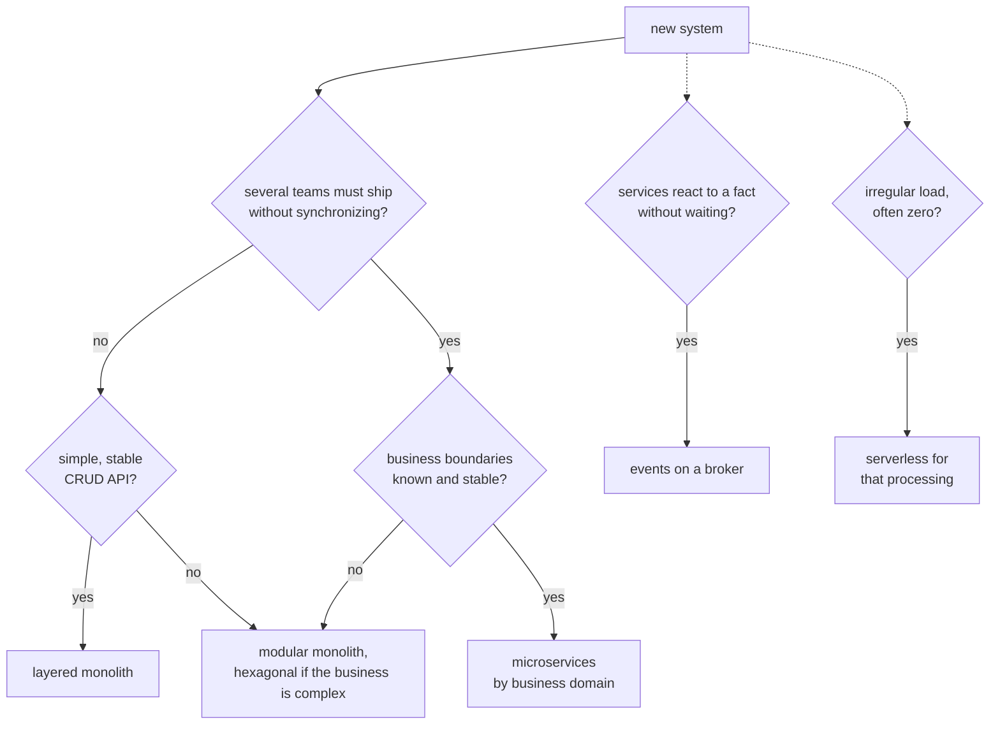

:material-book-open-variant: Reference docs: [Martin Fowler, "Microservice Premium"](https://martinfowler.com/bliki/MicroservicePremium.html) (2015)
{ .doc-ref }

## Splitting the system

<a class="pill pill-practice" href="../livraison/#design-before-coding">Practice · Technical design</a>
<a class="pill pill-dora" href="https://dora.dev/capabilities/loosely-coupled-teams/">DORA · Loosely coupled teams</a>

### Domain-Driven Design

<a class="pill pill-scope pill-scope-app" href="#map-of-scales">Scale · Application</a> <a class="pill pill-scope pill-scope-system" href="#map-of-scales">Scale · System</a> <span class="pill pill-status pill-status-ok" title="Still valid, checked November 2026">Current · 11/2026</span>

**Domain-Driven Design** (DDD, Eric Evans, 2003) starts from one idea: the software should be split along business lines, not along tables or technical layers. It provides tools to find those boundaries.

:material-book-open-variant: Reference docs: [Eric Evans, "Domain-Driven Design Reference"](https://www.domainlanguage.com/ddd/reference/) (2015); [Martin Fowler, "DomainDrivenDesign"](https://martinfowler.com/bliki/DomainDrivenDesign.html) (2020)
{ .doc-ref }

### Bounded context and ubiquitous language

<a class="pill pill-scope pill-scope-app" href="#map-of-scales">Scale · Application</a> <a class="pill pill-scope pill-scope-system" href="#map-of-scales">Scale · System</a> <span class="pill pill-status pill-status-ok" title="Still valid, checked November 2026">Current · 11/2026</span>

A **<span class="term" data-term="bounded-context">bounded context</span>** is a scope in which a word has one single meaning. In the same online shop, "order" does not mean the same thing everywhere:

| Context | An "order" is... |
|---|---|
| Sales | a validated cart, with prices and discounts |
| Billing | an amount due, a VAT, a payment method |
| Logistics | parcels, an address, a carrier |

Each context has its own model and its **<span class="term" data-term="ubiquitous-language">ubiquitous language</span>**: the business experts' words are the code's words (`Shipment`, not `OrderData2`). A bounded context is a good candidate for a module or a service.

!!! noob "As noob"
    In a company, the word "customer" does not mean the same thing to the salesperson, the accountant and the delivery driver, and each one is right in their own department. Rather than forcing one definition that suits nobody, I draw borders: each team keeps its meaning of the word, and I translate when information crosses from one side to the other. The one thing to remember: **one word, one meaning, inside a border.**

:material-book-open-variant: Reference docs: [Martin Fowler, "BoundedContext"](https://martinfowler.com/bliki/BoundedContext.html) (2014); [Martin Fowler, "UbiquitousLanguage"](https://martinfowler.com/bliki/UbiquitousLanguage.html) (2006)
{ .doc-ref }

### Context map

<a class="pill pill-scope pill-scope-system" href="#map-of-scales">Scale · System</a> <span class="pill pill-status pill-status-ok" title="Still valid, checked November 2026">Current · 11/2026</span>

The **<span class="term" data-term="context-map">context map</span>** draws the relationships between contexts: who supplies, who consumes, who adapts. When I consume a system whose model does not suit me (an old piece of software, a vendor), I place an **<span class="term" data-term="anti-corruption-layer">anti-corruption layer</span>**: code that translates its model into mine, so its words do not spread.

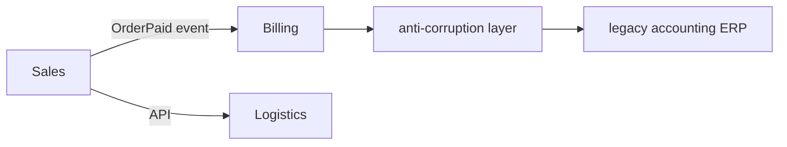

:material-book-open-variant: Reference docs: [Microsoft, "Anti-corruption Layer pattern"](https://learn.microsoft.com/en-us/azure/architecture/patterns/anti-corruption-layer) (accessed November 2026)
{ .doc-ref }

### Event storming

<a class="pill pill-scope pill-scope-system" href="#map-of-scales">Scale · System</a> <span class="pill pill-status pill-status-ok" title="Still valid, checked November 2026">Current · 11/2026</span>

**<span class="term" data-term="event-storming">Event storming</span>** (Alberto Brandolini, introduced around 2013) is a workshop: business experts and developers stick on a wall, in time order, every business event in the past tense ("order placed", "payment accepted", "parcel shipped"). The areas where the vocabulary changes and where the actors change draw the bounded contexts.

```
time ──────────────────────────────────────────────────────────────────>
[customer]     cart created, item added, order placed
[customer]     payment accepted
               ───── pivot: people stop saying "cart" and say "invoice" ─────
[accountant]   invoice issued, VAT computed, invoice sent
               ───── pivot: people say "parcel" and "carrier" ─────
[warehouse]    parcel prepared, parcel handed to carrier, parcel delivered

contexts found: Sales | Billing | Logistics
```

:material-book-open-variant: Reference docs: [Alberto Brandolini, EventStorming](https://www.eventstorming.com/) (accessed November 2026)
{ .doc-ref }

### Conway's law

<a class="pill pill-scope pill-scope-system" href="#map-of-scales">Scale · System</a> <a class="pill pill-scope pill-scope-enterprise" href="#map-of-scales">Scale · Enterprise</a>

**<span class="term" data-term="conway-law">Conway's law</span>** (Melvin Conway, "How Do Committees Invent?", 1968): a system ends up reproducing the communication structure of the organization that builds it. Three teams that rarely talk will produce three blocks that rarely talk. The **<span class="term" data-term="inverse-conway-maneuver">inverse Conway maneuver</span>** first organizes the teams along the desired architecture (Matthew Skelton and Manuel Pais, "Team Topologies", 2019).

:material-book-open-variant: Reference docs: [Melvin Conway, "How Do Committees Invent?"](https://www.melconway.com/Home/Committees_Paper.html) (1968); [Martin Fowler, "Conway's Law"](https://martinfowler.com/bliki/ConwaysLaw.html) (2022)
{ .doc-ref }

| I want to... | I use... |
|---|---|
| to find where to split the software when I land in a business I do not know, like logistics | event storming with the business experts |
| "order" not to mean a cart in one module, an invoice in another and a parcel in a third, at the risk of each one breaking what the others expect | bounded contexts, ubiquitous language |
| to plug into an external system whose model does not fit mine, like an old accounting ERP, without its words spreading through my code | anti-corruption layer |
| the boundaries drawn today to still hold once the code and the teams have grown | align teams with contexts (Conway) |

## Distributed systems

### The eight fallacies

<a class="pill pill-scope pill-scope-system" href="#map-of-scales">Scale · System</a> <a class="pill pill-scope pill-scope-infra" href="#map-of-scales">Scale · Infrastructure</a>

The **<span class="term" data-term="distributed-computing-fallacies">fallacies of distributed computing</span>** are eight false assumptions people naturally make when writing a network call (L. Peter Deutsch and colleagues at Sun, 1994, the eighth added by James Gosling around 1997, dates to check):

| Fallacy | What really happens |
|---|---|
| the network is reliable | packets get lost, connections drop |
| latency is zero | a call between regions costs tens of milliseconds |
| bandwidth is infinite | a 2 GB export saturates the link |
| the network is secure | every exchange must be encrypted and authenticated |
| topology does not change | pods change address at every deployment |
| there is one administrator | several teams, several providers |
| transport cost is zero | serialization, CPU, cloud egress fees |
| the network is homogeneous | different versions, protocols and hardware |

Each following section answers one of these fallacies.

:material-book-open-variant: Reference docs: [Wikipedia, "Fallacies of distributed computing"](https://en.wikipedia.org/wiki/Fallacies_of_distributed_computing) (accessed November 2026)
{ .doc-ref }

### CAP and PACELC

<a class="pill pill-scope pill-scope-system" href="#map-of-scales">Scale · System</a> <a class="pill pill-scope pill-scope-infra" href="#map-of-scales">Scale · Infrastructure</a>

The **<span class="term" data-term="cap-theorem">CAP theorem</span>** (conjectured by Eric Brewer in 2000, proven by Seth Gilbert and Nancy Lynch in 2002): when a **<span class="term" data-term="network-partition">network partition</span>** cuts the system in two, I must choose between **consistency** (refuse to answer rather than answer wrong) and **availability** (answer with possibly stale data). Partitions are not optional: the real choice is C or A during the cut.

**<span class="term" data-term="pacelc">PACELC</span>** (Daniel Abadi, 2012) completes it: if there is a **P**artition, choose **A** or **C**; **E**lse (in normal times), choose between **L**atency and **C**onsistency. That is the most frequent case: waiting for every replica's confirmation makes each write slower.

!!! noob "As noob"
    Two branches of a bank keep the same ledger and sync it over the phone. If the line drops, each branch chooses: refuse operations until the line is back (consistency), or carry on with what it knows, at the risk of an out-of-date balance (availability). And even when the line works, calling the other branch before every operation takes time: that is PACELC's latency or consistency choice. The one thing to remember: **I do not choose the outage, I choose how to behave during it.**

```
cut between two data centers, a customer wants to read their balance
choice C   "service temporarily unavailable"   (a bank)
choice A   shows the balance from 3 seconds ago  (a like counter)
```

<figure class="diagram"><svg viewBox="0 0 260 190" role="img" aria-label="CAP triangle"><polygon class="set" points="130,25 30,160 230,160"/><circle class="hit" cx="130" cy="25" r="5"/><circle class="hit" cx="30" cy="160" r="5"/><circle class="hit" cx="230" cy="160" r="5"/><text x="130" y="14" text-anchor="middle" class="label-strong">C: consistency</text><text x="10" y="178" text-anchor="start" class="label-strong">A: availability</text><text x="250" y="178" text-anchor="end" class="label-strong">P: partition tolerance</text><text x="98" y="95" text-anchor="middle">CA</text><text x="162" y="95" text-anchor="middle">CP</text><text x="130" y="152" text-anchor="middle">AP</text></svg><figcaption>During a partition only CP or AP remain: CA assumes a network that never splits</figcaption></figure>

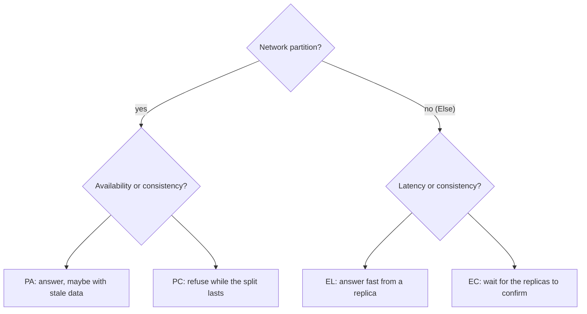

:material-book-open-variant: Reference docs: [Seth Gilbert and Nancy Lynch, "Brewer's Conjecture and the Feasibility of Consistent, Available, Partition-Tolerant Web Services"](https://dl.acm.org/doi/10.1145/564585.564601) (2002); [Daniel Abadi, "Consistency Tradeoffs in Modern Distributed Database System Design"](https://www.cs.umd.edu/~abadi/papers/abadi-pacelc.pdf) (2012)
{ .doc-ref }

### Strong or eventual consistency

<a class="pill pill-scope pill-scope-system" href="#map-of-scales">Scale · System</a> <span class="pill pill-status pill-status-ok" title="Still valid, checked November 2026">Current · 11/2026</span>

**<span class="term" data-term="strong-consistency">Strong consistency</span>**: after a confirmed write, every read sees the new value. **<span class="term" data-term="eventual-consistency">Eventual consistency</span>**: the copies will end up identical, but a read right after the write may see the old value.

!!! noob "As noob"
    Picture a chain of shops changing a price: head office sends the new label, and each shop puts it up a few minutes later. For that short while, two shops show two different prices, but they all end up showing the same one. The one thing to remember: **eventual means "soon the same everywhere", not "right now".**

```
10:00:00.000  ada changes her address (written on the primary database)
10:00:00.050  ada reloads the page, read from a lagging replica: old address
10:00:00.300  the replica has caught up: new address
```

Common fix for this case: reading my own writes from the primary for a few seconds ("read your writes").

:material-book-open-variant: Reference docs: [Werner Vogels, "Eventually Consistent"](https://www.allthingsdistributed.com/2008/12/eventually_consistent.html) (2008)
{ .doc-ref }

### Replication and quorum

<a class="pill pill-scope pill-scope-system" href="#map-of-scales">Scale · System</a> <a class="pill pill-scope pill-scope-infra" href="#map-of-scales">Scale · Infrastructure</a> <span class="pill pill-status pill-status-ok" title="Still valid, checked November 2026">Current · 11/2026</span>

**<span class="term" data-term="replication">Replication</span>** keeps several copies of a piece of data on several machines. With N copies, a write waits for W confirmations and a read queries R copies. If R + W > N, at least one copy read necessarily has the latest write: that is the **<span class="term" data-term="quorum">quorum</span>**.

!!! noob "As noob"
    Picture three notebooks holding the same list. If I always write in at least two of them and always read at least two, the two groups necessarily share one notebook, which holds the latest write: I just keep the most recent version among those I read. The one thing to remember: **if reads and writes always overlap on at least one copy, the read sees the latest write.**

| N | W | R | R + W > N? | Effect |
|---|---|---|---|---|
| 3 | 2 | 2 | yes | up-to-date read, tolerates one copy down |
| 3 | 1 | 1 | no | fast, but reads sometimes stale |
| 3 | 3 | 1 | yes | fast read, but one copy down blocks writes |

:material-book-open-variant: Reference docs: [Giuseppe DeCandia et al., "Dynamo: Amazon's Highly Available Key-value Store"](https://www.allthingsdistributed.com/files/amazon-dynamo-sosp2007.pdf) (2007)
{ .doc-ref }

### Consensus and leader election

<a class="pill pill-scope pill-scope-infra" href="#map-of-scales">Scale · Infrastructure</a> <span class="pill pill-status pill-status-ok" title="Still valid, checked November 2026">Current · 11/2026</span>

A **<span class="term" data-term="consensus-algorithm">consensus algorithm</span>** lets a group of machines agree on a value despite failures. The most taught today is **Raft** (Diego Ongaro and John Ousterhout, 2014), designed to be easier to understand than Paxos (Leslie Lamport, published in 1998). It is used for **<span class="term" data-term="leader-election">leader election</span>**: one machine writes, the others follow, and a new one is elected if the leader fails. A decision requires a majority:

| Nodes | Majority | Failures tolerated |
|---|---|---|
| 3 | 2 | 1 |
| 5 | 3 | 2 |
| 4 | 3 | 1 (a 4th node adds nothing) |

Hence odd numbers. The majority prevents **<span class="term" data-term="split-brain">split-brain</span>**: two halves cut apart cannot both elect a leader. I almost never write Raft myself: I rely on etcd, ZooKeeper, or the database that embeds it.

!!! noob "As noob"
    Picture a board of five people who must appoint a chair: it takes at least three votes. If the room is split into two groups, one of three and one of two, only the group of three can elect someone, so there are never two chairs at once. The one thing to remember: **requiring a majority guarantees one leader at a time.**

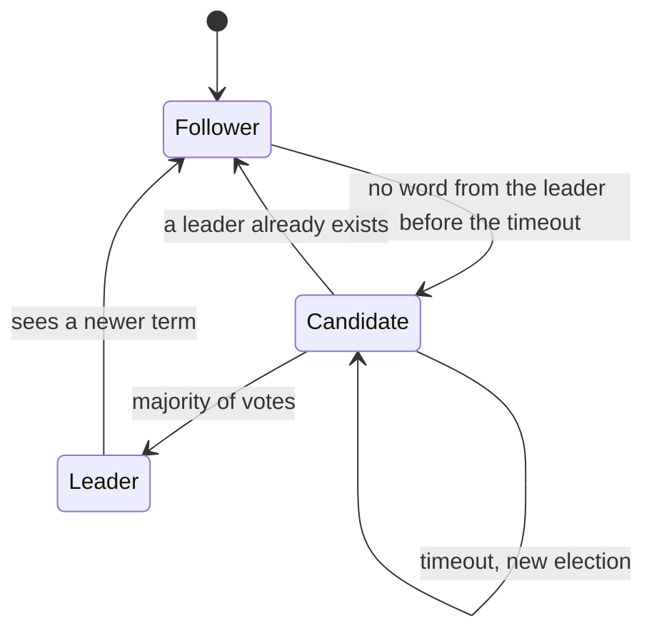

:material-book-open-variant: Reference docs: [The Raft site](https://raft.github.io/) (accessed November 2026); [Diego Ongaro and John Ousterhout, "In Search of an Understandable Consensus Algorithm"](https://raft.github.io/raft.pdf) (2014)
{ .doc-ref }

### Clocks and event order

<a class="pill pill-scope pill-scope-system" href="#map-of-scales">Scale · System</a> <span class="pill pill-status pill-status-ok" title="Still valid, checked November 2026">Current · 11/2026</span>

Two machines' clocks are never perfectly synchronized: sorting events from different machines by their time can give the wrong order. Leslie Lamport ("Time, Clocks, and the Ordering of Events in a Distributed System", 1978) proposes a **<span class="term" data-term="lamport-clock">logical clock</span>**: a counter that respects causality (if A caused B, A has a smaller number).

!!! noob "As noob"
    Two people write down the time from their own watches, and one watch is two minutes fast: sorting their notes by time can put an answer before its question. A logical clock replaces the time with a number: when I receive a message, I take a number bigger than its number, so an answer always comes after its question. Limit: for two unrelated events, the numbers say nothing about the real order. The one thing to remember: **to order things that cause each other, count the exchanges instead of reading the clock.**

```python
# Example: Lamport clock, a counter instead of the time of day
class LamportClock:
    def __init__(self) -> None:
        self.time = 0

    # Example: a local event moves the counter up by 1
    def tick(self) -> int:
        self.time += 1
        return self.time

    # Example: on receipt, I take a number greater than the one received
    def receive(self, remote_time: int) -> int:
        self.time = max(self.time, remote_time) + 1
        return self.time
```

In practice: a version number per object (ignore an update older than the one already applied) or a partition key that keeps order per order. See [message ordering](api-rest-async.md#message-ordering).

:material-book-open-variant: Reference docs: [Leslie Lamport, "Time, Clocks, and the Ordering of Events in a Distributed System"](https://lamport.azurewebsites.net/pubs/time-clocks.pdf) (1978)
{ .doc-ref }

### Idempotency

<a class="pill pill-scope pill-scope-code" href="#map-of-scales">Scale · Code</a> <a class="pill pill-scope pill-scope-system" href="#map-of-scales">Scale · System</a> <span class="pill pill-status pill-status-ok" title="Still valid, checked November 2026">Current · 11/2026</span>

On a network, I do not always know whether a request succeeded: the response may have been lost. So I retry, so the server receives duplicates. **<span class="term" data-term="idempotency">Idempotency</span>** (doing the same operation twice has the same effect as once) is the condition for any safe retry. The mechanisms (`Idempotency-Key`, idempotent consumer) are in [API: REST and asynchronous](api-rest-async.md#delivery-guarantees).

!!! noob "As noob"
    Pressing the lift call button twice does not bring two lifts: that is idempotent. Paying twice at the till because the receipt did not print, on the other hand, costs me twice. The one thing to remember: **an idempotent operation can be replayed safely, and that is what makes a retry safe.**

Example: `POST` is not idempotent by nature (see [HTTP methods](api-rest-async.md#http-methods)), the client makes it safe with an **<span class="term" data-term="idempotency-key">idempotency key</span>** it generates once per payment.

```
1. client   POST /charges  Idempotency-Key: 7f3a...  {"order": "A42", "amount": 4990}
2. server   charges the card, stores (7f3a..., body hash, 201 response, created_at) in idempotency_keys
3. client   the response is lost: timeout after 2 s
4. client   retry: same request, same key 7f3a...
5. server   key found, same hash: returns the stored 201 response, without charging a 2nd time
6. client   same key but different body ("amount": 9990): 422, the key is already bound to another request
```

The `idempotency_keys(key, request_hash, response, created_at)` table is purged after a delay (24 h for example). Pitfall: write the key and perform the charge in the same transaction, otherwise two simultaneous retries both go through.

:material-book-open-variant: Reference docs: [IETF, "The Idempotency-Key HTTP Header Field"](https://datatracker.ietf.org/doc/draft-ietf-httpapi-idempotency-key-header/) (draft, accessed November 2026); [Stripe, "Idempotent requests"](https://docs.stripe.com/api/idempotent_requests) (accessed November 2026)
{ .doc-ref }

| I want to... | I use... |
|---|---|
| never to show wrong data, like a bank balance, even if it means answering "unavailable" | strong consistency, majority quorum |
| always to answer, even with data a few seconds old, like a like counter | eventual consistency, replicas |
| only one machine at a time to have the right to write, otherwise two machines make conflicting decisions at the same time | leader election through an existing consensus tool |
| to put back in order events from several machines whose clocks disagree, without a reply landing before its question | version number or logical clock, not wall-clock time |
| to retry after a timeout without risking doing the action twice, like charging twice for a payment whose response got lost | idempotent operations |

## Data across services

### One database per service

<a class="pill pill-scope pill-scope-system" href="#map-of-scales">Scale · System</a> <span class="pill pill-status pill-status-ok" title="Still valid, checked November 2026">Current · 11/2026</span>

Each service alone owns its data: the others go through its API or its events, never through its tables. If three services read the same **<span class="term" data-term="shared-database">shared database</span>**, a simple column rename breaks all three, so nobody dares touch it any more. Consequence: a business operation touching several services can no longer fit in a single database transaction. **<span class="term" data-term="two-phase-commit">Two-phase commit</span>** (2PC) exists, but blocks everyone if the coordinator fails:

```
phase 1  coordinator -> stock, billing: "ready to commit?" (prepare)
         stock: yes (locks 1 item); billing: yes (locks the amount)
phase 2  coordinator -> stock, billing: "commit"; each one applies and releases its locks
failure  the coordinator crashes between the two phases: stock and billing voted yes, wait for the order and keep their locks
```

Between services, avoid it: each service would have to accept being locked by another, all must be available at the same time, and many databases and brokers do not offer it. The saga, below, only uses short local transactions and accepts visible intermediate states.

:material-book-open-variant: Reference docs: [Chris Richardson, microservices.io, "Database per service"](https://microservices.io/patterns/data/database-per-service.html) (accessed November 2026)
{ .doc-ref }

### Orchestrated or choreographed saga

<a class="pill pill-scope pill-scope-system" href="#map-of-scales">Scale · System</a> <span class="pill pill-status pill-status-ok" title="Still valid, checked November 2026">Current · 11/2026</span>

A **<span class="term" data-term="saga-pattern">saga</span>** (Hector Garcia-Molina and Kenneth Salem, 1987) splits the operation into local steps, each with a **<span class="term" data-term="compensation">compensation</span>**: the action that undoes its effect if a later step fails.

!!! noob "As noob"
    Planning a trip means booking the train, then the hotel, then the car, with three vendors who do not know each other. If no car is available, I cannot erase the past: I cancel the hotel and then the train, sometimes with a fee. The one thing to remember: **between services there is no "undo everything" button, each step plans its own cancellation.**

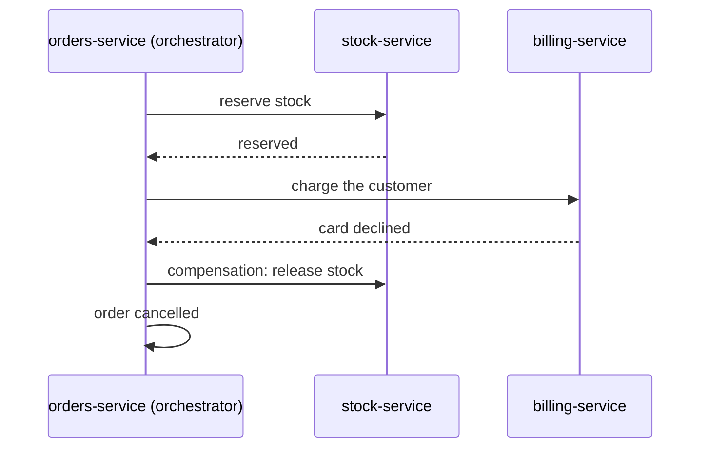

The same saga, choreographed: no coordinator, each service reacts to the events published on the broker.

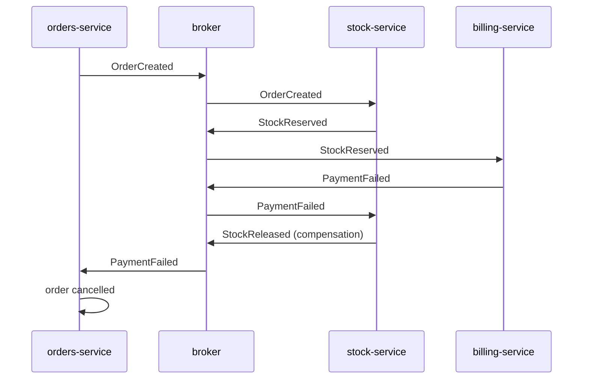

| Variant | How it works | Good when |
|---|---|---|
| <span class="term" data-term="saga-orchestration">orchestrated</span> | a coordinator calls each step and decides on compensations | more than three steps, need to see a saga's state in one place |
| <span class="term" data-term="saga-choreography">choreographed</span> | each service reacts to the others' events | two or three steps, very autonomous teams |

A compensation does not erase the past: a refund is not "never charged", the customer sees both lines. The business must validate these intermediate states.

:material-book-open-variant: Reference docs: [Chris Richardson, microservices.io, "Saga"](https://microservices.io/patterns/data/saga.html) (accessed November 2026); [Microsoft, "Saga distributed transactions pattern"](https://learn.microsoft.com/en-us/azure/architecture/patterns/saga) (accessed November 2026)
{ .doc-ref }

### Outbox

<a class="pill pill-scope pill-scope-app" href="#map-of-scales">Scale · Application</a> <span class="pill pill-status pill-status-ok" title="Still valid, checked November 2026">Current · 11/2026</span>

Writing to the database then publishing an event are two operations that can half succeed. The **<span class="term" data-term="outbox-pattern">outbox</span>** pattern solves this: it is described in [the write-then-publish trap](api-rest-async.md#the-write-then-publish-trap).

:material-book-open-variant: Reference docs: [Chris Richardson, microservices.io, "Transactional outbox"](https://microservices.io/patterns/data/transactional-outbox.html) (accessed November 2026)
{ .doc-ref }

### CQRS

<a class="pill pill-scope pill-scope-app" href="#map-of-scales">Scale · Application</a> <a class="pill pill-scope pill-scope-system" href="#map-of-scales">Scale · System</a> <span class="pill pill-status pill-status-ok" title="Still valid, checked November 2026">Current · 11/2026</span>

**<span class="term" data-term="cqrs">CQRS</span>** (Command Query Responsibility Segregation, popularized by Greg Young around 2010) separates the model that writes from the model that reads. Writes go through a strict business model; reads go through views built for each screen, updated from the changes.

!!! noob "As noob"
    In a restaurant, the kitchen follows strict rules to prepare each order, and the specials board lets customers read what is available. The board is copied from the kitchen, in a shape designed to be read at a glance, and it can be one dish behind. The one thing to remember: **one model to write correctly, another to read fast, with a small lag between them.**

```
write   POST /orders           Order model (business rules)  orders table
read    GET /dashboard/sales   sales_by_day view (precomputed, updated by event)
```

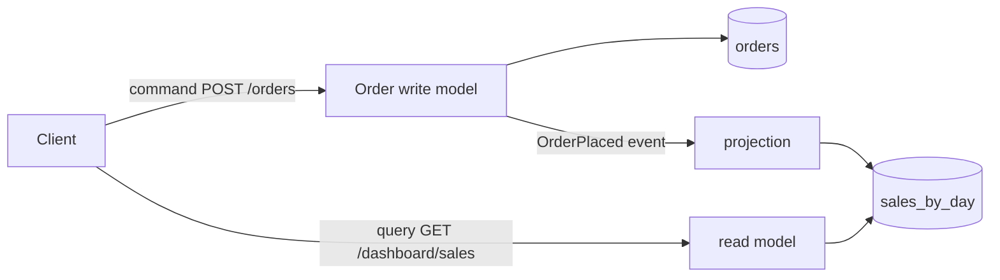

Useful when reads and writes have very different shapes or volumes. Cost: the view lags by a few moments.

:material-book-open-variant: Reference docs: [Martin Fowler, "CQRS"](https://martinfowler.com/bliki/CQRS.html) (2011); [Microsoft, "CQRS pattern"](https://learn.microsoft.com/en-us/azure/architecture/patterns/cqrs) (accessed November 2026)
{ .doc-ref }

### Event sourcing

<a class="pill pill-scope pill-scope-app" href="#map-of-scales">Scale · Application</a> <span class="pill pill-status pill-status-ok" title="Still valid, checked November 2026">Current · 11/2026</span>

With **<span class="term" data-term="event-sourcing">event sourcing</span>** (described by Martin Fowler in 2005), I do not store the current state but the sequence of events; the state is recomputed by replaying them.

```
account 42: Opened(0); Credited(100); Debited(30); Debited(20)   recomputed state: 50
```

Gain: a complete, verifiable history, and the ability to build new views afterwards. High cost: evolving the event format, replaying large volumes, deleting personal data. Reserved for domains where history is the business (accounting, audit).

:material-book-open-variant: Reference docs: [Martin Fowler, "Event Sourcing"](https://martinfowler.com/eaaDev/EventSourcing.html) (2005); [Microsoft, "Event Sourcing pattern"](https://learn.microsoft.com/en-us/azure/architecture/patterns/event-sourcing) (accessed November 2026)
{ .doc-ref }

| I want to... | I use... |
|---|---|
| to carry out a business action that touches several services, like an order that reserves stock then charges the customer | saga with compensations |
| to write the order to the database then publish the event, without losing it if the service crashes in between | outbox |
| a heavy dashboard, like sales per day, that does not slow down order taking | CQRS with read views |
| a complete history that is authoritative, like the movements of an account in accounting | event sourcing, only where it is required |
| two services to use the same data, like the customer's address for billing and for shipping | API or events, never the other's database |

## Resilience

A slow dependency is more dangerous than a dead one: requests pile up, hold threads and connections, and the slowness spreads to everything that calls the service. That is called a cascading failure. The mechanisms below stack; the classic reference is Michael Nygard, "Release It!" (2007, 2nd edition in 2018).

### Timeout

<a class="pill pill-scope pill-scope-code" href="#map-of-scales">Scale · Code</a> <a class="pill pill-scope pill-scope-system" href="#map-of-scales">Scale · System</a> <span class="pill pill-status pill-status-ok" title="Still valid, checked November 2026">Current · 11/2026</span>

Without a limit, my call to a slow service can wait for minutes, and my own service stays stuck with it. So every network call has a **<span class="term" data-term="timeout">timeout</span>**, chosen from measured latency (a bit above the dependency's p99), never the library default, which is often infinite or several minutes. The total timeout of a chain must fit inside the caller's.

:material-book-open-variant: Reference docs: [Marc Brooker, "Timeouts, retries, and backoff with jitter", Amazon Builders' Library](https://aws.amazon.com/builders-library/timeouts-retries-and-backoff-with-jitter/) (2019)
{ .doc-ref }

### Retry, exponential backoff and jitter

<a class="pill pill-scope pill-scope-code" href="#map-of-scales">Scale · Code</a> <a class="pill pill-scope pill-scope-system" href="#map-of-scales">Scale · System</a> <span class="pill pill-status pill-status-ok" title="Still valid, checked November 2026">Current · 11/2026</span>

Retrying helps with transient errors, as long as I wait longer and longer (**<span class="term" data-term="exponential-backoff">exponential backoff</span>**) and add randomness (**<span class="term" data-term="jitter">jitter</span>**), otherwise every client retries at the same millisecond (Marc Brooker, "Exponential Backoff And Jitter", AWS Architecture Blog, 2015).

```python
import random
import time

# Example: base delay, ceiling and number of attempts, named
BASE_DELAY_S = 0.1
MAX_DELAY_S = 5.0
MAX_ATTEMPTS = 4


# Good: exponential backoff with jitter, only on a transient error
def call_with_retry(call):
    for attempt in range(MAX_ATTEMPTS):
        try:
            return call()
        except TimeoutError:
            if attempt == MAX_ATTEMPTS - 1:
                raise
            ceiling = min(MAX_DELAY_S, BASE_DELAY_S * 2**attempt)
            time.sleep(random.uniform(0, ceiling))
```

Only retry transient errors (timeout, 503) and idempotent operations, never a 400.

:material-book-open-variant: Reference docs: [Marc Brooker, "Exponential Backoff And Jitter"](https://aws.amazon.com/blogs/architecture/exponential-backoff-and-jitter/) (2015); [Microsoft, "Retry pattern"](https://learn.microsoft.com/en-us/azure/architecture/patterns/retry) (accessed November 2026)
{ .doc-ref }

### Retry budget

<a class="pill pill-scope pill-scope-system" href="#map-of-scales">Scale · System</a> <span class="pill pill-status pill-status-ok" title="Still valid, checked November 2026">Current · 11/2026</span>

If each level of a three-service chain retries three times, one request can produce 27 on the last service: that is a **<span class="term" data-term="retry-storm">retry storm</span>**. A **<span class="term" data-term="retry-budget">retry budget</span>** caps retries at a share of normal traffic (Google's SRE book, 2016, mentions about 10% per client, to check), and only one level of the chain retries.

:material-book-open-variant: Reference docs: [Google SRE Book, "Handling Overload"](https://sre.google/sre-book/handling-overload/) (2016)
{ .doc-ref }

### Circuit breaker

<a class="pill pill-scope pill-scope-code" href="#map-of-scales">Scale · Code</a> <a class="pill pill-scope pill-scope-system" href="#map-of-scales">Scale · System</a> <span class="pill pill-status pill-status-ok" title="Still valid, checked November 2026">Current · 11/2026</span>

A **<span class="term" data-term="circuit-breaker">circuit breaker</span>** cuts calls to a failing dependency, to fail fast instead of waiting.

!!! noob "As noob"
    It is the circuit breaker in my house: when an appliance shorts, it cuts the power instead of letting the wires overheat. The difference: the software breaker resets itself after a delay, letting a few trial calls through. The one thing to remember: **failing right away beats waiting a long time only to fail anyway.**

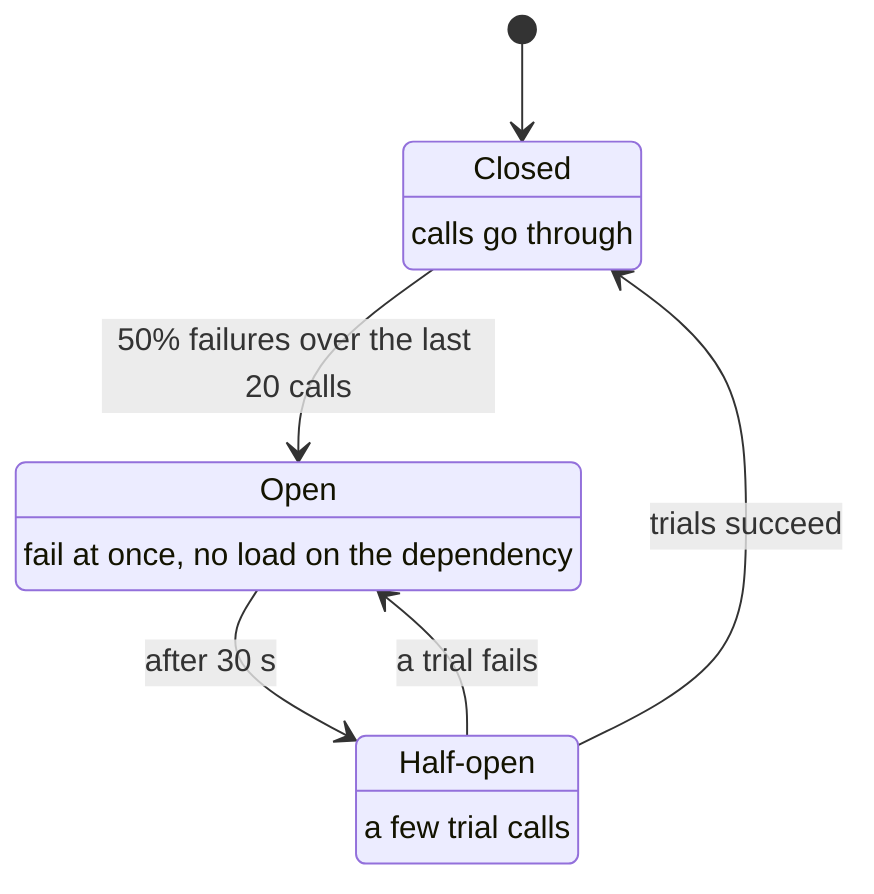

:material-book-open-variant: Reference docs: [Martin Fowler, "CircuitBreaker"](https://martinfowler.com/bliki/CircuitBreaker.html) (2014); [Microsoft, "Circuit Breaker pattern"](https://learn.microsoft.com/en-us/azure/architecture/patterns/circuit-breaker) (accessed November 2026)
{ .doc-ref }

### Bulkhead

<a class="pill pill-scope pill-scope-app" href="#map-of-scales">Scale · Application</a> <a class="pill pill-scope pill-scope-system" href="#map-of-scales">Scale · System</a> <a class="pill pill-scope pill-scope-infra" href="#map-of-scales">Scale · Infrastructure</a> <span class="pill pill-status pill-status-ok" title="Still valid, checked November 2026">Current · 11/2026</span>

A **<span class="term" data-term="bulkhead">bulkhead</span>** (like a ship's compartments) reserves separate resources for each dependency: a pool of 20 connections for `billing-service`, another 20 for `stock-service`. If `billing-service` becomes slow, only its 20 connections are stuck, the rest of `my-api` answers.

:material-book-open-variant: Reference docs: [Microsoft, "Bulkhead pattern"](https://learn.microsoft.com/en-us/azure/architecture/patterns/bulkhead) (accessed November 2026)
{ .doc-ref }

### Load shedding and backpressure

<a class="pill pill-scope pill-scope-system" href="#map-of-scales">Scale · System</a> <a class="pill pill-scope pill-scope-infra" href="#map-of-scales">Scale · Infrastructure</a> <span class="pill pill-status pill-status-ok" title="Still valid, checked November 2026">Current · 11/2026</span>

**<span class="term" data-term="load-shedding">Load shedding</span>** deliberately refuses part of the requests when the service saturates (a fast `503`, starting with the least important traffic) to serve the rest correctly. **<span class="term" data-term="backpressure">Backpressure</span>** pushes saturation back to the source: a full queue refuses new messages, and the producer slows down instead of filling memory. Reference: the "Handling Overload" and "Addressing Cascading Failures" chapters of Google's SRE book (2016).

Worked example (example figures):

```
load shedding   capacity 500 req/s, 700 arrive
                the 200 least important ones (recommendations, search) get an immediate 503
                checkout stays 100 % served, with no timeout for anyone
backpressure    the orders queue is capped at 1,000 messages
                the 1,001st publish is refused: the producer slows down or retries later
                without a cap, the queue grows until it fills the broker's memory
```

:material-book-open-variant: Reference docs: [Google SRE Book, "Addressing Cascading Failures"](https://sre.google/sre-book/addressing-cascading-failures/) (2016)
{ .doc-ref }

### Graceful degradation

<a class="pill pill-scope pill-scope-app" href="#map-of-scales">Scale · Application</a> <a class="pill pill-scope pill-scope-system" href="#map-of-scales">Scale · System</a> <span class="pill pill-status pill-status-ok" title="Still valid, checked November 2026">Current · 11/2026</span>

**<span class="term" data-term="graceful-degradation">Graceful degradation</span>** delivers a reduced but useful service when a dependency fails: the recommendation engine is down, the product page shows cached "best sellers". It is decided at design time, screen by screen: what is essential, what can disappear.

:material-book-open-variant: Reference docs: [AWS Well-Architected, "REL05-BP01 Implement graceful degradation"](https://docs.aws.amazon.com/wellarchitected/latest/reliability-pillar/rel_mitigate_interaction_failure_graceful_degradation.html) (accessed November 2026)
{ .doc-ref }

| I want to... | I use... |
|---|---|
| not to wait forever for a service that sometimes takes minutes to answer | timeout set from the measured p99 |
| a transient error, like a `503` while the called service restarts, not to make the user's request fail | retry with exponential backoff and jitter, on an idempotent operation |
| not to finish off an already struggling service under an avalanche of retries | retry budget, circuit breaker |
| the rest of `my-api` to keep answering when `billing-service` becomes slow | bulkhead (separate pools) |
| to hold a traffic peak beyond my capacity, like the start of a big sale, without the whole service going down | load shedding, backpressure on queues |
| the product page to still show when one piece fails, like the recommendation engine | graceful degradation, decided in advance |

## High availability and recovery

### Single point of failure

<a class="pill pill-scope pill-scope-system" href="#map-of-scales">Scale · System</a> <a class="pill pill-scope pill-scope-infra" href="#map-of-scales">Scale · Infrastructure</a> <span class="pill pill-status pill-status-ok" title="Still valid, checked November 2026">Current · 11/2026</span>

A **<span class="term" data-term="spof">SPOF</span>** (single point of failure) is a component present in a single copy whose failure stops everything: a single database without a replica, a single load balancer, a certificate nobody renews, a single person who knows how to deploy. The first step of an availability review is to list them.

### Composite availability

<a class="pill pill-scope pill-scope-system" href="#map-of-scales">Scale · System</a> <a class="pill pill-scope pill-scope-infra" href="#map-of-scales">Scale · Infrastructure</a>

**<span class="term" data-term="availability">Availability</span>** is the share of time the system answers correctly. 99.9% allows about 8 h 45 min of downtime per year (43 min per month); 99.99%, about 53 min per year. **<span class="term" data-term="composite-availability">Composite availability</span>** is computed from the building blocks:

```
in series (needs A AND B)           A × B
  my-api 99.9% calls billing 99.9%      0.999 × 0.999 = 0.998    i.e. 99.8%

in parallel (A OR B is enough)      1 - (1 - A) × (1 - B)
  two replicas at 99% each              1 - 0.01 × 0.01 = 0.9999 i.e. 99.99%
```

Each synchronous dependency added in series lowers availability; redundancy raises it, as long as the copies do not fail for the same reason (same zone, same deployment, same bug).

:material-book-open-variant: Reference docs: [Google SRE Book, "Embracing Risk"](https://sre.google/sre-book/embracing-risk/) (2016)
{ .doc-ref }

### Zones and regions

<a class="pill pill-scope pill-scope-infra" href="#map-of-scales">Scale · Infrastructure</a> <span class="pill pill-status pill-status-ok" title="Still valid, checked November 2026">Current · 11/2026</span>

An **<span class="term" data-term="availability-zone">availability zone</span>** is a data center (or group) isolated from the others in power and network, a few kilometers away, with latency around a millisecond between zones. A **<span class="term" data-term="cloud-region">region</span>** groups several zones in one geographic area; between regions, latency rises to tens of milliseconds. Spreading over three zones protects against a data center failure; protecting against the loss of a whole region costs much more.

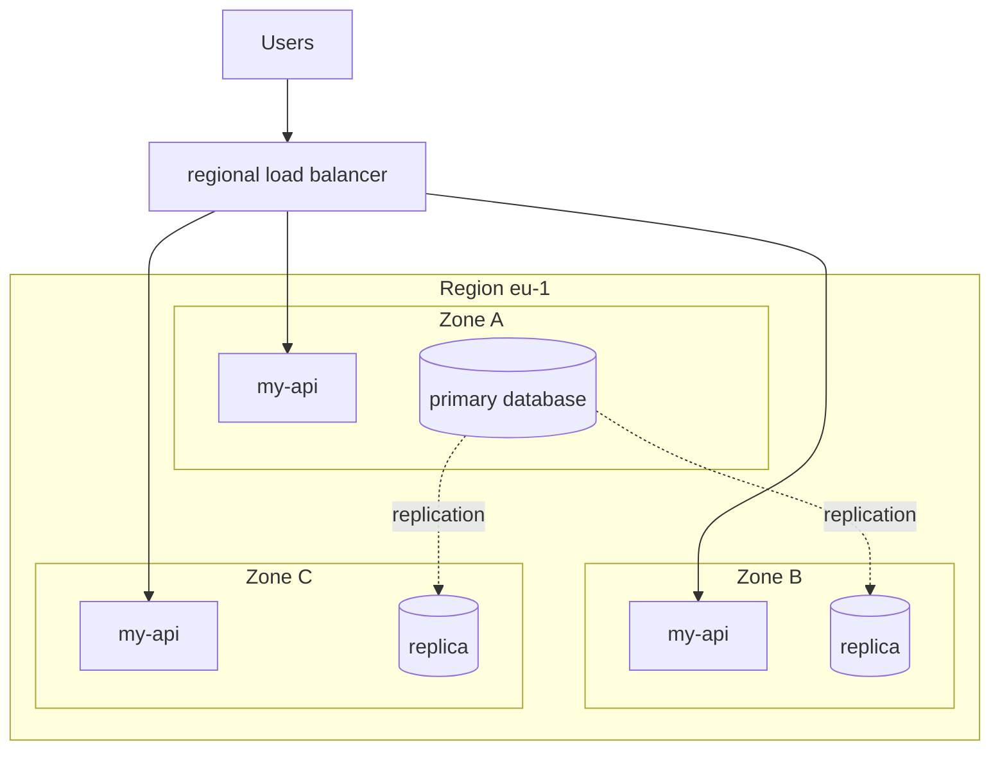

:material-book-open-variant: Reference docs: [AWS, "Regions and Zones"](https://docs.aws.amazon.com/AWSEC2/latest/UserGuide/using-regions-availability-zones.html) (accessed November 2026); [Google Cloud, "Regions and zones"](https://cloud.google.com/compute/docs/regions-zones) (accessed November 2026)
{ .doc-ref }

### RTO and RPO

<a class="pill pill-scope pill-scope-system" href="#map-of-scales">Scale · System</a> <a class="pill pill-scope pill-scope-infra" href="#map-of-scales">Scale · Infrastructure</a> <span class="pill pill-status pill-status-ok" title="Still valid, checked November 2026">Current · 11/2026</span>

Two numbers to set with the business before choosing a strategy: the **<span class="term" data-term="rto">RTO</span>** (how long the service may stay down) and the **<span class="term" data-term="rpo">RPO</span>** (how much recent data I accept to lose, expressed as a duration).

```
backup every 24 h, restore takes 4 h
failure at 18:00, last backup at 02:00
actual RPO: 16 h of orders lost    actual RTO: back at 22:00
```

<figure class="diagram"><svg viewBox="0 0 320 110" role="img" aria-label="RPO and RTO"><line class="set" x1="10" y1="55" x2="310" y2="55"/><rect class="layer layer-2" x="40" y="45" width="192" height="20"/><rect class="layer layer-3" x="232" y="45" width="48" height="20"/><line class="set" x1="40" y1="38" x2="40" y2="72"/><line class="set" x1="232" y1="38" x2="232" y2="72"/><line class="set" x1="280" y1="38" x2="280" y2="72"/><text x="136" y="34" text-anchor="middle" class="label-strong">RPO: 16 h of orders lost</text><text x="256" y="34" text-anchor="middle" class="label-strong">RTO: 4 h</text><text x="40" y="86" text-anchor="middle">02:00</text><text x="40" y="98" text-anchor="middle">backup</text><text x="232" y="86" text-anchor="middle">18:00</text><text x="232" y="98" text-anchor="middle">outage</text><text x="280" y="86" text-anchor="middle">22:00</text><text x="280" y="98" text-anchor="middle">recovered</text></svg><figcaption>RPO is measured before the outage, RTO after it (to scale, example above)</figcaption></figure>

:material-book-open-variant: Reference docs: [AWS, "Disaster Recovery of Workloads on AWS"](https://docs.aws.amazon.com/whitepapers/latest/disaster-recovery-workloads-on-aws/disaster-recovery-workloads-on-aws.html) (2021)
{ .doc-ref }

### Recovery strategies

<a class="pill pill-scope pill-scope-infra" href="#map-of-scales">Scale · Infrastructure</a> <span class="pill pill-status pill-status-ok" title="Still valid, checked November 2026">Current · 11/2026</span>

Classification taken from the AWS whitepaper "Disaster Recovery of Workloads on AWS" (2021), from cheapest to most expensive:

| Strategy | What runs in the backup region | Typical RTO / RPO (order of magnitude) |
|---|---|---|
| backup and restore | nothing, only backups | hours / hours |
| <span class="term" data-term="pilot-light">pilot light</span> | replicated data, the rest switched off | tens of minutes / minutes |
| <span class="term" data-term="warm-standby">warm standby</span> | the whole system, scaled down | minutes / seconds |
| <span class="term" data-term="active-active">active-active</span> | everything, serving traffic all the time | near zero / near zero |

[Take with caution: generic orders of magnitude, each system measures its own during recovery drills.] An untested strategy does not exist: rehearse it regularly (recovery drill, game day). Handling the incident itself is covered in [Incidents](incidents.md).

### Cell-based architecture

<a class="pill pill-scope pill-scope-system" href="#map-of-scales">Scale · System</a> <a class="pill pill-scope pill-scope-infra" href="#map-of-scales">Scale · Infrastructure</a> <span class="pill pill-status pill-status-ok" title="Still valid, checked November 2026">Current · 11/2026</span>

**<span class="term" data-term="cell-based-architecture">Cell-based architecture</span>** duplicates the whole system into independent cells, each serving part of the customers (for example customers 0 to 999 in cell 1). A bad deployment or toxic data hits only one cell: the **<span class="term" data-term="blast-radius">blast radius</span>** is bounded. Cost: per-customer routing and more infrastructure to run.

:material-book-open-variant: Reference docs: [AWS, "Reducing the Scope of Impact with Cell-Based Architecture"](https://docs.aws.amazon.com/wellarchitected/latest/reducing-scope-of-impact-with-cell-based-architecture/reducing-scope-of-impact-with-cell-based-architecture.html) (2023)
{ .doc-ref }

| I want to... | I use... |
|---|---|
| to find the single piece whose failure stops everything, like a database without a replica or the only person who knows how to deploy | the list of SPOFs, dependency by dependency |
| to know whether the promised 99.9% is achievable when my service depends on several others | the composite availability of the chain |
| the service to keep running when a whole data center fails, for example on a power cut | three zones, replicas and a load balancer |
| to restart in another region when a whole cloud region becomes unreachable | pilot light or warm standby depending on the RTO |
| a bad deployment to hit only part of the customers, not all of them at once | cell-based architecture, deploying cell by cell |

## Estimating capacity

### Orders of magnitude

<a class="pill pill-scope pill-scope-infra" href="#map-of-scales">Scale · Infrastructure</a>

A **<span class="term" data-term="back-of-envelope">back-of-the-envelope calculation</span>** is often enough to rule out an option. It relies on a few orders of magnitude:

| Operation | Order of magnitude | Source reliability |
|---|---|---|
| memory read | ~100 ns | numbers popularized by Jeff Dean around 2009-2010, hardware is faster today |
| random SSD read | ~100 µs | same source, varies a lot by disk |
| round trip within a data center | ~0.5 ms | same source |
| round trip between zones of a region | ~1 ms | common order of magnitude, check with my provider |
| round trip Europe to US east coast | ~80 ms | bound by the speed of light in fiber |

[Take with caution: these numbers are dated and hardware-dependent; they are for comparing orders of magnitude, not for sizing.] A day has 86,400 seconds, rounded to 100,000 for mental math.

:material-book-open-variant: Reference docs: [Jonas Bonér, "Latency Numbers Every Programmer Should Know"](https://gist.github.com/jboner/2841832) (2012)
{ .doc-ref }

### Average and peak QPS

<a class="pill pill-scope pill-scope-system" href="#map-of-scales">Scale · System</a> <span class="pill pill-status pill-status-ok" title="Still valid, checked November 2026">Current · 11/2026</span>

Average **<span class="term" data-term="qps">QPS</span>** (queries per second) is derived from usage; size for the peak.

```
1,000,000 daily active users × 20 requests each = 20,000,000 requests per day
20,000,000 / 86,400 s                            ≈ 230 QPS on average
peak (evening, sales): × 5 (example)             ≈ 1,200 QPS
storage: 50,000 orders per day × 2 KB            ≈ 100 MB per day, ≈ 36 GB per year
```

The flow of an estimate, from usage to validation:

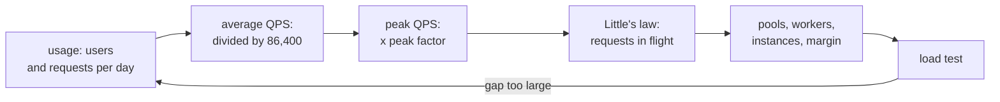

:material-book-open-variant: Reference docs: [Google SRE Book, "Handling Overload"](https://sre.google/sre-book/handling-overload/) (2016)
{ .doc-ref }

### Little's law

<a class="pill pill-scope pill-scope-system" href="#map-of-scales">Scale · System</a> <a class="pill pill-scope pill-scope-infra" href="#map-of-scales">Scale · Infrastructure</a>

**<span class="term" data-term="littles-law">Little's law</span>** (John Little, 1961): number of requests in flight = throughput × average duration. It sizes connection pools, threads and workers.

!!! noob "As noob"
    Picture a bakery: if 2 customers come in per minute and each stays 5 minutes, there are 10 people in the shop on average. If service slows to 10 minutes per customer, the shop holds 20, without a single extra customer coming in. The one thing to remember: **when processing slows down, the number of requests in flight climbs, even with constant traffic.**

```
1,200 requests/s × 0.2 s of processing = 240 requests in flight on average
if the database slows to 1 s: 1,200 × 1 = 1,200 requests in flight
a pool of 300 connections saturates: requests wait, latency climbs further
```

That is also why a short timeout protects: it caps duration, so the number of stuck requests.

:material-book-open-variant: Reference docs: [John D. C. Little, "Little's Law as Viewed on Its 50th Anniversary", Operations Research](https://pubsonline.informs.org/doi/10.1287/opre.1110.0940) (2011)
{ .doc-ref }

### And the database

<a class="pill pill-scope pill-scope-infra" href="#map-of-scales">Scale · Infrastructure</a> <span class="pill pill-status pill-status-ok" title="Still valid, checked November 2026">Current · 11/2026</span>

When load grows, the database is often the first limit. A bigger machine (vertical), read replicas, splitting data across several machines (horizontal): these choices have their own trade-offs, detailed in [Scaling a database](sql.md#scaling-a-database).

| I want to... | I use... |
|---|---|
| to know within minutes whether an option is realistic, before starting a prototype | back-of-the-envelope math with orders of magnitude |
| to choose how many servers to plan for, while traffic rises sharply in the evening or during sales | peak QPS, not the average, with a margin |
| to choose the size of a connection pool or the number of workers, knowing that the database can slow down | Little's law with the worst acceptable latency |
| to check that my calculations hold against real load | a load test, see [Quality and testing](qualite.md) |

## Front end

The **front end** is the part of the system the user sees: screens, navigation, forms, API calls from the browser. The architecture questions are the same as on the back end (split, share, ship without blocking each other), with two extra constraints: all the code ends up on the user's side, on a machine and a network I do not control, and the user sees **one** application, even when ten teams build it. Fictitious example for the whole section: a shop, `shop-web`, with a catalog, a cart and an account area.

### Micro front ends

<a class="pill pill-scope pill-scope-system" href="#map-of-scales">Scale · System</a> <span class="pill pill-status pill-status-ok" title="Still valid, checked November 2026">Current · 11/2026</span>

A **<span class="term" data-term="micro-frontend">micro front end</span>** applies the microservices idea to the browser: the interface is split into pieces, each owned by one team, built, tested and deployed alone, then assembled so that the user sees a single application. The assembly is done by a **<span class="term" data-term="app-shell">host application</span>** (the *shell*), which carries the shared layout, the top level navigation and the session. The term appeared in the Thoughtworks Technology Radar of November 2016 (to check); the most cited reference is Cam Jackson's article "Micro Frontends", published on martinfowler.com in June 2019.

I split **by business domain**, in vertical slices, not by technical layer: the cart team owns the cart screen, its API (`orders-service`) and its data, end to end. It is the front end shape of a <span class="term" data-term="stream-aligned-team">stream-aligned team</span>. Splitting into "header", "buttons", "forms" does the opposite: it creates dependencies between every team.

**Why.** The starting problem is a monolithic front end shared by several teams: one repository, one 40 minute pipeline, one release a week; a team that breaks the build blocks everyone, and upgrading the framework is a big bang. Micro front ends bring:

- independent deployment: the cart team ships five times a day without waiting for the catalog;
- technical autonomy within a shared frame (test tools, upgrade pace);
- gradual migration of an old front end, one route at a time, instead of a full rewrite;
- a smaller codebase per team, easier to understand and test.

The cost is real, and it is the cost of a distributed system in the browser:

- heavier pages if dependencies are loaded twice;
- an inconsistent experience if nobody owns the shared design;
- more infrastructure: hosting each piece, a version manifest, handling one piece being down;
- harder integration testing: each piece works alone, the assembly can break;
- governance: who decides on shared dependencies, on the contract with the shell, on UX rules.

**When to apply it.** The signals that justify the cost:

| Signal | Example |
|---|---|
| three or more teams ship into the same front end and spend their time waiting for each other | one shared release a week, a queue of merge requests |
| the parts of the screen exchange little with each other, each with its own business | catalog, cart and account exchange little information |
| I must move off an old front end without stopping deliveries during the migration | new pages in React, old ones stay in the old framework during the migration |
| some parts change every day, others almost never | the cart changes every day, the account area once a month |

When not to apply it: a single team (or two that talk every day), a small application, a screen where everything interacts with everything (an editor, a tightly linked dashboard), a low end mobile audience with no budget to watch page weight, or the wish to "try several frameworks". The alternative is the **modular front end**: one application, split into packages in a <span class="term" data-term="monorepo">monorepo</span>, with module boundaries checked in CI, exactly like the [modular monolith](#modular-monolith) on the back end. I move to micro front ends the day the shared deployment becomes the measured pain.

**How: the four ways to assemble.**

1. **At build time, through npm packages.** Each micro front end is published as a package, the shell declares it as a dependency, and everything is bundled together. Simple, typed, one well optimized bundle. But every change by one team forces a new publish and a redeploy of the shell: I lose independent deployment, which was the whole point. Cam Jackson advises against it for that reason.
2. **On the server or at the edge.** The server, or the <span class="term" data-term="cdn">CDN</span>, assembles the HTML page from fragments served by each team: Server Side Includes, **<span class="term" data-term="edge-side-includes">Edge Side Includes</span>** (ESI, a specification submitted to the W3C in 2001), or a small composition server. Good for search indexing and first display of mostly content pages; browser side interactivity has to be organized separately.
3. **At run time, in JavaScript.** The shell downloads the code of each micro front end when the user needs it:
    - **<span class="term" data-term="module-federation">Module Federation</span>**: introduced with Webpack 5 (October 2020). One build *exposes* modules, another *consumes* them as if they were local, and shared dependencies (React, the design system) are negotiated so they load only once. Also available natively in Rspack, and for Vite through a plugin (to check for the state of support);
    - **single-spa**: a framework agnostic orchestrator (first version around 2016, to check). Each registered application exposes `bootstrap`, `mount` and `unmount`, and single-spa mounts the one that matches the URL;
    - **<span class="term" data-term="web-component">Web Components</span>**: each team ships a custom HTML element (`<cart-summary>`), a browser standard usable from any framework, with CSS isolation through the <span class="term" data-term="shadow-dom">Shadow DOM</span>.
4. **Through an <span class="term" data-term="iframe">iframe</span>.** Full isolation (JavaScript, CSS, crashes), but navigation, the height of the area, accessibility, search indexing and session sharing become hard. Keep it for a third party tool or an old application embedded as is.

*npm: competes with yarn, pnpm*
{ .tool-rel }


| Mode | Independent deployment | Strengths | Weaknesses | Pick it when |
|---|---|---|---|---|
| npm packages at build time | no | simple, typed, one bundle | every change redeploys the shell | I mostly want to share code, not ship separately |
| server composition or ESI | yes | fast first display, good search indexing | interactivity handled separately, server infrastructure | content pages, public catalog |
| Module Federation | yes | shared dependencies, fine grained integration | coupled to bundler versions, harder debugging | a rich application, one framework, several teams |
| single-spa | yes | several frameworks side by side | one more layer to master | migrating from an old framework to a new one |
| Web Components | yes | standard, framework agnostic | server rendering and passing complex data are trickier | widgets reused in applications with different frameworks |
| iframe | yes | full isolation | UX, accessibility, sizing, search indexing | third party tool, old application embedded untouched |

**Example: one shell and three micro front ends.** Three teams, a shell owned by a platform team, a shared design system:

```
shop-shell/              team-platform: layout, top level routes, session, errors
├─ src/routes.ts         /catalog/* to catalog, /cart/* to cart, /account/* to account
├─ src/layout/           header, menu, footer
└─ rspack.config.js      remotes: catalog, cart, account
catalog-front/           team-catalog, deployed alone, calls catalog-api
cart-front/              team-checkout, deployed alone, calls orders-service
account-front/           team-account, deployed alone, calls account-api
shop-ui/                 @shop/ui package: design system, SemVer versioned
shop-mfe-contract/       @shop/mfe-contract package: contract between shell and micro front ends
```

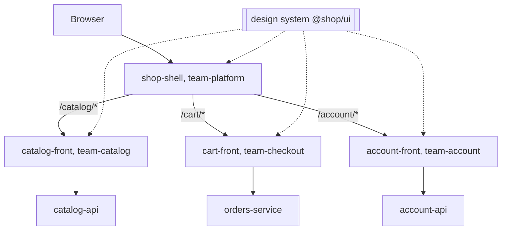

The shell's Module Federation configuration (Webpack 5 or Rspack, same syntax; package names depend on the version, to check):

```js
const { ModuleFederationPlugin } = require("@module-federation/enhanced/rspack");

// Example: the shell declares its remotes and shares React as a singleton
module.exports = {
  plugins: [
    new ModuleFederationPlugin({
      name: "shell",
      remotes: {
        catalog: "catalog@https://static.example.com/catalog/remoteEntry.js",
        cart: "cart@https://static.example.com/cart/remoteEntry.js",
        account: "account@https://static.example.com/account/remoteEntry.js",
      },
      shared: {
        react: { singleton: true, requiredVersion: "^18.3.0" },
        "react-dom": { singleton: true, requiredVersion: "^18.3.0" },
        "@shop/ui": { singleton: true, requiredVersion: "^4.0.0" },
      },
    }),
  ],
};
```

And the cart's, which exposes its entry point:

```js
// Example: the cart exposes its mount entry point
new ModuleFederationPlugin({
  name: "cart",
  filename: "remoteEntry.js",
  exposes: { "./mount": "./src/mount.tsx" },
  shared: {
    react: { singleton: true, requiredVersion: "^18.3.0" },
    "react-dom": { singleton: true, requiredVersion: "^18.3.0" },
    "@shop/ui": { singleton: true, requiredVersion: "^4.0.0" },
  },
});
```

The `remotes` URLs often point to a manifest loaded at startup rather than being hardcoded: that way I change the version of a micro front end (or roll it back) without rebuilding the shell.

**The contract between the shell and a micro front end.** It is the public API of each micro front end, to be treated like an API contract: written in a versioned package, changed with care.

```ts
// Example: the props the shell passes to each micro frontend
export interface MicroFrontendProps {
  basePath: string;
  locale: string;
  getAccessToken: () => Promise<string>;
  navigate: (path: string) => void;
}

// Example: mounting into an element returns a way to unmount
export type Unmount = () => void;

export type Mount = (element: HTMLElement, props: MicroFrontendProps) => Unmount;
```

**Routing.** The shell owns the first URL segment (`/cart`), the micro front end owns the rest (`/cart/checkout/payment`). One navigation history for everyone; to go to another domain, a micro front end calls the shell's `navigate` or uses a plain link, never another team's router. Every URL must work on reload: the server returns the shell for every route, and the shell mounts the right piece.

**Shared state: the rules.**

1. No common global store (a Redux shared between teams): it brings the monolith back, more fragile.
2. The URL is the first shared state: product id, filters, page.
3. Business data is read again from its API: the back end stays the source of truth, each micro front end keeps its own local state.
4. To tell others about a fact, publish a browser event with a documented and versioned payload, like an event between services:

    ```ts
    // Good: a browser event with a documented payload to notify the others
    window.dispatchEvent(
      new CustomEvent("cart:item-added", { detail: { sku: "SKU-42", quantity: 1 } }),
    );
    ```

5. Cross-cutting services (session, token, language, <span class="term" data-term="feature-flag">feature flags</span>) come from the shell, through the contract props, never copied by each team.

**Versions of shared dependencies.** Share little: the framework, the design system, the authentication client. Each team keeps its own copy of everything else.

- The framework is a `singleton`: two copies of React in the same page break hooks ("Invalid hook call").
- Shared packages follow <span class="term" data-term="semantic-versioning">semantic versioning</span>; `requiredVersion: "^4.0.0"` accepts any 4.x.
- A major version of the framework or of the design system is planned across all teams: it is the only moment they synchronize, and a dashboard of versions per micro front end prepares it.
- A CI check fails when a micro front end leaves the allowed range, otherwise the shell silently loads two versions.

**Performance and consistency traps.**

| Trap | What the user sees | Remedy |
|---|---|---|
| duplicated dependencies | a slow page, especially on mobile | `shared` and `singleton`, a weight budget per micro front end checked in CI (example: 150 kB compressed) |
| cascading loads (shell, then `remoteEntry.js`, then the code, then the API) | a long blank screen | preload the entries of likely routes, a skeleton placeholder, <span class="term" data-term="lazy-loading">lazy loading</span> for the rest |
| the layout moves when a piece arrives | clicks landing in the wrong place | reserve the space, track the CLS of the <span class="term" data-term="core-web-vitals">Core Web Vitals</span> |
| CSS leaking from one team to another | the cart button changes color | CSS Modules or prefixes, Shadow DOM, global styles only in the shell |
| inconsistent UX | three styles of error messages, two different loaders | design system, design tokens, cross-team UX review |
| a micro front end that crashes | the whole page goes blank | one error boundary per micro front end in the shell, fallback message "the cart is temporarily unavailable" |
| focus lost on route change | a silent screen reader | the shell handles focus and announcements, see <span class="term" data-term="web-accessibility">web accessibility</span> |

**Testing.** Three levels, from cheapest to most expensive:

1. **each micro front end alone**: unit and component tests, and a standalone start with a fake shell, to develop without the other teams;
2. **the contract**: a <span class="term" data-term="contract-test">contract test</span> checks that the micro front end honors `Mount` (it mounts, it unmounts cleanly) and that its events have the promised shape. The shell, as consumer, can publish its expectations as for an API contract, see [Contract tests and API mocks](qualite.md#contract-tests-and-api-mocks);
3. **the assembled application**: a few <span class="term" data-term="e2e-test">end-to-end tests</span> on the critical journeys that cross several teams, in an environment where the shell loads the latest version of each piece, run after every deployment of any of them. Plus a <span class="term" data-term="smoke-test">smoke test</span> checking that each `remoteEntry.js` answers.

The cart's contract test (Vitest):

```ts
import { describe, expect, it, vi } from "vitest";
import { mount } from "../src/mount";

// Example: contract test, the cart mounts and unmounts cleanly
describe("cart-front honors the shell contract", () => {
  it("mounts in the given element and unmounts cleanly", async () => {
    const element = document.createElement("div");
    const unmount = mount(element, {
      basePath: "/cart",
      locale: "en-GB",
      getAccessToken: vi.fn().mockResolvedValue("fake-token"),
      navigate: vi.fn(),
    });

    await vi.waitFor(() => {
      expect(element.querySelector("[data-testid='cart-root']")).not.toBeNull();
    });

    unmount();
    expect(element.innerHTML).toBe("");
  });
});
```

The end-to-end test on the assembly (Playwright), crossing catalog, shell and cart:

```ts
import { expect, test } from "@playwright/test";

// Example: E2E test that goes through catalog, shell and cart
test("a product added from the catalog shows up in the cart", async ({ page }) => {
  await page.goto("/catalog/sku-42");
  await page.getByRole("button", { name: "Add to cart" }).click();
  await expect(page.getByTestId("cart-badge")).toHaveText("1");

  await page.getByRole("link", { name: "Cart" }).click();
  await expect(page).toHaveURL(/\/cart/);
  await expect(page.getByText("SKU-42")).toBeVisible();
});
```

Steps to get started:

1. split by business domain, aligned with the teams ([Conway's law](#conways-law));
2. build a minimal shell: layout, top level routes, session, error boundaries;
3. write the contract (`Mount`, props, events) in a versioned package;
4. pick the assembly mode with the table above;
5. fix the short list of shared dependencies and their version ranges;
6. put weight budgets, contract tests and end-to-end tests on the assembly in CI;
7. migrate one route at a time, starting with the least risky.

:material-book-open-variant: Reference docs: [Cam Jackson, "Micro Frontends", martinfowler.com](https://martinfowler.com/articles/micro-frontends.html) (2019); [Michael Geers, micro-frontends.org](https://micro-frontends.org/) (accessed November 2026)
{ .doc-ref }

### Design system and component-driven development

<a class="pill pill-scope pill-scope-code" href="#map-of-scales">Scale · Code</a> <span class="pill pill-status pill-status-ok" title="Still valid, checked November 2026">Current · 11/2026</span>

A **<span class="term" data-term="design-system">design system</span>** is a shared set of coded interface components (button, field, modal), of **<span class="term" data-term="design-token">design tokens</span>** (colors, spacing, typography as named variables) and of documented usage rules, maintained as a product, with an owner and versions. **<span class="term" data-term="component-driven-development">Component-driven development</span>** (term popularized by Tom Coleman around 2017, to check) builds the interface bottom up: each component is built and tested alone, in all its states, then assembled into pages. Brad Frost gave it a reading grid, Atomic Design (article in 2013, book in 2016): atoms, molecules, organisms, templates, pages. **<span class="term" data-term="storybook">Storybook</span>** (first version in 2016, to check) is the most widespread open source tool for this: it shows each component outside the application, in each of its states, called *stories*.

**Why.** Without a design system, the same button is coded six times with six different grays, accessibility is fixed (or not) application by application, and each screen is discussed from screenshots. With one:

- a fix (contrast, keyboard focus) benefits every application in a single release;
- screens are built faster, from bricks that are already tested;
- designers and developers talk about the same components, with the same names;
- with micro front ends, it is what keeps one experience in the user's eyes.

The cost: an owner (at least one person, often a team), version management and migrations on the consumer side, and the risk of becoming a bottleneck. Started too early, it freezes abstractions before I know what the screens need.

**When to apply it.** Several applications or teams share a visual identity; micro front ends; the same components are recoded in several repositories; an accessibility target to meet everywhere. When not to: a single small product, a prototype. There, an existing open source component library with a theme is enough; building my own design system only pays off across several products.

**How.**

1. Inventory what exists: a screenshot of every button, field and error message is enough to convince.
2. Start with the tokens: colors, spacing, radii, typography.
3. Build the base components, accessible from day one, each with one story per state (default, disabled, loading, error).
4. Publish as a versioned package (`@shop/ui`), with a changelog, and ship a migration script for each major version.
5. Test the stories: interaction tests, visual <span class="term" data-term="regression">regression</span> (one screenshot per story compared to the baseline), automated accessibility checks.
6. Govern: contributions open to every team, review by the owner, a clear rule on what goes into the design system and what stays local.

The tokens, as CSS variables:

```css
/* Example: the design system tokens, as CSS variables */
:root {
  --color-primary: #1f6feb;
  --color-danger: #cf222e;
  --space-2: 8px;
  --space-4: 16px;
  --radius-md: 6px;
}
```

A story in CSF 3 format (Component Story Format, Storybook 7 and later, 2023; package names change with the version, to check):

```tsx
import type { Meta, StoryObj } from "@storybook/react";
import { Button } from "./Button";

// Example: the component entry and its default values
const meta = {
  title: "Actions/Button",
  component: Button,
  args: { label: "Pay", variant: "primary" },
} satisfies Meta<typeof Button>;

export default meta;

type Story = StoryObj<typeof meta>;

// Example: each export is a button state, so a test case
export const Primary: Story = {};

export const Disabled: Story = {
  args: { disabled: true },
};

export const Loading: Story = {
  args: { loading: true, label: "Payment in progress" },
};
```

Each export is a state of the button, visible in Storybook, and each state becomes a test case (visual snapshot, accessibility) without writing a separate test.

| I want... | I use... |
|---|---|
| the same button blue and the same spacing in all my applications, without copying values everywhere | design tokens |
| to work on a button in all its states (disabled, loading) without starting the whole application | Storybook, one story per state |
| to know right away that a CSS change broke a screen, before a user sees it | visual regression on the stories |
| clean screens for a single product built by a small team, without building a design system | an existing open source library, with a theme |
| one look across several products or micro front ends built by different teams | a versioned design system, with an owner |

:material-book-open-variant: Reference docs: [Storybook, documentation](https://storybook.js.org/docs) (accessed November 2026); [Brad Frost, "Atomic Design"](https://atomicdesign.bradfrost.com/) (2016)
{ .doc-ref }

### Rendering strategies

<a class="pill pill-scope pill-scope-app" href="#map-of-scales">Scale · Application</a> <span class="pill pill-status pill-status-ok" title="Still valid, checked November 2026">Current · 11/2026</span>

!!! info "Written in November 2026"
    Framework features move fast: check the documentation of the version in use.

**Rendering** is producing the HTML the browser displays. The question is: where and when is that HTML made?

- **<span class="term" data-term="csr">CSR</span>** (Client Side Rendering): the server sends an almost empty page and JavaScript; the browser builds everything. This is how a classic <span class="term" data-term="spa">SPA</span> works.
- **<span class="term" data-term="ssr">SSR</span>** (Server Side Rendering): the server makes the full HTML on every request, then JavaScript makes it interactive in the browser; that step is called **<span class="term" data-term="hydration">hydration</span>**.
- **<span class="term" data-term="ssg">SSG</span>** (Static Site Generation): the HTML is made once, at build time, then served as is by a CDN.
- **<span class="term" data-term="isr">ISR</span>** (Incremental Static Regeneration, introduced by Next.js 9.5 in 2020): like SSG, but each page is regenerated in the background after a delay or on demand, without rebuilding the whole site.

A **<span class="term" data-term="meta-framework">meta-framework</span>** brings these strategies, routing and server rendering on top of a UI library: Next.js (React, 2016), Nuxt (Vue, 2016), SvelteKit (Svelte), Remix then React Router 7 (React), Astro (2021, multi-framework, content oriented). Dates and names to check. They often let me choose the strategy **route by route**.

**Why it is an architecture choice.** It decides how fast the first display is, search indexing, server cost, data freshness and what can be cached. A bad choice is paid everywhere: an SPA for a public catalog loses search ranking; SSR for a page that never changes pays a server for nothing.

| Strategy | HTML made | When | When not | Traps |
|---|---|---|---|---|
| CSR | in the browser | internal tool behind a login, highly interactive application | public pages to index, slow phones | blank screen at startup, big bundle |
| SSR | on the server, on every request | personalized or very fresh content that must display fast | content identical for everyone (waste) | server cost, slow hydration, hydration errors (server HTML differs from client) |
| SSG | at build time | documentation, blog, legal pages, marketing | millions of pages, or data that changes often | build keeps getting longer, content frozen until the next build |
| ISR | at build time, then regenerated in the background | public catalog, product pages: many pages, moderate changes | personal data, or data that must be exact to the second | content one cycle behind, support varies by host |

**How.**

1. Sort pages by three questions: must it be indexed? is it personalized? how often does it change?
2. Pick the strategy route by route. For `shop-web`: legal pages in SSG, product pages in ISR (regenerated every 60 seconds), cart and account in CSR or SSR, never in a shared cache.
3. Measure on real users: the Core Web Vitals (LCP for the first useful display, INP for responsiveness, CLS for stability).
4. Watch the hydration cost: fast HTML but a page that only answers clicks after three seconds is still a bad experience.

A product page in ISR with Next.js (App Router, Next.js 15 syntax, to check against my version):

```tsx
// Example: the page is regenerated at most every 60 s (ISR)
export const revalidate = 60;

type Product = { sku: string; name: string; priceCents: number };

// Example: the page reads the product from the API at render time
export default async function ProductPage({ params }: { params: Promise<{ sku: string }> }) {
  const { sku } = await params;
  const response = await fetch(`https://catalog-api.example.com/products/${sku}`);
  const product: Product = await response.json();
  return <h1>{product.name}</h1>;
}
```

The trap that touches security: a personalized SSR page ("Hello Ada", her cart) cached by the CDN is served to the next user. Any response that depends on the session must be marked `Cache-Control: private, no-store`, and a test must check it.

:material-book-open-variant: Reference docs: [Jason Miller and Addy Osmani, "Rendering on the Web", web.dev](https://web.dev/articles/rendering-on-the-web) (2019)
{ .doc-ref }

### Bundlers

<a class="pill pill-scope pill-scope-code" href="#map-of-scales">Scale · Code</a> <span class="pill pill-status pill-status-ok" title="Still valid, checked November 2026">Current · 11/2026</span>

!!! info "Written in November 2026"
    Build tools move fast, and speed comparisons mostly come from the vendors themselves. Dates and features to check in the documentation.

A **<span class="term" data-term="bundler">bundler</span>** takes the source code (TypeScript, JSX, CSS, imports between files) and produces the files the browser loads. It resolves imports, transpiles, groups, minifies, splits the code into chunks loaded on demand, and removes code that is never used (<span class="term" data-term="tree-shaking">tree shaking</span>). In development, it serves the application and swaps the changed module in place without reloading the page (<span class="term" data-term="hmr">HMR</span>, Hot Module Replacement).

| Tool | Origin | Good for | Limits |
|---|---|---|---|
| Webpack | Tobias Koppers, 2012, written in JavaScript | the widest ecosystem of loaders and plugins, the original Module Federation, existing projects | verbose configuration, slow on large projects |
| Vite | Evan You, 2020 | a new React, Vue or Svelte project: near instant dev startup (native ES modules), short configuration | historically two different paths in development (esbuild) and production (Rollup), being unified with Rolldown, written in Rust (to check); Module Federation through a plugin |
| Rspack | 2023, written in Rust, version 1.0 in 2024 (to check) | speeding up a large Webpack project without rewriting its configuration (compatible API), built-in Module Federation | not every Webpack plugin is compatible |
| esbuild | Evan Wallace, 2020, written in Go | transpiling and bundling very fast: libraries, scripts, serverless functions, internal brick of other tools | no built-in HMR, more limited code splitting (to check) |

The announced speed gains often range from "10 times faster" to much more [Take with caution: numbers published by the projects themselves, on their own benchmarks]. None of these tools checks TypeScript types: `tsc --noEmit` stays a separate CI step.

**When to switch.** Not because of fashion: when a pain can be measured. Signals (thresholds given as examples): a dev server that takes more than 30 seconds to start, a change that takes several seconds to show up, a CI build over 10 minutes. If the framework imposes its bundler (a meta-framework), keep that one.

**How to migrate.** Example of a large Webpack project moving to Rspack:

1. measure before: startup time, build time, weight of each output file;
2. swap the package and keep the configuration, replacing incompatible plugins one by one;
3. compare the output files (weight, splitting) with the bundle analysis tool;
4. run the end-to-end tests on the result before switching the CI.

| I want... | I use... |
|---|---|
| to start a new React, Vue or Svelte application with a development server that starts fast | Vite, or the bundler of the chosen meta-framework |
| to speed up a large existing Webpack project whose build is too slow, without rewriting its configuration | Rspack, configuration kept |
| to assemble micro front ends with Module Federation, like the shell and the cart of `shop-web` | Webpack 5 or Rspack |
| to build a library, a script or a serverless function quickly | esbuild (directly or through a tool that uses it) |

:material-book-open-variant: Reference docs: [webpack, "Concepts"](https://webpack.js.org/concepts/) (accessed November 2026); [Vite, "Why Vite"](https://vite.dev/guide/why) (accessed November 2026)
{ .doc-ref }

## Urbanizing the information system

<a class="pill pill-scope pill-scope-enterprise" href="#map-of-scales">Scale · Enterprise</a> <span class="pill pill-status pill-status-ok" title="Still valid, checked November 2026">Current · 11/2026</span>

**<span class="term" data-term="si-urbanization">Information system urbanization</span>** applies the picture of a city to a company's application estate: I do not rebuild the city, I make it evolve district by district, following a plan and shared rules. The term is mostly used in France (Jacques Sassoon, "Urbanisation des systèmes d'information", 1998, to check; Christophe Longépé, "Le projet d'urbanisation du SI", Dunod, first edition in 2001, to check). In the English speaking world, the closest name is **<span class="term" data-term="enterprise-architecture">enterprise architecture</span>**.

Where the rest of this page talks about one system, urbanization talks about **all** of them: 80 applications, 3 ERPs inherited from acquisitions, file exchanges nobody controls.

### Why

Without a plan, an information system grows like a city without a land registry:

- the same data (the customer, the product) lives in five applications, with five different values;
- every new project creates its own point to point links, and the map of exchanges turns into spaghetti;
- nobody knows which application can be switched off, nor what breaks if it is;
- budgets fund duplicates without knowing it.

Urbanization provides three things: a **map** of what exists, a **target** a few years out, and **rules** every project follows to move toward the target.

### The four views and the city metaphor

The information system is described in four layers, from the most stable to the most changing:

| View | Question | Example |
|---|---|---|
| business | what does the company do, through which processes? | "sell", "deliver", "invoice" |
| functional | which blocks of functions does that need? | "customer relationship" zone, "order" district, "quote" block |
| application | which applications provide those functions? | `crm-app`, `orders-service`, `billing-service` |
| technical | what do they run on? | Kubernetes, Postgres, message broker |

The functional view borrows the city vocabulary: **zones** (large domains), split into **districts**, split into **blocks** (the smallest unit a single application must own).

The classic urbanization rules:

1. every piece of reference data has **a single owner** (the customer referential, the product referential); the others read it or receive a copy;
2. a block belongs to **one** application only;
3. districts exchange through **published interfaces** (APIs, events on a broker), never by reading someone else's database;
4. a new application is first placed on the map: if its block is already taken, the duplicate is justified or the existing one is reused.

### Example: a fictitious map

```
Customer relationship zone
├─ Prospects district ........ crm-app
└─ Customer accounts district  customer-referential   (referential: the only writer of customers)
Sales zone
├─ Quotes district ........... crm-app, quote-tool    (duplicate to remove)
└─ Orders district ........... orders-service
Finance zone
├─ Invoicing district ........ billing-service, legacy-erp (migration in progress)
└─ Payment district .......... (empty: external provider through payment-adapter)
Steering zone
└─ Reporting district ........ data-warehouse          (reads copies, writes nothing)
```

Reading: two applications on "Quotes" (a duplicate to settle), a migration in progress on "Invoicing", and a single writer for customers.

### Reference frameworks

<span class="pill pill-status pill-status-ok" title="Still valid, checked November 2026">Current · 11/2026</span>

| Framework | What it is | What it is for |
|---|---|---|
| **<span class="term" data-term="togaf">TOGAF</span>** (The Open Group, first version in 1995, TOGAF Standard 10th edition in 2022) | a method, the ADM: a cycle of phases (vision, business, systems, technology, opportunities, migration, governance) | running a transformation programme end to end |
| **<span class="term" data-term="zachman">Zachman Framework</span>** (John Zachman, IBM Systems Journal, 1987) | a grid: six questions (what, how, where, who, when, why) crossed with six viewpoints | checking that no facet is forgotten; it is not a method |
| **<span class="term" data-term="archimate">ArchiMate</span>** (The Open Group, version 3.2 in 2022, to check) | a modelling language, with standard symbols for the business, application and technology layers | drawing maps every architect reads the same way |
| **<span class="term" data-term="capability-map">capability map</span>** | the list of what the company can do, regardless of who does it | common starting point with leadership; often the business view above |
| French style urbanization (Sassoon, Longépé) | zones, districts, blocks and urbanization rules | splitting and organizing the application estate |

TOGAF and urbanization are not opposed: TOGAF says how to run the effort, urbanization says how to split and organize.

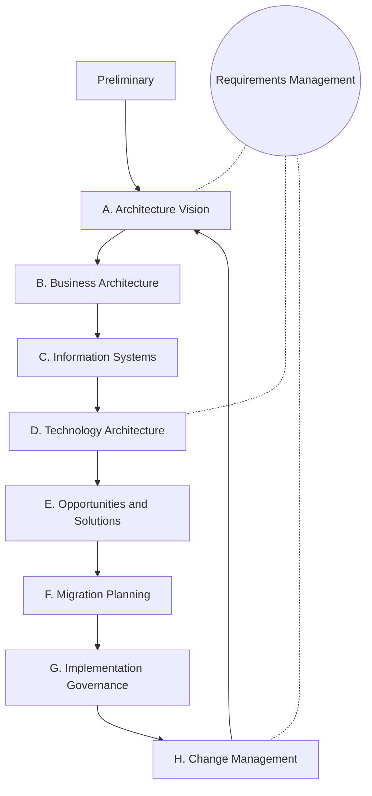

:material-book-open-variant: Reference docs: [The Open Group, TOGAF Standard](https://www.opengroup.org/togaf) (10th edition, 2022); [The Open Group, ArchiMate](https://www.opengroup.org/archimate-forum/archimate-overview) (version 3.2, 2022)
{ .doc-ref }

### When and how

**When.** The approach makes sense from a few dozen applications on, or at one of these moments: merger or acquisition, leaving an ERP, cloud migration, the recurring complaint "nobody knows who does what". For a startup with three services, it is bureaucracy: a level 1 C4 diagram is enough.

**How.** A light approach that delivers something at each step:

1. **map what exists**: list the applications, their owner, the data they write and their exchanges (a spreadsheet is enough at first);
2. **draw the capability map** with the business, then project the applications onto it: duplicates and gaps show up on their own;
3. **set a few rules** (single owner for each piece of data, exchanges through APIs or events) and publish them;
4. **define the target** two or three years out and the steps, each step carried by a project that happens anyway;
5. **govern without blocking**: every new project places itself on the map, and a decision that departs from the rules is recorded in an [ADR](#adr);
6. **keep the map alive**: generate it from the service catalogue or the code when possible, otherwise it is wrong within six months.

| I want to... | I use... |
|---|---|
| to know which applications exist and who to talk to for each one | application inventory, then mapping |
| to talk about the information system with leadership, in terms of what the company does rather than software | capability map |
| to organize the estate and spot duplicates and gaps, like two quoting tools or an empty district | zones, districts, blocks |
| to run a transformation over several years, like a merger or leaving an ERP | TOGAF ADM cycle, lightened |
| to check that a big picture misses no facet (what, who, where, when, why) | Zachman grid |
| diagrams every architect reads the same way, with the same symbols | ArchiMate |
| to describe a single system or a few services, without heavy process | no urbanization: C4 and ADRs are enough |

## Documenting and governing

<a class="pill pill-practice" href="../livraison/#design-before-coding">Practice · Technical design</a>
<a class="pill pill-dora" href="https://dora.dev/capabilities/documentation-quality/">DORA · Documentation quality</a>

### C4 model

<a class="pill pill-scope pill-scope-code" href="#map-of-scales">Scale · Code</a> <a class="pill pill-scope pill-scope-app" href="#map-of-scales">Scale · Application</a> <a class="pill pill-scope pill-scope-system" href="#map-of-scales">Scale · System</a> <span class="pill pill-status pill-status-ok" title="Still valid, checked November 2026">Current · 11/2026</span>

The **<span class="term" data-term="c4-model">C4 model</span>** (Simon Brown, c4model.com, creation date to check) draws an architecture at four zoom levels, each for an audience:

| Level | Shows | For whom |
|---|---|---|
| 1. Context | the system, its users, external systems | everyone, business included |
| 2. Containers | deployed applications and databases, and their exchanges | technical teams, operations |
| 3. Components | the main blocks of one container | developers of that container |
| 4. Code | classes and functions | rarely drawn by hand |

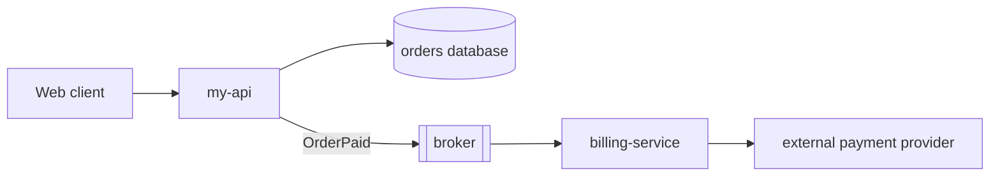

Levels 1 and 2 are enough in most cases. A diagram keeps its value if it lives in the repo, as text (Mermaid, Structurizr), next to the code.

:material-book-open-variant: Reference docs: [Simon Brown, "The C4 model"](https://c4model.com/) (accessed November 2026)
{ .doc-ref }

### arc42

<a class="pill pill-scope pill-scope-system" href="#map-of-scales">Scale · System</a> <span class="pill pill-status pill-status-ok" title="Still valid, checked November 2026">Current · 11/2026</span>

**<span class="term" data-term="arc42">arc42</span>** (Gernot Starke and Peter Hruschka, first version in 2005) is an architecture document template in twelve sections: goals, constraints, context, strategy, views, cross-cutting concepts, decisions, quality requirements, risks, glossary. Fill in only the useful sections; the template is mainly there so nothing is forgotten.

:material-book-open-variant: Reference docs: [arc42, "Overview"](https://arc42.org/overview) (accessed November 2026)
{ .doc-ref }

### ADR

<a class="pill pill-scope pill-scope-all" href="#map-of-scales">All scales</a> <span class="pill pill-status pill-status-ok" title="Still valid, checked November 2026">Current · 11/2026</span>

A structuring decision is recorded in an **<span class="term" data-term="adr">ADR</span>**, one page per decision, in the repo. The format and an example are in [Delivery: design before coding](livraison.md#design-before-coding).

:material-book-open-variant: Reference docs: [Michael Nygard, "Documenting Architecture Decisions"](https://cognitect.com/blog/2011/11/15/documenting-architecture-decisions) (2011); [Architectural Decision Records, adr.github.io](https://adr.github.io/) (accessed November 2026)
{ .doc-ref }

### Fitness functions

<a class="pill pill-scope pill-scope-code" href="#map-of-scales">Scale · Code</a> <a class="pill pill-scope pill-scope-system" href="#map-of-scales">Scale · System</a> <span class="pill pill-status pill-status-ok" title="Still valid, checked November 2026">Current · 11/2026</span>

A **<span class="term" data-term="fitness-function">fitness function</span>** (Neal Ford, Rebecca Parsons and Patrick Kua, "Building Evolutionary Architectures", 2017) is an automated check that continuously verifies an architecture decision still holds: a dependency rule, a latency threshold, an image size. Without it, the code drifts away from the diagram within months.

Example in Python with import-linter, `.importlinter` file checked in every pipeline:

```ini
# Example: orders cannot import billing.storage, checked in CI
[importlinter:contract:orders-isolation]
name = orders imports only the public API of billing
type = forbidden
source_modules = my_api.orders
forbidden_modules = my_api.billing.storage
```

:material-book-open-variant: Reference docs: [Thoughtworks Technology Radar, "Architectural fitness function"](https://www.thoughtworks.com/radar/techniques/architectural-fitness-function) (accessed November 2026)
{ .doc-ref }

| I want to... | I use... |
|---|---|
| to explain the system to a newcomer or the business, without going into the code | C4 levels 1 and 2 |
| to write a complete architecture document without starting from a blank page | arc42 template, useful sections only |
| the team to still know a year from now why it picked one option over another | ADR in the repo |
| the code not to quietly contradict the architecture, like `orders` importing `billing`'s internals | fitness functions in CI |

## Pitfalls to avoid

- **Splitting too early**: I go for microservices on day one, before I know where the business boundaries lie. Every splitting mistake costs network calls, contracts to version and deployments to coordinate. I start with a modular monolith and split when a measured pain calls for it ([see Which style to choose](#which-style-to-choose)).
- **The distributed monolith**: I separate the services but let them read the same tables. A column rename breaks three services at once, and they all have to be deployed together. Each service keeps its own data and the others go through its API or its events ([see One database per service](#one-database-per-service)).
- **The default timeout**: I keep the library's value, often infinite or several minutes long. A slow dependency ties up my threads and the slowness spreads to everything that calls me. I set a timeout from the measured latency, a little above the dependency's p99 ([see Timeout](#timeout)).
- **Retrying everywhere, right away**: each level of a chain of three services retries three times, without waiting. A single request turns into 27 on the last service, which collapses. I retry at one level only, with exponential backoff, jitter and a retry budget ([see Retry budget](#retry-budget)).
- **Retrying a non idempotent operation**: I replay a payment after a timeout when only the response was lost. The customer is charged twice. I only retry an idempotent operation, with an idempotency key written in the same transaction as the charge ([see Idempotency](#idempotency)).
- **Believing a compensation erases the past**: I design a saga as if cancelling reset everything. The customer sees the charge then the refund on their statement, and the business discovers this intermediate state in production. I get the business to approve every visible intermediate state ([see Orchestrated or choreographed saga](#orchestrated-or-choreographed-saga)).
- **Sizing on the average**: I plan my servers from the day's average QPS. In the evening or during sales, the peak exceeds capacity and the service goes down when it earns the most. I size on the peak with a margin, then check with a load test ([see Average and peak QPS](#average-and-peak-qps)).
- **Forgetting non technical single points of failure**: I double the servers but only one person knows how to deploy, or a certificate has no owner. The day that person is away or the certificate expires, everything stops. I list the SPOFs, technical and human, at the start of every availability review ([see Single point of failure](#single-point-of-failure)).

## What interviews ask

The typical questions:

- "Monolith or microservices for a new product?", "What is a distributed monolith?" How I answer: I start from the number of teams and how stable the business boundaries are ([Which style to choose](#which-style-to-choose)).
- "Explain the CAP theorem", "Strong or eventual consistency for a bank balance, and for a like counter?" How I answer: I recall that the choice only arises during a network partition, then compare the two cases ([CAP and PACELC](#cap-and-pacelc)), and [The CAP theorem](textes-fondateurs.md#brewer-2000-then-gilbert-and-lynch-2002-the-cap-theorem).
- "How do you keep data consistent across two services without a distributed transaction?", "How do you publish an event without losing it once the database has written?" How I answer: I describe a saga with its compensations, then the outbox ([Orchestrated or choreographed saga](#orchestrated-or-choreographed-saga), [Outbox](#outbox)).
- "A service you depend on becomes slow, what do you do?", "How do you stop a retry from charging twice?" How I answer: I stack timeout, retry with jitter, circuit breaker and idempotency ([Resilience](#resilience), [Idempotency](#idempotency)).
- "How do you approach a system design exercise?" How I answer: I first clarify the needs and the orders of magnitude, propose the simplest design that meets them, then look for its bottlenecks and the way it fails ([Estimating capacity](#estimating-capacity), [Resilience](#resilience)).
- "How many servers for one million daily active users?" How I answer: I walk through the back-of-the-envelope calculation, from average QPS to peak, then Little's law ([Average and peak QPS](#average-and-peak-qps), [Little's law](#littles-law)).
- "How do you document an architecture decision?" How I answer: I show an ADR and the C4 views I draw ([ADR](#adr), [C4 model](#c4-model)).

What makes a good answer: it names the trade-off, what the choice brings, what it costs, and in which situation I would do the opposite. A style or pattern presented without its cost sounds like a learned answer.

## What to use in which situation

| Situation | I use |
|---|---|
| I am starting a new product with one or two teams, and I do not know yet where to split | modular monolith, boundaries checked in CI |
| several teams block each other on one deployment: one release a week, and a team that breaks the build blocks the others | split by bounded context, then services |
| my services are separate, but I must always deploy them together because they share a database or call each other in chains | revisit the boundaries: it is a distributed monolith |
| a fact, like a paid order, must reach other services without the sender waiting for them | events, outbox, idempotent consumers |
| a business action spans several services, like reserving stock then charging the customer | saga with compensations validated by the business |
| one slow service takes down, in a cascade, everything that calls it | timeout, circuit breaker, bulkhead |
| during an outage, every client's retries arrive at the same time and make things worse | exponential backoff with jitter, retry budget |
| the business sets me an availability target, like 99.9%, and I must know whether it is achievable | composite calculation, removing SPOFs, three zones |
| the business asks "how much time and data can we lose?" | set RTO and RPO, then pick the recovery strategy |
| I must estimate the load before building, to know how many servers and connections to plan for | back-of-the-envelope math, peak QPS, Little's law |
| I am making a decision whose reason nobody will remember in a year | ADR |
| the code drifts little by little from the architecture diagram, without anyone noticing | fitness functions |
| nobody knows which systems exist, who owns them or where the duplicates are | urbanization: mapping, capability map, rules |
| my business has rich rules, like discounts, that every change of database or provider puts at risk | hexagonal architecture, dependency rule checked in CI |
| several teams block each other on one front end: one shared release, a queue of merge requests | micro front ends split by domain, shell and versioned contract |
| I have a single front end, built by one or two teams that talk every day | modular front end in a monorepo, no micro front ends |
| my screens do not look alike from one application to the next: three styles of error messages, several greys | design system, design tokens, Storybook |
| my public pages, like product pages, must be found by search engines and display fast | SSG or ISR, SSR if the content is personalized |
| I am building an internal tool, used only after login, that search engines do not need to see | CSR (SPA) |
| my front end build is too slow, like a development server that takes more than 30 seconds to start | measure, then Vite (new project) or Rspack (large Webpack project) |

## Sources

- Len Bass, Paul Clements and Rick Kazman, "Software Architecture in Practice", 4th edition (2021)
- Eric Evans, "Domain-Driven Design" (2003)
- [Melvin Conway, "How Do Committees Invent?" (1968)](https://www.melconway.com/Home/Committees_Paper.html)
- Matthew Skelton and Manuel Pais, "Team Topologies" (2019)
- [James Lewis and Martin Fowler, "Microservices" (2014)](https://martinfowler.com/articles/microservices.html)
- [Martin Fowler, "MonolithFirst" (2015)](https://martinfowler.com/bliki/MonolithFirst.html)
- [Alistair Cockburn, "Hexagonal Architecture" (2005)](https://alistair.cockburn.us/hexagonal-architecture/)
- [Robert C. Martin, "The Clean Architecture" (2012)](https://blog.cleancoder.com/uncle-bob/2012/08/13/the-clean-architecture.html)
- Alberto Brandolini, "Introducing EventStorming" (Leanpub, published in parts since around 2015, to check)
- [Seth Gilbert and Nancy Lynch, "Brewer's Conjecture and the Feasibility of Consistent, Available, Partition-Tolerant Web Services" (2002)](https://dl.acm.org/doi/10.1145/564585.564601)
- [Daniel Abadi, "Consistency Tradeoffs in Modern Distributed Database System Design", IEEE Computer (2012)](https://www.cs.umd.edu/~abadi/papers/abadi-pacelc.pdf)
- [Diego Ongaro and John Ousterhout, "In Search of an Understandable Consensus Algorithm" (2014)](https://raft.github.io/raft.pdf)
- [Leslie Lamport, "Time, Clocks, and the Ordering of Events in a Distributed System" (1978)](https://lamport.azurewebsites.net/pubs/time-clocks.pdf)
- Hector Garcia-Molina and Kenneth Salem, "Sagas", ACM SIGMOD (1987)
- [Martin Fowler, "Event Sourcing" (2005)](https://martinfowler.com/eaaDev/EventSourcing.html)
- [Martin Fowler, "CQRS" (2011)](https://martinfowler.com/bliki/CQRS.html)
- Martin Kleppmann, "Designing Data-Intensive Applications" (2017)
- Michael Nygard, "Release It!", 2nd edition (2018)
- [Marc Brooker, "Exponential Backoff And Jitter", AWS Architecture Blog (2015)](https://aws.amazon.com/blogs/architecture/exponential-backoff-and-jitter/)
- [Betsy Beyer et al., "Site Reliability Engineering", Google (2016)](https://sre.google/sre-book/table-of-contents/)
- [AWS, "Disaster Recovery of Workloads on AWS" (2021)](https://docs.aws.amazon.com/whitepapers/latest/disaster-recovery-workloads-on-aws/disaster-recovery-workloads-on-aws.html)
- [AWS, "Reducing the Scope of Impact with Cell-Based Architecture" (2023, to check)](https://docs.aws.amazon.com/wellarchitected/latest/reducing-scope-of-impact-with-cell-based-architecture/reducing-scope-of-impact-with-cell-based-architecture.html)
- John D. C. Little, "A Proof for the Queuing Formula: L = λW", Operations Research (1961)
- [Simon Brown, The C4 model (publication date not stated)](https://c4model.com/)
- [arc42, architecture documentation template (first version in 2005)](https://arc42.org/)
- Neal Ford, Rebecca Parsons and Patrick Kua, "Building Evolutionary Architectures" (2017)
- Jacques Sassoon, "Urbanisation des systèmes d'information", Hermès (1998, to check)
- Christophe Longépé, "Le projet d'urbanisation du SI", Dunod (first edition in 2001, to check)
- [The Open Group, TOGAF Standard, 10th edition (2022)](https://www.opengroup.org/togaf)
- John Zachman, "A Framework for Information Systems Architecture", IBM Systems Journal (1987)
- [The Open Group, ArchiMate 3.2 (2022, to check)](https://www.opengroup.org/archimate-forum/archimate-overview)
- [Jeffrey Palermo, "The Onion Architecture" (2008)](https://jeffreypalermo.com/2008/07/the-onion-architecture-part-1/)
- [import-linter, documentation (publication date not stated)](https://import-linter.readthedocs.io/)
- [Cam Jackson, "Micro Frontends", martinfowler.com (June 2019)](https://martinfowler.com/articles/micro-frontends.html)
- [Thoughtworks Technology Radar, "Micro frontends" (November 2016, to check)](https://www.thoughtworks.com/radar/techniques/micro-frontends)
- Michael Geers, "Micro Frontends in Action", Manning (2020)
- Luca Mezzalira, "Building Micro-Frontends", O'Reilly (first edition in 2021, to check)
- [webpack, "Module Federation" (publication date not stated)](https://webpack.js.org/concepts/module-federation/)
- [Module Federation, documentation (publication date not stated)](https://module-federation.io/)
- [single-spa, documentation (publication date not stated)](https://single-spa.js.org/)
- [W3C, "ESI Language Specification 1.0" (2001)](https://www.w3.org/TR/esi-lang/)
- [MDN, "Web Components" (publication date not stated)](https://developer.mozilla.org/en-US/docs/Web/API/Web_components)
- [Brad Frost, "Atomic Design" (2016)](https://atomicdesign.bradfrost.com/)
- [Component Driven, reference site (publication date not stated)](https://www.componentdriven.org/)
- [Storybook, "Component Story Format" (publication date not stated)](https://storybook.js.org/docs/api/csf)
- [Jason Miller and Addy Osmani, "Rendering on the Web", web.dev (2019)](https://web.dev/articles/rendering-on-the-web)
- [Next.js, "Incremental Static Regeneration" (publication date not stated)](https://nextjs.org/docs/app/guides/incremental-static-regeneration)
- [web.dev, "Web Vitals" (publication date not stated)](https://web.dev/articles/vitals)
- [webpack, documentation (publication date not stated)](https://webpack.js.org/)
- [Vite, "Why Vite" (publication date not stated)](https://vite.dev/guide/why)
- [Rspack, documentation (publication date not stated)](https://rspack.rs/)
- [esbuild, documentation (publication date not stated)](https://esbuild.github.io/)
