# Architecture et systèmes distribués

!!! warning "Avertissement"
    Ces notes sont des pense-bêtes personnels, pas une source de vérité. Elles reflètent ma compréhension et mes choix : leur contenu reste subjectif, malgré les citations et les références qu'il contient. Il peut être incomplet, simplifié, inexact ou dépassé. Vérifiez toujours dans la documentation officielle avant de l'appliquer. Ce contenu est fourni tel quel, sans aucune garantie : son utilisation se fait sous votre seule responsabilité.

!!! abstract "Les échelles"
    Les pastilles de couleur sous les titres disent à quelle échelle une notion s'applique :

    - <span class="pill pill-scope pill-scope-code">Code</span> les classes, fonctions et modules d'un programme ;
    - <span class="pill pill-scope pill-scope-app">Application</span> un service ou une application et son découpage interne ;
    - <span class="pill pill-scope pill-scope-system">Système</span> plusieurs services qui communiquent par le réseau ;
    - <span class="pill pill-scope pill-scope-infra">Infrastructure</span> les serveurs, le réseau, les zones et les clusters, physiques ou virtuels ;
    - <span class="pill pill-scope pill-scope-enterprise">Entreprise</span> le système d'information entier et son organisation.

    Détail et mots ambigus : [carte des échelles](#carte-des-echelles).

Cette page rassemble les notions de base pour concevoir un système qui tient la charge et les pannes : les grands styles d'architecture, la façon de découper, ce qui change quand le système tourne sur plusieurs machines, comment partager des données entre services, résister aux pannes, estimer la capacité, construire le front-end (micro front-ends, design system, rendu, bundlers), urbaniser un parc d'applications et documenter les choix. Les services `orders-service`, `billing-service`, `stock-service` et `my-api` sont fictifs, et tous les chiffres sont des exemples sauf mention contraire.

## Vocabulaire

**Architecture** : l'ensemble des décisions structurantes d'un système, celles qui coûtent cher à changer plus tard : comment il est découpé, comment les morceaux se parlent, où vivent les données.

**<span class="term" data-term="quality-attribute">Attribut de qualité</span>** : une propriété mesurable du système autre que ce qu'il fait : performance, disponibilité, sécurité, coût, facilité à le faire évoluer. Ce sont eux, plus que les fonctionnalités, qui décident de l'architecture. On les écrit sous forme de scénario mesurable :

```
source      un pic de 2 000 clients simultanés (soldes)
stimulus    ils passent commande en même temps
réponse     orders-service accepte toutes les commandes
mesure      p99 sous 800 ms, 0 commande perdue
```

**<span class="term" data-term="software-component">Composant</span>** : un morceau du système qui a un rôle précis et une frontière claire : une API, une file de messages, une base, un module de code.

**<span class="term" data-term="coupling">Couplage</span>** : à quel point un composant dépend des détails d'un autre. Fort couplage : changer `billing-service` oblige à changer `orders-service` le même jour. **<span class="term" data-term="cohesion">Cohésion</span>** : à quel point ce qui est rangé ensemble sert le même but. On vise un couplage faible et une cohésion forte.

**<span class="term" data-term="distributed-system">Système distribué</span>** : un système dont les composants tournent sur plusieurs machines et se parlent par le réseau. Dès qu'il y a deux services et une base, on y est : chaque appel peut être lent, perdu ou dupliqué.

**<span class="term" data-term="trade-off">Compromis</span>** : en architecture, presque tout est un compromis. Gagner en disponibilité coûte de la cohérence ou de l'argent, gagner en autonomie des équipes coûte de la complexité d'exploitation. Une bonne décision dit ce qu'elle sacrifie.

| Je veux... | Je regarde... |
|---|---|
| trancher entre deux options, comme une base unique ou une base par service, sans que la discussion tourne aux goûts de chacun | les attributs de qualité qu'il sert et ceux qu'il dégrade |
| savoir si deux composants sont trop liés, par exemple si chaque changement de `billing-service` oblige à toucher `orders-service` le même jour | combien de fois ils changent ensemble, combien d'appels ils échangent |
| comprendre pourquoi le système tombe souvent alors que chaque service, pris seul, marche bien | ce qui passe par le réseau, et ce qui arrive quand le réseau échoue |

## Carte des échelles

Le mot « architecture » désigne aussi bien l'organisation des classes d'un programme que celle des serveurs d'un datacenter. Une même notion n'a pas le même sens selon l'échelle : l'architecture hexagonale découpe du **code**, l'architecture cellulaire découpe de l'**infrastructure**. Chaque notion de ce site porte donc une ou plusieurs pastilles qui disent de quelle échelle elle parle.

### Les cinq échelles

| Échelle | De quoi on parle | Logique ou physique | Ce qu'on dessine | Exemple |
|---|---|---|---|---|
| <span class="pill pill-scope pill-scope-code">Échelle · Code</span> | classes, fonctions, modules d'un même programme | logique | diagramme de classes, arbre de modules | `PayOrder` ne connaît que l'interface `PaymentGateway` |
| <span class="pill pill-scope pill-scope-app">Échelle · Application</span> | un service ou une application et son découpage interne | logique | composants (C4 niveau 3) | `orders-service` : API, métier, accès aux données |
| <span class="pill pill-scope pill-scope-system">Échelle · Système</span> | plusieurs services qui communiquent | logique, avec le réseau entre eux | conteneurs (C4 niveau 2), flux | `orders-service` publie `OrderPaid`, `billing-service` le consomme |
| <span class="pill pill-scope pill-scope-infra">Échelle · Infrastructure</span> | serveurs, réseau, zones, clusters, matériel | physique ou virtuel | schéma de déploiement | 3 nœuds Kubernetes répartis sur 3 zones, une base principale et deux réplicas |
| <span class="pill pill-scope pill-scope-enterprise">Échelle · Entreprise</span> | le système d'information entier | logique, organisationnel | cartographie, carte des capacités | 80 applications rangées en zones et quartiers |

Une notion peut couvrir deux échelles : un **retry** s'écrit dans le code mais n'a de sens qu'entre deux services ; elle porte alors deux pastilles. <span class="pill pill-scope pill-scope-all">Toutes les échelles</span> marque les outils de documentation qui servent partout (ADR).

### Les notions de cette page

| Notion | Code | Application | Système | Infrastructure | Entreprise |
|---|---|---|---|---|---|
| monolithe, monolithe modulaire | x | x | | | |
| architecture hexagonale, clean architecture | x | x | | | |
| microservices, architecture orientée événements | | | x | | |
| serverless | | x | | x | |
| DDD, contexte borné | | x | x | | |
| loi de Conway | | | x | | x |
| CAP, réplication, consensus | | | x | x | |
| saga, outbox, CQRS, event sourcing | | x | x | | |
| timeout, retry, disjoncteur | x | | x | | |
| cloison, délestage | | x | x | x | |
| zones et régions, RTO et RPO, reprise, architecture cellulaire | | | x | x | |
| estimation de capacité | | | x | x | |
| micro front-ends | | | x | | |
| design system, bundlers | x | | | | |
| stratégies de rendu | | x | | | |
| urbanisation, TOGAF, Zachman | | | | | x |
| C4, arc42, fitness functions | x | x | x | | |

### Les mots qui changent de sens selon l'échelle

| Mot | À l'échelle du code ou de l'application | À l'échelle de l'infrastructure |
|---|---|---|
| couche (layer) | un groupe de modules : présentation, métier, accès aux données | un étage de machines (tier) : serveurs web, serveurs d'application, base |
| adaptateur | une classe qui branche le métier sur un outil (architecture hexagonale) | un équipement ou un service qui convertit un protocole |
| partition | un découpage des données (une partition Kafka, une table partitionnée) | une coupure réseau entre deux groupes de machines (le P de CAP) |
| cellule | rarement utilisé | une copie complète et isolée de la pile, qui sert une partie des clients |
| nœud | un élément d'un arbre ou d'un graphe | une machine d'un cluster |
| instance | un objet créé à partir d'une classe | une machine virtuelle ou une copie d'un service en cours d'exécution |
| service | une classe qui porte une règle métier (`PricingService`) | un programme déployé seul, avec son adresse réseau |
| cloison (bulkhead) | un pool de threads ou de connexions réservé à une dépendance | des clusters ou des comptes séparés pour isoler une panne |

**Quand s'en servir.** À chaque fois qu'une discussion d'architecture tourne en rond : demander « on parle de quelle échelle ? » règle la moitié des malentendus. Un architecte d'entreprise, un architecte de solution et un développeur qui disent « architecture en couches » ne parlent souvent pas de la même chose.

## Styles d'architecture

### Monolithe

<a class="pill pill-scope pill-scope-app" href="#carte-des-echelles">Échelle · Application</a> <span class="pill pill-status pill-status-ok" title="Toujours valable, vérifié en novembre 2026">Valable · 11/2026</span>

Un **<span class="term" data-term="monolith">monolithe</span>** est une seule application, un seul déploiement, souvent une seule base. Au début, c'est le plus simple : je développe, teste et déploie un seul programme. Ça devient pénible quand des dizaines de personnes modifient le même code : la moindre correction attend que tout le reste soit prêt, puis tout redéploie ensemble.

:material-book-open-variant: Doc de référence : [Martin Fowler, « MonolithFirst »](https://martinfowler.com/bliki/MonolithFirst.html) (2015)
{ .doc-ref }

### Monolithe modulaire

<a class="pill pill-scope pill-scope-code" href="#carte-des-echelles">Échelle · Code</a> <a class="pill pill-scope pill-scope-app" href="#carte-des-echelles">Échelle · Application</a> <span class="pill pill-status pill-status-ok" title="Toujours valable, vérifié en novembre 2026">Valable · 11/2026</span>

Un **<span class="term" data-term="modular-monolith">monolithe modulaire</span>** se déploie d'un bloc, mais son code est découpé en modules aux frontières strictes : chaque module expose une interface publique, et les autres n'ont pas le droit d'importer ses détails internes.

```
my-api/
├── orders/      api.py (public), domain/, storage/ (privé)
├── billing/     api.py (public), domain/, storage/ (privé)
└── stock/       api.py (public), domain/, storage/ (privé)
règle vérifiée en CI : orders n'importe que billing.api, jamais billing.storage
```

C'est souvent le meilleur point de départ : si un module doit un jour devenir un service, sa frontière existe déjà.

### Microservices

<a class="pill pill-scope pill-scope-system" href="#carte-des-echelles">Échelle · Système</a> <span class="pill pill-status pill-status-ok" title="Toujours valable, vérifié en novembre 2026">Valable · 11/2026</span>

Des **<span class="term" data-term="microservice">microservices</span>** : plusieurs petits services, chacun déployé seul, propriétaire de ses données, maintenu par une équipe. Ils apportent l'autonomie (chaque équipe livre à son rythme) et un passage à l'échelle par service, au prix d'un système distribué : réseau, cohérence des données, observabilité, versions de contrats. Le piège classique est le **<span class="term" data-term="distributed-monolith">monolithe distribué</span>** : des services séparés mais qui doivent tous être déployés ensemble parce qu'ils partagent une base ou s'appellent en chaîne. Référence : James Lewis et Martin Fowler, « Microservices » (2014).

:material-book-open-variant: Doc de référence : [James Lewis et Martin Fowler, « Microservices »](https://martinfowler.com/articles/microservices.html) (2014) ; [Chris Richardson, microservices.io, « Microservice Architecture »](https://microservices.io/patterns/microservices.html) (consultée en novembre 2026)
{ .doc-ref }

### Serverless

<a class="pill pill-scope pill-scope-app" href="#carte-des-echelles">Échelle · Application</a> <a class="pill pill-scope pill-scope-infra" href="#carte-des-echelles">Échelle · Infrastructure</a> <span class="pill pill-status pill-status-ok" title="Toujours valable, vérifié en novembre 2026">Valable · 11/2026</span>

J'ai des traitements qui n'arrivent que de temps en temps, comme une miniature à créer quand quelqu'un dépose une photo. En **<span class="term" data-term="serverless">serverless</span>**, le fournisseur cloud lance mon code seulement quand il y a du travail (une requête, un message, un fichier déposé) et me facture à l'usage. Je n'ai pas de serveur à gérer, et la nuit, sans trafic, il ne tourne rien. En échange : démarrage à froid, durée d'exécution limitée, dépendance au fournisseur. Bien adapté aux traitements par événements et au trafic irrégulier.

Le **<span class="term" data-term="cold-start">démarrage à froid</span>** (cold start) est le temps que met le fournisseur à créer une instance quand aucune n'est prête : télécharger le code, lancer le runtime, exécuter l'initialisation. Il ne frappe que la première requête après une période sans trafic. Exemple pour une fonction qui crée une miniature (chiffres d'exemple, ils varient selon le langage, la taille du paquet et le fournisseur) :

```
10:00:00.000  photo.jpg déposée dans le bucket, l'événement déclenche la fonction
10:00:00.000  aucune instance prête : démarrage à froid (1,5 s)
10:00:01.500  la fonction s'exécute : 20 ms de travail, miniature écrite
10:00:01.520  l'instance reste au chaud ; un 2e fichier à 10:00:30 démarre sans attente
10:15:00      aucun appel depuis ~15 min : le fournisseur supprime l'instance
facture       2 invocations et leur durée, rien pour les 15 min d'attente
```

:material-book-open-variant: Doc de référence : [Mike Roberts, « Serverless Architectures », martinfowler.com](https://martinfowler.com/articles/serverless.html) (2018)
{ .doc-ref }

### Architecture orientée événements

<a class="pill pill-scope pill-scope-system" href="#carte-des-echelles">Échelle · Système</a> <span class="pill pill-status pill-status-ok" title="Toujours valable, vérifié en novembre 2026">Valable · 11/2026</span>

Dans une **<span class="term" data-term="event-driven-architecture">architecture orientée événements</span>**, un service annonce un fait (« commande payée ») sur un broker, et les services intéressés réagissent, sans que l'émetteur les connaisse.

```
appel direct      orders-service appelle billing, stock, email : si email tombe, la commande échoue
événements        orders-service publie OrderPaid ; billing, stock, email consomment à leur rythme
```

Gain : découplage dans le temps (le consommateur peut être en panne) et ajout de consommateurs sans toucher l'émetteur. Coût : cohérence à terme, flux plus difficile à suivre, messages en double. Les mécanismes (file, sujet, garanties de livraison, DLQ) sont dans [API : REST et asynchrone](api-rest-async.md#asynchrone-messages-et-evenements).

:material-book-open-variant: Doc de référence : [Martin Fowler, « What do you mean by Event-Driven? »](https://martinfowler.com/articles/201701-event-driven.html) (2017)
{ .doc-ref }

### Architecture hexagonale et clean architecture

<a class="pill pill-scope pill-scope-code" href="#carte-des-echelles">Échelle · Code</a> <a class="pill pill-scope pill-scope-app" href="#carte-des-echelles">Échelle · Application</a> <span class="pill pill-status pill-status-ok" title="Toujours valable, vérifié en novembre 2026">Valable · 11/2026</span>

L'**<span class="term" data-term="hexagonal-architecture">architecture hexagonale</span>** (Alistair Cockburn, 2005, aussi appelée « <span class="term" data-term="port-adapter">ports et adaptateurs</span> ») met le code métier au centre. Il ne connaît que des interfaces (les ports) ; la base, l'API HTTP et le broker sont des adaptateurs branchés sur ces ports. La **<span class="term" data-term="clean-architecture">clean architecture</span>** (Robert C. Martin, article de 2012, livre en 2017) pousse la même idée en cercles : les dépendances pointent toujours vers le métier.

!!! noob "As noob"
    Imaginons une lampe et à une prise murale : la lampe (le code métier) ne sait pas si le courant vient d'une centrale ou d'un groupe électrogène, elle connaît seulement la forme de la prise (le port). En production on la branche sur le vrai réseau, en test sur une pile, sans jamais toucher à la lampe. La phrase à retenir : **le métier dessine ses prises, le reste du monde vient s'y brancher.**

**À quelle échelle.** Ces deux modèles organisent le **code d'un service** : un port est une interface, un adaptateur est une classe. Ils ne disent rien du nombre de serveurs, du réseau ou des zones ; un même service hexagonal tourne aussi bien sur une seule machine que sur cent pods. Pour l'échelle des machines, voir [Haute disponibilité et reprise](#haute-disponibilite-et-reprise) et l'[architecture cellulaire](#architecture-cellulaire).

```python
# Exemple : le port, l'interface dont le métier a besoin
class PaymentGateway(Protocol):
    def charge(self, order_id: str, amount_cents: int) -> bool: ...


# Exemple : le cas d'usage, qui ne connaît que le port
class PayOrder:
    def __init__(self, gateway: PaymentGateway) -> None:
        self.gateway = gateway

    def run(self, order_id: str, amount_cents: int) -> bool:
        return self.gateway.charge(order_id, amount_cents)
```

En test, on branche un faux `PaymentGateway` ; en production, l'adaptateur du prestataire de paiement. Le détail des principes (<span class="term" data-term="dependency-inversion">inversion de dépendance</span>, SOLID) est dans [Principes de conception](principes-conception.md).

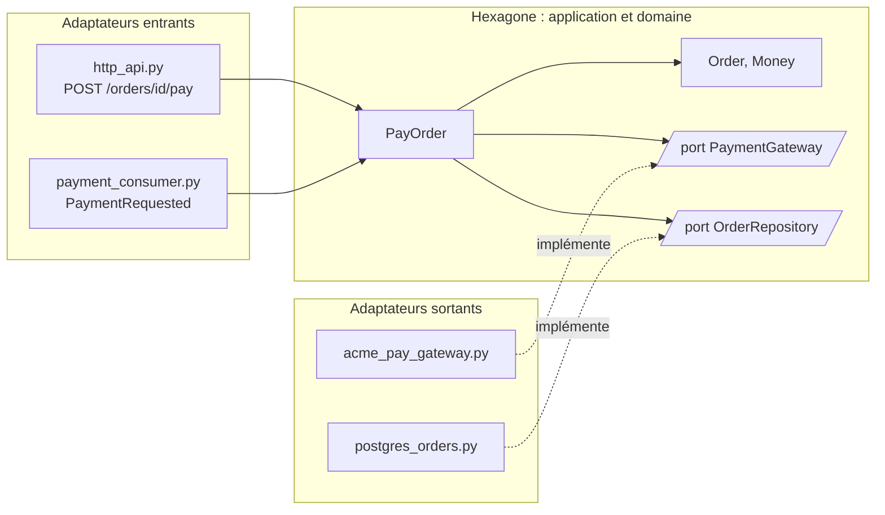

**Pourquoi.** Le métier change lentement, la technique change vite : on change de base, de prestataire de paiement, on ajoute une file de messages. Sans frontière, une règle métier finit écrite dans un contrôleur HTTP ou dans une requête SQL, et chaque changement technique la met en danger. Avec des ports :

- le métier se teste sans base ni réseau, en millisecondes ;
- changer d'adaptateur (passer d'un prestataire à un autre) ne touche pas une ligne du métier ;
- un même cas d'usage se déclenche par plusieurs entrées : route HTTP, message reçu, commande en ligne.

**Quand l'appliquer.** Les signaux qui justifient le coût :

| Signal | Exemple |
|---|---|
| mon métier a des règles riches, qui vont vivre des années | calcul de remises, cycle de vie d'une commande avec ses états et ses interdits |
| je sais qu'un outil technique sous mon code va probablement changer | migration de prestataire de paiement prévue, deux bases pour le même rôle |
| le même cas d'usage doit pouvoir se déclencher par plusieurs portes d'entrée | « payer une commande » par l'API et par un message `PaymentRequested` |
| mes tests sont lents ou fragiles parce que chacun passe par la base | 12 minutes de tests pour vérifier des règles de calcul |

Quand ne pas l'appliquer : un CRUD sans règle, un script, un prototype jetable, un service qui ne fait que transformer et transmettre des données. Là, des couches simples (route, service, accès aux données) suffisent ; des ports et des adaptateurs n'y ajouteraient que des fichiers.

**Comment.** Une arborescence type :

```
orders_service/
├─ domain/                    règles pures, aucun import technique
│  └─ order.py                Order, Money, transitions d'état
├─ application/               cas d'usage et ports
│  ├─ ports.py                PaymentGateway, OrderRepository
│  └─ pay_order.py            PayOrder
├─ adapters/
│  ├─ inbound/                ce qui appelle le métier
│  │  ├─ http_api.py          POST /orders/{id}/pay
│  │  └─ payment_consumer.py  message PaymentRequested
│  └─ outbound/               ce que le métier appelle
│     ├─ acme_pay_gateway.py  prestataire de paiement (fictif)
│     └─ postgres_orders.py   OrderRepository sur Postgres
└─ main.py                    assemble : choisit les adaptateurs à brancher
```

Les étapes :

1. partir d'un cas d'usage (« payer une commande »), pas des couches techniques ;
2. écrire le métier sans aucun import de framework, de base ou de client HTTP ;
3. définir chaque port du point de vue du métier : `charge(order_id, amount_cents)`, pas `post_json(url, body)` ;
4. écrire l'adaptateur et le tester à part contre le vrai voisin ([Testcontainers](qualite.md#tests-dintegration-avec-testcontainers), test de contrat) ;
5. tout assembler en un seul endroit (`main.py`), le seul fichier qui connaît à la fois le métier et les adaptateurs ;
6. faire vérifier la règle de dépendance par la CI, sinon elle s'érode en quelques semaines.

*Testcontainers : complémentaire de pytest*
{ .tool-rel }


Le test du cas d'usage, avec un faux branché sur le port (ce n'est pas un mock à travers une frontière réseau : la frontière, c'est le port, et l'adaptateur réel a ses propres tests d'intégration) :

```python
# Bien : un faux branché sur le port, pas un mock à travers le réseau
class FakeGateway:
    def __init__(self, accept: bool) -> None:
        self.accept = accept
        self.calls: list[tuple[str, int]] = []

    def charge(self, order_id: str, amount_cents: int) -> bool:
        self.calls.append((order_id, amount_cents))
        return self.accept


# Exemple : le test vérifie le résultat et le montant débité
def test_pay_order_charges_the_full_amount() -> None:
    gateway = FakeGateway(accept=True)
    assert PayOrder(gateway).run("o-42", 12_000) is True
    assert gateway.calls == [("o-42", 12_000)]
```

La règle de dépendance vérifiée à chaque pipeline (import-linter, contrat `layers` : une couche du haut peut importer celles du bas, jamais l'inverse) :

```ini
# Exemple : contrat layers, le haut importe le bas, jamais l'inverse
[importlinter:contract:hexagon]
name = le métier ne dépend d'aucun adaptateur
type = layers
layers =
    orders_service.adapters
    orders_service.application
    orders_service.domain
```

Pièges fréquents :

- un port qui recopie l'outil (`execute_sql`, `get_bucket`) au lieu d'exprimer un besoin métier : le métier dépend encore de la technique ;
- des types techniques qui fuient dans le métier (objet ORM, réponse HTTP, exception du client) ;
- appliquer le modèle à tout le système d'un coup : on le réserve aux modules dont le métier le justifie, les autres restent en couches simples.

| Variante | Image | Ce qu'elle ajoute |
|---|---|---|
| hexagonale (Cockburn, 2005) | un hexagone, entrées d'un côté, sorties de l'autre | ports et adaptateurs, symétrie entrée et sortie |
| onion (Jeffrey Palermo, 2008) | des anneaux concentriques | le modèle du domaine au cœur, les services autour |
| clean architecture (Robert C. Martin, 2012) | des cercles | cas d'usage explicites, règle de dépendance vers l'intérieur |

Les trois disent la même chose : les dépendances pointent vers le métier. Le choix du nom compte moins que la règle vérifiée en CI.

<figure class="diagram"><svg viewBox="0 0 220 210" role="img" aria-label="Cercles de la clean architecture"><circle class="layer layer-1" cx="110" cy="105" r="95"/><circle class="layer layer-1" cx="110" cy="105" r="70"/><circle class="layer layer-2" cx="110" cy="105" r="45"/><circle class="layer layer-3" cx="110" cy="105" r="20"/><text x="110" y="26" text-anchor="middle">frameworks, base, HTTP</text><text x="110" y="51" text-anchor="middle">adaptateurs</text><text x="110" y="76" text-anchor="middle">cas d'usage</text><text x="110" y="108" text-anchor="middle">entités</text></svg><figcaption>Clean architecture (Robert C. Martin, 2012) : les dépendances pointent vers le centre</figcaption></figure>

:material-book-open-variant: Doc de référence : [Alistair Cockburn, « Hexagonal Architecture »](https://alistair.cockburn.us/hexagonal-architecture/) (2005) ; [Robert C. Martin, « The Clean Architecture »](https://blog.cleancoder.com/uncle-bob/2012/08/13/the-clean-architecture.html) (2012)
{ .doc-ref }

### Quel style choisir

| Je veux... | J'utilise... |
|---|---|
| lancer un nouveau produit avec une ou deux équipes, sans savoir encore où passeront les frontières | monolithe modulaire |
| que plusieurs équipes livrent chacune à son rythme : l'équipe paiement sort une correction le matin sans attendre que l'équipe catalogue ait fini | microservices, découpés par domaine métier |
| traiter des tâches qui arrivent par à-coups, comme une miniature à créer quand quelqu'un dépose une photo, sans payer un serveur qui attend le reste du temps | serverless |
| que la facturation, le stock et l'envoi d'e-mails apprennent qu'une commande est payée, sans que la commande attende leur réponse | événements sur un broker |
| garder intactes des règles métier complexes (remises, états d'une commande) quand on change de base ou de prestataire de paiement | architecture hexagonale |
| une API qui lit et écrit des fiches sans règle particulière, comme un carnet d'adresses, et qui bougera peu | un monolithe en couches, sans cérémonie |

La règle de prudence : commencer simple, découper quand une douleur mesurée l'exige (Martin Fowler, « MonolithFirst », 2015).

Le même choix sous forme d'arbre ; serverless et événements se combinent avec n'importe quelle branche :

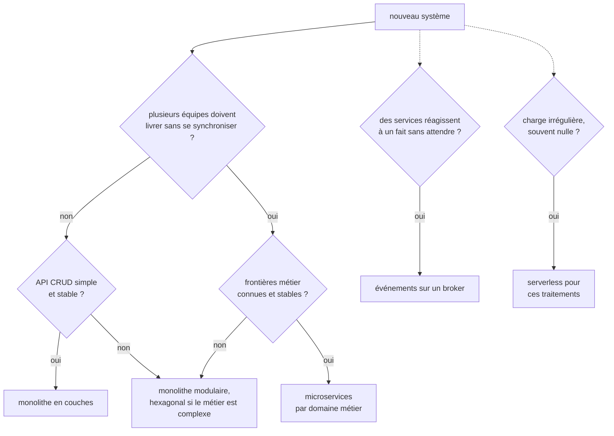

:material-book-open-variant: Doc de référence : [Martin Fowler, « Microservice Premium »](https://martinfowler.com/bliki/MicroservicePremium.html) (2015)
{ .doc-ref }

## Découper le système

<a class="pill pill-practice" href="../livraison/#concevoir-avant-de-coder">Pratique · Conception technique</a>
<a class="pill pill-dora" href="https://dora.dev/capabilities/loosely-coupled-teams/">DORA · Loosely coupled teams</a>

### Domain-Driven Design

<a class="pill pill-scope pill-scope-app" href="#carte-des-echelles">Échelle · Application</a> <a class="pill pill-scope pill-scope-system" href="#carte-des-echelles">Échelle · Système</a> <span class="pill pill-status pill-status-ok" title="Toujours valable, vérifié en novembre 2026">Valable · 11/2026</span>

Le **Domain-Driven Design** (DDD, Eric Evans, 2003) part d'une idée : le découpage du logiciel doit suivre le découpage du métier, pas celui des tables ou des couches techniques. Il donne des outils pour trouver ces frontières.

:material-book-open-variant: Doc de référence : [Eric Evans, « Domain-Driven Design Reference »](https://www.domainlanguage.com/ddd/reference/) (2015) ; [Martin Fowler, « DomainDrivenDesign »](https://martinfowler.com/bliki/DomainDrivenDesign.html) (2020)
{ .doc-ref }

### Contexte borné et langage omniprésent

<a class="pill pill-scope pill-scope-app" href="#carte-des-echelles">Échelle · Application</a> <a class="pill pill-scope pill-scope-system" href="#carte-des-echelles">Échelle · Système</a> <span class="pill pill-status pill-status-ok" title="Toujours valable, vérifié en novembre 2026">Valable · 11/2026</span>

Un **<span class="term" data-term="bounded-context">contexte borné</span>** est un périmètre où un mot a un sens unique. Dans un même magasin en ligne, « commande » ne veut pas dire la même chose partout :

| Contexte | « Commande », c'est... |
|---|---|
| Vente | un panier validé, avec des prix et des remises |
| Facturation | un montant dû, une TVA, un moyen de paiement |
| Logistique | des colis, une adresse, un transporteur |

Chaque contexte a son propre modèle et son **<span class="term" data-term="ubiquitous-language">langage omniprésent</span>** : les mots des experts métier sont ceux du code (`Shipment`, pas `OrderData2`). Un contexte borné est un bon candidat pour un module ou un service.

!!! noob "As noob"
    Dans une entreprise, le mot « client » ne veut pas dire la même chose pour le commercial, le comptable et le livreur, et chacun a raison chez lui. Plutôt que d'imposer une définition unique qui ne convient à personne, on trace des frontières : chaque équipe garde son sens du mot, et on traduit quand une information passe d'un côté à l'autre. La phrase à retenir : **un mot, un seul sens, à l'intérieur d'une frontière.**

:material-book-open-variant: Doc de référence : [Martin Fowler, « BoundedContext »](https://martinfowler.com/bliki/BoundedContext.html) (2014) ; [Martin Fowler, « UbiquitousLanguage »](https://martinfowler.com/bliki/UbiquitousLanguage.html) (2006)
{ .doc-ref }

### Carte de contextes

<a class="pill pill-scope pill-scope-system" href="#carte-des-echelles">Échelle · Système</a> <span class="pill pill-status pill-status-ok" title="Toujours valable, vérifié en novembre 2026">Valable · 11/2026</span>

La **<span class="term" data-term="context-map">carte de contextes</span>** dessine les relations entre contextes : qui fournit, qui consomme, qui s'adapte. Quand on consomme un système dont le modèle ne nous convient pas (un vieux logiciel, un prestataire), on place une **<span class="term" data-term="anti-corruption-layer">couche anticorruption</span>** : du code qui traduit son modèle dans le nôtre, pour que ses mots ne se répandent pas.

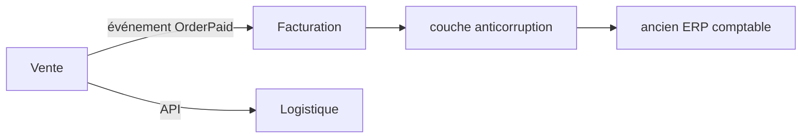

:material-book-open-variant: Doc de référence : [Microsoft, « Anti-corruption Layer pattern »](https://learn.microsoft.com/en-us/azure/architecture/patterns/anti-corruption-layer) (consultée en novembre 2026)
{ .doc-ref }

### Event storming

<a class="pill pill-scope pill-scope-system" href="#carte-des-echelles">Échelle · Système</a> <span class="pill pill-status pill-status-ok" title="Toujours valable, vérifié en novembre 2026">Valable · 11/2026</span>

L'**<span class="term" data-term="event-storming">event storming</span>** (Alberto Brandolini, présenté vers 2013) est un atelier : experts métier et développeurs collent sur un mur, dans l'ordre du temps, tous les événements métier au passé (« commande passée », « paiement accepté », « colis expédié »). Les zones où le vocabulaire change et où les acteurs changent dessinent les contextes bornés.

```
temps ─────────────────────────────────────────────────────────────────>
[client]       panier créé, article ajouté, commande passée
[client]       paiement accepté
               ───── pivot : on ne parle plus de « panier » mais de « facture » ─────
[comptable]    facture émise, TVA calculée, facture envoyée
               ───── pivot : on parle de « colis » et de « transporteur » ─────
[entrepôt]     colis préparé, colis remis au transporteur, colis livré

contextes trouvés : Vente | Facturation | Logistique
```

:material-book-open-variant: Doc de référence : [Alberto Brandolini, EventStorming](https://www.eventstorming.com/) (consultée en novembre 2026)
{ .doc-ref }

### Loi de Conway

<a class="pill pill-scope pill-scope-system" href="#carte-des-echelles">Échelle · Système</a> <a class="pill pill-scope pill-scope-enterprise" href="#carte-des-echelles">Échelle · Entreprise</a>

La **<span class="term" data-term="conway-law">loi de Conway</span>** (Melvin Conway, « How Do Committees Invent? », 1968) : un système finit par reproduire la structure de communication de l'organisation qui le construit. Trois équipes qui se parlent peu produiront trois blocs qui se parlent peu. La **<span class="term" data-term="inverse-conway-maneuver">manœuvre de Conway inverse</span>** organise d'abord les équipes selon l'architecture voulue (Matthew Skelton et Manuel Pais, « Team Topologies », 2019).

:material-book-open-variant: Doc de référence : [Melvin Conway, « How Do Committees Invent? »](https://www.melconway.com/Home/Committees_Paper.html) (1968) ; [Martin Fowler, « Conway's Law »](https://martinfowler.com/bliki/ConwaysLaw.html) (2022)
{ .doc-ref }

| Je veux... | J'utilise... |
|---|---|
| trouver où couper le logiciel quand j'arrive sur un métier que je ne connais pas, comme la logistique | event storming avec les experts métier |
| que « commande » ne veuille pas dire un panier dans un module, une facture dans un autre et un colis dans un troisième, au risque que chacun casse ce que l'autre attend | contextes bornés, langage omniprésent |
| me brancher sur un système externe dont le modèle ne colle pas au mien, comme un ancien ERP comptable, sans que ses mots envahissent mon code | couche anticorruption |
| que les frontières dessinées aujourd'hui tiennent encore quand le code et les équipes auront grandi | aligner les équipes sur les contextes (Conway) |

## Systèmes distribués

### Les huit illusions

<a class="pill pill-scope pill-scope-system" href="#carte-des-echelles">Échelle · Système</a> <a class="pill pill-scope pill-scope-infra" href="#carte-des-echelles">Échelle · Infrastructure</a>

Les **<span class="term" data-term="distributed-computing-fallacies">illusions de l'informatique distribuée</span>** sont huit hypothèses fausses que l'on fait spontanément en écrivant un appel réseau (L. Peter Deutsch et ses collègues de Sun, 1994, la huitième ajoutée par James Gosling vers 1997, dates à vérifier) :

| Illusion | Ce qui arrive vraiment |
|---|---|
| le réseau est fiable | des paquets se perdent, des connexions coupent |
| la latence est nulle | un appel entre régions coûte des dizaines de millisecondes |
| la bande passante est infinie | un export de 2 Go sature le lien |
| le réseau est sûr | il faut chiffrer et authentifier chaque échange |
| la topologie ne change pas | les pods changent d'adresse à chaque déploiement |
| il y a un seul administrateur | plusieurs équipes, plusieurs fournisseurs |
| le transport ne coûte rien | sérialisation, CPU, frais de sortie du cloud |
| le réseau est homogène | versions, protocoles et matériels différents |

Chaque section qui suit est une réponse à l'une de ces illusions.

:material-book-open-variant: Doc de référence : [Wikipedia, « Fallacies of distributed computing »](https://en.wikipedia.org/wiki/Fallacies_of_distributed_computing) (consultée en novembre 2026)
{ .doc-ref }

### CAP et PACELC

<a class="pill pill-scope pill-scope-system" href="#carte-des-echelles">Échelle · Système</a> <a class="pill pill-scope pill-scope-infra" href="#carte-des-echelles">Échelle · Infrastructure</a>

Le **<span class="term" data-term="cap-theorem">théorème CAP</span>** (conjecture d'Eric Brewer en 2000, démontrée par Seth Gilbert et Nancy Lynch en 2002) : quand une **<span class="term" data-term="network-partition">partition réseau</span>** coupe le système en deux, il faut choisir entre **cohérence** (refuser de répondre plutôt que répondre faux) et **disponibilité** (répondre avec une donnée peut-être ancienne). Les partitions ne se choisissent pas : le vrai choix est C ou A pendant la coupure.

**<span class="term" data-term="pacelc">PACELC</span>** (Daniel Abadi, 2012) complète : s'il y a **P**artition, choisir **A** ou **C** ; **E**lse (sinon, en temps normal), choisir entre **L**atence et **C**ohérence. C'est le cas le plus fréquent : attendre la confirmation de tous les réplicas rend chaque écriture plus lente.

!!! noob "As noob"
    Deux agences d'une banque tiennent le même registre et se le synchronisent par téléphone. Si la ligne coupe, chaque agence choisit : refuser les opérations jusqu'au retour de la ligne (cohérence), ou continuer avec ce qu'elle sait, au risque d'un solde pas à jour (disponibilité). Et même quand la ligne marche, appeler l'autre agence avant chaque opération prend du temps : c'est le choix latence ou cohérence de PACELC. La phrase à retenir : **la coupure, je la subis ; ce que je choisis, c'est comment me comporter pendant.**

```
coupure entre deux centres, un client veut lire son solde
choix C   « service momentanément indisponible »   (une banque)
choix A   affiche le solde d'il y a 3 secondes       (un compteur de likes)
```

<figure class="diagram"><svg viewBox="0 0 260 190" role="img" aria-label="Triangle CAP"><polygon class="set" points="130,25 30,160 230,160"/><circle class="hit" cx="130" cy="25" r="5"/><circle class="hit" cx="30" cy="160" r="5"/><circle class="hit" cx="230" cy="160" r="5"/><text x="130" y="14" text-anchor="middle" class="label-strong">C : cohérence</text><text x="10" y="178" text-anchor="start" class="label-strong">A : disponibilité</text><text x="250" y="178" text-anchor="end" class="label-strong">P : tolérance aux partitions</text><text x="98" y="95" text-anchor="middle">CA</text><text x="162" y="95" text-anchor="middle">CP</text><text x="130" y="152" text-anchor="middle">AP</text></svg><figcaption>Pendant une partition, il ne reste que CP ou AP : CA suppose un réseau qui ne coupe jamais</figcaption></figure>

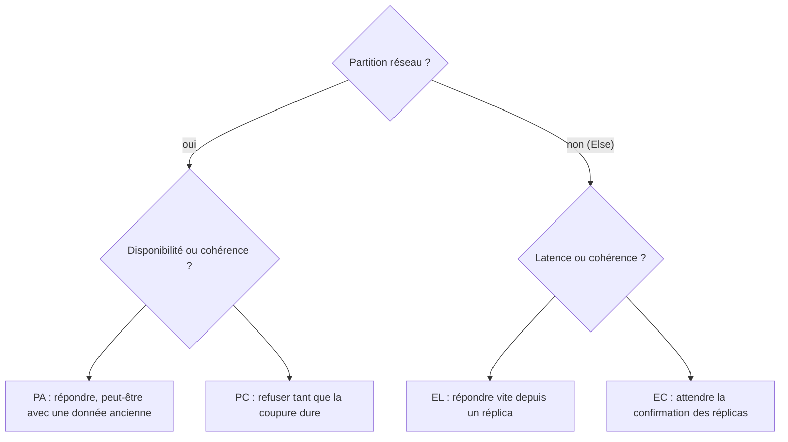

:material-book-open-variant: Doc de référence : [Seth Gilbert et Nancy Lynch, « Brewer's Conjecture and the Feasibility of Consistent, Available, Partition-Tolerant Web Services »](https://dl.acm.org/doi/10.1145/564585.564601) (2002) ; [Daniel Abadi, « Consistency Tradeoffs in Modern Distributed Database System Design »](https://www.cs.umd.edu/~abadi/papers/abadi-pacelc.pdf) (2012)
{ .doc-ref }

### Cohérence forte ou à terme

<a class="pill pill-scope pill-scope-system" href="#carte-des-echelles">Échelle · Système</a> <span class="pill pill-status pill-status-ok" title="Toujours valable, vérifié en novembre 2026">Valable · 11/2026</span>

**<span class="term" data-term="strong-consistency">Cohérence forte</span>** : après une écriture confirmée, toute lecture voit la nouvelle valeur. **<span class="term" data-term="eventual-consistency">Cohérence à terme</span>** : les copies finiront par être identiques, mais une lecture juste après l'écriture peut voir l'ancienne valeur.

!!! noob "As noob"
    C'est une chaîne de magasins qui change un prix : le siège envoie la nouvelle étiquette, et chaque magasin la colle quelques minutes plus tard. Pendant ce court moment, deux magasins affichent deux prix différents, mais tous finissent par afficher le même. La phrase à retenir : **à terme veut dire « bientôt pareil partout », pas « tout de suite ».**

```
10:00:00.000  ada change son adresse (écrite sur la base principale)
10:00:00.050  ada recharge la page, lue sur un réplica en retard : ancienne adresse
10:00:00.300  le réplica a rattrapé : nouvelle adresse
```

Parade courante pour ce cas : lire ses propres écritures sur la base principale pendant quelques secondes (« read your writes »).

:material-book-open-variant: Doc de référence : [Werner Vogels, « Eventually Consistent »](https://www.allthingsdistributed.com/2008/12/eventually_consistent.html) (2008)
{ .doc-ref }

### Réplication et quorum

<a class="pill pill-scope pill-scope-system" href="#carte-des-echelles">Échelle · Système</a> <a class="pill pill-scope pill-scope-infra" href="#carte-des-echelles">Échelle · Infrastructure</a> <span class="pill pill-status pill-status-ok" title="Toujours valable, vérifié en novembre 2026">Valable · 11/2026</span>

La **<span class="term" data-term="replication">réplication</span>** garde plusieurs copies d'une donnée sur plusieurs machines. Avec N copies, une écriture attend W confirmations et une lecture interroge R copies. Si R + W > N, au moins une copie lue a forcément la dernière écriture : c'est le **<span class="term" data-term="quorum">quorum</span>**.

!!! noob "As noob"
    Imaginons trois carnets qui contiennent la même liste. Si j'écris toujours dans au moins deux carnets et que j'en relis toujours au moins deux, les deux groupes ont forcément un carnet en commun, qui contient la dernière écriture : il suffit de garder la version la plus récente parmi celles lues. La phrase à retenir : **si lecture et écriture se croisent toujours sur au moins une copie, la lecture voit la dernière écriture.**

| N | W | R | R + W > N ? | Effet |
|---|---|---|---|---|
| 3 | 2 | 2 | oui | lecture à jour, tolère une copie en panne |
| 3 | 1 | 1 | non | rapide, mais lecture parfois ancienne |
| 3 | 3 | 1 | oui | lecture rapide, mais une copie en panne bloque les écritures |

:material-book-open-variant: Doc de référence : [Giuseppe DeCandia et al., « Dynamo: Amazon's Highly Available Key-value Store »](https://www.allthingsdistributed.com/files/amazon-dynamo-sosp2007.pdf) (2007)
{ .doc-ref }

### Consensus et élection de leader

<a class="pill pill-scope pill-scope-infra" href="#carte-des-echelles">Échelle · Infrastructure</a> <span class="pill pill-status pill-status-ok" title="Toujours valable, vérifié en novembre 2026">Valable · 11/2026</span>

Un **<span class="term" data-term="consensus-algorithm">algorithme de consensus</span>** permet à un groupe de machines de se mettre d'accord sur une valeur malgré des pannes. Le plus enseigné aujourd'hui est **Raft** (Diego Ongaro et John Ousterhout, 2014), conçu pour être plus compréhensible que Paxos (Leslie Lamport, publié en 1998). Il sert à l'**<span class="term" data-term="leader-election">élection de leader</span>** : une seule machine écrit, les autres suivent, et une nouvelle est élue si le leader tombe. Une décision exige la majorité :

| Nœuds | Majorité | Pannes tolérées |
|---|---|---|
| 3 | 2 | 1 |
| 5 | 3 | 2 |
| 4 | 3 | 1 (un 4e nœud n'apporte rien) |

D'où les nombres impairs. La majorité empêche le **<span class="term" data-term="split-brain">split-brain</span>** : deux moitiés coupées ne peuvent pas toutes deux élire un leader. On n'écrit presque jamais Raft soi-même : on s'appuie sur etcd, ZooKeeper, ou la base qui l'embarque.

!!! noob "As noob"
    C'est un conseil de cinq personnes qui doit désigner un président : il faut au moins trois voix. Si la salle est coupée en deux groupes, l'un de trois et l'autre de deux, seul le groupe de trois peut élire quelqu'un, donc il n'y a jamais deux présidents en même temps. La phrase à retenir : **exiger la majorité garantit qu'il n'y a qu'un seul chef à la fois.**

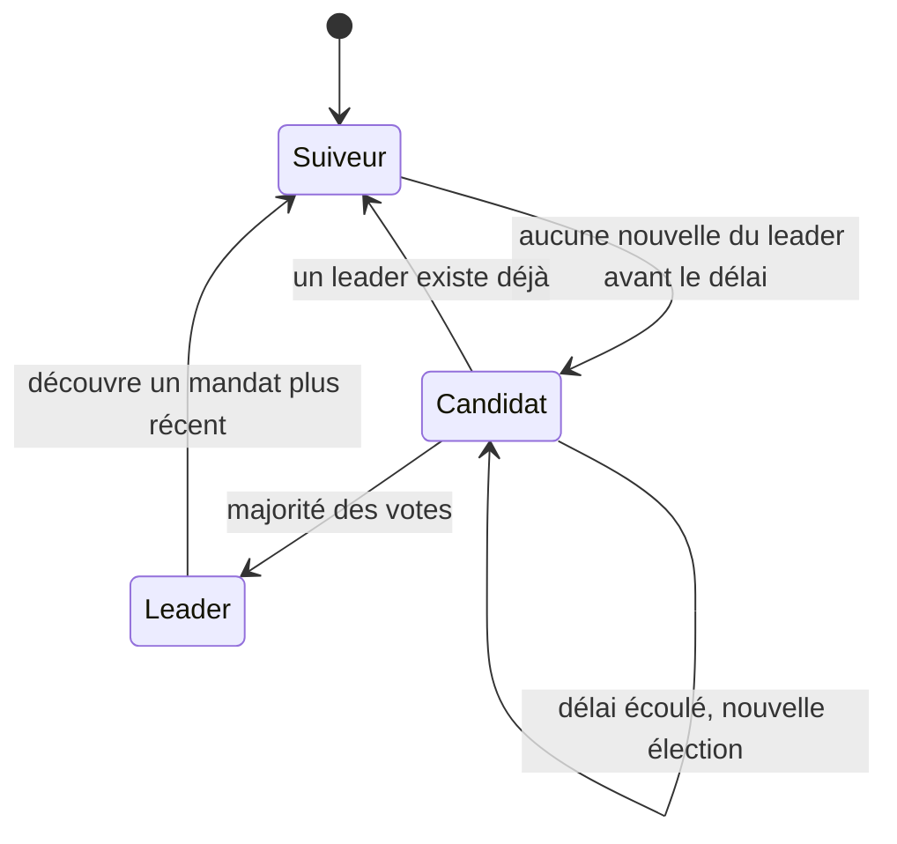

:material-book-open-variant: Doc de référence : [Le site de Raft](https://raft.github.io/) (consultée en novembre 2026) ; [Diego Ongaro et John Ousterhout, « In Search of an Understandable Consensus Algorithm »](https://raft.github.io/raft.pdf) (2014)
{ .doc-ref }

### Horloges et ordre des événements

<a class="pill pill-scope pill-scope-system" href="#carte-des-echelles">Échelle · Système</a> <span class="pill pill-status pill-status-ok" title="Toujours valable, vérifié en novembre 2026">Valable · 11/2026</span>

Les horloges de deux machines ne sont jamais parfaitement synchronisées : trier des événements de machines différentes par leur heure peut donner un ordre faux. Leslie Lamport (« Time, Clocks, and the Ordering of Events in a Distributed System », 1978) propose une **<span class="term" data-term="lamport-clock">horloge logique</span>** : un compteur qui respecte la causalité (si A a causé B, A a un numéro plus petit).

!!! noob "As noob"
    Deux personnes notent l'heure sur leur propre montre, et l'une avance de deux minutes : trier leurs notes par heure peut placer une réponse avant sa question. L'horloge logique remplace l'heure par un numéro : quand je reçois un message, je prends un numéro plus grand que le sien, donc une réponse vient toujours après sa question. Limite : pour deux événements sans lien entre eux, les numéros ne disent rien de l'ordre réel. La phrase à retenir : **pour ordonner ce qui s'enchaîne, je compte les échanges au lieu de lire l'heure.**

```python
# Exemple : horloge de Lamport, un compteur à la place de l'heure
class LamportClock:
    def __init__(self) -> None:
        self.time = 0

    # Exemple : un événement local avance le compteur de 1
    def tick(self) -> int:
        self.time += 1
        return self.time

    # Exemple : à la réception, je prends un numéro plus grand que celui reçu
    def receive(self, remote_time: int) -> int:
        self.time = max(self.time, remote_time) + 1
        return self.time
```

En pratique : un numéro de version par objet (on ignore une mise à jour plus ancienne que celle déjà appliquée) ou une clé de partition qui garde l'ordre par commande. Voir [ordre des messages](api-rest-async.md#ordre-des-messages).

:material-book-open-variant: Doc de référence : [Leslie Lamport, « Time, Clocks, and the Ordering of Events in a Distributed System »](https://lamport.azurewebsites.net/pubs/time-clocks.pdf) (1978)
{ .doc-ref }

### Idempotence

<a class="pill pill-scope pill-scope-code" href="#carte-des-echelles">Échelle · Code</a> <a class="pill pill-scope pill-scope-system" href="#carte-des-echelles">Échelle · Système</a> <span class="pill pill-status pill-status-ok" title="Toujours valable, vérifié en novembre 2026">Valable · 11/2026</span>

Sur un réseau, on ne sait pas toujours si une requête a abouti : la réponse peut s'être perdue. Donc on réessaie, donc le serveur reçoit des doublons. L'**<span class="term" data-term="idempotency">idempotence</span>** (faire deux fois la même opération a le même effet qu'une fois) est la condition de tout retry sûr. Les mécanismes (`Idempotency-Key`, consommateur idempotent) sont dans [API : REST et asynchrone](api-rest-async.md#garanties-de-livraison).

!!! noob "As noob"
    Appuyer deux fois sur le bouton d'appel d'un ascenseur ne fait pas venir deux ascenseurs : c'est idempotent. Payer deux fois en caisse parce que le ticket n'est pas sorti, en revanche, me coûte deux fois. La phrase à retenir : **une opération idempotente se rejoue sans crainte, c'est ce qui rend le retry sûr.**

Exemple : `POST` n'est pas idempotent par nature (voir [méthodes HTTP](api-rest-async.md#les-methodes-http)), le client le rend sûr avec une **<span class="term" data-term="idempotency-key">clé d'idempotence</span>** qu'il génère une fois par paiement.

```
1. client   POST /charges  Idempotency-Key: 7f3a...  {"order": "A42", "amount": 4990}
2. serveur  débite la carte, stocke (7f3a..., hash du corps, réponse 201, created_at) dans idempotency_keys
3. client   la réponse se perd : timeout au bout de 2 s
4. client   retry : même requête, même clé 7f3a...
5. serveur  clé trouvée, même hash : renvoie la réponse 201 stockée, sans débiter une 2e fois
6. client   même clé mais corps différent ("amount": 9990) : 422, la clé est déjà liée à une autre requête
```

La table `idempotency_keys(key, request_hash, response, created_at)` est purgée après un délai (24 h par exemple). Piège : écrire la clé et faire le débit dans la même transaction, sinon deux retries simultanés passent tous les deux.

:material-book-open-variant: Doc de référence : [IETF, « The Idempotency-Key HTTP Header Field »](https://datatracker.ietf.org/doc/draft-ietf-httpapi-idempotency-key-header/) (brouillon, consultée en novembre 2026) ; [Stripe, « Idempotent requests »](https://docs.stripe.com/api/idempotent_requests) (consultée en novembre 2026)
{ .doc-ref }

| Je veux... | J'utilise... |
|---|---|
| ne jamais afficher une donnée fausse, comme un solde bancaire, quitte à répondre « indisponible » | cohérence forte, quorum majoritaire |
| toujours répondre, même avec une donnée vieille de quelques secondes, comme un compteur de likes | cohérence à terme, réplicas |
| qu'une seule machine à la fois ait le droit d'écrire, sinon deux machines prennent des décisions contradictoires en même temps | élection de leader via un outil de consensus existant |
| remettre dans l'ordre des événements venus de plusieurs machines dont les horloges ne sont pas d'accord, sans qu'une réponse passe avant sa question | numéro de version ou horloge logique, pas l'heure |
| réessayer après un timeout sans risquer de faire l'action deux fois, comme débiter deux fois un paiement dont la réponse s'est perdue | opérations idempotentes |

## Données entre services

### Une base par service

<a class="pill pill-scope pill-scope-system" href="#carte-des-echelles">Échelle · Système</a> <span class="pill pill-status pill-status-ok" title="Toujours valable, vérifié en novembre 2026">Valable · 11/2026</span>

Chaque service est seul propriétaire de ses données : les autres passent par son API ou ses événements, jamais par ses tables. Si trois services lisent la même **<span class="term" data-term="shared-database">base partagée</span>**, un simple renommage de colonne les casse tous les trois, donc plus personne n'ose y toucher. Conséquence : une opération métier qui touche plusieurs services ne peut plus tenir dans une seule transaction de base. Le **<span class="term" data-term="two-phase-commit">commit à deux phases</span>** (2PC) existe, mais bloque tout le monde si le coordinateur tombe :

```
phase 1  coordinateur -> stock, billing : "prêts à valider ?" (prepare)
         stock : oui (verrouille 1 article) ; billing : oui (verrouille le montant)
phase 2  coordinateur -> stock, billing : "validez" (commit) ; chacun applique et libère ses verrous
panne    le coordinateur tombe entre les deux phases : stock et billing ont voté oui, attendent l'ordre et gardent leurs verrous
```

Entre services, on l'évite : chaque service devrait accepter d'être verrouillé par un autre, tous doivent être disponibles en même temps, et beaucoup de bases ou de brokers ne le proposent pas. La saga, ci-dessous, n'utilise que des transactions locales courtes et accepte des états intermédiaires visibles.

:material-book-open-variant: Doc de référence : [Chris Richardson, microservices.io, « Database per service »](https://microservices.io/patterns/data/database-per-service.html) (consultée en novembre 2026)
{ .doc-ref }

### Saga orchestrée ou chorégraphiée

<a class="pill pill-scope pill-scope-system" href="#carte-des-echelles">Échelle · Système</a> <span class="pill pill-status pill-status-ok" title="Toujours valable, vérifié en novembre 2026">Valable · 11/2026</span>

Une **<span class="term" data-term="saga-pattern">saga</span>** (Hector Garcia-Molina et Kenneth Salem, 1987) découpe l'opération en étapes locales, chacune avec une **<span class="term" data-term="compensation">compensation</span>** : l'action qui annule son effet si une étape suivante échoue.

!!! noob "As noob"
    Organiser un voyage, c'est réserver le train, puis l'hôtel, puis la voiture, chez trois vendeurs qui ne se connaissent pas. Si aucune voiture n'est disponible, on n'efface pas le passé : on annule l'hôtel puis le train, parfois avec des frais. La phrase à retenir : **entre services, pas de bouton « tout annuler » : chaque étape prévoit sa propre annulation.**

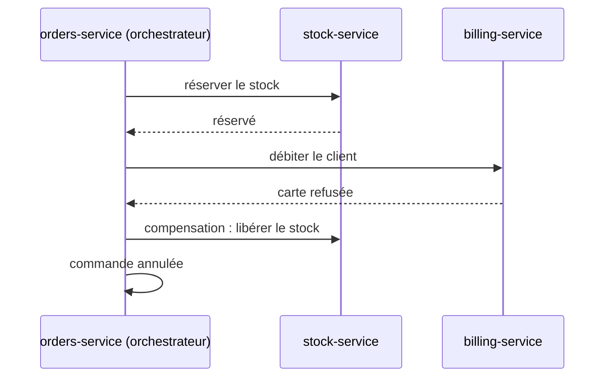

La même saga, chorégraphiée : aucun coordinateur, chaque service réagit aux événements publiés sur le broker.

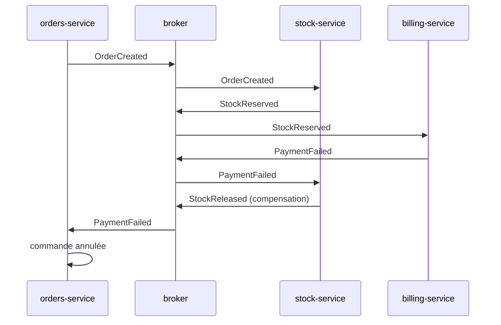

| Variante | Fonctionnement | Bien quand |
|---|---|---|
| <span class="term" data-term="saga-orchestration">orchestrée</span> | un coordinateur appelle chaque étape et décide des compensations | plus de trois étapes, besoin de voir l'état d'une saga en un endroit |
| <span class="term" data-term="saga-choreography">chorégraphiée</span> | chaque service réagit aux événements des autres | deux ou trois étapes, équipes très autonomes |

Une compensation n'efface pas le passé : un remboursement n'est pas « jamais débité », le client voit les deux lignes. Le métier doit valider ces états intermédiaires.

:material-book-open-variant: Doc de référence : [Chris Richardson, microservices.io, « Saga »](https://microservices.io/patterns/data/saga.html) (consultée en novembre 2026) ; [Microsoft, « Saga distributed transactions pattern »](https://learn.microsoft.com/en-us/azure/architecture/patterns/saga) (consultée en novembre 2026)
{ .doc-ref }

### Outbox

<a class="pill pill-scope pill-scope-app" href="#carte-des-echelles">Échelle · Application</a> <span class="pill pill-status pill-status-ok" title="Toujours valable, vérifié en novembre 2026">Valable · 11/2026</span>

Écrire en base puis publier un événement, ce sont deux opérations qui peuvent réussir à moitié. Le motif **<span class="term" data-term="outbox-pattern">outbox</span>** règle ce cas : il est décrit dans [le piège de l'écriture puis de la publication](api-rest-async.md#le-piege-de-lecriture-puis-de-la-publication).

:material-book-open-variant: Doc de référence : [Chris Richardson, microservices.io, « Transactional outbox »](https://microservices.io/patterns/data/transactional-outbox.html) (consultée en novembre 2026)
{ .doc-ref }

### CQRS

<a class="pill pill-scope pill-scope-app" href="#carte-des-echelles">Échelle · Application</a> <a class="pill pill-scope pill-scope-system" href="#carte-des-echelles">Échelle · Système</a> <span class="pill pill-status pill-status-ok" title="Toujours valable, vérifié en novembre 2026">Valable · 11/2026</span>

**<span class="term" data-term="cqrs">CQRS</span>** (Command Query Responsibility Segregation, popularisé par Greg Young vers 2010) sépare le modèle qui écrit du modèle qui lit. Les écritures passent par un modèle métier strict ; les lectures, par des vues construites pour chaque écran, mises à jour à partir des changements.

!!! noob "As noob"
    Dans un restaurant, la cuisine suit des règles strictes pour préparer chaque commande, et l'ardoise du jour sert aux clients à lire ce qui est disponible. L'ardoise est recopiée depuis la cuisine, sous une forme pensée pour être lue d'un coup d'œil, et elle peut avoir un plat de retard. La phrase à retenir : **un modèle pour écrire juste, un autre pour lire vite, avec un léger décalage entre les deux.**

```
écriture   POST /orders           modèle Order (règles métier)  table orders
lecture    GET /dashboard/sales   vue sales_by_day (pré-calculée, mise à jour par événement)
```

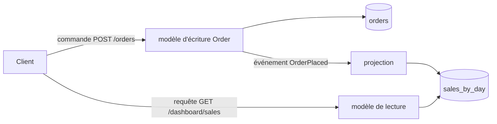

Utile quand lecture et écriture ont des formes ou des volumes très différents. Coût : la vue est en retard de quelques instants.

:material-book-open-variant: Doc de référence : [Martin Fowler, « CQRS »](https://martinfowler.com/bliki/CQRS.html) (2011) ; [Microsoft, « CQRS pattern »](https://learn.microsoft.com/en-us/azure/architecture/patterns/cqrs) (consultée en novembre 2026)
{ .doc-ref }

### Event sourcing

<a class="pill pill-scope pill-scope-app" href="#carte-des-echelles">Échelle · Application</a> <span class="pill pill-status pill-status-ok" title="Toujours valable, vérifié en novembre 2026">Valable · 11/2026</span>

En **<span class="term" data-term="event-sourcing">event sourcing</span>** (décrit par Martin Fowler en 2005), on ne stocke pas l'état courant mais la suite des événements ; l'état se recalcule en les rejouant.

```
compte 42 : Ouvert(0) ; Crédité(100) ; Débité(30) ; Débité(20)   état recalculé : 50
```

Gain : un historique complet et vérifiable, la possibilité de construire de nouvelles vues après coup. Coût élevé : faire évoluer le format des événements, rejouer de gros volumes, supprimer des données personnelles. Réservé aux domaines où l'historique est le métier (comptabilité, audit).

:material-book-open-variant: Doc de référence : [Martin Fowler, « Event Sourcing »](https://martinfowler.com/eaaDev/EventSourcing.html) (2005) ; [Microsoft, « Event Sourcing pattern »](https://learn.microsoft.com/en-us/azure/architecture/patterns/event-sourcing) (consultée en novembre 2026)
{ .doc-ref }

| Je veux... | J'utilise... |
|---|---|
| mener une action métier qui touche plusieurs services, comme une commande qui réserve le stock puis débite le client | saga avec compensations |
| écrire la commande en base puis publier l'événement, sans le perdre si le service plante entre les deux | outbox |
| un tableau de bord lourd, comme les ventes par jour, qui ne ralentit pas la prise de commandes | CQRS avec vues de lecture |
| un historique complet qui fait foi, comme les mouvements d'un compte en comptabilité | event sourcing, seulement là où il est demandé |
| que deux services utilisent la même donnée, comme l'adresse du client pour la facturation et pour la livraison | API ou événements, jamais la base de l'autre |

## Résilience

Une dépendance lente est plus dangereuse qu'une dépendance en panne : les requêtes s'accumulent, occupent les threads et les connexions, et la lenteur se propage à tout ce qui appelle le service. On appelle ça une panne en cascade. Les mécanismes qui suivent s'empilent ; la référence classique est Michael Nygard, « Release It! » (2007, 2e édition en 2018).

### Timeout

<a class="pill pill-scope pill-scope-code" href="#carte-des-echelles">Échelle · Code</a> <a class="pill pill-scope pill-scope-system" href="#carte-des-echelles">Échelle · Système</a> <span class="pill pill-status pill-status-ok" title="Toujours valable, vérifié en novembre 2026">Valable · 11/2026</span>

Sans limite, mon appel vers un service lent peut attendre des minutes, et mon propre service reste bloqué avec lui. Tout appel réseau a donc un **<span class="term" data-term="timeout">timeout</span>**, choisi d'après la latence mesurée (un peu au-dessus du p99 de la dépendance), jamais la valeur par défaut de la bibliothèque, souvent infinie ou de plusieurs minutes. Le timeout total d'une chaîne doit tenir dans celui de l'appelant.

:material-book-open-variant: Doc de référence : [Marc Brooker, « Timeouts, retries, and backoff with jitter », Amazon Builders' Library](https://aws.amazon.com/builders-library/timeouts-retries-and-backoff-with-jitter/) (2019)
{ .doc-ref }

### Retry, backoff exponentiel et gigue

<a class="pill pill-scope pill-scope-code" href="#carte-des-echelles">Échelle · Code</a> <a class="pill pill-scope pill-scope-system" href="#carte-des-echelles">Échelle · Système</a> <span class="pill pill-status pill-status-ok" title="Toujours valable, vérifié en novembre 2026">Valable · 11/2026</span>

Réessayer aide pour les erreurs passagères, à condition d'attendre de plus en plus longtemps (**<span class="term" data-term="exponential-backoff">backoff exponentiel</span>**) et d'ajouter du hasard (**<span class="term" data-term="jitter">gigue</span>**), sinon tous les clients réessaient à la même milliseconde (Marc Brooker, « Exponential Backoff And Jitter », AWS Architecture Blog, 2015).

```python
import random
import time

# Exemple : délai de base, plafond et nombre d'essais nommés
BASE_DELAY_S = 0.1
MAX_DELAY_S = 5.0
MAX_ATTEMPTS = 4


# Bien : backoff exponentiel avec gigue, seulement sur une erreur passagère
def call_with_retry(call):
    for attempt in range(MAX_ATTEMPTS):
        try:
            return call()
        except TimeoutError:
            if attempt == MAX_ATTEMPTS - 1:
                raise
            ceiling = min(MAX_DELAY_S, BASE_DELAY_S * 2**attempt)
            time.sleep(random.uniform(0, ceiling))
```

On ne réessaie que les erreurs passagères (timeout, 503) et les opérations idempotentes, jamais un 400.

:material-book-open-variant: Doc de référence : [Marc Brooker, « Exponential Backoff And Jitter »](https://aws.amazon.com/blogs/architecture/exponential-backoff-and-jitter/) (2015) ; [Microsoft, « Retry pattern »](https://learn.microsoft.com/en-us/azure/architecture/patterns/retry) (consultée en novembre 2026)
{ .doc-ref }

### Budget de retry

<a class="pill pill-scope pill-scope-system" href="#carte-des-echelles">Échelle · Système</a> <span class="pill pill-status pill-status-ok" title="Toujours valable, vérifié en novembre 2026">Valable · 11/2026</span>

Si chaque niveau d'une chaîne de trois services réessaie trois fois, une requête peut en produire 27 sur le dernier service : c'est la **<span class="term" data-term="retry-storm">tempête de retries</span>**. Un **<span class="term" data-term="retry-budget">budget de retry</span>** plafonne les nouvelles tentatives à une part du trafic normal (le livre SRE de Google, 2016, cite environ 10 % par client, à vérifier), et on ne réessaie qu'à un seul niveau de la chaîne.

:material-book-open-variant: Doc de référence : [Google SRE Book, « Handling Overload »](https://sre.google/sre-book/handling-overload/) (2016)
{ .doc-ref }

### Disjoncteur

<a class="pill pill-scope pill-scope-code" href="#carte-des-echelles">Échelle · Code</a> <a class="pill pill-scope pill-scope-system" href="#carte-des-echelles">Échelle · Système</a> <span class="pill pill-status pill-status-ok" title="Toujours valable, vérifié en novembre 2026">Valable · 11/2026</span>

Un **<span class="term" data-term="circuit-breaker">disjoncteur</span>** coupe les appels vers une dépendance qui échoue, pour échouer vite au lieu d'attendre.

!!! noob "As noob"
    C'est le disjoncteur de ma maison : quand un appareil fait court-circuit, il coupe le courant au lieu de laisser chauffer les fils. La différence : le disjoncteur logiciel se réarme tout seul après un délai, en laissant passer quelques appels d'essai. La phrase à retenir : **mieux vaut échouer tout de suite qu'attendre longtemps pour échouer quand même.**

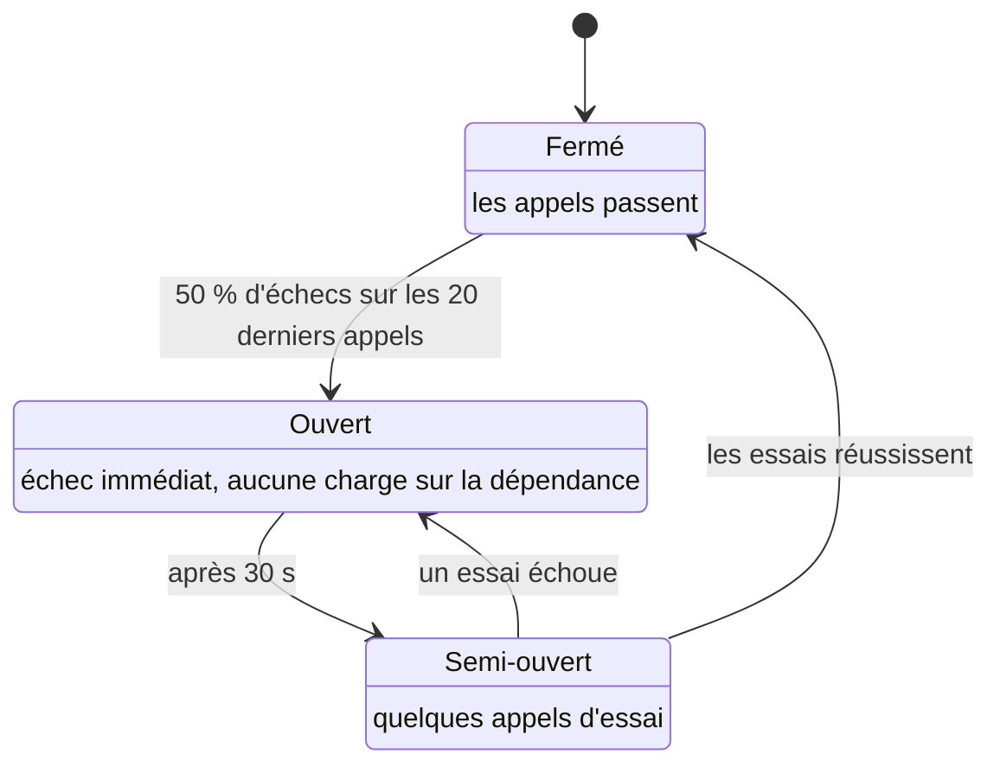

:material-book-open-variant: Doc de référence : [Martin Fowler, « CircuitBreaker »](https://martinfowler.com/bliki/CircuitBreaker.html) (2014) ; [Microsoft, « Circuit Breaker pattern »](https://learn.microsoft.com/en-us/azure/architecture/patterns/circuit-breaker) (consultée en novembre 2026)
{ .doc-ref }

### Cloison

<a class="pill pill-scope pill-scope-app" href="#carte-des-echelles">Échelle · Application</a> <a class="pill pill-scope pill-scope-system" href="#carte-des-echelles">Échelle · Système</a> <a class="pill pill-scope pill-scope-infra" href="#carte-des-echelles">Échelle · Infrastructure</a> <span class="pill pill-status pill-status-ok" title="Toujours valable, vérifié en novembre 2026">Valable · 11/2026</span>

Une **<span class="term" data-term="bulkhead">cloison</span>** (bulkhead, comme les compartiments d'un navire) réserve des ressources séparées à chaque dépendance : un pool de 20 connexions pour `billing-service`, un autre de 20 pour `stock-service`. Si `billing-service` devient lent, seules ses 20 connexions sont bloquées, le reste de `my-api` répond.

:material-book-open-variant: Doc de référence : [Microsoft, « Bulkhead pattern »](https://learn.microsoft.com/en-us/azure/architecture/patterns/bulkhead) (consultée en novembre 2026)
{ .doc-ref }

### Délestage et contre-pression

<a class="pill pill-scope pill-scope-system" href="#carte-des-echelles">Échelle · Système</a> <a class="pill pill-scope pill-scope-infra" href="#carte-des-echelles">Échelle · Infrastructure</a> <span class="pill pill-status pill-status-ok" title="Toujours valable, vérifié en novembre 2026">Valable · 11/2026</span>

Le **<span class="term" data-term="load-shedding">délestage</span>** refuse volontairement une partie des requêtes quand le service sature (un `503` rapide, en commençant par le trafic le moins important) pour servir correctement le reste. La **<span class="term" data-term="backpressure">contre-pression</span>** fait remonter la saturation à la source : une file pleine refuse de nouveaux messages, et le producteur ralentit au lieu de remplir la mémoire. Référence : chapitres « Handling Overload » et « Addressing Cascading Failures » du livre SRE de Google (2016).

Exemple chiffré (chiffres d'exemple) :

```
délestage        capacité 500 req/s, il en arrive 700
                 les 200 les moins importantes (recommandations, recherche) reçoivent un 503 immédiat
                 le checkout reste servi à 100 %, sans timeout pour personne
contre-pression  la file des commandes est limitée à 1 000 messages
                 la 1 001e publication est refusée : le producteur ralentit ou réessaie plus tard
                 sans limite, la file grossit jusqu'à saturer la mémoire du broker
```

:material-book-open-variant: Doc de référence : [Google SRE Book, « Addressing Cascading Failures »](https://sre.google/sre-book/addressing-cascading-failures/) (2016)
{ .doc-ref }

### Dégradation contrôlée

<a class="pill pill-scope pill-scope-app" href="#carte-des-echelles">Échelle · Application</a> <a class="pill pill-scope pill-scope-system" href="#carte-des-echelles">Échelle · Système</a> <span class="pill pill-status pill-status-ok" title="Toujours valable, vérifié en novembre 2026">Valable · 11/2026</span>

La **<span class="term" data-term="graceful-degradation">dégradation contrôlée</span>** rend un service réduit mais utile quand une dépendance tombe : le moteur de recommandations est en panne, la page produit s'affiche avec « meilleures ventes » en cache. Elle se décide à la conception, écran par écran : qu'est-ce qui est indispensable, qu'est-ce qui peut disparaître.

:material-book-open-variant: Doc de référence : [AWS Well-Architected, « REL05-BP01 Implement graceful degradation »](https://docs.aws.amazon.com/wellarchitected/latest/reliability-pillar/rel_mitigate_interaction_failure_graceful_degradation.html) (consultée en novembre 2026)
{ .doc-ref }

| Je veux... | J'utilise... |
|---|---|
| ne pas attendre indéfiniment un service qui met parfois des minutes à répondre | timeout calé sur le p99 mesuré |
| qu'une erreur passagère, comme un `503` pendant le redémarrage du service appelé, ne fasse pas échouer la demande de l'utilisateur | retry avec backoff exponentiel et gigue, sur opération idempotente |
| ne pas achever sous une avalanche de nouvelles tentatives un service qui souffre déjà | budget de retry, disjoncteur |
| que le reste de `my-api` continue de répondre quand `billing-service` devient lent | cloison (pools séparés) |
| tenir un pic de trafic qui dépasse ma capacité, comme l'ouverture des soldes, sans que tout le service tombe | délestage, contre-pression sur les files |
| que la page produit s'affiche encore quand une brique tombe, comme le moteur de recommandations | dégradation contrôlée, décidée à l'avance |

## Haute disponibilité et reprise

### Point unique de défaillance

<a class="pill pill-scope pill-scope-system" href="#carte-des-echelles">Échelle · Système</a> <a class="pill pill-scope pill-scope-infra" href="#carte-des-echelles">Échelle · Infrastructure</a> <span class="pill pill-status pill-status-ok" title="Toujours valable, vérifié en novembre 2026">Valable · 11/2026</span>

Un **<span class="term" data-term="spof">SPOF</span>** (single point of failure) est un composant présent en un seul exemplaire dont la panne arrête tout : une seule base sans réplica, un seul répartiteur de charge, un certificat que personne ne renouvelle, une seule personne qui sait déployer. La première étape d'une revue de disponibilité est de les lister.

### Disponibilité composée

<a class="pill pill-scope pill-scope-system" href="#carte-des-echelles">Échelle · Système</a> <a class="pill pill-scope pill-scope-infra" href="#carte-des-echelles">Échelle · Infrastructure</a>

La **<span class="term" data-term="availability">disponibilité</span>** est la part du temps où le système répond correctement. 99,9 % autorise environ 8 h 45 d'arrêt par an (43 min par mois) ; 99,99 %, environ 53 min par an. La **<span class="term" data-term="composite-availability">disponibilité composée</span>** se calcule à partir des briques :

```
en série (il faut A ET B)          A × B
  my-api 99,9 % appelle billing 99,9 %   0,999 × 0,999 = 0,998    soit 99,8 %

en parallèle (il suffit de A OU B)   1 - (1 - A) × (1 - B)
  deux réplicas à 99 % chacun         1 - 0,01 × 0,01 = 0,9999 soit 99,99 %
```

Chaque dépendance synchrone ajoutée en série fait baisser la disponibilité ; la redondance la fait monter, à condition que les copies ne tombent pas pour la même raison (même zone, même déploiement, même bug).

:material-book-open-variant: Doc de référence : [Google SRE Book, « Embracing Risk »](https://sre.google/sre-book/embracing-risk/) (2016)
{ .doc-ref }

### Zones et régions

<a class="pill pill-scope pill-scope-infra" href="#carte-des-echelles">Échelle · Infrastructure</a> <span class="pill pill-status pill-status-ok" title="Toujours valable, vérifié en novembre 2026">Valable · 11/2026</span>

Une **<span class="term" data-term="availability-zone">zone de disponibilité</span>** est un centre de données (ou un groupe) isolé des autres en énergie et réseau, à quelques kilomètres, avec une latence de l'ordre de la milliseconde entre zones. Une **<span class="term" data-term="cloud-region">région</span>** regroupe plusieurs zones dans une zone géographique ; entre régions, la latence passe à des dizaines de millisecondes. Répartir sur trois zones protège d'une panne de centre de données ; se protéger de la perte d'une région entière coûte beaucoup plus cher.

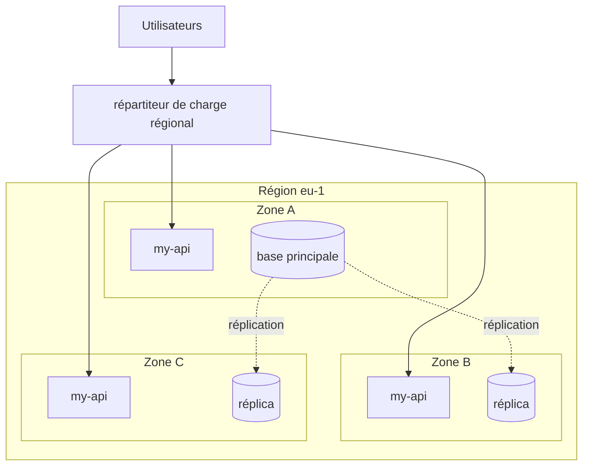

:material-book-open-variant: Doc de référence : [AWS, « Regions and Zones »](https://docs.aws.amazon.com/AWSEC2/latest/UserGuide/using-regions-availability-zones.html) (consultée en novembre 2026) ; [Google Cloud, « Regions and zones »](https://cloud.google.com/compute/docs/regions-zones) (consultée en novembre 2026)
{ .doc-ref }

### RTO et RPO

<a class="pill pill-scope pill-scope-system" href="#carte-des-echelles">Échelle · Système</a> <a class="pill pill-scope pill-scope-infra" href="#carte-des-echelles">Échelle · Infrastructure</a> <span class="pill pill-status pill-status-ok" title="Toujours valable, vérifié en novembre 2026">Valable · 11/2026</span>

Deux chiffres à fixer avec le métier avant de choisir une stratégie : le **<span class="term" data-term="rto">RTO</span>** (combien de temps le service peut rester arrêté) et le **<span class="term" data-term="rpo">RPO</span>** (combien de données récentes on accepte de perdre, exprimé en durée).

```
sauvegarde toutes les 24 h, restauration en 4 h
panne à 18:00, dernière sauvegarde à 02:00
RPO réel : 16 h de commandes perdues    RTO réel : retour à 22:00
```

<figure class="diagram"><svg viewBox="0 0 320 110" role="img" aria-label="RPO et RTO"><line class="set" x1="10" y1="55" x2="310" y2="55"/><rect class="layer layer-2" x="40" y="45" width="192" height="20"/><rect class="layer layer-3" x="232" y="45" width="48" height="20"/><line class="set" x1="40" y1="38" x2="40" y2="72"/><line class="set" x1="232" y1="38" x2="232" y2="72"/><line class="set" x1="280" y1="38" x2="280" y2="72"/><text x="136" y="34" text-anchor="middle" class="label-strong">RPO : 16 h de commandes perdues</text><text x="256" y="34" text-anchor="middle" class="label-strong">RTO : 4 h</text><text x="40" y="86" text-anchor="middle">02:00</text><text x="40" y="98" text-anchor="middle">sauvegarde</text><text x="232" y="86" text-anchor="middle">18:00</text><text x="232" y="98" text-anchor="middle">panne</text><text x="280" y="86" text-anchor="middle">22:00</text><text x="280" y="98" text-anchor="middle">reprise</text></svg><figcaption>Le RPO se mesure avant la panne, le RTO après (à l'échelle, exemple ci-dessus)</figcaption></figure>

:material-book-open-variant: Doc de référence : [AWS, « Disaster Recovery of Workloads on AWS »](https://docs.aws.amazon.com/whitepapers/latest/disaster-recovery-workloads-on-aws/disaster-recovery-workloads-on-aws.html) (2021)
{ .doc-ref }

### Stratégies de reprise

<a class="pill pill-scope pill-scope-infra" href="#carte-des-echelles">Échelle · Infrastructure</a> <span class="pill pill-status pill-status-ok" title="Toujours valable, vérifié en novembre 2026">Valable · 11/2026</span>

Classement repris du livre blanc AWS « Disaster Recovery of Workloads on AWS » (2021), du moins cher au plus cher :

| Stratégie | Ce qui tourne dans la région de secours | RTO / RPO typiques (ordre de grandeur) |
|---|---|---|
| sauvegarde et restauration | rien, seulement des sauvegardes | heures / heures |
| <span class="term" data-term="pilot-light">pilot light</span> | les données répliquées, le reste éteint | dizaines de minutes / minutes |
| <span class="term" data-term="warm-standby">warm standby</span> | tout le système, en taille réduite | minutes / secondes |
| <span class="term" data-term="active-active">actif-actif</span> | tout, servant du trafic en permanence | quasi nul / quasi nul |

[À prendre avec précaution : ordres de grandeur génériques, chaque système mesure les siens en exercice de reprise.] Une stratégie non testée n'existe pas : on la rejoue régulièrement (exercice de reprise, game day). La conduite de l'incident lui-même est dans [Incidents](incidents.md).

### Architecture cellulaire

<a class="pill pill-scope pill-scope-system" href="#carte-des-echelles">Échelle · Système</a> <a class="pill pill-scope pill-scope-infra" href="#carte-des-echelles">Échelle · Infrastructure</a> <span class="pill pill-status pill-status-ok" title="Toujours valable, vérifié en novembre 2026">Valable · 11/2026</span>

L'**<span class="term" data-term="cell-based-architecture">architecture cellulaire</span>** duplique le système complet en cellules indépendantes, chacune servant une partie des clients (par exemple les clients 0 à 999 dans la cellule 1). Un mauvais déploiement ou une donnée toxique ne touche qu'une cellule : le **<span class="term" data-term="blast-radius">rayon d'impact</span>** est borné. Coût : un routage par client et plus d'infrastructure à exploiter.

:material-book-open-variant: Doc de référence : [AWS, « Reducing the Scope of Impact with Cell-Based Architecture »](https://docs.aws.amazon.com/wellarchitected/latest/reducing-scope-of-impact-with-cell-based-architecture/reducing-scope-of-impact-with-cell-based-architecture.html) (2023)
{ .doc-ref }

| Je veux... | J'utilise... |
|---|---|
| trouver la pièce unique dont la panne arrête tout, comme une base sans réplica ou une seule personne qui sait déployer | la liste des SPOF, dépendance par dépendance |
| savoir si les 99,9 % promis sont tenables quand mon service dépend de plusieurs autres | le calcul de disponibilité composée de la chaîne |
| que le service continue quand un centre de données entier tombe, par exemple sur une coupure de courant | trois zones, réplicas et répartiteur de charge |
| repartir dans une autre région quand une région cloud entière devient inaccessible | pilot light ou warm standby selon le RTO |
| qu'un mauvais déploiement ne touche qu'une partie des clients, pas tous à la fois | architecture cellulaire, déploiement cellule par cellule |

## Estimer la capacité

### Ordres de grandeur

<a class="pill pill-scope pill-scope-infra" href="#carte-des-echelles">Échelle · Infrastructure</a>

Un **<span class="term" data-term="back-of-envelope">calcul de coin de table</span>** suffit souvent à éliminer une option. Il s'appuie sur quelques ordres de grandeur :

| Opération | Ordre de grandeur | Fiabilité de la source |
|---|---|---|
| lecture en mémoire | ~100 ns | chiffres popularisés par Jeff Dean vers 2009-2010, matériel plus rapide aujourd'hui |
| lecture aléatoire sur SSD | ~100 µs | même source, varie beaucoup selon le disque |
| aller-retour dans un même centre de données | ~0,5 ms | même source |
| aller-retour entre zones d'une région | ~1 ms | ordre de grandeur courant, à vérifier chez son fournisseur |
| aller-retour Europe et côte est des États-Unis | ~80 ms | contraint par la vitesse de la lumière dans la fibre |

[À prendre avec précaution : ces chiffres datent et dépendent du matériel ; ils servent à comparer des ordres de grandeur, pas à dimensionner.] Une journée compte 86 400 secondes, qu'on arrondit à 100 000 pour calculer de tête.

:material-book-open-variant: Doc de référence : [Jonas Bonér, « Latency Numbers Every Programmer Should Know »](https://gist.github.com/jboner/2841832) (2012)
{ .doc-ref }

### QPS moyen et pic

<a class="pill pill-scope pill-scope-system" href="#carte-des-echelles">Échelle · Système</a> <span class="pill pill-status pill-status-ok" title="Toujours valable, vérifié en novembre 2026">Valable · 11/2026</span>

Le **<span class="term" data-term="qps">QPS</span>** (requêtes par seconde) moyen se déduit de l'usage ; on dimensionne sur le pic.

```
1 000 000 utilisateurs actifs par jour × 20 requêtes chacun = 20 000 000 requêtes par jour
20 000 000 / 86 400 s                                       ≈ 230 QPS en moyenne
pic (soirée, soldes) : × 5 (exemple)                        ≈ 1 200 QPS
stockage : 50 000 commandes par jour × 2 Ko                 ≈ 100 Mo par jour, ≈ 36 Go par an
```

Le déroulé d'une estimation, de l'usage jusqu'à la validation :

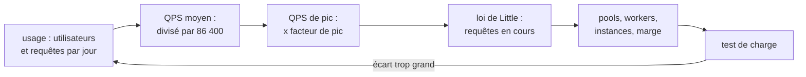

:material-book-open-variant: Doc de référence : [Google SRE Book, « Handling Overload »](https://sre.google/sre-book/handling-overload/) (2016)
{ .doc-ref }

### Loi de Little

<a class="pill pill-scope pill-scope-system" href="#carte-des-echelles">Échelle · Système</a> <a class="pill pill-scope pill-scope-infra" href="#carte-des-echelles">Échelle · Infrastructure</a>

La **<span class="term" data-term="littles-law">loi de Little</span>** (John Little, 1961) : nombre de requêtes en cours = débit × durée moyenne. Elle dimensionne les pools de connexions, les threads et les workers.

!!! noob "As noob"
    Imaginons une boulangerie : s'il entre 2 clients par minute et que chacun reste 5 minutes, il y a en moyenne 10 personnes dans la boutique. Si le service ralentit à 10 minutes par client, la boutique en contient 20, sans un seul client de plus à l'entrée. La phrase à retenir : **quand le traitement ralentit, le nombre de requêtes en attente grimpe, même à trafic constant.**

```
1 200 requêtes/s × 0,2 s de traitement = 240 requêtes en cours en moyenne
si la base ralentit à 1 s : 1 200 × 1 = 1 200 requêtes en cours
un pool de 300 connexions sature : les requêtes attendent, la latence grimpe encore
```

C'est aussi pourquoi un timeout court protège : il limite la durée, donc le nombre de requêtes coincées.

:material-book-open-variant: Doc de référence : [John D. C. Little, « Little's Law as Viewed on Its 50th Anniversary », Operations Research](https://pubsonline.informs.org/doi/10.1287/opre.1110.0940) (2011)
{ .doc-ref }

### Et la base de données

<a class="pill pill-scope pill-scope-infra" href="#carte-des-echelles">Échelle · Infrastructure</a> <span class="pill pill-status pill-status-ok" title="Toujours valable, vérifié en novembre 2026">Valable · 11/2026</span>

Quand la charge augmente, la base est souvent la première limite. Grossir la machine (vertical), ajouter des réplicas de lecture, partitionner les données sur plusieurs machines (horizontal) : ces choix ont leurs propres compromis, détaillés dans [Faire grandir une base de données](sql.md#faire-grandir-une-base-de-donnees).

| Je veux... | J'utilise... |
|---|---|
| savoir en quelques minutes si une option est réaliste, avant de lancer un prototype | calcul de coin de table avec des ordres de grandeur |
| choisir combien de serveurs prévoir, alors que le trafic monte fort le soir ou pendant les soldes | QPS de pic, pas la moyenne, avec une marge |
| choisir la taille d'un pool de connexions ou le nombre de workers, en sachant que la base peut ralentir | loi de Little avec la latence du pire cas acceptable |
| vérifier que mes calculs tiennent face à la vraie charge | un test de charge, voir [Qualité et tests](qualite.md) |

## Front-end

Le **front-end** est la partie du système que l'utilisateur voit : écrans, navigation, formulaires, appels aux API depuis le navigateur. Les questions d'architecture y sont les mêmes qu'au back-end (découper, partager, livrer sans se bloquer), avec deux contraintes en plus : tout le code finit chez l'utilisateur, sur une machine et un réseau qu'on ne maîtrise pas, et l'utilisateur voit **une seule** application, même si dix équipes la construisent. Exemple fictif de toute la section : une boutique `shop-web` avec un catalogue, un panier et un espace compte.

### Micro front-ends

<a class="pill pill-scope pill-scope-system" href="#carte-des-echelles">Échelle · Système</a> <span class="pill pill-status pill-status-ok" title="Toujours valable, vérifié en novembre 2026">Valable · 11/2026</span>

Un **<span class="term" data-term="micro-frontend">micro front-end</span>** applique au navigateur l'idée des microservices : l'interface est découpée en morceaux, chacun possédé par une équipe, développé, testé et déployé seul, puis assemblé pour que l'utilisateur voie une seule application. L'assemblage est fait par une **<span class="term" data-term="app-shell">application hôte</span>** (le *shell*), qui porte la mise en page commune, la navigation de premier niveau et la session. Le terme apparaît dans le Thoughtworks Technology Radar de novembre 2016 (à vérifier) ; la référence la plus citée est l'article de Cam Jackson, « Micro Frontends », publié sur martinfowler.com en juin 2019.

On découpe **par domaine métier**, en tranches verticales, pas par couche technique : l'équipe panier possède l'écran panier, son API (`orders-service`) et ses données, de bout en bout. C'est la forme front-end d'une <span class="term" data-term="stream-aligned-team">équipe alignée sur un flux</span>. Découper en « en-tête », « boutons », « formulaires » recrée au contraire des dépendances entre toutes les équipes.

**Pourquoi.** Le problème de départ est un front monolithique partagé par plusieurs équipes : un seul dépôt, un seul pipeline de 40 minutes, une seule mise en production par semaine ; une équipe qui casse le build bloque toutes les autres, et monter de version le framework se fait en big bang. Les micro front-ends apportent :

- le déploiement indépendant : l'équipe panier livre cinq fois par jour sans attendre le catalogue ;
- l'autonomie technique dans un cadre commun (outils de test, rythme de mise à jour) ;
- la migration progressive d'un vieux front, une route à la fois, au lieu d'une réécriture totale ;
- une base de code plus petite par équipe, plus facile à comprendre et à tester.

Le coût est réel, et c'est celui d'un système distribué côté navigateur :

- des pages plus lourdes si les dépendances sont chargées en double ;
- une expérience incohérente si personne ne tient le design commun ;
- une infrastructure en plus : hébergement de chaque morceau, manifeste des versions, gestion des pannes d'un morceau ;
- des tests d'intégration plus difficiles : chaque morceau marche seul, l'assemblage peut casser ;
- une gouvernance : qui décide des dépendances partagées, du contrat avec le shell, des règles d'UX.

**Quand l'appliquer.** Les signaux qui justifient ce coût :

| Signal | Exemple |
|---|---|
| trois équipes ou plus livrent dans le même front et passent leur temps à s'attendre | une mise en production commune par semaine, une file d'attente de merge requests |
| les parties de l'écran échangent peu entre elles, chacune avec son propre métier | catalogue, panier et compte échangent peu d'informations entre eux |
| je dois sortir d'un vieux front sans arrêter les livraisons pendant la migration | les nouvelles pages en React, les anciennes restent dans l'ancien framework le temps de la migration |
| certaines parties changent tous les jours, d'autres presque jamais | le panier change tous les jours, l'espace compte une fois par mois |

Quand ne pas l'appliquer : une seule équipe (ou deux qui se parlent tous les jours), une petite application, un écran où tout interagit avec tout (un éditeur, un tableau de bord très lié), une cible mobile bas de gamme sans budget pour surveiller le poids des pages, ou l'envie de « tester plusieurs frameworks ». L'alternative est le **front modulaire** : une seule application, découpée en paquets dans un <span class="term" data-term="monorepo">monorepo</span>, avec des frontières entre modules vérifiées en CI, exactement comme le [monolithe modulaire](#monolithe-modulaire) côté back-end. On passe aux micro front-ends le jour où le déploiement commun devient la douleur mesurée.

**Comment : les quatre façons d'assembler.**

1. **Au build, par paquets npm.** Chaque micro front-end est publié comme paquet, le shell le déclare en dépendance, et tout est empaqueté ensemble. Simple, typé, un seul bundle bien optimisé. Mais chaque changement d'une équipe oblige à republier puis redéployer le shell : on perd le déploiement indépendant, qui était la raison d'être. Cam Jackson le déconseille pour cette raison.
2. **Côté serveur ou en bordure.** Le serveur, ou le <span class="term" data-term="cdn">CDN</span>, assemble la page HTML à partir de fragments servis par chaque équipe : Server Side Includes, **<span class="term" data-term="edge-side-includes">Edge Side Includes</span>** (ESI, spécification soumise au W3C en 2001), ou un petit serveur de composition. Bon pour le référencement et le premier affichage de pages surtout faites de contenu ; l'interactivité côté navigateur reste à organiser à part.
3. **À l'exécution, en JavaScript.** Le shell télécharge le code de chaque micro front-end au moment où l'utilisateur en a besoin :
    - **<span class="term" data-term="module-federation">Module Federation</span>** : apparu avec Webpack 5 (octobre 2020). Un build *expose* des modules, un autre les *consomme* comme s'ils étaient locaux, et les dépendances communes (React, le design system) sont négociées pour n'être chargées qu'une fois. Aussi disponible nativement dans Rspack, et pour Vite via un plugin (à vérifier pour l'état du support) ;
    - **single-spa** : un orchestrateur indépendant du framework (première version vers 2016, à vérifier). Chaque application enregistrée expose `bootstrap`, `mount` et `unmount`, et single-spa monte celle qui correspond à l'URL ;
    - **<span class="term" data-term="web-component">Web Components</span>** : chaque équipe livre un élément HTML personnalisé (`<cart-summary>`), un standard du navigateur, utilisable depuis n'importe quel framework, avec une isolation du CSS par le <span class="term" data-term="shadow-dom">Shadow DOM</span>.
4. **Par <span class="term" data-term="iframe">iframe</span>.** Isolation totale (JavaScript, CSS, plantage), mais navigation, hauteur de la zone, accessibilité, référencement et partage de session deviennent difficiles. Réservé à un outil tiers ou à une vieille application intégrée telle quelle.

*npm : concurrent de yarn, pnpm*
{ .tool-rel }


| Mode | Déploiement indépendant | Points forts | Points faibles | À choisir quand |
|---|---|---|---|---|
| paquets npm au build | non | simple, typé, un seul bundle | chaque changement redéploie le shell | on veut surtout partager du code, pas livrer séparément |
| composition serveur ou ESI | oui | premier affichage rapide, bon référencement | interactivité à gérer à part, infrastructure serveur | pages de contenu, catalogue public |
| Module Federation | oui | dépendances partagées, intégration fine | couplage aux versions du bundler, débogage plus dur | une application riche, un seul framework, plusieurs équipes |
| single-spa | oui | plusieurs frameworks côte à côte | une couche de plus à maîtriser | migration d'un vieux framework vers un nouveau |
| Web Components | oui | standard, indépendant du framework | rendu serveur et passage de données complexes plus délicats | widgets réutilisés dans des applications aux frameworks différents |
| iframe | oui | isolation totale | UX, accessibilité, taille, référencement | outil tiers, vieille application à intégrer sans la toucher |

**Exemple : un shell et trois micro front-ends.** Trois équipes, un shell tenu par une équipe plateforme, un design system partagé :

```
shop-shell/              team-platform : mise en page, routes de 1er niveau, session, erreurs
├─ src/routes.ts         /catalog/* vers catalog, /cart/* vers cart, /account/* vers account
├─ src/layout/           en-tête, menu, pied de page
└─ rspack.config.js      remotes : catalog, cart, account
catalog-front/           team-catalog, déployé seul, appelle catalog-api
cart-front/              team-checkout, déployé seul, appelle orders-service
account-front/           team-account, déployé seul, appelle account-api
shop-ui/                 paquet @shop/ui : design system, versionné SemVer
shop-mfe-contract/       paquet @shop/mfe-contract : contrat entre shell et micro front-ends
```

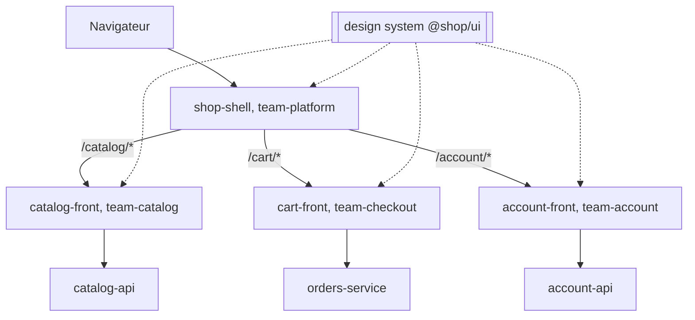

La configuration Module Federation du shell (Webpack 5 ou Rspack, même syntaxe ; les noms de paquets dépendent de la version, à vérifier) :

```js
const { ModuleFederationPlugin } = require("@module-federation/enhanced/rspack");

// Exemple : le shell déclare ses remotes et partage React en singleton
module.exports = {
  plugins: [
    new ModuleFederationPlugin({
      name: "shell",
      remotes: {
        catalog: "catalog@https://static.example.com/catalog/remoteEntry.js",
        cart: "cart@https://static.example.com/cart/remoteEntry.js",
        account: "account@https://static.example.com/account/remoteEntry.js",
      },
      shared: {
        react: { singleton: true, requiredVersion: "^18.3.0" },
        "react-dom": { singleton: true, requiredVersion: "^18.3.0" },
        "@shop/ui": { singleton: true, requiredVersion: "^4.0.0" },
      },
    }),
  ],
};
```

Et celle du panier, qui expose son point d'entrée :

```js
// Exemple : le panier expose son point d'entrée mount
new ModuleFederationPlugin({
  name: "cart",
  filename: "remoteEntry.js",
  exposes: { "./mount": "./src/mount.tsx" },
  shared: {
    react: { singleton: true, requiredVersion: "^18.3.0" },
    "react-dom": { singleton: true, requiredVersion: "^18.3.0" },
    "@shop/ui": { singleton: true, requiredVersion: "^4.0.0" },
  },
});
```

Les URL des `remotes` pointent souvent vers un manifeste chargé au démarrage plutôt qu'en dur : on change ainsi la version d'un micro front-end (ou on revient en arrière) sans reconstruire le shell.

**Le contrat entre le shell et un micro front-end.** C'est l'API publique de chaque micro front-end, à traiter comme un contrat d'API : écrit dans un paquet versionné, changé avec prudence.

```ts
// Exemple : les props que le shell passe à chaque micro front-end
export interface MicroFrontendProps {
  basePath: string;
  locale: string;
  getAccessToken: () => Promise<string>;
  navigate: (path: string) => void;
}

// Exemple : monter dans un élément renvoie de quoi se démonter
export type Unmount = () => void;

export type Mount = (element: HTMLElement, props: MicroFrontendProps) => Unmount;
```

**Routage.** Le shell possède le premier segment de l'URL (`/cart`), le micro front-end possède la suite (`/cart/checkout/payment`). Un seul historique de navigation pour tout le monde ; pour aller dans un autre domaine, un micro front-end appelle `navigate` du shell ou pose un simple lien, jamais le routeur d'une autre équipe. Toute URL doit fonctionner au rechargement : le serveur renvoie le shell pour toutes les routes, et le shell monte le bon morceau.

**État partagé : les règles.**

1. Pas de store global commun (un Redux partagé entre équipes) : c'est le retour du monolithe, en plus fragile.
2. L'URL est le premier état partagé : identifiant du produit, filtres, page.
3. Les données métier se relisent depuis leur API : le back-end reste la source de vérité, chaque micro front-end garde son propre état local.
4. Pour prévenir les autres d'un fait, on publie un événement navigateur avec un contenu documenté et versionné, comme un événement entre services :

    ```ts
    // Bien : un événement navigateur au contenu documenté pour prévenir les autres
    window.dispatchEvent(
      new CustomEvent("cart:item-added", { detail: { sku: "SKU-42", quantity: 1 } }),
    );
    ```

5. Les services transverses (session, jeton, langue, <span class="term" data-term="feature-flag">feature flags</span>) viennent du shell, par les props du contrat, jamais recopiés par chaque équipe.

**Versions des dépendances partagées.** Partager peu : le framework, le design system, le client d'authentification. Le reste, chaque équipe garde le sien.

- Le framework est en `singleton` : deux copies de React dans la même page cassent les hooks (« Invalid hook call »).
- Les paquets partagés suivent la <span class="term" data-term="semantic-versioning">version sémantique</span> ; `requiredVersion: "^4.0.0"` accepte toute 4.x.
- Une version majeure du framework ou du design system se planifie entre toutes les équipes : c'est le seul moment où l'on se synchronise, et un tableau de bord des versions par micro front-end le prépare.
- Un contrôle en CI échoue si un micro front-end sort de la plage autorisée, sinon le shell charge silencieusement deux versions.

**Pièges de performance et de cohérence.**

| Piège | Ce que voit l'utilisateur | Parade |
|---|---|---|
| dépendances en double | une page lente, surtout sur mobile | `shared` et `singleton`, budget de poids par micro front-end vérifié en CI (exemple : 150 ko compressés) |
| chargements en cascade (shell, puis `remoteEntry.js`, puis le code, puis l'API) | un écran blanc qui dure | précharger les entrées des routes probables, squelette d'attente, <span class="term" data-term="lazy-loading">chargement paresseux</span> du reste |
| la mise en page bouge quand un morceau arrive | des clics au mauvais endroit | réserver la place, suivre le CLS des <span class="term" data-term="core-web-vitals">Core Web Vitals</span> |
| CSS qui fuit d'une équipe à l'autre | le bouton du panier change de couleur | CSS Modules ou préfixes, Shadow DOM, styles globaux seulement dans le shell |
| UX incohérente | trois styles de messages d'erreur, deux chargements différents | design system, design tokens, revue UX transverse |
| un micro front-end qui plante | toute la page blanche | une frontière d'erreur par micro front-end dans le shell, message de repli « le panier est momentanément indisponible » |
| focus perdu au changement de route | lecteur d'écran muet | le shell gère focus et annonces, voir <span class="term" data-term="web-accessibility">accessibilité numérique</span> |

**Tester.** Trois niveaux, du moins cher au plus cher :

1. **chaque micro front-end seul** : tests unitaires et de composants, et un démarrage autonome avec un faux shell, pour développer sans les autres équipes ;
2. **le contrat** : un <span class="term" data-term="contract-test">test de contrat</span> vérifie que le micro front-end respecte `Mount` (il se monte, se démonte proprement) et que ses événements ont la forme promise. Le shell, consommateur, peut publier ses attentes comme pour un contrat d'API, voir [Tests de contrat et mocks d'API](qualite.md#tests-de-contrat-et-mocks-dapi) ;
3. **l'application assemblée** : quelques <span class="term" data-term="e2e-test">tests de bout en bout</span> sur les parcours critiques qui traversent plusieurs équipes, dans un environnement où le shell charge la dernière version de chaque morceau, lancés après chaque déploiement de n'importe lequel d'entre eux. Plus un <span class="term" data-term="smoke-test">smoke test</span> qui vérifie que chaque `remoteEntry.js` répond.

Le test de contrat du panier (Vitest) :

```ts
import { describe, expect, it, vi } from "vitest";
import { mount } from "../src/mount";

// Exemple : test de contrat, le panier se monte et se démonte proprement
describe("cart-front respecte le contrat du shell", () => {
  it("se monte dans l'élément fourni et se démonte proprement", async () => {
    const element = document.createElement("div");
    const unmount = mount(element, {
      basePath: "/cart",
      locale: "fr-FR",
      getAccessToken: vi.fn().mockResolvedValue("fake-token"),
      navigate: vi.fn(),
    });

    await vi.waitFor(() => {
      expect(element.querySelector("[data-testid='cart-root']")).not.toBeNull();
    });

    unmount();
    expect(element.innerHTML).toBe("");
  });
});
```

Le test de bout en bout sur l'assemblage (Playwright), qui traverse catalogue, shell et panier :

```ts
import { expect, test } from "@playwright/test";

// Exemple : test E2E qui traverse catalogue, shell et panier
test("un produit ajouté depuis le catalogue apparaît dans le panier", async ({ page }) => {
  await page.goto("/catalog/sku-42");
  await page.getByRole("button", { name: "Ajouter au panier" }).click();
  await expect(page.getByTestId("cart-badge")).toHaveText("1");

  await page.getByRole("link", { name: "Panier" }).click();
  await expect(page).toHaveURL(/\/cart/);
  await expect(page.getByText("SKU-42")).toBeVisible();
});
```

Les étapes pour démarrer :

1. découper par domaine métier, aligné sur les équipes ([loi de Conway](#loi-de-conway)) ;
2. construire un shell minimal : mise en page, routes de premier niveau, session, frontières d'erreur ;
3. écrire le contrat (`Mount`, props, événements) dans un paquet versionné ;
4. choisir le mode d'assemblage avec le tableau ci-dessus ;
5. fixer la courte liste des dépendances partagées et leurs plages de versions ;
6. mettre en CI les budgets de poids, les tests de contrat, et les tests de bout en bout sur l'assemblage ;
7. migrer une route à la fois, en commençant par la moins risquée.

:material-book-open-variant: Doc de référence : [Cam Jackson, « Micro Frontends », martinfowler.com](https://martinfowler.com/articles/micro-frontends.html) (2019) ; [Michael Geers, micro-frontends.org](https://micro-frontends.org/) (consultée en novembre 2026)
{ .doc-ref }

### Design system et développement par composants

<a class="pill pill-scope pill-scope-code" href="#carte-des-echelles">Échelle · Code</a> <span class="pill pill-status pill-status-ok" title="Toujours valable, vérifié en novembre 2026">Valable · 11/2026</span>

Un **<span class="term" data-term="design-system">design system</span>** est un ensemble partagé de composants d'interface codés (bouton, champ, modale), de **<span class="term" data-term="design-token">design tokens</span>** (couleurs, espacements, typographie sous forme de variables nommées) et de règles d'usage documentées, maintenu comme un produit, avec un propriétaire et des versions. Le **<span class="term" data-term="component-driven-development">développement piloté par les composants</span>** (component-driven development, terme popularisé par Tom Coleman vers 2017, à vérifier) construit l'interface de bas en haut : chaque composant est développé et testé seul, dans tous ses états, puis assemblé en pages. Brad Frost en a donné une grille de lecture, l'Atomic Design (article en 2013, livre en 2016) : atomes, molécules, organismes, gabarits, pages. **<span class="term" data-term="storybook">Storybook</span>** (première version en 2016, à vérifier) est l'outil open source le plus répandu pour cela : il affiche chaque composant hors de l'application, dans chacun de ses états, appelés *stories*.

**Pourquoi.** Sans design system, le même bouton est recodé six fois avec six gris différents, l'accessibilité est corrigée (ou pas) application par application, et chaque écran se discute à partir de captures. Avec lui :

- une correction (contraste, focus clavier) profite à toutes les applications en une seule version ;
- les écrans se construisent plus vite, à partir de briques déjà testées ;
- designers et développeurs parlent des mêmes composants, avec les mêmes noms ;
- avec des micro front-ends, c'est ce qui garde une seule expérience aux yeux de l'utilisateur.

Le coût : un propriétaire (au minimum une personne, souvent une équipe), une gestion de versions et des migrations chez les consommateurs, et le risque de devenir un goulot d'étranglement. Lancé trop tôt, il fige des abstractions avant de savoir ce dont les écrans ont besoin.

**Quand l'appliquer.** Plusieurs applications ou équipes partagent une identité visuelle ; des micro front-ends ; les mêmes composants sont recodés dans plusieurs dépôts ; un objectif d'accessibilité à tenir partout. Quand ne pas : un seul petit produit, un prototype. Là, une bibliothèque de composants open source existante, avec un thème, suffit ; construire son propre design system ne se justifie qu'à plusieurs produits.

**Comment.**

1. Faire l'inventaire de l'existant : une capture de tous les boutons, champs et messages d'erreur suffit à convaincre.
2. Commencer par les tokens : couleurs, espacements, rayons, typographie.
3. Construire les composants de base, accessibles dès le départ, chacun avec une story par état (normal, désactivé, en chargement, en erreur).
4. Publier comme paquet versionné (`@shop/ui`), avec un journal des changements, et fournir un script de migration pour chaque version majeure.
5. Tester les stories : tests d'interaction, <span class="term" data-term="regression">régression</span> visuelle (une capture par story comparée à la référence), contrôle d'accessibilité automatique.
6. Gouverner : contributions ouvertes à toutes les équipes, revue par le propriétaire, règle claire sur ce qui entre dans le design system et ce qui reste local.

Les tokens, en variables CSS :

```css
/* Exemple : les tokens du design system, en variables CSS */
:root {
  --color-primary: #1f6feb;
  --color-danger: #cf222e;
  --space-2: 8px;
  --space-4: 16px;
  --radius-md: 6px;
}
```

Une story au format CSF 3 (Component Story Format, Storybook 7 et suivants, 2023 ; les noms de paquets changent selon la version, à vérifier) :

```tsx
import type { Meta, StoryObj } from "@storybook/react";
import { Button } from "./Button";

// Exemple : la fiche du composant et ses valeurs par défaut
const meta = {
  title: "Actions/Button",
  component: Button,
  args: { label: "Payer", variant: "primary" },
} satisfies Meta<typeof Button>;

export default meta;

type Story = StoryObj<typeof meta>;

// Exemple : chaque export est un état du bouton, donc un cas de test
export const Primary: Story = {};

export const Disabled: Story = {
  args: { disabled: true },
};

export const Loading: Story = {
  args: { loading: true, label: "Paiement en cours" },
};
```

Chaque export est un état du bouton, visible dans Storybook, et chaque état devient un cas de test (capture visuelle, accessibilité) sans écrire de test à part.

| Je veux... | J'utilise... |
|---|---|
| le même bleu de bouton et les mêmes marges dans toutes mes applications, sans recopier les valeurs partout | design tokens |
| travailler sur un bouton dans tous ses états (désactivé, en chargement) sans lancer toute l'application | Storybook, une story par état |
| savoir tout de suite qu'un changement de CSS a cassé un écran, avant qu'un utilisateur le voie | régression visuelle sur les stories |
| des écrans propres pour un seul produit fait par une petite équipe, sans construire de design system | une bibliothèque open source existante, avec un thème |
| une seule apparence pour plusieurs produits ou micro front-ends faits par des équipes différentes | un design system versionné, avec un propriétaire |

:material-book-open-variant: Doc de référence : [Storybook, documentation](https://storybook.js.org/docs) (consultée en novembre 2026) ; [Brad Frost, « Atomic Design »](https://atomicdesign.bradfrost.com/) (2016)
{ .doc-ref }

### Stratégies de rendu

<a class="pill pill-scope pill-scope-app" href="#carte-des-echelles">Échelle · Application</a> <span class="pill pill-status pill-status-ok" title="Toujours valable, vérifié en novembre 2026">Valable · 11/2026</span>

!!! info "Écrit en novembre 2026"
    Les fonctionnalités des frameworks évoluent vite : vérifier dans la documentation de la version utilisée.

Le **rendu**, c'est la production du HTML que le navigateur affiche. La question est : où et quand ce HTML est-il fabriqué ?

- **<span class="term" data-term="csr">CSR</span>** (Client Side Rendering) : le serveur envoie une page presque vide et du JavaScript ; le navigateur construit tout. C'est le fonctionnement d'une <span class="term" data-term="spa">SPA</span> classique.
- **<span class="term" data-term="ssr">SSR</span>** (Server Side Rendering) : le serveur fabrique le HTML complet à chaque requête, puis le JavaScript le rend interactif dans le navigateur ; cette étape s'appelle l'**<span class="term" data-term="hydration">hydratation</span>**.
- **<span class="term" data-term="ssg">SSG</span>** (Static Site Generation) : le HTML est fabriqué une fois, au build, puis servi tel quel par un CDN.
- **<span class="term" data-term="isr">ISR</span>** (Incremental Static Regeneration, introduit par Next.js 9.5 en 2020) : comme le SSG, mais chaque page est régénérée en arrière-plan après un délai ou à la demande, sans reconstruire tout le site.

Un **<span class="term" data-term="meta-framework">méta-framework</span>** apporte ces stratégies, le routage et le rendu serveur au-dessus d'une bibliothèque d'interface : Next.js (React, 2016), Nuxt (Vue, 2016), SvelteKit (Svelte), Remix puis React Router 7 (React), Astro (2021, multi-framework, orienté contenu). Dates et noms à vérifier. Ils permettent souvent de choisir la stratégie **route par route**.

**Pourquoi c'est un choix d'architecture.** Il décide de la vitesse du premier affichage, du référencement par les moteurs de recherche, du coût des serveurs, de la fraîcheur des données et de ce qui peut être mis en cache. Un mauvais choix se paie partout : une SPA pour un catalogue public perd en référencement ; du SSR pour une page qui ne change jamais paie un serveur pour rien.

| Stratégie | HTML fabriqué | Quand | Quand ne pas | Pièges |
|---|---|---|---|---|
| CSR | dans le navigateur | outil interne derrière connexion, application très interactive | pages publiques à référencer, mobiles lents | écran blanc au démarrage, gros bundle |
| SSR | sur le serveur, à chaque requête | contenu personnalisé ou très frais qui doit s'afficher vite | contenu identique pour tous (gaspillage) | coût serveur, hydratation lente, erreurs d'hydratation (HTML serveur différent du client) |
| SSG | au build | documentation, blog, pages légales, marketing | des millions de pages, ou des données qui changent souvent | build de plus en plus long, contenu figé jusqu'au prochain build |
| ISR | au build, puis régénéré en arrière-plan | catalogue public, fiches produit : beaucoup de pages, changements modérés | données personnelles, ou qui doivent être exactes à la seconde | contenu en retard d'un cycle, support variable selon l'hébergeur |

**Comment.**

1. Classer les pages selon trois questions : faut-il la référencer ? est-elle personnalisée ? à quelle fréquence change-t-elle ?
2. Choisir la stratégie route par route. Pour `shop-web` : pages légales en SSG, fiches produit en ISR (régénérées toutes les 60 secondes), panier et compte en CSR ou SSR, jamais mis en cache partagé.
3. Mesurer sur de vrais utilisateurs : les Core Web Vitals (LCP pour le premier affichage utile, INP pour la réactivité, CLS pour la stabilité).
4. Surveiller le coût d'hydratation : un HTML rapide mais une page qui ne répond aux clics qu'après trois secondes reste une mauvaise expérience.

Une fiche produit en ISR avec Next.js (App Router, syntaxe de Next.js 15, à vérifier selon la version) :

```tsx
// Exemple : la page est régénérée au plus toutes les 60 s (ISR)
export const revalidate = 60;

type Product = { sku: string; name: string; priceCents: number };

// Exemple : la page lit le produit depuis l'API au rendu
export default async function ProductPage({ params }: { params: Promise<{ sku: string }> }) {
  const { sku } = await params;
  const response = await fetch(`https://catalog-api.example.com/products/${sku}`);
  const product: Product = await response.json();
  return <h1>{product.name}</h1>;
}
```

Le piège qui touche la sécurité : une page SSR personnalisée (« Bonjour Ada », son panier) mise en cache par le CDN est servie à l'utilisateur suivant. Toute réponse qui dépend de la session doit être marquée `Cache-Control: private, no-store`, et un test doit le vérifier.

:material-book-open-variant: Doc de référence : [Jason Miller et Addy Osmani, « Rendering on the Web », web.dev](https://web.dev/articles/rendering-on-the-web) (2019)
{ .doc-ref }

### Bundlers

<a class="pill pill-scope pill-scope-code" href="#carte-des-echelles">Échelle · Code</a> <span class="pill pill-status pill-status-ok" title="Toujours valable, vérifié en novembre 2026">Valable · 11/2026</span>

!!! info "Écrit en novembre 2026"
    Les outils de build évoluent vite, et les comparaisons de vitesse viennent surtout des éditeurs eux-mêmes. Dates et fonctionnalités à vérifier dans la documentation.

Un **<span class="term" data-term="bundler">bundler</span>** prend le code source (TypeScript, JSX, CSS, imports entre fichiers) et produit les fichiers que le navigateur charge. Il résout les imports, transpile, regroupe, minifie, découpe le code en morceaux chargés à la demande, et supprime le code jamais utilisé (le <span class="term" data-term="tree-shaking">tree shaking</span>). En développement, il sert l'application et remplace à chaud le module modifié sans recharger la page (<span class="term" data-term="hmr">HMR</span>, Hot Module Replacement).

| Outil | Origine | Bon pour | Limites |
|---|---|---|---|
| Webpack | Tobias Koppers, 2012, écrit en JavaScript | l'écosystème de loaders et plugins le plus riche, Module Federation d'origine, projets existants | configuration verbeuse, lent sur de gros projets |
| Vite | Evan You, 2020 | nouveau projet React, Vue ou Svelte : démarrage quasi instantané en développement (modules ES natifs), configuration courte | historiquement deux chemins différents en développement (esbuild) et en production (Rollup), en cours d'unification avec Rolldown, écrit en Rust (à vérifier) ; Module Federation par plugin |
| Rspack | 2023, écrit en Rust, version 1.0 en 2024 (à vérifier) | accélérer un gros projet Webpack sans réécrire sa configuration (API compatible), Module Federation intégré | tous les plugins Webpack ne sont pas compatibles |
| esbuild | Evan Wallace, 2020, écrit en Go | transpiler et regrouper très vite : bibliothèques, scripts, fonctions serverless, brique interne d'autres outils | pas de HMR intégré, découpage du code plus limité (à vérifier) |

Les gains de vitesse annoncés vont souvent de « 10 fois plus rapide » à bien plus [À prendre avec précaution : chiffres publiés par les projets eux-mêmes, sur leurs propres bancs d'essai]. Aucun de ces outils ne vérifie les types TypeScript : `tsc --noEmit` reste une étape à part dans la CI.

**Quand en changer.** Pas par mode : quand une douleur se mesure. Signaux (seuils donnés en exemple) : un serveur de développement qui démarre en plus de 30 secondes, une modification qui met plusieurs secondes à s'afficher, un build de CI de plus de 10 minutes. Si le framework impose son bundler (un méta-framework), on garde le sien.

**Comment migrer.** Exemple d'un gros projet Webpack vers Rspack :

1. mesurer avant : temps de démarrage, temps de build, poids de chaque fichier produit ;
2. remplacer le paquet et garder la configuration, en remplaçant les plugins incompatibles un par un ;
3. comparer les fichiers produits (poids, découpage) avec l'outil d'analyse du bundle ;
4. lancer les tests de bout en bout sur le résultat, avant de basculer la CI.

| Je veux... | J'utilise... |
|---|---|
| démarrer une nouvelle application React, Vue ou Svelte avec un serveur de développement qui démarre vite | Vite, ou le bundler du méta-framework choisi |
| accélérer un gros projet Webpack existant dont le build est trop lent, sans réécrire sa configuration | Rspack, configuration conservée |
| assembler des micro front-ends avec Module Federation, comme le shell et le panier de `shop-web` | Webpack 5 ou Rspack |
| construire vite une bibliothèque, un script ou une fonction serverless | esbuild (directement ou via un outil qui l'utilise) |

:material-book-open-variant: Doc de référence : [webpack, « Concepts »](https://webpack.js.org/concepts/) (consultée en novembre 2026) ; [Vite, « Why Vite »](https://vite.dev/guide/why) (consultée en novembre 2026)
{ .doc-ref }

## Urbaniser le système d'information

<a class="pill pill-scope pill-scope-enterprise" href="#carte-des-echelles">Échelle · Entreprise</a> <span class="pill pill-status pill-status-ok" title="Toujours valable, vérifié en novembre 2026">Valable · 11/2026</span>

L'**<span class="term" data-term="si-urbanization">urbanisation du système d'information</span>** applique au parc d'applications d'une entreprise l'image d'une ville : on ne reconstruit pas la ville, on la fait évoluer quartier par quartier en suivant un plan et des règles communes. Le terme est surtout utilisé en France (Jacques Sassoon, « Urbanisation des systèmes d'information », 1998, à vérifier ; Christophe Longépé, « Le projet d'urbanisation du SI », Dunod, première édition en 2001, à vérifier). Dans le monde anglophone, on parle d'**<span class="term" data-term="enterprise-architecture">architecture d'entreprise</span>** (enterprise architecture).

Là où le reste de cette page parle d'un système, l'urbanisation parle de **tous** les systèmes : 80 applications, 3 ERP hérités de rachats, des échanges de fichiers que personne ne maîtrise.

### Pourquoi

Sans plan, un système d'information grandit comme une ville sans cadastre :

- la même donnée (le client, le produit) existe dans cinq applications, avec cinq valeurs différentes ;
- chaque nouveau projet crée ses propres liaisons point à point, et le schéma des échanges devient un plat de spaghettis ;
- personne ne sait quelle application débrancher, ni ce qui casse si on la débranche ;
- les budgets financent des doublons sans le savoir.

L'urbanisation donne trois choses : une **carte** de l'existant, une **cible** à quelques années, et des **règles** que chaque projet respecte pour aller vers la cible.

### Les quatre vues et la métaphore de la ville

On décrit le système d'information en quatre couches, de la plus stable à la plus changeante :

| Vue | Question | Exemple |
|---|---|---|
| métier | que fait l'entreprise, par quels processus ? | « vendre », « livrer », « facturer » |
| fonctionnelle | quels blocs de fonctions faut-il pour cela ? | zone « relation client », quartier « commande », îlot « devis » |
| applicative | quelles applications rendent ces fonctions ? | `crm-app`, `orders-service`, `billing-service` |
| technique | sur quoi tournent-elles ? | Kubernetes, Postgres, broker de messages |

La vue fonctionnelle reprend le vocabulaire de la ville : des **zones** (grands domaines), découpées en **quartiers**, découpés en **îlots** (le plus petit bloc qu'une seule application doit porter).

Les règles d'urbanisme classiques :

1. chaque donnée de référence a **un seul propriétaire** (le référentiel client, le référentiel produit) ; les autres la consultent ou en reçoivent une copie ;
2. un îlot appartient à **une seule** application ;
3. les quartiers échangent par des **interfaces publiées** (API, événements sur un broker), jamais en lisant la base d'un autre ;
4. une nouvelle application se place d'abord sur la carte : si son îlot est déjà occupé, on justifie le doublon ou on réutilise.

### Exemple : une cartographie fictive

```
Zone Relation client
├─ Quartier Prospects ........ crm-app
└─ Quartier Comptes clients .. customer-referential   (référentiel : seul à écrire le client)
Zone Ventes
├─ Quartier Devis ............ crm-app, quote-tool    (doublon à résorber)
└─ Quartier Commandes ........ orders-service
Zone Finance
├─ Quartier Facturation ...... billing-service, legacy-erp (migration en cours)
└─ Quartier Paiement ......... (vide : prestataire externe via payment-adapter)
Zone Pilotage
└─ Quartier Reporting ........ data-warehouse          (lit des copies, n'écrit rien)
```

Lecture : deux applications sur « Devis » (un doublon à arbitrer), une migration en cours sur « Facturation », et une seule source d'écriture pour le client.

### Les cadres de référence

<span class="pill pill-status pill-status-ok" title="Toujours valable, vérifié en novembre 2026">Valable · 11/2026</span>

| Cadre | Ce que c'est | À quoi il sert |
|---|---|---|
| **<span class="term" data-term="togaf">TOGAF</span>** (The Open Group, première version en 1995, TOGAF Standard 10e édition en 2022) | une méthode, l'ADM : un cycle de phases (vision, métier, systèmes, technique, opportunités, migration, gouvernance) | conduire un programme de transformation de bout en bout |
| **<span class="term" data-term="zachman">Cadre de Zachman</span>** (John Zachman, IBM Systems Journal, 1987) | une grille : six questions (quoi, comment, où, qui, quand, pourquoi) croisées avec six points de vue | vérifier qu'aucune facette n'est oubliée ; ce n'est pas une méthode |
| **<span class="term" data-term="archimate">ArchiMate</span>** (The Open Group, version 3.2 en 2022, à vérifier) | un langage de modélisation, avec des symboles normalisés pour les couches métier, application et technique | dessiner les cartes de façon lisible par tous les architectes |
| **<span class="term" data-term="capability-map">carte des capacités</span>** | la liste de ce que l'entreprise sait faire, indépendamment de qui le fait | point de départ commun avec la direction ; c'est souvent la vue métier ci-dessus |
| urbanisation à la française (Sassoon, Longépé) | zones, quartiers, îlots et règles d'urbanisme | découper et ranger le parc applicatif |

TOGAF et l'urbanisation ne s'opposent pas : TOGAF dit comment mener la démarche, l'urbanisation dit comment découper et ranger.

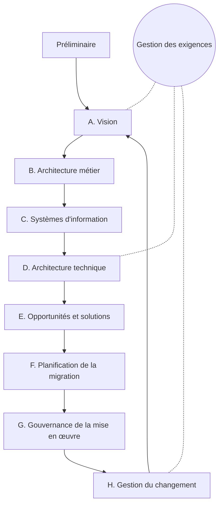

:material-book-open-variant: Doc de référence : [The Open Group, TOGAF Standard](https://www.opengroup.org/togaf) (10e édition, 2022) ; [The Open Group, ArchiMate](https://www.opengroup.org/archimate-forum/archimate-overview) (version 3.2, 2022)
{ .doc-ref }

### Quand et comment

**Quand.** La démarche a du sens à partir de quelques dizaines d'applications, ou dans un de ces moments : fusion ou rachat, sortie d'un ERP, migration vers le cloud, plainte récurrente « on ne sait pas qui fait quoi ». Pour une startup avec trois services, c'est de la bureaucratie : un schéma C4 de niveau 1 suffit.

**Comment.** Une démarche légère, qui livre quelque chose à chaque étape :

1. **cartographier l'existant** : lister les applications, leur propriétaire, les données qu'elles écrivent et leurs échanges (un tableur suffit au début) ;
2. **dessiner la carte des capacités** avec le métier, puis y projeter les applications : les doublons et les trous apparaissent tout seuls ;
3. **fixer quelques règles** (propriétaire unique de chaque donnée, échanges par API ou événements) et les publier ;
4. **définir la cible** à deux ou trois ans et les étapes, chaque étape portée par un projet qui a de toute façon lieu ;
5. **gouverner sans bloquer** : chaque nouveau projet se place sur la carte, et une décision qui s'écarte des règles se consigne dans un [ADR](#adr) ;
6. **tenir la carte vivante** : la générer depuis le catalogue de services ou le code quand c'est possible, sinon elle est fausse en six mois.

| Je veux... | J'utilise... |
|---|---|
| savoir quelles applications existent et à qui m'adresser pour chacune | inventaire des applications, puis cartographie |
| parler du système d'information avec la direction, en termes de ce que fait l'entreprise plutôt que de logiciels | carte des capacités |
| ranger le parc et repérer les doublons et les trous, comme deux outils de devis ou un quartier vide | zones, quartiers, îlots |
| mener une transformation sur plusieurs années, comme une fusion ou la sortie d'un ERP | cycle ADM de TOGAF, allégé |
| vérifier qu'une vision d'ensemble n'oublie aucune facette (quoi, qui, où, quand, pourquoi) | grille de Zachman |
| des schémas que tous les architectes lisent de la même façon, avec les mêmes symboles | ArchiMate |
| décrire un seul système ou quelques services, sans lourdeur | pas d'urbanisation : C4 et ADR suffisent |

## Documenter et gouverner

<a class="pill pill-practice" href="../livraison/#concevoir-avant-de-coder">Pratique · Conception technique</a>
<a class="pill pill-dora" href="https://dora.dev/capabilities/documentation-quality/">DORA · Documentation quality</a>

### Modèle C4

<a class="pill pill-scope pill-scope-code" href="#carte-des-echelles">Échelle · Code</a> <a class="pill pill-scope pill-scope-app" href="#carte-des-echelles">Échelle · Application</a> <a class="pill pill-scope pill-scope-system" href="#carte-des-echelles">Échelle · Système</a> <span class="pill pill-status pill-status-ok" title="Toujours valable, vérifié en novembre 2026">Valable · 11/2026</span>

Le **<span class="term" data-term="c4-model">modèle C4</span>** (Simon Brown, site c4model.com, date de création à vérifier) dessine une architecture en quatre niveaux de zoom, chacun pour un public :

| Niveau | Montre | Pour qui |
|---|---|---|
| 1. Contexte | le système, ses utilisateurs, les systèmes externes | tout le monde, métier compris |
| 2. Conteneurs | les applications et bases déployées, et leurs échanges | équipes techniques, exploitation |
| 3. Composants | les grands blocs d'un conteneur | développeurs de ce conteneur |
| 4. Code | classes et fonctions | rarement dessiné à la main |

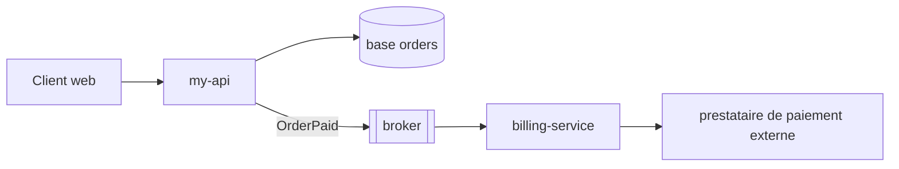

Les niveaux 1 et 2 suffisent dans la plupart des cas. Un schéma garde sa valeur s'il vit dans le repo, en texte (Mermaid, Structurizr), à côté du code.

:material-book-open-variant: Doc de référence : [Simon Brown, « The C4 model »](https://c4model.com/) (consultée en novembre 2026)
{ .doc-ref }

### arc42

<a class="pill pill-scope pill-scope-system" href="#carte-des-echelles">Échelle · Système</a> <span class="pill pill-status pill-status-ok" title="Toujours valable, vérifié en novembre 2026">Valable · 11/2026</span>

**<span class="term" data-term="arc42">arc42</span>** (Gernot Starke et Peter Hruschka, première version en 2005) est un plan de document d'architecture en douze sections : objectifs, contraintes, contexte, stratégie, vues, concepts transverses, décisions, exigences de qualité, risques, glossaire. On ne remplit que les sections utiles ; le plan sert surtout à ne rien oublier.

:material-book-open-variant: Doc de référence : [arc42, « Overview »](https://arc42.org/overview) (consultée en novembre 2026)
{ .doc-ref }

### ADR

<a class="pill pill-scope pill-scope-all" href="#carte-des-echelles">Toutes les échelles</a> <span class="pill pill-status pill-status-ok" title="Toujours valable, vérifié en novembre 2026">Valable · 11/2026</span>

Une décision structurante se consigne dans un **<span class="term" data-term="adr">ADR</span>**, une page par décision, dans le repo. Le format et un exemple sont dans [Livraison : concevoir avant de coder](livraison.md#concevoir-avant-de-coder).

:material-book-open-variant: Doc de référence : [Michael Nygard, « Documenting Architecture Decisions »](https://cognitect.com/blog/2011/11/15/documenting-architecture-decisions) (2011) ; [Architectural Decision Records, adr.github.io](https://adr.github.io/) (consultée en novembre 2026)
{ .doc-ref }

### Fitness functions

<a class="pill pill-scope pill-scope-code" href="#carte-des-echelles">Échelle · Code</a> <a class="pill pill-scope pill-scope-system" href="#carte-des-echelles">Échelle · Système</a> <span class="pill pill-status pill-status-ok" title="Toujours valable, vérifié en novembre 2026">Valable · 11/2026</span>

Une **<span class="term" data-term="fitness-function">fitness function</span>** (Neal Ford, Rebecca Parsons et Patrick Kua, « Building Evolutionary Architectures », 2017) est un contrôle automatique qui vérifie en continu qu'une décision d'architecture reste vraie : une règle de dépendance, un seuil de latence, une taille d'image. Sans elle, le code dérive du schéma en quelques mois.

Exemple en Python avec import-linter, fichier `.importlinter` vérifié à chaque pipeline :

```ini
# Exemple : orders ne peut pas importer billing.storage, vérifié en CI
[importlinter:contract:orders-isolation]
name = orders n'importe que l'API publique de billing
type = forbidden
source_modules = my_api.orders
forbidden_modules = my_api.billing.storage
```

:material-book-open-variant: Doc de référence : [Thoughtworks Technology Radar, « Architectural fitness function »](https://www.thoughtworks.com/radar/techniques/architectural-fitness-function) (consultée en novembre 2026)
{ .doc-ref }

| Je veux... | J'utilise... |
|---|---|
| expliquer le système à un nouveau venu ou au métier, sans entrer dans le code | C4 niveaux 1 et 2 |
| écrire un document d'architecture complet sans partir d'une page blanche | plan arc42, sections utiles seulement |
| que l'équipe sache encore dans un an pourquoi elle a choisi une option plutôt qu'une autre | ADR dans le repo |
| que le code ne contredise pas l'architecture en douce, comme `orders` qui importe les détails internes de `billing` | fitness functions dans la CI |

## Pièges à éviter

- **Découper trop tôt** : je pars en microservices dès le premier jour, avant de savoir où passent les frontières métier. Chaque erreur de découpage se paie en appels réseau, en contrats à versionner et en déploiements à coordonner. Je commence par un monolithe modulaire et je découpe quand une douleur mesurée l'exige ([voir Quel style choisir](#quel-style-choisir)).
- **Le monolithe distribué** : je sépare les services mais je les laisse lire les mêmes tables. Un renommage de colonne casse trois services à la fois, et ils doivent tous être déployés ensemble. Chaque service garde ses données et les autres passent par son API ou ses événements ([voir Une base par service](#une-base-par-service)).
- **Le timeout par défaut** : je garde la valeur de la bibliothèque, souvent infinie ou de plusieurs minutes. Une dépendance lente bloque mes threads et la lenteur se propage à tout ce qui m'appelle. Je fixe un timeout d'après la latence mesurée, un peu au-dessus du p99 de la dépendance ([voir Timeout](#timeout)).
- **Réessayer partout et tout de suite** : chaque niveau d'une chaîne de trois services réessaie trois fois, sans attendre. Une seule requête en produit 27 sur le dernier service, qui s'effondre. Je réessaie à un seul niveau, avec backoff exponentiel, gigue et un budget de retry ([voir Budget de retry](#budget-de-retry)).
- **Réessayer une opération non idempotente** : je rejoue un paiement après un timeout alors que la réponse s'est seulement perdue. Le client est débité deux fois. Je n'envoie de retry que sur une opération idempotente, avec une clé d'idempotence écrite dans la même transaction que le débit ([voir Idempotence](#idempotence)).
- **Croire qu'une compensation efface le passé** : je conçois une saga comme si l'annulation remettait tout à zéro. Le client voit le débit puis le remboursement sur son relevé, et le métier découvre cet état intermédiaire en production. Je fais valider par le métier chaque état intermédiaire visible ([voir Saga orchestrée ou chorégraphiée](#saga-orchestree-ou-choregraphiee)).
- **Dimensionner sur la moyenne** : je prévois mes serveurs d'après le QPS moyen de la journée. Le soir ou pendant les soldes, le pic dépasse la capacité et le service tombe au moment où il rapporte le plus. Je dimensionne sur le pic avec une marge, puis je vérifie par un test de charge ([voir QPS moyen et pic](#qps-moyen-et-pic)).
- **Oublier les points uniques de défaillance non techniques** : je double les serveurs mais une seule personne sait déployer, ou un certificat n'a pas de responsable. Le jour où elle est absente ou où le certificat expire, tout s'arrête. Je liste les SPOF, techniques et humains, au début de chaque revue de disponibilité ([voir Point unique de défaillance](#point-unique-de-defaillance)).

## Ce qu'on demande en entretien

Les questions typiques :

- « Monolithe ou microservices pour un nouveau produit ? », « Qu'est-ce qu'un monolithe distribué ? » Pour répondre : je pars du nombre d'équipes et de la stabilité des frontières métier ([Quel style choisir](#quel-style-choisir)).
- « Explique le théorème CAP », « Cohérence forte ou à terme pour un solde bancaire, et pour un compteur de likes ? » Pour répondre : je rappelle que le choix ne se pose que pendant une coupure réseau, puis je compare les deux cas ([CAP et PACELC](#cap-et-pacelc)), et [Le théorème CAP](textes-fondateurs.md#brewer-2000-puis-gilbert-et-lynch-2002-le-theoreme-cap).
- « Comment garder des données cohérentes entre deux services sans transaction distribuée ? », « Comment publier un événement sans le perdre si la base a écrit ? » Pour répondre : je décris une saga avec ses compensations, puis l'outbox ([Saga orchestrée ou chorégraphiée](#saga-orchestree-ou-choregraphiee), [Outbox](#outbox)).
- « Un service dont tu dépends devient lent, que fais-tu ? », « Comment éviter qu'un retry débite deux fois ? » Pour répondre : j'empile timeout, retry avec gigue, disjoncteur et idempotence ([Résilience](#resilience), [Idempotence](#idempotence)).
- « Comment abordes-tu un exercice de system design ? » Pour répondre : je clarifie d'abord les besoins et les ordres de grandeur, je propose le design le plus simple qui y répond, puis je cherche ses goulots d'étranglement et la façon dont il tombe en panne ([Estimer la capacité](#estimer-la-capacite), [Résilience](#resilience)).
- « Combien de serveurs pour un million d'utilisateurs actifs par jour ? » Pour répondre : je déroule le calcul de coin de table, du QPS moyen au pic puis à la loi de Little ([QPS moyen et pic](#qps-moyen-et-pic), [Loi de Little](#loi-de-little)).
- « Comment documentes-tu une décision d'architecture ? » Pour répondre : je montre un ADR et les vues C4 que je dessine ([ADR](#adr), [Modèle C4](#modele-c4)).

Ce qui fait une bonne réponse : elle nomme le compromis, ce que le choix apporte, ce qu'il coûte, et dans quelle situation je ferais l'inverse. Un style ou un motif présenté sans son coût sonne comme une réponse apprise.

## Quoi utiliser dans quelle situation

| Situation | J'utilise |
|---|---|
| je lance un nouveau produit avec une ou deux équipes, et je ne sais pas encore où couper | monolithe modulaire, frontières vérifiées en CI |
| plusieurs équipes se bloquent sur un même déploiement : une seule mise en production par semaine, et une équipe qui casse le build bloque les autres | découpage par contexte borné, puis services |
| mes services sont séparés, mais je dois toujours les déployer ensemble parce qu'ils partagent une base ou s'appellent en chaîne | revoir les frontières : c'est un monolithe distribué |
| un fait, comme une commande payée, doit prévenir d'autres services sans que l'émetteur les attende | événements, outbox, consommateurs idempotents |
| une action métier traverse plusieurs services, comme réserver le stock puis débiter le client | saga avec compensations validées par le métier |
| un service lent fait tomber, en cascade, tous ceux qui l'appellent | timeout, disjoncteur, cloison |
| pendant une panne, les nouvelles tentatives de tous les clients arrivent en même temps et aggravent la situation | backoff exponentiel avec gigue, budget de retry |
| le métier me fixe un objectif de disponibilité, comme 99,9 %, et je dois savoir s'il est tenable | calcul composé, suppression des SPOF, trois zones |
| le métier demande « combien de temps et de données peut-on perdre ? » | fixer RTO et RPO, puis choisir la stratégie de reprise |
| je dois estimer la charge avant de construire, pour savoir combien de serveurs et de connexions prévoir | calcul de coin de table, QPS de pic, loi de Little |
| je prends une décision dont personne ne se rappellera le pourquoi dans un an | ADR |
| le code s'éloigne peu à peu du schéma d'architecture, sans que personne le remarque | fitness functions |
| personne ne sait quels systèmes existent, qui les possède ni où sont les doublons | urbanisation : cartographie, carte des capacités, règles |
| mon métier a des règles riches, comme les remises, que chaque changement de base ou de prestataire met en danger | architecture hexagonale, règle de dépendance vérifiée en CI |
| plusieurs équipes se bloquent sur un même front : une seule mise en production commune, une file d'attente de merge requests | micro front-ends découpés par domaine, shell et contrat versionné |
| j'ai un seul front, fait par une ou deux équipes qui se parlent tous les jours | front modulaire dans un monorepo, pas de micro front-ends |
| mes écrans ne se ressemblent pas d'une application à l'autre : trois styles de messages d'erreur, plusieurs gris | design system, design tokens, Storybook |
| mes pages publiques, comme les fiches produit, doivent être trouvées par les moteurs de recherche et s'afficher vite | SSG ou ISR, SSR si le contenu est personnalisé |
| je fais un outil interne, utilisé seulement après connexion, que les moteurs de recherche n'ont pas à voir | CSR (SPA) |
| mon build front est trop lent, comme un serveur de développement qui met plus de 30 secondes à démarrer | mesurer, puis Vite (nouveau projet) ou Rspack (gros projet Webpack) |

## Sources

- Len Bass, Paul Clements et Rick Kazman, « Software Architecture in Practice », 4e édition (2021)
- Eric Evans, « Domain-Driven Design » (2003)
- [Melvin Conway, « How Do Committees Invent? » (1968)](https://www.melconway.com/Home/Committees_Paper.html)
- Matthew Skelton et Manuel Pais, « Team Topologies » (2019)
- [James Lewis et Martin Fowler, « Microservices » (2014)](https://martinfowler.com/articles/microservices.html)
- [Martin Fowler, « MonolithFirst » (2015)](https://martinfowler.com/bliki/MonolithFirst.html)
- [Alistair Cockburn, « Hexagonal Architecture » (2005)](https://alistair.cockburn.us/hexagonal-architecture/)
- [Robert C. Martin, « The Clean Architecture » (2012)](https://blog.cleancoder.com/uncle-bob/2012/08/13/the-clean-architecture.html)
- Alberto Brandolini, « Introducing EventStorming » (Leanpub, publié par parties depuis 2015 environ, à vérifier)
- [Seth Gilbert et Nancy Lynch, « Brewer's Conjecture and the Feasibility of Consistent, Available, Partition-Tolerant Web Services » (2002)](https://dl.acm.org/doi/10.1145/564585.564601)
- [Daniel Abadi, « Consistency Tradeoffs in Modern Distributed Database System Design », IEEE Computer (2012)](https://www.cs.umd.edu/~abadi/papers/abadi-pacelc.pdf)
- [Diego Ongaro et John Ousterhout, « In Search of an Understandable Consensus Algorithm » (2014)](https://raft.github.io/raft.pdf)
- [Leslie Lamport, « Time, Clocks, and the Ordering of Events in a Distributed System » (1978)](https://lamport.azurewebsites.net/pubs/time-clocks.pdf)
- Hector Garcia-Molina et Kenneth Salem, « Sagas », ACM SIGMOD (1987)
- [Martin Fowler, « Event Sourcing » (2005)](https://martinfowler.com/eaaDev/EventSourcing.html)
- [Martin Fowler, « CQRS » (2011)](https://martinfowler.com/bliki/CQRS.html)
- Martin Kleppmann, « Designing Data-Intensive Applications » (2017)
- Michael Nygard, « Release It! », 2e édition (2018)
- [Marc Brooker, « Exponential Backoff And Jitter », AWS Architecture Blog (2015)](https://aws.amazon.com/blogs/architecture/exponential-backoff-and-jitter/)
- [Betsy Beyer et al., « Site Reliability Engineering », Google (2016)](https://sre.google/sre-book/table-of-contents/)
- [AWS, « Disaster Recovery of Workloads on AWS » (2021)](https://docs.aws.amazon.com/whitepapers/latest/disaster-recovery-workloads-on-aws/disaster-recovery-workloads-on-aws.html)
- [AWS, « Reducing the Scope of Impact with Cell-Based Architecture » (2023, à vérifier)](https://docs.aws.amazon.com/wellarchitected/latest/reducing-scope-of-impact-with-cell-based-architecture/reducing-scope-of-impact-with-cell-based-architecture.html)
- John D. C. Little, « A Proof for the Queuing Formula: L = λW », Operations Research (1961)
- [Simon Brown, The C4 model (date de publication non indiquée)](https://c4model.com/)
- [arc42, modèle de documentation d'architecture (première version en 2005)](https://arc42.org/)
- Neal Ford, Rebecca Parsons et Patrick Kua, « Building Evolutionary Architectures » (2017)
- Jacques Sassoon, « Urbanisation des systèmes d'information », Hermès (1998, à vérifier)
- Christophe Longépé, « Le projet d'urbanisation du SI », Dunod (première édition en 2001, à vérifier)
- [The Open Group, TOGAF Standard, 10e édition (2022)](https://www.opengroup.org/togaf)
- John Zachman, « A Framework for Information Systems Architecture », IBM Systems Journal (1987)
- [The Open Group, ArchiMate 3.2 (2022, à vérifier)](https://www.opengroup.org/archimate-forum/archimate-overview)
- [Jeffrey Palermo, « The Onion Architecture » (2008)](https://jeffreypalermo.com/2008/07/the-onion-architecture-part-1/)
- [import-linter, documentation (date de publication non indiquée)](https://import-linter.readthedocs.io/)
- [Cam Jackson, « Micro Frontends », martinfowler.com (juin 2019)](https://martinfowler.com/articles/micro-frontends.html)
- [Thoughtworks Technology Radar, « Micro frontends » (novembre 2016, à vérifier)](https://www.thoughtworks.com/radar/techniques/micro-frontends)
- Michael Geers, « Micro Frontends in Action », Manning (2020)
- Luca Mezzalira, « Building Micro-Frontends », O'Reilly (première édition en 2021, à vérifier)
- [webpack, « Module Federation » (date de publication non indiquée)](https://webpack.js.org/concepts/module-federation/)
- [Module Federation, documentation (date de publication non indiquée)](https://module-federation.io/)
- [single-spa, documentation (date de publication non indiquée)](https://single-spa.js.org/)
- [W3C, « ESI Language Specification 1.0 » (2001)](https://www.w3.org/TR/esi-lang/)
- [MDN, « Web Components » (date de publication non indiquée)](https://developer.mozilla.org/fr/docs/Web/API/Web_components)
- [Brad Frost, « Atomic Design » (2016)](https://atomicdesign.bradfrost.com/)
- [Component Driven, site de référence (date de publication non indiquée)](https://www.componentdriven.org/)
- [Storybook, « Component Story Format » (date de publication non indiquée)](https://storybook.js.org/docs/api/csf)
- [Jason Miller et Addy Osmani, « Rendering on the Web », web.dev (2019)](https://web.dev/articles/rendering-on-the-web)
- [Next.js, « Incremental Static Regeneration » (date de publication non indiquée)](https://nextjs.org/docs/app/guides/incremental-static-regeneration)
- [web.dev, « Web Vitals » (date de publication non indiquée)](https://web.dev/articles/vitals)
- [webpack, documentation (date de publication non indiquée)](https://webpack.js.org/)
- [Vite, « Why Vite » (date de publication non indiquée)](https://vite.dev/guide/why)
- [Rspack, documentation (date de publication non indiquée)](https://rspack.rs/)
- [esbuild, documentation (date de publication non indiquée)](https://esbuild.github.io/)
