# Architecture et systèmes distribués

!!! warning "Avertissement"
    Ces notes sont des pense-bêtes personnels, pas une source de vérité. Elles reflètent ma compréhension et mes choix : leur contenu reste subjectif, malgré les citations et les références qu'il contient. Il peut être incomplet, simplifié, inexact ou dépassé. Vérifiez toujours dans la documentation officielle avant de l'appliquer. Ce contenu est fourni tel quel, sans aucune garantie : son utilisation se fait sous votre seule responsabilité.

!!! audience "Pour qui, pour quoi"
    - **Métiers** : développeur back-end ou front-end, tech lead, architecte de solution, SRE, QA qui teste des systèmes distribués.
    - **Usages** : je choisis entre un monolithe modulaire et des microservices pour un nouveau produit ; je comprends pourquoi une commande apparaît en double après une panne réseau ; je prépare un entretien de conception de système ; je relis un ADR et je vérifie qu'il dit ce qu'il sacrifie ; je dimensionne un service avant un pic de charge, comme les soldes.

!!! abstract "Les échelles"
    Les pastilles de couleur sous les titres disent à quelle échelle une notion s'applique :

    - <span class="pill pill-scope pill-scope-code">Code</span> les classes, fonctions et modules d'un programme ;
    - <span class="pill pill-scope pill-scope-app">Application</span> un service ou une application et son découpage interne ;
    - <span class="pill pill-scope pill-scope-system">Système</span> plusieurs services qui communiquent par le réseau ;
    - <span class="pill pill-scope pill-scope-infra">Infrastructure</span> les serveurs, le réseau, les zones et les clusters, physiques ou virtuels ;
    - <span class="pill pill-scope pill-scope-enterprise">Entreprise</span> le système d'information entier et son organisation.

    Détail et mots ambigus : [carte des échelles](#carte-des-echelles).

Cette page rassemble les notions de base pour concevoir un système qui tient la charge et les pannes : les grands styles d'architecture, la façon de découper, ce qui change quand le système tourne sur plusieurs machines, comment partager des données entre services, résister aux pannes, estimer la capacité, passer à l'échelle (<span class="term" data-term="scale-cube">scale cube</span>, cache), concevoir pour la livraison continue, moderniser un système existant, urbaniser un parc d'applications et documenter les choix. Le front-end (React, application web sur mobile, micro front-ends, design system, rendu, bundlers) a sa propre page : [Front-end et applications web](front-end.md). Les services `orders-service`, `billing-service`, `stock-service` et `my-api` sont fictifs, et tous les chiffres sont des exemples sauf mention contraire.

## Comment lire cette page

Le mot « architecture » mélange trois choses qu'on confond vite : l'architecture du **logiciel** (comment le code et les services sont découpés), celle des **données** (où vivent les données et comment leurs copies restent d'accord) et celle de l'**exécution** (machines, zones, capacité). Une quatrième, l'**organisation** (équipes, parc d'applications), pèse sur les trois. Et toutes les notions ne se lisent pas de la même façon : certaines sont des **choix** que mon équipe fait et écrit dans un [ADR](#adr), d'autres sont des **lois** que personne ne choisit, comme CAP ou la loi de Conway, mais qu'il faut connaître pour ne pas décider à côté.

Sous chaque titre, en plus des pastilles d'échelle, deux pastilles le disent :

- <span class="pill pill-nature pill-nature-decide">À décider</span> un choix que l'équipe ou les architectes doivent faire, en écrivant ce qu'il sacrifie ;
- <span class="pill pill-nature pill-nature-know">À connaître</span> un phénomène qui s'impose à moi : je ne le choisis pas, je conçois en en tenant compte ;
- <span class="pill pill-topic pill-topic-data">Données</span> la notion parle des données (copies, cohérence, transactions, sauvegardes), pas du découpage du code.

| Section | De quoi elle parle | Ce que j'en fais | Qui décide, en général |
|---|---|---|---|
| [Styles d'architecture](#styles-darchitecture) | logiciel | je choisis un style pour mon système | l'équipe, avec un architecte si plusieurs équipes sont touchées |
| [Découper le système](#decouper-le-systeme) | logiciel, organisation | je trace des frontières ; la loi de Conway est à connaître | l'équipe et les experts métier |
| [Systèmes distribués](#systemes-distribues) | données, réseau | surtout à connaître : ce qui arrive dès qu'il y a un réseau ; seuls la cohérence voulue et l'idempotence sont des choix | personne pour les lois ; l'équipe pour la cohérence et l'idempotence |
| [Données entre services](#donnees-entre-services) | données | je choisis comment partager et garder cohérentes les données entre services | l'équipe propriétaire de chaque service |
| [Résilience](#resilience) | logiciel, réseau | je choisis et je règle des mécanismes dans le code de chaque appel | l'équipe qui écrit l'appel |
| [Haute disponibilité et reprise](#haute-disponibilite-et-reprise) | exécution, données | je fixe des objectifs (RTO, RPO) et je choisis une stratégie de reprise | l'équipe avec les SRE et le métier, qui dit combien coûte une heure de panne |
| [Estimer la capacité](#estimer-la-capacite) | exécution | à connaître : une méthode de calcul, pas un choix | personne, c'est du calcul |
| [Passer à l'échelle](#passer-a-lechelle) | exécution, données | je choisis comment multiplier le système et où garder des copies (cache) | l'équipe, avec le métier pour l'âge acceptable des données |
| [Front-end et applications web](front-end.md), sur sa propre page | logiciel | je choisis un framework, un découpage et une stratégie de rendu | l'équipe front, avec les autres équipes si le front est partagé |
| [Concevoir pour la livraison continue](#concevoir-pour-la-livraison-continue) | logiciel, données | je choisis une architecture qui permet de livrer souvent sans casse | l'équipe |
| [Moderniser un système existant](#moderniser-un-systeme-existant) | logiciel | je choisis entre réécrire et refondre, puis je remplace morceau par morceau | l'équipe, avec le métier qui finance et attend des évolutions pendant ce temps |
| [Urbaniser le système d'information](#urbaniser-le-systeme-dinformation) | organisation | une démarche d'entreprise : une équipe la connaît et la respecte, sans la porter seule | les architectes d'entreprise |
| [Documenter et gouverner](#documenter-et-gouverner) | tout | je documente mes choix et je les vérifie automatiquement | l'équipe ; les architectes pour le tech radar |
| [Mesurer le succès](#mesurer-le-succes) | tout | je vérifie qu'une solution marche : un indicateur (SLI), un objectif interne (SLO) et, s'il y a un client, une promesse contractuelle (SLA) | l'équipe avec le métier ; le SLA avec le commercial et le juridique |

!!! noob "As noob"
    Construire une maison, c'est décider du plan, de l'emplacement de la cuisine, du chauffage : ce sont des choix. Mais la gravité, le gel et la pente du terrain ne se choisissent pas : l'architecte les connaît pour que ses choix tiennent. Cette page mélange les deux, et les pastilles disent lequel est lequel. La phrase à retenir : **avant de débattre d'une notion, je vérifie si c'est un choix à faire ou une contrainte à respecter.**

## Vocabulaire

**Architecture** : l'ensemble des décisions structurantes d'un système, celles qui coûtent cher à changer plus tard : comment il est découpé, comment les morceaux se parlent, où vivent les données.

**<span class="term" data-term="quality-attribute">Attribut de qualité</span>** : une propriété mesurable du système autre que ce qu'il fait : performance, disponibilité, sécurité, coût, facilité à le faire évoluer. Ce sont eux, plus que les fonctionnalités, qui décident de l'architecture. On les écrit sous forme de scénario mesurable, en six parties (détail, arbre d'utilité et ATAM dans [Scénarios de qualité, arbre d'utilité et ATAM](#scenarios-de-qualite-arbre-dutilite-et-atam)) :

```
source         un pic de 2 000 clients simultanés (soldes)
stimulus       ils passent commande en même temps
environnement  fonctionnement normal, pic de charge
artefact       orders-service et sa base
réponse        orders-service accepte toutes les commandes
mesure         p99 sous 800 ms, 0 commande perdue
```

**<span class="term" data-term="software-component">Composant</span>** : un morceau du système qui a un rôle précis et une frontière claire : une API, une file de messages, une base, un module de code.

**<span class="term" data-term="coupling">Couplage</span>** : à quel point un composant dépend des détails d'un autre. Fort couplage : changer `billing-service` oblige à changer `orders-service` le même jour. **<span class="term" data-term="cohesion">Cohésion</span>** : à quel point ce qui est rangé ensemble sert le même but. On vise un couplage faible et une cohésion forte.

**<span class="term" data-term="distributed-system">Système distribué</span>** : un système dont les composants tournent sur plusieurs machines et se parlent par le réseau. Dès qu'il y a deux services et une base, on y est : chaque appel peut être lent, perdu ou dupliqué.

**<span class="term" data-term="broker">Broker</span>** (courtier de messages) : un serveur intermédiaire qui reçoit des messages d'un service et les garde jusqu'à ce que d'autres services viennent les lire. L'émetteur ne parle qu'au broker, jamais directement aux destinataires : il n'a pas besoin de savoir qui ils sont, ni s'ils sont en ligne à ce moment-là. Exemples : Apache Kafka, RabbitMQ, Google Pub/Sub, Amazon SQS. Deux formes : la **file** (chaque message est une tâche prise par un seul consommateur, puis supprimée) et le **sujet** ou topic (chaque message est un fait que tous les abonnés lisent, chacun à son rythme).

```
sans broker   orders-service --HTTP--> email-service      email en panne : l'appel échoue, la commande aussi
avec broker   orders-service --publie OrderPaid--> [broker] --> email-service lit quand il revient
              le message attend dans le broker pendant la panne, la commande réussit
```

!!! noob "As noob"
    Un broker, c'est une boîte aux lettres partagée. Je dépose ma lettre et je repars : je n'ai pas besoin que le destinataire soit chez lui, il la relèvera en rentrant. Si plusieurs personnes doivent lire la même nouvelle, c'est plutôt un panneau d'affichage : chacun vient lire quand il veut. Limite de l'image : un broker peut livrer la même lettre deux fois après une panne, donc le destinataire doit savoir reconnaître un doublon ([idempotence](#idempotence)). La phrase à retenir : **l'émetteur dépose et continue sa vie ; le broker garde le message jusqu'à ce que quelqu'un le traite.**

**<span class="term" data-term="trade-off">Compromis</span>** : en architecture, presque tout est un compromis. Gagner en disponibilité coûte de la cohérence ou de l'argent, gagner en autonomie des équipes coûte de la complexité d'exploitation. Une bonne décision dit ce qu'elle sacrifie.

**<span class="term" data-term="sli">SLI</span>** (service level indicator) : l'indicateur mesuré qui dit si le service va bien du point de vue de l'utilisateur. Exemple : la part des requêtes de `my-api` servies sans erreur en moins de 800 ms.

**<span class="term" data-term="slo">SLO</span>** (service level objective) : l'objectif interne que l'équipe se fixe sur un SLI, sur une fenêtre de temps. Exemple : 99,9 % de ces requêtes réussies sur 30 jours glissants.

**<span class="term" data-term="sla">SLA</span>** (service level agreement) : la promesse contractuelle faite à un client, avec une pénalité si elle n'est pas tenue, en général plus lâche que le SLO pour garder une marge. Exemple : 99,5 % par mois, sinon un avoir de 10 % sur la facture.

| Je veux... | Je regarde... |
|---|---|
| trancher entre deux options, comme une base unique ou une base par service, sans que la discussion tourne aux goûts de chacun | les attributs de qualité qu'il sert et ceux qu'il dégrade |
| savoir si deux composants sont trop liés, par exemple si chaque changement de `billing-service` oblige à toucher `orders-service` le même jour | combien de fois ils changent ensemble, combien d'appels ils échangent |
| comprendre pourquoi le système tombe souvent alors que chaque service, pris seul, marche bien | ce qui passe par le réseau, et ce qui arrive quand le réseau échoue |

## Carte des échelles

Le mot « architecture » désigne aussi bien l'organisation des classes d'un programme que celle des serveurs d'un datacenter. Une même notion n'a pas le même sens selon l'échelle : l'architecture hexagonale découpe du **code**, l'architecture cellulaire découpe de l'**infrastructure**. Chaque notion de ce site porte donc une ou plusieurs pastilles qui disent de quelle échelle elle parle.

### Les cinq échelles

| Échelle | De quoi on parle | Logique ou physique | Ce qu'on dessine | Exemple |
|---|---|---|---|---|
| <span class="pill pill-scope pill-scope-code">Échelle · Code</span> | classes, fonctions, modules d'un même programme | logique | diagramme de classes, arbre de modules | `PayOrder` ne connaît que l'interface `PaymentGateway` |
| <span class="pill pill-scope pill-scope-app">Échelle · Application</span> | un service ou une application et son découpage interne | logique | composants (C4 niveau 3) | `orders-service` : API, métier, accès aux données |
| <span class="pill pill-scope pill-scope-system">Échelle · Système</span> | plusieurs services qui communiquent | logique, avec le réseau entre eux | conteneurs (C4 niveau 2), flux | `orders-service` publie `OrderPaid`, `billing-service` le consomme |
| <span class="pill pill-scope pill-scope-infra">Échelle · Infrastructure</span> | serveurs, réseau, zones, clusters, matériel | physique ou virtuel | schéma de déploiement | 3 nœuds Kubernetes répartis sur 3 zones, une base principale et deux réplicas |
| <span class="pill pill-scope pill-scope-enterprise">Échelle · Entreprise</span> | le système d'information entier | logique, organisationnel | cartographie, carte des capacités | 80 applications rangées en zones et quartiers |

Une notion peut couvrir deux échelles : un **retry** s'écrit dans le code mais n'a de sens qu'entre deux services ; elle porte alors deux pastilles. <span class="pill pill-scope pill-scope-all">Toutes les échelles</span> marque les outils de documentation qui servent partout (ADR).

### Les notions de cette page

| Notion | Code | Application | Système | Infrastructure | Entreprise |
|---|---|---|---|---|---|
| monolithe, monolithe modulaire | x | x | | | |
| architecture hexagonale, clean architecture | x | x | | | |
| microservices, architecture orientée événements, broker | | | x | | |
| serverless | | x | | x | |
| DDD, contexte borné | | x | x | | |
| loi de Conway | | | x | | x |
| CAP, réplication, consensus | | | x | x | |
| saga, outbox, CQRS, event sourcing | | x | x | | |
| type de base, persistance polyglotte | | x | x | | |
| timeout, retry, disjoncteur | x | | x | | |
| cloison, délestage | | x | x | x | |
| limitation de débit | x | | x | | |
| zones et régions, RTO et RPO, reprise, architecture cellulaire | | | x | x | |
| estimation de capacité | | | x | x | |
| scale cube | | | x | x | |
| cache : couches, motifs de lecture et d'écriture, invalidation | x | x | x | x | |
| livraison continue : déploiement indépendant, expand and contract, feature flags | x | x | x | | |
| réécriture, figuier étrangleur, architecture sacrificielle | | x | x | | |
| urbanisation, TOGAF, Zachman | | | | | x |
| C4, arc42, fitness functions | x | x | x | | |
| scénarios de qualité, arbre d'utilité, ATAM | | x | x | | |
| tech radar d'entreprise | | | | | x |

Les notions du front-end (React, application web sur mobile et PWA, micro front-ends, design system, stratégies de rendu, bundlers) portent les mêmes pastilles sur leur propre page : [Front-end et applications web](front-end.md).

### Les mots qui changent de sens selon l'échelle

| Mot | À l'échelle du code ou de l'application | À l'échelle de l'infrastructure |
|---|---|---|
| couche (layer) | un groupe de modules : présentation, métier, accès aux données | un étage de machines (tier) : serveurs web, serveurs d'application, base |
| adaptateur | une classe qui branche le métier sur un outil (architecture hexagonale) | un équipement ou un service qui convertit un protocole |
| partition | un découpage des données (une partition Kafka, une table partitionnée) | une coupure réseau entre deux groupes de machines (le P de CAP) |
| cellule | rarement utilisé | une copie complète et isolée de la pile, qui sert une partie des clients |
| nœud | un élément d'un arbre ou d'un graphe | une machine d'un cluster |
| instance | un objet créé à partir d'une classe | une machine virtuelle ou une copie d'un service en cours d'exécution |
| service | une classe qui porte une règle métier (`PricingService`) | un programme déployé seul, avec son adresse réseau |
| cloison (bulkhead) | un pool de threads ou de connexions réservé à une dépendance | des clusters ou des comptes séparés pour isoler une panne |

**Quand s'en servir.** À chaque fois qu'une discussion d'architecture tourne en rond : demander « on parle de quelle échelle ? » règle la moitié des malentendus. Un architecte d'entreprise, un architecte de solution et un développeur qui disent « architecture en couches » ne parlent souvent pas de la même chose.

## Styles d'architecture

### Monolithe

<a class="pill pill-scope pill-scope-app" href="#carte-des-echelles">Échelle · Application</a> <span class="pill pill-status pill-status-ok" title="Toujours valable, vérifié en novembre 2026">Valable · 11/2026</span> <a class="pill pill-nature pill-nature-decide" href="../architecture/#comment-lire-cette-page" title="Un choix que l'équipe ou les architectes doivent faire, puis écrire dans un ADR">À décider</a>

Un **<span class="term" data-term="monolith">monolithe</span>** est une seule application, un seul déploiement, souvent une seule base. Au début, c'est le plus simple : je développe, teste et déploie un seul programme. Ça devient pénible quand des dizaines de personnes modifient le même code : la moindre correction attend que tout le reste soit prêt, puis tout redéploie ensemble.

**Risques.** Sans frontières internes, le code devient une « grosse boule de boue » où tout dépend de tout : la facturation et le panier lisent la même classe `Order`, donc un champ ajouté pour l'une casse l'affichage de l'autre, et chaque changement oblige à retester toute l'application. Un seul déploiement veut aussi dire qu'une fuite mémoire dans un coin fait tomber tout le service. Je limite les deux en passant au monolithe modulaire dès que plusieurs personnes travaillent dessus.

:material-book-open-variant: Doc de référence : [Martin Fowler, « MonolithFirst »](https://martinfowler.com/bliki/MonolithFirst.html) (2015)
{ .doc-ref }

### Monolithe modulaire

<a class="pill pill-scope pill-scope-code" href="#carte-des-echelles">Échelle · Code</a> <a class="pill pill-scope pill-scope-app" href="#carte-des-echelles">Échelle · Application</a> <span class="pill pill-status pill-status-ok" title="Toujours valable, vérifié en novembre 2026">Valable · 11/2026</span> <a class="pill pill-nature pill-nature-decide" href="../architecture/#comment-lire-cette-page" title="Un choix que l'équipe ou les architectes doivent faire, puis écrire dans un ADR">À décider</a>

Un **<span class="term" data-term="modular-monolith">monolithe modulaire</span>** se déploie d'un bloc, mais son code est découpé en modules aux frontières strictes : chaque module expose une interface publique, et les autres n'ont pas le droit d'importer ses détails internes.

```
my-api/
├── orders/      api.py (public), domain/, storage/ (privé)
├── billing/     api.py (public), domain/, storage/ (privé)
└── stock/       api.py (public), domain/, storage/ (privé)
règle vérifiée en CI : orders n'importe que billing.api, jamais billing.storage
```

C'est souvent le meilleur point de départ : si un module doit un jour devenir un service, sa frontière existe déjà.

**Risques.** Une frontière qu'aucun outil ne vérifie s'érode en quelques semaines : un import « juste pour cette fois » de `billing.storage` depuis `orders`, et le découpage n'existe plus que sur le schéma. Les modules partagent aussi le même processus et souvent la même base : un module qui sature les connexions ralentit tous les autres. Je fais vérifier les imports en CI et je donne à chaque module ses propres tables.

### Microservices

<a class="pill pill-scope pill-scope-system" href="#carte-des-echelles">Échelle · Système</a> <span class="pill pill-status pill-status-ok" title="Toujours valable, vérifié en novembre 2026">Valable · 11/2026</span> <a class="pill pill-nature pill-nature-decide" href="../architecture/#comment-lire-cette-page" title="Un choix que l'équipe ou les architectes doivent faire, puis écrire dans un ADR">À décider</a>

Des **<span class="term" data-term="microservice">microservices</span>** : plusieurs petits services, chacun déployé seul, propriétaire de ses données, maintenu par une équipe. Ils apportent l'autonomie (chaque équipe livre à son rythme) et un passage à l'échelle par service, au prix d'un système distribué : réseau, cohérence des données, observabilité, versions de contrats. Le piège classique est le **<span class="term" data-term="distributed-monolith">monolithe distribué</span>** : des services séparés mais qui doivent tous être déployés ensemble parce qu'ils partagent une base ou s'appellent en chaîne. Référence : James Lewis et Martin Fowler, « Microservices » (2014).

:material-book-open-variant: Doc de référence : [James Lewis et Martin Fowler, « Microservices »](https://martinfowler.com/articles/microservices.html) (2014) ; [Chris Richardson, microservices.io, « Microservice Architecture »](https://microservices.io/patterns/microservices.html) (consultée en novembre 2026)
{ .doc-ref }

### Serverless

<a class="pill pill-scope pill-scope-app" href="#carte-des-echelles">Échelle · Application</a> <a class="pill pill-scope pill-scope-infra" href="#carte-des-echelles">Échelle · Infrastructure</a> <span class="pill pill-status pill-status-ok" title="Toujours valable, vérifié en novembre 2026">Valable · 11/2026</span> <a class="pill pill-nature pill-nature-decide" href="../architecture/#comment-lire-cette-page" title="Un choix que l'équipe ou les architectes doivent faire, puis écrire dans un ADR">À décider</a>

J'ai des traitements qui n'arrivent que de temps en temps, comme une miniature à créer quand quelqu'un dépose une photo. En **<span class="term" data-term="serverless">serverless</span>**, le fournisseur cloud lance mon code seulement quand il y a du travail (une requête, un message, un fichier déposé) et me facture à l'usage. Je n'ai pas de serveur à gérer, et la nuit, sans trafic, il ne tourne rien. En échange : démarrage à froid, durée d'exécution limitée, dépendance au fournisseur. Bien adapté aux traitements par événements et au trafic irrégulier.

Le **<span class="term" data-term="cold-start">démarrage à froid</span>** (cold start) est le temps que met le fournisseur à créer une instance quand aucune n'est prête : télécharger le code, lancer le runtime, exécuter l'initialisation. Il ne frappe que la première requête après une période sans trafic. Exemple pour une fonction qui crée une miniature (chiffres d'exemple, ils varient selon le langage, la taille du paquet et le fournisseur) :

```
10:00:00.000  photo.jpg déposée dans le bucket, l'événement déclenche la fonction
10:00:00.000  aucune instance prête : démarrage à froid (1,5 s)
10:00:01.500  la fonction s'exécute : 20 ms de travail, miniature écrite
10:00:01.520  l'instance reste au chaud ; un 2e fichier à 10:00:30 démarre sans attente
10:15:00      aucun appel depuis ~15 min : le fournisseur supprime l'instance
facture       2 invocations et leur durée, rien pour les 15 min d'attente
```

:material-book-open-variant: Doc de référence : [Mike Roberts, « Serverless Architectures », martinfowler.com](https://martinfowler.com/articles/serverless.html) (2018)
{ .doc-ref }

### Architecture orientée événements

<a class="pill pill-scope pill-scope-system" href="#carte-des-echelles">Échelle · Système</a> <span class="pill pill-status pill-status-ok" title="Toujours valable, vérifié en novembre 2026">Valable · 11/2026</span> <a class="pill pill-nature pill-nature-decide" href="../architecture/#comment-lire-cette-page" title="Un choix que l'équipe ou les architectes doivent faire, puis écrire dans un ADR">À décider</a>

Dans une **<span class="term" data-term="event-driven-architecture">architecture orientée événements</span>**, un service annonce un fait (« commande payée ») sur un [broker](#vocabulaire), et les services intéressés réagissent, sans que l'émetteur les connaisse.

```
appel direct      orders-service appelle billing, stock, email : si email tombe, la commande échoue
événements        orders-service publie OrderPaid ; billing, stock, email consomment à leur rythme
```

Gain : découplage dans le temps (le consommateur peut être en panne) et ajout de consommateurs sans toucher l'émetteur. Coût : cohérence à terme, flux plus difficile à suivre, messages en double. Les mécanismes (file, sujet, garanties de livraison, DLQ) sont dans [API : REST et asynchrone](api-rest-async.md#asynchrone-messages-et-evenements).

:material-book-open-variant: Doc de référence : [Martin Fowler, « What do you mean by Event-Driven? »](https://martinfowler.com/articles/201701-event-driven.html) (2017)
{ .doc-ref }

### Architecture hexagonale et clean architecture

<a class="pill pill-scope pill-scope-code" href="#carte-des-echelles">Échelle · Code</a> <a class="pill pill-scope pill-scope-app" href="#carte-des-echelles">Échelle · Application</a> <span class="pill pill-status pill-status-ok" title="Toujours valable, vérifié en novembre 2026">Valable · 11/2026</span> <a class="pill pill-nature pill-nature-decide" href="../architecture/#comment-lire-cette-page" title="Un choix que l'équipe ou les architectes doivent faire, puis écrire dans un ADR">À décider</a>

L'**<span class="term" data-term="hexagonal-architecture">architecture hexagonale</span>** (Alistair Cockburn, 2005, aussi appelée « <span class="term" data-term="port-adapter">ports et adaptateurs</span> ») met le code métier au centre. Il ne connaît que des interfaces (les ports) ; la base, l'API HTTP et le broker sont des adaptateurs branchés sur ces ports. La **<span class="term" data-term="clean-architecture">clean architecture</span>** (Robert C. Martin, article de 2012, livre en 2017) pousse la même idée en cercles : les dépendances pointent toujours vers le métier.

!!! noob "As noob"
    Imaginons une lampe et à une prise murale : la lampe (le code métier) ne sait pas si le courant vient d'une centrale ou d'un groupe électrogène, elle connaît seulement la forme de la prise (le port). En production on la branche sur le vrai réseau, en test sur une pile, sans jamais toucher à la lampe. La phrase à retenir : **le métier dessine ses prises, le reste du monde vient s'y brancher.**

**À quelle échelle.** Ces deux modèles organisent le **code d'un service** : un port est une interface, un adaptateur est une classe. Ils ne disent rien du nombre de serveurs, du réseau ou des zones ; un même service hexagonal tourne aussi bien sur une seule machine que sur cent pods. Pour l'échelle des machines, voir [Haute disponibilité et reprise](#haute-disponibilite-et-reprise) et l'[architecture cellulaire](#architecture-cellulaire).

Ce que l'architecture hexagonale évite : un cas d'usage qui appelle lui-même le prestataire et la base. Le jour où l'entreprise change de prestataire de paiement, il faut réécrire la règle métier, et chaque test du paiement a besoin du réseau et d'une vraie base.

```python
# À éviter : la règle métier connaît l'URL du prestataire et le SQL
class PayOrder:
    def run(self, order_id: str, amount_cents: int) -> bool:
        response = requests.post(
            "https://api.acme-pay.example/v1/charges",
            json={"order": order_id, "amount": amount_cents},
            timeout=2,
        )
        db.execute("UPDATE orders SET status = 'paid' WHERE id = %s", (order_id,))
        return response.status_code == 201
```

La même chose avec un port :

```python
# Exemple : le port, l'interface dont le métier a besoin
class PaymentGateway(Protocol):
    def charge(self, order_id: str, amount_cents: int) -> bool: ...


# Exemple : le cas d'usage, qui ne connaît que le port
class PayOrder:
    def __init__(self, gateway: PaymentGateway) -> None:
        self.gateway = gateway

    def run(self, order_id: str, amount_cents: int) -> bool:
        return self.gateway.charge(order_id, amount_cents)
```

En test, on branche un faux `PaymentGateway` ; en production, l'adaptateur du prestataire de paiement. Le détail des principes (<span class="term" data-term="dependency-inversion">inversion de dépendance</span>, SOLID) est dans [Principes de conception](principes-conception.md).

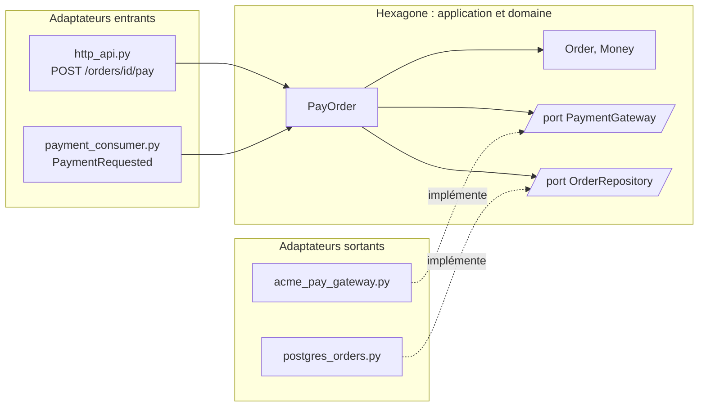

**Pourquoi.** Le métier change lentement, la technique change vite : on change de base, de prestataire de paiement, on ajoute une file de messages. Sans frontière, une règle métier finit écrite dans un contrôleur HTTP ou dans une requête SQL, et chaque changement technique la met en danger. Avec des ports :

- le métier se teste sans base ni réseau, en millisecondes ;
- changer d'adaptateur (passer d'un prestataire à un autre) ne touche pas une ligne du métier ;
- un même cas d'usage se déclenche par plusieurs entrées : route HTTP, message reçu, commande en ligne.

**Quand l'appliquer.** Les signaux qui justifient le coût :

| Signal | Exemple |
|---|---|
| mon métier a des règles riches, qui vont vivre des années | calcul de remises, cycle de vie d'une commande avec ses états et ses interdits |
| je sais qu'un outil technique sous mon code va probablement changer | migration de prestataire de paiement prévue, deux bases pour le même rôle |
| le même cas d'usage doit pouvoir se déclencher par plusieurs portes d'entrée | « payer une commande » par l'API et par un message `PaymentRequested` |
| mes tests sont lents ou fragiles parce que chacun passe par la base | 12 minutes de tests pour vérifier des règles de calcul |

Quand ne pas l'appliquer : un CRUD sans règle, un script, un prototype jetable, un service qui ne fait que transformer et transmettre des données. Là, des couches simples (route, service, accès aux données) suffisent ; des ports et des adaptateurs n'y ajouteraient que des fichiers.

**Comment.** Une arborescence type :

```
orders_service/
├─ domain/                    règles pures, aucun import technique
│  └─ order.py                Order, Money, transitions d'état
├─ application/               cas d'usage et ports
│  ├─ ports.py                PaymentGateway, OrderRepository
│  └─ pay_order.py            PayOrder
├─ adapters/
│  ├─ inbound/                ce qui appelle le métier
│  │  ├─ http_api.py          POST /orders/{id}/pay
│  │  └─ payment_consumer.py  message PaymentRequested
│  └─ outbound/               ce que le métier appelle
│     ├─ acme_pay_gateway.py  prestataire de paiement (fictif)
│     └─ postgres_orders.py   OrderRepository sur Postgres
└─ main.py                    assemble : choisit les adaptateurs à brancher
```

Les étapes :

1. partir d'un cas d'usage (« payer une commande »), pas des couches techniques ;
2. écrire le métier sans aucun import de framework, de base ou de client HTTP ;
3. définir chaque port du point de vue du métier : `charge(order_id, amount_cents)`, pas `post_json(url, body)` ;
4. écrire l'adaptateur et le tester à part contre le vrai voisin ([Testcontainers](qualite.md#tests-dintegration-avec-testcontainers), test de contrat) ;
5. tout assembler en un seul endroit (`main.py`), le seul fichier qui connaît à la fois le métier et les adaptateurs ;
6. faire vérifier la règle de dépendance par la CI, sinon elle s'érode en quelques semaines.

*Testcontainers : complémentaire de pytest*
{ .tool-rel }


Le test du cas d'usage, avec un faux branché sur le port (ce n'est pas un mock à travers une frontière réseau : la frontière, c'est le port, et l'adaptateur réel a ses propres tests d'intégration) :

```python
# Bien : un faux branché sur le port, pas un mock à travers le réseau
class FakeGateway:
    def __init__(self, accept: bool) -> None:
        self.accept = accept
        self.calls: list[tuple[str, int]] = []

    def charge(self, order_id: str, amount_cents: int) -> bool:
        self.calls.append((order_id, amount_cents))
        return self.accept


# Exemple : le test vérifie le résultat et le montant débité
def test_pay_order_charges_the_full_amount() -> None:
    gateway = FakeGateway(accept=True)
    assert PayOrder(gateway).run("o-42", 12_000) is True
    assert gateway.calls == [("o-42", 12_000)]
```

La règle de dépendance vérifiée à chaque pipeline (import-linter, contrat `layers` : une couche du haut peut importer celles du bas, jamais l'inverse) :

```ini
# Exemple : contrat layers, le haut importe le bas, jamais l'inverse
[importlinter:contract:hexagon]
name = le métier ne dépend d'aucun adaptateur
type = layers
layers =
    orders_service.adapters
    orders_service.application
    orders_service.domain
```

Pièges fréquents :

- un port qui recopie l'outil (`execute_sql`, `get_bucket`) au lieu d'exprimer un besoin métier : le métier dépend encore de la technique ;
- des types techniques qui fuient dans le métier (objet ORM, réponse HTTP, exception du client) ;
- appliquer le modèle à tout le système d'un coup : on le réserve aux modules dont le métier le justifie, les autres restent en couches simples.

| Variante | Image | Ce qu'elle ajoute |
|---|---|---|
| hexagonale (Cockburn, 2005) | un hexagone, entrées d'un côté, sorties de l'autre | ports et adaptateurs, symétrie entrée et sortie |
| onion (Jeffrey Palermo, 2008) | des anneaux concentriques | le modèle du domaine au cœur, les services autour |
| clean architecture (Robert C. Martin, 2012) | des cercles | cas d'usage explicites, règle de dépendance vers l'intérieur |

Les trois disent la même chose : les dépendances pointent vers le métier. Le choix du nom compte moins que la règle vérifiée en CI.

<figure class="diagram"><svg viewBox="0 0 220 210" role="img" aria-label="Cercles de la clean architecture"><circle class="layer layer-1" cx="110" cy="105" r="95"/><circle class="layer layer-1" cx="110" cy="105" r="70"/><circle class="layer layer-2" cx="110" cy="105" r="45"/><circle class="layer layer-3" cx="110" cy="105" r="20"/><text x="110" y="26" text-anchor="middle">frameworks, base, HTTP</text><text x="110" y="51" text-anchor="middle">adaptateurs</text><text x="110" y="76" text-anchor="middle">cas d'usage</text><text x="110" y="108" text-anchor="middle">entités</text></svg><figcaption>Clean architecture (Robert C. Martin, 2012) : les dépendances pointent vers le centre</figcaption></figure>

:material-book-open-variant: Doc de référence : [Alistair Cockburn, « Hexagonal Architecture »](https://alistair.cockburn.us/hexagonal-architecture/) (2005) ; [Robert C. Martin, « The Clean Architecture »](https://blog.cleancoder.com/uncle-bob/2012/08/13/the-clean-architecture.html) (2012)
{ .doc-ref }

### Quel style choisir

| Je veux... | J'utilise... |
|---|---|
| lancer un nouveau produit avec une ou deux équipes, sans savoir encore où passeront les frontières | monolithe modulaire |
| que plusieurs équipes livrent chacune à son rythme : l'équipe paiement sort une correction le matin sans attendre que l'équipe catalogue ait fini | microservices, découpés par domaine métier |
| traiter des tâches qui arrivent par à-coups, comme une miniature à créer quand quelqu'un dépose une photo, sans payer un serveur qui attend le reste du temps | serverless |
| que la facturation, le stock et l'envoi d'e-mails apprennent qu'une commande est payée, sans que la commande attende leur réponse | événements sur un broker |
| garder intactes des règles métier complexes (remises, états d'une commande) quand on change de base ou de prestataire de paiement | architecture hexagonale |
| une API qui lit et écrit des fiches sans règle particulière, comme un carnet d'adresses, et qui bougera peu | un monolithe en couches, sans cérémonie |

La règle de prudence : commencer simple, découper quand une douleur mesurée l'exige (Martin Fowler, « MonolithFirst », 2015).

Le même choix sous forme d'arbre ; serverless et événements se combinent avec n'importe quelle branche :

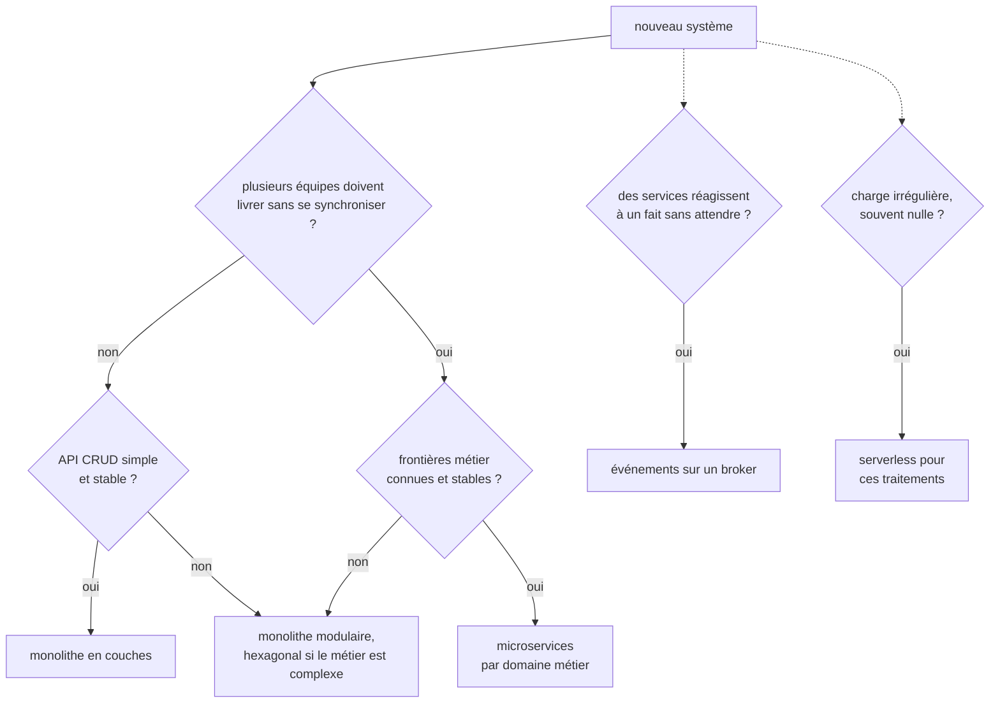

:material-book-open-variant: Doc de référence : [Martin Fowler, « Microservice Premium »](https://martinfowler.com/bliki/MicroservicePremium.html) (2015)
{ .doc-ref }

!!! maturity "Mesurer la maturité"
    | Niveau | Ce que j'observe dans l'équipe |
    |---|---|
    | N1 | le style du système a été choisi, mais à l'oral : personne ne sait dire pourquoi un monolithe modulaire plutôt que des microservices |
    | N2 | le choix de style est écrit dans un ADR avec ce qu'il sacrifie, et les frontières entre modules ou services sont vérifiées en CI (import-linter, règle de dépendance hexagonale) |
    | N3 | une merge request qui franchit une frontière interdite ou ajoute une base partagée entre deux services est bloquée par le pipeline, sans attendre une revue humaine |
    | N4 | l'équipe revoit son style à partir de chiffres suivis : services à déployer ensemble, temps d'attente entre équipes, part des changements qui touchent plusieurs modules |

    **Je mesure** : la part des mises en production qui exigent de déployer plus d'un service ou module ensemble, lue dans l'historique des déploiements ; le nombre de violations de frontières bloquées par mois, lu dans les rapports de CI.

## Découper le système

<a class="pill pill-practice" href="../livraison/#concevoir-avant-de-coder">Pratique · Conception technique</a>
<a class="pill pill-dora" href="https://dora.dev/capabilities/loosely-coupled-teams/">DORA · Loosely coupled teams</a>

### Domain-Driven Design

<a class="pill pill-scope pill-scope-app" href="#carte-des-echelles">Échelle · Application</a> <a class="pill pill-scope pill-scope-system" href="#carte-des-echelles">Échelle · Système</a> <span class="pill pill-status pill-status-ok" title="Toujours valable, vérifié en novembre 2026">Valable · 11/2026</span> <a class="pill pill-nature pill-nature-decide" href="../architecture/#comment-lire-cette-page" title="Un choix que l'équipe ou les architectes doivent faire, puis écrire dans un ADR">À décider</a>

Le **Domain-Driven Design** (DDD, Eric Evans, 2003) part d'une idée : le découpage du logiciel doit suivre le découpage du métier, pas celui des tables ou des couches techniques. Il donne des outils pour trouver ces frontières.

**Risques.** Appliquer tout l'outillage (agrégats, entités, objets valeur) à des modules sans règle métier alourdit le code sans rien apporter, et passer des mois à modéliser avant de livrer fige des frontières jamais confrontées à la réalité. Je réserve le DDD aux domaines complexes et je valide chaque frontière par une première livraison.

:material-book-open-variant: Doc de référence : [Eric Evans, « Domain-Driven Design Reference »](https://www.domainlanguage.com/ddd/reference/) (2015) ; [Martin Fowler, « DomainDrivenDesign »](https://martinfowler.com/bliki/DomainDrivenDesign.html) (2020)
{ .doc-ref }

### Contexte borné et langage omniprésent

<a class="pill pill-scope pill-scope-app" href="#carte-des-echelles">Échelle · Application</a> <a class="pill pill-scope pill-scope-system" href="#carte-des-echelles">Échelle · Système</a> <span class="pill pill-status pill-status-ok" title="Toujours valable, vérifié en novembre 2026">Valable · 11/2026</span> <a class="pill pill-nature pill-nature-decide" href="../architecture/#comment-lire-cette-page" title="Un choix que l'équipe ou les architectes doivent faire, puis écrire dans un ADR">À décider</a>

Un **<span class="term" data-term="bounded-context">contexte borné</span>** est un périmètre où un mot a un sens unique. Dans un même magasin en ligne, « commande » ne veut pas dire la même chose partout :

| Contexte | « Commande », c'est... |
|---|---|
| Vente | un panier validé, avec des prix et des remises |
| Facturation | un montant dû, une TVA, un moyen de paiement |
| Logistique | des colis, une adresse, un transporteur |

Chaque contexte a son propre modèle et son **<span class="term" data-term="ubiquitous-language">langage omniprésent</span>** : les mots des experts métier sont ceux du code (`Shipment`, pas `OrderData2`). Un contexte borné est un bon candidat pour un module ou un service.

!!! noob "As noob"
    Dans une entreprise, le mot « client » ne veut pas dire la même chose pour le commercial, le comptable et le livreur, et chacun a raison chez lui. Plutôt que d'imposer une définition unique qui ne convient à personne, on trace des frontières : chaque équipe garde son sens du mot, et on traduit quand une information passe d'un côté à l'autre. La phrase à retenir : **un mot, un seul sens, à l'intérieur d'une frontière.**

**Risques.** Des contextes trop petits multiplient les traductions et les appels entre services pour la moindre fonctionnalité. À l'inverse, un modèle `Customer` unique partagé par la vente, la facturation et la logistique finit avec quarante champs dont chacun n'utilise que dix, et un changement pour l'un casse les autres. Je découpe là où le vocabulaire change vraiment, pas entité par entité.

:material-book-open-variant: Doc de référence : [Martin Fowler, « BoundedContext »](https://martinfowler.com/bliki/BoundedContext.html) (2014) ; [Martin Fowler, « UbiquitousLanguage »](https://martinfowler.com/bliki/UbiquitousLanguage.html) (2006)
{ .doc-ref }

### Carte de contextes

<a class="pill pill-scope pill-scope-system" href="#carte-des-echelles">Échelle · Système</a> <span class="pill pill-status pill-status-ok" title="Toujours valable, vérifié en novembre 2026">Valable · 11/2026</span> <a class="pill pill-nature pill-nature-decide" href="../architecture/#comment-lire-cette-page" title="Un choix que l'équipe ou les architectes doivent faire, puis écrire dans un ADR">À décider</a>

La **<span class="term" data-term="context-map">carte de contextes</span>** dessine les relations entre contextes : qui fournit, qui consomme, qui s'adapte. Quand on consomme un système dont le modèle ne nous convient pas (un vieux logiciel, un prestataire), on place une **<span class="term" data-term="anti-corruption-layer">couche anticorruption</span>** : du code qui traduit son modèle dans le nôtre, pour que ses mots ne se répandent pas.

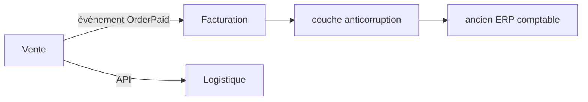

**Risques.** Une couche anticorruption est du code de plus, avec sa latence et ses bugs de traduction : si personne ne la maintient, elle laisse passer les champs de l'ancien système tels quels et ne protège plus rien. Sans elle, les noms de l'ERP (`CUST_ID_02`, `FLG_X`) se répandent dans mon code. Je lui donne un propriétaire et des tests de contrat contre le système externe.

:material-book-open-variant: Doc de référence : [Microsoft, « Anti-corruption Layer pattern »](https://learn.microsoft.com/en-us/azure/architecture/patterns/anti-corruption-layer) (consultée en novembre 2026)
{ .doc-ref }

### Event storming

<a class="pill pill-scope pill-scope-system" href="#carte-des-echelles">Échelle · Système</a> <span class="pill pill-status pill-status-ok" title="Toujours valable, vérifié en novembre 2026">Valable · 11/2026</span> <a class="pill pill-nature pill-nature-decide" href="../architecture/#comment-lire-cette-page" title="Un choix que l'équipe ou les architectes doivent faire, puis écrire dans un ADR">À décider</a>

L'**<span class="term" data-term="event-storming">event storming</span>** (Alberto Brandolini, présenté vers 2013) est un atelier : experts métier et développeurs collent sur un mur, dans l'ordre du temps, tous les événements métier au passé (« commande passée », « paiement accepté », « colis expédié »). Les zones où le vocabulaire change et où les acteurs changent dessinent les contextes bornés.

```
temps ─────────────────────────────────────────────────────────────────>
[client]       panier créé, article ajouté, commande passée
[client]       paiement accepté
               ───── pivot : on ne parle plus de « panier » mais de « facture » ─────
[comptable]    facture émise, TVA calculée, facture envoyée
               ───── pivot : on parle de « colis » et de « transporteur » ─────
[entrepôt]     colis préparé, colis remis au transporteur, colis livré

contextes trouvés : Vente | Facturation | Logistique
```

**Risques.** Un atelier sans vrais experts métier dessine les frontières telles que les développeurs les imaginent, et ces erreurs finissent gravées dans des services. Le mur de post-its photographié puis oublié ne sert qu'une fois. Je fais venir les personnes qui font le travail au quotidien et je refais un atelier court quand le métier change.

:material-book-open-variant: Doc de référence : [Alberto Brandolini, EventStorming](https://www.eventstorming.com/) (consultée en novembre 2026)
{ .doc-ref }

### Loi de Conway

<a class="pill pill-scope pill-scope-system" href="#carte-des-echelles">Échelle · Système</a> <a class="pill pill-scope pill-scope-enterprise" href="#carte-des-echelles">Échelle · Entreprise</a> <a class="pill pill-nature pill-nature-know" href="../architecture/#comment-lire-cette-page" title="Une loi ou un phénomène qu'on ne choisit pas : le connaître évite de mauvaises décisions">À connaître</a>

Mon entreprise a une équipe front, une équipe back et une équipe base de données. Chaque nouvelle fonctionnalité, comme « afficher la date de livraison dans le panier », demande un ticket à chacune des trois, trois priorités à aligner et trois mises en production synchronisées. Ce n'est pas un hasard d'organisation : c'est ce que décrit la **<span class="term" data-term="conway-law">loi de Conway</span>** (Melvin Conway, « How Do Committees Invent? », 1968) : un système finit par reproduire la façon dont communiquent les équipes qui le construisent. Là où deux équipes doivent se parler pour avancer, il apparaît une frontière technique (une API, un contrat, une file) ; là où une équipe travaille seule, le code reste d'un seul tenant.

Le mécanisme est simple : pour que deux morceaux de code s'intègrent finement, leurs auteurs doivent se parler souvent. Une équipe ne peut pas modifier tous les jours un code qui appartient à une autre, donc elle passe par une interface, et l'architecture se cale sur les frontières entre équipes. Ce n'est pas une règle à appliquer : c'est une observation, qui se vérifie que je la connaisse ou non.

```
organisation                       architecture qui en sort
équipe front                       une appli front
équipe back                        une API générique, sans métier précis
équipe base de données             un schéma partagé que tout le monde lit
une fonctionnalité = 3 équipes     une fonctionnalité = 3 changements coordonnés, livrés ensemble
```

!!! noob "As noob"
    Si on demande à quatre personnes qui ne se parlent pas d'écrire un roman, on obtient quatre chapitres qui se tiennent chacun, mais des raccords maladroits entre eux. Si deux d'entre elles partagent un bureau, leurs deux chapitres se fondront bien plus. Le logiciel fait pareil : il se recolle là où les gens se parlent, il se découpe là où ils ne se parlent pas. La phrase à retenir : **l'architecture suit l'organigramme, que je le veuille ou non ; autant choisir l'organigramme qui donne l'architecture voulue.**

**Pourquoi c'est utile.** Si je dessine une architecture en microservices par domaine (panier, paiement, livraison) mais que je garde des équipes par couche technique (front, back, base), la loi de Conway gagne : chaque fonctionnalité traverse toutes les équipes, et les services finissent couplés comme les équipes. Le dessin ne survit pas à l'organigramme.

**Comment s'en servir : la <span class="term" data-term="inverse-conway-maneuver">manœuvre de Conway inverse</span>.** Plutôt que de subir la loi, je l'utilise : j'organise d'abord les équipes selon l'architecture voulue, et le code suit (expression apparue vers 2010 chez Thoughtworks, sous la plume de Jonny LeRoy et Matt Simons, à vérifier ; développée par Matthew Skelton et Manuel Pais dans « Team Topologies », 2019). Les étapes :

1. je dessine les frontières visées, par exemple avec un [event storming](#event-storming) : Vente, Facturation, Logistique ;
2. je crée une <span class="term" data-term="stream-aligned-team">équipe alignée sur un flux</span> par frontière, qui possède le front, le back et les données de son domaine ;
3. je donne à chaque équipe ses propres dépôts, son pipeline et sa base, pour qu'elle livre sans attendre les autres ;
4. je définis les échanges entre équipes comme des contrats publiés (API, événements), et je limite les réunions obligatoires entre elles.

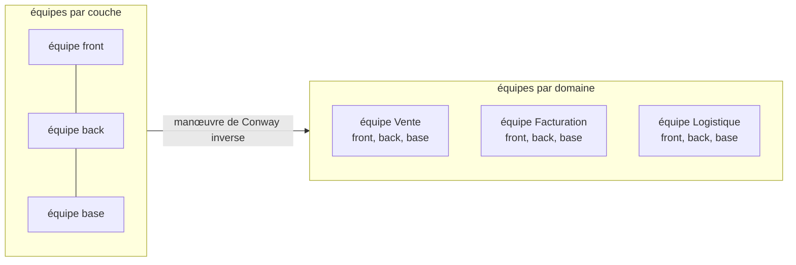

**Quand y penser.** Quand chaque fonctionnalité demande trois équipes, quand un découpage en services ne tient pas parce que les équipes ne correspondent pas aux services, ou avant de lancer une réorganisation. Quand ne pas forcer : une petite entreprise où tout le monde se parle tous les jours, ou un système dont les frontières métier ne sont pas encore connues (réorganiser trop tôt fige de mauvaises frontières). Limite : la loi décrit une tendance forte, pas une fatalité mathématique ; une très bonne communication entre équipes peut l'atténuer.

:material-book-open-variant: Doc de référence : [Melvin Conway, « How Do Committees Invent? »](https://www.melconway.com/Home/Committees_Paper.html) (1968) ; [Martin Fowler, « Conway's Law »](https://martinfowler.com/bliki/ConwaysLaw.html) (2022)
{ .doc-ref }

| Je veux... | J'utilise... |
|---|---|
| trouver où couper le logiciel quand j'arrive sur un métier que je ne connais pas, comme la logistique | event storming avec les experts métier |
| que « commande » ne veuille pas dire un panier dans un module, une facture dans un autre et un colis dans un troisième, au risque que chacun casse ce que l'autre attend | contextes bornés, langage omniprésent |
| me brancher sur un système externe dont le modèle ne colle pas au mien, comme un ancien ERP comptable, sans que ses mots envahissent mon code | couche anticorruption |
| que les frontières dessinées aujourd'hui tiennent encore quand le code et les équipes auront grandi | aligner les équipes sur les contextes (Conway) |

!!! maturity "Mesurer la maturité"
    | Niveau | Ce que j'observe dans l'équipe |
    |---|---|
    | N1 | une personne a dessiné les contextes une fois, souvent après un event storming, mais le code ne les reflète qu'en partie |
    | N2 | chaque contexte borné a son module ou son service, son glossaire et une équipe propriétaire ; les échanges avec un système externe passent par une couche anticorruption |
    | N3 | un nouveau besoin passe d'office par la carte de contextes dans le rituel de conception, et la CI refuse qu'un contexte importe le modèle interne d'un autre |
    | N4 | l'équipe redécoupe à partir de chiffres : part des fonctionnalités qui exigent plusieurs équipes, part des changements qui touchent plusieurs contextes à la fois |

    **Je mesure** : le nombre moyen d'équipes impliquées par fonctionnalité livrée, lu dans les tickets liés ; la part des merge requests qui modifient plus d'un contexte, lue dans l'historique Git par dossier.

## Systèmes distribués

Cette section parle surtout de **données** et de **réseau** : ce qui arrive aux données dès qu'elles sont copiées sur plusieurs machines. La plupart des notions sont <span class="pill pill-nature pill-nature-know">À connaître</span> : je ne choisis pas que le réseau coupe, je choisis seulement comment mon système se comporte quand il coupe.

### Les huit illusions

<a class="pill pill-scope pill-scope-system" href="#carte-des-echelles">Échelle · Système</a> <a class="pill pill-scope pill-scope-infra" href="#carte-des-echelles">Échelle · Infrastructure</a> <a class="pill pill-nature pill-nature-know" href="../architecture/#comment-lire-cette-page" title="Une loi ou un phénomène qu'on ne choisit pas : le connaître évite de mauvaises décisions">À connaître</a>

Les **<span class="term" data-term="distributed-computing-fallacies">illusions de l'informatique distribuée</span>** sont huit hypothèses fausses que l'on fait spontanément en écrivant un appel réseau (L. Peter Deutsch et ses collègues de Sun, 1994, la huitième ajoutée par James Gosling vers 1997, dates à vérifier) :

| Illusion | Ce qui arrive vraiment |
|---|---|
| le réseau est fiable | des paquets se perdent, des connexions coupent |
| la latence est nulle | un appel entre régions coûte des dizaines de millisecondes |
| la bande passante est infinie | un export de 2 Go sature le lien |
| le réseau est sûr | il faut chiffrer et authentifier chaque échange |
| la topologie ne change pas | les pods changent d'adresse à chaque déploiement |
| il y a un seul administrateur | plusieurs équipes, plusieurs fournisseurs |
| le transport ne coûte rien | sérialisation, CPU, frais de sortie du cloud |
| le réseau est homogène | versions, protocoles et matériels différents |

Chaque section qui suit est une réponse à l'une de ces illusions.

**Risques.** Les ignorer, c'est écrire un appel réseau comme un appel de fonction : sans timeout, sans retry, sans chiffrement, en supposant une adresse fixe. La première coupure transforme alors un incident réseau de quelques secondes en panne de tout le service. Je relis la liste à chaque revue de conception d'un appel entre services.

:material-book-open-variant: Doc de référence : [Wikipedia, « Fallacies of distributed computing »](https://en.wikipedia.org/wiki/Fallacies_of_distributed_computing) (consultée en novembre 2026)
{ .doc-ref }

### CAP et PACELC

<a class="pill pill-scope pill-scope-system" href="#carte-des-echelles">Échelle · Système</a> <a class="pill pill-scope pill-scope-infra" href="#carte-des-echelles">Échelle · Infrastructure</a> <a class="pill pill-nature pill-nature-know" href="../architecture/#comment-lire-cette-page" title="Une loi ou un phénomène qu'on ne choisit pas : le connaître évite de mauvaises décisions">À connaître</a> <a class="pill pill-topic pill-topic-data" href="../architecture/#comment-lire-cette-page" title="Parle de l'endroit où vivent les données et de la façon dont leurs copies restent d'accord">Données</a>

Le **<span class="term" data-term="cap-theorem">théorème CAP</span>** (conjecture d'Eric Brewer en 2000, démontrée par Seth Gilbert et Nancy Lynch en 2002) : quand une **<span class="term" data-term="network-partition">partition réseau</span>** coupe le système en deux, il faut choisir entre **cohérence** (refuser de répondre plutôt que répondre faux) et **disponibilité** (répondre avec une donnée peut-être ancienne). Les partitions ne se choisissent pas : le vrai choix est C ou A pendant la coupure.

Les trois lettres ont un sens précis dans la démonstration de 2002, plus strict que leur sens courant, et c'est ce que vérifie une question d'entretien d'architecture :

| Lettre | Sens formel | Ce que ça exclut |
|---|---|---|
| C | **linéarisabilité** : tout se passe comme s'il n'y avait qu'une seule copie ; dès qu'une écriture est confirmée, toute lecture, sur n'importe quel nœud, voit cette valeur ou une plus récente | la cohérence à terme, ou « lire ses propres écritures » seulement |
| A | **chaque requête reçue par un nœud qui n'est pas en panne obtient une réponse**, autre qu'une erreur, sans limite de temps imposée | un système qui répond seulement sur la partie majoritaire du cluster |
| P | le système continue de fonctionner quand des messages entre nœuds sont perdus, en nombre quelconque | rien : sur un vrai réseau, les coupures arrivent |

Conséquence : beaucoup de bases ne sont ni « CP » ni « AP » au sens strict. Une base avec un leader et des réplicas lus en asynchrone n'est pas linéarisable (donc pas C), et refuse les écritures du côté coupé du leader (donc pas A). Martin Kleppmann propose pour ça, dans « Please stop calling databases CP or AP » (2015), de décrire plutôt le niveau de cohérence offert et le comportement pendant une coupure.

**<span class="term" data-term="pacelc">PACELC</span>** (Daniel Abadi, 2012) complète : s'il y a **P**artition, choisir **A** ou **C** ; **E**lse (sinon, en temps normal), choisir entre **L**atence et **C**ohérence. C'est le cas le plus fréquent : attendre la confirmation de tous les réplicas rend chaque écriture plus lente.

!!! noob "As noob"
    Deux agences d'une banque tiennent le même registre et se le synchronisent par téléphone. Si la ligne coupe, chaque agence choisit : refuser les opérations jusqu'au retour de la ligne (cohérence), ou continuer avec ce qu'elle sait, au risque d'un solde pas à jour (disponibilité). Et même quand la ligne marche, appeler l'autre agence avant chaque opération prend du temps : c'est le choix latence ou cohérence de PACELC. La phrase à retenir : **la coupure, je la subis ; ce que je choisis, c'est comment me comporter pendant.**

```
coupure entre deux centres, un client veut lire son solde
choix C   « service momentanément indisponible »   (une banque)
choix A   affiche le solde d'il y a 3 secondes       (un compteur de likes)
```

<figure class="diagram"><svg viewBox="0 0 260 190" role="img" aria-label="Triangle CAP"><polygon class="set" points="130,25 30,160 230,160"/><circle class="hit" cx="130" cy="25" r="5"/><circle class="hit" cx="30" cy="160" r="5"/><circle class="hit" cx="230" cy="160" r="5"/><text x="130" y="14" text-anchor="middle" class="label-strong">C : cohérence</text><text x="10" y="178" text-anchor="start" class="label-strong">A : disponibilité</text><text x="250" y="178" text-anchor="end" class="label-strong">P : tolérance aux partitions</text><text x="98" y="95" text-anchor="middle">CA</text><text x="162" y="95" text-anchor="middle">CP</text><text x="130" y="152" text-anchor="middle">AP</text></svg><figcaption>Pendant une partition, il ne reste que CP ou AP : CA suppose un réseau qui ne coupe jamais</figcaption></figure>

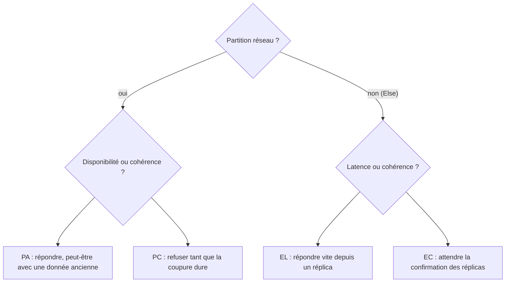

**Risques.** L'ignorer, c'est promettre au métier un système « toujours disponible et toujours juste », puis découvrir pendant la première coupure qu'il répond faux ou plus du tout, sans que personne ait choisi lequel. Je fais choisir à l'avance, donnée par donnée, entre refuser et répondre avec une valeur peut-être ancienne, et j'écris ce choix dans un ADR.

:material-book-open-variant: Doc de référence : [Seth Gilbert et Nancy Lynch, « Brewer's Conjecture and the Feasibility of Consistent, Available, Partition-Tolerant Web Services »](https://dl.acm.org/doi/10.1145/564585.564601) (2002) ; [Martin Kleppmann, « Please stop calling databases CP or AP »](https://martin.kleppmann.com/2015/05/11/please-stop-calling-databases-cp-or-ap.html) (mai 2015) ; [Daniel Abadi, « Consistency Tradeoffs in Modern Distributed Database System Design »](https://www.cs.umd.edu/~abadi/papers/abadi-pacelc.pdf) (2012)
{ .doc-ref }

### Cohérence forte ou à terme

<a class="pill pill-scope pill-scope-system" href="#carte-des-echelles">Échelle · Système</a> <span class="pill pill-status pill-status-ok" title="Toujours valable, vérifié en novembre 2026">Valable · 11/2026</span> <a class="pill pill-nature pill-nature-decide" href="../architecture/#comment-lire-cette-page" title="Un choix que l'équipe ou les architectes doivent faire, puis écrire dans un ADR">À décider</a> <a class="pill pill-topic pill-topic-data" href="../architecture/#comment-lire-cette-page" title="Parle de l'endroit où vivent les données et de la façon dont leurs copies restent d'accord">Données</a>

**<span class="term" data-term="strong-consistency">Cohérence forte</span>** : après une écriture confirmée, toute lecture voit la nouvelle valeur. **<span class="term" data-term="eventual-consistency">Cohérence à terme</span>** : les copies finiront par être identiques, mais une lecture juste après l'écriture peut voir l'ancienne valeur.

!!! noob "As noob"
    C'est une chaîne de magasins qui change un prix : le siège envoie la nouvelle étiquette, et chaque magasin la colle quelques minutes plus tard. Pendant ce court moment, deux magasins affichent deux prix différents, mais tous finissent par afficher le même. La phrase à retenir : **à terme veut dire « bientôt pareil partout », pas « tout de suite ».**

```
10:00:00.000  ada change son adresse (écrite sur la base principale)
10:00:00.050  ada recharge la page, lue sur un réplica en retard : ancienne adresse
10:00:00.300  le réplica a rattrapé : nouvelle adresse
```

Parade courante pour ce cas : lire ses propres écritures sur la base principale pendant quelques secondes (« read your writes »).

**Risques.** Exiger la cohérence forte partout rend chaque écriture plus lente et le service indisponible dès qu'un réplica manque. Choisir la cohérence à terme sans le dire au métier produit des bugs « impossibles » : un client modifie son adresse, recharge et voit l'ancienne, donc il la ressaisit ou appelle le support. Je choisis donnée par donnée, et j'ajoute « read your writes » là où l'utilisateur relit ce qu'il vient d'écrire.

:material-book-open-variant: Doc de référence : [Werner Vogels, « Eventually Consistent »](https://www.allthingsdistributed.com/2008/12/eventually_consistent.html) (2008)
{ .doc-ref }

### Réplication et quorum

<a class="pill pill-scope pill-scope-system" href="#carte-des-echelles">Échelle · Système</a> <a class="pill pill-scope pill-scope-infra" href="#carte-des-echelles">Échelle · Infrastructure</a> <span class="pill pill-status pill-status-ok" title="Toujours valable, vérifié en novembre 2026">Valable · 11/2026</span> <a class="pill pill-nature pill-nature-know" href="../architecture/#comment-lire-cette-page" title="Une loi ou un phénomène qu'on ne choisit pas : le connaître évite de mauvaises décisions">À connaître</a> <a class="pill pill-topic pill-topic-data" href="../architecture/#comment-lire-cette-page" title="Parle de l'endroit où vivent les données et de la façon dont leurs copies restent d'accord">Données</a>

La **<span class="term" data-term="replication">réplication</span>** garde plusieurs copies d'une donnée sur plusieurs machines. Avec N copies, une écriture attend W confirmations et une lecture interroge R copies. Si R + W > N, au moins une copie lue a forcément la dernière écriture : c'est le **<span class="term" data-term="quorum">quorum</span>**.

!!! noob "As noob"
    Imaginons trois carnets qui contiennent la même liste. Si j'écris toujours dans au moins deux carnets et que j'en relis toujours au moins deux, les deux groupes ont forcément un carnet en commun, qui contient la dernière écriture : il suffit de garder la version la plus récente parmi celles lues. La phrase à retenir : **si lecture et écriture se croisent toujours sur au moins une copie, la lecture voit la dernière écriture.**

| N | W | R | R + W > N ? | Effet |
|---|---|---|---|---|
| 3 | 2 | 2 | oui | lecture à jour, tolère une copie en panne |
| 3 | 1 | 1 | non | rapide, mais lecture parfois ancienne |
| 3 | 3 | 1 | oui | lecture rapide, mais une copie en panne bloque les écritures |

**Risques.** Ignorer le quorum, c'est régler W et R au hasard : avec W = 1 et R = 1 sur trois copies, une lecture peut rendre une valeur ancienne alors que l'équipe croit la base cohérente. Je vérifie R + W > N pour chaque donnée qui doit être à jour, et je mesure le retard des réplicas.

:material-book-open-variant: Doc de référence : [Giuseppe DeCandia et al., « Dynamo: Amazon's Highly Available Key-value Store »](https://www.allthingsdistributed.com/files/amazon-dynamo-sosp2007.pdf) (2007)
{ .doc-ref }

### Consensus et élection de leader

<a class="pill pill-scope pill-scope-infra" href="#carte-des-echelles">Échelle · Infrastructure</a> <span class="pill pill-status pill-status-ok" title="Toujours valable, vérifié en novembre 2026">Valable · 11/2026</span> <a class="pill pill-nature pill-nature-know" href="../architecture/#comment-lire-cette-page" title="Une loi ou un phénomène qu'on ne choisit pas : le connaître évite de mauvaises décisions">À connaître</a> <a class="pill pill-topic pill-topic-data" href="../architecture/#comment-lire-cette-page" title="Parle de l'endroit où vivent les données et de la façon dont leurs copies restent d'accord">Données</a>

Un **<span class="term" data-term="consensus-algorithm">algorithme de consensus</span>** permet à un groupe de machines de se mettre d'accord sur une valeur malgré des pannes. Le plus enseigné aujourd'hui est **Raft** (Diego Ongaro et John Ousterhout, 2014), conçu pour être plus compréhensible que Paxos (Leslie Lamport, publié en 1998). Il sert à l'**<span class="term" data-term="leader-election">élection de leader</span>** : une seule machine écrit, les autres suivent, et une nouvelle est élue si le leader tombe. Une décision exige la majorité :

| Nœuds | Majorité | Pannes tolérées |
|---|---|---|
| 3 | 2 | 1 |
| 5 | 3 | 2 |
| 4 | 3 | 1 (un 4e nœud n'apporte rien) |

D'où les nombres impairs. La majorité empêche le **<span class="term" data-term="split-brain">split-brain</span>** : deux moitiés coupées ne peuvent pas toutes deux élire un leader. On n'écrit presque jamais Raft soi-même : on s'appuie sur etcd, ZooKeeper, ou la base qui l'embarque.

!!! noob "As noob"
    C'est un conseil de cinq personnes qui doit désigner un président : il faut au moins trois voix. Si la salle est coupée en deux groupes, l'un de trois et l'autre de deux, seul le groupe de trois peut élire quelqu'un, donc il n'y a jamais deux présidents en même temps. La phrase à retenir : **exiger la majorité garantit qu'il n'y a qu'un seul chef à la fois.**

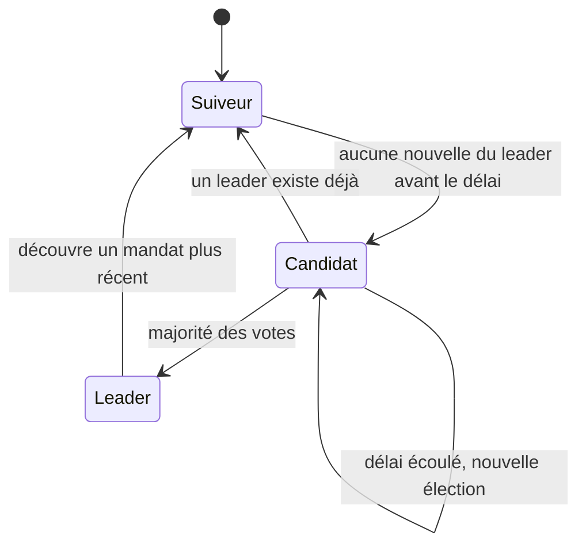

**Risques.** L'ignorer mène à écrire sa propre élection de leader avec un verrou et un délai : pendant une coupure réseau, deux machines se croient leader et écrivent chacune de leur côté (split-brain), donc les données divergent. Je m'appuie sur etcd, ZooKeeper ou la base, avec un nombre impair de nœuds.

:material-book-open-variant: Doc de référence : [Le site de Raft](https://raft.github.io/) (consultée en novembre 2026) ; [Diego Ongaro et John Ousterhout, « In Search of an Understandable Consensus Algorithm »](https://raft.github.io/raft.pdf) (2014)
{ .doc-ref }

### Horloges et ordre des événements

<a class="pill pill-scope pill-scope-system" href="#carte-des-echelles">Échelle · Système</a> <span class="pill pill-status pill-status-ok" title="Toujours valable, vérifié en novembre 2026">Valable · 11/2026</span> <a class="pill pill-nature pill-nature-know" href="../architecture/#comment-lire-cette-page" title="Une loi ou un phénomène qu'on ne choisit pas : le connaître évite de mauvaises décisions">À connaître</a> <a class="pill pill-topic pill-topic-data" href="../architecture/#comment-lire-cette-page" title="Parle de l'endroit où vivent les données et de la façon dont leurs copies restent d'accord">Données</a>

Les horloges de deux machines ne sont jamais parfaitement synchronisées : trier des événements de machines différentes par leur heure peut donner un ordre faux. Leslie Lamport (« Time, Clocks, and the Ordering of Events in a Distributed System », 1978) propose une **<span class="term" data-term="lamport-clock">horloge logique</span>** : un compteur qui respecte la causalité (si A a causé B, A a un numéro plus petit).

!!! noob "As noob"
    Deux personnes notent l'heure sur leur propre montre, et l'une avance de deux minutes : trier leurs notes par heure peut placer une réponse avant sa question. L'horloge logique remplace l'heure par un numéro : quand je reçois un message, je prends un numéro plus grand que le sien, donc une réponse vient toujours après sa question. Limite : pour deux événements sans lien entre eux, les numéros ne disent rien de l'ordre réel. La phrase à retenir : **pour ordonner ce qui s'enchaîne, je compte les échanges au lieu de lire l'heure.**

```python
# Exemple : horloge de Lamport, un compteur à la place de l'heure
class LamportClock:
    def __init__(self) -> None:
        self.time = 0

    # Exemple : un événement local avance le compteur de 1
    def tick(self) -> int:
        self.time += 1
        return self.time

    # Exemple : à la réception, je prends un numéro plus grand que celui reçu
    def receive(self, remote_time: int) -> int:
        self.time = max(self.time, remote_time) + 1
        return self.time
```

En pratique : un numéro de version par objet (on ignore une mise à jour plus ancienne que celle déjà appliquée) ou une clé de partition qui garde l'ordre par commande. Voir [ordre des messages](api-rest-async.md#ordre-des-messages).

**Risques.** Trier par l'heure des machines, c'est accepter qu'une mise à jour plus ancienne écrase une plus récente dès qu'une horloge avance de quelques millisecondes : le client voit revenir son ancienne adresse. Je compare des numéros de version, pas des heures, dès qu'il faut décider quelle écriture gagne.

:material-book-open-variant: Doc de référence : [Leslie Lamport, « Time, Clocks, and the Ordering of Events in a Distributed System »](https://lamport.azurewebsites.net/pubs/time-clocks.pdf) (1978)
{ .doc-ref }

### Idempotence

<a class="pill pill-scope pill-scope-code" href="#carte-des-echelles">Échelle · Code</a> <a class="pill pill-scope pill-scope-system" href="#carte-des-echelles">Échelle · Système</a> <span class="pill pill-status pill-status-ok" title="Toujours valable, vérifié en novembre 2026">Valable · 11/2026</span> <a class="pill pill-nature pill-nature-decide" href="../architecture/#comment-lire-cette-page" title="Un choix que l'équipe ou les architectes doivent faire, puis écrire dans un ADR">À décider</a>

Sur un réseau, on ne sait pas toujours si une requête a abouti : la réponse peut s'être perdue. Donc on réessaie, donc le serveur reçoit des doublons. L'**<span class="term" data-term="idempotency">idempotence</span>** (faire deux fois la même opération a le même effet qu'une fois) est la condition de tout retry sûr. Les mécanismes (`Idempotency-Key`, consommateur idempotent) sont dans [API : REST et asynchrone](api-rest-async.md#garanties-de-livraison).

!!! noob "As noob"
    Appuyer deux fois sur le bouton d'appel d'un ascenseur ne fait pas venir deux ascenseurs : c'est idempotent. Payer deux fois en caisse parce que le ticket n'est pas sorti, en revanche, me coûte deux fois. La phrase à retenir : **une opération idempotente se rejoue sans crainte, c'est ce qui rend le retry sûr.**

Exemple : `POST` n'est pas idempotent par nature (voir [méthodes HTTP](api-rest-async.md#les-methodes-http)), le client le rend sûr avec une **<span class="term" data-term="idempotency-key">clé d'idempotence</span>** qu'il génère une fois par paiement.

```
1. client   POST /charges  Idempotency-Key: 7f3a...  {"order": "A42", "amount": 4990}
2. serveur  débite la carte, stocke (7f3a..., hash du corps, réponse 201, created_at) dans idempotency_keys
3. client   la réponse se perd : timeout au bout de 2 s
4. client   retry : même requête, même clé 7f3a...
5. serveur  clé trouvée, même hash : renvoie la réponse 201 stockée, sans débiter une 2e fois
6. client   même clé mais corps différent ("amount": 9990) : 422, la clé est déjà liée à une autre requête
```

La table `idempotency_keys(key, request_hash, response, created_at)` est purgée après un délai (24 h par exemple). Piège : écrire la clé et faire le débit dans la même transaction, sinon deux retries simultanés passent tous les deux.

```python
# À éviter : vérifier puis écrire en deux temps, deux retries simultanés passent tous les deux
def charge(key: str, order: str, amount: int) -> Response:
    if db.find_key(key) is None:
        response = payment.debit(order, amount)
        db.save_key(key, response)
        return response
    return db.find_key(key).response


# Bien : la clé est réservée par une contrainte d'unicité avant de débiter
def charge(key: str, order: str, amount: int) -> Response:
    with db.transaction():
        inserted = db.insert_key_if_absent(key, status="in_progress")
        if not inserted:
            return db.find_key(key).response
        response = payment.debit(order, amount)
        db.store_response(key, response)
    return response
```

:material-book-open-variant: Doc de référence : [IETF, « The Idempotency-Key HTTP Header Field »](https://datatracker.ietf.org/doc/draft-ietf-httpapi-idempotency-key-header/) (brouillon, consultée en novembre 2026) ; [Stripe, « Idempotent requests »](https://docs.stripe.com/api/idempotent_requests) (consultée en novembre 2026)
{ .doc-ref }

| Je veux... | J'utilise... |
|---|---|
| ne jamais afficher une donnée fausse, comme un solde bancaire, quitte à répondre « indisponible » | cohérence forte, quorum majoritaire |
| toujours répondre, même avec une donnée vieille de quelques secondes, comme un compteur de likes | cohérence à terme, réplicas |
| qu'une seule machine à la fois ait le droit d'écrire, sinon deux machines prennent des décisions contradictoires en même temps | élection de leader via un outil de consensus existant |
| remettre dans l'ordre des événements venus de plusieurs machines dont les horloges ne sont pas d'accord, sans qu'une réponse passe avant sa question | numéro de version ou horloge logique, pas l'heure |
| réessayer après un timeout sans risquer de faire l'action deux fois, comme débiter deux fois un paiement dont la réponse s'est perdue | opérations idempotentes |

!!! maturity "Mesurer la maturité"
    | Niveau | Ce que j'observe dans l'équipe |
    |---|---|
    | N1 | l'équipe connaît CAP et les illusions, mais chaque appel réseau est écrit comme un appel local ; une clé d'idempotence est ajoutée quand un doublon a déjà fait mal |
    | N2 | chaque opération qui écrit a une clé d'idempotence, le niveau de cohérence voulu est écrit pour chaque donnée (forte pour le solde, à terme pour le compteur), et le consensus vient d'un outil éprouvé |
    | N3 | les doublons sont rejetés par une contrainte d'unicité en base, et un test de panne réseau (coupure, latence injectée) tourne en préproduction sans intervention |
    | N4 | l'équipe suit le taux de doublons absorbés, le retard des réplicas et les lectures périmées, et ajuste quorum ou routage des lectures à partir de ces chiffres |

    **Je mesure** : le nombre de requêtes rejouées absorbées par la clé d'idempotence, lu dans le journal applicatif ; le retard de réplication au p99, lu dans les métriques de la base.

## Données entre services

Cette section parle d'**architecture des données**, pas de découpage du code : où vit chaque donnée, qui a le droit de l'écrire, et comment deux services restent d'accord sans partager une base. Ici, tout est <span class="pill pill-nature pill-nature-decide">À décider</span> par l'équipe propriétaire de chaque service.

### Une base par service

<a class="pill pill-scope pill-scope-system" href="#carte-des-echelles">Échelle · Système</a> <span class="pill pill-status pill-status-ok" title="Toujours valable, vérifié en novembre 2026">Valable · 11/2026</span> <a class="pill pill-nature pill-nature-decide" href="../architecture/#comment-lire-cette-page" title="Un choix que l'équipe ou les architectes doivent faire, puis écrire dans un ADR">À décider</a> <a class="pill pill-topic pill-topic-data" href="../architecture/#comment-lire-cette-page" title="Parle de l'endroit où vivent les données et de la façon dont leurs copies restent d'accord">Données</a>

Chaque service est seul propriétaire de ses données : les autres passent par son API ou ses événements, jamais par ses tables. Si trois services lisent la même **<span class="term" data-term="shared-database">base partagée</span>**, un simple renommage de colonne les casse tous les trois, donc plus personne n'ose y toucher. Conséquence : une opération métier qui touche plusieurs services ne peut plus tenir dans une seule transaction de base. Le **<span class="term" data-term="two-phase-commit">commit à deux phases</span>** (2PC) existe, mais bloque tout le monde si le coordinateur tombe :

```
phase 1  coordinateur -> stock, billing : "prêts à valider ?" (prepare)
         stock : oui (verrouille 1 article) ; billing : oui (verrouille le montant)
phase 2  coordinateur -> stock, billing : "validez" (commit) ; chacun applique et libère ses verrous
panne    le coordinateur tombe entre les deux phases : stock et billing ont voté oui, attendent l'ordre et gardent leurs verrous
```

Entre services, on l'évite : chaque service devrait accepter d'être verrouillé par un autre, tous doivent être disponibles en même temps, et beaucoup de bases ou de brokers ne le proposent pas. La saga, ci-dessous, n'utilise que des transactions locales courtes et accepte des états intermédiaires visibles.

:material-book-open-variant: Doc de référence : [Chris Richardson, microservices.io, « Database per service »](https://microservices.io/patterns/data/database-per-service.html) (consultée en novembre 2026)
{ .doc-ref }

### Choisir le type de base

<a class="pill pill-scope pill-scope-app" href="#carte-des-echelles">Échelle · Application</a> <a class="pill pill-scope pill-scope-system" href="#carte-des-echelles">Échelle · Système</a> <span class="pill pill-status pill-status-ok" title="Toujours valable, vérifié en novembre 2026">Valable · 11/2026</span> <a class="pill pill-nature pill-nature-decide" href="../architecture/#comment-lire-cette-page" title="Un choix que l'équipe ou les architectes doivent faire, puis écrire dans un ADR">À décider</a> <a class="pill pill-topic pill-topic-data" href="../architecture/#comment-lire-cette-page" title="Parle de l'endroit où vivent les données et de la façon dont leurs copies restent d'accord">Données</a>

Mon nouveau service doit stocker ses données, et quelqu'un propose déjà « une base NoSQL, parce que c'est plus moderne ». Le bon point de départ n'est pas un nom de produit mais les **motifs d'accès** : comment le service lit et écrit (par clé, par filtre, par plage de temps, en suivant des relations, en texte libre), avec quels volumes et quelle cohérence. Chaque famille de base est optimisée pour un motif :

| Famille | Range les données comme... | Bonne pour | Exemples |
|---|---|---|---|
| <span class="term" data-term="relational-database">relationnelle</span> | des tables liées, avec transactions, contraintes et jointures | le cas par défaut : commandes, paiements, tout ce qui demande une transaction sur plusieurs lignes | PostgreSQL, MySQL |
| <span class="term" data-term="document-database">documents</span> | des objets JSON lus et écrits d'un bloc, à structure variable | une fiche produit dont les attributs changent selon la catégorie | MongoDB, Firestore |
| <span class="term" data-term="key-value-store">clé-valeur</span> | une valeur opaque derrière une clé | des lectures par clé très rapides : sessions, paniers, cache | Redis, DynamoDB |
| <span class="term" data-term="wide-column-store">orientée colonnes</span> | des lignes très larges, réparties par clé | d'énormes volumes d'écritures, relus par clé et par plage de temps : mesures, journaux d'événements | Cassandra, ScyllaDB |
| moteur de recherche | un <span class="term" data-term="inverted-index">index inversé</span> : chaque mot pointe vers les documents qui le contiennent | le texte libre, les filtres, la tolérance aux fautes de frappe | OpenSearch, Elasticsearch |
| <span class="term" data-term="graph-database">graphe</span> | des nœuds et des relations | des requêtes qui suivent des relations sur plusieurs niveaux : « les amis de mes amis » | Neo4j |

**Quand changer de famille.** Par défaut, je prends une base relationnelle : tout le monde sait l'exploiter, ses transactions gardent les données justes et, avec des colonnes <span class="term" data-term="jsonb">JSONB</span>, elle couvre beaucoup de besoins « documents ». Je n'ajoute une autre base que pour un motif d'accès qu'elle sert mal, mesuré ou chiffré, jamais par goût.

**Pourquoi.** Utiliser plusieurs types de bases dans un même système s'appelle la **<span class="term" data-term="polyglot-persistence">persistance polyglotte</span>** (Martin Fowler, 2011) : chaque base sert ce qu'elle fait le mieux. Le coût est réel : une base de plus, ce sont des sauvegardes, des montées de version, des compétences, des alertes et une copie de données à garder synchronisée. Dan McKinley le résume dans « Choose Boring Technology » (2015) : chaque équipe n'a que quelques **jetons d'innovation**, une technologie nouvelle en consomme un, et il faut qu'elle le vaille. Une technologie « ennuyeuse » a des pannes déjà connues et documentées.

**Comment.** Exemple d'une place de marché fictive : 5 millions de produits aux attributs variables, des commandes, une recherche plein texte et des recommandations.

```
commandes, paiements   PostgreSQL : transactions sur plusieurs tables, pas de discussion
catalogue              PostgreSQL, attributs variables dans une colonne JSONB indexée
recherche plein texte  OpenSearch, alimenté depuis PostgreSQL, reconstructible à tout moment
recommandations        une table de paires de produits recalculée chaque nuit, pas de base graphe
total                  2 technologies au lieu de 4
```

Le moteur de recherche n'est jamais la <span class="term" data-term="source-of-truth">source de vérité</span> : il est alimenté par <span class="term" data-term="cdc">CDC</span> (lecture du journal de la base principale), pas par une double écriture dans le code, qui diverge le jour où la deuxième écriture échoue. Si un jour les écritures de commandes dépassent ce que la base encaisse, je regarde d'abord les réplicas et le partitionnement ([Faire grandir une base de données](sql.md#faire-grandir-une-base-de-donnees)), avant de changer de famille.

:material-book-open-variant: Doc de référence : [Dan McKinley, « Choose Boring Technology »](https://mcfunley.com/choose-boring-technology) (2015) ; [Martin Fowler, « PolyglotPersistence »](https://martinfowler.com/bliki/PolyglotPersistence.html) (2011)
{ .doc-ref }

### Saga orchestrée ou chorégraphiée

<a class="pill pill-scope pill-scope-system" href="#carte-des-echelles">Échelle · Système</a> <span class="pill pill-status pill-status-ok" title="Toujours valable, vérifié en novembre 2026">Valable · 11/2026</span> <a class="pill pill-nature pill-nature-decide" href="../architecture/#comment-lire-cette-page" title="Un choix que l'équipe ou les architectes doivent faire, puis écrire dans un ADR">À décider</a> <a class="pill pill-topic pill-topic-data" href="../architecture/#comment-lire-cette-page" title="Parle de l'endroit où vivent les données et de la façon dont leurs copies restent d'accord">Données</a>

Une **<span class="term" data-term="saga-pattern">saga</span>** (Hector Garcia-Molina et Kenneth Salem, 1987) découpe l'opération en étapes locales, chacune avec une **<span class="term" data-term="compensation">compensation</span>** : l'action qui annule son effet si une étape suivante échoue.

!!! noob "As noob"
    Organiser un voyage, c'est réserver le train, puis l'hôtel, puis la voiture, chez trois vendeurs qui ne se connaissent pas. Si aucune voiture n'est disponible, on n'efface pas le passé : on annule l'hôtel puis le train, parfois avec des frais. La phrase à retenir : **entre services, pas de bouton « tout annuler » : chaque étape prévoit sa propre annulation.**

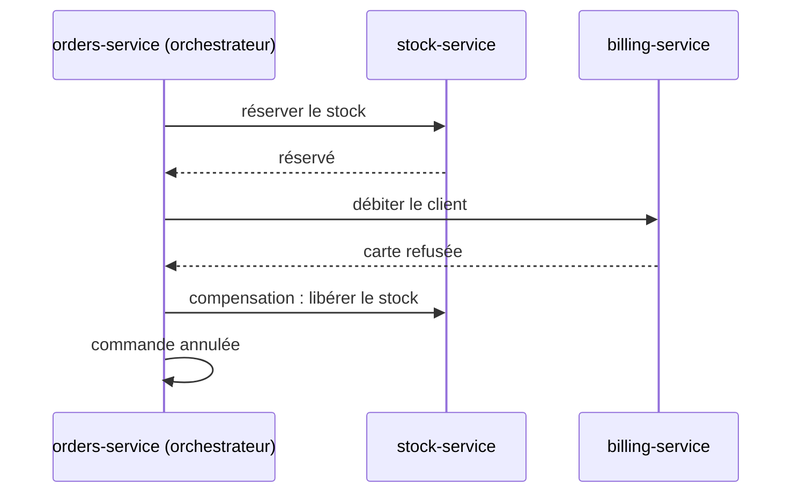

La même saga, chorégraphiée : aucun coordinateur, chaque service réagit aux événements publiés sur le broker.

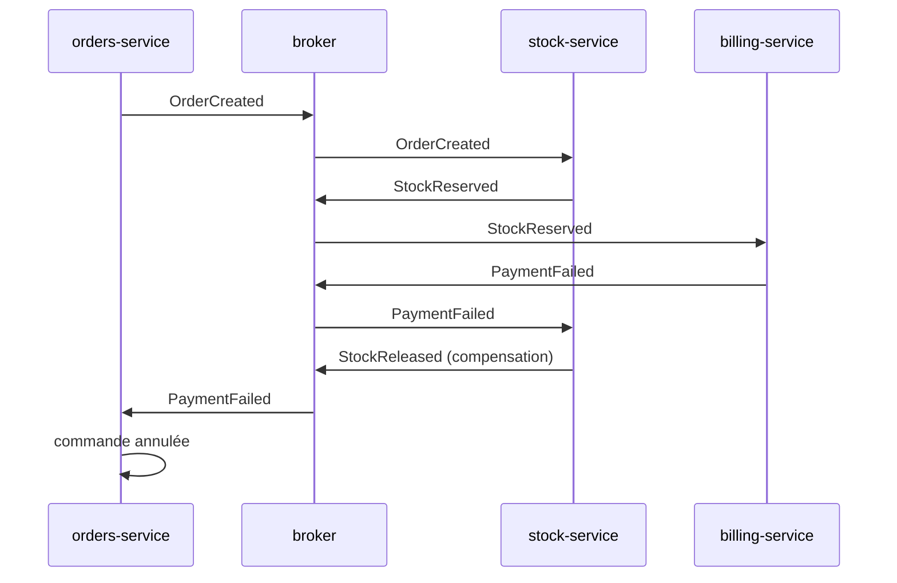

| Variante | Fonctionnement | Bien quand |
|---|---|---|
| <span class="term" data-term="saga-orchestration">orchestrée</span> | un coordinateur appelle chaque étape et décide des compensations | plus de trois étapes, besoin de voir l'état d'une saga en un endroit |
| <span class="term" data-term="saga-choreography">chorégraphiée</span> | chaque service réagit aux événements des autres | deux ou trois étapes, équipes très autonomes |

Une compensation n'efface pas le passé : un remboursement n'est pas « jamais débité », le client voit les deux lignes. Le métier doit valider ces états intermédiaires.

**Risques.** En chorégraphie, personne ne voit l'état d'une saga : quand la commande 1042 de Léa reste bloquée « en attente », je dois remonter les événements de trois services pour trouver l'étape perdue ; je propage un identifiant de corrélation et je passe à l'orchestration au-delà de trois étapes. En orchestration, le coordinateur attire peu à peu les règles métier des autres services et devient le code que tout le monde doit modifier ; je le limite à l'enchaînement des étapes et aux compensations. Dans les deux cas, une compensation qui échoue laisse le stock réservé pour rien : je la rends rejouable sans effet en double et je surveille les sagas restées ouvertes.

:material-book-open-variant: Doc de référence : [Chris Richardson, microservices.io, « Saga »](https://microservices.io/patterns/data/saga.html) (consultée en novembre 2026) ; [Microsoft, « Saga distributed transactions pattern »](https://learn.microsoft.com/en-us/azure/architecture/patterns/saga) (consultée en novembre 2026)
{ .doc-ref }

### Outbox

<a class="pill pill-scope pill-scope-app" href="#carte-des-echelles">Échelle · Application</a> <span class="pill pill-status pill-status-ok" title="Toujours valable, vérifié en novembre 2026">Valable · 11/2026</span> <a class="pill pill-nature pill-nature-decide" href="../architecture/#comment-lire-cette-page" title="Un choix que l'équipe ou les architectes doivent faire, puis écrire dans un ADR">À décider</a> <a class="pill pill-topic pill-topic-data" href="../architecture/#comment-lire-cette-page" title="Parle de l'endroit où vivent les données et de la façon dont leurs copies restent d'accord">Données</a>

Écrire en base puis publier un événement, ce sont deux opérations qui peuvent réussir à moitié. Le motif **<span class="term" data-term="outbox-pattern">outbox</span>** règle ce cas : il est décrit dans [le piège de l'écriture puis de la publication](api-rest-async.md#le-piege-de-lecriture-puis-de-la-publication).

**Risques.** L'outbox garantit qu'un événement part au moins une fois, pas exactement une fois : le relais peut le publier deux fois après un redémarrage, donc chaque consommateur doit être idempotent. Si le relais s'arrête, la table grossit et les événements partent en retard sans que personne le voie. Je purge les lignes publiées et j'alerte sur l'âge du plus vieux message non publié.

:material-book-open-variant: Doc de référence : [Chris Richardson, microservices.io, « Transactional outbox »](https://microservices.io/patterns/data/transactional-outbox.html) (consultée en novembre 2026)
{ .doc-ref }

### CQRS

<a class="pill pill-scope pill-scope-app" href="#carte-des-echelles">Échelle · Application</a> <a class="pill pill-scope pill-scope-system" href="#carte-des-echelles">Échelle · Système</a> <span class="pill pill-status pill-status-ok" title="Toujours valable, vérifié en novembre 2026">Valable · 11/2026</span> <a class="pill pill-nature pill-nature-decide" href="../architecture/#comment-lire-cette-page" title="Un choix que l'équipe ou les architectes doivent faire, puis écrire dans un ADR">À décider</a> <a class="pill pill-topic pill-topic-data" href="../architecture/#comment-lire-cette-page" title="Parle de l'endroit où vivent les données et de la façon dont leurs copies restent d'accord">Données</a>

**<span class="term" data-term="cqrs">CQRS</span>** (Command Query Responsibility Segregation, popularisé par Greg Young vers 2010) sépare le modèle qui écrit du modèle qui lit. Les écritures passent par un modèle métier strict ; les lectures, par des vues construites pour chaque écran, mises à jour à partir des changements.

!!! noob "As noob"
    Dans un restaurant, la cuisine suit des règles strictes pour préparer chaque commande, et l'ardoise du jour sert aux clients à lire ce qui est disponible. L'ardoise est recopiée depuis la cuisine, sous une forme pensée pour être lue d'un coup d'œil, et elle peut avoir un plat de retard. La phrase à retenir : **un modèle pour écrire juste, un autre pour lire vite, avec un léger décalage entre les deux.**

```
écriture   POST /orders           modèle Order (règles métier)  table orders
lecture    GET /dashboard/sales   vue sales_by_day (pré-calculée, mise à jour par événement)
```

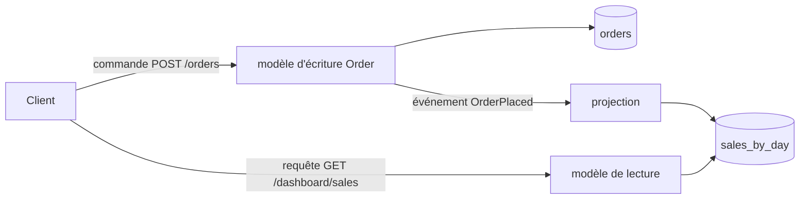

Utile quand lecture et écriture ont des formes ou des volumes très différents. Coût : la vue est en retard de quelques instants.

**Risques.** Sur un simple CRUD, deux modèles doublent le code pour rien. Un bug dans la projection donne une vue fausse que personne ne détecte, puisque la base d'écriture, elle, est juste ; et un client qui vient de commander peut ne pas voir sa commande pendant quelques secondes. Je réserve CQRS aux lectures vraiment différentes des écritures et je garde un moyen de reconstruire la vue depuis zéro.

:material-book-open-variant: Doc de référence : [Martin Fowler, « CQRS »](https://martinfowler.com/bliki/CQRS.html) (2011) ; [Microsoft, « CQRS pattern »](https://learn.microsoft.com/en-us/azure/architecture/patterns/cqrs) (consultée en novembre 2026)
{ .doc-ref }

### Event sourcing

<a class="pill pill-scope pill-scope-app" href="#carte-des-echelles">Échelle · Application</a> <span class="pill pill-status pill-status-ok" title="Toujours valable, vérifié en novembre 2026">Valable · 11/2026</span> <a class="pill pill-nature pill-nature-decide" href="../architecture/#comment-lire-cette-page" title="Un choix que l'équipe ou les architectes doivent faire, puis écrire dans un ADR">À décider</a> <a class="pill pill-topic pill-topic-data" href="../architecture/#comment-lire-cette-page" title="Parle de l'endroit où vivent les données et de la façon dont leurs copies restent d'accord">Données</a>

En **<span class="term" data-term="event-sourcing">event sourcing</span>** (décrit par Martin Fowler en 2005), on ne stocke pas l'état courant mais la suite des événements ; l'état se recalcule en les rejouant.

```
compte 42 : Ouvert(0) ; Crédité(100) ; Débité(30) ; Débité(20)   état recalculé : 50
```

Gain : un historique complet et vérifiable, la possibilité de construire de nouvelles vues après coup. Coût élevé : faire évoluer le format des événements, rejouer de gros volumes, supprimer des données personnelles. Réservé aux domaines où l'historique est le métier (comptabilité, audit).

Le format des événements finit toujours par changer, alors que le journal, lui, ne se réécrit pas : c'est ce qui fait sa valeur. Exemple : `CreditIssued` version 1 portait `amount` en euros décimaux ; la version 2 porte `amount_cents` et `currency`. La technique standard est l'**<span class="term" data-term="upcasting">upcasting</span>** : le code de lecture convertit chaque ancien événement vers le format courant juste avant de l'appliquer, et le journal garde les versions 1 telles quelles. Chaque événement porte donc un numéro de version de schéma dès le premier jour.

```python
# À éviter : réécrire le journal en place, l'historique qui fait foi est modifié
def migrate_journal(store):
    for event in store.all_events("CreditIssued"):
        event["amount_cents"] = round(event.pop("amount") * 100)
        store.overwrite(event)


# Bien : le journal reste intact, la lecture convertit les anciennes versions
def upcast(raw: dict) -> dict:
    if raw["type"] != "CreditIssued" or raw.get("schema_version", 1) != 1:
        return raw
    v2 = {key: value for key, value in raw.items() if key != "amount"}
    return {**v2, "schema_version": 2,
            "amount_cents": round(raw["amount"] * 100), "currency": "EUR"}
```

Réécrire le journal casse ce qui fait l'intérêt de l'event sourcing : l'auditeur ne peut plus vérifier que l'historique n'a pas bougé, et une erreur de migration abîme tout l'historique sans retour possible. Avec l'upcasting, le code qui applique les événements ne connaît que la dernière version (l'exemple suppose que toutes les versions 1 étaient en euros). Quand les conversions s'empilent sur de nombreuses versions, on peut recopier le journal vers un nouveau flux transformé, l'ancien restant archivé.


:material-book-open-variant: Doc de référence : [Martin Fowler, « Event Sourcing »](https://martinfowler.com/eaaDev/EventSourcing.html) (2005) ; [Microsoft, « Event Sourcing pattern »](https://learn.microsoft.com/en-us/azure/architecture/patterns/event-sourcing) (consultée en novembre 2026) ; [Greg Young, « Versioning in an Event Sourced System »](https://leanpub.com/esversioning) (Leanpub, 2017, à vérifier)
{ .doc-ref }

| Je veux... | J'utilise... |
|---|---|
| mener une action métier qui touche plusieurs services, comme une commande qui réserve le stock puis débite le client | saga avec compensations |
| écrire la commande en base puis publier l'événement, sans le perdre si le service plante entre les deux | outbox |
| un tableau de bord lourd, comme les ventes par jour, qui ne ralentit pas la prise de commandes | CQRS avec vues de lecture |
| un historique complet qui fait foi, comme les mouvements d'un compte en comptabilité | event sourcing, seulement là où il est demandé |
| que deux services utilisent la même donnée, comme l'adresse du client pour la facturation et pour la livraison | API ou événements, jamais la base de l'autre |
| choisir où stocker les données d'un nouveau service, alors que quelqu'un propose déjà une base à la mode | motifs d'accès, base relationnelle par défaut |

!!! maturity "Mesurer la maturité"
    | Niveau | Ce que j'observe dans l'équipe |
    |---|---|
    | N1 | chaque service a sa base sur le papier, mais un script de reporting ou un autre service lit encore ses tables |
    | N2 | aucun service ne lit la base d'un autre (accès refusés par les droits de la base), les sagas ont leurs compensations écrites et l'outbox publie les événements |
    | N3 | une saga bloquée ou un message de l'outbox non publié depuis plusieurs minutes déclenche une alerte et une compensation automatique, sans attendre qu'un client se plaigne |
    | N4 | l'équipe suit le retard de l'outbox, la part de sagas compensées et le retard des vues CQRS, et ajuste ses choix (orchestrer, revoir une vue) à partir de ces chiffres |

    **Je mesure** : l'âge du plus vieux message non publié de l'outbox, lu par une requête sur la table ; la part des sagas terminées par une compensation, lue dans l'orchestrateur ou les événements.

## Résilience

Une dépendance lente est plus dangereuse qu'une dépendance en panne : les requêtes s'accumulent, occupent les threads et les connexions, et la lenteur se propage à tout ce qui appelle le service. On appelle ça une panne en cascade. Les mécanismes qui suivent s'empilent ; la référence classique est Michael Nygard, « Release It! » (2007, 2e édition en 2018).

### Timeout

<a class="pill pill-scope pill-scope-code" href="#carte-des-echelles">Échelle · Code</a> <a class="pill pill-scope pill-scope-system" href="#carte-des-echelles">Échelle · Système</a> <span class="pill pill-status pill-status-ok" title="Toujours valable, vérifié en novembre 2026">Valable · 11/2026</span> <a class="pill pill-nature pill-nature-decide" href="../architecture/#comment-lire-cette-page" title="Un choix que l'équipe ou les architectes doivent faire, puis écrire dans un ADR">À décider</a>

Sans limite, mon appel vers un service lent peut attendre des minutes, et mon propre service reste bloqué avec lui. Tout appel réseau a donc un **<span class="term" data-term="timeout">timeout</span>**, choisi d'après la latence mesurée (un peu au-dessus du p99 de la dépendance), jamais la valeur par défaut de la bibliothèque, souvent infinie ou de plusieurs minutes. Le timeout total d'une chaîne doit tenir dans celui de l'appelant.

**Risques.** Trop court, le timeout coupe des requêtes qui auraient réussi, et les retries qui suivent chargent encore une dépendance déjà lente. Trop long, il laisse les threads bloqués et la lenteur se propage. Si le timeout de l'appelé dépasse celui de l'appelant, le travail continue pour une réponse que plus personne n'attend. Je le cale sur le p99 mesuré et je le revois quand la latence change.

:material-book-open-variant: Doc de référence : [Marc Brooker, « Timeouts, retries, and backoff with jitter », Amazon Builders' Library](https://aws.amazon.com/builders-library/timeouts-retries-and-backoff-with-jitter/) (2019)
{ .doc-ref }

### Retry, backoff exponentiel et gigue

<a class="pill pill-scope pill-scope-code" href="#carte-des-echelles">Échelle · Code</a> <a class="pill pill-scope pill-scope-system" href="#carte-des-echelles">Échelle · Système</a> <span class="pill pill-status pill-status-ok" title="Toujours valable, vérifié en novembre 2026">Valable · 11/2026</span> <a class="pill pill-nature pill-nature-decide" href="../architecture/#comment-lire-cette-page" title="Un choix que l'équipe ou les architectes doivent faire, puis écrire dans un ADR">À décider</a>

Réessayer aide pour les erreurs passagères, à condition d'attendre de plus en plus longtemps (**<span class="term" data-term="exponential-backoff">backoff exponentiel</span>**) et d'ajouter du hasard (**<span class="term" data-term="jitter">gigue</span>**), sinon tous les clients réessaient à la même milliseconde (Marc Brooker, « Exponential Backoff And Jitter », AWS Architecture Blog, 2015).

```python
import random
import time

# Exemple : délai de base, plafond et nombre d'essais nommés
BASE_DELAY_S = 0.1
MAX_DELAY_S = 5.0
MAX_ATTEMPTS = 4


# À éviter : réessaie tout, tout de suite, sans fin
def call_with_naive_retry(call):
    while True:
        try:
            return call()
        except Exception:
            continue


# Bien : backoff exponentiel avec gigue, seulement sur une erreur passagère
def call_with_retry(call):
    for attempt in range(MAX_ATTEMPTS):
        try:
            return call()
        except TimeoutError:
            if attempt == MAX_ATTEMPTS - 1:
                raise
            ceiling = min(MAX_DELAY_S, BASE_DELAY_S * 2**attempt)
            time.sleep(random.uniform(0, ceiling))
```

La version naïve est celle qui fait tomber les systèmes : quand le service appelé ralentit, mille clients le rappellent en boucle sans attendre, donc il reçoit dix fois plus de requêtes au pire moment et ne se relève pas. Elle réessaie aussi un `400` (la requête est fausse, elle le restera) et un paiement non idempotent. On ne réessaie que les erreurs passagères (timeout, 503) et les opérations idempotentes, jamais un 400.

:material-book-open-variant: Doc de référence : [Marc Brooker, « Exponential Backoff And Jitter »](https://aws.amazon.com/blogs/architecture/exponential-backoff-and-jitter/) (2015) ; [Microsoft, « Retry pattern »](https://learn.microsoft.com/en-us/azure/architecture/patterns/retry) (consultée en novembre 2026)
{ .doc-ref }

### Budget de retry

<a class="pill pill-scope pill-scope-system" href="#carte-des-echelles">Échelle · Système</a> <span class="pill pill-status pill-status-ok" title="Toujours valable, vérifié en novembre 2026">Valable · 11/2026</span> <a class="pill pill-nature pill-nature-decide" href="../architecture/#comment-lire-cette-page" title="Un choix que l'équipe ou les architectes doivent faire, puis écrire dans un ADR">À décider</a>

Si chaque niveau d'une chaîne de trois services réessaie trois fois, une requête peut en produire 27 sur le dernier service : c'est la **<span class="term" data-term="retry-storm">tempête de retries</span>**. Un **<span class="term" data-term="retry-budget">budget de retry</span>** plafonne les nouvelles tentatives à une part du trafic normal (le livre SRE de Google, 2016, cite environ 10 % par client, à vérifier), et on ne réessaie qu'à un seul niveau de la chaîne.

**Risques.** Un budget trop bas laisse remonter à l'utilisateur des erreurs passagères qu'un seul retry aurait masquées ; réessayer à plusieurs niveaux malgré le budget recrée la tempête. Je mesure le taux de retries par dépendance et j'écris quel niveau de la chaîne a le droit de réessayer.

:material-book-open-variant: Doc de référence : [Google SRE Book, « Handling Overload »](https://sre.google/sre-book/handling-overload/) (2016)
{ .doc-ref }

### Disjoncteur

<a class="pill pill-scope pill-scope-code" href="#carte-des-echelles">Échelle · Code</a> <a class="pill pill-scope pill-scope-system" href="#carte-des-echelles">Échelle · Système</a> <span class="pill pill-status pill-status-ok" title="Toujours valable, vérifié en novembre 2026">Valable · 11/2026</span> <a class="pill pill-nature pill-nature-decide" href="../architecture/#comment-lire-cette-page" title="Un choix que l'équipe ou les architectes doivent faire, puis écrire dans un ADR">À décider</a>

Un **<span class="term" data-term="circuit-breaker">disjoncteur</span>** coupe les appels vers une dépendance qui échoue, pour échouer vite au lieu d'attendre.

!!! noob "As noob"
    C'est le disjoncteur de ma maison : quand un appareil fait court-circuit, il coupe le courant au lieu de laisser chauffer les fils. La différence : le disjoncteur logiciel se réarme tout seul après un délai, en laissant passer quelques appels d'essai. La phrase à retenir : **mieux vaut échouer tout de suite qu'attendre longtemps pour échouer quand même.**

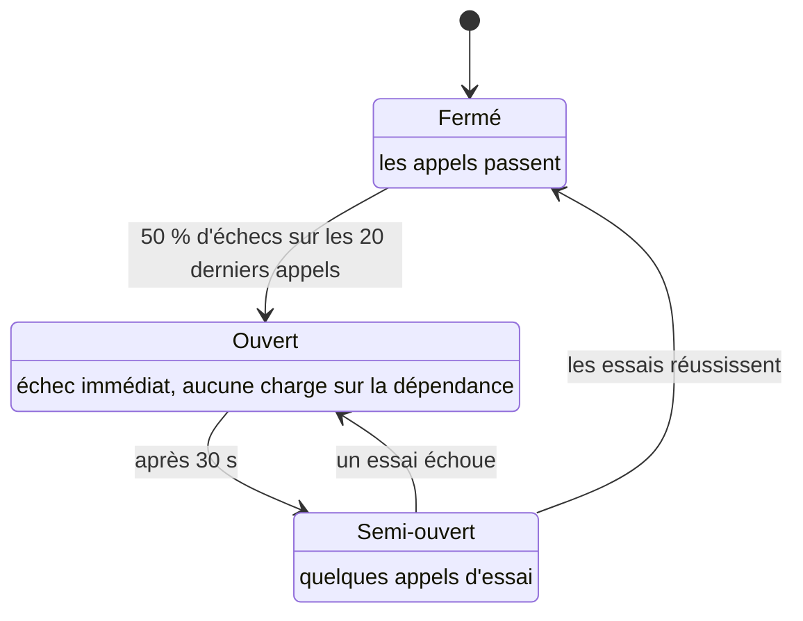

**Risques.** Des seuils mal réglés ouvrent le disjoncteur sur deux erreurs quand le trafic est faible, ou le font osciller entre ouvert et fermé ; un disjoncteur par instance réagit aussi différemment selon le pod. Pendant qu'il est ouvert, il faut une réponse de repli, sinon l'utilisateur voit une erreur sèche. Je règle les seuils sur un nombre minimal d'appels et je teste le repli.

:material-book-open-variant: Doc de référence : [Martin Fowler, « CircuitBreaker »](https://martinfowler.com/bliki/CircuitBreaker.html) (2014) ; [Microsoft, « Circuit Breaker pattern »](https://learn.microsoft.com/en-us/azure/architecture/patterns/circuit-breaker) (consultée en novembre 2026)
{ .doc-ref }

### Cloison

<a class="pill pill-scope pill-scope-app" href="#carte-des-echelles">Échelle · Application</a> <a class="pill pill-scope pill-scope-system" href="#carte-des-echelles">Échelle · Système</a> <a class="pill pill-scope pill-scope-infra" href="#carte-des-echelles">Échelle · Infrastructure</a> <span class="pill pill-status pill-status-ok" title="Toujours valable, vérifié en novembre 2026">Valable · 11/2026</span> <a class="pill pill-nature pill-nature-decide" href="../architecture/#comment-lire-cette-page" title="Un choix que l'équipe ou les architectes doivent faire, puis écrire dans un ADR">À décider</a>

Une **<span class="term" data-term="bulkhead">cloison</span>** (bulkhead, comme les compartiments d'un navire) réserve des ressources séparées à chaque dépendance : un pool de 20 connexions pour `billing-service`, un autre de 20 pour `stock-service`. Si `billing-service` devient lent, seules ses 20 connexions sont bloquées, le reste de `my-api` répond.

**Risques.** Des pools trop petits refusent des requêtes alors que la machine a de la marge ; additionnés, des pools trop grands dépassent le nombre de connexions que la base accepte. Je dimensionne chaque pool avec la [loi de Little](#loi-de-little) et je vérifie que leur somme tient dans la limite de la dépendance.

:material-book-open-variant: Doc de référence : [Microsoft, « Bulkhead pattern »](https://learn.microsoft.com/en-us/azure/architecture/patterns/bulkhead) (consultée en novembre 2026)
{ .doc-ref }

### Délestage et contre-pression

<a class="pill pill-scope pill-scope-system" href="#carte-des-echelles">Échelle · Système</a> <a class="pill pill-scope pill-scope-infra" href="#carte-des-echelles">Échelle · Infrastructure</a> <span class="pill pill-status pill-status-ok" title="Toujours valable, vérifié en novembre 2026">Valable · 11/2026</span> <a class="pill pill-nature pill-nature-decide" href="../architecture/#comment-lire-cette-page" title="Un choix que l'équipe ou les architectes doivent faire, puis écrire dans un ADR">À décider</a>

Le **<span class="term" data-term="load-shedding">délestage</span>** refuse volontairement une partie des requêtes quand le service sature (un `503` rapide, en commençant par le trafic le moins important) pour servir correctement le reste. La **<span class="term" data-term="backpressure">contre-pression</span>** fait remonter la saturation à la source : une file pleine refuse de nouveaux messages, et le producteur ralentit au lieu de remplir la mémoire. Référence : chapitres « Handling Overload » et « Addressing Cascading Failures » du livre SRE de Google (2016).

Exemple chiffré (chiffres d'exemple) :

```
délestage        capacité 500 req/s, il en arrive 700
                 les 200 les moins importantes (recommandations, recherche) reçoivent un 503 immédiat
                 le checkout reste servi à 100 %, sans timeout pour personne
contre-pression  la file des commandes est limitée à 1 000 messages
                 la 1 001e publication est refusée : le producteur ralentit ou réessaie plus tard
                 sans limite, la file grossit jusqu'à saturer la mémoire du broker
```

**Risques.** Un délestage mal classé refuse le mauvais trafic, comme le paiement au lieu des recommandations. Des clients qui réessaient chaque `503` tout de suite doublent la charge qu'on voulait réduire ; la contre-pression, elle, peut bloquer un producteur qui bloque à son tour ses propres appelants. J'écris la priorité de chaque route, je renvoie `Retry-After` et je surveille la longueur des files.

:material-book-open-variant: Doc de référence : [Google SRE Book, « Addressing Cascading Failures »](https://sre.google/sre-book/addressing-cascading-failures/) (2016)
{ .doc-ref }

### Limitation de débit

<a class="pill pill-scope pill-scope-code" href="#carte-des-echelles">Échelle · Code</a> <a class="pill pill-scope pill-scope-system" href="#carte-des-echelles">Échelle · Système</a> <span class="pill pill-status pill-status-ok" title="Toujours valable, vérifié en novembre 2026">Valable · 11/2026</span> <a class="pill pill-nature pill-nature-decide" href="../architecture/#comment-lire-cette-page" title="Un choix que l'équipe ou les architectes doivent faire, puis écrire dans un ADR">À décider</a>

Mon API est ouverte à des partenaires, chacun avec sa clé. Hier, le script mal écrit d'un seul partenaire a saturé `my-api`, et tous les autres clients ont subi des timeouts. La **<span class="term" data-term="rate-limit">limite de débit</span>** (rate limiting) plafonne le nombre de requêtes qu'un appelant peut faire sur une durée, par exemple 100 requêtes par minute et par clé. Au-delà, l'API répond tout de suite `429 Too Many Requests` (RFC 6585, 2012) avec un en-tête `Retry-After` (RFC 9110, 2022) qui dit quand réessayer, au lieu de laisser un seul client consommer la capacité de tous. La différence avec le délestage : le délestage protège le service quand il sature, quel que soit l'appelant ; la limite de débit protège les clients les uns des autres, même quand le service va bien. Les codes et le format d'erreur sont dans [Les codes de réponse](api-rest-async.md#les-codes-de-reponse).

**Quand.** Une API publique ou ouverte à des partenaires, une route coûteuse (export, recherche), une page de connexion à protéger contre l'essai de mots de passe en masse. Entre deux services internes qui se font confiance, la cloison et le délestage suffisent souvent.

Cinq algorithmes, du plus simple au plus fin :

| Algorithme | Principe | Avantage | Limite |
|---|---|---|---|
| fenêtre fixe | un compteur par clé et par minute calendaire | très simple : un `INCR` | jusqu'à 200 requêtes en quelques secondes autour du changement de minute |
| fenêtre glissante, journal | garder l'heure de chaque requête, compter celles de la dernière minute | exact | mémoire proportionnelle au nombre de requêtes |
| fenêtre glissante, compteur | pondérer le compteur de la minute précédente par la part encore couverte par la fenêtre | bon compromis, deux compteurs par clé | approximatif |
| <span class="term" data-term="token-bucket">seau à jetons</span> | un seau se remplit à vitesse fixe, chaque requête prend un jeton | autorise de petites rafales, plafonne le débit moyen | un peu plus de calcul, état à stocker |
| seau percé (leaky bucket) | les requêtes entrent dans une file qui se vide à débit constant | débit de sortie parfaitement régulier | aucune rafale, la file ajoute de l'attente |

!!! noob "As noob"
    Le seau à jetons, c'est une carte de transport rechargée automatiquement d'un ticket toutes les six secondes, avec dix tickets au maximum. Si je n'ai pas voyagé depuis longtemps, je peux enchaîner dix trajets (la rafale) ; ensuite, je dois attendre que les tickets reviennent. La phrase à retenir : **le débit moyen est plafonné, mais une petite rafale reste permise.**

Exemple de fenêtre glissante par compteur, à 10:01:15 (chiffres d'exemple) : la minute précédente a compté 84 requêtes, la minute en cours 30 ; la fenêtre couvre encore 75 % de la minute précédente, donc 84 × 0,75 + 30 = 93, sous la limite de 100. Cloudflare a décrit cette méthode en 2017.

**Comment.** Pour commencer, la fenêtre fixe suffit souvent ; le seau à jetons est le bon choix si je veux tolérer des rafales courtes. Le piège classique est le compteur gardé dans la mémoire de chaque instance :

```python
# Exemple : 100 requêtes par fenêtre d'une minute
WINDOW_SECONDS = 60
LIMIT_PER_WINDOW = 100

# À éviter : un compteur dans la mémoire de chaque instance, jamais remis à zéro
local_counts: dict[str, int] = {}


def check_rate_limit_local(api_key: str) -> bool:
    local_counts[api_key] = local_counts.get(api_key, 0) + 1
    return local_counts[api_key] <= LIMIT_PER_WINDOW


# Bien : fenêtre fixe partagée dans Redis, INCR est atomique et l'expiration nettoie les vieilles fenêtres
def check_rate_limit(redis, api_key: str, now: float) -> tuple[bool, int]:
    window = int(now // WINDOW_SECONDS)
    key = f"ratelimit:{api_key}:{window}"
    pipe = redis.pipeline()
    pipe.incr(key)
    pipe.expire(key, WINDOW_SECONDS * 2)
    count, _ = pipe.execute()
    retry_after = WINDOW_SECONDS - int(now % WINDOW_SECONDS)
    return count <= LIMIT_PER_WINDOW, retry_after
```

Avec quatre instances derrière le répartiteur de charge, la version locale donne 400 requêtes par minute au partenaire au lieu de 100, et elle finit par bloquer la clé pour toujours puisque son compteur ne redescend jamais. Avec Redis, deux instances qui incrémentent en même temps obtiennent deux valeurs différentes, et `retry_after` remplit l'en-tête `Retry-After`. Pour un seau à jetons partagé, le calcul s'écrit en script Lua exécuté par Redis, pour rester atomique. Reste une décision produit à écrire : si Redis tombe, je laisse tout passer ou je bloque tout ? Des en-têtes `RateLimit` standardisés (limite, restant, remise à zéro) sont en cours de normalisation à l'IETF (brouillon, statut à vérifier).

:material-book-open-variant: Doc de référence : [Stripe, « Scaling your API with rate limiters »](https://stripe.com/blog/rate-limiters) (2017) ; [Cloudflare, « Counting things, a lot of different things »](https://blog.cloudflare.com/counting-things-a-lot-of-different-things/) (2017)
{ .doc-ref }

### Dégradation contrôlée

<a class="pill pill-scope pill-scope-app" href="#carte-des-echelles">Échelle · Application</a> <a class="pill pill-scope pill-scope-system" href="#carte-des-echelles">Échelle · Système</a> <span class="pill pill-status pill-status-ok" title="Toujours valable, vérifié en novembre 2026">Valable · 11/2026</span> <a class="pill pill-nature pill-nature-decide" href="../architecture/#comment-lire-cette-page" title="Un choix que l'équipe ou les architectes doivent faire, puis écrire dans un ADR">À décider</a>

La **<span class="term" data-term="graceful-degradation">dégradation contrôlée</span>** rend un service réduit mais utile quand une dépendance tombe : le moteur de recommandations est en panne, la page produit s'affiche avec « meilleures ventes » en cache. Elle se décide à la conception, écran par écran : qu'est-ce qui est indispensable, qu'est-ce qui peut disparaître.

**Risques.** Un mode dégradé jamais testé échoue le jour où il sert : le repli lit un cache vide ou appelle la même dépendance en panne. Une donnée de repli présentée comme fraîche trompe l'utilisateur, par exemple un stock « disponible » qui ne l'est plus. Je teste chaque repli en coupant la dépendance lors d'un exercice de panne, et j'affiche clairement ce qui est approximatif.

:material-book-open-variant: Doc de référence : [AWS Well-Architected, « REL05-BP01 Implement graceful degradation »](https://docs.aws.amazon.com/wellarchitected/latest/reliability-pillar/rel_mitigate_interaction_failure_graceful_degradation.html) (consultée en novembre 2026)
{ .doc-ref }

| Je veux... | J'utilise... |
|---|---|
| ne pas attendre indéfiniment un service qui met parfois des minutes à répondre | timeout calé sur le p99 mesuré |
| qu'une erreur passagère, comme un `503` pendant le redémarrage du service appelé, ne fasse pas échouer la demande de l'utilisateur | retry avec backoff exponentiel et gigue, sur opération idempotente |
| ne pas achever sous une avalanche de nouvelles tentatives un service qui souffre déjà | budget de retry, disjoncteur |
| que le reste de `my-api` continue de répondre quand `billing-service` devient lent | cloison (pools séparés) |
| tenir un pic de trafic qui dépasse ma capacité, comme l'ouverture des soldes, sans que tout le service tombe | délestage, contre-pression sur les files |
| que la page produit s'affiche encore quand une brique tombe, comme le moteur de recommandations | dégradation contrôlée, décidée à l'avance |
| qu'un seul partenaire au script mal écrit ne sature pas l'API pour tous les autres | limite de débit par clé, compteur partagé, `429` avec `Retry-After` |

!!! maturity "Mesurer la maturité"
    | Niveau | Ce que j'observe dans l'équipe |
    |---|---|
    | N1 | quelques appels ont un timeout et un retry, ajoutés après un incident, avec des valeurs copiées d'un autre service |
    | N2 | tout appel réseau passe par un client commun qui impose un timeout calé sur le p99, un retry avec gigue sur les seules erreurs passagères, un disjoncteur et un pool par dépendance |
    | N3 | pendant une panne, le disjoncteur s'ouvre, le délestage refuse le trafic secondaire et la dégradation contrôlée s'active seuls, sans personne d'astreinte pour basculer |
    | N4 | les seuils (timeouts, budget de retry, limites de débit) sont revus chaque trimestre à partir des latences mesurées, du taux de retries et des résultats d'exercices de panne |

    **Je mesure** : la part des appels sortants sans timeout explicite, lue en revue de code ou par analyse statique ; le ratio entre retries et requêtes initiales par dépendance, lu dans les métriques du client HTTP.

## Haute disponibilité et reprise

### Point unique de défaillance

<a class="pill pill-scope pill-scope-system" href="#carte-des-echelles">Échelle · Système</a> <a class="pill pill-scope pill-scope-infra" href="#carte-des-echelles">Échelle · Infrastructure</a> <span class="pill pill-status pill-status-ok" title="Toujours valable, vérifié en novembre 2026">Valable · 11/2026</span> <a class="pill pill-nature pill-nature-know" href="../architecture/#comment-lire-cette-page" title="Une loi ou un phénomène qu'on ne choisit pas : le connaître évite de mauvaises décisions">À connaître</a>

Un **<span class="term" data-term="spof">SPOF</span>** (single point of failure) est un composant présent en un seul exemplaire dont la panne arrête tout : une seule base sans réplica, un seul répartiteur de charge, un certificat que personne ne renouvelle, une seule personne qui sait déployer. La première étape d'une revue de disponibilité est de les lister.

**Risques.** Les ignorer, c'est doubler les serveurs et garder un seul répartiteur de charge, un seul certificat ou une seule personne qui sait déployer : la panne arrive par la pièce que personne n'a listée. Je tiens la liste à jour à chaque revue de disponibilité, humains compris.

### Disponibilité composée

<a class="pill pill-scope pill-scope-system" href="#carte-des-echelles">Échelle · Système</a> <a class="pill pill-scope pill-scope-infra" href="#carte-des-echelles">Échelle · Infrastructure</a> <a class="pill pill-nature pill-nature-know" href="../architecture/#comment-lire-cette-page" title="Une loi ou un phénomène qu'on ne choisit pas : le connaître évite de mauvaises décisions">À connaître</a>

La **<span class="term" data-term="availability">disponibilité</span>** est la part du temps où le système répond correctement. 99,9 % autorise environ 8 h 45 d'arrêt par an (43 min par mois) ; 99,99 %, environ 53 min par an. La **<span class="term" data-term="composite-availability">disponibilité composée</span>** se calcule à partir des briques :

```
en série (il faut A ET B)          A × B
  my-api 99,9 % appelle billing 99,9 %   0,999 × 0,999 = 0,998    soit 99,8 %

en parallèle (il suffit de A OU B)   1 - (1 - A) × (1 - B)
  deux réplicas à 99 % chacun         1 - 0,01 × 0,01 = 0,9999 soit 99,99 %
```

Chaque dépendance synchrone ajoutée en série fait baisser la disponibilité ; la redondance la fait monter, à condition que les copies ne tombent pas pour la même raison (même zone, même déploiement, même bug).

**Risques.** L'ignorer, c'est promettre 99,9 % pour un service à 99,9 % qui appelle en série quatre dépendances à 99,9 % : le calcul donne environ 99,5 %, donc la promesse est intenable avant même la première panne. Je fais le calcul avant de m'engager et je retire des dépendances synchrones du chemin critique.

:material-book-open-variant: Doc de référence : [Google SRE Book, « Embracing Risk »](https://sre.google/sre-book/embracing-risk/) (2016)
{ .doc-ref }

### Zones et régions

<a class="pill pill-scope pill-scope-infra" href="#carte-des-echelles">Échelle · Infrastructure</a> <span class="pill pill-status pill-status-ok" title="Toujours valable, vérifié en novembre 2026">Valable · 11/2026</span> <a class="pill pill-nature pill-nature-decide" href="../architecture/#comment-lire-cette-page" title="Un choix que l'équipe ou les architectes doivent faire, puis écrire dans un ADR">À décider</a>

Une **<span class="term" data-term="availability-zone">zone de disponibilité</span>** est un centre de données (ou un groupe) isolé des autres en énergie et réseau, à quelques kilomètres, avec une latence de l'ordre de la milliseconde entre zones. Une **<span class="term" data-term="cloud-region">région</span>** regroupe plusieurs zones dans une zone géographique ; entre régions, la latence passe à des dizaines de millisecondes. Répartir sur trois zones protège d'une panne de centre de données ; se protéger de la perte d'une région entière coûte beaucoup plus cher.

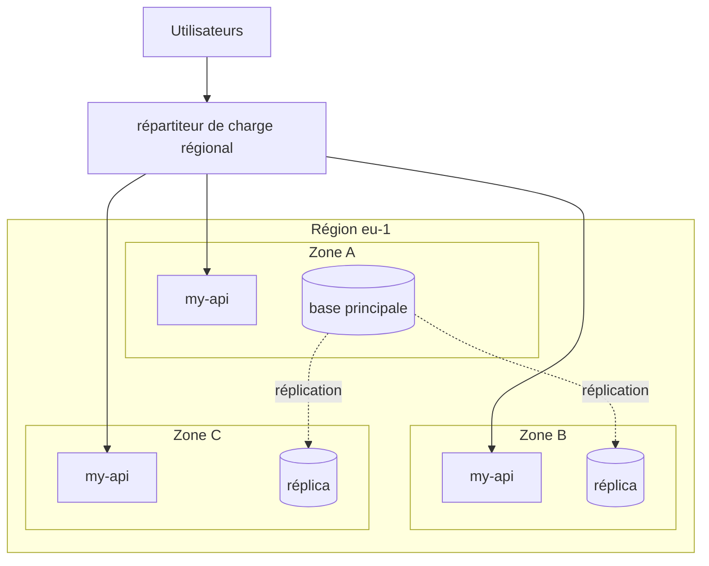


Répartir sur trois zones ne suffit pas si la reprise dépend d'une action pendant la panne. La **<span class="term" data-term="static-stability">stabilité statique</span>** (Becky Weiss et Mike Furr, Amazon Builders' Library, 2020, à vérifier) demande que le système continue de fonctionner pendant une panne **sans changer d'état** : sans créer de machine, sans modifier de configuration, sans appeler le composant en panne. En pratique, je provisionne d'avance la capacité de secours plutôt que de compter sur l'autoscaling au moment de la panne, parce que le plan de contrôle (l'API qui crée les machines) souffre souvent en même temps.

!!! noob "As noob"
    C'est la roue de secours déjà dans le coffre, plutôt que le numéro du dépanneur : le jour de la crevaison, je n'ai besoin de personne, et surtout pas d'un dépanneur débordé par tous les automobilistes en panne au même endroit. Le prix : je transporte toujours une roue qui ne sert presque jamais. La phrase à retenir : **pendant la panne, je n'ai rien à créer ni à demander : tout ce qu'il faut tourne déjà.**

```
dynamique   2 zones portent chacune 50 % de la charge ; une zone tombe
            l'autoscaling doit créer des machines dans la zone restante, via une API elle-même saturée
            en attendant, la zone survivante reçoit 100 % de la charge avec 50 % de capacité
statique    3 zones dimensionnées chacune pour 50 % de la charge (150 % au total, chiffres d'exemple)
            une zone tombe : les deux restantes portent 100 % sans rien créer ni reconfigurer
            coût : un tiers de capacité payée en permanence, inutile les jours sans panne
```

:material-book-open-variant: Doc de référence : [AWS, « Regions and Zones »](https://docs.aws.amazon.com/AWSEC2/latest/UserGuide/using-regions-availability-zones.html) (consultée en novembre 2026) ; [Google Cloud, « Regions and zones »](https://cloud.google.com/compute/docs/regions-zones) (consultée en novembre 2026) ; [Becky Weiss et Mike Furr, « Static stability using Availability Zones », Amazon Builders' Library](https://aws.amazon.com/builders-library/static-stability-using-availability-zones/) (2020, à vérifier)
{ .doc-ref }

### RTO et RPO

<a class="pill pill-scope pill-scope-system" href="#carte-des-echelles">Échelle · Système</a> <a class="pill pill-scope pill-scope-infra" href="#carte-des-echelles">Échelle · Infrastructure</a> <span class="pill pill-status pill-status-ok" title="Toujours valable, vérifié en novembre 2026">Valable · 11/2026</span> <a class="pill pill-nature pill-nature-decide" href="../architecture/#comment-lire-cette-page" title="Un choix que l'équipe ou les architectes doivent faire, puis écrire dans un ADR">À décider</a> <a class="pill pill-topic pill-topic-data" href="../architecture/#comment-lire-cette-page" title="Parle de l'endroit où vivent les données et de la façon dont leurs copies restent d'accord">Données</a>

Deux chiffres à fixer avec le métier avant de choisir une stratégie : le **<span class="term" data-term="rto">RTO</span>** (combien de temps le service peut rester arrêté) et le **<span class="term" data-term="rpo">RPO</span>** (combien de données récentes on accepte de perdre, exprimé en durée).

```
sauvegarde toutes les 24 h, restauration en 4 h
panne à 18:00, dernière sauvegarde à 02:00
RPO réel : 16 h de commandes perdues    RTO réel : retour à 22:00
```

<figure class="diagram"><svg viewBox="0 0 320 110" role="img" aria-label="RPO et RTO"><line class="set" x1="10" y1="55" x2="310" y2="55"/><rect class="layer layer-2" x="40" y="45" width="192" height="20"/><rect class="layer layer-3" x="232" y="45" width="48" height="20"/><line class="set" x1="40" y1="38" x2="40" y2="72"/><line class="set" x1="232" y1="38" x2="232" y2="72"/><line class="set" x1="280" y1="38" x2="280" y2="72"/><text x="136" y="34" text-anchor="middle" class="label-strong">RPO : 16 h de commandes perdues</text><text x="256" y="34" text-anchor="middle" class="label-strong">RTO : 4 h</text><text x="40" y="86" text-anchor="middle">02:00</text><text x="40" y="98" text-anchor="middle">sauvegarde</text><text x="232" y="86" text-anchor="middle">18:00</text><text x="232" y="98" text-anchor="middle">panne</text><text x="280" y="86" text-anchor="middle">22:00</text><text x="280" y="98" text-anchor="middle">reprise</text></svg><figcaption>Le RPO se mesure avant la panne, le RTO après (à l'échelle, exemple ci-dessus)</figcaption></figure>

**Risques.** Des chiffres fixés sans le métier coûtent cher dans les deux sens : un RPO de zéro exigé partout impose une réplication synchrone qui ralentit chaque écriture, et un RTO de 24 h jamais discuté révèle en pleine panne qu'une journée d'arrêt coûte des milliers de commandes. Un objectif jamais mesuré en exercice reste un souhait. Je les fais valider par le métier et je les vérifie par un exercice de reprise.

:material-book-open-variant: Doc de référence : [AWS, « Disaster Recovery of Workloads on AWS »](https://docs.aws.amazon.com/whitepapers/latest/disaster-recovery-workloads-on-aws/disaster-recovery-workloads-on-aws.html) (2021)
{ .doc-ref }

### Stratégies de reprise

<a class="pill pill-scope pill-scope-infra" href="#carte-des-echelles">Échelle · Infrastructure</a> <span class="pill pill-status pill-status-ok" title="Toujours valable, vérifié en novembre 2026">Valable · 11/2026</span> <a class="pill pill-nature pill-nature-decide" href="../architecture/#comment-lire-cette-page" title="Un choix que l'équipe ou les architectes doivent faire, puis écrire dans un ADR">À décider</a> <a class="pill pill-topic pill-topic-data" href="../architecture/#comment-lire-cette-page" title="Parle de l'endroit où vivent les données et de la façon dont leurs copies restent d'accord">Données</a>

Classement repris du livre blanc AWS « Disaster Recovery of Workloads on AWS » (2021), du moins cher au plus cher :

| Stratégie | Ce qui tourne dans la région de secours | RTO / RPO typiques (ordre de grandeur) |
|---|---|---|
| sauvegarde et restauration | rien, seulement des sauvegardes | heures / heures |
| <span class="term" data-term="pilot-light">pilot light</span> | les données répliquées, le reste éteint | dizaines de minutes / minutes |
| <span class="term" data-term="warm-standby">warm standby</span> | tout le système, en taille réduite | minutes / secondes |
| <span class="term" data-term="active-active">actif-actif</span> | tout, servant du trafic en permanence | quasi nul / quasi nul |

[À prendre avec précaution : ordres de grandeur génériques, chaque système mesure les siens en exercice de reprise.] Une stratégie non testée n'existe pas : on la rejoue régulièrement (exercice de reprise, game day). La conduite de l'incident lui-même est dans [Incidents](incidents.md).

### Architecture cellulaire

<a class="pill pill-scope pill-scope-system" href="#carte-des-echelles">Échelle · Système</a> <a class="pill pill-scope pill-scope-infra" href="#carte-des-echelles">Échelle · Infrastructure</a> <span class="pill pill-status pill-status-ok" title="Toujours valable, vérifié en novembre 2026">Valable · 11/2026</span> <a class="pill pill-nature pill-nature-decide" href="../architecture/#comment-lire-cette-page" title="Un choix que l'équipe ou les architectes doivent faire, puis écrire dans un ADR">À décider</a>

L'**<span class="term" data-term="cell-based-architecture">architecture cellulaire</span>** duplique le système complet en cellules indépendantes, chacune servant une partie des clients (par exemple les clients 0 à 999 dans la cellule 1). Un mauvais déploiement ou une donnée toxique ne touche qu'une cellule : le **<span class="term" data-term="blast-radius">rayon d'impact</span>** est borné. Coût : un routage par client et plus d'infrastructure à exploiter.

:material-book-open-variant: Doc de référence : [AWS, « Reducing the Scope of Impact with Cell-Based Architecture »](https://docs.aws.amazon.com/wellarchitected/latest/reducing-scope-of-impact-with-cell-based-architecture/reducing-scope-of-impact-with-cell-based-architecture.html) (2023)
{ .doc-ref }

| Je veux... | J'utilise... |
|---|---|
| trouver la pièce unique dont la panne arrête tout, comme une base sans réplica ou une seule personne qui sait déployer | la liste des SPOF, dépendance par dépendance |
| savoir si les 99,9 % promis sont tenables quand mon service dépend de plusieurs autres | le calcul de disponibilité composée de la chaîne |
| que le service continue quand un centre de données entier tombe, par exemple sur une coupure de courant | trois zones, réplicas et répartiteur de charge |
| repartir dans une autre région quand une région cloud entière devient inaccessible | pilot light ou warm standby selon le RTO |
| qu'un mauvais déploiement ne touche qu'une partie des clients, pas tous à la fois | architecture cellulaire, déploiement cellule par cellule |
| que la perte d'une zone ne dépende pas de l'autoscaling, qui peut lui-même souffrir pendant la panne | stabilité statique : capacité de secours provisionnée d'avance |

!!! maturity "Mesurer la maturité"
    | Niveau | Ce que j'observe dans l'équipe |
    |---|---|
    | N1 | la liste des SPOF existe dans un document, et une sauvegarde tourne, mais personne n'a jamais essayé de restaurer |
    | N2 | RTO et RPO sont fixés avec le métier, le service tourne sur trois zones, et une restauration de sauvegarde est testée automatiquement chaque semaine |
    | N3 | la perte d'une zone est absorbée sans action humaine (stabilité statique, bascule automatique de la base), et un déploiement fautif s'arrête après une seule cellule |
    | N4 | l'équipe compare RTO et RPO mesurés en exercice aux objectifs, et ajuste stratégie de reprise et budget à partir de l'écart |

    **Je mesure** : le RTO et le RPO réels du dernier exercice de reprise, lus dans son compte rendu ; le nombre de SPOF encore ouverts, lu dans la revue de disponibilité.

## Estimer la capacité

### Ordres de grandeur

<a class="pill pill-scope pill-scope-infra" href="#carte-des-echelles">Échelle · Infrastructure</a> <a class="pill pill-nature pill-nature-know" href="../architecture/#comment-lire-cette-page" title="Une loi ou un phénomène qu'on ne choisit pas : le connaître évite de mauvaises décisions">À connaître</a>

Un **<span class="term" data-term="back-of-envelope">calcul de coin de table</span>** suffit souvent à éliminer une option. Il s'appuie sur quelques ordres de grandeur :

| Opération | Ordre de grandeur | Fiabilité de la source |
|---|---|---|
| lecture en mémoire | ~100 ns | chiffres popularisés par Jeff Dean vers 2009-2010, matériel plus rapide aujourd'hui |
| lecture aléatoire sur SSD | ~100 µs | même source, varie beaucoup selon le disque |
| aller-retour dans un même centre de données | ~0,5 ms | même source |
| aller-retour entre zones d'une région | ~1 ms | ordre de grandeur courant, à vérifier chez son fournisseur |
| aller-retour Europe et côte est des États-Unis | ~80 ms | contraint par la vitesse de la lumière dans la fibre |

[À prendre avec précaution : ces chiffres datent et dépendent du matériel ; ils servent à comparer des ordres de grandeur, pas à dimensionner.] Une journée compte 86 400 secondes, qu'on arrondit à 100 000 pour calculer de tête.

:material-book-open-variant: Doc de référence : [Jonas Bonér, « Latency Numbers Every Programmer Should Know »](https://gist.github.com/jboner/2841832) (2012)
{ .doc-ref }

### QPS moyen et pic

<a class="pill pill-scope pill-scope-system" href="#carte-des-echelles">Échelle · Système</a> <span class="pill pill-status pill-status-ok" title="Toujours valable, vérifié en novembre 2026">Valable · 11/2026</span> <a class="pill pill-nature pill-nature-know" href="../architecture/#comment-lire-cette-page" title="Une loi ou un phénomène qu'on ne choisit pas : le connaître évite de mauvaises décisions">À connaître</a>

Le **<span class="term" data-term="qps">QPS</span>** (requêtes par seconde) moyen se déduit de l'usage ; on dimensionne sur le pic.

```
1 000 000 utilisateurs actifs par jour × 20 requêtes chacun = 20 000 000 requêtes par jour
20 000 000 / 86 400 s                                       ≈ 230 QPS en moyenne
pic (soirée, soldes) : × 5 (exemple)                        ≈ 1 200 QPS
stockage : 50 000 commandes par jour × 2 Ko                 ≈ 100 Mo par jour, ≈ 36 Go par an
```

Le déroulé d'une estimation, de l'usage jusqu'à la validation :

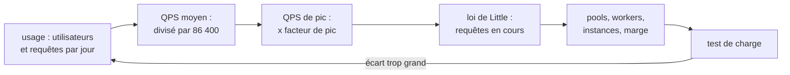

**Risques.** Ignorer le pic, c'est dimensionner sur la moyenne et tomber le soir des soldes ; oublier le stockage et sa croissance, c'est saturer un disque au bout de quelques mois. Je dimensionne sur le pic avec une marge et je confronte l'estimation à un test de charge.

:material-book-open-variant: Doc de référence : [Google SRE Book, « Handling Overload »](https://sre.google/sre-book/handling-overload/) (2016)
{ .doc-ref }

### Loi de Little

<a class="pill pill-scope pill-scope-system" href="#carte-des-echelles">Échelle · Système</a> <a class="pill pill-scope pill-scope-infra" href="#carte-des-echelles">Échelle · Infrastructure</a> <a class="pill pill-nature pill-nature-know" href="../architecture/#comment-lire-cette-page" title="Une loi ou un phénomène qu'on ne choisit pas : le connaître évite de mauvaises décisions">À connaître</a>

La **<span class="term" data-term="littles-law">loi de Little</span>** (John Little, 1961) : nombre de requêtes en cours = débit × durée moyenne. Elle dimensionne les pools de connexions, les threads et les workers.

!!! noob "As noob"
    Imaginons une boulangerie : s'il entre 2 clients par minute et que chacun reste 5 minutes, il y a en moyenne 10 personnes dans la boutique. Si le service ralentit à 10 minutes par client, la boutique en contient 20, sans un seul client de plus à l'entrée. La phrase à retenir : **quand le traitement ralentit, le nombre de requêtes en attente grimpe, même à trafic constant.**

```
1 200 requêtes/s × 0,2 s de traitement = 240 requêtes en cours en moyenne
si la base ralentit à 1 s : 1 200 × 1 = 1 200 requêtes en cours
un pool de 300 connexions sature : les requêtes attendent, la latence grimpe encore
```

C'est aussi pourquoi un timeout court protège : il limite la durée, donc le nombre de requêtes coincées.

**Risques.** L'ignorer, c'est dimensionner un pool de connexions sur la latence normale : le jour où la base ralentit, le nombre de requêtes en cours grimpe d'autant et le pool sature, alors que le trafic n'a pas bougé. Je dimensionne avec la latence du pire cas acceptable et je borne la durée par un timeout.

:material-book-open-variant: Doc de référence : [John D. C. Little, « Little's Law as Viewed on Its 50th Anniversary », Operations Research](https://pubsonline.informs.org/doi/10.1287/opre.1110.0940) (2011)
{ .doc-ref }

### Et la base de données

<a class="pill pill-scope pill-scope-infra" href="#carte-des-echelles">Échelle · Infrastructure</a> <span class="pill pill-status pill-status-ok" title="Toujours valable, vérifié en novembre 2026">Valable · 11/2026</span> <a class="pill pill-nature pill-nature-know" href="../architecture/#comment-lire-cette-page" title="Une loi ou un phénomène qu'on ne choisit pas : le connaître évite de mauvaises décisions">À connaître</a> <a class="pill pill-topic pill-topic-data" href="../architecture/#comment-lire-cette-page" title="Parle de l'endroit où vivent les données et de la façon dont leurs copies restent d'accord">Données</a>

Quand la charge augmente, la base est souvent la première limite. Grossir la machine (vertical), ajouter des réplicas de lecture, partitionner les données sur plusieurs machines (horizontal) : ces choix ont leurs propres compromis, détaillés dans [Faire grandir une base de données](sql.md#faire-grandir-une-base-de-donnees).

| Je veux... | J'utilise... |
|---|---|
| savoir en quelques minutes si une option est réaliste, avant de lancer un prototype | calcul de coin de table avec des ordres de grandeur |
| choisir combien de serveurs prévoir, alors que le trafic monte fort le soir ou pendant les soldes | QPS de pic, pas la moyenne, avec une marge |
| choisir la taille d'un pool de connexions ou le nombre de workers, en sachant que la base peut ralentir | loi de Little avec la latence du pire cas acceptable |
| vérifier que mes calculs tiennent face à la vraie charge | un test de charge, voir [Qualité et tests](qualite.md) |

!!! maturity "Mesurer la maturité"
    | Niveau | Ce que j'observe dans l'équipe |
    |---|---|
    | N1 | une personne fait un calcul de coin de table avant un lancement important, sur une feuille de brouillon |
    | N2 | chaque nouveau service a une estimation écrite (QPS moyen, pic, loi de Little pour les pools), vérifiée par un test de charge avant la mise en production |
    | N3 | un test de charge tourne chaque nuit et bloque la livraison si la capacité mesurée passe sous le pic prévu plus la marge |
    | N4 | l'équipe compare chaque mois l'estimation au trafic réel et corrige son facteur de pic et ses marges à partir de l'écart |

    **Je mesure** : l'écart entre le pic estimé et le pic observé, lu dans le tableau de bord de trafic ; la marge de capacité restante au pic, en pourcentage, lue en comparant le test de charge au trafic réel.

## Passer à l'échelle

Le calcul de capacité dit combien de charge il faut tenir ; cette section dit comment la tenir quand une seule machine ne suffit plus : les trois façons de multiplier un système (le scale cube), puis le cache, la façon la plus courante d'éviter de refaire un travail coûteux. Tout y est <span class="pill pill-nature pill-nature-decide">À décider</span>, et le cache parle de copies de données.

### Scale cube

<a class="pill pill-scope pill-scope-system" href="#carte-des-echelles">Échelle · Système</a> <a class="pill pill-scope pill-scope-infra" href="#carte-des-echelles">Échelle · Infrastructure</a> <span class="pill pill-status pill-status-ok" title="Toujours valable, vérifié en novembre 2026">Valable · 11/2026</span> <a class="pill pill-nature pill-nature-decide" href="../architecture/#comment-lire-cette-page" title="Un choix que l'équipe ou les architectes doivent faire, puis écrire dans un ADR">À décider</a>

Mon service ne tient plus la charge sur une machine. Le **scale cube** (Martin Abbott et Michael Fisher, « The Art of Scalability », 2009) range les façons d'en ajouter selon trois axes, qu'on peut combiner :

| Axe | Ce qu'on fait | Exemple avec `orders-service` | Coût |
|---|---|---|---|
| X : dupliquer | plusieurs copies identiques derrière un répartiteur de charge | 6 instances de `orders-service`, chacune sait tout faire | facile si le service est sans état ; la base partagée reste la limite |
| Y : découper par fonction | séparer les fonctions en services différents | `billing-service` et `stock-service` sortent de `orders-service` | frontières à trouver, appels réseau, contrats à versionner |
| Z : partitionner par donnée | chaque copie ne sert qu'une partie des clients ou des données | les clients A à M sur une partition, N à Z sur une autre | routage par clé, requêtes transverses difficiles, rééquilibrage |

!!! noob "As noob"
    Une boulangerie débordée a trois options. Embaucher d'autres vendeurs qui font tous la même chose (X). Séparer les métiers : un pâtissier, un boulanger, une caissière (Y). Ouvrir une deuxième boutique dans un autre quartier, qui sert ses propres clients (Z). La phrase à retenir : **dupliquer, découper par fonction, découper par client : je commence par le plus simple, l'axe X.**

**Quand.** L'axe X d'abord : c'est le moins cher, à condition que le service ne garde rien en mémoire entre deux requêtes. L'axe Y quand une fonction a une charge ou un rythme de changement très différent des autres : c'est le découpage en services ([Quel style choisir](#quel-style-choisir)). L'axe Z quand les données elles-mêmes ne tiennent plus sur une machine, en dernier parce que c'est le plus coûteux ([Sharder, en dernier](sql.md#sharder-en-dernier)). L'[architecture cellulaire](#architecture-cellulaire) est un axe Z appliqué à toute la pile.

**Pourquoi.** Nommer l'axe évite de répondre « on ajoute des serveurs » à un problème qui n'est pas là : dupliquer `orders-service` six fois ne sert à rien si c'est la base partagée qui sature.

:material-book-open-variant: Doc de référence : [AKF Partners, « The Scale Cube »](https://akfpartners.com/growth-blog/scale-cube) (consultée en novembre 2026) ; Martin Abbott et Michael Fisher, « The Art of Scalability » (2009)
{ .doc-ref }

### Où placer un cache

<a class="pill pill-scope pill-scope-system" href="#carte-des-echelles">Échelle · Système</a> <a class="pill pill-scope pill-scope-infra" href="#carte-des-echelles">Échelle · Infrastructure</a> <span class="pill pill-status pill-status-ok" title="Toujours valable, vérifié en novembre 2026">Valable · 11/2026</span> <a class="pill pill-nature pill-nature-decide" href="../architecture/#comment-lire-cette-page" title="Un choix que l'équipe ou les architectes doivent faire, puis écrire dans un ADR">À décider</a> <a class="pill pill-topic pill-topic-data" href="../architecture/#comment-lire-cette-page" title="Parle de l'endroit où vivent les données et de la façon dont leurs copies restent d'accord">Données</a>

La fiche produit de `catalog-service` met 800 ms à se construire et elle est lue des milliers de fois par minute. Un **<span class="term" data-term="cache-data">cache</span>** garde une copie de la réponse pour ne pas la recalculer. Avant d'en ajouter un, je mesure : souvent, un index manquant fait passer la requête de 800 ms à 50 ms sans cache ([EXPLAIN](sql.md#explain)). Un cache ajoute une copie qui peut mentir et une pièce qui peut tomber.

Les caches s'empilent en couches, du plus proche de l'utilisateur au plus proche de la base. Plus la couche est proche de l'utilisateur, plus elle économise, mais moins je la contrôle : une réponse gardée dans un navigateur ne s'invalide pas.

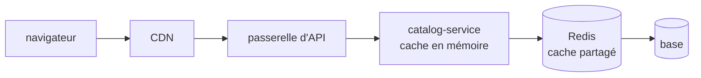

| Couche | Ce qu'elle garde | Comment je la pilote | Invalidable ? |
|---|---|---|---|
| navigateur | les réponses de cette personne | en-têtes `Cache-Control` (RFC 9111, juin 2022) | non : j'attends l'expiration, ou je change l'URL |
| <span class="term" data-term="cdn">CDN</span> | réponses publiques, images, pages | `Cache-Control`, purge par l'API du CDN | oui, en quelques secondes à quelques minutes |
| application, en mémoire | données chaudes d'une instance | code, taille maximale | seulement sur cette instance |
| cache partagé (Redis) | données partagées par toutes les instances | code : clé, durée de vie, suppression | oui, pour toutes les instances |

Une durée de vie, le **<span class="term" data-term="ttl">TTL</span>**, borne l'âge d'une copie : c'est une décision métier (« un prix vieux de 60 secondes est-il acceptable à l'affichage ? »), pas un réglage technique. Un cache a aussi une taille limitée : quand il est plein, il évince une entrée, le plus souvent la moins récemment utilisée (**LRU**, least recently used ; c'est la politique `allkeys-lru` de Redis). Je mesure le **taux de succès** (la part des lectures servies par le cache) couche par couche : un cache à 30 % de succès coûte souvent plus qu'il ne rapporte (ordre de grandeur d'exemple).

Ce qui ne passe jamais par un cache : les décisions qui engagent. Le prix affiché peut venir du CDN, le prix payé est relu à la source au moment du paiement ; le stock affiché peut être approximatif, la réservation se fait dans `stock-service`. Exemple de carte des caches d'une fiche produit (chiffres d'exemple) :

| Donnée | Couche | Durée de vie | Invalidation |
|---|---|---|---|
| image, description | CDN | 1 an | nouvelle URL à chaque version |
| prix affiché | CDN et Redis | 60 s, puis 30 s de copie périmée tolérée | événement `price.changed` |
| prix au paiement | aucune | sans objet | lecture directe de la source |
| stock affiché | Redis | 5 s | aucune, libellé prudent (« plus que quelques articles ») |

Le piège qui touche la sécurité : une page personnalisée mise en cache par le CDN est servie à l'utilisateur suivant ([Stratégies de rendu](front-end.md#strategies-de-rendu)).

:material-book-open-variant: Doc de référence : [IETF, RFC 9111 « HTTP Caching »](https://www.rfc-editor.org/rfc/rfc9111) (juin 2022)
{ .doc-ref }

### Lire et écrire avec un cache

<a class="pill pill-scope pill-scope-code" href="#carte-des-echelles">Échelle · Code</a> <a class="pill pill-scope pill-scope-app" href="#carte-des-echelles">Échelle · Application</a> <span class="pill pill-status pill-status-ok" title="Toujours valable, vérifié en novembre 2026">Valable · 11/2026</span> <a class="pill pill-nature pill-nature-decide" href="../architecture/#comment-lire-cette-page" title="Un choix que l'équipe ou les architectes doivent faire, puis écrire dans un ADR">À décider</a> <a class="pill pill-topic pill-topic-data" href="../architecture/#comment-lire-cette-page" title="Parle de l'endroit où vivent les données et de la façon dont leurs copies restent d'accord">Données</a>

Une fois le cache placé, reste à décider qui le remplit et ce qui se passe à l'écriture. Quatre motifs classiques :

| Motif | À la lecture | À l'écriture | Bon pour | Risque |
|---|---|---|---|---|
| <span class="term" data-term="cache-aside">cache-aside</span> | l'application lit le cache ; si la donnée manque, elle lit la base et remplit le cache | l'application écrit la base puis supprime l'entrée | le cas par défaut, Redis devant une base | une copie périmée jusqu'à la suppression ; premier accès lent |
| read-through | l'application ne parle qu'au cache, qui va lui-même chercher en base | comme cache-aside | une bibliothèque ou un service de cache qui sait lire la source | le cache devient une dépendance critique |
| <span class="term" data-term="write-through">write-through</span> | depuis le cache | chaque écriture met à jour la base et le cache dans le même traitement | une donnée relue juste après son écriture | écritures plus lentes ; des données mises en cache et jamais relues |
| write-behind (write-back) | depuis le cache | l'écriture va au cache, la base est mise à jour plus tard, par lots | des écritures très fréquentes, comme des compteurs de vues | écritures perdues si le cache tombe avant la recopie |

**Quand.** Cache-aside par défaut : simple, et le service continue de fonctionner sans le cache. Write-through quand une donnée est presque toujours relue juste après l'écriture. Write-behind seulement pour des données dont la perte de quelques secondes est acceptable (compteurs, statistiques), jamais pour une commande ou un paiement.

**Comment.** Le cache-aside en Python, avec Redis :

```python
import json

from redis.exceptions import RedisError

# Exemple : durée de vie de 10 minutes, filet de sécurité si une invalidation se perd
PRICE_TTL_S = 600


# À éviter : aucune durée de vie, et une panne de Redis fait échouer la page entière
def get_price_naive(redis, db, product_id: int) -> dict:
    cached = redis.get(f"price:{product_id}")
    if cached is None:
        cached = json.dumps(db.read_price(product_id))
        redis.set(f"price:{product_id}", cached)
    return json.loads(cached)


# Bien : durée de vie bornée, et lecture directe de la source si Redis est indisponible
def get_price(redis, db, product_id: int) -> dict:
    key = f"price:{product_id}"
    try:
        cached = redis.get(key)
    except RedisError:
        return db.read_price(product_id)
    if cached is not None:
        return json.loads(cached)
    price = db.read_price(product_id)
    redis.set(key, json.dumps(price), ex=PRICE_TTL_S)
    return price
```

Sans durée de vie, une invalidation oubliée (un prix modifié par un import de nuit qui ne prévient pas le cache) laisse le prix faux indéfiniment ; sans repli, le composant ajouté pour la performance devient une cause de panne. À l'écriture, je supprime l'entrée (`DEL price:42`) plutôt que de la réécrire : deux écritures concurrentes qui réécrivent le cache peuvent y laisser la plus ancienne valeur. Les bases de Redis sont dans [Cache : Redis](outils.md#cache-redis).

:material-book-open-variant: Doc de référence : [Microsoft, « Cache-Aside pattern »](https://learn.microsoft.com/en-us/azure/architecture/patterns/cache-aside) (consultée en novembre 2026)
{ .doc-ref }

### Invalidation et ruée sur le cache

<a class="pill pill-scope pill-scope-system" href="#carte-des-echelles">Échelle · Système</a> <span class="pill pill-status pill-status-ok" title="Toujours valable, vérifié en novembre 2026">Valable · 11/2026</span> <a class="pill pill-nature pill-nature-decide" href="../architecture/#comment-lire-cette-page" title="Un choix que l'équipe ou les architectes doivent faire, puis écrire dans un ADR">À décider</a> <a class="pill pill-topic pill-topic-data" href="../architecture/#comment-lire-cette-page" title="Parle de l'endroit où vivent les données et de la façon dont leurs copies restent d'accord">Données</a>

« Il n'y a que deux choses difficiles en informatique : l'invalidation de cache et nommer les choses » (phrase attribuée à Phil Karlton, date inconnue). L'**<span class="term" data-term="cache-invalidation">invalidation</span>** retire une copie quand la source change. Trois façons, souvent combinées :

- **par durée de vie** : l'entrée expire seule après son TTL ; simple, mais la copie peut mentir jusque-là ;
- **par événement** : le service propriétaire publie `price.changed`, et chaque cache supprime la clé concernée ; le TTL ne sert plus que de filet de sécurité ;
- **par version dans la clé ou l'URL** : `logo.3f9a2c.png`, `price:42:v7` ; une nouvelle version crée une nouvelle clé, l'ancienne n'est plus jamais lue. C'est la seule façon fiable pour les caches que je ne contrôle pas, comme le navigateur.

Le deuxième problème est la **<span class="term" data-term="cache-stampede">ruée sur le cache</span>** (cache stampede) : la fiche d'un produit populaire expire pendant les soldes, et les 500 requêtes qui arrivent dans la même seconde trouvent toutes le cache vide et frappent la base en même temps. La base ralentit, les requêtes s'accumulent, et le cache ne se remplit plus parce que chaque reconstruction finit en timeout.

!!! noob "As noob"
    La machine à café du bureau est vide à 9 h : tout le monde arrive en même temps, chacun constate qu'elle est vide et chacun relance une cafetière. Il suffisait qu'une seule personne la relance pendant que les autres attendaient deux minutes. La phrase à retenir : **quand une copie populaire disparaît, une seule requête doit la reconstruire, les autres attendent ou se contentent de l'ancienne.**

Quatre protections, qui se combinent :

| Protection | Principe | Exemple |
|---|---|---|
| regroupement des requêtes (request coalescing) | une seule requête par clé va à la base, les autres attendent son résultat | un verrou par clé dans chaque instance, ou un « lease » distribué par le cache (« Scaling Memcache at Facebook », NSDI 2013) |
| gigue sur le TTL | chaque entrée reçoit un TTL légèrement aléatoire, pour que les clés n'expirent pas toutes à la même seconde | 600 s plus ou moins 10 % au lieu de 600 s pile |
| stale-while-revalidate | servir la copie un peu périmée pendant qu'une seule requête la rafraîchit en arrière-plan | `Cache-Control: public, max-age=60, stale-while-revalidate=30` (RFC 5861, 2010) |
| rafraîchissement anticipé probabiliste | une requête rafraîchit l'entrée un peu avant son expiration, avec une probabilité qui augmente à l'approche | Vattani, Chierichetti et Lowenstein, VLDB 2015 |

```python
import random
import threading

# Exemple : TTL de base, gigue de 10 % et un verrou par clé
BASE_TTL_S = 600
TTL_JITTER = 0.1
_locks: dict[str, threading.Lock] = {}
_locks_guard = threading.Lock()


# À éviter : chaque requête qui trouve le cache vide reconstruit la fiche, toutes en même temps et avec le même TTL
def get_product_naive(cache, db, product_id: int) -> dict:
    key = f"product:{product_id}"
    product = cache.get(key)
    if product is None:
        product = db.build_product(product_id)
        cache.set(key, product, ex=BASE_TTL_S)
    return product


# Bien : une seule reconstruction par clé et par instance, TTL avec gigue
def get_product(cache, db, product_id: int) -> dict:
    key = f"product:{product_id}"
    product = cache.get(key)
    if product is not None:
        return product
    with _locks_guard:
        lock = _locks.setdefault(key, threading.Lock())
    with lock:
        product = cache.get(key)
        if product is None:
            product = db.build_product(product_id)
            ttl = int(BASE_TTL_S * random.uniform(1 - TTL_JITTER, 1 + TTL_JITTER))
            cache.set(key, product, ex=ttl)
    return product
```

Le second `cache.get` à l'intérieur du verrou est ce qui évite la ruée : les requêtes qui attendaient trouvent la fiche déjà reconstruite par la première. Ce verrou ne regroupe que les requêtes d'une même instance : avec 20 instances, la base reçoit au plus 20 reconstructions au lieu de 500, ce qui suffit souvent ; sinon, un verrou partagé dans Redis (`SET ... NX EX`) ne laisse passer qu'une reconstruction en tout.

:material-book-open-variant: Doc de référence : [IETF, RFC 5861 « HTTP Cache-Control Extensions for Stale Content »](https://www.rfc-editor.org/rfc/rfc5861) (2010) ; [Andrea Vattani, Flavio Chierichetti et Keegan Lowenstein, « Optimal Probabilistic Cache Stampede Prevention »](https://www.vldb.org/pvldb/vol8/p886-vattani.pdf) (VLDB, 2015)
{ .doc-ref }

| Je veux... | J'utilise... |
|---|---|
| tenir plus de charge sur un service sans état, comme une API qui ne garde rien en mémoire entre deux requêtes | axe X : plus de copies derrière le répartiteur de charge |
| qu'une fonction très sollicitée, comme la recherche, ne ralentisse pas la prise de commandes | axe Y : la sortir dans son propre service |
| stocker des données qui ne tiennent plus sur une machine, même après index, réplicas et machine plus grosse | axe Z : partitionner par client, en dernier |
| accélérer une fiche produit lue des milliers de fois par minute, après avoir vérifié qu'aucun index ne manque | cache-aside dans Redis, TTL décidé avec le métier |
| servir les images et les pages publiques au plus près des utilisateurs, sans charger mes serveurs | CDN, `Cache-Control`, URL versionnées |
| qu'une clé populaire qui expire pendant les soldes ne fasse pas tomber la base | regroupement des requêtes, gigue sur le TTL, stale-while-revalidate |
| que le prix payé soit toujours le bon, même si le prix affiché vient d'un cache | relire la source au paiement, jamais de cache sur une décision qui engage |

!!! maturity "Mesurer la maturité"
    | Niveau | Ce que j'observe dans l'équipe |
    |---|---|
    | N1 | un cache a été ajouté sur une page lente, sans TTL décidé avec le métier ni mesure de son taux de succès |
    | N2 | chaque cache a un TTL validé par le métier, un repli si le cache tombe et un taux de succès suivi couche par couche ; les instances sont sans état pour être dupliquées |
    | N3 | l'autoscaling ajoute des copies (axe X) seul, et la protection contre la ruée (regroupement, gigue, stale-while-revalidate) évite qu'une clé expirée surcharge la base |
    | N4 | l'équipe retire ou redimensionne les caches au taux de succès trop bas, et choisit l'axe X, Y ou Z à partir du goulot mesuré |

    **Je mesure** : le taux de succès de chaque couche de cache, lu dans les métriques de Redis et du CDN ; la charge de la base pendant les pics, avant et après le cache.

## Concevoir pour la livraison continue

<a class="pill pill-practice" href="../livraison/#livraison-et-deploiement-continus">Pratique · Déploiement continu</a>
<a class="pill pill-dora" href="https://dora.dev/capabilities/continuous-delivery/">DORA · Continuous delivery</a> <a class="pill pill-dora" href="https://dora.dev/capabilities/loosely-coupled-teams/">DORA · Loosely coupled teams</a>

Mon équipe veut mettre en production plusieurs fois par jour, mais chaque mise en production demande une soirée, trois équipes en ligne et un gel des fusions la veille. Le problème n'est pas le pipeline : c'est l'architecture. La **<span class="term" data-term="continuous-delivery">livraison continue</span>** (continuous delivery, Jez Humble et David Farley, « Continuous Delivery », 2010) veut dire que **chaque changement fusionné peut partir en production à tout moment**, sans risque et sans effort particulier ; un humain décide encore quand appuyer sur le bouton. Le <span class="term" data-term="continuous-deployment">déploiement continu</span> va un cran plus loin : plus personne n'appuie, tout changement vert part seul. Les pratiques (pipeline, contrôles, déploiement progressif) sont dans [Livraison et pratiques d'ingénierie](livraison.md#livraison-et-deploiement-continus) ; cette section dit ce que l'**architecture** doit permettre pour que ces pratiques marchent.

!!! noob "As noob"
    Une boulangerie qui ne sort qu'une fournée par semaine joue gros à chaque fois : si la recette est ratée, c'est toute la semaine qui est perdue. Une boulangerie qui cuit toutes les heures goûte chaque petite fournée, et une fournée ratée ne coûte qu'une heure. Mais pour cuire toutes les heures, il faut un fournil pensé pour : plusieurs fours, des plans de travail séparés. La phrase à retenir : **la livraison continue, ce sont de petits changements souvent ; c'est l'architecture qui dit si c'est possible.**

### Ce que l'architecture change à la livraison

<a class="pill pill-scope pill-scope-app" href="#carte-des-echelles">Échelle · Application</a> <a class="pill pill-scope pill-scope-system" href="#carte-des-echelles">Échelle · Système</a> <span class="pill pill-status pill-status-ok" title="Toujours valable, vérifié en novembre 2026">Valable · 11/2026</span> <a class="pill pill-nature pill-nature-decide" href="../architecture/#comment-lire-cette-page" title="Un choix que l'équipe ou les architectes doivent faire, puis écrire dans un ADR">À décider</a>

La recherche DORA (Nicole Forsgren, Jez Humble, Gene Kim, « Accelerate », 2018) relie la fréquence de livraison à une architecture **faiblement couplée** : une équipe peut tester et déployer sa partie sans demander la permission aux autres ni se synchroniser avec elles. Concrètement, quatre propriétés :

| Propriété | Ce qu'elle veut dire | Ce qui casse sans elle |
|---|---|---|
| déploiement indépendant | je déploie `orders-service` sans redéployer `billing-service` | une mise en production commune par semaine, et un bug d'une équipe bloque toutes les autres |
| contrats compatibles | une nouvelle version de l'API accepte encore les anciens appels (<span class="term" data-term="backward-compatibility">compatibilité ascendante</span>) | je dois déployer le serveur et tous ses clients à la même minute |
| migrations de base sans coupure | le schéma change en plusieurs étapes que l'ancien et le nouveau code supportent tous les deux | une fenêtre de maintenance la nuit, ou une erreur 500 pendant le déploiement |
| déployer n'est pas activer | le code part en production éteint, derrière un <span class="term" data-term="feature-flag">feature flag</span>, et s'allume plus tard | une fonctionnalité à moitié finie bloque la branche principale, ou part visible trop tôt |

Une architecture testable compte aussi : si chaque test passe par la base et le réseau, le pipeline dure une heure et personne ne livre dix fois par jour. L'[architecture hexagonale](#architecture-hexagonale-et-clean-architecture) et les [tests de contrat](qualite.md) gardent un pipeline court.

### Changer sans casser : expand and contract

<a class="pill pill-scope pill-scope-app" href="#carte-des-echelles">Échelle · Application</a> <a class="pill pill-scope pill-scope-system" href="#carte-des-echelles">Échelle · Système</a> <span class="pill pill-status pill-status-ok" title="Toujours valable, vérifié en novembre 2026">Valable · 11/2026</span> <a class="pill pill-nature pill-nature-decide" href="../architecture/#comment-lire-cette-page" title="Un choix que l'équipe ou les architectes doivent faire, puis écrire dans un ADR">À décider</a> <a class="pill pill-topic pill-topic-data" href="../architecture/#comment-lire-cette-page" title="Parle de l'endroit où vivent les données et de la façon dont leurs copies restent d'accord">Données</a>

Pendant un déploiement, l'ancienne et la nouvelle version du code tournent **en même temps** (déploiement progressif, plusieurs pods). Donc la base et les contrats doivent convenir aux deux. Le motif **<span class="term" data-term="expand-contract">expand and contract</span>** (aussi appelé « parallel change », Danilo Sato, martinfowler.com, 2014) découpe un changement cassant en étapes qui ne cassent rien : j'élargis d'abord (j'ajoute le nouveau à côté de l'ancien), je migre, puis je resserre (je retire l'ancien).

Exemple : renommer la colonne `customer_name` en `full_name`.

```sql
-- À éviter : renommer d'un coup, les pods encore en ancienne version plantent sur customer_name
ALTER TABLE customers RENAME COLUMN customer_name TO full_name;

-- Bien, déploiement 1 (expand) : ajouter la nouvelle colonne, le code écrit dans les deux
ALTER TABLE customers ADD COLUMN full_name TEXT;

-- Bien, déploiement 2 : recopier l'existant, le code lit full_name
UPDATE customers SET full_name = customer_name WHERE full_name IS NULL;

-- Bien, déploiement 3 (contract) : plus aucun code ne lit l'ancienne colonne, je la retire
ALTER TABLE customers DROP COLUMN customer_name;
```

```
lundi      déploiement 1 : colonne full_name ajoutée, le code écrit dans les deux colonnes
mardi      déploiement 2 : les anciennes lignes recopiées, le code lit full_name
mercredi   vérification : plus aucune requête sur customer_name (logs, recherche dans le code)
jeudi      déploiement 3 : customer_name supprimée
à tout moment, revenir à la version d'avant reste possible sans perte de données
```

La même idée vaut pour une API : j'ajoute le champ ou la route nouvelle, j'attends que tous les clients aient migré (je le mesure), puis je retire l'ancien.

**Risques.** L'étape « contract » est souvent oubliée : les deux colonnes restent pour toujours et le code écrit en double sans fin. Un `UPDATE` de recopie sur une très grosse table verrouille des lignes et ralentit la production s'il n'est pas découpé en lots. Je planifie le retrait dès le départ, avec une date, et je recopie par lots.

### Séparer déployer et activer

<a class="pill pill-scope pill-scope-code" href="#carte-des-echelles">Échelle · Code</a> <a class="pill pill-scope pill-scope-app" href="#carte-des-echelles">Échelle · Application</a> <span class="pill pill-status pill-status-ok" title="Toujours valable, vérifié en novembre 2026">Valable · 11/2026</span> <a class="pill pill-nature pill-nature-decide" href="../architecture/#comment-lire-cette-page" title="Un choix que l'équipe ou les architectes doivent faire, puis écrire dans un ADR">À décider</a>

**Déployer**, c'est mettre le code sur les serveurs ; **activer** (release), c'est le rendre visible aux utilisateurs. Un feature flag sépare les deux : je fusionne et je déploie tous les jours un code éteint, puis le produit l'allume quand il veut, d'abord pour 1 % des clients (Pete Hodgson, « Feature Toggles », martinfowler.com, 2017).

```python
# À éviter : l'activation codée en dur, impossible à couper en cas de bug sans redéployer
def shipping_fee(order: Order) -> Money:
    if date.today() >= date(2026, 12, 1):
        return new_shipping_fee(order)
    return legacy_shipping_fee(order)


# Bien : le nouveau calcul part en production éteint, et s'allume par client
def shipping_fee(order: Order) -> Money:
    if flags.is_enabled("new-shipping-fee", customer_id=order.customer_id):
        return new_shipping_fee(order)
    return legacy_shipping_fee(order)
```

Avec la date codée en dur, le 1er décembre à minuit le nouveau calcul s'allume pour tout le monde ; s'il est faux, il faut une correction, une revue et un déploiement pour l'éteindre. Le flag, lui, s'éteint en un clic.

Piège : un flag est une dette. Chaque flag oublié double les chemins à tester ; je lui donne un responsable et une date de retrait dès sa création.

**Quand s'y mettre.** Dès que les mises en production font peur, qu'elles se font le soir, ou que plusieurs équipes doivent se synchroniser pour livrer. Quand ne pas en faire trop : un prototype ou un outil interne utilisé par trois personnes peut se permettre une coupure de deux minutes ; les trois déploiements d'un expand and contract y coûtent plus qu'ils ne rapportent.

| Je veux... | J'utilise... |
|---|---|
| livrer `orders-service` sans attendre que l'équipe facturation ait fini sa version | des services ou modules déployables seuls, avec des contrats compatibles |
| renommer une colonne ou un champ d'API sans coupure, alors que l'ancienne et la nouvelle version tournent en même temps pendant le déploiement | expand and contract |
| fusionner tous les jours une fonctionnalité qui ne sera prête que dans trois semaines | un feature flag éteint |
| savoir si mon architecture freine la livraison | les cinq métriques DORA, et le nombre d'équipes à coordonner par mise en production |

:material-book-open-variant: Doc de référence : [Jez Humble, continuousdelivery.com](https://continuousdelivery.com/) (consultée en novembre 2026) ; [Danilo Sato, « ParallelChange »](https://martinfowler.com/bliki/ParallelChange.html) (2014)
{ .doc-ref }

!!! maturity "Mesurer la maturité"
    | Niveau | Ce que j'observe dans l'équipe |
    |---|---|
    | N1 | l'équipe sait faire un expand and contract ou poser un feature flag, mais seulement pour les changements qui font peur |
    | N2 | chaque changement de schéma suit expand and contract, chaque fonctionnalité non finie part derrière un flag avec un responsable et une date de retrait, et chaque service se déploie seul |
    | N3 | la CI refuse une migration cassante (renommage, suppression d'une colonne encore lue), et un flag dont la date de retrait est dépassée fait échouer le pipeline |
    | N4 | l'équipe suit les cinq métriques DORA et le nombre d'équipes à coordonner par mise en production, et s'attaque d'abord au couplage qui les freine |

    **Je mesure** : la fréquence de déploiement par service et le délai entre fusion et production, lus dans l'outil de CI/CD ; le nombre de flags plus vieux que leur date de retrait, lu dans l'outil de flags.

## Moderniser un système existant

Mon équipe hérite d'un monolithe de douze ans que plus personne n'ose toucher, et la tentation est de tout jeter pour recommencer. Cette section dit comment décider entre réécrire et refondre, puis comment remplacer un système morceau par morceau. Tout y est <span class="pill pill-nature pill-nature-decide">À décider</span>.

### Réécrire ou refondre progressivement

<a class="pill pill-scope pill-scope-app" href="#carte-des-echelles">Échelle · Application</a> <a class="pill pill-scope pill-scope-system" href="#carte-des-echelles">Échelle · Système</a> <span class="pill pill-status pill-status-ok" title="Toujours valable, vérifié en novembre 2026">Valable · 11/2026</span> <a class="pill pill-nature pill-nature-decide" href="../architecture/#comment-lire-cette-page" title="Un choix que l'équipe ou les architectes doivent faire, puis écrire dans un ADR">À décider</a>

Une **<span class="term" data-term="rewrite">réécriture complète</span>** reconstruit le système de zéro à côté de l'ancien, puis bascule d'un coup. Une **<span class="term" data-term="incremental-redesign">refonte progressive</span>** remplace ou améliore le système par petites étapes, chacune livrée en production. Ma position par défaut est la refonte progressive. Une réécriture doit rattraper des années de corrections et de règles métier écrites seulement dans le code, pendant que l'ancien système continue d'évoluer, et elle ne livre aucune valeur avant la bascule. Joel Spolsky y voyait « la pire erreur stratégique qu'une entreprise de logiciel puisse faire » (« Things You Should Never Do, Part I », avril 2000). Elle s'expose aussi à l'**<span class="term" data-term="second-system-effect">effet second système</span>** (Frederick Brooks, « The Mythical Man-Month », 1975) : la deuxième version accumule toutes les idées repoussées lors de la première.

| Critère | Pousse vers la refonte progressive | Pousse vers la réécriture |
|---|---|---|
| taille du système | grande, beaucoup de règles métier | petite, quelques semaines de travail |
| couverture de tests | faible : le comportement réel est mal connu | bonne : je sais vérifier l'équivalence |
| technologie | maintenue, montée de version possible | abandonnée, plus de correctifs de sécurité |
| évolutions pendant le projet | le métier en demande sans arrêt | le périmètre peut être gelé |
| besoin métier | proche de l'existant | très différent de l'existant |
| livraison intermédiaire | possible, morceau par morceau | impossible avant la bascule |

**Comment.** L'équipe de `orders-service` veut réécrire en dix-huit mois un monolithe jugé illisible, alors que le métier continue de demander des évolutions. Je mesure d'abord où se concentrent les changements et les bugs (l'historique Git le dit) : en général, une petite partie du code concentre l'essentiel de la douleur. Je remplace ces modules d'abord, après avoir figé leur comportement actuel par des **<span class="term" data-term="characterization-test">tests de caractérisation</span>**. Je fixe un critère d'arrêt avant de commencer : si le premier module remplacé n'apporte pas de gain mesurable en trois mois, sur le délai de livraison par exemple, on réévalue. Même quand la réécriture se justifie, je la découpe en tranches qui partent en production tôt.

:material-book-open-variant: Doc de référence : [Joel Spolsky, « Things You Should Never Do, Part I »](https://www.joelonsoftware.com/2000/04/06/things-you-should-never-do-part-i/) (avril 2000)
{ .doc-ref }

### Figuier étrangleur

<a class="pill pill-scope pill-scope-app" href="#carte-des-echelles">Échelle · Application</a> <a class="pill pill-scope pill-scope-system" href="#carte-des-echelles">Échelle · Système</a> <span class="pill pill-status pill-status-ok" title="Toujours valable, vérifié en novembre 2026">Valable · 11/2026</span> <a class="pill pill-nature pill-nature-decide" href="../architecture/#comment-lire-cette-page" title="Un choix que l'équipe ou les architectes doivent faire, puis écrire dans un ADR">À décider</a>

Le **<span class="term" data-term="strangler-fig">figuier étrangleur</span>** (Martin Fowler, 2004, d'après un figuier qui pousse autour d'un arbre jusqu'à le remplacer) construit le nouveau système autour de l'ancien et lui transfère les fonctions une à une, jusqu'à pouvoir éteindre l'ancien. Un point de routage devant le monolithe envoie certaines requêtes vers le nouveau composant, les autres restent sur l'ancien. Entre les deux, une **<span class="term" data-term="anti-corruption-layer">couche anti-corruption</span>** traduit les modèles, pour que celui de l'ancien système ne contamine pas le nouveau. Dans le code, le **<span class="term" data-term="branch-by-abstraction">branch by abstraction</span>** place une interface devant le code à remplacer, construit la nouvelle version derrière, puis bascule avec un <span class="term" data-term="feature-flag">feature flag</span>, sans branche Git longue.

!!! noob "As noob"
    Je rénove la maison où j'habite : plutôt que de la raser et de dormir à l'hôtel pendant deux ans, je refais une pièce à la fois et je continue de vivre dans les autres. À la fin, il ne reste rien de l'ancienne maison, et je n'ai jamais été sans toit. La phrase à retenir : **le nouveau système grandit autour de l'ancien et le remplace route par route, avec un retour arrière possible à chaque étape.**

**Comment.** Exemple : extraire la facturation d'un monolithe, parce que c'est elle qui change le plus souvent (règles fiscales) et que chaque changement demande trois semaines de tests manuels sur tout le monolithe.

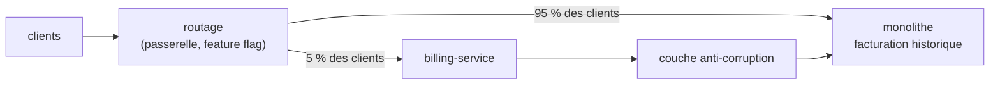

| Étape | Ce qui change | Retour arrière |
|---|---|---|
| 1 | le routage est en place, 0 % vers `billing-service` | aucun besoin |
| 2 | calcul en parallèle, comparaison des montants, réponse toujours donnée par le monolithe | arrêter la comparaison |
| 3 | 5 % des clients facturés par `billing-service` | flag à 0 % |
| 4 | 100 % des clients | flag à 0 % pendant un mois |
| 5 | code de facturation supprimé du monolithe | restaurer depuis Git, plus coûteux : on n'y arrive qu'après un mois stable |

La dernière étape est celle qu'on oublie : une modernisation qui ne retire rien ne fait qu'ajouter un système à maintenir. Le même principe sert à migrer un vieux front une route à la fois ([Micro front-ends](front-end.md#micro-front-ends)) et à changer un schéma de base ([expand and contract](#changer-sans-casser-expand-and-contract)). **Quand ne pas l'utiliser.** Un petit système bien couvert par des tests, qu'on réécrit en quelques semaines : le routage coûte alors plus que la réécriture.

:material-book-open-variant: Doc de référence : [Martin Fowler, « Strangler Fig »](https://martinfowler.com/bliki/StranglerFigApplication.html) (2004, réécrit depuis, à vérifier)
{ .doc-ref }

### Architecture sacrificielle

<a class="pill pill-scope pill-scope-app" href="#carte-des-echelles">Échelle · Application</a> <a class="pill pill-scope pill-scope-system" href="#carte-des-echelles">Échelle · Système</a> <span class="pill pill-status pill-status-ok" title="Toujours valable, vérifié en novembre 2026">Valable · 11/2026</span> <a class="pill pill-nature pill-nature-decide" href="../architecture/#comment-lire-cette-page" title="Un choix que l'équipe ou les architectes doivent faire, puis écrire dans un ADR">À décider</a>

Mon équipe lance un produit dont personne ne sait s'il trouvera ses utilisateurs. L'**<span class="term" data-term="sacrificial-architecture">architecture sacrificielle</span>** (Martin Fowler, « Sacrificial Architecture », 2014) accepte dès le départ que le code sera jeté et remplacé si le produit réussit, et le conçoit pour ça : des modules bien séparés qu'on pourra remplacer un par un, plutôt qu'une architecture prévue pour cent fois la charge. Fowler cite eBay, passé de scripts Perl en 1995 à C++ en 1997, puis à Java en 2002 (à vérifier).

**Pourquoi.** Concevoir tout de suite pour un trafic qu'on n'aura peut-être jamais retarde le lancement et coûte cher ; un système qui réussit finit de toute façon par être reconstruit, parce que les besoins changent avec l'échelle. **Comment.** J'écris le choix dans un [ADR](#adr) avec le signal qui déclenchera le remplacement (par exemple : « au-delà de 1 000 commandes par heure, on remplace le module de stock ») et je garde des frontières nettes entre modules, pour remplacer par morceaux avec un figuier étrangleur le moment venu. **Quand ne pas l'utiliser.** Pour ce qui doit durer : un schéma de base ou un format d'événement se jette mal ; c'est le code qu'on sacrifie, pas les données.

**Risques.** Le code « provisoire » survit souvent au succès du produit : personne ne déclenche le remplacement, et le prototype porte encore la charge des années plus tard. À l'inverse, sacrifier trop tôt un code qui marche coûte une réécriture inutile. Je suis le signal écrit dans l'ADR, comme le nombre de commandes par heure, et je réévalue quand il est atteint.

:material-book-open-variant: Doc de référence : [Martin Fowler, « Sacrificial Architecture »](https://martinfowler.com/bliki/SacrificialArchitecture.html) (2014)
{ .doc-ref }

| Je veux... | J'utilise... |
|---|---|
| décider s'il faut réécrire un vieux système jugé illisible, alors que le métier continue de demander des évolutions | la grille de décision, refonte progressive par défaut |
| remplacer la facturation d'un monolithe sans arrêter le service ni tout basculer d'un coup | figuier étrangleur, couche anti-corruption, feature flag |
| figer ce que fait vraiment un vieux module avant de le remplacer | tests de caractérisation |
| lancer vite un produit incertain sans m'interdire de le reconstruire s'il réussit | architecture sacrificielle, signal de remplacement écrit dans un ADR |

!!! maturity "Mesurer la maturité"
    | Niveau | Ce que j'observe dans l'équipe |
    |---|---|
    | N1 | l'équipe parle de remplacer l'ancien système, sans critère d'arrêt ni ordre de remplacement |
    | N2 | le remplacement suit un figuier étrangleur avec routage, tests de caractérisation devant chaque module et retour arrière prévu à chaque étape |
    | N3 | le routage compare automatiquement les réponses de l'ancien et du nouveau système, et repasse à 0 % vers le nouveau si l'écart dépasse un seuil |
    | N4 | l'équipe choisit le prochain module à remplacer d'après la concentration mesurée de changements et de bugs, et suit la part de trafic et de code encore dans l'ancien système |

    **Je mesure** : la part du trafic servie par le nouveau système, lue dans les métriques du routage ; les routes ou lignes de code retirées de l'ancien système par trimestre, lues dans l'historique Git.

## Urbaniser le système d'information

<a class="pill pill-scope pill-scope-enterprise" href="#carte-des-echelles">Échelle · Entreprise</a> <span class="pill pill-status pill-status-ok" title="Toujours valable, vérifié en novembre 2026">Valable · 11/2026</span>

L'**<span class="term" data-term="si-urbanization">urbanisation du système d'information</span>** applique au parc d'applications d'une entreprise l'image d'une ville : on ne reconstruit pas la ville, on la fait évoluer quartier par quartier en suivant un plan et des règles communes. Le terme est surtout utilisé en France (Jacques Sassoon, « Urbanisation des systèmes d'information », 1998, à vérifier ; Christophe Longépé, « Le projet d'urbanisation du SI », Dunod, première édition en 2001, à vérifier). Dans le monde anglophone, on parle d'**<span class="term" data-term="enterprise-architecture">architecture d'entreprise</span>** (enterprise architecture).

Là où le reste de cette page parle d'un système, l'urbanisation parle de **tous** les systèmes : 80 applications, 3 ERP hérités de rachats, des échanges de fichiers que personne ne maîtrise.

### Pourquoi

Sans plan, un système d'information grandit comme une ville sans cadastre :

- la même donnée (le client, le produit) existe dans cinq applications, avec cinq valeurs différentes ;
- chaque nouveau projet crée ses propres liaisons point à point, et le schéma des échanges devient un plat de spaghettis ;
- personne ne sait quelle application débrancher, ni ce qui casse si on la débranche ;
- les budgets financent des doublons sans le savoir.

L'urbanisation donne trois choses : une **carte** de l'existant, une **cible** à quelques années, et des **règles** que chaque projet respecte pour aller vers la cible.

### Les quatre vues et la métaphore de la ville

On décrit le système d'information en quatre couches, de la plus stable à la plus changeante :

| Vue | Question | Exemple |
|---|---|---|
| métier | que fait l'entreprise, par quels processus ? | « vendre », « livrer », « facturer » |
| fonctionnelle | quels blocs de fonctions faut-il pour cela ? | zone « relation client », quartier « commande », îlot « devis » |
| applicative | quelles applications rendent ces fonctions ? | `crm-app`, `orders-service`, `billing-service` |
| technique | sur quoi tournent-elles ? | Kubernetes, Postgres, broker de messages |

La vue fonctionnelle reprend le vocabulaire de la ville : des **zones** (grands domaines), découpées en **quartiers**, découpés en **îlots** (le plus petit bloc qu'une seule application doit porter).

Les règles d'urbanisme classiques :

1. chaque donnée de référence a **un seul propriétaire** (le référentiel client, le référentiel produit) ; les autres la consultent ou en reçoivent une copie ;
2. un îlot appartient à **une seule** application ;
3. les quartiers échangent par des **interfaces publiées** (API, événements sur un broker), jamais en lisant la base d'un autre ;
4. une nouvelle application se place d'abord sur la carte : si son îlot est déjà occupé, on justifie le doublon ou on réutilise.

### Exemple : une cartographie fictive

```
Zone Relation client
├─ Quartier Prospects ........ crm-app
└─ Quartier Comptes clients .. customer-referential   (référentiel : seul à écrire le client)
Zone Ventes
├─ Quartier Devis ............ crm-app, quote-tool    (doublon à résorber)
└─ Quartier Commandes ........ orders-service
Zone Finance
├─ Quartier Facturation ...... billing-service, legacy-erp (migration en cours)
└─ Quartier Paiement ......... (vide : prestataire externe via payment-adapter)
Zone Pilotage
└─ Quartier Reporting ........ data-warehouse          (lit des copies, n'écrit rien)
```

Lecture : deux applications sur « Devis » (un doublon à arbitrer), une migration en cours sur « Facturation », et une seule source d'écriture pour le client.

### Les cadres de référence

<span class="pill pill-status pill-status-ok" title="Toujours valable, vérifié en novembre 2026">Valable · 11/2026</span> <a class="pill pill-nature pill-nature-know" href="../architecture/#comment-lire-cette-page" title="Une loi ou un phénomène qu'on ne choisit pas : le connaître évite de mauvaises décisions">À connaître</a>

| Cadre | Ce que c'est | À quoi il sert |
|---|---|---|
| **<span class="term" data-term="togaf">TOGAF</span>** (The Open Group, première version en 1995, TOGAF Standard 10e édition en 2022) | une méthode, l'ADM : un cycle de phases (vision, métier, systèmes, technique, opportunités, migration, gouvernance) | conduire un programme de transformation de bout en bout |
| **<span class="term" data-term="zachman">Cadre de Zachman</span>** (John Zachman, IBM Systems Journal, 1987) | une grille : six questions (quoi, comment, où, qui, quand, pourquoi) croisées avec six points de vue | vérifier qu'aucune facette n'est oubliée ; ce n'est pas une méthode |
| **<span class="term" data-term="archimate">ArchiMate</span>** (The Open Group, version 3.2 en 2022, à vérifier) | un langage de modélisation, avec des symboles normalisés pour les couches métier, application et technique | dessiner les cartes de façon lisible par tous les architectes |
| **<span class="term" data-term="capability-map">carte des capacités</span>** | la liste de ce que l'entreprise sait faire, indépendamment de qui le fait | point de départ commun avec la direction ; c'est souvent la vue métier ci-dessus |
| urbanisation à la française (Sassoon, Longépé) | zones, quartiers, îlots et règles d'urbanisme | découper et ranger le parc applicatif |

TOGAF et l'urbanisation ne s'opposent pas : TOGAF dit comment mener la démarche, l'urbanisation dit comment découper et ranger.

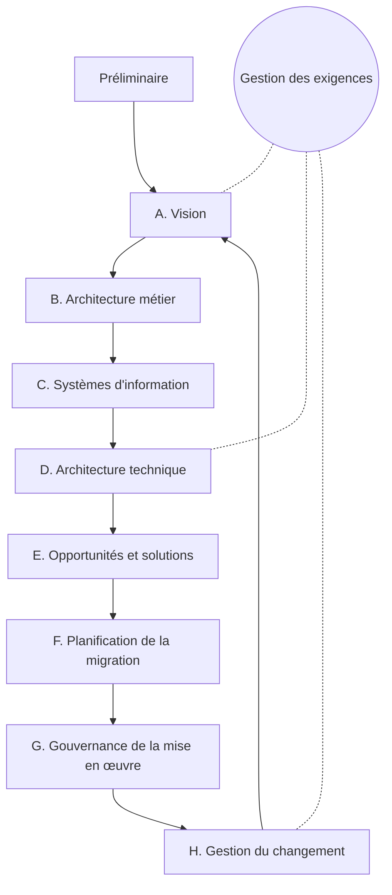

**Risques.** Appliquer TOGAF en entier dans une entreprise moyenne produit des livrables que personne ne lit et ralentit chaque projet ; dessiner en ArchiMate pour un public qui ne le connaît pas rend les cartes illisibles. Je prends dans chaque cadre ce qui sert la question du moment et je l'allège.

:material-book-open-variant: Doc de référence : [The Open Group, TOGAF Standard](https://www.opengroup.org/togaf) (10e édition, 2022) ; [The Open Group, ArchiMate](https://www.opengroup.org/archimate-forum/archimate-overview) (version 3.2, 2022)
{ .doc-ref }

### Quand et comment

**Quand.** La démarche a du sens à partir de quelques dizaines d'applications, ou dans un de ces moments : fusion ou rachat, sortie d'un ERP, migration vers le cloud, plainte récurrente « on ne sait pas qui fait quoi ». Pour une startup avec trois services, c'est de la bureaucratie : un schéma C4 de niveau 1 suffit.

**Comment.** Une démarche légère, qui livre quelque chose à chaque étape :

1. **cartographier l'existant** : lister les applications, leur propriétaire, les données qu'elles écrivent et leurs échanges (un tableur suffit au début) ;
2. **dessiner la carte des capacités** avec le métier, puis y projeter les applications : les doublons et les trous apparaissent tout seuls ;
3. **fixer quelques règles** (propriétaire unique de chaque donnée, échanges par API ou événements) et les publier ;
4. **définir la cible** à deux ou trois ans et les étapes, chaque étape portée par un projet qui a de toute façon lieu ;
5. **gouverner sans bloquer** : chaque nouveau projet se place sur la carte, et une décision qui s'écarte des règles se consigne dans un [ADR](#adr) ;
6. **tenir la carte vivante** : la générer depuis le catalogue de services ou le code quand c'est possible, sinon elle est fausse en six mois.

| Je veux... | J'utilise... |
|---|---|
| savoir quelles applications existent et à qui m'adresser pour chacune | inventaire des applications, puis cartographie |
| parler du système d'information avec la direction, en termes de ce que fait l'entreprise plutôt que de logiciels | carte des capacités |
| ranger le parc et repérer les doublons et les trous, comme deux outils de devis ou un quartier vide | zones, quartiers, îlots |
| mener une transformation sur plusieurs années, comme une fusion ou la sortie d'un ERP | cycle ADM de TOGAF, allégé |
| vérifier qu'une vision d'ensemble n'oublie aucune facette (quoi, qui, où, quand, pourquoi) | grille de Zachman |
| des schémas que tous les architectes lisent de la même façon, avec les mêmes symboles | ArchiMate |
| décrire un seul système ou quelques services, sans lourdeur | pas d'urbanisation : C4 et ADR suffisent |

!!! maturity "Mesurer la maturité"
    | Niveau | Ce que j'observe dans l'équipe |
    |---|---|
    | N1 | un tableur liste les applications, tenu par une personne, sans propriétaire ni échanges pour chacune |
    | N2 | la cartographie couvre toutes les applications avec propriétaire, données écrites et échanges, et des règles d'urbanisme sont publiées |
    | N3 | tout nouveau projet se place sur la carte dans le rituel de cadrage, sans que personne le demande, et la carte est générée depuis le catalogue de services |
    | N4 | les architectes suivent le nombre de doublons, d'échanges point à point et de données sans propriétaire unique, et fixent la cible à partir de leur évolution |

    **Je mesure** : le nombre d'îlots portés par plus d'une application, lu dans la cartographie ; la part des applications dont la fiche du catalogue a été mise à jour dans les six derniers mois.

## Documenter et gouverner

<a class="pill pill-practice" href="../livraison/#concevoir-avant-de-coder">Pratique · Conception technique</a>
<a class="pill pill-dora" href="https://dora.dev/capabilities/documentation-quality/">DORA · Documentation quality</a>

### Modèle C4

<a class="pill pill-scope pill-scope-code" href="#carte-des-echelles">Échelle · Code</a> <a class="pill pill-scope pill-scope-app" href="#carte-des-echelles">Échelle · Application</a> <a class="pill pill-scope pill-scope-system" href="#carte-des-echelles">Échelle · Système</a> <span class="pill pill-status pill-status-ok" title="Toujours valable, vérifié en novembre 2026">Valable · 11/2026</span> <a class="pill pill-nature pill-nature-decide" href="../architecture/#comment-lire-cette-page" title="Un choix que l'équipe ou les architectes doivent faire, puis écrire dans un ADR">À décider</a>

Le **<span class="term" data-term="c4-model">modèle C4</span>** (Simon Brown, site c4model.com, date de création à vérifier) dessine une architecture en quatre niveaux de zoom, chacun pour un public :

| Niveau | Montre | Pour qui |
|---|---|---|
| 1. Contexte | le système, ses utilisateurs, les systèmes externes | tout le monde, métier compris |
| 2. Conteneurs | les applications et bases déployées, et leurs échanges | équipes techniques, exploitation |
| 3. Composants | les grands blocs d'un conteneur | développeurs de ce conteneur |
| 4. Code | classes et fonctions | rarement dessiné à la main |

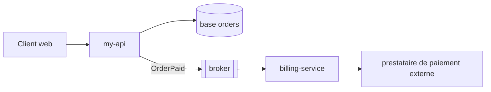

Les niveaux 1 et 2 suffisent dans la plupart des cas. Un schéma garde sa valeur s'il vit dans le repo, en texte (Mermaid, Structurizr), à côté du code.

**Risques.** Un schéma dessiné dans un outil de dessin, loin du code, est faux au bout de quelques mois, et un niveau 3 ou 4 pour chaque conteneur coûte plus à maintenir qu'il n'aide. Je garde les niveaux 1 et 2, en texte dans le repo, revus avec le code.

:material-book-open-variant: Doc de référence : [Simon Brown, « The C4 model »](https://c4model.com/) (consultée en novembre 2026)
{ .doc-ref }

### arc42

<a class="pill pill-scope pill-scope-system" href="#carte-des-echelles">Échelle · Système</a> <span class="pill pill-status pill-status-ok" title="Toujours valable, vérifié en novembre 2026">Valable · 11/2026</span> <a class="pill pill-nature pill-nature-decide" href="../architecture/#comment-lire-cette-page" title="Un choix que l'équipe ou les architectes doivent faire, puis écrire dans un ADR">À décider</a>

**<span class="term" data-term="arc42">arc42</span>** (Gernot Starke et Peter Hruschka, première version en 2005) est un plan de document d'architecture en douze sections : objectifs, contraintes, contexte, stratégie, vues, concepts transverses, décisions, exigences de qualité, risques, glossaire. On ne remplit que les sections utiles ; le plan sert surtout à ne rien oublier.

**Risques.** Remplir les douze sections par principe donne un document de quarante pages que personne ne lit ni ne met à jour. Je ne remplis que les sections qui répondent à une question réelle, et je renvoie aux ADR pour les décisions.

:material-book-open-variant: Doc de référence : [arc42, « Overview »](https://arc42.org/overview) (consultée en novembre 2026)
{ .doc-ref }

### ADR

<a class="pill pill-scope pill-scope-all" href="#carte-des-echelles">Toutes les échelles</a> <span class="pill pill-status pill-status-ok" title="Toujours valable, vérifié en novembre 2026">Valable · 11/2026</span> <a class="pill pill-nature pill-nature-decide" href="../architecture/#comment-lire-cette-page" title="Un choix que l'équipe ou les architectes doivent faire, puis écrire dans un ADR">À décider</a>

Une décision structurante se consigne dans un **<span class="term" data-term="adr">ADR</span>**, une page par décision, dans le repo. Le format et un exemple sont dans [Livraison : concevoir avant de coder](livraison.md#concevoir-avant-de-coder).

**Risques.** Un ADR écrit après coup justifie le choix au lieu de le discuter, et un ADR modifié en place efface la décision d'origine. Sans ADR, l'équipe redébat le même choix tous les six mois. J'écris l'ADR avant de trancher, avec les options rejetées, et je remplace un ADR dépassé par un nouveau qui le déclare caduc.

:material-book-open-variant: Doc de référence : [Michael Nygard, « Documenting Architecture Decisions »](https://cognitect.com/blog/2011/11/15/documenting-architecture-decisions) (2011) ; [Architectural Decision Records, adr.github.io](https://adr.github.io/) (consultée en novembre 2026)
{ .doc-ref }

### Scénarios de qualité, arbre d'utilité et ATAM

<a class="pill pill-scope pill-scope-app" href="#carte-des-echelles">Échelle · Application</a> <a class="pill pill-scope pill-scope-system" href="#carte-des-echelles">Échelle · Système</a> <span class="pill pill-status pill-status-ok" title="Toujours valable, vérifié en novembre 2026">Valable · 11/2026</span> <a class="pill pill-nature pill-nature-decide" href="../architecture/#comment-lire-cette-page" title="Un choix que l'équipe ou les architectes doivent faire, puis écrire dans un ADR">À décider</a>

Le métier demande « une plateforme de réservation fiable et rapide ». Ces adjectifs ne disent rien à l'architecture : rapide pour qui, combien, dans quelle situation ? Un **<span class="term" data-term="quality-attribute-scenario">scénario d'attribut de qualité</span>** (Len Bass, Paul Clements et Rick Kazman, « Software Architecture in Practice », 1re édition en 1998, 4e en 2021) transforme chaque adjectif en phrase vérifiable, en six parties :

| Partie | Question | Exemple pour « rapide » |
|---|---|---|
| source | qui ou quoi déclenche ? | les clients, au lancement d'une campagne |
| stimulus | que se passe-t-il ? | 200 réservations par seconde |
| environnement | dans quel état est le système ? | fonctionnement normal, pic de charge |
| artefact | quelle partie est touchée ? | `booking-service` et sa base |
| réponse | que doit faire le système ? | confirmer chaque réservation |
| mesure de la réponse | comment je vérifie ? | moins d'une seconde au p99, aucune double réservation |

!!! noob "As noob"
    Dire à un architecte « je veux une maison bien isolée », c'est presque ne rien dire ; « 19 °C dans le salon quand il fait -5 °C dehors, pour moins de 800 € de chauffage par an », il peut le concevoir et le vérifier. Le scénario de qualité fait la même chose pour un logiciel : il remplace l'adjectif par une situation et un chiffre. La phrase à retenir : **un attribut de qualité sans mesure est un souhait, pas une exigence.**

**Quand.** Au début d'un projet, quand les exigences arrivent sous forme d'adjectifs ; avant un choix d'architecture coûteux ; quand deux équipes se disputent un compromis, comme cohérence contre disponibilité, sans chiffres. **Pourquoi.** Le métier et l'équipe parlent des mêmes chiffres, les tests de charge et les SLO découlent des scénarios, et je ne surdimensionne pas pour une exigence que personne n'a demandée. Un chiffre choisi au hasard dimensionne tout le système : je le fais valider par ceux qui en paieront le coût.

**Comment.**

1. Je pose des questions concrètes au métier : que se passe-t-il pour le client si la réservation est indisponible dix minutes ? Qu'est-ce qui est pire, une réservation refusée ou la même place vendue deux fois ?
2. J'écris quatre à huit scénarios, au moins un par attribut important.
3. Je les range dans un **<span class="term" data-term="utility-tree">arbre d'utilité</span>** : la racine « utilité », puis les attributs, puis les scénarios, chacun noté par importance métier et par difficulté technique (H, M, L). Les scénarios notés (H, H) guident l'architecture.
4. Je relis la liste des caractéristiques de la norme ISO/IEC 25010 (2011, révisée en 2023) pour ne pas oublier une famille, comme la sécurité ou la maintenabilité.

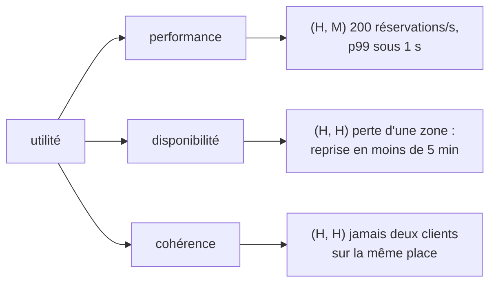

Dans cet exemple, le métier a dit sans le formuler que la double réservation est inacceptable : c'est une exigence de cohérence forte sur le stock de places, qui pèsera plus sur l'architecture que la vitesse ([Cohérence forte ou à terme](#coherence-forte-ou-a-terme)).

Deux méthodes du Software Engineering Institute (SEI, Carnegie Mellon) vont plus loin. Le **Quality Attribute Workshop** (QAW, rapport de 2003) est un atelier d'une journée avec les parties prenantes pour faire émerger et classer les scénarios, avant que l'architecture existe. L'**<span class="term" data-term="atam">ATAM</span>** (Architecture Tradeoff Analysis Method, 2000) évalue une architecture proposée : architectes et métier passent les scénarios de l'arbre un par un et notent les risques, les points sensibles et les compromis que chacun révèle. Une version allégée tient en une demi-journée : les scénarios (H, H), et pour chacun « qu'est-ce qui, dans le design, le rend tenable, et qu'est-ce qui le casserait ? ». Les scénarios retenus deviennent ensuite des contrôles automatiques ([Fitness functions](#fitness-functions)).

:material-book-open-variant: Doc de référence : [SEI, « ATAM: Method for Architecture Evaluation »](https://insights.sei.cmu.edu/library/atam-method-for-architecture-evaluation/) (2000) ; [SEI, « Quality Attribute Workshops (QAWs), Third Edition »](https://insights.sei.cmu.edu/library/quality-attribute-workshops-qaws-third-edition/) (2003)
{ .doc-ref }

### Fitness functions

<a class="pill pill-scope pill-scope-code" href="#carte-des-echelles">Échelle · Code</a> <a class="pill pill-scope pill-scope-system" href="#carte-des-echelles">Échelle · Système</a> <span class="pill pill-status pill-status-ok" title="Toujours valable, vérifié en novembre 2026">Valable · 11/2026</span> <a class="pill pill-nature pill-nature-decide" href="../architecture/#comment-lire-cette-page" title="Un choix que l'équipe ou les architectes doivent faire, puis écrire dans un ADR">À décider</a>

Une **<span class="term" data-term="fitness-function">fitness function</span>** (Neal Ford, Rebecca Parsons et Patrick Kua, « Building Evolutionary Architectures », 2017) est un contrôle automatique qui vérifie en continu qu'une décision d'architecture reste vraie : une règle de dépendance, un seuil de latence, une taille d'image. Sans elle, le code dérive du schéma en quelques mois.

Exemple en Python avec import-linter, fichier `.importlinter` vérifié à chaque pipeline :

```ini
# Exemple : orders ne peut pas importer billing.storage, vérifié en CI
[importlinter:contract:orders-isolation]
name = orders n'importe que l'API publique de billing
type = forbidden
source_modules = my_api.orders
forbidden_modules = my_api.billing.storage
```

**Risques.** Un contrôle fragile, qui échoue au hasard, finit désactivé, et la règle disparaît avec lui. Trop de règles bloquent des changements légitimes et poussent à les contourner. Je commence par deux ou trois règles qui protègent une décision écrite dans un ADR, et je supprime celles qui ne servent plus.

:material-book-open-variant: Doc de référence : [Thoughtworks Technology Radar, « Architectural fitness function »](https://www.thoughtworks.com/radar/techniques/architectural-fitness-function) (consultée en novembre 2026)
{ .doc-ref }

### Tech radar d'entreprise

<a class="pill pill-scope pill-scope-enterprise" href="#carte-des-echelles">Échelle · Entreprise</a> <span class="pill pill-status pill-status-ok" title="Toujours valable, vérifié en novembre 2026">Valable · 11/2026</span> <a class="pill pill-nature pill-nature-decide" href="../architecture/#comment-lire-cette-page" title="Un choix que l'équipe ou les architectes doivent faire, puis écrire dans un ADR">À décider</a>

Dans une entreprise de vingt équipes, chacune choisit ses outils : trois bibliothèques de logs, deux brokers, un service écrit dans un langage qu'une seule personne maîtrise. Le jour où elle part, personne ne sait maintenir ce service, et l'équipe plateforme doit brancher la CI, l'observabilité et les scans de sécurité sur chaque technologie, une par une. Un **<span class="term" data-term="tech-radar">tech radar</span> d'entreprise** rend ces choix visibles : la liste des technologies que l'entreprise soutient, essaie, étudie ou ne veut plus voir dans un nouveau projet, chacune avec sa justification.

Il est en général tenu par les **architectes**, ou par un groupe d'ingénieurs seniors qui couvre tous les domaines (backend, front, données, mobile, infrastructure). C'est leur outil pour traduire la stratégie technique en règles que chaque équipe applique seule, sans passer par un comité à chaque projet. Neal Ford, membre du Technology Advisory Board de Thoughtworks, conseille d'en tenir deux : un pour soi, pour sa carrière, et un pour l'entreprise, pour ses choix techniques (« Build your own Technology Radar », 2016). Les outils pour le dessiner sont dans [Panorama des outils : tech radar](outils.md#tech-radar-thoughtworks-byor-zalando-aoe-cncf).

!!! noob "As noob"
    C'est la carte des vins d'un restaurant, tenue par le sommelier. Les valeurs sûres sont en tête de carte (Adopt), la suggestion du moment se goûte au verre (Trial), le sommelier déguste des nouveautés avant de les proposer (Assess), et une bouteille retirée de la carte n'est plus commandée, mais on finit celles qui sont ouvertes (Hold). **Le radar ne dit pas ce qui est interdit : il dit ce que l'entreprise sait servir, et pourquoi.**

<figure class="diagram radar">
<svg viewBox="-20 -20 280 285" role="img" aria-label="Un radar : quatre anneaux du centre vers le bord, quatre quadrants par type de technologie (entrées fictives)">
<circle class="set" cx="120" cy="120" r="110"/>
<circle class="layer layer-1" cx="120" cy="120" r="82"/>
<circle class="layer layer-2" cx="120" cy="120" r="56"/>
<circle class="layer layer-3" cx="120" cy="120" r="30"/>
<line class="set" x1="120" y1="10" x2="120" y2="230"/>
<line class="set" x1="10" y1="120" x2="230" y2="120"/>
<text class="label-strong" x="135" y="130" text-anchor="middle">Adopt</text>
<text class="label-strong" x="163" y="130" text-anchor="middle">Trial</text>
<text class="label-strong" x="189" y="130" text-anchor="middle">Assess</text>
<text class="label-strong" x="216" y="130" text-anchor="middle">Hold</text>
<text class="label-strong" x="-15" y="-6">Techniques</text>
<text class="label-strong" x="255" y="-6" text-anchor="end">Outils</text>
<text class="label-strong" x="-15" y="258">Plateformes</text>
<text class="label-strong" x="255" y="258" text-anchor="end">Langages et frameworks</text>
<circle class="hit" cx="140" cy="100" r="4"/>
<text x="146" y="97">Testcontainers</text>
<circle class="hit" cx="88" cy="82" r="4"/>
<text x="82" y="78" text-anchor="end">Pact</text>
<circle class="hit" cx="105" cy="140" r="4"/>
<text x="99" y="152" text-anchor="end">Kubernetes</text>
<circle class="hit" cx="185" cy="195" r="4"/>
<text x="185" y="210" text-anchor="middle">framework Y</text>
</svg>
<figcaption>Un radar : quatre anneaux du centre vers le bord, quatre quadrants par type de technologie (entrées fictives)</figcaption>
</figure>

Les quatre anneaux, avec un sens que l'entreprise doit écrire noir sur blanc. Zalando, par exemple, les a redéfinis en 2020 ainsi :

| Anneau | Sens chez Zalando (2020) | Ce que ça change pour une équipe |
|---|---|---|
| Adopt | adoption large, l'entreprise s'engage à investir sur le long terme | je peux l'utiliser sans demander, la plateforme le soutient |
| Trial | les expériences en cours, en production | je l'essaie sur un vrai service, avec un responsable qui suit l'essai |
| Assess | étude active de technologies prometteuses, hors production | je peux lire, prototyper, rédiger un retour, pas déployer |
| Hold | adoption large déconseillée ; aucune nouvelle application ne doit l'utiliser | je ne démarre rien de nouveau avec ; l'existant tourne et migre à son rythme |

**Quand.** Les signaux : plusieurs équipes (à partir de cinq ou six, ordre de grandeur personnel), la même question qui revient à chaque nouveau projet (« quel broker ? », « quelle base ? »), une équipe plateforme qui ne peut plus outiller toutes les technologies, un service orphelin dans un langage que plus personne ne connaît. Pas besoin de radar pour une ou deux équipes qui se parlent tous les jours : un [ADR](#adr) par décision suffit.

**Pourquoi.** Le gain : des choix cohérents sans comité pour chaque projet ; chaque équipe sait ce qui est soutenu (CI, observabilité, sécurité) ; moins de technologies à maintenir et à apprendre aux nouveaux arrivants ; et un chemin officiel pour les idées nouvelles (Assess, puis Trial) au lieu d'une arrivée en production en douce. Le coût : du temps d'ingénieurs seniors à chaque revue, et un risque de freiner l'innovation si Hold devient « interdit » sans discussion.

**Comment.**

1. **Constituer le groupe** : architectes et ingénieurs seniors de chaque domaine, avec un mandat clair de la direction technique. Sans mandat, le radar est ignoré : c'est le premier problème que décrit Zalando en 2020, des choix faits par les équipes seules et des entrées ajoutées après coup, une fois la technologie déjà en production.
2. **Partir de l'existant** : ce qui tourne vraiment en production (catalogue de services, dépendances déclarées, enquête auprès des développeurs), pas les préférences du groupe.
3. **Écrire les critères de chaque anneau** : par exemple, pour Adopt, la technologie est branchée sur la CI, l'observabilité et les scans de sécurité, au moins deux équipes l'opèrent en production et l'entreprise peut recruter des gens qui la connaissent. Pour Trial, un responsable s'engage à retirer l'essai s'il échoue.
4. **Ouvrir les propositions** : n'importe quelle équipe propose une entrée ou un changement d'anneau, par une merge request ou un RFC, avec sa justification.
5. **Revoir à rythme fixe**, chaque trimestre ou chaque semestre, et publier : chaque entrée garde son historique et la date de son dernier déplacement.
6. **Brancher le radar sur le quotidien** : les <span class="term" data-term="golden-path">golden paths</span> et les modèles de projet n'utilisent que des technologies Adopt, s'écarter du radar demande un ADR, et une [fitness function](#fitness-functions) ou une règle de CI signale une dépendance en Hold dans un nouveau dépôt.

Le cycle de vie d'une entrée :

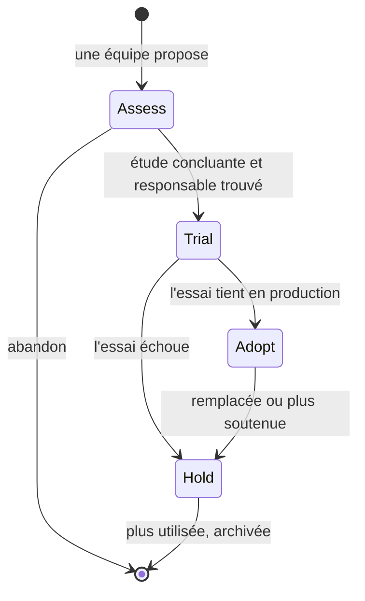

Exemple : une entrée tenue comme du code, un fichier par entrée relu en merge request (format inspiré du générateur AOE, contenu fictif) :

```
radar/2026-11-01/contrats-pilotes-par-le-consommateur.md
---
title: "Contrats pilotés par le consommateur (Pact)"
ring: trial
quadrant: techniques
---
Essai entre orders-service et billing-service depuis septembre 2026.
Responsable : le lead technique de team-core.
Passage en Adopt si aucune régression d'intégration n'arrive en production
pendant trois mois. Si l'essai échoue, team-core retire Pact de ses deux dépôts.
```

Le radar ne remplace ni l'ADR ni le golden path, les trois s'emboîtent :

| Outil | Portée | Question à laquelle il répond |
|---|---|---|
| ADR | une décision, dans un système | pourquoi ce choix ici, et pas un autre ? |
| tech radar d'entreprise | toute l'entreprise | quelles technologies sont soutenues, essayées, étudiées ou à éviter, et pourquoi ? |
| golden path | un chemin outillé | comment démarrer un service avec les choix Adopt déjà branchés ? |

Pièges :

- **un radar sans mandat ni critères** : tenu par des volontaires, sans règle pour changer d'anneau, il ne fait que constater après coup ce qui est déjà en production ;
- **Hold lu comme « interdit, migrez tout »** : les équipes réécrivent des services qui marchent, au lieu de ne plus rien démarrer de nouveau avec ;
- **recopier un radar public** : je reprends les anneaux de Thoughtworks comme politique d'entreprise, alors que personne chez moi ne sait opérer l'outil ni ne le soutient dans la CI ;
- **un radar figé** : jamais revu, il conseille des outils que l'entreprise a abandonnés, et plus personne ne le lit.

:material-book-open-variant: Doc de référence : [Zalando Engineering, « Technology Choices at Zalando: Updating our Tech Radar Process »](https://engineering.zalando.com/posts/2020/07/technology-choices-at-zalando-tech-radar-update.html) (juillet 2020) ; [Neal Ford, « Build your own Technology Radar »](https://www.thoughtworks.com/insights/blog/build-your-own-technology-radar) (2016)
{ .doc-ref }

| Je veux... | J'utilise... |
|---|---|
| expliquer le système à un nouveau venu ou au métier, sans entrer dans le code | C4 niveaux 1 et 2 |
| écrire un document d'architecture complet sans partir d'une page blanche | plan arc42, sections utiles seulement |
| que l'équipe sache encore dans un an pourquoi elle a choisi une option plutôt qu'une autre | ADR dans le repo |
| que le code ne contredise pas l'architecture en douce, comme `orders` qui importe les détails internes de `billing` | fitness functions dans la CI |
| que chaque nouvelle équipe sache quel broker ou quelle base choisir, sans réunion, alors que la plateforme ne peut pas tout outiller | tech radar d'entreprise, tenu par les architectes |

!!! maturity "Mesurer la maturité"
    | Niveau | Ce que j'observe dans l'équipe |
    |---|---|
    | N1 | quelques ADR et schémas existent, écrits par une personne motivée, souvent périmés |
    | N2 | toute décision structurante a son ADR dans le repo, les schémas C4 de niveaux 1 et 2 vivent en texte à côté du code, et le tech radar est publié |
    | N3 | la revue de merge request exige un ADR pour un changement d'architecture, les fitness functions bloquent une dérive, et la CI signale une dépendance en Hold |
    | N4 | l'équipe suit les dérives bloquées, l'âge des ADR et des schémas et le respect du radar, et ajuste ses règles à partir de ces chiffres |

    **Je mesure** : la part des changements d'architecture fusionnés avec un ADR lié, lue dans l'outil de merge request ; le nombre de fitness functions et de violations bloquées par mois, lu dans les rapports de CI.

## Mesurer le succès

Une solution d'architecture marche quand un chiffre bouge dans le bon sens sans qu'un autre se dégrade. Avant de changer quoi que ce soit, je relève une base : la disponibilité, la latence p99 ou la fréquence de livraison des quatre dernières semaines, par exemple. Après le changement, je relève la même mesure, de la même façon, sur une fenêtre de même durée, pour ne pas comparer une semaine de soldes à une semaine creuse. Et je choisis une métrique de garde qui ne doit pas bouger : ajouter un cache ne doit pas faire apparaître de prix faux, découper en services ne doit pas faire baisser la disponibilité de la chaîne. Le chiffre suivi est un SLI, l'objectif que l'équipe se fixe dessus est un SLO, et la promesse faite à un client avec pénalité est un SLA, en général plus lâche que le SLO.

| Solution ou situation | Indicateur de succès (SLI) | SLO probable | SLA probable |
|---|---|---|---|
| monolithe modulaire ou microservices ([Styles d'architecture](#styles-darchitecture)) | part des mises en production qui exigent de déployer plusieurs services ou modules ensemble | moins de 10 % sur un trimestre | sans objet : pas de contrat externe |
| paiements idempotents ([Idempotence](#idempotence)) | nombre de paiements débités deux fois | 0 par mois, chaque doublon est traité comme un incident | aucun double débit non remboursé après 5 jours ouvrés (un double débit coûte un client et un litige bancaire) |
| appels protégés par timeout, retry et disjoncteur ([Résilience](#resilience)) | part des requêtes de `my-api` servies sans erreur 5xx en moins de 800 ms | 99,9 % sur 30 jours glissants | 99,5 % par mois, avec un avoir en dessous (plus lâche pour garder une marge avant la pénalité) |
| service réparti sur trois zones ([Zones et régions](#zones-et-regions)) | disponibilité mesurée de l'extérieur par une sonde | 99,95 % par mois, environ 22 min d'arrêt | 99,9 % par mois, environ 43 min |
| reprise après sinistre ([RTO et RPO](#rto-et-rpo)) | RTO et RPO réels mesurés en exercice de reprise | RTO de 1 h et RPO de 5 min, vérifiés à chaque exercice trimestriel | RTO de 4 h et RPO de 1 h, écrits au contrat |
| cache devant la fiche produit ([Passer à l'échelle](#passer-a-lechelle)) | latence p95 de la fiche produit ; en garde, prix payés différents du prix source | p95 sous 200 ms, 0 prix faux au paiement | sans objet : pas de contrat externe, le prix payé est relu à la source |
| architecture pour la livraison continue ([Concevoir pour la livraison continue](#concevoir-pour-la-livraison-continue)) | délai médian entre fusion et production, taux d'échec des changements | moins d'un jour, moins de 15 % de changements qui demandent une correction | sans objet : pas de contrat externe |

[À prendre avec précaution : ordres de grandeur d'exemple, à fixer avec le métier]

!!! noob "As noob"
    Un transporteur promet par contrat une livraison avant midi, sinon il rembourse les frais de port : c'est le SLA. En interne, ses équipes visent 11 h : c'est le SLO, plus exigeant, pour que les petits retards ne coûtent rien. Le SLI, c'est l'heure de livraison que le scanner enregistre pour chaque colis. La phrase à retenir : **le SLO est mon objectif interne, le SLA la promesse payante au client, et je vise toujours mieux que ce que je promets.**

## Pièges à éviter

- **Découper trop tôt** : je pars en microservices dès le premier jour, avant de savoir où passent les frontières métier. Chaque erreur de découpage se paie en appels réseau, en contrats à versionner et en déploiements à coordonner. Je commence par un monolithe modulaire et je découpe quand une douleur mesurée l'exige ([voir Quel style choisir](#quel-style-choisir)).
- **Le monolithe distribué** : je sépare les services mais je les laisse lire les mêmes tables. Un renommage de colonne casse trois services à la fois, et ils doivent tous être déployés ensemble. Chaque service garde ses données et les autres passent par son API ou ses événements ([voir Une base par service](#une-base-par-service)).
- **Le timeout par défaut** : je garde la valeur de la bibliothèque, souvent infinie ou de plusieurs minutes. Une dépendance lente bloque mes threads et la lenteur se propage à tout ce qui m'appelle. Je fixe un timeout d'après la latence mesurée, un peu au-dessus du p99 de la dépendance ([voir Timeout](#timeout)).
- **Réessayer partout et tout de suite** : chaque niveau d'une chaîne de trois services réessaie trois fois, sans attendre. Une seule requête en produit 27 sur le dernier service, qui s'effondre. Je réessaie à un seul niveau, avec backoff exponentiel, gigue et un budget de retry ([voir Budget de retry](#budget-de-retry)).
- **Réessayer une opération non idempotente** : je rejoue un paiement après un timeout alors que la réponse s'est seulement perdue. Le client est débité deux fois. Je n'envoie de retry que sur une opération idempotente, avec une clé d'idempotence écrite dans la même transaction que le débit ([voir Idempotence](#idempotence)).
- **Croire qu'une compensation efface le passé** : je conçois une saga comme si l'annulation remettait tout à zéro. Le client voit le débit puis le remboursement sur son relevé, et le métier découvre cet état intermédiaire en production. Je fais valider par le métier chaque état intermédiaire visible ([voir Saga orchestrée ou chorégraphiée](#saga-orchestree-ou-choregraphiee)).
- **Dimensionner sur la moyenne** : je prévois mes serveurs d'après le QPS moyen de la journée. Le soir ou pendant les soldes, le pic dépasse la capacité et le service tombe au moment où il rapporte le plus. Je dimensionne sur le pic avec une marge, puis je vérifie par un test de charge ([voir QPS moyen et pic](#qps-moyen-et-pic)).
- **Oublier les points uniques de défaillance non techniques** : je double les serveurs mais une seule personne sait déployer, ou un certificat n'a pas de responsable. Le jour où elle est absente ou où le certificat expire, tout s'arrête. Je liste les SPOF, techniques et humains, au début de chaque revue de disponibilité ([voir Point unique de défaillance](#point-unique-de-defaillance)).

## Ce qu'on demande en entretien

Les questions typiques :

- « Monolithe ou microservices pour un nouveau produit ? », « Qu'est-ce qu'un monolithe distribué ? » Pour répondre : je pars du nombre d'équipes et de la stabilité des frontières métier ([Quel style choisir](#quel-style-choisir)).
- « Explique le théorème CAP », « Cohérence forte ou à terme pour un solde bancaire, et pour un compteur de likes ? » Pour répondre : je rappelle que le choix ne se pose que pendant une coupure réseau, puis je compare les deux cas ([CAP et PACELC](#cap-et-pacelc)), et [Le théorème CAP](textes-fondateurs.md#brewer-2000-puis-gilbert-et-lynch-2002-le-theoreme-cap).
- « Comment garder des données cohérentes entre deux services sans transaction distribuée ? », « Comment publier un événement sans le perdre si la base a écrit ? » Pour répondre : je décris une saga avec ses compensations, puis l'outbox ([Saga orchestrée ou chorégraphiée](#saga-orchestree-ou-choregraphiee), [Outbox](#outbox)).
- « Un service dont tu dépends devient lent, que fais-tu ? », « Comment éviter qu'un retry débite deux fois ? » Pour répondre : j'empile timeout, retry avec gigue, disjoncteur et idempotence ([Résilience](#resilience), [Idempotence](#idempotence)).
- « Comment abordes-tu un exercice de system design ? » Pour répondre : je clarifie d'abord les besoins et les ordres de grandeur, je propose le design le plus simple qui y répond, puis je cherche ses goulots d'étranglement et la façon dont il tombe en panne ([Estimer la capacité](#estimer-la-capacite), [Résilience](#resilience)).
- « Combien de serveurs pour un million d'utilisateurs actifs par jour ? » Pour répondre : je déroule le calcul de coin de table, du QPS moyen au pic puis à la loi de Little ([QPS moyen et pic](#qps-moyen-et-pic), [Loi de Little](#loi-de-little)).
- « Comment livres-tu plusieurs fois par jour sans coupure ? », « Comment renommes-tu une colonne en production ? » Pour répondre : je parle de déploiement indépendant, de contrats compatibles, d'expand and contract et de feature flags, puis je renvoie aux pratiques du pipeline ([Concevoir pour la livraison continue](#concevoir-pour-la-livraison-continue)).
- « Qu'est-ce que la loi de Conway, et qu'en fais-tu ? » Pour répondre : je décris l'équipe front, l'équipe back et l'équipe base qui produisent trois couches couplées, puis la manœuvre inverse ([Loi de Conway](#loi-de-conway)).
- « Comment choisis-tu une base de données ? » Pour répondre : je pars des motifs d'accès, je prends une base relationnelle par défaut et je n'ajoute une autre famille que pour un motif qu'elle sert mal, en citant les jetons d'innovation ([Choisir le type de base](#choisir-le-type-de-base)).
- « Où places-tu un cache, et comment évites-tu qu'une clé populaire qui expire fasse tomber la base ? » Pour répondre : je mesure d'abord, je raisonne en couches, cache-aside par défaut avec un TTL décidé par le métier, puis <span class="term" data-term="request-coalescing">regroupement des requêtes</span>, gigue et stale-while-revalidate contre la ruée ([Passer à l'échelle](#passer-a-lechelle)).
- « Conçois un limiteur de débit pour une API ouverte à des partenaires. » Pour répondre : je compare fenêtre fixe, fenêtre glissante et seau à jetons, je partage le compteur dans Redis entre les instances et je renvoie `429` avec `Retry-After` ([Limitation de débit](#limitation-de-debit)).
- « Le métier veut un système "rapide et fiable", que fais-tu ? » Pour répondre : je transforme chaque adjectif en scénario en six parties, je les range dans un arbre d'utilité et je fais valider les chiffres ([Scénarios de qualité, arbre d'utilité et ATAM](#scenarios-de-qualite-arbre-dutilite-et-atam)).
- « Réécriture complète ou refonte progressive ? » Pour répondre : refonte progressive par défaut, avec la grille de décision, puis le figuier étrangleur étape par étape avec son retour arrière ([Moderniser un système existant](#moderniser-un-systeme-existant)).
- « Comment documentes-tu une décision d'architecture ? » Pour répondre : je montre un ADR et les vues C4 que je dessine ([ADR](#adr), [Modèle C4](#modele-c4)).
- « Comment encadres-tu le choix des technologies entre plusieurs équipes ? », « Qui décide qu'un outil est adopté ? » Pour répondre : je décris un radar d'entreprise tenu par les architectes avec un mandat, des critères écrits par anneau, des propositions ouvertes à toutes les équipes et une revue à rythme fixe, puis je le relie aux ADR et aux golden paths ([Tech radar d'entreprise](#tech-radar-dentreprise)).
- « Comment sais-tu que ta nouvelle architecture marche ? », « Quelle différence entre SLO et SLA ? » Pour répondre : je relève une base avant, la même mesure après sur une fenêtre de même durée et une métrique de garde, puis je donne un SLI, un SLO interne et un SLA plus lâche avec pénalité ([Mesurer le succès](#mesurer-le-succes)).

Ce qui fait une bonne réponse : elle nomme le compromis, ce que le choix apporte, ce qu'il coûte, et dans quelle situation je ferais l'inverse. Un style ou un motif présenté sans son coût sonne comme une réponse apprise.

## Quoi utiliser dans quelle situation

| Situation | J'utilise |
|---|---|
| je lance un nouveau produit avec une ou deux équipes, et je ne sais pas encore où couper | monolithe modulaire, frontières vérifiées en CI |
| plusieurs équipes se bloquent sur un même déploiement : une seule mise en production par semaine, et une équipe qui casse le build bloque les autres | découpage par contexte borné, puis services |
| mes services sont séparés, mais je dois toujours les déployer ensemble parce qu'ils partagent une base ou s'appellent en chaîne | revoir les frontières : c'est un monolithe distribué |
| un fait, comme une commande payée, doit prévenir d'autres services sans que l'émetteur les attende | événements, outbox, consommateurs idempotents |
| une action métier traverse plusieurs services, comme réserver le stock puis débiter le client | saga avec compensations validées par le métier |
| un service lent fait tomber, en cascade, tous ceux qui l'appellent | timeout, disjoncteur, cloison |
| pendant une panne, les nouvelles tentatives de tous les clients arrivent en même temps et aggravent la situation | backoff exponentiel avec gigue, budget de retry |
| le métier me fixe un objectif de disponibilité, comme 99,9 %, et je dois savoir s'il est tenable | calcul composé, suppression des SPOF, trois zones |
| le métier demande « combien de temps et de données peut-on perdre ? » | fixer RTO et RPO, puis choisir la stratégie de reprise |
| je dois estimer la charge avant de construire, pour savoir combien de serveurs et de connexions prévoir | calcul de coin de table, QPS de pic, loi de Little |
| chaque mise en production demande une soirée et plusieurs équipes en ligne, alors que je voudrais livrer tous les jours | déploiement indépendant, contrats compatibles, expand and contract, feature flags |
| je prends une décision dont personne ne se rappellera le pourquoi dans un an | ADR |
| le code s'éloigne peu à peu du schéma d'architecture, sans que personne le remarque | fitness functions |
| personne ne sait quels systèmes existent, qui les possède ni où sont les doublons | urbanisation : cartographie, carte des capacités, règles |
| chaque équipe choisit ses outils seule, et je découvre en production un troisième broker ou un langage que personne d'autre ne connaît | tech radar d'entreprise, branché sur les golden paths et les ADR |
| mon métier a des règles riches, comme les remises, que chaque changement de base ou de prestataire met en danger | architecture hexagonale, règle de dépendance vérifiée en CI |
| un partenaire au script mal écrit sature mon API, et tous les autres clients subissent des timeouts | limite de débit par clé, compteur partagé, `429` avec `Retry-After` |
| une page lue des milliers de fois par minute est lente, et j'ai déjà vérifié qu'aucun index ne manque | cache-aside, TTL décidé avec le métier, protection contre la ruée |
| je dois choisir la base d'un nouveau service, et quelqu'un propose déjà une technologie à la mode | motifs d'accès, base relationnelle par défaut |
| le métier décrit ses besoins avec des adjectifs, comme « rapide et fiable » | scénarios de qualité, arbre d'utilité |
| mon équipe veut réécrire de zéro un vieux système, alors que le métier continue de demander des évolutions | refonte progressive, figuier étrangleur |

## Sources

- Len Bass, Paul Clements et Rick Kazman, « Software Architecture in Practice », 4e édition (2021)
- Eric Evans, « Domain-Driven Design » (2003)
- [Melvin Conway, « How Do Committees Invent? » (1968)](https://www.melconway.com/Home/Committees_Paper.html)
- Matthew Skelton et Manuel Pais, « Team Topologies » (2019)
- [James Lewis et Martin Fowler, « Microservices » (2014)](https://martinfowler.com/articles/microservices.html)
- [Martin Fowler, « MonolithFirst » (2015)](https://martinfowler.com/bliki/MonolithFirst.html)
- [Alistair Cockburn, « Hexagonal Architecture » (2005)](https://alistair.cockburn.us/hexagonal-architecture/)
- [Neal Ford, « Build your own Technology Radar », Thoughtworks (2016, reprise d'un billet de 2013)](https://www.thoughtworks.com/insights/blog/build-your-own-technology-radar)
- [Zalando Engineering, « Technology Choices at Zalando: Updating our Tech Radar Process » (juillet 2020)](https://engineering.zalando.com/posts/2020/07/technology-choices-at-zalando-tech-radar-update.html)
- [Zalando Engineering, « Building a Better Tech Radar » (janvier 2018)](https://engineering.zalando.com/posts/2018/01/building-tech-radar.html)
- [Robert C. Martin, « The Clean Architecture » (2012)](https://blog.cleancoder.com/uncle-bob/2012/08/13/the-clean-architecture.html)
- Alberto Brandolini, « Introducing EventStorming » (Leanpub, publié par parties depuis 2015 environ, à vérifier)
- [Seth Gilbert et Nancy Lynch, « Brewer's Conjecture and the Feasibility of Consistent, Available, Partition-Tolerant Web Services » (2002)](https://dl.acm.org/doi/10.1145/564585.564601)
- [Daniel Abadi, « Consistency Tradeoffs in Modern Distributed Database System Design », IEEE Computer (2012)](https://www.cs.umd.edu/~abadi/papers/abadi-pacelc.pdf)
- [Diego Ongaro et John Ousterhout, « In Search of an Understandable Consensus Algorithm » (2014)](https://raft.github.io/raft.pdf)
- [Leslie Lamport, « Time, Clocks, and the Ordering of Events in a Distributed System » (1978)](https://lamport.azurewebsites.net/pubs/time-clocks.pdf)
- Hector Garcia-Molina et Kenneth Salem, « Sagas », ACM SIGMOD (1987)
- [Martin Fowler, « Event Sourcing » (2005)](https://martinfowler.com/eaaDev/EventSourcing.html)
- [Martin Fowler, « CQRS » (2011)](https://martinfowler.com/bliki/CQRS.html)
- Martin Kleppmann, « Designing Data-Intensive Applications » (2017)
- Michael Nygard, « Release It! », 2e édition (2018)
- [Marc Brooker, « Exponential Backoff And Jitter », AWS Architecture Blog (2015)](https://aws.amazon.com/blogs/architecture/exponential-backoff-and-jitter/)
- [Betsy Beyer et al., « Site Reliability Engineering », Google (2016)](https://sre.google/sre-book/table-of-contents/)
- [AWS, « Disaster Recovery of Workloads on AWS » (2021)](https://docs.aws.amazon.com/whitepapers/latest/disaster-recovery-workloads-on-aws/disaster-recovery-workloads-on-aws.html)
- [AWS, « Reducing the Scope of Impact with Cell-Based Architecture » (2023, à vérifier)](https://docs.aws.amazon.com/wellarchitected/latest/reducing-scope-of-impact-with-cell-based-architecture/reducing-scope-of-impact-with-cell-based-architecture.html)
- John D. C. Little, « A Proof for the Queuing Formula: L = λW », Operations Research (1961)
- [Simon Brown, The C4 model (date de publication non indiquée)](https://c4model.com/)
- [arc42, modèle de documentation d'architecture (première version en 2005)](https://arc42.org/)
- Neal Ford, Rebecca Parsons et Patrick Kua, « Building Evolutionary Architectures » (2017)
- Jacques Sassoon, « Urbanisation des systèmes d'information », Hermès (1998, à vérifier)
- Christophe Longépé, « Le projet d'urbanisation du SI », Dunod (première édition en 2001, à vérifier)
- [The Open Group, TOGAF Standard, 10e édition (2022)](https://www.opengroup.org/togaf)
- John Zachman, « A Framework for Information Systems Architecture », IBM Systems Journal (1987)
- [The Open Group, ArchiMate 3.2 (2022, à vérifier)](https://www.opengroup.org/archimate-forum/archimate-overview)
- [Jeffrey Palermo, « The Onion Architecture » (2008)](https://jeffreypalermo.com/2008/07/the-onion-architecture-part-1/)
- [import-linter, documentation (date de publication non indiquée)](https://import-linter.readthedocs.io/)
- Martin Abbott et Michael Fisher, « The Art of Scalability » (2009)
- [Dan McKinley, « Choose Boring Technology » (2015)](https://mcfunley.com/choose-boring-technology)
- [Martin Fowler, « PolyglotPersistence » (2011)](https://martinfowler.com/bliki/PolyglotPersistence.html)
- [SEI, « ATAM: Method for Architecture Evaluation » (2000)](https://insights.sei.cmu.edu/library/atam-method-for-architecture-evaluation/)
- [SEI, « Quality Attribute Workshops (QAWs), Third Edition » (2003)](https://insights.sei.cmu.edu/library/quality-attribute-workshops-qaws-third-edition/)
- [IETF, RFC 9111 « HTTP Caching » (juin 2022)](https://www.rfc-editor.org/rfc/rfc9111)
- [IETF, RFC 5861 « HTTP Cache-Control Extensions for Stale Content » (2010)](https://www.rfc-editor.org/rfc/rfc5861)
- [Andrea Vattani, Flavio Chierichetti et Keegan Lowenstein, « Optimal Probabilistic Cache Stampede Prevention », VLDB (2015)](https://www.vldb.org/pvldb/vol8/p886-vattani.pdf)
- [Rajesh Nishtala et al., « Scaling Memcache at Facebook », NSDI (2013)](https://www.usenix.org/conference/nsdi13/technical-sessions/presentation/nishtala)
- [Stripe, « Scaling your API with rate limiters » (2017)](https://stripe.com/blog/rate-limiters)
- [Cloudflare, « Counting things, a lot of different things » (2017)](https://blog.cloudflare.com/counting-things-a-lot-of-different-things/)
- [Becky Weiss et Mike Furr, « Static stability using Availability Zones », Amazon Builders' Library (2020, à vérifier)](https://aws.amazon.com/builders-library/static-stability-using-availability-zones/)
- [Greg Young, « Versioning in an Event Sourced System », Leanpub (2017, à vérifier)](https://leanpub.com/esversioning)
- [Joel Spolsky, « Things You Should Never Do, Part I » (avril 2000)](https://www.joelonsoftware.com/2000/04/06/things-you-should-never-do-part-i/)
- Frederick Brooks, « The Mythical Man-Month » (1975)
- [Martin Fowler, « Strangler Fig » (2004, réécrit depuis, à vérifier)](https://martinfowler.com/bliki/StranglerFigApplication.html)
- [Martin Fowler, « Sacrificial Architecture » (2014)](https://martinfowler.com/bliki/SacrificialArchitecture.html)
