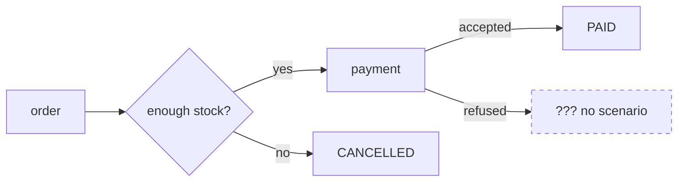
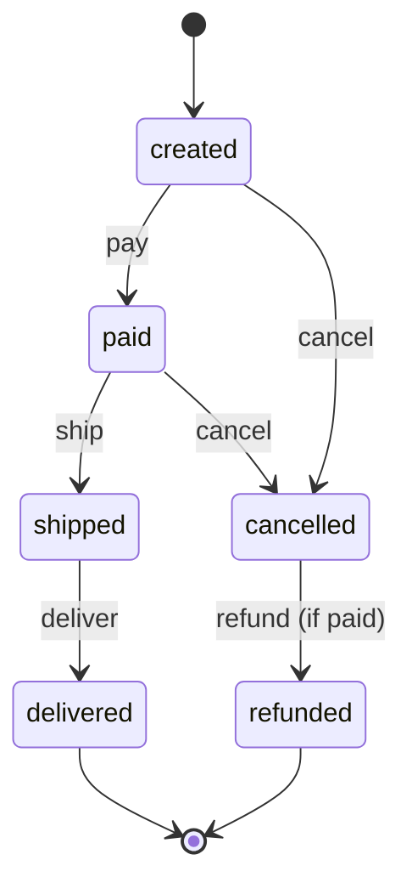

# Designing tests

!!! warning "Disclaimer"
    These notes are personal cheat sheets, not a source of truth. They reflect my own understanding and choices: their content remains subjective, despite the quotes and references it contains. It may be incomplete, simplified, inaccurate or outdated. Always check the official documentation before applying it. This content is provided as is, without any warranty: you use it at your own risk.

!!! audience "Who and what for"
    - **Roles**: QA, SDET, back-end or front-end developer, product owner, tech lead
    - **Uses**: I prepare the test strategy of a new feature, like promo codes, and rank its risks; I pick the values to test for an "age between 18 and 65" field; I prepare an exploratory session on a new CSV import; I write a bug report a developer reproduces on the first try; I check that a payment form can be filled in with the keyboard

!!! abstract "Scales"
    The colored badges under the headings say at which scale a notion applies:

    - <span class="pill pill-scope pill-scope-code">Code</span> the classes, functions and modules of one program;
    - <span class="pill pill-scope pill-scope-app">Application</span> one service or application and its internal split;
    - <span class="pill pill-scope pill-scope-system">System</span> several services talking to each other over the network;
    - <span class="pill pill-scope pill-scope-infra">Infrastructure</span> servers, network, zones and clusters, physical or virtual;
    - <span class="pill pill-scope pill-scope-enterprise">Enterprise</span> the whole information system and its organization.

    Details and ambiguous words: [map of scales](architecture.md#map-of-scales).

This page starts from the moment I know I have to test, and answers two questions: **what to test** and **how to write it** so that the test proves something. It follows the order of a test campaign: the strategy (where to put the effort, when to stop), designing scenarios and test cases, exploring what nobody planned for, test data, TDD and legacy code, reporting a defect, and accessibility.

The foundations (testing vocabulary, reference models, test levels, integration, contracts) and what keeps quality up over time (coverage, quality gates, CI, flaky tests, measurement) live in [Software quality and testing](qualite.md).

In the examples, the accounts `ada`, `grace` and `dennis` are fictitious test users, and the figures are examples.

:material-swap-horizontal: The tools mentioned on this page: which ones replace each other, which ones combine? See [Complementary or competing](outils.md#complementary-or-competing).
{ .doc-ref }

## Terminology

### Defect, test case, scenario

- **Defect (bug)**: the software does not do what it should. An **<span class="term" data-term="escaped-defect">escaped defect</span>** is a defect that every check let through all the way to production. Full example in [Defect, regression, escaped defect](qualite.md#defect-regression-escaped-defect).
- **Test case**: a precise input, an action and the expected result, written to check a rule.
- **Scenario**: an end-to-end user journey, written in sentences, that chains several actions and ends with an expected result.
- **Test design technique**: a method that gives a reason for each test case (partitions, boundary values, decision table...), instead of picking values at random.

``` { .text .ex-illus title="Illustration" }
rule       : the age must be between 18 and 65 inclusive
test case  : age 17, expected "refused"           (boundary value, picked by a technique)
scenario   : ada signs up at 17, sees the error message, fixes it, then signs up
defect     : 65 is refused, because the code says < 65 instead of <= 65
```

:material-book-open-variant: Reference docs: [ISTQB, Glossary](https://glossary.istqb.org/) (accessed November 2026)
{ .doc-ref }

### Risk, exit criterion, accepted risk

- **Risk**: what would hurt if it broke, scored on **likelihood** (is it likely to happen?) and **impact** (how much it costs if it does). Example: "a promo code applied twice", likely and costly.
- **<span class="term" data-term="exit-criteria">Exit criterion</span>**: a measurable condition, written before testing, that says when testing is done. Example: "no critical bug open".
- **<span class="term" data-term="accepted-risk">Accepted risk</span>**: a risk the PO chooses not to cover, written down in black and white with its reason. Example: "promo code label badly translated, not tested".

:material-book-open-variant: Reference docs: [ISTQB, Certified Tester Foundation Level v4.0](https://www.istqb.org/certifications/certified-tester-foundation-level-ctfl-v4-0/) (2023)
{ .doc-ref }

### Gherkin, PO, Playwright Codegen, HAR

**<span class="term" data-term="gherkin">Gherkin</span>**: a format for writing a scenario in sentences (`Given` the context, `When` the action, `Then` the expected result), that humans read and a tool runs. Full definition in [Testing vocabulary](qualite.md#testing-vocabulary).

**<span class="term" data-term="product-owner">PO (Product Owner)</span>**: the person who decides what the product must do, and therefore what an acceptance test must prove and how urgent a bug is.

**Playwright Codegen**: a tool that records clicks in a browser and generates the test code. **HAR**: the file that records all the network traffic of that session, including passwords and <span class="term" data-term="token-oauth">tokens</span>, hence the mandatory cleanup.

:material-book-open-variant: Reference docs: [Cucumber, Gherkin Reference](https://cucumber.io/docs/gherkin/reference/) (accessed November 2026); [Playwright, Test generator](https://playwright.dev/docs/codegen) (accessed November 2026)
{ .doc-ref }

### SLI, SLO, SLA

**SLI (Service Level Indicator)**: the indicator I actually measure, as a share of good events. Example: the share of bugs sent back as "cannot reproduce" over 30 days.

**SLO (Service Level Objective)**: an internal numeric target on an <span class="term" data-term="sli">SLI</span>, over a time window, for example "under 5% of bugs that cannot be reproduced over 30 days".

**SLA (Service Level Agreement)**: the promise written into a customer's contract, with a penalty if it is not met. It is usually looser than the <span class="term" data-term="slo">SLO</span>, so the team is alerted well before having to pay. Example: a critical defect fixed within 8 business hours internally, an <span class="term" data-term="sla">SLA</span> of 24 business hours in the support contract.

:material-book-open-variant: Reference docs: [Google SRE Book, Service Level Objectives](https://sre.google/sre-book/service-level-objectives/) (2016)
{ .doc-ref }

## Test strategy: risks and exit criteria

<a class="pill pill-scope pill-scope-app" href="../architecture/#map-of-scales">Scale · Application</a> <a class="pill pill-scope pill-scope-system" href="../architecture/#map-of-scales">Scale · System</a>

I cannot test everything (ISTQB principle 2, see [The seven testing principles](qualite.md#the-seven-testing-principles-istqb)). Two decisions therefore frame every test campaign: **where to put the effort** at the start, and **when to stop** at the end. Both are written before testing, not on release day.

### Risk-based testing

<span class="pill pill-status pill-status-ok" title="Still valid, checked November 2026">Current · 11/2026</span>

My team adds promo codes to the shop: a code gives a percentage or a fixed amount, it has an end date, a maximum number of uses, and it does not stack with sales. I do not start from a list of test cases but from a list of **risks**: what would hurt most if it broke. <span class="term" data-term="risk-based-testing">Risk-based testing</span> (ISTQB Foundation syllabus v4.0, 2023) scores each risk on **likelihood** and **impact**, and the product of the two decides the depth and the order of the tests.

!!! noob "As noob"
    It is servicing a car before a long trip: I check the brakes and the tyres first, not the radio. The takeaway: **test effort follows risk, and what I do not test is written down in black and white.**

**How.** In a thirty-minute workshop with the PO and a developer: I list the risks, score likelihood from 1 (unlikely) to 3 (very likely) and impact from 1 (minor annoyance) to 3 (lost money or customers). The score therefore goes from 1 to 9: the higher it is, the earlier the risk is handled. Example for promo codes:

| Risk | Likelihood | Impact | Score | What I do |
|---|---|---|---|---|
| code applied twice to the same order | 2 | 3 | **6** | unit and API tests, double-click case |
| maximum uses exceeded by two simultaneous orders | 2 | 3 | **6** | API test with parallel requests, where a <span class="term" data-term="race-condition">race</span> lets one use too many through |
| expired code still accepted | 2 | 2 | 4 | boundary values on the end date, as unit tests |
| stacking with sales | 1 | 3 | 3 | decision table, as unit tests |
| code typed in lowercase or with spaces refused | 3 | 1 | 3 | exploratory session |
| code label badly translated | 1 | 1 | 1 | not tested, **risk accepted and written down** |

The last row matters as much as the others: a written <span class="term" data-term="accepted-risk">accepted risk</span> is a decision the PO made knowingly, a forgotten risk is a gap. The table fits on one screen and answers the question "what did you test?" in advance.

**When.** At the start of every feature, and again when time runs short before a release: I then test the highest scores and say what is left. For a small fix, three rows are enough: the matrix is a sorting tool, not a deliverable. **Why.** Test time goes where a defect is expensive, and developers get a list of risks they can cover themselves in the code. The same scores serve at company scale in a [risk register](culture-entreprise.md#risk-register).

**Risks.** Scores are subjective: the team underestimates the probability of what it knows poorly, and a module scored 1 is never tested until its first incident. I have three people with different roles score, and I raise the score of an area that already had incidents. An accepted risk nobody rereads stays accepted forever: I reread the list at every big release.

:material-book-open-variant: Reference docs: [ISTQB, Certified Tester Foundation Level v4.0](https://www.istqb.org/certifications/certified-tester-foundation-level-ctfl-v4-0/) (2023, chapter 5 on risk management)
{ .doc-ref }

### Exit criteria and the go/no-go decision

<span class="pill pill-status pill-status-ok" title="Still valid, checked November 2026">Current · 11/2026</span>

The release is planned for tomorrow morning and someone asks me "is QA fine with it?". Without a rule written beforehand, the answer depends on mood and on calendar pressure. <span class="term" data-term="exit-criteria">Exit criteria</span> are measurable conditions, set at the start of the campaign, that say when testing is done. The **go/no-go** is the decision to release (go) or postpone (no-go), made by comparing those criteria with the real state.

Example criteria, written under the risk matrix:

- every risk with a score of 4 or more has at least one green automated test;
- no critical bug open, and every open major bug has a written workaround;
- the <span class="term" data-term="rollback">rollback</span> has been tested on this version;
- the exploratory session report has been read by the PO.

**Who decides.** QA presents a factual state and gives an opinion (go, no-go, or go with conditions) with its reason; the decision belongs to the PO and the team, who carry the business risk. I never sign "validated" on what I have not tested: I say what is tested, what is not, and the <span class="term" data-term="residual-risk">residual risk</span>.

A written opinion, for a version 5.0 planned at 6 pm (fictitious example):

``` { .markdown .ex-illus title="Illustration" }
QA opinion, version 5.0, 3:30 pm

| Exit criterion                        | State                                        | OK  |
|---------------------------------------|----------------------------------------------|-----|
| Critical E2E tests green              | 47/48, PDF invoice red                       | no  |
| No critical bug open                  | 0                                            | yes |
| Major bugs with a written workaround  | 1 of 1 (sort by price reversed)              | yes |
| Risks scored 4 and above covered      | failures of 3-instalment payment not tested  | no  |
| Rollback tested                       | impossible: the migration drops a column     | no  |

Recommendation: NO-GO at 6 pm, GO tomorrow if:
1. dropping the column moves to a later version (two-step migration);
2. the 3-instalment payment ships behind the `split-payment` flag, disabled;
3. the PDF invoice E2E test is qualified tonight (flaky test or real bug).
Accepted risk: sort by price reversed (major, workaround: sort by relevance), fixed in 5.0.1.
Decision: PO and tech lead, at 4 pm.
```

The only truly blocking point is the rollback: the old version still reads the dropped column, so rolling back breaks the application. The fix is a two-step migration (<span class="term" data-term="expand-contract">expand / contract</span>). The rest is handled without blocking everything: a disabled <span class="term" data-term="feature-flag">feature flag</span> ships the code without exposing the untested part.

**When.** I write the criteria at the start of the campaign and reread them at the go/no-go. **Why.** The decision rests on facts, accepted risks are traced, and intermediate solutions show up (flag, [canary](qualite.md#testing-a-canary-deployment)) instead of all or nothing. **Trap.** Vague criteria ("good enough quality") or criteria always bypassed: if they never hold, I review them with the team instead of ignoring them.

:material-book-open-variant: Reference docs: [ISTQB, Certified Tester Foundation Level v4.0](https://www.istqb.org/certifications/certified-tester-foundation-level-ctfl-v4-0/) (2023, entry and exit criteria, test completion report)
{ .doc-ref }

!!! maturity "Measuring maturity"
    | Level | What I see in the team |
    |---|---|
    | N1 | one person writes a risk matrix for big features, and says "go" or "no-go" from memory |
    | N2 | every feature has its matrix and its exit criteria written at the start, in a shared template |
    | N3 | measurable criteria are checked by the release pipeline: a release does not go out if a critical E2E is red or if rollback was not tested, with no meeting |
    | N4 | the team recalibrates probability and impact scores from escaped defects: a module scored 1 that had three incidents moves to 3 |

    **I measure**: the share of features shipped with a matrix and criteria written beforehand (read in the tickets), and the share of escaped defects that hit a risk scored low or accepted.

## Designing scenarios

<a class="pill pill-scope pill-scope-system" href="../architecture/#map-of-scales">Scale · System</a>

### Drawing the journey as a graph

<span class="pill pill-status pill-status-ok" title="Still valid, checked November 2026">Current · 11/2026</span>

A list of scenarios hides what is missing. A graph shows it: each scenario is a path, and transitions never walked stand out.



Examples of gaps found this way:
- account access: 23 transitions, 6 of them without a scenario (account migrated from an old login, weak password rejected...);
- order: nothing for a refused payment, nor for a worker that dies halfway and receives the event a 2nd time;
- file checks: everything passes, but no sample file is broken, so nothing proves that an empty or badly named file is detected.

Workflow: QA proposes the graph, the <span class="term" data-term="product-owner">PO</span> validates the journey, each path becomes a scenario.

**Risks.** A graph that is too detailed becomes unreadable and nobody updates it: it then describes a journey that no longer exists. I draw business states and decisions, not every screen, and I keep it next to the tests so it changes in the same MR.

### Gherkin with a "Goal"

<span class="pill pill-status pill-status-ok" title="Still valid, checked November 2026">Current · 11/2026</span>

*Gherkin: complements Cucumber, pytest-bdd*
{ .tool-rel }

The name says what happens, the `Goal` says why it matters: the risk covered.

The mistake: a scenario written as a click script. The PO cannot challenge anything in it, and a restyling breaks the scenario although the behaviour did not change.
``` { .gherkin .ex-bad title="Avoid" }
# Avoid: selectors, a URL and a pause in the steps, and a name that says nothing
Scenario: Test 1
  Given I open "https://shop.example.com/login"
  When I fill "#user" with "dennis"
  And I click "button.btn-primary"
  And I wait 3 seconds
  Then I see "404"
```

The right version:

``` { .gherkin .ex-good title="Recommended" }
# Good: the name says what happens, the Goal says the risk covered
@tool-playwright
Feature: Place an order

  Scenario: A closed customer is refused
    Goal: a customer the company no longer serves gets a 404,
    before any call to the bank or any visit counted.
    When "dennis" asks for a greeting
    Then the storefront answers 404
```

Good practices:
- few acceptance scenarios, **one behaviour each**, sentences a PO can challenge;
- no technical detail in the steps (no <span class="term" data-term="selector">selector</span>, no URL);
- a scenario only writes its own data (new user, one unit of a high-stock product);
- a shared account is only read: never send it a wrong password, it could get locked;
- <span class="term" data-term="playwright">Playwright</span>: fresh context per scenario, elements found by role and label, `expect(...)`, never `sleep`.

A performance threshold can also be a scenario:
``` { .gherkin .ex-ref title="Reference" }
# Example: a performance threshold written as a scenario
Scenario: The storefront holds a small rush
  Goal: ten customers at once still get a fast answer.
  When 10 customers browse for 30 seconds
  Then less than 1% of requests fail
  And the p95 response time is under 500 ms
```

**Risks.** A `Goal` copied from one scenario to the next ("check that it works") no longer names any risk and becomes noise. A step library that grows without review ends up with three sentences for the same action. I review the `Goal` lines with the PO and merge duplicate steps.

:material-book-open-variant: Reference docs: [Cucumber, Gherkin Reference](https://cucumber.io/docs/gherkin/reference/) (accessed November 2026)
{ .doc-ref }

### Gherkin tools per language

<span class="pill pill-status pill-status-ok" title="Still valid, checked November 2026">Current · 11/2026</span>

The same `.feature` file runs with a tool specific to each language: the tool binds each sentence (`Given`, `When`, `Then`) to a function, the *step definition*.

| Language | Tool | Note |
|---|---|---|
| Java, JavaScript, Ruby | Cucumber | the original tool behind the Gherkin format |
| Python | pytest-bdd, Behave | pytest-bdd reuses pytest fixtures, Behave has its own runner |
| PHP | Behat | the reference tool of the PHP ecosystem (Symfony, Laravel) |
| .NET | Reqnroll | open source successor of SpecFlow (2024, to check) |
| TypeScript with Playwright | playwright-bdd | generates Playwright tests from `.feature` files |

**When to use Gherkin and <span class="term" data-term="bdd">BDD</span>.** When the business really reads, challenges or writes the scenarios: the format then becomes a shared contract. When only developers read them, the sentence layer is an indirection that brings nothing: a well named Playwright or pytest test is enough.

*pytest: competes with unittest; complements Testcontainers*
{ .tool-rel }


**How.** Write the scenarios in a workshop with the PO before the code (three amigos), keep steps reusable and free of technical detail, and stay at a handful of scenarios per feature: the rest moves down to lower level tests.

:material-book-open-variant: Reference docs: [pytest-bdd](https://pytest-bdd.readthedocs.io/) (accessed November 2026); [Behat](https://docs.behat.org/) (accessed November 2026)
{ .doc-ref }

### Recorded scenario (Playwright Codegen)

<span class="pill pill-status pill-status-ok" title="Still valid, checked November 2026">Current · 11/2026</span>

*Playwright: competes with Cypress, Selenium; complements Checkly*
{ .tool-rel }

A PO clicks through the journey, the tool records it. Trap: the person records with **their own** account without saying so, and the test fails for everyone else. Hence a template that forces it to be explicit:

``` { .gherkin .ex-good title="Recommended" }
# Good: the template forces me to state which account and data are used
Given "ada", a customer of the company who can order
And the stock of "BK-0004" holds at least 1 item
When ...
Then the page shows every step done and the order paid
```
What the same journey gives when recorded without a template:
``` { .gherkin .ex-bad title="Avoid" }
# Avoid: the raw recording, the person's implicit account and no Then
Given I am logged in
When I click "Place order"
And I click "Pay"
```
A `Then` is mandatory: the clicks say what was done, not what was supposed to happen. And the recording (<span class="term" data-term="har-file">HAR</span> file) is **cleaned of its secrets before any other step**: `Authorization` and `Cookie` headers, passwords, tokens.

:material-book-open-variant: Reference docs: [Playwright, Test generator](https://playwright.dev/docs/codegen) (accessed November 2026)
{ .doc-ref }

!!! maturity "Measuring maturity"
    | Level | What I see in the team |
    |---|---|
    | N1 | scenarios are a list written by QA, and the PO discovers them at acceptance time |
    | N2 | every journey has its graph confirmed by the PO, every path becomes a Gherkin scenario with a `Goal`, and recordings go through the template |
    | N3 | a check rejects a scenario with no `Then`, or a HAR file that still holds an `Authorization` header, before it enters the repository |
    | N4 | the team tracks the share of graph transitions covered by a scenario and escaped defects on paths never drawn |

    **I measure**: the number of transitions with no scenario in the graphs, counted when reviewing them, and the share of scenarios reviewed by the PO before the code.

## Test design techniques

<a class="pill pill-scope pill-scope-code" href="../architecture/#map-of-scales">Scale · Code</a> <a class="pill pill-scope pill-scope-app" href="../architecture/#map-of-scales">Scale · Application</a>

A 10-character field has billions of possible values: I have to choose. The "black-box" techniques of the ISTQB Foundation syllabus (v4.0, 2023) give each test case a reason, from the rule alone, without reading the code. Each one fits a shape of rule: ranges of values, conditions that combine, an object that changes state, many parameters, a property true for any input.

### Equivalence partitioning and boundary values

<span class="pill pill-status pill-status-ok" title="Still valid, checked November 2026">Current · 11/2026</span>

A sign-up form asks for the age, and the rule says "between 18 and 65 inclusive". An <span class="term" data-term="equivalence-partitioning">equivalence partition</span> is a group of values the system must handle the same way: one value of the group is enough to represent it. Here, three partitions: under 18 (invalid), 18 to 65 (valid), over 65 (invalid), plus the format partitions (empty, `18.5`, `eighteen`).

A <span class="term" data-term="boundary-value">boundary value</span> is the value right at the border between two partitions. That is where developers get it wrong: a `<` instead of a `<=`, a bound included or excluded. Syllabus v4.0 describes two variants:

| Variant | Around the bound 18 | Around the bound 65 |
|---|---|---|
| **2-value**: the bound and its neighbour in the other partition | 17, 18 | 65, 66 |
| **3-value**: the bound and both its neighbours | 17, 18, 19 | 64, 65, 66 |

The 3-value variant also catches a bound written `age == 18` instead of `age >= 18`: 19 would be refused, and only the 19 case shows it.

``` { .python .ex-bad title="Avoid" }
# Avoid: random values, far from the bounds, that pass even if the rule says < 65
@pytest.mark.parametrize(("age", "expected"), [(25, True), (40, True), (10, False)])
def test_validate_age_random_values(age, expected):
    assert validate_age(age) is expected
```

``` { .python .ex-good title="Recommended" }
# Good: one value per partition, then 3-value boundaries, each case named
@pytest.mark.parametrize(
    ("age", "expected"),
    [
        pytest.param(10, False, id="partition-too-young"),
        pytest.param(40, True, id="partition-valid"),
        pytest.param(80, False, id="partition-too-old"),
        pytest.param(17, False, id="lower-bound-minus-1"),
        pytest.param(18, True, id="lower-bound"),
        pytest.param(19, True, id="lower-bound-plus-1"),
        pytest.param(64, True, id="upper-bound-minus-1"),
        pytest.param(65, True, id="upper-bound"),
        pytest.param(66, False, id="upper-bound-plus-1"),
    ],
)
def test_validate_age(age, expected):
    assert validate_age(age) is expected


# Good: the format partitions, refused with an error
@pytest.mark.parametrize("raw", ["", "-1", "0", "18.5", "eighteen", "99999999999"])
def test_validate_age_rejects_bad_format(raw):
    with pytest.raises(ValueError):
        validate_age(raw)
```
The day `upper-bound` fails, I know straight away that a `< 65` slipped in instead of `<= 65`. The three values of the first version pass on that bug.

I add what rules never state: empty field, spaces, zero, decimal, very long text, accented characters; for a date, the clock change, 29 February, the year change and the user's time zone. And I check the rule on the server side, by sending `17` straight to the API: a check done only in the browser can be bypassed.

**When.** For any field or parameter with ranges of values: age, amount, quantity, dates, length. **Why.** Few cases, each one justifiable in review, which developers can reuse as <span class="term" data-term="parametrized-test">parametrised</span> unit tests.

**Risks.** Partitions come from my reading of the rule: if I misread the specification (65 included or excluded?), my tests freeze the mistake. I have the PO confirm the boundaries before writing the cases. The technique does not see interactions between fields either: for those, a decision table.

:material-book-open-variant: Reference docs: [ISTQB, Certified Tester Foundation Level v4.0](https://www.istqb.org/certifications/certified-tester-foundation-level-ctfl-v4-0/) (2023, chapter 4 on test techniques)
{ .doc-ref }

### Decision table

<span class="pill pill-status pill-status-ok" title="Still valid, checked November 2026">Current · 11/2026</span>

A booking rule combines three conditions: the start must not be in the past, the duration must be 1 to 14 days, and the start must fall no later than D+90. A <span class="term" data-term="decision-table">decision table</span> puts one condition per row, one combination per column (a rule), and the expected result at the bottom. Each column becomes a test case. "-" means "does not matter for this rule": that is what lets me merge columns and keep the table short.

| Condition / result | R1 | R2 | R3 | R4 |
|---|---|---|---|---|
| start in the past | yes | no | no | no |
| duration of 1 to 14 days | - | no | yes | yes |
| start no later than D+90 | - | - | no | yes |
| **expected result** | refused `start_in_past` | refused `invalid_duration` | refused `too_far_ahead` | accepted |

**When.** As soon as the result depends on two or more conditions that combine: a discount based on customer status and basket amount, a refund based on order status and delay. **Why.** The table shows the combinations the specification forgot; I have the PO decide them before testing, while they still cost nothing. **Limit.** With n yes/no conditions, the full table has 2ⁿ columns: beyond four or five conditions, I merge the "does not matter" cells or switch to pairwise testing.

:material-book-open-variant: Reference docs: [ISTQB, Certified Tester Foundation Level v4.0](https://www.istqb.org/certifications/certified-tester-foundation-level-ctfl-v4-0/) (2023, chapter 4 on test techniques)
{ .doc-ref }

### State transitions

<span class="pill pill-status pill-status-ok" title="Still valid, checked November 2026">Current · 11/2026</span>

An order goes through "created", "paid", "shipped", "delivered", "cancelled" and "refunded". The customer can cancel as long as the order is not shipped, and a refund is only possible for an order that was paid then cancelled. I draw its <span class="term" data-term="state-machine">possible states</span> and the events that move it from one to another, have the PO validate the drawing, then test each **valid** <span class="term" data-term="state-transition">transition</span>, and then the **invalid** ones.



| Test | From | Action | Expected |
|---|---|---|---|
| T1 | created | pay | paid |
| T2 | paid | cancel | cancelled |
| T3 | cancelled (after payment) | refund | refunded |
| T4 | shipped | cancel | **409 refused**, state unchanged |
| T5 | cancelled (never paid) | refund | **409 refused**, no refund created |
| T6 | refunded | refund | **409 refused**, no second refund |

T1 to T3 cover the valid transitions, T4 to T6 the invalid ones. The most expensive bugs are often there: an action accepted in a state where it makes no sense. T6 is the one protecting the money. For each refusal, I also check that the state is intact in the database, not only that the API returns an error.

**When.** For any object with a life cycle: order, subscription, account, booking. **Why.** The drawing serves as a shared specification and brings up forgotten questions ("can a shipped but not yet delivered order be cancelled?"), and coverage becomes measurable: all valid and invalid transitions tested. The [journey graph](#drawing-the-journey-as-a-graph) applies the same idea to a whole user journey.

**Risks.** The diagram drifts from the code if nobody updates it, and the tests then check a life cycle that no longer exists. With many states, invalid transitions explode (n states times m actions): I test all valid transitions and the invalid ones that touch money or permissions, not every combination.

:material-book-open-variant: Reference docs: [ISTQB, Certified Tester Foundation Level v4.0](https://www.istqb.org/certifications/certified-tester-foundation-level-ctfl-v4-0/) (2023); [OMG, UML 2.5.1](https://www.omg.org/spec/UML/2.5.1/) (2017, state machine diagrams)
{ .doc-ref }

### Pairwise testing

<span class="pill pill-status pill-status-ok" title="Still valid, checked November 2026">Current · 11/2026</span>

*PICT: competes with ACTS (NIST), AllPairs*
{ .tool-rel }

A payment page must work on 4 browsers, in 3 languages, with 3 payment methods, for 2 account types: 4 × 3 × 3 × 2 = 72 combinations, each taking several minutes in E2E, and every added parameter multiplies again. <span class="term" data-term="pairwise-testing">Pairwise testing</span> picks a small set of cases where **every pair of values of two parameters appears at least once** (Safari and German, PayPal and business account, and so on).

Why it is often enough: D. Richard Kuhn, Dolores Wallace and Albert Gallo ("Software Fault Interactions and Implications for Software Testing", IEEE Transactions on Software Engineering, 2004) found that, on the systems studied, the vast majority of defects were triggered by a single parameter or by a pair. [Take with caution: a result measured on a small number of systems, it guarantees nothing for a given product.]

!!! noob "As noob"
    It is a tournament where every player must have faced every other player at least once: no need to play every possible team line-up. Limit: a bug that only shows with three specific values together can slip through. The takeaway: **all pairs covered with few cases, plus the risky combinations added by hand.**

The PICT tool (Microsoft, open source) generates the cases from a file of parameters and constraints, here `payment.pict`:

``` { .text .ex-ref title="Reference" }
# Example: four parameters and one business constraint, a private customer does not pay by bank transfer
Browser:  Chrome, Firefox, Safari, Edge
Language: fr, en, de
Payment:  card, paypal, transfer
Account:  private, business

IF [Account] = "private" THEN [Payment] <> "transfer";
```
`pict payment.pict` gives about a dozen rows instead of 72, for example:

| Browser | Language | Payment | Account |
|---|---|---|---|
| Chrome | fr | card | private |
| Firefox | en | paypal | business |
| Safari | de | transfer | business |
| Edge | fr | paypal | private |
| ... | ... | ... | ... |

**How.** Count the combinations to show testing them all is impossible, generate the pairs, then **add by hand** the combinations known to be risky (Safari with card, because 3-D Secure opens a window Safari handles differently), and keep exhaustive testing for the few parameters where an error would be very expensive. I do not test in these combinations what does not depend on them: the amount calculation, independent of the browser, stays in unit tests.

**When.** Compatibility matrices (browsers, systems, versions), configuration options, forms with many independent fields. **Not when** the parameters interact through a known rule: there, a decision table says exactly what to test.

:material-book-open-variant: Reference docs: [NIST, Automated Combinatorial Testing for Software](https://csrc.nist.gov/projects/automated-combinatorial-testing-for-software) (accessed November 2026); [Microsoft, PICT](https://github.com/microsoft/pict) (accessed November 2026)
{ .doc-ref }

### Property-based testing

<span class="pill pill-status pill-status-ok" title="Still valid, checked November 2026">Current · 11/2026</span>

*Hypothesis: complements pytest, Schemathesis; competes with fast-check (JavaScript)*
{ .tool-rel }

I test a function that splits a bill between several people, in cents. With hand-picked examples, I test €100 for 4 people and never think of 1 cent for 2. **<span class="term" data-term="property-based-testing">Property-based testing</span>** reverses the approach: I describe a rule that must hold **for any input** (an <span class="term" data-term="invariant">invariant</span>), and the tool generates hundreds of inputs to try to break it. When it finds a counterexample, it **shrinks** it to the smallest case that still fails, and replays it on later runs. The idea comes from QuickCheck (Koen Claessen and John Hughes, in Haskell, 2000); in Python, the tool is Hypothesis.

!!! noob "As noob"
    Instead of trying three keys I picked myself, I hand a ring of a thousand random keys to someone who looks for the one that opens the door when it should not. If they find one, they bring me back the simplest. The takeaway: **I write the rule, the tool looks for the counterexample.**

``` { .python .ex-bad title="Avoid" }
# Avoid: two hand-picked examples, the 1 cent for 2 people case is never tried
def test_split_bill():
    assert split_bill(10_000, 4) == [2_500, 2_500, 2_500, 2_500]
    assert split_bill(1_000, 2) == [500, 500]
```

``` { .python .ex-good title="Recommended" }
# Good: three properties checked on hundreds of generated inputs
@given(st.integers(min_value=0, max_value=10**9), st.integers(min_value=1, max_value=100))
def test_split_invariants(total_cents, people):
    shares = split_bill(total_cents, people)
    assert sum(shares) == total_cents
    assert len(shares) == people
    assert max(shares) - min(shares) <= 1
```
If `split_bill` rounds each share down, both examples pass, but the first property breaks and Hypothesis reports the smallest counterexample, something like `total_cents=1, people=2`: the shares add up to 0, one cent has vanished.

Typical properties: a round trip (`decode(encode(x)) == x`), an invariant (the sum is preserved, a refund never exceeds the price paid), a comparison with a simple but slow implementation acting as an <span class="term" data-term="test-oracle">oracle</span>, or simply "never crashes". For an API, <span class="term" data-term="schemathesis">Schemathesis</span> applies the same idea from the OpenAPI contract: it generates requests and checks that responses match the schema (see [Detecting that the partner has changed](qualite.md#detecting-that-the-partner-has-changed)).

**When.** Pure functions with a general rule: money calculations, parsers, serialisation, sorting, conversions. **Not when** I cannot write the property without rewriting the code under test: that is the mock that copies the rule, only slower. **Cost.** Slower tests (100 examples per test by default in Hypothesis, to check for your version) and a property harder to write than an example: I keep a few readable examples next to it, as documentation.

:material-book-open-variant: Reference docs: [Hypothesis, Documentation](https://hypothesis.readthedocs.io/) (accessed November 2026)
{ .doc-ref }

### Which technique for which rule

| My rule looks like... | Technique |
|---|---|
| a field or parameter with ranges of values, like an age between 18 and 65 or a quantity from 1 to 99 | equivalence partitioning and boundary values |
| a result that depends on several combined conditions, like a discount based on customer status and basket amount | decision table |
| an object with a life cycle, like an order created, paid, shipped then cancelled | state transitions, valid then invalid |
| many independent parameters, like a page to test on 4 browsers, 3 languages and 3 payment methods | pairwise testing (PICT) and risky cases by hand |
| a rule true for any input, like "the shares add up to the total" | property-based testing (Hypothesis) |
| what nobody thought of writing in the specification, like a badly encoded file | [exploratory testing](#exploratory-testing) |

!!! maturity "Measuring maturity"
    | Level | What I see in the team |
    |---|---|
    | N1 | one person knows boundary values and applies them to the fields they test |
    | N2 | every rule with value ranges has its parametrized tests partition by partition and boundary by boundary, and every combined rule has its decision table |
    | N3 | property-based tests and pairwise-generated cases run in CI on every MR and block the merge on a counterexample |
    | N4 | the team tracks the mutation score of the modules tested this way and escaped defects at boundaries, and picks the technique from them |

    **I measure**: the share of escaped defects located at a boundary or in an untested combination, read in the incident tickets, and the mutation score of critical modules.

## Exploratory testing

<a class="pill pill-scope pill-scope-app" href="../architecture/#map-of-scales">Scale · Application</a>

Automated tests check what I already know. To find what nobody imagined, I need a human who explores, and a method so that exploration can be planned and reviewed.

### Session and charter (SBTM)

<span class="pill pill-status pill-status-ok" title="Still valid, checked November 2026">Current · 11/2026</span>

A CSV contact import feature arrives in testing. The automated tests check the import of a clean three-line file, and nothing else. <span class="term" data-term="exploratory-testing">Exploratory testing</span> means learning the product, designing tests and running them at the same time, letting each observation steer the next test. It is not random clicking: **Session-Based Test Management** (SBTM, Jonathan Bach, 2000) makes it manageable.

!!! noob "As noob"
    It is an inspector who visits a building with a precise mission ("check the emergency exits") and a notebook, rather than a visitor wandering around. The takeaway: **one mission, a fixed duration, notes and a debrief: exploration becomes work that can be planned and reviewed.**

The cycle:

1. a **<span class="term" data-term="test-charter">charter</span>**: the session's mission in one sentence. Elisabeth Hendrickson's template ("Explore It!", 2013): *Explore* (target) *with* (resources) *to discover* (information);
2. a **session**: a fixed, uninterrupted time slot, often 60 to 90 minutes, dedicated to that charter;
3. **session notes**: what was covered, the bugs, the questions, what was not seen;
4. a ten-minute **debrief** with the developer or the PO: bugs to file, a new charter, cases to add to the automated suite.

A charter and its notes, in Markdown (fictitious example):

``` { .markdown .ex-illus title="Illustration" }
## Charter
Explore the CSV contact import
with malformed, large and multilingual files
to discover robustness and error message problems.

Duration: 60 min. Tester: ada. Environment: integration, build 1.42.0.

## Session notes
- 10:05 clean UTF-8 file, 3 lines: OK
- 10:12 Latin-1 file: "Hélène" becomes "Hélène": BUG-1
- 10:20 ";" separator: refused, clear message: OK
- 10:28 50,000 lines: 4 min wait with no indicator: BUG-2
- 10:40 duplicate email in the file: imported twice: question for the PO
- 10:52 PDF file renamed to .csv: error 500: BUG-3

## Summary
Covered: encoding, separators, volume, duplicates, fake files.
Not covered: import while another user edits a contact.
Bugs: 3. Questions: 1. Time: 70% testing, 20% bug writing, 10% setup.
Next: charter "concurrent import", 3 files added to the API tests.
```
At the debrief, the PO settles the duplicates question, the developer knows where to start, and the three faulty files join the automated suite so they cannot regress. The time split (testing, bug writing, setup) is the measure SBTM proposes: it shows how much time the team really spends testing.

**When.** On every new feature, on top of automated tests; when an area has already had incidents; when a suite that no longer changes no longer finds anything (the pesticide paradox). It fills quadrant Q3 of the [agile testing quadrants](qualite.md#agile-testing-quadrants-not-forgetting-a-kind-of-test). **Why.** Find the bugs nobody imagined when writing the specification, and feed the automated suite with real cases rather than invented ones. **Cost.** Human time that cannot be replayed: that is why useful findings become automated tests.

:material-book-open-variant: Reference docs: [Jonathan Bach, Session-Based Test Management](https://www.satisfice.com/download/session-based-test-management) (2000); [Elisabeth Hendrickson, Explore It!](https://pragprog.com/titles/ehxta/explore-it/) (2013)
{ .doc-ref }

### Testing vs checking

<span class="pill pill-status pill-status-ok" title="Still valid, checked November 2026">Current · 11/2026</span>

Michael Bolton ("Testing vs. Checking", 2009, refined with James Bach in Rapid Software Testing in 2013) separates two activities the word "test" mixes up:

- a **<span class="term" data-term="test-check">check</span>** confirms a known expectation that a machine can evaluate alone: "the status is 200", "the total is €36.00";
- **testing** in the broad sense explores, questions, learns and judges: "what happens if the file is in Latin-1?", "is this error message understandable?".

An automated suite is a collection of checks: it tells me whether what I already knew is still true. It will never find a problem nobody imagined. **How I use it.** To defend exploration time in a test plan ("automation covers known regressions, exploration looks for the unknowns"), and to avoid mistaking a green suite for a problem-free product.

**Risks.** Setting the two against each other suggests that automation is worthless, or that exploration needs no method: a session with no charter and no notes leaves no trace, and nobody knows what was covered. I keep both: each exploratory session has a charter and a report, and every bug it finds becomes an automated check, like the duplicate import Léa found while exploring.

:material-book-open-variant: Reference docs: [Michael Bolton, Testing vs. Checking](https://developsense.com/blog/2009/08/testing-vs-checking) (2009)
{ .doc-ref }

### SFDIPOT: finding test ideas

<span class="pill pill-status pill-status-ok" title="Still valid, checked November 2026">Current · 11/2026</span>

Facing a charter, I sometimes run dry on what to try. **SFDIPOT** is a mnemonic from James Bach's *Heuristic Test Strategy Model* (successive versions since the late 1990s, date to check): seven angles to look at the product, each giving test ideas. Example on the CSV import:

| Letter | Angle | Test idea for the CSV import |
|---|---|---|
| **S** | Structure: what the product is made of | does the file go through a message queue? what if the worker restarts halfway? |
| **F** | Function: what it does | duplicates, extra columns, missing required fields |
| **D** | Data: what it processes | Latin-1 encoding, emojis, 50,000 lines, empty file |
| **I** | Interfaces: how it is talked to | import through the API without the screen, readable error response |
| **P** | Platform: what it depends on | full storage, Safari browser, file sent from a phone |
| **O** | Operations: how it is used | a user who imports the same file twice by mistake |
| **T** | Time: what depends on timing | import while another user edits a contact, interrupted import |

**When.** To write charters, or to review a test plan and spot the forgotten angle. **Why.** A heuristic guarantees nothing, it avoids always testing the same things; it is the exploratory counterpart of the [quadrants](qualite.md#agile-testing-quadrants-not-forgetting-a-kind-of-test).

:material-book-open-variant: Reference docs: [James Bach, Heuristic Test Strategy Model](https://www.satisfice.com/download/heuristic-test-strategy-model) (accessed November 2026)
{ .doc-ref }

!!! maturity "Measuring maturity"
    | Level | What I see in the team |
    |---|---|
    | N1 | someone explores a new feature when they have time, with no charter and no notes |
    | N2 | every significant feature gets at least one session with a charter, notes and a debrief |
    | N3 | the exploratory session is part of the definition of done: a story does not move to "done" without its report, without anyone asking |
    | N4 | the team tracks bugs found per session and the share of time spent testing (the SBTM measure), and steers charters towards the areas that yield most |

    **I measure**: the number of sessions per shipped feature and the share of bugs found in exploratory testing that became automated tests, read in the tickets.

## Test data and readability

<a class="pill pill-scope pill-scope-code" href="../architecture/#map-of-scales">Scale · Code</a>

A test is read more often than it is written, and one day it fails in front of someone who did not write it. Two things decide whether it can be understood: where its data comes from, and what was factored out.

### Test data: Builder, Object Mother, isolation

<span class="pill pill-status pill-status-ok" title="Still valid, checked November 2026">Current · 11/2026</span>

My API suite uses a `qa-user-1` account shared by the whole team. The tests pass in the morning and fail in the afternoon, when someone has changed the account's address or emptied its cart. Shared <span class="term" data-term="test-data">test data</span> always ends up modified by someone. The rule: **each test creates what it needs, with unique values, and cleans it up** (per-test isolation). I create data through the API or in the database, never by clicking in the UI, and a unique suffix lets tests run in parallel without collisions.

Two patterns avoid copying twenty required fields into every test:

- **<span class="term" data-term="test-data-builder">Test Data Builder</span>** (Nat Pryce, 2007): a builder with valid default values; the test only changes what matters to it (`OrderBuilder().with_total(12_000)`).
- **Object Mother** (Martin Fowler, 2006): ready-made, named objects (`customers.premium()`). Simple at first, it grows one method per variant (`premium_with_expired_card_in_belgium()`): the Builder scales better.

``` { .python .ex-bad title="Avoid" }
# Avoid: a shared account, every field copied, and nothing says which one matters
def test_refund_is_capped():
    order = api.post(
        "/orders",
        json={"status": "paid", "total_cents": 12_000, "items": [{"sku": "MUG-BLUE", "quantity": 1}]},
        headers={"X-User-Id": "qa-user-1"},
    ).json()
    assert api.post(f"/orders/{order['id']}/refunds", json={"amount_cents": 15_000}).status_code == 422
```

``` { .python .ex-good title="Recommended" }
# Good: a builder with valid defaults, each test only changes what matters
@dataclass
class OrderBuilder:
    status: str = "paid"
    total_cents: int = 5_000
    items: list[dict] = field(default_factory=lambda: [{"sku": "MUG-BLUE", "quantity": 1}])

    def with_total(self, cents):
        return replace(self, total_cents=cents)

    def to_payload(self):
        return asdict(self)


# Good: a unique user per test, deleted afterwards, even if the test fails
@pytest.fixture
def user(api):
    created = api.post("/test/users", json={"email": f"ada+{uuid.uuid4().hex[:8]}@example.test"}).json()
    yield created
    api.delete(f"/test/users/{created['id']}")


# Good: only the data that matters for this test, the amount, is visible
def test_refund_is_capped_at_paid_amount(api, user):
    payload = OrderBuilder().with_total(12_000).to_payload()
    order = api.post("/orders", json=payload, headers={"X-User-Id": user["id"]}).json()
    response = api.post(f"/orders/{order['id']}/refunds", json={"amount_cents": 15_000})
    assert response.status_code == 422
```
The first test breaks on the afternoon someone deletes the orders of `qa-user-1`, and the reader cannot see that only the amount matters.

A stable reference set (the product catalogue) can be loaded once, read-only: no test is allowed to change it. And data taken from production always goes through <span class="term" data-term="data-anonymization">anonymisation</span> (GDPR, regulation 2016/679, applicable since 2018).

**When.** As soon as a test depends on an account or an object another test can change, and before parallelising. **Cost.** Creating data in each test adds a few API calls per test, and it needs a test route or database access.

:material-book-open-variant: Reference docs: [Nat Pryce, Test Data Builders](http://www.natpryce.com/articles/000714.html) (2007); [Martin Fowler, ObjectMother](https://martinfowler.com/bliki/ObjectMother.html) (2006)
{ .doc-ref }

!!! maturity "Measuring maturity"
    | Level | What I see in the team |
    |---|---|
    | N1 | some tests create their data, others still write to a shared account like `qa-user-1` |
    | N2 | every test creates its data through the API with a builder and a unique suffix, and deletes it in a fixture |
    | N3 | tests run in parallel and in random order in every pipeline (pytest-xdist, pytest-randomly): a hidden dependency between tests breaks the pipeline on its own |
    | N4 | the team tracks the rate of failures caused by data (collision, data changed by another test) and handles the suites where it is highest first |

    **I measure**: the number of tests that write to a shared account (search for the shared identifiers in the test code) and the share of failures classified as "data" when sorting red tests.

### DAMP over DRY in tests

<span class="pill pill-status pill-status-ok" title="Still valid, checked November 2026">Current · 11/2026</span>

In production code, I factor out: one piece of knowledge in one place (<span class="term" data-term="dry">DRY</span>). In a test, pushed too far, this gives a `runOrderScenario(type, options)` function with eight parameters: when it fails, nobody knows which business case is broken. **<span class="term" data-term="damp">DAMP</span>** (*Descriptive And Meaningful Phrases*) says a test must read on its own, top to bottom, even if a few lines repeat from one test to the next.

!!! noob "As noob"
    It is a recipe card: I want to read the ingredients and the steps on the same card, not "see recipe 12, step 3, with the changes from recipe 7". The takeaway: **I factor out the mechanics of a test, never its intent.**

| I factor out (DRY) | I keep visible in the test (DAMP) |
|---|---|
| <span class="term" data-term="selector">selectors</span>, in a Page Object | the data that matters (`CMD-1001`, the expected status) |
| data creation, in a <span class="term" data-term="test-fixture">fixture</span> or a builder | the business case, in the test name |
| login and navigation | the assertion, in the test and not hidden in a Page Object |

``` { .typescript .ex-bad title="Avoid" }
// Avoid: a generic scenario with options, the failure does not say which business case breaks
test("order scenarios", async ({ page }) => {
  for (const type of ["paid", "refunded", "promo"]) {
    await runOrderScenario(page, type, { verify: true, withPromo: type === "promo" });
  }
});
```

``` { .typescript .ex-good title="Recommended" }
// Good: one test per business case, with its data and its expected result visible
test("a paid order shows up with the Paid status", async ({ ordersPage, createOrder }) => {
  await createOrder({ reference: "CMD-1001", status: "paid" });
  await ordersPage.goto();
  await expect(ordersPage.table.row("CMD-1001")).toContainText("Paid");
});
```
In the first version, the report only says "order scenarios failed": I have to read `runOrderScenario` and its options to know which of the three cases is broken.

**When.** DRY for the test infrastructure (selectors, fixtures, API clients), DAMP for the scenario. **Warning sign.** An `if` or a loop in a test, or a helper that takes a `type` parameter: the intent has been factored out.

**Risks.** Repeating the scenario in every test makes the copies drift: if the order creation API changes, twenty tests need fixing instead of one. I repeat the intent, not the mechanics, which stay in fixtures and builders. Pushed too far, DAMP also gives hundred-line tests where the point gets lost.

:material-book-open-variant: Reference docs: [Software Engineering at Google, chapter 12 "Unit Testing"](https://abseil.io/resources/swe-book/html/ch12.html) (2020)
{ .doc-ref }

## TDD and legacy code

<a class="pill pill-scope pill-scope-code" href="../architecture/#map-of-scales">Scale · Code</a>

Two opposite situations: code that does not exist yet, where the test can come first, and code that exists without any test, which I must change without breaking anything.

### TDD in practice

<span class="pill pill-status pill-status-ok" title="Still valid, checked November 2026">Current · 11/2026</span>

I am asked for a function that checks password strength: at least 12 characters, not in a list of common passwords, not equal to the email. <span class="term" data-term="tdd">TDD</span> (*Test-Driven Development*, Kent Beck, "Test-Driven Development: By Example", 2002) first writes a failing test, then the minimal code that makes it pass, then cleans up: **red, green, refactor**, in very small steps.

Kent Beck described the method again in "Canon TDD" (2023), because many critiques targeted a distorted version:

1. write the **list** of scenarios to cover (behaviours, edge cases), without code;
2. take **exactly one** scenario from the list and turn it into a real test, which runs and fails;
3. change the code so this test and all previous ones pass, adding to the list whatever I discover on the way;
4. if needed, <span class="term" data-term="refactoring">refactor</span> to improve the design, tests still green;
5. repeat until the list is empty.

The mistakes he lists: writing all the tests at once before the code, mixing refactoring with getting to green, refactoring too early, or copying into the assertion the value the code returns.

The **three laws of TDD** (Robert C. Martin, around 2005, to check) state the same discipline more bluntly: no production code without a failing test; no more test than needed to fail (not compiling counts as failing); no more production code than needed to pass the test.

``` { .python .ex-bad title="Avoid" }
# Avoid: the expected value copied from what the code returns today (its limit is 8), the test freezes the bug
def test_strength():
    assert password_strength("abcdefghijk", email="ada@example.test") == "ok"
```

``` { .python .ex-good title="Recommended" }
# Good: 1st round, red. the expected value comes from the rule (12 characters minimum), written by hand
def test_11_characters_is_too_short():
    assert password_strength("abcdefghijk", email="ada@example.test") == "too_short"


# Good: 1st round, green. the minimal code that makes this test pass, nothing more
def password_strength(password, email):
    if len(password) < 12:
        return "too_short"
    return "ok"


# Good: 2nd round, red. the next scenario on the list, before writing the common-password rule
def test_common_password_is_refused():
    assert password_strength("password1234", email="ada@example.test") == "too_common"
```
The first test was written afterwards by copying the output: it stays green while an 11-character password should be refused.

**When.** When the rule is clear and the logic rich: a calculation, a validation, a parser, and always for a bug (the test that reproduces the bug first, it fails, I fix, it passes). **When not to use it.** When I do not know yet what I am building: I first do a throwaway <span class="term" data-term="spike">spike</span> to understand, then start again properly with tests; and for a very visual UI, where the expected result is judged by eye. **Why.** The tests really exist, the code is testable by construction (what is hard to test shows up immediately), and work moves in small steps that are easy to resume. TDD does not say whether to isolate the unit: that is the debate of the [London and Detroit schools](qualite.md#london-and-detroit-schools-isolating-the-unit-or-not).

:material-book-open-variant: Reference docs: [Kent Beck, Canon TDD](https://tidyfirst.substack.com/p/canon-tdd) (2023); [Robert C. Martin, The Three Rules of TDD](http://butunclebob.com/ArticleS.UncleBob.TheThreeRulesOfTdd) (publication date not given)
{ .doc-ref }

### Characterization tests and golden master

<span class="pill pill-status pill-status-ok" title="Still valid, checked November 2026">Current · 11/2026</span>

I must add "free shipping above €50" to a 400-line `checkout()` method that calls the database, the carrier's API and the system clock directly. No test exists. For Michael Feathers ("Working Effectively with Legacy Code", 2004), this is the definition of <span class="term" data-term="legacy-code">legacy code</span>: code without tests, therefore risky to change, whatever its age.

His method: identify the place to change, find a point from which to observe the behaviour, break just enough dependencies to test (a <span class="term" data-term="seam">seam</span>: pass the clock or the carrier as a parameter, with the real implementation as default), write tests that freeze the current behaviour, and only then change and clean up.

- **<span class="term" data-term="characterization-test">Characterization test</span>**: a test that asserts what the code does **today**, even if it is odd. I run the code, read the output, and write it as the expected value. It does not say whether the behaviour is right, it says whether it changed.
- **<span class="term" data-term="golden-master">Golden master</span>** (or *approval testing*): the same idea at large scale. I record the full current output (a file, a report, a JSON response) for a large set of inputs, then every change is compared with that reference recording.
- **Sprout method** (same book): the new rule goes into a new function, test-driven, that the old code calls, instead of being added in the middle of the 400 lines.

!!! noob "As noob"
    It is the photo of the room before moving the furniture: it does not say whether the decor was nice, it lets me see everything that moved. The takeaway: **a characterization test protects the current behaviour, not the intended one.**

``` { .python .ex-bad title="Avoid" }
# Avoid: the rule added in the middle of the 400 lines, impossible to test without the database and the carrier
def checkout(cart):
    fee = carrier_api.quote(cart).fee_cents
    if cart.subtotal_cents >= 5_000:
        fee = 0
    return save_order(cart, fee, created_at=datetime.now())
```

``` { .python .ex-good title="Recommended" }
# Good: the new rule in a pure function, test-driven (sprout method)
def shipping_fee(subtotal_cents, base_fee_cents):
    return 0 if subtotal_cents >= 5_000 else base_fee_cents


# Good: a characterization test on the old total, the expected value read from the current output
def test_checkout_total_is_unchanged_for_a_known_cart():
    total = checkout(KNOWN_CART, carrier=FakeCarrier(fee_cents=490), now=FIXED_NOW)
    assert total.cents == 4_489
```
In the first version, testing the rule needs the real database, the real carrier and the right time: nobody will do it, and the rule ships untested.

**When.** Before changing code without tests; the golden master when the output is large and hard to describe rule by rule (an export, a PDF, a payroll calculation). **Cost.** These tests freeze bugs too: when I fix one, I update the expected value on purpose, in the same MR, and say so. A golden master whose output contains dates or random identifiers must mask those fields, or it fails on every run. And they are transition tests: once the area is refactored, I replace them with behaviour tests.

:material-book-open-variant: Reference docs: [Michael Feathers, Working Effectively with Legacy Code](https://www.informit.com/store/working-effectively-with-legacy-code-9780131177055) (2004); [ApprovalTests](https://approvaltests.com/) (accessed November 2026)
{ .doc-ref }

!!! maturity "Measuring maturity"
    | Level | What I see in the team |
    |---|---|
    | N1 | one person writes the test before the code on the rules they care about, and a fixed bug does not always ship with its test |
    | N2 | every fix comes with the test that reproduces the bug, and every change to an untested area starts with characterization tests |
    | N3 | a CI check rejects a fix MR that touches no test file, unless an explicit label gives the reason |
    | N4 | the team tracks the number of bugs that come back after a fix and picks from it the legacy areas to characterize first |

    **I measure**: the share of fix MRs that add a test, read in the MR tool through the "bug" label, and the number of bugs reopened per quarter.

## Defects: severity, priority, bug report

<a class="pill pill-scope pill-scope-app" href="../architecture/#map-of-scales">Scale · Application</a>

Finding a bug is not enough: I must say how serious it is, decide when to fix it, and describe it so someone else reproduces it on the first try.

### Severity and priority

<span class="pill pill-status pill-status-ok" title="Still valid, checked November 2026">Current · 11/2026</span>

The day before a release, three bugs are open: the invoice PDF export crashes beyond 100 lines; the logo is blurry on high-resolution screens; Belgian customers see French VAT on their invoice. Which one to fix first? Two different axes answer:

- **<span class="term" data-term="bug-severity">severity</span>** describes the bug's **impact** on the system or the user. It is an observation: QA proposes it;
- **<span class="term" data-term="bug-priority">priority</span>** describes the **urgency** of the fix. It is a business decision, made with the PO, based on how many users are affected, whether a <span class="term" data-term="workaround">workaround</span> exists, a deadline or a legal obligation.

!!! noob "As noob"
    A leak under the sink is more serious than a dead light bulb. But if guests arrive in an hour and the bulb is the one in the hall, I change it first, and call the plumber tomorrow. The takeaway: **severity is an observation, priority is a decision.**

A common four-level severity scale:

| Severity | What it means | Example |
|---|---|---|
| critical | lost money or data, security hole, service down, legal obligation breached | double charge at payment, wrong VAT on an invoice |
| major | important function broken, a workaround exists | PDF export crashes while the CSV export works |
| minor | annoyance that blocks nobody | typo in a confirmation email |
| cosmetic | visual defect only | blurry logo, icon a few pixels off |

The two axes often diverge:

| | High priority | Low priority |
|---|---|---|
| **High severity** | French VAT on a Belgian invoice: blocks the release | crash of the yearly archiving screen, used in January |
| **Low severity** | brand name misspelt on the home page | blurry logo on high-resolution screens |

**Why two axes.** With a single "seriousness" field, everyone puts in a mix of impact and urgency, and the debate comes back at every meeting. With two, QA says what it observed, the PO says what they decide, and each stays in their role.

**Risks.** Inflation: when "critical" is the only way to get a quick fix, everything becomes critical and the scale no longer sorts anything. I write a definition of each level with an example, and I leave priority to the PO so that severity stays an observation.

:material-book-open-variant: Reference docs: [ISTQB, Glossary](https://glossary.istqb.org/) (accessed November 2026, severity and priority entries)
{ .doc-ref }

### Triage and zero-bug policy

<span class="pill pill-status pill-status-ok" title="Still valid, checked November 2026">Current · 11/2026</span>

**<span class="term" data-term="bug-triage">Triage</span>** is a short, regular meeting (fifteen minutes, once or twice a week) where each new bug leaves with a decision: fix now, schedule, or close with an explanation. The minutes for the three bugs above, with priorities from P1 (fix right away) to P4 (when there is time):

| Bug | Severity | Priority | Decision | Reason |
|---|---|---|---|---|
| wrong Belgian VAT | critical | P1 | fix before release | legal obligation |
| PDF export over 100 lines | major | P2 | release with CSV workaround | 3 customers affected, warned |
| blurry logo | cosmetic | P4 | next sprint | no business impact |

I write each decision and its reason in the ticket, so the debate is not held twice: a bug left open on purpose becomes an accepted, traced risk.

The **zero-bug policy** (a common practice in agile teams, with no single author) takes the logic to the end: each bug is either fixed right away or closed with its reason, never left in a growing backlog. **Why.** A backlog of 400 open bugs can no longer be read: duplicates pile up and real problems get lost. **Cost.** I have to accept closing real but unimportant bugs, which needs a PO who owns the decision. **When.** For a team that releases often and whose bug list never goes down.

:material-book-open-variant: Reference docs: [ISTQB, Certified Tester Foundation Level v4.0](https://www.istqb.org/certifications/certified-tester-foundation-level-ctfl-v4-0/) (2023, section on defect management)
{ .doc-ref }

### The bug report

<span class="pill pill-status pill-status-ok" title="Still valid, checked November 2026">Current · 11/2026</span>

A good report reads in thirty seconds and reproduces in five minutes. Otherwise it comes back with "cannot reproduce", and the bug waits another week.

Before writing, I look for the **<span class="term" data-term="minimal-reproduction">minimal reproduction</span>**: I remove each step and check the bug still shows (are two items needed, or is one enough? and when decreasing the quantity?). Then I **isolate**: if the API returns the right total, it is a display bug; otherwise it is a server-side calculation bug, much more serious since the customer would pay the wrong amount. Cem Kaner sums up the approach as **RIMGEA** (BBST Bug Advocacy course, date to check):

| Letter | Step | What I do |
|---|---|---|
| **R** | Replicate | reproduce reliably, note the frequency (5 tries out of 5) |
| **I** | Isolate | narrow down to the conditions that trigger the bug, client or server side |
| **M** | Maximize | look for the worst consequence (is the amount paid wrong?) |
| **G** | Generalize | find the more general case (one item is enough, decreasing too) |
| **E** | Externalize | state the impact for the user or the business, not for the code |
| **A** | And say it clearly | a title and steps that make sense without context |

The expected fields come from the IEEE 829 test incident report (1998 and 2008 editions), replaced by ISO/IEC/IEEE 29119-3 (2013, revised in 2021): identifier, summary, steps, expected, actual, environment, severity, evidence.

To avoid, a report that gives no data, no environment and no expected result:

``` { .markdown .ex-bad title="Avoid" }
Title: Cart broken
The promo code does not work, see screenshot. Urgent!!
```

Good, the same finding reported in full (fictitious example):

``` { .markdown .ex-good title="Recommended" }
Title: The cart total ignores the promo code after a quantity change

Environment: integration, front 2.8.1, cart API 1.14.0, Chrome 130, macOS
Proposed severity: major (the amount paid is wrong)
Frequency: 5 tries out of 5

Steps
1. Log in with the test account grace@example.test
2. Add the item "Blue mug" (€20.00) to the cart
3. Apply the code SUMMER10
4. Check: total shown €18.00, "SUMMER10 applied" visible
5. Change the mug quantity from 1 to 2

Expected: total €36.00 (€40.00 minus 10%), code still applied
Actual: total €40.00, while "SUMMER10 applied" is still shown

Isolation
- One item is enough. Decreasing the quantity gives the same bug.
- PATCH /cart/items response: "discount": 0, so the server calculation is wrong.

Evidence: Playwright trace attached, X-Request-Id 7f3c9a, JSON response attached
```
The title says what and under which condition, without guessing the cause. The <span class="term" data-term="reproduction-steps">steps</span> are minimal, with the exact data. The "Isolation" section points the fix to the server, and the <span class="term" data-term="correlation-id">correlation ID</span> lets the developer find the logs. For a double charge, the same isolation (two identical `POST /payments` sent with curl create two payments) shows that a server-side <span class="term" data-term="idempotency-key">idempotency key</span> is needed, not just a disabled button.

**When.** For every bug, including those found while exploring; the level of detail follows the severity. **Why.** Fewer back-and-forths, a faster fix, and a bug history that can be mined later for trends. The same principle of proof applies in review: [proving every comment](qualite.md#proving-every-comment).

**Risks.** Attached evidence (trace, HAR, screenshot) sometimes holds tokens or customers' personal data: I clean it before attaching it. Spending an hour isolating a cosmetic bug costs more than fixing it: the level of detail follows severity.

:material-book-open-variant: Reference docs: [ISO/IEC/IEEE 29119-3:2021, Test documentation](https://www.iso.org/standard/79429.html) (2021)
{ .doc-ref }

!!! maturity "Measuring maturity"
    | Level | What I see in the team |
    |---|---|
    | N1 | bugs have a single "seriousness" field, filled by gut feeling, and triage happens when the list gets too long |
    | N2 | severity and priority are two separate fields, triage happens every week, and every report follows the template (steps, expected, actual, environment, evidence) |
    | N3 | the ticket tool rejects a bug without steps or environment, and an open critical bug blocks the release pipeline on its own |
    | N4 | the team tracks fix time per severity, the share of "cannot reproduce" bugs and the backlog size, and adjusts triage from them |

    **I measure**: the share of bugs sent back as "cannot reproduce" and the median time between opening and the triage decision, read in the ticket tool.

## Accessibility testing

<a class="pill pill-scope pill-scope-app" href="../architecture/#map-of-scales">Scale · Application</a>

A customer who cannot pay with the keyboard is a customer who cannot pay. Accessibility is tested like a functional requirement, with an automated part and a manual part.

### WCAG 2.2 and legal obligations

<span class="pill pill-status pill-status-ok" title="Still valid, checked November 2026">Current · 11/2026</span>

A new payment form is ready, and the functional tests pass. But a customer who does not use a mouse cannot reach the "Pay" button, and a blind customer does not hear the error message shown in red. Digital <span class="term" data-term="web-accessibility">accessibility</span> means a site can be used by everyone, including people with a visual, motor, hearing or cognitive disability.

**<span class="term" data-term="wcag">WCAG</span> 2.2** (W3C, recommendation of October 2023) are the reference rules. Their success criteria are sorted into three levels:

| Level | What it covers | Example criterion |
|---|---|---|
| **A** | the minimum: without it, some users are blocked | an informative image has a text alternative; everything works with the keyboard |
| **AA** | the usual target, the one legal obligations require | text contrast of at least 4.5:1; visible focus; targets of at least 24 × 24 pixels (added in 2.2) |
| **AAA** | the enhanced level, rarely required for a whole site | contrast of at least 7:1; sign language for videos |

The obligations:

- **European Accessibility Act** (directive (EU) 2019/882, applicable since 28 June 2025): makes accessibility mandatory for part of e-commerce and digital services sold in the European Union (banking, transport, e-books...). Its exact scope depends on the product and on exemptions, such as the one for microenterprises: to check case by case;
- **RGAA** (Référentiel général d'amélioration de l'accessibilité, France, version 4.1 from 2021, update 4.1.2 in 2023, to check): a detailed verification method aligned with WCAG, mandatory for French public services and used as an audit grid beyond them.

**When.** From the design of a screen, not as an audit the day before release: a badly marked-up component is cheap to fix while it is new. **Why.** More people can use the product, legal compliance is anticipated, and an accessible form is often clearer for everyone.

**Risks.** Aiming for the ticked box rather than real use: a page compliant for the tool can stay unusable with a screen reader, so I test critical journeys by hand. Doing nothing exposes the product to legal non-compliance and to customers who cannot buy, found through a complaint rather than a test.

:material-book-open-variant: Reference docs: [W3C, WCAG 2.2](https://www.w3.org/TR/WCAG22/) (2023); [Directive (EU) 2019/882](https://eur-lex.europa.eu/eli/dir/2019/882/oj) (2019); [RGAA](https://accessibilite.numerique.gouv.fr/) (accessed November 2026)
{ .doc-ref }

### Automated and manual: axe-core, keyboard, screen reader

<span class="pill pill-status pill-status-ok" title="Still valid, checked November 2026">Current · 11/2026</span>

*axe-core: competes with Pa11y, WAVE; complements Playwright*
{ .tool-rel }

An automated tool finds only part of the problems: it sees that a field has no label, not that the focus order is absurd or that an error message is incomprehensible. Estimates range from about a third to a little over half of the problems [Take with caution: the high end comes from Deque, the maker of axe-core, on its own audits; the low end from older studies, figures not verified here]. So I combine two layers:

1. **automated**: axe-core in the Playwright tests, limited to WCAG A and AA rules, failing the test on any violation;
2. **manual**, on critical journeys: do everything with the keyboard (Tab, Enter, Escape), check that the focus is visible and follows a logical order, trigger an error and listen to it with a <span class="term" data-term="screen-reader">screen reader</span> (NVDA, VoiceOver), zoom to 200%.

``` { .typescript .ex-bad title="Avoid" }
// Avoid: every rule on the whole page, and a count printed that nobody reads
const results = await new AxeBuilder({ page }).analyze();
console.log(results.violations.length);
```

``` { .typescript .ex-good title="Recommended" }
// Good: WCAG A and AA rules, limited to the form, and the test fails on any violation
test("the payment form meets WCAG A and AA", async ({ page }) => {
  await page.goto("/checkout/payment");
  const results = await new AxeBuilder({ page })
    .withTags(["wcag2a", "wcag2aa", "wcag21a", "wcag21aa", "wcag22aa"])
    .include("#payment-form")
    .analyze();
  expect(results.violations).toEqual([]);
});
```
The first version never fails CI: violations pile up in a log.

| Check | Automated (axe) | By hand |
|---|---|---|
| text contrast | yes | |
| field without a label | yes | |
| logical focus order | no | keyboard |
| error message announced and understandable | partly | screen reader |
| journey understandable without seeing the screen | no | screen reader |

The problems found are bugs like any other, with a severity, and I add "usable with keyboard and screen reader" to the <span class="term" data-term="definition-of-done">definition of done</span>. Bonus: Playwright <span class="term" data-term="selector">selectors</span> by role and label only work if the page is properly marked up, so accessible pages also give more robust tests.

:material-book-open-variant: Reference docs: [Playwright, Accessibility testing](https://playwright.dev/docs/accessibility-testing) (accessed November 2026); [Deque, Automated accessibility testing coverage](https://www.deque.com/automated-accessibility-testing-coverage/) (accessed November 2026)
{ .doc-ref }

!!! maturity "Measuring maturity"
    | Level | What I see in the team |
    |---|---|
    | N1 | one person checks the screens they test with the keyboard, or an audit happens once before a release |
    | N2 | axe-core on WCAG A and AA rules runs in the Playwright tests of critical journeys, and the keyboard and screen reader pass is in the definition of done |
    | N3 | an axe violation on a critical journey blocks the MR, with no reviewer |
    | N4 | the team tracks the number of violations per journey and feedback from users with disabilities, and plans fixes from them |

    **I measure**: the share of critical journeys covered by an axe test in CI, and the number of open WCAG AA violations, read in the test report and the tickets.

## Measuring success

I know a practice from this page works when a number has moved, not when it is in place. I record a baseline before (for example 6 major escaped defects per month, 2 of them at a boundary, and 30% of bugs sent back as "cannot reproduce", example figures), I measure the same thing the same way afterwards, over a window long enough to smooth out noise (one or two months), and I keep a guard metric that must not degrade: a shorter test campaign does not count if escaped defects go back up. Choosing the indicators follows [Measuring quality](qualite.md#measuring-quality) (GQM, DDP); here, for each practice I set an <span class="term" data-term="sli">SLI</span>, an internal <span class="term" data-term="slo">SLO</span>, and an <span class="term" data-term="sla">SLA</span> only when a customer has a contract.

| Solution or situation | Success indicator (SLI) | Likely SLO | Likely SLA |
|---|---|---|---|
| test strategy and exit criteria | major and critical escaped defects per month, DDP per quarter | at most 2 major per month, DDP of at least 90% | n/a: no external contract |
| test design techniques (partitions, boundary values, properties) | share of escaped defects located at a boundary or in an untested combination, per quarter | under 10% of escaped defects | n/a: no external contract |
| exploratory testing | share of bugs found in exploratory sessions that became automated tests, one month after the session | at least 80% | n/a: no external contract |
| test data created per test | share of failures classified as "data" (collision, data changed by another test) when sorting red tests, over 30 days | under 2% | n/a: no external contract |
| TDD and characterization tests | bugs reopened after a fix, per quarter | at most 1 per quarter | n/a: no external contract |
| bug report | share of bugs sent back as "cannot reproduce", over 30 days | under 5% | n/a: no external contract |
| defect triage | time between a critical defect report and its fix in production | 8 business hours | 24 business hours in the support contract, with a penalty: the margin covers a fix that fails on the first attempt |
| accessibility testing | open WCAG AA violations on critical journeys | no blocking violation, each violation fixed in the next sprint | n/a: no external contract; the European Accessibility Act is a compliance obligation, not an SLA |

[Take with caution: example orders of magnitude, to set with the business]

## Pitfalls to avoid

- **A risk matrix scored alone**: I score likelihood and impact alone, from memory. I underestimate what I know badly, and the module scored 1 is never tested until its first incident. I have three people with different roles score it, and I raise the score of areas that already had incidents ([see Risk-based testing](#risk-based-testing)).
- **"Signed off" on what I did not test**: the day before the release, I answer "it's fine" without written criteria. The PO believes the risk is covered, and the gap shows up in production. I compare the real state with criteria written beforehand, and I say what is untested and the residual risk ([see Exit criteria](#exit-criteria-and-the-gono-go-decision)).
- **Random values, far from the bounds**: I test 25 and 40 for a "between 18 and 65" rule. A `<` instead of a `<=` goes through silently all the way to production. I test one value per partition and 3-value boundaries ([see Partitions and boundary values](#equivalence-partitioning-and-boundary-values)).
- **Exploring without a charter or notes**: I "click around" for an hour. Nobody knows what was seen, and the findings never become tests. I set a charter, a fixed length, notes and a debrief ([see Session and charter](#session-and-charter-sbtm)).
- **A shared account in the tests**: the whole suite uses `qa-user-1`. Tests fail in the afternoon when someone changes the account, and parallelising becomes impossible. Each test creates its data with a builder and a unique suffix, then deletes it ([see Test data](#test-data-builder-object-mother-isolation)).
- **The expected value copied from the code's output**: I write the assertion by copying what the function returns today. The test freezes the bug and stays green. The expected value comes from the rule, written by hand before the code ([see TDD in practice](#tdd-in-practice)).
- **Everything becomes critical**: a single "seriousness" field is used to get a quick fix. The scale no longer sorts anything, and triage reopens the debate at every meeting. I separate severity, QA's observation, from priority, the PO's decision ([see Severity and priority](#severity-and-priority)).
- **axe-core taken for a full audit**: the automated test is green, so I declare the page accessible. It sees neither an absurd focus order nor an error message the screen reader never announces, and a customer cannot pay. I also test the critical journeys by hand, with the keyboard and a screen reader ([see Automated and manual](#automated-and-manual-axe-core-keyboard-screen-reader)).

## What interviews ask

The typical questions:

- "How do you build the test strategy for a new feature?", "Time is short before a release, what do you test first?" How I answer: I list the risks and rank each one by impact times probability, draw the journey to cover the critical paths first, then pick the lowest test level that proves each behaviour; when time is short, I test those critical paths and the areas that already had incidents ([Risk-based testing](#risk-based-testing), [The seven testing principles](qualite.md#the-seven-testing-principles-istqb), [Designing scenarios](#designing-scenarios), [Choosing the right test level](qualite.md#choosing-the-right-test-level)).
- "How do you take part in a go/no-go?", "You are asked to sign off a release you had no time to test." How I answer: I compare the real state with criteria written beforehand, say what is untested and the residual risk, propose a go with conditions (flag, tested rollback) and leave the decision to the PO ([Exit criteria and the go/no-go decision](#exit-criteria-and-the-gono-go-decision)).
- "How do you pick the values to test for a field?", "How do you test many combinations without testing them all?" How I answer: I split into partitions, add 3-value boundaries, then a decision table, state transitions or pairwise testing depending on the shape of the rule ([Test design techniques](#test-design-techniques)).
- "What is exploratory testing, and how do you make it rigorous?" How I answer: a charter, a fixed-length session, notes and a debrief, then useful findings become automated tests ([Session and charter](#session-and-charter-sbtm), [Testing vs checking](#testing-vs-checking)).
- "How do you manage test data?" How I answer: each test creates its data with a builder and a unique suffix, then cleans it up; the shared reference set stays read-only, and the test keeps the data that matters visible ([Test data](#test-data-builder-object-mother-isolation), [DAMP over DRY](#damp-over-dry-in-tests)).
- "Do you practise TDD?", "How do you change legacy code without tests?" How I answer: Canon TDD when the rule is clear, a spike when it is not; for legacy, a seam, characterization tests, then a sprout method ([TDD in practice](#tdd-in-practice), [Characterization tests and golden master](#characterization-tests-and-golden-master)).
- "How do you write a good bug report?" How I answer: I first look for the minimal reproduction and isolate the client or server side, then write the steps to reproduce, the expected and the actual result, the environment and evidence (screenshot, trace, log) cleaned of its secrets ([The bug report](#the-bug-report), [Recorded scenario](#recorded-scenario-playwright-codegen)).
- "What is the difference between severity and priority?" How I answer: severity is an observation of impact that QA proposes, priority a decision on urgency the PO makes, with an example where the two diverge ([Severity and priority](#severity-and-priority), [Triage and zero-bug policy](#triage-and-zero-bug-policy)).
- "How do you include accessibility in your tests?" How I answer: axe-core on WCAG A and AA in CI, plus keyboard and screen reader by hand on critical journeys, with the European Accessibility Act as the backdrop ([Accessibility testing](#accessibility-testing)).

What makes a good answer: a lived (or realistic) example with the bug a test case caught or let through, then the limit of the technique I mention. An "it depends" followed by the criteria beats a recited rule.

## What to use in which situation

| Situation | I use |
|---|---|
| time is short and I must choose what to test first on a new feature, like promo codes | likelihood × impact risk matrix |
| someone asks me "is QA fine with it?" the day before a release | exit criteria written beforehand, go/no-go opinion |
| the PO wants to read, and be able to challenge, what the product promises, like "a closed customer is refused" | Gherkin scenario with a `Goal` |
| I want to know which journeys have no test at all, like a refused payment nobody planned for | scenario graph, coverage map |
| I must test a field or a rule with several conditions, like an age between 18 and 65 or a discount based on status and amount | partitions, boundary values, decision table |
| my page must work on many combinations of browsers, languages and payment methods, and I cannot test them all | pairwise testing (PICT) and risky cases by hand |
| I want to check a rule true for any input, like "the shares add up to the total" | property-based testing (Hypothesis) |
| I want to look for what nobody planned in a new file import | exploratory session with a charter |
| my tests fail in the afternoon because a shared account was modified | data created per test, Test Data Builder |
| I must change a 400-line method that has no test at all | characterization test, then sprout method |
| three bugs are open the day before a release and we must choose which to fix | severity proposed by QA, priority decided at triage |
| the product is sold in the European Union and I want to make sure people can pay with the keyboard | axe-core on WCAG A and AA, plus keyboard and screen reader |

## Sources

- [ISTQB, Certified Tester Foundation Level v4.0 (2023)](https://www.istqb.org/certifications/certified-tester-foundation-level-ctfl-v4-0/)
- [ISTQB, Glossary (accessed November 2026)](https://glossary.istqb.org/)
- [Cucumber, Gherkin Reference (accessed November 2026)](https://cucumber.io/docs/gherkin/reference/)
- [Playwright, Test generator (accessed November 2026)](https://playwright.dev/docs/codegen)
- [Nat Pryce, Test Data Builders (2007)](http://www.natpryce.com/articles/000714.html)
- [Martin Fowler, ObjectMother (2006)](https://martinfowler.com/bliki/ObjectMother.html)
- [Software Engineering at Google, chapter 12 "Unit Testing" (2020)](https://abseil.io/resources/swe-book/html/ch12.html)
- Kent Beck, "Test-Driven Development: By Example" (2002)
- [Kent Beck, Canon TDD (2023)](https://tidyfirst.substack.com/p/canon-tdd)
- [Michael Feathers, Working Effectively with Legacy Code (2004)](https://www.informit.com/store/working-effectively-with-legacy-code-9780131177055)
- D. Richard Kuhn, Dolores Wallace and Albert Gallo, "Software Fault Interactions and Implications for Software Testing", IEEE Transactions on Software Engineering (2004)
- [Microsoft, PICT (accessed November 2026)](https://github.com/microsoft/pict)
- [Hypothesis, Documentation (accessed November 2026)](https://hypothesis.readthedocs.io/)
- [Jonathan Bach, Session-Based Test Management (2000)](https://www.satisfice.com/download/session-based-test-management)
- [Elisabeth Hendrickson, Explore It! (2013)](https://pragprog.com/titles/ehxta/explore-it/)
- [Michael Bolton, Testing vs. Checking (2009)](https://developsense.com/blog/2009/08/testing-vs-checking)
- [James Bach, Heuristic Test Strategy Model (accessed November 2026)](https://www.satisfice.com/download/heuristic-test-strategy-model)
- [ISO/IEC/IEEE 29119-3:2021, Test documentation (2021)](https://www.iso.org/standard/79429.html)
- [W3C, WCAG 2.2 (2023)](https://www.w3.org/TR/WCAG22/)
- [Directive (EU) 2019/882, European Accessibility Act (2019)](https://eur-lex.europa.eu/eli/dir/2019/882/oj)
- [Deque, Automated accessibility testing coverage (accessed November 2026)](https://www.deque.com/automated-accessibility-testing-coverage/)
