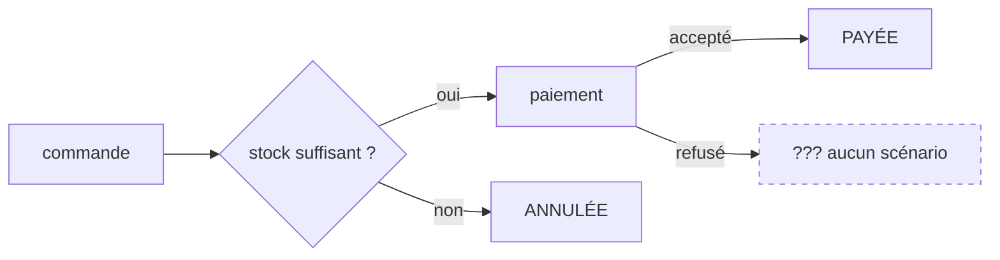
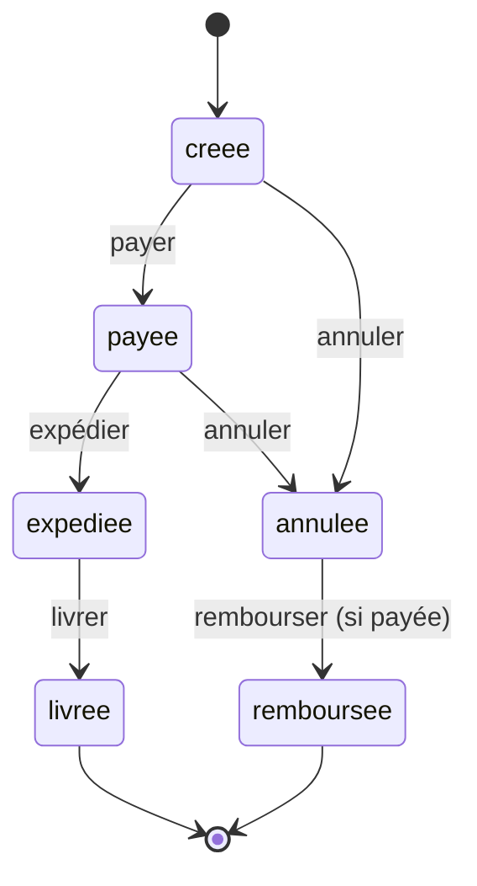

# Concevoir les tests

!!! warning "Avertissement"
    Ces notes sont des pense-bêtes personnels, pas une source de vérité. Elles reflètent ma compréhension et mes choix : leur contenu reste subjectif, malgré les citations et les références qu'il contient. Il peut être incomplet, simplifié, inexact ou dépassé. Vérifiez toujours dans la documentation officielle avant de l'appliquer. Ce contenu est fourni tel quel, sans aucune garantie : son utilisation se fait sous votre seule responsabilité.

!!! audience "Pour qui, pour quoi"
    - **Métiers** : QA, SDET, développeur back-end ou front-end, product owner, tech lead
    - **Usages** : je prépare la stratégie de test d'une nouvelle fonctionnalité, comme des codes promo, et je classe ses risques ; je choisis les valeurs à tester pour un champ « âge entre 18 et 65 ans » ; je prépare une session exploratoire sur un nouvel import CSV ; je rédige un rapport de bug qu'un développeur reproduit du premier coup ; je vérifie qu'un formulaire de paiement se remplit au clavier

!!! abstract "Les échelles"
    Les pastilles de couleur sous les titres disent à quelle échelle une notion s'applique :

    - <span class="pill pill-scope pill-scope-code">Code</span> les classes, fonctions et modules d'un programme ;
    - <span class="pill pill-scope pill-scope-app">Application</span> un service ou une application et son découpage interne ;
    - <span class="pill pill-scope pill-scope-system">Système</span> plusieurs services qui communiquent par le réseau ;
    - <span class="pill pill-scope pill-scope-infra">Infrastructure</span> les serveurs, le réseau, les zones et les clusters, physiques ou virtuels ;
    - <span class="pill pill-scope pill-scope-enterprise">Entreprise</span> le système d'information entier et son organisation.

    Détail et mots ambigus : [carte des échelles](architecture.md#carte-des-echelles).

Cette page part du moment où je sais que je dois tester, et répond à deux questions : **quoi tester** et **comment l'écrire** pour que le test prouve quelque chose. Elle suit l'ordre d'une campagne de test : la stratégie (où mettre l'effort, quand s'arrêter), la conception des scénarios et des cas de test, l'exploration de ce que personne n'a prévu, les données de test, le TDD et le code legacy, le rapport de défaut, et l'accessibilité.

Les fondations (vocabulaire des tests, modèles de référence, niveaux de test, intégration, contrats) et ce qui fait tenir la qualité dans le temps (couverture, quality gates, CI, tests instables, mesure) sont dans [Qualité logicielle et tests](qualite.md).

Dans les exemples, les comptes `ada`, `grace` et `dennis` sont des utilisateurs de test fictifs, et les chiffres sont des exemples.

:material-swap-horizontal: Les outils cités dans cette page : lesquels se remplacent, lesquels se combinent ? Voir [Complémentaires ou concurrents](outils.md#complementaires-ou-concurrents).
{ .doc-ref }

## Vocabulaire

### Défaut, cas de test, scénario

- **Défaut (bug)** : le logiciel ne fait pas ce qu'il devrait. Un **<span class="term" data-term="escaped-defect">défaut échappé</span>** est un défaut que tous les contrôles ont laissé passer jusqu'en production. Exemple complet dans [Défaut, régression, défaut échappé](qualite.md#defaut-regression-defaut-echappe).
- **Cas de test** : une entrée précise, une action et le résultat attendu, écrits pour vérifier une règle.
- **Scénario** : un parcours d'utilisateur de bout en bout, écrit en phrases, qui enchaîne plusieurs actions et finit par un résultat attendu.
- **Technique de conception de tests** : une méthode qui donne une raison à chaque cas de test (partitions, valeurs limites, table de décision...), au lieu de choisir des valeurs au hasard.

```
règle        : l'âge doit être entre 18 et 65 ans inclus
cas de test  : âge 17, attendu « refusé »         (valeur limite, choisie par une technique)
scénario     : ada s'inscrit avec 17 ans, voit le message d'erreur, corrige, puis s'inscrit
défaut       : 65 est refusé, parce que le code écrit < 65 au lieu de <= 65
```

:material-book-open-variant: Doc de référence : [ISTQB, Glossary](https://glossary.istqb.org/) (consultée en novembre 2026)
{ .doc-ref }

### Risque, critère de sortie, risque accepté

- **Risque** : ce qui ferait mal si ça cassait, noté en **probabilité** (est-ce que ça risque d'arriver ?) et en **impact** (combien ça coûte si ça arrive). Exemple : « un code promo appliqué deux fois », probable et coûteux.
- **<span class="term" data-term="exit-criteria">Critère de sortie</span>** : une condition mesurable, écrite avant de tester, qui dit quand le test est terminé. Exemple : « aucun bug critique ouvert ».
- **<span class="term" data-term="accepted-risk">Risque accepté</span>** : un risque que le PO choisit de ne pas couvrir, écrit noir sur blanc avec sa raison. Exemple : « libellé du code promo mal traduit, non testé ».

:material-book-open-variant: Doc de référence : [ISTQB, Certified Tester Foundation Level v4.0](https://www.istqb.org/certifications/certified-tester-foundation-level-ctfl-v4-0/) (2023)
{ .doc-ref }

### Gherkin, PO, Playwright Codegen, HAR

**<span class="term" data-term="gherkin">Gherkin</span>** : un format pour écrire un scénario en phrases (`Given` le contexte, `When` l'action, `Then` le résultat attendu), que des humains lisent et qu'un outil exécute. Définition complète dans [Le vocabulaire des tests](qualite.md#le-vocabulaire-des-tests).

**<span class="term" data-term="product-owner">PO (Product Owner)</span>** : la personne qui décide de ce que le produit doit faire, et donc de ce qu'un test d'acceptance doit prouver et de la priorité d'un bug.

**Playwright Codegen** : un outil qui enregistre les clics dans un navigateur et génère le code du test. **HAR** : le fichier qui enregistre tout le trafic réseau de cette session, y compris les mots de passe et <span class="term" data-term="token-oauth">jetons</span>, d'où le nettoyage obligatoire.

:material-book-open-variant: Doc de référence : [Cucumber, Gherkin Reference](https://cucumber.io/docs/gherkin/reference/) (consultée en novembre 2026) ; [Playwright, Test generator](https://playwright.dev/docs/codegen) (consultée en novembre 2026)
{ .doc-ref }

### SLI, SLO, SLA

**SLI (Service Level Indicator)** : l'indicateur que je mesure vraiment, en part de bons événements. Exemple : la part des bugs renvoyés pour « impossible à reproduire » sur 30 jours.

**SLO (Service Level Objective)** : un objectif chiffré interne sur un <span class="term" data-term="sli">SLI</span>, sur une fenêtre de temps, par exemple « moins de 5 % de bugs impossibles à reproduire sur 30 jours ».

**SLA (Service Level Agreement)** : la promesse écrite dans le contrat d'un client, avec une pénalité si elle n'est pas tenue. Elle est toujours plus lâche que le <span class="term" data-term="slo">SLO</span>, pour que l'équipe soit alertée bien avant de devoir payer. Exemple : correction d'un défaut critique en 8 h ouvrées en interne, <span class="term" data-term="sla">SLA</span> de 24 h ouvrées dans le contrat de support.

:material-book-open-variant: Doc de référence : [Google SRE Book, Service Level Objectives](https://sre.google/sre-book/service-level-objectives/) (2016)
{ .doc-ref }

## Stratégie de test : risques et critères de sortie

<a class="pill pill-scope pill-scope-app" href="../architecture/#carte-des-echelles">Échelle · Application</a> <a class="pill pill-scope pill-scope-system" href="../architecture/#carte-des-echelles">Échelle · Système</a>

Je ne peux pas tout tester (principe 2 de l'ISTQB, voir [Les sept principes du test](qualite.md#les-sept-principes-du-test-istqb)). Deux décisions encadrent donc chaque campagne de test : **où mettre l'effort** au départ, et **quand s'arrêter** à la fin. Les deux s'écrivent avant de tester, pas le jour de la livraison.

### Test basé sur les risques

<span class="pill pill-status pill-status-ok" title="Toujours valable, vérifié en novembre 2026">Valable · 11/2026</span>

Mon équipe ajoute les codes promo à la boutique : un code donne un pourcentage ou un montant fixe, il a une date de fin, un nombre d'utilisations maximum, et il ne se cumule pas avec les soldes. Je ne pars pas d'une liste de cas de test mais d'une liste de **risques** : ce qui ferait le plus mal si ça cassait. Le <span class="term" data-term="risk-based-testing">test basé sur les risques</span> (syllabus ISTQB Foundation v4.0, 2023) note chaque risque en **probabilité** et en **impact**, et le produit des deux décide de la profondeur et de l'ordre des tests.

!!! noob "As noob"
    C'est la révision d'une voiture avant un long trajet : je vérifie d'abord les freins et les pneus, pas l'autoradio. La phrase à retenir : **l'effort de test suit le risque, et ce que je ne teste pas s'écrit noir sur blanc.**

**Comment.** En atelier de trente minutes avec le PO et un développeur : je liste les risques, je note la probabilité de 1 (peu probable) à 3 (très probable) et l'impact de 1 (gêne mineure) à 3 (perte d'argent ou de clients). Le score va donc de 1 à 9 : plus il est haut, plus le risque est traité tôt. Exemple pour les codes promo :

| Risque | Probabilité | Impact | Score | Ce que je fais |
|---|---|---|---|---|
| code appliqué deux fois sur la même commande | 2 | 3 | **6** | tests unitaires et API, cas du double clic |
| utilisation maximum dépassée par deux commandes simultanées | 2 | 3 | **6** | test API avec requêtes en parallèle, là où une <span class="term" data-term="race-condition">course</span> laisse passer une utilisation de trop |
| code expiré encore accepté | 2 | 2 | 4 | valeurs limites sur la date de fin, en unitaire |
| cumul avec les soldes | 1 | 3 | 3 | table de décision, en unitaire |
| code saisi en minuscules ou avec des espaces refusé | 3 | 1 | 3 | session exploratoire |
| libellé du code mal traduit | 1 | 1 | 1 | non testé, **risque accepté et écrit** |

La dernière ligne compte autant que les autres : un <span class="term" data-term="accepted-risk">risque accepté</span> écrit est une décision que le PO a prise en connaissance de cause, un risque oublié est un trou. Le tableau tient sur un écran et répond d'avance à la question « vous avez testé quoi ? ».

**Quand.** Au démarrage de chaque fonctionnalité, et de nouveau quand le temps manque avant une livraison : je teste alors les scores les plus hauts et je dis ce qui reste. Pour une petite correction, trois lignes suffisent : la matrice est un outil de tri, pas un livrable. **Pourquoi.** Le temps de test va là où un défaut coûte cher, et les développeurs reçoivent une liste de risques qu'ils peuvent couvrir eux-mêmes dès le code. Les mêmes notes servent à l'échelle de l'organisation dans un [registre des risques](culture-entreprise.md#registre-des-risques).

**Risques.** Les notes sont subjectives : l'équipe sous-estime la probabilité de ce qu'elle connaît mal, et un module noté 1 n'est jamais testé jusqu'à son premier incident. Je fais noter par trois personnes de rôles différents et je relève la note d'une zone qui a déjà eu des incidents. Un risque accepté que personne ne relit reste accepté pour toujours : je relis la liste à chaque grosse livraison.

:material-book-open-variant: Doc de référence : [ISTQB, Certified Tester Foundation Level v4.0](https://www.istqb.org/certifications/certified-tester-foundation-level-ctfl-v4-0/) (2023, chapitre 5 sur la gestion des risques)
{ .doc-ref }

### Critères de sortie et décision go/no-go

<span class="pill pill-status pill-status-ok" title="Toujours valable, vérifié en novembre 2026">Valable · 11/2026</span>

La release est prévue demain matin et on me demande « c'est bon côté QA ? ». Sans règle écrite avant, la réponse dépend de l'humeur et de la pression du calendrier. Les <span class="term" data-term="exit-criteria">critères de sortie</span> sont des conditions mesurables, fixées au début de la campagne, qui disent quand le test est terminé. Le **go/no-go** est la décision de livrer (go) ou de reporter (no-go), prise en comparant ces critères à l'état réel.

Exemples de critères, écrits sous la matrice des risques :

- tous les risques de score 4 ou plus ont au moins un test automatisé vert ;
- aucun bug critique ouvert, et chaque bug majeur ouvert a un contournement écrit ;
- le <span class="term" data-term="rollback">retour arrière</span> a été testé sur cette version ;
- le compte rendu de la session exploratoire a été relu par le PO.

**Qui décide.** La QA présente un état factuel et donne un avis (go, no-go, ou go sous conditions) avec sa raison ; la décision appartient au PO et à l'équipe, qui portent le risque métier. Je ne signe jamais « validé » sur ce que je n'ai pas testé : je dis ce qui est testé, ce qui ne l'est pas, et le <span class="term" data-term="residual-risk">risque résiduel</span>.

Un avis rédigé, pour une version 5.0 prévue à 18 h (exemple fictif) :

```markdown
Avis QA, version 5.0, 15 h 30

| Critère de sortie                     | État                                         | OK  |
|---------------------------------------|----------------------------------------------|-----|
| E2E critiques verts                   | 47/48, facture PDF rouge                     | non |
| Aucun bug critique ouvert             | 0                                            | oui |
| Bugs majeurs avec contournement écrit | 1 sur 1 (tri par prix inversé)               | oui |
| Risques de score 4 et plus couverts   | échecs du paiement en 3 fois non testés      | non |
| Retour arrière testé                  | impossible : la migration supprime une colonne | non |

Recommandation : NO-GO à 18 h, GO demain si :
1. la suppression de la colonne part dans une version suivante (migration en deux temps) ;
2. le paiement en 3 fois est livré derrière le flag `split-payment`, désactivé ;
3. l'E2E facture PDF est qualifié ce soir (test instable ou vrai bug).
Risque accepté : tri par prix inversé (majeur, contournement : tri par pertinence), corrigé en 5.0.1.
Décision : PO et responsable technique, à 16 h.
```

Le seul point vraiment bloquant est le retour arrière : l'ancienne version lit encore la colonne supprimée, donc revenir en arrière casse l'application. La parade est une migration en deux temps (<span class="term" data-term="expand-contract">expand / contract</span>). Le reste se règle sans tout bloquer : un <span class="term" data-term="feature-flag">feature flag</span> désactivé livre le code sans exposer la partie non testée.

**Quand.** J'écris les critères au début de la campagne et je les relis au go/no-go. **Pourquoi.** La décision repose sur des faits, les risques acceptés sont tracés, et on trouve des solutions intermédiaires (flag, [canary](qualite.md#tester-un-deploiement-canary)) au lieu d'un tout ou rien. **Piège.** Des critères vagues (« qualité suffisante ») ou toujours contournés : s'ils ne tiennent jamais, je les revois avec l'équipe au lieu de les ignorer.

:material-book-open-variant: Doc de référence : [ISTQB, Certified Tester Foundation Level v4.0](https://www.istqb.org/certifications/certified-tester-foundation-level-ctfl-v4-0/) (2023, critères d'entrée et de sortie, rapport de fin de test)
{ .doc-ref }

!!! maturity "Mesurer la maturité"
    | Niveau | Ce que j'observe dans l'équipe |
    |---|---|
    | N1 | une personne écrit une matrice des risques pour les grosses fonctionnalités, et dit « go » ou « no-go » de mémoire |
    | N2 | chaque fonctionnalité a sa matrice et ses critères de sortie écrits au démarrage, dans un modèle partagé |
    | N3 | les critères mesurables sont vérifiés par le pipeline de release : une release ne part pas si un E2E critique est rouge ou si le retour arrière n'a pas été testé, sans réunion |
    | N4 | l'équipe recalibre les notes de probabilité et d'impact d'après les défauts échappés : un module noté 1 qui a eu trois incidents passe à 3 |

    **Je mesure** : la part des fonctionnalités livrées avec une matrice et des critères écrits avant (lue dans les tickets), et la part des défauts échappés qui touchaient un risque noté bas ou accepté.

## Concevoir les scénarios

<a class="pill pill-scope pill-scope-system" href="../architecture/#carte-des-echelles">Échelle · Système</a>

### Dessiner le parcours comme un graphe

<span class="pill pill-status pill-status-ok" title="Toujours valable, vérifié en novembre 2026">Valable · 11/2026</span>

Une liste de scénarios cache ce qui manque. Un graphe le montre : chaque scénario est un chemin, les transitions jamais parcourues sautent aux yeux.



Exemples de trous trouvés comme ça :
- accès au compte : 23 transitions, dont 6 sans scénario (compte migré d'un ancien login, mot de passe faible refusé...) ;
- commande : rien pour un paiement refusé, ni pour un worker qui meurt au milieu et reçoit l'événement une 2e fois ;
- contrôle de fichiers : tout passe, mais aucun fichier d'exemple n'est cassé, donc rien ne prouve qu'un fichier vide ou mal nommé est détecté.

Workflow : la QA propose le graphe, le <span class="term" data-term="product-owner">PO</span> valide le parcours, chaque chemin devient un scénario.

**Risques.** Un graphe trop détaillé devient illisible et personne ne le met à jour : il décrit alors un parcours qui n'existe plus. Je dessine les états et les décisions métier, pas chaque écran, et je le range à côté des tests pour le modifier dans la même MR.

### Gherkin avec un « Goal »

<span class="pill pill-status pill-status-ok" title="Toujours valable, vérifié en novembre 2026">Valable · 11/2026</span>

*Gherkin : complémentaire de Cucumber, pytest-bdd*
{ .tool-rel }

Le nom dit ce qui se passe, le `Goal` dit pourquoi c'est important : le risque couvert.

L'erreur : un scénario écrit comme un script de clics. Le PO ne peut rien y contester, et un restylage casse le scénario alors que le comportement n'a pas changé.
```gherkin
# À éviter : des sélecteurs, une URL et une pause dans les steps, et un nom qui ne dit rien
Scenario: Test 1
  Given I open "https://shop.example.com/login"
  When I fill "#user" with "dennis"
  And I click "button.btn-primary"
  And I wait 3 seconds
  Then I see "404"
```

La bonne version :

```gherkin
# Bien : le nom dit ce qui se passe, le Goal dit le risque couvert
@tool-playwright
Feature: Place an order

  Scenario: A closed customer is refused
    Goal: a customer the company no longer serves gets a 404,
    before any call to the bank or any visit counted.
    When "dennis" asks for a greeting
    Then the storefront answers 404
```

Bonnes pratiques :
- peu de scénarios d'acceptance, **un comportement chacun**, des phrases qu'un PO peut contester ;
- pas de détail technique dans les steps (pas de <span class="term" data-term="selector">sélecteur</span>, pas d'URL) ;
- un scénario n'écrit que ses propres données (nouvel utilisateur, une unité d'un produit à gros stock) ;
- un compte partagé est seulement lu : ne jamais lui envoyer un mauvais mot de passe, il pourrait se bloquer ;
- <span class="term" data-term="playwright">Playwright</span> : contexte neuf par scénario, éléments trouvés par rôle et label, `expect(...)`, jamais de `sleep`.

Un seuil de perf peut aussi être un scénario :
```gherkin
# Exemple : un seuil de performance écrit comme un scénario
Scenario: The storefront holds a small rush
  Goal: ten customers at once still get a fast answer.
  When 10 customers browse for 30 seconds
  Then less than 1% of requests fail
  And the p95 response time is under 500 ms
```

**Risques.** Un `Goal` recopié d'un scénario à l'autre (« vérifier que ça marche ») ne nomme plus aucun risque et devient du bruit. Une bibliothèque de steps qui grossit sans relecture finit avec trois phrases pour la même action. Je relis les `Goal` avec le PO et je fusionne les steps en double.

:material-book-open-variant: Doc de référence : [Cucumber, Gherkin Reference](https://cucumber.io/docs/gherkin/reference/) (consultée en novembre 2026)
{ .doc-ref }

### Outils Gherkin par langage

<span class="pill pill-status pill-status-ok" title="Toujours valable, vérifié en novembre 2026">Valable · 11/2026</span>

Le même fichier `.feature` s'exécute avec un outil propre à chaque langage : l'outil relie chaque phrase (`Given`, `When`, `Then`) à une fonction, la *step definition*.

| Langage | Outil | Remarque |
|---|---|---|
| Java, JavaScript, Ruby | Cucumber | l'outil d'origine du format Gherkin |
| Python | pytest-bdd, Behave | pytest-bdd réutilise les fixtures pytest, Behave a son propre lanceur |
| PHP | Behat | l'outil de référence de l'écosystème PHP (Symfony, Laravel) |
| .NET | Reqnroll | successeur open source de SpecFlow (2024, à vérifier) |
| TypeScript avec Playwright | playwright-bdd | génère des tests Playwright à partir des fichiers `.feature` |

**Quand utiliser Gherkin et le <span class="term" data-term="bdd">BDD</span>.** Quand le métier lit, conteste ou écrit vraiment les scénarios : le format est alors un contrat partagé. Quand seuls les développeurs les lisent, la couche de phrases coûte une indirection sans rien apporter : un test Playwright ou pytest bien nommé suffit.

*pytest : concurrent de unittest ; complémentaire de Testcontainers*
{ .tool-rel }


**Comment.** Écrire les scénarios en atelier avec le PO avant le code (three amigos), garder des steps réutilisables et sans détail technique, et ne pas dépasser une poignée de scénarios par fonctionnalité : le reste descend dans des tests plus bas.

:material-book-open-variant: Doc de référence : [pytest-bdd](https://pytest-bdd.readthedocs.io/) (consultée en novembre 2026) ; [Behat](https://docs.behat.org/) (consultée en novembre 2026)
{ .doc-ref }

### Scénario enregistré (Playwright Codegen)

<span class="pill pill-status pill-status-ok" title="Toujours valable, vérifié en novembre 2026">Valable · 11/2026</span>

*Playwright : concurrent de Cypress, Selenium ; complémentaire de Checkly*
{ .tool-rel }

Un PO clique le parcours, l'outil l'enregistre. Piège : la personne enregistre avec **son** compte sans le dire, et le test échoue pour tous les autres. D'où un gabarit qui oblige à expliciter :

```gherkin
# Bien : le gabarit oblige à dire quel compte et quelles données sont utilisés
Given "ada", a customer of the company who can order
And the stock of "BK-0004" holds at least 1 item
When ...
Then the page shows every step done and the order paid
```
Ce que donne le même parcours enregistré sans gabarit :
```gherkin
# À éviter : l'enregistrement brut, le compte implicite de la personne et aucun Then
Given I am logged in
When I click "Commander"
And I click "Payer"
```
Un `Then` est obligatoire : les clics disent ce qui a été fait, pas ce qui devait arriver. Et l'enregistrement (fichier <span class="term" data-term="har-file">HAR</span>) est **nettoyé de ses secrets avant toute autre étape** : en-têtes `Authorization` et `Cookie`, mots de passe, jetons.

:material-book-open-variant: Doc de référence : [Playwright, Test generator](https://playwright.dev/docs/codegen) (consultée en novembre 2026)
{ .doc-ref }

!!! maturity "Mesurer la maturité"
    | Niveau | Ce que j'observe dans l'équipe |
    |---|---|
    | N1 | les scénarios sont une liste écrite par la QA, et le PO les découvre au moment de la recette |
    | N2 | chaque parcours a son graphe validé par le PO, chaque chemin devient un scénario Gherkin avec un `Goal`, et les enregistrements passent par le gabarit |
    | N3 | un contrôle refuse un scénario sans `Then`, ou un fichier HAR qui contient encore un en-tête `Authorization`, avant qu'il entre dans le dépôt |
    | N4 | l'équipe suit la part des transitions du graphe couvertes par un scénario et les défauts échappés sur des chemins jamais dessinés |

    **Je mesure** : le nombre de transitions sans scénario dans les graphes, compté à leur relecture, et la part des scénarios relus par le PO avant le code.

## Techniques de conception de tests

<a class="pill pill-scope pill-scope-code" href="../architecture/#carte-des-echelles">Échelle · Code</a> <a class="pill pill-scope pill-scope-app" href="../architecture/#carte-des-echelles">Échelle · Application</a>

Un champ de 10 caractères a des milliards de valeurs possibles : je dois choisir. Les techniques « boîte noire » du syllabus ISTQB Foundation (v4.0, 2023) donnent une raison à chaque cas de test, à partir de la règle seule, sans lire le code. Chacune répond à une forme de règle : des plages de valeurs, des conditions qui se combinent, un objet qui change d'état, beaucoup de paramètres, une propriété vraie pour toute entrée.

### Partitions d'équivalence et valeurs limites

<span class="pill pill-status pill-status-ok" title="Toujours valable, vérifié en novembre 2026">Valable · 11/2026</span>

Un formulaire d'inscription demande l'âge, et la règle dit « entre 18 et 65 ans inclus ». Une <span class="term" data-term="equivalence-partitioning">partition d'équivalence</span> est un groupe de valeurs que le système doit traiter de la même façon : une valeur du groupe suffit à le représenter. Ici, trois partitions : moins de 18 (invalide), de 18 à 65 (valide), plus de 65 (invalide), plus les partitions de format (vide, `18.5`, `dix-huit`).

Une <span class="term" data-term="boundary-value">valeur limite</span> est la valeur juste à la frontière entre deux partitions. C'est là que les développeurs se trompent : un `<` à la place d'un `<=`, une borne incluse ou exclue. Le syllabus v4.0 décrit deux variantes :

| Variante | Autour de la borne 18 | Autour de la borne 65 |
|---|---|---|
| **à deux valeurs** : la borne et sa voisine dans l'autre partition | 17, 18 | 65, 66 |
| **à trois valeurs** : la borne et ses deux voisines | 17, 18, 19 | 64, 65, 66 |

La variante à trois valeurs attrape en plus une borne écrite `age == 18` au lieu de `age >= 18` : 19 serait refusé, et seul le cas 19 le montre.

```python
# À éviter : des valeurs au hasard, loin des bornes, qui passent même si la règle écrit < 65
@pytest.mark.parametrize(("age", "expected"), [(25, True), (40, True), (10, False)])
def test_validate_age_random_values(age, expected):
    assert validate_age(age) is expected


# Bien : une valeur par partition, puis les limites à trois valeurs, chaque cas nommé
@pytest.mark.parametrize(
    ("age", "expected"),
    [
        pytest.param(10, False, id="partition-trop-jeune"),
        pytest.param(40, True, id="partition-valide"),
        pytest.param(80, False, id="partition-trop-age"),
        pytest.param(17, False, id="limite-basse-moins-1"),
        pytest.param(18, True, id="limite-basse"),
        pytest.param(19, True, id="limite-basse-plus-1"),
        pytest.param(64, True, id="limite-haute-moins-1"),
        pytest.param(65, True, id="limite-haute"),
        pytest.param(66, False, id="limite-haute-plus-1"),
    ],
)
def test_validate_age(age, expected):
    assert validate_age(age) is expected


# Bien : les partitions de format, refusées avec une erreur
@pytest.mark.parametrize("raw", ["", "-1", "0", "18.5", "dix-huit", "99999999999"])
def test_validate_age_rejects_bad_format(raw):
    with pytest.raises(ValueError):
        validate_age(raw)
```
Le jour où `limite-haute` échoue, je sais tout de suite qu'un `< 65` s'est glissé à la place de `<= 65`. Les trois valeurs de la première version passent sur ce bug.

J'ajoute ce que les règles n'énoncent jamais : champ vide, espaces, zéro, décimal, texte très long, caractères accentués ; pour une date, le changement d'heure, le 29 février, le passage d'année et le fuseau horaire de l'utilisateur. Et je vérifie la règle côté serveur, en envoyant `17` directement à l'API : un contrôle fait seulement dans le navigateur se contourne.

**Quand.** Pour tout champ ou paramètre qui a des plages de valeurs : âge, montant, quantité, dates, longueur. **Pourquoi.** Peu de cas, chacun justifiable en revue, que les développeurs peuvent reprendre en tests unitaires <span class="term" data-term="parametrized-test">paramétrés</span>.

**Risques.** Les partitions viennent de ma lecture de la règle : si j'ai mal compris la spécification (65 inclus ou exclu ?), mes tests figent l'erreur. Je fais valider les bornes par le PO avant d'écrire les cas. La technique ne voit pas non plus les interactions entre champs : pour celles-là, une table de décision.

:material-book-open-variant: Doc de référence : [ISTQB, Certified Tester Foundation Level v4.0](https://www.istqb.org/certifications/certified-tester-foundation-level-ctfl-v4-0/) (2023, chapitre 4 sur les techniques de test)
{ .doc-ref }

### Table de décision

<span class="pill pill-status pill-status-ok" title="Toujours valable, vérifié en novembre 2026">Valable · 11/2026</span>

Une règle de réservation combine trois conditions : le début ne doit pas être dans le passé, la durée doit aller de 1 à 14 jours, et le début doit tomber au plus tard à J+90. Une <span class="term" data-term="decision-table">table de décision</span> met une condition par ligne, une combinaison par colonne (une règle), et le résultat attendu en bas. Chaque colonne devient un cas de test. « - » veut dire « peu importe pour cette règle » : c'est ce qui permet de fusionner des colonnes et de garder une table courte.

| Condition / résultat | R1 | R2 | R3 | R4 |
|---|---|---|---|---|
| début dans le passé | oui | non | non | non |
| durée de 1 à 14 jours | - | non | oui | oui |
| début au plus tard à J+90 | - | - | non | oui |
| **résultat attendu** | refus `start_in_past` | refus `invalid_duration` | refus `too_far_ahead` | accepté |

**Quand.** Dès que le résultat dépend de deux conditions ou plus qui se combinent : une remise selon le statut du client et le montant du panier, un remboursement selon le statut de la commande et le délai. **Pourquoi.** Le tableau montre les combinaisons que la spécification a oubliées ; je les fais trancher par le PO avant de tester, quand elles ne coûtent encore rien. **Limite.** Avec n conditions oui ou non, la table complète a 2ⁿ colonnes : au-delà de quatre ou cinq conditions, je fusionne les « peu importe » ou je passe au test par paires.

:material-book-open-variant: Doc de référence : [ISTQB, Certified Tester Foundation Level v4.0](https://www.istqb.org/certifications/certified-tester-foundation-level-ctfl-v4-0/) (2023, chapitre 4 sur les techniques de test)
{ .doc-ref }

### Transitions d'état

<span class="pill pill-status pill-status-ok" title="Toujours valable, vérifié en novembre 2026">Valable · 11/2026</span>

Une commande passe par « créée », « payée », « expédiée », « livrée », « annulée » et « remboursée ». Le client peut annuler tant que la commande n'est pas expédiée, et un remboursement n'est possible que pour une commande payée puis annulée. Je dessine ses <span class="term" data-term="state-machine">états possibles</span> et les événements qui la font passer de l'un à l'autre, je fais valider le dessin par le PO, puis je teste chaque <span class="term" data-term="state-transition">transition</span> **valide**, et ensuite les transitions **invalides**.



| Test | Départ | Action | Attendu |
|---|---|---|---|
| T1 | créée | payer | payée |
| T2 | payée | annuler | annulée |
| T3 | annulée (après paiement) | rembourser | remboursée |
| T4 | expédiée | annuler | **refus 409**, état inchangé |
| T5 | annulée (jamais payée) | rembourser | **refus 409**, aucun remboursement créé |
| T6 | remboursée | rembourser | **refus 409**, pas de second remboursement |

T1 à T3 couvrent les transitions valides, T4 à T6 les invalides. Les bugs les plus coûteux sont souvent là : une action acceptée dans un état où elle n'a pas de sens. T6 est celui qui protège l'argent. Pour chaque refus, je vérifie aussi que l'état est intact en base, pas seulement que l'API renvoie une erreur.

**Quand.** Pour tout objet qui a un cycle de vie : commande, abonnement, compte, réservation. **Pourquoi.** Le dessin sert de spécification partagée et fait apparaître les questions oubliées (« peut-on annuler une commande expédiée mais pas encore livrée ? »), et la couverture devient mesurable : toutes les transitions valides et invalides testées. Le [graphe de parcours](#dessiner-le-parcours-comme-un-graphe) applique la même idée à un parcours utilisateur entier.

**Risques.** Le diagramme dérive du code si personne ne le met à jour, et les tests vérifient alors un cycle de vie qui n'existe plus. Avec beaucoup d'états, les transitions invalides explosent (n états fois m actions) : je teste toutes les transitions valides et les invalides qui touchent l'argent ou les droits, pas toutes les combinaisons.

:material-book-open-variant: Doc de référence : [ISTQB, Certified Tester Foundation Level v4.0](https://www.istqb.org/certifications/certified-tester-foundation-level-ctfl-v4-0/) (2023) ; [OMG, UML 2.5.1](https://www.omg.org/spec/UML/2.5.1/) (2017, diagrammes d'états)
{ .doc-ref }

### Test par paires (pairwise)

<span class="pill pill-status pill-status-ok" title="Toujours valable, vérifié en novembre 2026">Valable · 11/2026</span>

*PICT : concurrent de ACTS (NIST), AllPairs*
{ .tool-rel }

Une page de paiement doit marcher sur 4 navigateurs, en 3 langues, avec 3 moyens de paiement, pour 2 types de compte : 4 × 3 × 3 × 2 = 72 combinaisons, chacune de plusieurs minutes en E2E, et chaque paramètre ajouté multiplie encore. Le <span class="term" data-term="pairwise-testing">test par paires</span> choisit un petit ensemble de cas où **chaque couple de valeurs de deux paramètres apparaît au moins une fois** (Safari et allemand, PayPal et compte pro, etc.).

Pourquoi ça suffit souvent : D. Richard Kuhn, Dolores Wallace et Albert Gallo (« Software Fault Interactions and Implications for Software Testing », IEEE Transactions on Software Engineering, 2004) ont trouvé que, sur les systèmes étudiés, la grande majorité des défauts était déclenchée par un seul paramètre ou par une paire. [À prendre avec précaution : résultat mesuré sur un petit nombre de systèmes, il ne garantit rien pour un produit donné.]

!!! noob "As noob"
    C'est un tournoi où chaque joueur doit avoir affronté chaque autre au moins une fois : pas besoin de jouer toutes les compositions d'équipes possibles. Limite : un bug qui n'apparaît qu'avec trois valeurs précises ensemble peut passer. La phrase à retenir : **toutes les paires couvertes avec peu de cas, plus les combinaisons à risque ajoutées à la main.**

L'outil PICT (Microsoft, open source) génère les cas à partir d'un fichier de paramètres et de contraintes, ici `payment.pict` :

```text
# Exemple : quatre paramètres et une contrainte métier, un particulier ne paie pas par virement
Navigateur: Chrome, Firefox, Safari, Edge
Langue:     fr, en, de
Paiement:   carte, paypal, virement
Compte:     particulier, pro

IF [Compte] = "particulier" THEN [Paiement] <> "virement";
```
`pict payment.pict` donne une douzaine de lignes au lieu de 72, par exemple :

| Navigateur | Langue | Paiement | Compte |
|---|---|---|---|
| Chrome | fr | carte | particulier |
| Firefox | en | paypal | pro |
| Safari | de | virement | pro |
| Edge | fr | paypal | particulier |
| ... | ... | ... | ... |

**Comment.** Compter les combinaisons pour montrer que tout tester est impossible, générer les paires, puis **ajouter à la main** les combinaisons connues pour être risquées (Safari avec carte, parce que 3-D Secure ouvre une fenêtre que Safari traite différemment), et garder l'exhaustif pour les seuls paramètres où une erreur coûterait très cher. Je ne teste pas dans ces combinaisons ce qui n'en dépend pas : le calcul du montant, indépendant du navigateur, reste en unitaire.

**Quand.** Matrices de compatibilité (navigateurs, systèmes, versions), options de configuration, formulaires à nombreux champs indépendants. **Pas quand** les paramètres interagissent par une règle connue : là, une table de décision dit exactement quoi tester.

:material-book-open-variant: Doc de référence : [NIST, Automated Combinatorial Testing for Software](https://csrc.nist.gov/projects/automated-combinatorial-testing-for-software) (consultée en novembre 2026) ; [Microsoft, PICT](https://github.com/microsoft/pict) (consultée en novembre 2026)
{ .doc-ref }

### Test par propriétés (property-based testing)

<span class="pill pill-status pill-status-ok" title="Toujours valable, vérifié en novembre 2026">Valable · 11/2026</span>

*Hypothesis : complémentaire de pytest, Schemathesis ; concurrent de fast-check (JavaScript)*
{ .tool-rel }

Je teste une fonction qui partage une addition entre plusieurs personnes, en centimes. Avec des exemples choisis à la main, je teste 100 € pour 4 personnes et je ne pense pas à 1 centime pour 2. Le **<span class="term" data-term="property-based-testing">test par propriétés</span>** inverse la démarche : je décris une règle qui doit être vraie **pour toute entrée** (un <span class="term" data-term="invariant">invariant</span>), et l'outil génère des centaines d'entrées pour essayer de la casser. Quand il trouve un contre-exemple, il le **réduit** (*shrinking*) au plus petit cas qui échoue encore, et le rejoue aux runs suivants. L'idée vient de QuickCheck (Koen Claessen et John Hughes, en Haskell, 2000) ; en Python, l'outil est Hypothesis.

!!! noob "As noob"
    Au lieu d'essayer trois clés choisies par moi, je confie un trousseau de mille clés au hasard à quelqu'un qui cherche celle qui ouvre la porte alors qu'elle ne devrait pas. S'il en trouve une, il me rapporte la plus simple. La phrase à retenir : **j'écris la règle, l'outil cherche le contre-exemple.**

```python
# À éviter : deux exemples choisis à la main, le cas 1 centime pour 2 personnes n'est jamais essayé
def test_split_bill():
    assert split_bill(10_000, 4) == [2_500, 2_500, 2_500, 2_500]
    assert split_bill(1_000, 2) == [500, 500]


# Bien : trois propriétés vérifiées sur des centaines d'entrées générées
@given(st.integers(min_value=0, max_value=10**9), st.integers(min_value=1, max_value=100))
def test_split_invariants(total_cents, people):
    shares = split_bill(total_cents, people)
    assert sum(shares) == total_cents
    assert len(shares) == people
    assert max(shares) - min(shares) <= 1
```
Si `split_bill` arrondit chaque part à l'entier inférieur, les deux exemples passent, mais la première propriété casse et Hypothesis rapporte le plus petit contre-exemple, du type `total_cents=1, people=2` : la somme des parts fait 0, un centime a disparu.

Propriétés typiques : un aller-retour (`decode(encode(x)) == x`), un invariant (la somme est conservée, un remboursement ne dépasse jamais le prix payé), une comparaison à une implémentation simple mais lente qui sert d'<span class="term" data-term="test-oracle">oracle</span>, ou simplement « ne plante jamais ». Pour une API, <span class="term" data-term="schemathesis">Schemathesis</span> applique la même idée à partir du contrat OpenAPI : il génère des requêtes et vérifie que les réponses respectent le schéma (voir [Détecter que le partenaire a changé](qualite.md#detecter-que-le-partenaire-a-change)).

**Quand.** Fonctions pures avec une règle générale : calculs d'argent, parseurs, sérialisation, tri, conversions. **Pas quand** je ne sais pas écrire la propriété sans réécrire le code testé : c'est le mock qui recopie la règle, en plus lent. **Coût.** Des tests plus lents (100 exemples par test par défaut dans Hypothesis, à vérifier selon la version) et une propriété plus dure à écrire qu'un exemple : je garde quelques exemples lisibles à côté, comme documentation.

:material-book-open-variant: Doc de référence : [Hypothesis, Documentation](https://hypothesis.readthedocs.io/) (consultée en novembre 2026)
{ .doc-ref }

### Quelle technique pour quelle règle

| Ma règle ressemble à... | Technique |
|---|---|
| un champ ou un paramètre avec des plages de valeurs, comme un âge entre 18 et 65 ans ou une quantité de 1 à 99 | partitions d'équivalence et valeurs limites |
| un résultat qui dépend de plusieurs conditions combinées, comme une remise selon le statut du client et le montant du panier | table de décision |
| un objet qui a un cycle de vie, comme une commande créée, payée, expédiée puis annulée | transitions d'état, valides puis invalides |
| beaucoup de paramètres indépendants, comme une page à tester sur 4 navigateurs, 3 langues et 3 moyens de paiement | test par paires (PICT) et cas à risque à la main |
| une règle vraie pour toute entrée, comme « la somme des parts égale le total » | test par propriétés (Hypothesis) |
| ce que personne n'a pensé à écrire dans la spécification, comme un fichier mal encodé | [test exploratoire](#test-exploratoire) |

!!! maturity "Mesurer la maturité"
    | Niveau | Ce que j'observe dans l'équipe |
    |---|---|
    | N1 | une personne connaît les valeurs limites et les applique sur les champs qu'elle teste |
    | N2 | chaque règle à plages de valeurs a ses tests paramétrés partition par partition et limite par limite, et chaque règle combinée a sa table de décision |
    | N3 | les tests par propriétés et les cas générés par paires tournent en CI à chaque MR et bloquent la fusion sur un contre-exemple |
    | N4 | l'équipe suit le score de mutation des modules testés ainsi et les défauts échappés aux bornes, et choisit la technique d'après eux |

    **Je mesure** : la part des défauts échappés situés à une borne ou dans une combinaison non testée, lue dans les tickets d'incident, et le score de mutation des modules critiques.

## Test exploratoire

<a class="pill pill-scope pill-scope-app" href="../architecture/#carte-des-echelles">Échelle · Application</a>

Les tests automatisés vérifient ce que je sais déjà. Pour trouver ce que personne n'a imaginé, il faut un humain qui explore, et une méthode pour que cette exploration se planifie et se relise.

### Session et charte (SBTM)

<span class="pill pill-status pill-status-ok" title="Toujours valable, vérifié en novembre 2026">Valable · 11/2026</span>

Une fonctionnalité d'import de contacts au format CSV arrive en test. Les tests automatisés vérifient l'import d'un fichier propre de trois lignes, et rien d'autre. Le <span class="term" data-term="exploratory-testing">test exploratoire</span> consiste à apprendre le produit, concevoir des tests et les exécuter en même temps, en laissant chaque observation orienter le test suivant. Ce n'est pas cliquer au hasard : le **Session-Based Test Management** (SBTM, Jonathan Bach, 2000) le rend pilotable.

!!! noob "As noob"
    C'est un inspecteur qui visite un bâtiment avec une mission précise (« vérifier les issues de secours ») et un carnet, plutôt qu'un visiteur qui se promène. La phrase à retenir : **une mission, une durée fixe, des notes et un débrief : l'exploration devient un travail qu'on peut planifier et relire.**

Le cycle :

1. une **<span class="term" data-term="test-charter">charte</span>** : la mission de la session en une phrase. Le modèle d'Elisabeth Hendrickson (« Explore It! », 2013) : *Explorer* (cible) *avec* (ressources) *pour découvrir* (information) ;
2. une **session** : une plage fixe et sans interruption, souvent de 60 à 90 minutes, consacrée à cette charte ;
3. des **notes de session** : ce qui a été couvert, les bugs, les questions, ce qui n'a pas été vu ;
4. un **débrief** de dix minutes avec le développeur ou le PO : bugs à ouvrir, nouvelle charte, cas à ajouter à la suite automatisée.

Une charte et ses notes, en Markdown (exemple fictif) :

```markdown
## Charte
Explorer l'import CSV de contacts
avec des fichiers mal formés, volumineux et multilingues
pour découvrir les problèmes de robustesse et de messages d'erreur.

Durée : 60 min. Testeuse : ada. Environnement : intégration, build 1.42.0.

## Notes de session
- 10:05 fichier UTF-8 propre, 3 lignes : OK
- 10:12 fichier Latin-1 : "Hélène" devient "Hélène" : BUG-1
- 10:20 séparateur ";" : refusé, message clair : OK
- 10:28 50 000 lignes : 4 min d'attente sans indicateur : BUG-2
- 10:40 e-mail en double dans le fichier : importé deux fois : question au PO
- 10:52 fichier PDF renommé en .csv : erreur 500 : BUG-3

## Bilan
Couvert : encodage, séparateurs, volume, doublons, faux fichiers.
Non couvert : import pendant qu'un autre utilisateur modifie un contact.
Bugs : 3. Questions : 1. Temps : 70 % test, 20 % rédaction de bugs, 10 % préparation.
Suite proposée : charte "import concurrent", 3 fichiers ajoutés aux tests API.
```
Au débrief, le PO tranche la question des doublons, le développeur sait par où commencer, et les trois fichiers fautifs entrent dans la suite automatisée pour ne plus régresser. La répartition du temps (test, rédaction de bugs, préparation) est la mesure que propose le SBTM : elle montre combien de temps l'équipe passe vraiment à tester.

**Quand.** Sur toute nouvelle fonctionnalité, en plus des tests automatisés ; quand une zone a déjà eu des incidents ; quand une suite qui ne change plus ne trouve plus rien (le paradoxe du pesticide). Elle remplit le quadrant Q3 des [quadrants du test agile](qualite.md#les-quadrants-du-test-agile-ne-pas-oublier-un-type-de-test). **Pourquoi.** Trouver les bugs que personne n'a imaginés en écrivant la spécification, et nourrir la suite automatisée de cas réels plutôt qu'inventés. **Coût.** Du temps humain qui ne se rejoue pas : c'est pour ça que les trouvailles utiles deviennent des tests automatisés.

:material-book-open-variant: Doc de référence : [Jonathan Bach, Session-Based Test Management](https://www.satisfice.com/download/session-based-test-management) (2000) ; [Elisabeth Hendrickson, Explore It!](https://pragprog.com/titles/ehxta/explore-it/) (2013)
{ .doc-ref }

### Tester ou vérifier (testing vs checking)

<span class="pill pill-status pill-status-ok" title="Toujours valable, vérifié en novembre 2026">Valable · 11/2026</span>

Michael Bolton (« Testing vs. Checking », 2009, précisé avec James Bach dans Rapid Software Testing en 2013) distingue deux activités que le mot « test » mélange :

- un **<span class="term" data-term="test-check">check</span>** confirme une attente connue, qu'une machine peut évaluer seule : « le statut vaut 200 », « le total vaut 36,00 € » ;
- le **test** au sens large explore, questionne, apprend et juge : « que se passe-t-il si le fichier est en Latin-1 ? », « ce message d'erreur est-il compréhensible ? ».

Une suite automatisée est une collection de checks : elle dit si ce que je savais déjà est toujours vrai. Elle ne trouvera jamais un problème que personne n'a imaginé. **Comment je m'en sers.** Pour défendre le temps d'exploration dans un plan de test (« l'automatisation couvre les régressions connues, l'exploration cherche les inconnues »), et pour ne pas confondre une suite verte avec un produit sans problème.

**Risques.** Opposer les deux fait croire que l'automatisation ne vaut rien, ou que l'exploration se passe de méthode : une session sans charte ni notes ne laisse aucune trace, et personne ne sait ce qui a été vu. Je garde les deux : chaque session exploratoire a une charte et un compte rendu, et tout bug qu'elle trouve devient un check automatique, comme le doublon d'import que Léa a découvert en explorant.

:material-book-open-variant: Doc de référence : [Michael Bolton, Testing vs. Checking](https://developsense.com/blog/2009/08/testing-vs-checking) (2009)
{ .doc-ref }

### SFDIPOT : trouver des idées de test

<span class="pill pill-status pill-status-ok" title="Toujours valable, vérifié en novembre 2026">Valable · 11/2026</span>

Devant une charte, je sèche parfois sur quoi essayer. **SFDIPOT** est un moyen mnémotechnique tiré du *Heuristic Test Strategy Model* de James Bach (versions successives depuis la fin des années 1990, date à vérifier) : sept angles pour regarder le produit, chacun donnant des idées de test. Exemple sur l'import CSV :

| Lettre | Angle | Idée de test pour l'import CSV |
|---|---|---|
| **S** | Structure : de quoi le produit est fait | le fichier passe-t-il par une file de messages ? que se passe-t-il si le worker redémarre au milieu ? |
| **F** | Fonction : ce qu'il fait | doublons, colonnes en trop, champs obligatoires manquants |
| **D** | Données : ce qu'il traite | encodage Latin-1, emojis, 50 000 lignes, fichier vide |
| **I** | Interfaces : comment on lui parle | import par l'API sans passer par l'écran, réponse d'erreur lisible |
| **P** | Plateforme : ce dont il dépend | stockage plein, navigateur Safari, fichier envoyé depuis un mobile |
| **O** | Opérations : comment il est utilisé | un utilisateur qui importe deux fois le même fichier par erreur |
| **T** | Temps : ce qui dépend du moment | import pendant qu'un autre utilisateur modifie un contact, import interrompu |

**Quand.** Pour écrire des chartes, ou pour relire un plan de test et voir l'angle oublié. **Pourquoi.** Une heuristique ne garantit rien, elle évite de toujours tester les mêmes choses ; c'est le pendant exploratoire des [quadrants](qualite.md#les-quadrants-du-test-agile-ne-pas-oublier-un-type-de-test).

:material-book-open-variant: Doc de référence : [James Bach, Heuristic Test Strategy Model](https://www.satisfice.com/download/heuristic-test-strategy-model) (consultée en novembre 2026)
{ .doc-ref }

!!! maturity "Mesurer la maturité"
    | Niveau | Ce que j'observe dans l'équipe |
    |---|---|
    | N1 | quelqu'un explore une nouvelle fonctionnalité quand il a le temps, sans charte ni notes |
    | N2 | chaque fonctionnalité importante a au moins une session avec une charte, des notes et un débrief |
    | N3 | la session exploratoire fait partie de la définition de terminé : une story ne passe pas en « terminé » sans son compte rendu, sans que personne le réclame |
    | N4 | l'équipe suit les bugs trouvés par session et la part du temps passé à tester (la mesure du SBTM), et oriente les chartes vers les zones qui en donnent le plus |

    **Je mesure** : le nombre de sessions par fonctionnalité livrée et la part des bugs trouvés en exploratoire devenus des tests automatisés, lus dans les tickets.

## Données de test et lisibilité

<a class="pill pill-scope pill-scope-code" href="../architecture/#carte-des-echelles">Échelle · Code</a>

Un test se lit plus souvent qu'il ne s'écrit, et il échoue un jour devant quelqu'un qui ne l'a pas écrit. Deux choses décident s'il se comprend : d'où viennent ses données, et ce qui a été factorisé.

### Données de test : Builder, Object Mother, isolation

<span class="pill pill-status pill-status-ok" title="Toujours valable, vérifié en novembre 2026">Valable · 11/2026</span>

Ma suite d'API utilise un compte `qa-user-1` partagé par toute l'équipe. Les tests passent le matin et échouent l'après-midi, quand quelqu'un a modifié l'adresse du compte ou vidé son panier. Des <span class="term" data-term="test-data">données de test</span> partagées finissent toujours par être modifiées par quelqu'un. La règle : **chaque test crée ce dont il a besoin, avec des valeurs uniques, et le nettoie** (isolation par test). Je crée les données par l'API ou en base, jamais en cliquant dans l'interface, et un suffixe unique permet de lancer les tests en parallèle sans collision.

Deux patterns évitent de recopier vingt champs obligatoires dans chaque test :

- **<span class="term" data-term="test-data-builder">Test Data Builder</span>** (Nat Pryce, 2007) : un constructeur avec des valeurs par défaut valides ; le test ne change que ce qui compte pour lui (`OrderBuilder().with_total(12_000)`).
- **Object Mother** (Martin Fowler, 2006) : des objets prêts à l'emploi et nommés (`customers.premium()`). Simple au début, elle grossit d'une méthode par variante (`premium_with_expired_card_in_belgium()`) : le Builder passe mieux à l'échelle.

```python
# À éviter : un compte partagé, tous les champs recopiés, et rien ne dit lequel compte
def test_refund_is_capped():
    order = api.post(
        "/orders",
        json={"status": "paid", "total_cents": 12_000, "items": [{"sku": "MUG-BLUE", "quantity": 1}]},
        headers={"X-User-Id": "qa-user-1"},
    ).json()
    assert api.post(f"/orders/{order['id']}/refunds", json={"amount_cents": 15_000}).status_code == 422


# Bien : un builder aux valeurs par défaut valides, chaque test ne change que ce qui compte
@dataclass
class OrderBuilder:
    status: str = "paid"
    total_cents: int = 5_000
    items: list[dict] = field(default_factory=lambda: [{"sku": "MUG-BLUE", "quantity": 1}])

    def with_total(self, cents):
        return replace(self, total_cents=cents)

    def to_payload(self):
        return asdict(self)


# Bien : un utilisateur unique par test, supprimé après, même si le test échoue
@pytest.fixture
def user(api):
    created = api.post("/test/users", json={"email": f"ada+{uuid.uuid4().hex[:8]}@example.test"}).json()
    yield created
    api.delete(f"/test/users/{created['id']}")


# Bien : seule la donnée qui compte pour ce test, le montant, est visible
def test_refund_is_capped_at_paid_amount(api, user):
    payload = OrderBuilder().with_total(12_000).to_payload()
    order = api.post("/orders", json=payload, headers={"X-User-Id": user["id"]}).json()
    response = api.post(f"/orders/{order['id']}/refunds", json={"amount_cents": 15_000})
    assert response.status_code == 422
```
Le premier test casse l'après-midi où quelqu'un supprime les commandes de `qa-user-1`, et le lecteur ne voit pas que seul le montant compte.

Un jeu de référence stable (le catalogue de produits) peut être chargé une fois, en lecture seule : aucun test n'a le droit de le modifier. Et des données venues de la production passent toujours par une <span class="term" data-term="data-anonymization">anonymisation</span> (RGPD, règlement 2016/679, applicable depuis 2018).

**Quand.** Dès qu'un test dépend d'un compte ou d'un objet qu'un autre test peut modifier, et avant de paralléliser. **Coût.** Créer les données à chaque test ajoute quelques appels d'API par test, et il faut une route de test ou un accès en base pour le faire.

:material-book-open-variant: Doc de référence : [Nat Pryce, Test Data Builders](http://www.natpryce.com/articles/000714.html) (2007) ; [Martin Fowler, ObjectMother](https://martinfowler.com/bliki/ObjectMother.html) (2006)
{ .doc-ref }

!!! maturity "Mesurer la maturité"
    | Niveau | Ce que j'observe dans l'équipe |
    |---|---|
    | N1 | certains tests créent leurs données, d'autres écrivent encore dans un compte partagé comme `qa-user-1` |
    | N2 | chaque test crée ses données par l'API avec un builder et un suffixe unique, et les supprime dans une fixture |
    | N3 | les tests tournent en parallèle et dans un ordre aléatoire à chaque pipeline (pytest-xdist, pytest-randomly) : une dépendance cachée entre tests casse le pipeline toute seule |
    | N4 | l'équipe suit le taux d'échecs dus aux données (collision, donnée modifiée par un autre test) et traite d'abord les suites où il est le plus haut |

    **Je mesure** : le nombre de tests qui écrivent dans un compte partagé (recherche des identifiants partagés dans le code de test) et la part des échecs classés « données » au tri des tests rouges.

### DAMP plutôt que DRY dans les tests

<span class="pill pill-status pill-status-ok" title="Toujours valable, vérifié en novembre 2026">Valable · 11/2026</span>

Dans le code de production, je factorise : une connaissance à un seul endroit (<span class="term" data-term="dry">DRY</span>). Dans un test, poussé trop loin, ça donne une fonction `runOrderScenario(type, options)` à huit paramètres : quand elle échoue, personne ne sait quel cas métier est cassé. **<span class="term" data-term="damp">DAMP</span>** (*Descriptive And Meaningful Phrases*) dit qu'un test doit se lire seul, de haut en bas, quitte à répéter quelques lignes d'un test à l'autre.

!!! noob "As noob"
    C'est une fiche recette : je veux lire les ingrédients et les étapes sur la même fiche, pas « voir recette 12, étape 3, avec les changements de la recette 7 ». La phrase à retenir : **je factorise la mécanique du test, jamais son intention.**

| Je factorise (DRY) | Je garde visible dans le test (DAMP) |
|---|---|
| les <span class="term" data-term="selector">sélecteurs</span>, dans un Page Object | les données qui comptent (`CMD-1001`, le statut attendu) |
| la création des données, dans une <span class="term" data-term="test-fixture">fixture</span> ou un builder | le cas métier, dans le nom du test |
| la connexion et la navigation | l'assertion, dans le test et pas cachée dans un Page Object |

```typescript
// À éviter : un scénario générique à options, l'échec ne dit pas quel cas métier casse
test("order scenarios", async ({ page }) => {
  for (const type of ["paid", "refunded", "promo"]) {
    await runOrderScenario(page, type, { verify: true, withPromo: type === "promo" });
  }
});

// Bien : un test par cas métier, avec ses données et son attendu visibles
test("une commande payée apparaît avec le statut Payée", async ({ ordersPage, createOrder }) => {
  await createOrder({ reference: "CMD-1001", status: "paid" });
  await ordersPage.goto();
  await expect(ordersPage.table.row("CMD-1001")).toContainText("Payée");
});
```
Dans la première version, le rapport dit seulement « order scenarios failed » : il faut lire `runOrderScenario` et ses options pour savoir lequel des trois cas est cassé.

**Quand.** DRY pour l'infrastructure du test (sélecteurs, fixtures, clients d'API), DAMP pour le scénario. **Signal d'alerte.** Un `if` ou une boucle dans un test, ou un helper qui prend un paramètre `type` : c'est l'intention qui a été factorisée.

**Risques.** Répéter le scénario dans chaque test fait diverger les copies : si l'API de création de commande change, il faut corriger vingt tests au lieu d'un. Je répète l'intention, pas la mécanique, qui reste dans les fixtures et les builders. Poussé trop loin, DAMP donne aussi des tests de cent lignes où l'essentiel se perd.

:material-book-open-variant: Doc de référence : [Software Engineering at Google, chapitre 12 « Unit Testing »](https://abseil.io/resources/swe-book/html/ch12.html) (2020)
{ .doc-ref }

## TDD et code legacy

<a class="pill pill-scope pill-scope-code" href="../architecture/#carte-des-echelles">Échelle · Code</a>

Deux situations opposées : du code qui n'existe pas encore, où le test peut venir en premier, et du code qui existe sans aucun test, qu'il faut changer sans rien casser.

### TDD en pratique

<span class="pill pill-status pill-status-ok" title="Toujours valable, vérifié en novembre 2026">Valable · 11/2026</span>

On me demande une fonction qui vérifie la force d'un mot de passe : au moins 12 caractères, pas dans une liste de mots de passe courants, pas identique à l'e-mail. Le <span class="term" data-term="tdd">TDD</span> (*Test-Driven Development*, Kent Beck, « Test-Driven Development: By Example », 2002) écrit d'abord un test qui échoue, puis le code minimal qui le fait passer, puis nettoie : **rouge, vert, refactor**, en tout petits pas.

Kent Beck a redécrit la méthode dans « Canon TDD » (2023), parce que beaucoup de critiques visaient une version déformée :

1. écrire la **liste** des scénarios à couvrir (comportements, cas limites), sans code ;
2. prendre **un seul** scénario de la liste et l'écrire comme un vrai test, qui s'exécute et échoue ;
3. modifier le code pour que ce test et tous les précédents passent, en ajoutant à la liste ce que je découvre en route ;
4. si besoin, <span class="term" data-term="refactoring">refactorer</span> pour améliorer la conception, tests toujours verts ;
5. recommencer jusqu'à ce que la liste soit vide.

Les erreurs qu'il cite : écrire tous les tests d'un coup avant le code, mélanger refactoring et passage au vert, refactorer trop tôt, ou copier dans l'assertion la valeur que le code renvoie.

Les **trois lois du TDD** (Robert C. Martin, vers 2005, à vérifier) disent la même discipline plus sèchement : pas de code de production sans un test qui échoue ; pas plus de test qu'il n'en faut pour échouer (ne pas compiler compte comme un échec) ; pas plus de code de production qu'il n'en faut pour faire passer le test.

```python
# À éviter : l'attendu copié depuis ce que le code renvoie aujourd'hui (sa limite est à 8), le test fige le bug
def test_strength():
    assert password_strength("abcdefghijk", email="ada@example.test") == "ok"


# Bien : 1er tour, rouge. l'attendu vient de la règle (12 caractères minimum), écrit à la main
def test_11_characters_is_too_short():
    assert password_strength("abcdefghijk", email="ada@example.test") == "too_short"


# Bien : 1er tour, vert. le code minimal qui fait passer ce test, rien de plus
def password_strength(password, email):
    if len(password) < 12:
        return "too_short"
    return "ok"


# Bien : 2e tour, rouge. le scénario suivant de la liste, avant d'écrire la règle des mots courants
def test_common_password_is_refused():
    assert password_strength("password1234", email="ada@example.test") == "too_common"
```
Le premier test a été écrit après coup en recopiant la sortie : il reste vert alors qu'un mot de passe de 11 caractères devrait être refusé.

**Quand.** Quand la règle est claire et la logique riche : un calcul, une validation, un parseur, et toujours pour un bug (le test qui reproduit le bug d'abord, il échoue, je corrige, il passe). **Quand ne pas l'utiliser.** Quand je ne sais pas encore ce que je construis : je fais d'abord un <span class="term" data-term="spike">spike</span> jetable pour comprendre, puis je reprends proprement avec des tests ; et pour une interface très visuelle, où l'attendu se juge à l'œil. **Pourquoi.** Les tests existent vraiment, le code est testable par construction (ce qui est dur à tester se voit tout de suite), et le travail avance par petits pas faciles à reprendre. Le TDD ne dit pas s'il faut isoler l'unité : c'est le débat des [écoles de Londres et de Detroit](qualite.md#ecoles-de-londres-et-de-detroit-isoler-ou-non-lunite).

:material-book-open-variant: Doc de référence : [Kent Beck, Canon TDD](https://tidyfirst.substack.com/p/canon-tdd) (2023) ; [Robert C. Martin, The Three Rules of TDD](http://butunclebob.com/ArticleS.UncleBob.TheThreeRulesOfTdd) (date de publication non indiquée)
{ .doc-ref }

### Tests de caractérisation et golden master

<span class="pill pill-status pill-status-ok" title="Toujours valable, vérifié en novembre 2026">Valable · 11/2026</span>

Je dois ajouter « livraison gratuite au-dessus de 50 € » dans une méthode `checkout()` de 400 lignes, qui appelle directement la base, l'API du transporteur et l'horloge système. Aucun test n'existe. Pour Michael Feathers (« Working Effectively with Legacy Code », 2004), c'est la définition du <span class="term" data-term="legacy-code">code legacy</span> : du code sans tests, donc risqué à modifier, quel que soit son âge.

Sa méthode : identifier l'endroit à changer, trouver un point d'où observer le comportement, casser juste assez de dépendances pour tester (un <span class="term" data-term="seam">seam</span> : passer l'horloge ou le transporteur en paramètre, avec la vraie implémentation par défaut), écrire des tests qui figent le comportement actuel, puis seulement changer et nettoyer.

- **<span class="term" data-term="characterization-test">Test de caractérisation</span>** : un test qui affirme ce que le code fait **aujourd'hui**, même si c'est bizarre. Je lance le code, je lis la sortie, et je l'écris comme attendu. Il ne dit pas si le comportement est juste, il dit s'il a changé.
- **<span class="term" data-term="golden-master">Golden master</span>** (ou *approval testing*) : la même idée à grande échelle. J'enregistre la sortie complète actuelle (un fichier, un rapport, une réponse JSON) pour un large jeu d'entrées, puis chaque modification est comparée à cet enregistrement de référence.
- **Sprout method** (même livre) : la nouvelle règle va dans une nouvelle fonction testée en TDD, que l'ancien code appelle, au lieu d'être ajoutée au milieu des 400 lignes.

!!! noob "As noob"
    C'est la photo de la pièce avant de déplacer les meubles : elle ne dit pas si la déco était belle, elle permet de voir tout ce qui a bougé. La phrase à retenir : **un test de caractérisation protège le comportement actuel, pas le comportement voulu.**

```python
# À éviter : la règle ajoutée au milieu des 400 lignes, impossible à tester sans la base ni le transporteur
def checkout(cart):
    fee = carrier_api.quote(cart).fee_cents
    if cart.subtotal_cents >= 5_000:
        fee = 0
    return save_order(cart, fee, created_at=datetime.now())


# Bien : la nouvelle règle dans une fonction pure, écrite en TDD (sprout method)
def shipping_fee(subtotal_cents, base_fee_cents):
    return 0 if subtotal_cents >= 5_000 else base_fee_cents


# Bien : un test de caractérisation sur l'ancien total, l'attendu lu dans la sortie actuelle
def test_checkout_total_is_unchanged_for_a_known_cart():
    total = checkout(KNOWN_CART, carrier=FakeCarrier(fee_cents=490), now=FIXED_NOW)
    assert total.cents == 4_489
```
Dans la première version, tester la règle demande la vraie base, le vrai transporteur et la bonne heure : personne ne le fera, et la règle part sans test.

**Quand.** Avant de modifier un code sans tests ; le golden master quand la sortie est grosse et difficile à décrire règle par règle (un export, un PDF, un calcul de paie). **Coût.** Ces tests figent aussi les bugs : quand j'en corrige un, je mets à jour l'attendu exprès, dans la même MR, en le disant. Un golden master dont la sortie contient des dates ou des identifiants aléatoires doit masquer ces champs, sinon il échoue à chaque run. Et ce sont des tests de transition : une fois la zone refactorée, je les remplace par des tests de comportement.

:material-book-open-variant: Doc de référence : [Michael Feathers, Working Effectively with Legacy Code](https://www.informit.com/store/working-effectively-with-legacy-code-9780131177055) (2004) ; [ApprovalTests](https://approvaltests.com/) (consultée en novembre 2026)
{ .doc-ref }

!!! maturity "Mesurer la maturité"
    | Niveau | Ce que j'observe dans l'équipe |
    |---|---|
    | N1 | une personne écrit le test avant le code sur les règles qui l'intéressent, et un bug corrigé ne part pas toujours avec son test |
    | N2 | chaque correctif arrive avec le test qui reproduit le bug, et chaque modification d'une zone sans tests commence par des tests de caractérisation |
    | N3 | un contrôle de CI refuse une MR de correctif qui ne touche aucun fichier de test, sauf étiquette explicite avec sa raison |
    | N4 | l'équipe suit le nombre de bugs qui reviennent après correction et choisit d'après lui les zones legacy à caractériser en premier |

    **Je mesure** : la part des MR de correctif qui ajoutent un test, lue dans l'outil de MR par l'étiquette « bug », et le nombre de bugs rouverts par trimestre.

## Défauts : sévérité, priorité, rapport de bug

<a class="pill pill-scope pill-scope-app" href="../architecture/#carte-des-echelles">Échelle · Application</a>

Trouver un bug ne suffit pas : il faut dire à quel point il est grave, décider quand le corriger, et le décrire pour que quelqu'un d'autre le reproduise du premier coup.

### Sévérité et priorité

<span class="pill pill-status pill-status-ok" title="Toujours valable, vérifié en novembre 2026">Valable · 11/2026</span>

La veille d'une mise en production, trois bugs sont ouverts : l'export PDF des factures plante au-delà de 100 lignes ; le logo est flou sur les écrans haute résolution ; les clients belges voient la TVA française sur leur facture. Lequel corriger d'abord ? Deux axes différents répondent :

- la **<span class="term" data-term="bug-severity">sévérité</span>** décrit l'**impact** du bug sur le système ou l'utilisateur. C'est un constat : la QA la propose ;
- la **<span class="term" data-term="bug-priority">priorité</span>** décrit l'**urgence** de la correction. C'est une décision métier, prise avec le PO, selon le nombre d'utilisateurs touchés, l'existence d'un <span class="term" data-term="workaround">contournement</span>, une date ou une obligation légale.

!!! noob "As noob"
    Une fuite sous l'évier est plus grave qu'une ampoule grillée. Mais si des invités arrivent dans une heure et que l'ampoule est celle de l'entrée, je la change d'abord, et j'appelle le plombier demain. La phrase à retenir : **la sévérité est un constat, la priorité est une décision.**

Une échelle courante à quatre niveaux de sévérité :

| Sévérité | Ce que ça veut dire | Exemple |
|---|---|---|
| critique | perte d'argent ou de données, faille, service arrêté, obligation légale violée | double débit au paiement, TVA fausse sur une facture |
| majeure | fonction importante cassée, un contournement existe | export PDF qui plante alors que l'export CSV marche |
| mineure | gêne sans bloquer personne | faute dans un e-mail de confirmation |
| cosmétique | défaut visuel seulement | logo flou, icône décalée de quelques pixels |

Les deux axes divergent souvent :

| | Priorité haute | Priorité basse |
|---|---|---|
| **Sévérité haute** | TVA française sur une facture belge : bloque la release | plantage de l'écran d'archivage annuel, utilisé en janvier |
| **Sévérité basse** | nom de la marque mal écrit sur la page d'accueil | logo flou sur écran haute résolution |

**Pourquoi deux axes.** Avec un seul champ « gravité », chacun y met un mélange d'impact et d'urgence, et le débat revient à chaque réunion. Avec deux, la QA dit ce qu'elle a constaté, le PO dit ce qu'il décide, et chacun reste dans son rôle.

**Risques.** L'inflation : quand « critique » est le seul moyen d'être corrigé vite, tout devient critique et l'échelle ne trie plus rien. J'écris une définition de chaque niveau avec un exemple, et je laisse la priorité au PO pour que la sévérité reste un constat.

:material-book-open-variant: Doc de référence : [ISTQB, Glossary](https://glossary.istqb.org/) (consultée en novembre 2026, entrées severity et priority)
{ .doc-ref }

### Triage et politique zéro bug

<span class="pill pill-status pill-status-ok" title="Toujours valable, vérifié en novembre 2026">Valable · 11/2026</span>

Le **<span class="term" data-term="bug-triage">triage</span>** est une réunion courte et régulière (quinze minutes, une ou deux fois par semaine) où chaque nouveau bug sort avec une décision : corriger maintenant, planifier, ou fermer en expliquant pourquoi. Le compte rendu pour les trois bugs plus haut, avec une priorité de P1 (à corriger tout de suite) à P4 (quand on a le temps) :

| Bug | Sévérité | Priorité | Décision | Raison |
|---|---|---|---|---|
| TVA belge fausse | critique | P1 | correction avant release | obligation légale |
| export PDF de plus de 100 lignes | majeure | P2 | release avec contournement CSV | 3 clients concernés, prévenus |
| logo flou | cosmétique | P4 | sprint suivant | aucun impact métier |

J'écris chaque décision et sa raison dans le ticket, pour qu'on ne refasse pas le débat : un bug laissé ouvert exprès devient un risque accepté et tracé.

La **politique zéro bug** (pratique répandue en équipe agile, sans auteur unique) pousse la logique au bout : chaque bug est soit corrigé tout de suite, soit fermé avec sa raison, jamais laissé dans un backlog qui grossit. **Pourquoi.** Un backlog de 400 bugs ouverts ne se lit plus : les doublons s'accumulent et les vrais problèmes s'y perdent. **Coût.** Il faut accepter de fermer des bugs réels mais sans importance, ce qui demande un PO qui assume la décision. **Quand.** Pour une équipe qui livre souvent et dont la liste de bugs ne descend jamais.

:material-book-open-variant: Doc de référence : [ISTQB, Certified Tester Foundation Level v4.0](https://www.istqb.org/certifications/certified-tester-foundation-level-ctfl-v4-0/) (2023, section sur la gestion des défauts)
{ .doc-ref }

### Le rapport de bug

<span class="pill pill-status pill-status-ok" title="Toujours valable, vérifié en novembre 2026">Valable · 11/2026</span>

Un bon rapport se lit en trente secondes et se reproduit en cinq minutes. Sinon, il revient avec « je n'arrive pas à reproduire », et le bug attend une semaine de plus.

Avant d'écrire, je cherche la **<span class="term" data-term="minimal-reproduction">reproduction minimale</span>** : je retire chaque étape et je vérifie que le bug apparaît encore (faut-il deux articles, ou un seul suffit ? et en diminuant la quantité ?). Puis j'**isole** : si l'API renvoie le bon total, c'est un bug d'affichage ; sinon c'est un bug de calcul côté serveur, bien plus grave puisque le client paierait le mauvais montant. Cem Kaner résume la démarche par **RIMGEA** (cours BBST Bug Advocacy, date à vérifier) :

| Lettre | Étape | Ce que je fais |
|---|---|---|
| **R** | Replicate | reproduire de façon fiable, noter la fréquence (5 essais sur 5) |
| **I** | Isolate | réduire aux conditions qui déclenchent le bug, côté client ou serveur |
| **M** | Maximize | chercher la pire conséquence (le montant payé est-il faux ?) |
| **G** | Generalize | trouver le cas plus général (un seul article suffit, diminuer aussi) |
| **E** | Externalize | dire l'impact pour l'utilisateur ou le métier, pas pour le code |
| **A** | And say it clearly | un titre et des étapes qu'on comprend sans contexte |

Les champs attendus viennent du rapport d'incident de test d'IEEE 829 (éditions 1998 et 2008), remplacé par ISO/IEC/IEEE 29119-3 (2013, révisée en 2021) : identifiant, résumé, étapes, attendu, obtenu, environnement, sévérité, preuves.

À éviter, un rapport qui ne donne ni données, ni environnement, ni attendu :

```markdown
Titre : Panier cassé
Le code promo ne marche pas, voir capture. Urgent !!
```

Bien, la même trouvaille rapportée complètement (exemple fictif) :

```markdown
Titre : Le total du panier ignore le code promo après un changement de quantité

Environnement : intégration, front 2.8.1, API cart 1.14.0, Chrome 130, macOS
Sévérité proposée : majeure (le montant payé est faux)
Fréquence : 5 essais sur 5

Étapes
1. Se connecter avec le compte de test grace@example.test
2. Ajouter l'article "Mug bleu" (20,00 €) au panier
3. Appliquer le code ETE10
4. Vérifier : total affiché 18,00 €, "ETE10 appliqué" visible
5. Passer la quantité du mug de 1 à 2

Attendu : total 36,00 € (40,00 € moins 10 %), code toujours appliqué
Obtenu : total 40,00 €, alors que "ETE10 appliqué" reste affiché

Isolation
- Un seul article suffit. Diminuer la quantité donne le même bug.
- Réponse de PATCH /cart/items : "discount": 0, donc le calcul serveur est faux.

Preuves : trace Playwright jointe, X-Request-Id 7f3c9a, réponse JSON jointe
```
Le titre dit quoi et dans quelle condition, sans deviner la cause. Les <span class="term" data-term="reproduction-steps">étapes</span> sont minimales, avec les données exactes. La section « Isolation » oriente la correction vers le serveur, et l'<span class="term" data-term="correlation-id">identifiant de corrélation</span> permet au développeur de retrouver les logs. Pour un double débit, la même isolation (deux `POST /payments` identiques envoyés avec curl créent deux paiements) montre qu'il faut une <span class="term" data-term="idempotency-key">clé d'idempotence</span> côté serveur, pas seulement un bouton désactivé.

**Quand.** Pour chaque bug, y compris ceux trouvés en exploratoire ; le niveau de détail suit la sévérité. **Pourquoi.** Moins d'allers-retours, une correction plus rapide, et un historique de bugs exploitable plus tard pour trouver des tendances. Le même principe de preuve s'applique en revue : [prouver chaque remarque](qualite.md#prouver-chaque-remarque).

**Risques.** Les preuves jointes (trace, HAR, capture) contiennent parfois des jetons ou des données personnelles de clients : je les nettoie avant de les joindre. Passer une heure à isoler un bug cosmétique coûte plus que sa correction : le niveau de détail suit la sévérité.

:material-book-open-variant: Doc de référence : [ISO/IEC/IEEE 29119-3:2021, Test documentation](https://www.iso.org/standard/79429.html) (2021)
{ .doc-ref }

!!! maturity "Mesurer la maturité"
    | Niveau | Ce que j'observe dans l'équipe |
    |---|---|
    | N1 | les bugs ont un seul champ « gravité », rempli au jugé, et le triage a lieu quand la liste devient trop longue |
    | N2 | sévérité et priorité sont deux champs distincts, le triage a lieu chaque semaine, et chaque rapport suit le modèle (étapes, attendu, obtenu, environnement, preuves) |
    | N3 | l'outil de tickets refuse un bug sans étapes ni environnement, et un bug critique ouvert bloque le pipeline de release tout seul |
    | N4 | l'équipe suit le délai de correction par sévérité, la part des bugs « impossible à reproduire » et la taille du backlog, et ajuste le triage d'après eux |

    **Je mesure** : la part des bugs renvoyés pour « impossible à reproduire » et le délai médian entre l'ouverture et la décision de triage, lus dans l'outil de tickets.

## Tests d'accessibilité

<a class="pill pill-scope pill-scope-app" href="../architecture/#carte-des-echelles">Échelle · Application</a>

Un client qui ne peut pas payer au clavier est un client qui ne peut pas payer. L'accessibilité se teste comme une exigence fonctionnelle, avec une partie automatique et une partie à la main.

### WCAG 2.2 et obligations légales

<span class="pill pill-status pill-status-ok" title="Toujours valable, vérifié en novembre 2026">Valable · 11/2026</span>

Un nouveau formulaire de paiement est prêt, et les tests fonctionnels passent. Mais un client qui n'utilise pas de souris ne peut pas atteindre le bouton « Payer », et un client aveugle n'entend pas le message d'erreur affiché en rouge. L'<span class="term" data-term="web-accessibility">accessibilité numérique</span>, c'est le fait qu'un site soit utilisable par tous, y compris avec un handicap visuel, moteur, auditif ou cognitif.

Les **<span class="term" data-term="wcag">WCAG</span> 2.2** (W3C, recommandation d'octobre 2023) sont les règles de référence. Leurs critères de succès sont classés en trois niveaux :

| Niveau | Ce qu'il couvre | Exemple de critère |
|---|---|---|
| **A** | le minimum : sans lui, certains utilisateurs sont bloqués | une image porteuse d'information a un texte alternatif ; tout se fait au clavier |
| **AA** | la cible habituelle, celle que demandent les obligations légales | contraste du texte d'au moins 4,5:1 ; focus visible ; cibles d'au moins 24 × 24 pixels (ajouté en 2.2) |
| **AAA** | le niveau renforcé, rarement exigé pour un site entier | contraste d'au moins 7:1 ; langue des signes pour les vidéos |

Les obligations :

- **European Accessibility Act** (directive (UE) 2019/882, applicable depuis le 28 juin 2025) : rend l'accessibilité obligatoire pour une partie du commerce en ligne et des services numériques vendus dans l'Union européenne (banque, transport, livres numériques...). Sa portée exacte dépend du produit et des exemptions, comme celle des microentreprises : à vérifier au cas par cas ;
- **RGAA** (Référentiel général d'amélioration de l'accessibilité, France, version 4.1 de 2021, mise à jour 4.1.2 en 2023, à vérifier) : une méthode de vérification détaillée, alignée sur les WCAG, obligatoire pour les services publics français et utilisée comme grille d'audit au-delà.

**Quand.** Dès la conception d'un écran, pas en audit la veille de la mise en production : un composant mal balisé coûte peu à corriger quand il est neuf. **Pourquoi.** Plus de personnes peuvent utiliser le produit, la conformité légale est anticipée, et un formulaire accessible est souvent plus clair pour tout le monde.

**Risques.** Viser la case cochée plutôt que l'usage réel : une page conforme pour l'outil peut rester inutilisable au lecteur d'écran, donc je teste à la main les parcours critiques. Ne rien faire expose à une non-conformité légale et à des clients qui ne peuvent pas acheter, découverts par une plainte plutôt que par un test.

:material-book-open-variant: Doc de référence : [W3C, WCAG 2.2](https://www.w3.org/TR/WCAG22/) (2023) ; [Directive (UE) 2019/882](https://eur-lex.europa.eu/eli/dir/2019/882/oj) (2019) ; [RGAA](https://accessibilite.numerique.gouv.fr/) (consultée en novembre 2026)
{ .doc-ref }

### Automatique et manuel : axe-core, clavier, lecteur d'écran

<span class="pill pill-status pill-status-ok" title="Toujours valable, vérifié en novembre 2026">Valable · 11/2026</span>

*axe-core : concurrent de Pa11y, WAVE ; complémentaire de Playwright*
{ .tool-rel }

Un outil automatique ne trouve qu'une partie des problèmes : il voit qu'un champ n'a pas de libellé, pas que l'ordre du focus est absurde ni qu'un message d'erreur est incompréhensible. Les estimations vont d'environ un tiers à un peu plus de la moitié des problèmes [À prendre avec précaution : la fourchette haute vient de Deque, l'éditeur d'axe-core, sur ses propres audits ; la fourchette basse d'études plus anciennes, chiffres non vérifiés ici]. Je combine donc deux couches :

1. **automatique** : axe-core dans les tests Playwright, limité aux règles WCAG A et AA, qui fait échouer le test en cas de violation ;
2. **manuelle**, sur les parcours critiques : tout faire au clavier (Tab, Entrée, Échap), vérifier que le focus est visible et suit un ordre logique, provoquer une erreur et l'écouter avec un <span class="term" data-term="screen-reader">lecteur d'écran</span> (NVDA, VoiceOver), zoomer à 200 %.

```typescript
// À éviter : toutes les règles sur toute la page, et un nombre affiché que personne ne lit
const results = await new AxeBuilder({ page }).analyze();
console.log(results.violations.length);

// Bien : les règles WCAG A et AA, limitées au formulaire, et le test échoue s'il y a une violation
test("le formulaire de paiement respecte WCAG A et AA", async ({ page }) => {
  await page.goto("/checkout/payment");
  const results = await new AxeBuilder({ page })
    .withTags(["wcag2a", "wcag2aa", "wcag21a", "wcag21aa", "wcag22aa"])
    .include("#payment-form")
    .analyze();
  expect(results.violations).toEqual([]);
});
```
La première version ne fait jamais échouer la CI : les violations s'accumulent dans un journal.

| Contrôle | Automatique (axe) | À la main |
|---|---|---|
| contraste du texte | oui | |
| champ sans libellé | oui | |
| ordre du focus logique | non | clavier |
| message d'erreur annoncé et compréhensible | en partie | lecteur d'écran |
| parcours compréhensible sans voir l'écran | non | lecteur d'écran |

Les problèmes trouvés sont des bugs comme les autres, avec une sévérité, et j'ajoute « utilisable au clavier et au lecteur d'écran » à la <span class="term" data-term="definition-of-done">définition de terminé</span>. Bonus : les <span class="term" data-term="selector">sélecteurs</span> Playwright par rôle et par libellé ne marchent que si la page est bien balisée, donc des pages accessibles donnent aussi des tests plus robustes.

:material-book-open-variant: Doc de référence : [Playwright, Accessibility testing](https://playwright.dev/docs/accessibility-testing) (consultée en novembre 2026) ; [Deque, Automated accessibility testing coverage](https://www.deque.com/automated-accessibility-testing-coverage/) (consultée en novembre 2026)
{ .doc-ref }

!!! maturity "Mesurer la maturité"
    | Niveau | Ce que j'observe dans l'équipe |
    |---|---|
    | N1 | une personne vérifie au clavier les écrans qu'elle teste, ou un audit a lieu une fois avant une mise en production |
    | N2 | axe-core sur les règles WCAG A et AA tourne dans les tests Playwright des parcours critiques, et le passage au clavier et au lecteur d'écran est dans la définition de terminé |
    | N3 | une violation axe sur un parcours critique bloque la MR, sans relecteur |
    | N4 | l'équipe suit le nombre de violations par parcours et les retours d'utilisateurs en situation de handicap, et planifie les corrections d'après eux |

    **Je mesure** : la part des parcours critiques couverts par un test axe en CI, et le nombre de violations WCAG AA ouvertes, lus dans le rapport de tests et les tickets.

## Mesurer le succès

Je sais qu'une pratique de cette page marche quand un chiffre a bougé, pas quand elle est en place. Je relève une référence avant (par exemple 6 défauts échappés majeurs par mois, dont 2 situés à une borne, et 30 % de bugs renvoyés pour « impossible à reproduire », chiffres d'exemple), je mesure la même chose de la même façon après, sur une fenêtre assez longue pour lisser le bruit (un ou deux mois), et je garde une métrique garde-fou qui ne doit pas se dégrader : une campagne de test raccourcie ne compte pas si les défauts échappés remontent. Le choix des indicateurs suit [Mesurer la qualité](qualite.md#mesurer-la-qualite) (GQM, DDP) ; ici, je fixe pour chaque pratique un <span class="term" data-term="sli">SLI</span>, un <span class="term" data-term="slo">SLO</span> interne, et un <span class="term" data-term="sla">SLA</span> seulement quand un client a un contrat.

| Solution ou situation | Indicateur de succès (SLI) | SLO probable | SLA probable |
|---|---|---|---|
| stratégie de test et critères de sortie | défauts échappés majeurs et critiques par mois, DDP par trimestre | au plus 2 majeurs par mois, DDP d'au moins 90 % | sans objet : pas de contrat externe |
| techniques de conception (partitions, valeurs limites, propriétés) | part des défauts échappés situés à une borne ou dans une combinaison non testée, par trimestre | moins de 10 % des défauts échappés | sans objet : pas de contrat externe |
| test exploratoire | part des bugs trouvés en session exploratoire devenus des tests automatisés, un mois après la session | au moins 80 % | sans objet : pas de contrat externe |
| données de test créées par test | part des échecs classés « données » (collision, donnée modifiée par un autre test) au tri des tests rouges, sur 30 jours | moins de 2 % | sans objet : pas de contrat externe |
| TDD et tests de caractérisation | bugs rouverts après correction, par trimestre | au plus 1 par trimestre | sans objet : pas de contrat externe |
| rapport de bug | part des bugs renvoyés pour « impossible à reproduire », sur 30 jours | moins de 5 % | sans objet : pas de contrat externe |
| triage des défauts | délai entre le signalement d'un défaut critique et sa correction en production | 8 h ouvrées | 24 h ouvrées dans le contrat de support, avec pénalité : la marge couvre un correctif qui échoue au premier essai |
| tests d'accessibilité | violations WCAG AA ouvertes sur les parcours critiques | aucune violation bloquante, chaque violation corrigée dans le sprint suivant | sans objet : pas de contrat externe ; l'European Accessibility Act est une obligation de conformité, pas un SLA |

[À prendre avec précaution : ordres de grandeur d'exemple, à fixer avec le métier]

## Pièges à éviter

- **Une matrice des risques notée seul** : je note la probabilité et l'impact seul, de mémoire. Je sous-estime ce que je connais mal, et le module noté 1 n'est jamais testé jusqu'à son premier incident. Je fais noter par trois personnes de rôles différents et je relève la note des zones qui ont déjà eu des incidents ([voir Test basé sur les risques](#test-base-sur-les-risques)).
- **« Validé » sur ce que je n'ai pas testé** : la veille de la release, je réponds « c'est bon » sans critères écrits. Le PO croit le risque couvert, et le trou apparaît en production. Je compare l'état réel à des critères écrits avant, et je dis ce qui n'est pas testé et le risque résiduel ([voir Critères de sortie](#criteres-de-sortie-et-decision-gono-go)).
- **Des valeurs au hasard, loin des bornes** : je teste 25 et 40 pour une règle « entre 18 et 65 ans ». Un `<` à la place d'un `<=` passe sans bruit jusqu'en production. Je teste une valeur par partition et les limites à trois valeurs ([voir Partitions et valeurs limites](#partitions-dequivalence-et-valeurs-limites)).
- **Une exploration sans charte ni notes** : je « clique un peu partout » pendant une heure. Personne ne sait ce qui a été vu, et les trouvailles ne deviennent jamais des tests. Je pose une charte, une durée fixe, des notes et un débrief ([voir Session et charte](#session-et-charte-sbtm)).
- **Un compte partagé dans les tests** : toute la suite utilise `qa-user-1`. Les tests échouent l'après-midi quand quelqu'un modifie le compte, et la parallélisation devient impossible. Chaque test crée ses données avec un builder et un suffixe unique, puis les supprime ([voir Données de test](#donnees-de-test-builder-object-mother-isolation)).
- **L'attendu recopié depuis la sortie du code** : j'écris l'assertion en copiant ce que la fonction renvoie aujourd'hui. Le test fige le bug et reste vert. L'attendu vient de la règle, écrit à la main avant le code ([voir TDD en pratique](#tdd-en-pratique)).
- **Tout devient critique** : un seul champ « gravité » sert à obtenir une correction rapide. L'échelle ne trie plus rien, et le triage refait le débat à chaque réunion. Je sépare la sévérité, constat de la QA, de la priorité, décision du PO ([voir Sévérité et priorité](#severite-et-priorite)).
- **axe-core pris pour un audit complet** : le test automatique est vert, donc je déclare la page accessible. Il ne voit ni un ordre du focus absurde ni un message d'erreur muet au lecteur d'écran, et un client ne peut pas payer. Je teste aussi à la main, au clavier et au lecteur d'écran, les parcours critiques ([voir Automatique et manuel](#automatique-et-manuel-axe-core-clavier-lecteur-decran)).

## Ce qu'on demande en entretien

Les questions typiques :

- « Comment construis-tu la stratégie de test d'une nouvelle fonctionnalité ? », « Le temps manque avant une mise en production, que testes-tu en priorité ? » Pour répondre : je liste les risques et je classe chacun par impact multiplié par probabilité, je dessine le parcours pour couvrir d'abord les chemins critiques, puis je choisis le niveau de test le plus bas qui prouve chaque comportement ; quand le temps manque, je teste ces chemins critiques et les zones qui ont déjà eu des incidents ([Test basé sur les risques](#test-base-sur-les-risques), [Les sept principes du test](qualite.md#les-sept-principes-du-test-istqb), [Concevoir les scénarios](#concevoir-les-scenarios), [Choisir le bon niveau de test](qualite.md#choisir-le-bon-niveau-de-test)).
- « Comment prends-tu part à un go/no-go ? », « On te demande de valider une release que tu n'as pas eu le temps de tester. » Pour répondre : je compare l'état réel à des critères écrits avant, je dis ce qui n'est pas testé et le risque résiduel, je propose un go sous conditions (flag, retour arrière testé) et je laisse la décision au PO ([Critères de sortie et décision go/no-go](#criteres-de-sortie-et-decision-gono-go)).
- « Comment choisis-tu les valeurs à tester pour un champ ? », « Comment testes-tu beaucoup de combinaisons sans toutes les tester ? » Pour répondre : je découpe en partitions, j'ajoute les valeurs limites à trois valeurs, puis table de décision, transitions d'état ou test par paires selon la forme de la règle ([Techniques de conception de tests](#techniques-de-conception-de-tests)).
- « Qu'est-ce que le test exploratoire, et comment le rends-tu sérieux ? » Pour répondre : une charte, une session de durée fixe, des notes et un débrief, puis les trouvailles utiles deviennent des tests automatisés ([Session et charte](#session-et-charte-sbtm), [Tester ou vérifier](#tester-ou-verifier-testing-vs-checking)).
- « Comment gères-tu les données de test ? » Pour répondre : chaque test crée ses données avec un builder et un suffixe unique, puis les nettoie ; le jeu de référence partagé reste en lecture seule, et le test garde visibles les données qui comptent ([Données de test](#donnees-de-test-builder-object-mother-isolation), [DAMP plutôt que DRY](#damp-plutot-que-dry-dans-les-tests)).
- « Pratiques-tu le TDD ? », « Comment modifies-tu un code legacy sans tests ? » Pour répondre : Canon TDD quand la règle est claire, un spike quand elle ne l'est pas ; pour le legacy, un seam, des tests de caractérisation, puis une sprout method ([TDD en pratique](#tdd-en-pratique), [Tests de caractérisation et golden master](#tests-de-caracterisation-et-golden-master)).
- « Comment rédiges-tu un bon rapport de bug ? » Pour répondre : je cherche d'abord la reproduction minimale et j'isole le côté client ou serveur, puis j'écris les étapes pour reproduire, le résultat attendu et le résultat obtenu, l'environnement et une preuve (capture, trace, journal) nettoyée de ses secrets ([Le rapport de bug](#le-rapport-de-bug), [Scénario enregistré](#scenario-enregistre-playwright-codegen)).
- « Quelle différence entre sévérité et priorité ? » Pour répondre : la sévérité est un constat d'impact que la QA propose, la priorité une décision d'urgence que prend le PO, avec un exemple où les deux divergent ([Sévérité et priorité](#severite-et-priorite), [Triage et politique zéro bug](#triage-et-politique-zero-bug)).
- « Comment intègres-tu l'accessibilité dans tes tests ? » Pour répondre : axe-core sur WCAG A et AA dans la CI, plus clavier et lecteur d'écran à la main sur les parcours critiques, avec l'European Accessibility Act en toile de fond ([Tests d'accessibilité](#tests-daccessibilite)).

Ce qui fait une bonne réponse : un exemple vécu (ou réaliste) avec le bug qu'un cas de test a attrapé ou laissé passer, puis la limite de la technique citée. Un « ça dépend » suivi des critères vaut mieux qu'une règle récitée.

## Quoi utiliser dans quelle situation

| Situation | J'utilise |
|---|---|
| le temps manque et je dois choisir quoi tester en premier sur une nouvelle fonctionnalité, comme les codes promo | matrice des risques probabilité × impact |
| on me demande « c'est bon côté QA ? » la veille d'une release | critères de sortie écrits avant, avis go/no-go |
| le PO veut lire et pouvoir contester ce que le produit promet, comme « un client fermé est refusé » | scénario Gherkin avec un `Goal` |
| je veux savoir quels parcours n'ont aucun test, comme un paiement refusé que personne n'a prévu | graphe de scénarios, carte de couverture |
| je dois tester un champ ou une règle à plusieurs conditions, comme un âge entre 18 et 65 ans ou une remise selon le statut et le montant | partitions, valeurs limites, table de décision |
| ma page doit marcher sur beaucoup de combinaisons de navigateurs, langues et moyens de paiement, et je ne peux pas toutes les tester | test par paires (PICT) et cas à risque à la main |
| je veux vérifier une règle vraie pour toute entrée, comme « la somme des parts égale le total » | test par propriétés (Hypothesis) |
| je veux chercher ce que personne n'a prévu dans un nouvel import de fichiers | session exploratoire avec une charte |
| mes tests échouent l'après-midi parce qu'un compte partagé a été modifié | données créées par test, Test Data Builder |
| je dois modifier une méthode de 400 lignes sans aucun test | test de caractérisation, puis sprout method |
| trois bugs sont ouverts la veille d'une release et il faut choisir lesquels corriger | sévérité proposée par la QA, priorité décidée au triage |
| le produit est vendu dans l'Union européenne et je veux m'assurer qu'on peut payer au clavier | axe-core sur WCAG A et AA, plus clavier et lecteur d'écran |

## Sources

- [ISTQB, Certified Tester Foundation Level v4.0 (2023)](https://www.istqb.org/certifications/certified-tester-foundation-level-ctfl-v4-0/)
- [ISTQB, Glossary (consultée en novembre 2026)](https://glossary.istqb.org/)
- [Cucumber, Gherkin Reference (consultée en novembre 2026)](https://cucumber.io/docs/gherkin/reference/)
- [Playwright, Test generator (consultée en novembre 2026)](https://playwright.dev/docs/codegen)
- [Nat Pryce, Test Data Builders (2007)](http://www.natpryce.com/articles/000714.html)
- [Martin Fowler, ObjectMother (2006)](https://martinfowler.com/bliki/ObjectMother.html)
- [Software Engineering at Google, chapitre 12 « Unit Testing » (2020)](https://abseil.io/resources/swe-book/html/ch12.html)
- Kent Beck, « Test-Driven Development: By Example » (2002)
- [Kent Beck, Canon TDD (2023)](https://tidyfirst.substack.com/p/canon-tdd)
- [Michael Feathers, Working Effectively with Legacy Code (2004)](https://www.informit.com/store/working-effectively-with-legacy-code-9780131177055)
- D. Richard Kuhn, Dolores Wallace et Albert Gallo, « Software Fault Interactions and Implications for Software Testing », IEEE Transactions on Software Engineering (2004)
- [Microsoft, PICT (consultée en novembre 2026)](https://github.com/microsoft/pict)
- [Hypothesis, Documentation (consultée en novembre 2026)](https://hypothesis.readthedocs.io/)
- [Jonathan Bach, Session-Based Test Management (2000)](https://www.satisfice.com/download/session-based-test-management)
- [Elisabeth Hendrickson, Explore It! (2013)](https://pragprog.com/titles/ehxta/explore-it/)
- [Michael Bolton, Testing vs. Checking (2009)](https://developsense.com/blog/2009/08/testing-vs-checking)
- [James Bach, Heuristic Test Strategy Model (consultée en novembre 2026)](https://www.satisfice.com/download/heuristic-test-strategy-model)
- [ISO/IEC/IEEE 29119-3:2021, Test documentation (2021)](https://www.iso.org/standard/79429.html)
- [W3C, WCAG 2.2 (2023)](https://www.w3.org/TR/WCAG22/)
- [Directive (UE) 2019/882, European Accessibility Act (2019)](https://eur-lex.europa.eu/eli/dir/2019/882/oj)
- [Deque, Automated accessibility testing coverage (consultée en novembre 2026)](https://www.deque.com/automated-accessibility-testing-coverage/)
