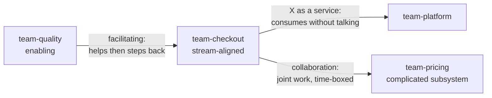
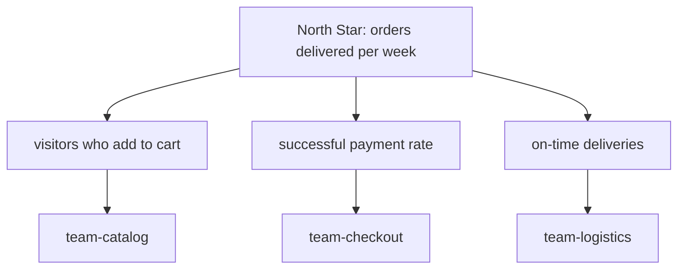
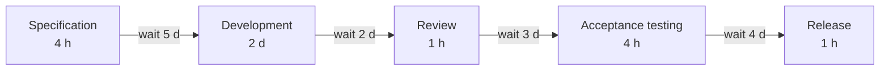
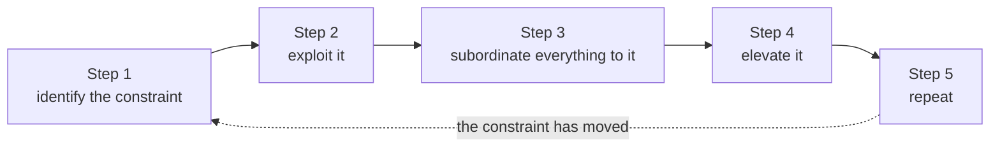
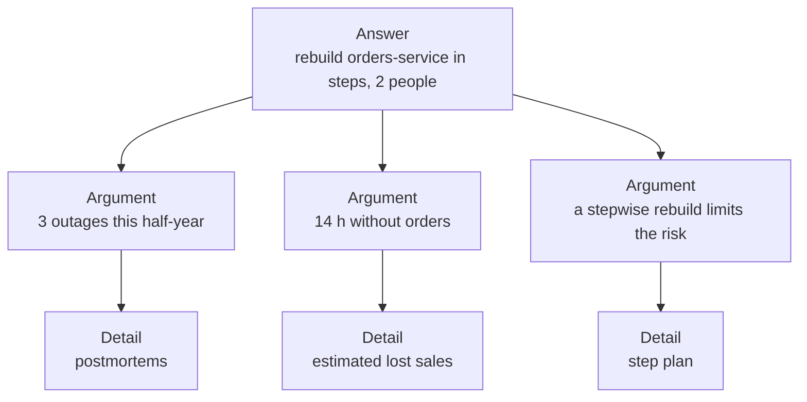

# Company culture and organization

!!! warning "Disclaimer"
    These notes are personal cheat sheets, not a source of truth. They reflect my own understanding and choices: their content remains subjective, despite the quotes and references it contains. It may be incomplete, simplified, inaccurate or outdated. Always check the official documentation before applying it. This content is provided as is, without any warranty: you use it at your own risk.

!!! audience "Who and what for"
    - **Roles**: developer, QA engineer, tech lead, engineering manager, product owner, architect.
    - **Uses**: I prepare an interview where I am asked how my team reacts after an outage; I have to convince my management to fund a project, like automating acceptance testing; my team has grown and I look for a way to split it; I want to understand why a two-day ticket takes three weeks to ship; I aim for a staff role and want to know what is expected.

!!! abstract "Scales"
    The colored badges under the headings say at which scale a notion applies:

    - <span class="pill pill-scope pill-scope-code">Code</span> the classes, functions and modules of one program;
    - <span class="pill pill-scope pill-scope-app">Application</span> one service or application and its internal split;
    - <span class="pill pill-scope pill-scope-system">System</span> several services talking to each other over the network;
    - <span class="pill pill-scope pill-scope-infra">Infrastructure</span> servers, network, zones and clusters, physical or virtual;
    - <span class="pill pill-scope pill-scope-enterprise">Enterprise</span> the whole information system and its organization.

    Details and ambiguous words: [map of scales](architecture.md#map-of-scales).

An engineer talking to a manager, a head of product or a finance director switches language: no more latency or message queues, but goals, costs, risks and deadlines. This page gathers the vocabulary and the thinking frameworks most often quoted in companies: describing a team culture, organizing teams, setting goals, deciding, making work flow, thinking in terms of product and strategy, talking about money, presenting a technical choice to leadership and understanding career tracks.

Management, product and strategy books are here. The founding technical papers are gathered in [Founding texts](textes-fondateurs.md). The teams (`team-core`, `team-billing`), services (`orders-service`, `billing-service`), people (ada, grace) and all figures are examples.

## Terminology

| Word | Definition | Example |
|---|---|---|
| **Culture** | what people actually do when nobody is watching: how information flows, how a mistake is handled, who dares to disagree | in team-core, a junior can say in a meeting "I don't think this plan holds" without risk |
| **Governance** | who has the right to decide what, and how those decisions are checked | the architecture board approves anything that touches more than two teams |
| **Strategy** | the diagnosis of a situation and the small set of coherent choices that answer it | "our customers leave because of outages: this year, reliability comes before new features" |
| **OKR** | Objectives and Key Results: a qualitative objective and two to five measurable results that say whether it is reached | objective "frictionless payment", key result "checkout abandonment from 12% to 6%" |
| **KPI** | Key Performance Indicator: an indicator tracked continuously to know whether the business is healthy | monthly revenue, availability rate, number of support tickets |
| **ROI** | Return On Investment: what an investment brings back, relative to what it costs | €50,000 spent, €80,000 saved: 60% ROI |
| **CAPEX** | Capital Expenditure: an investment, depreciated over several years | buying servers, building a new platform |
| **OPEX** | Operating Expenditure: a running cost, counted in the year | the monthly cloud bill, annual licences, maintenance |
| **P&L** | Profit and Loss, the income statement: revenue minus costs over a period | "the product line's P&L has been negative for two quarters" |
| **Margin** | what is left of revenue once direct costs are paid | a €10 subscription that costs €3 in cloud and support: 70% gross margin |
| **Time to market** | the delay between the idea and availability to customers | three months to ship a new offer instead of nine |
| **Roadmap** | the ordered list of what we plan to ship, often per quarter | Q1: pay in instalments; Q2: mobile app |
| **Stakeholder** | anyone affected by a decision or able to influence it | support, finance, legal, the teams consuming the API |
| **Sponsor** | the leadership member who carries a project, defends it and unlocks the budget | the CTO sponsors the migration to the cloud |
| **Run and build** | run keeps the existing going (operations, support), build creates the new | "60% of our budget goes into run" |
| **Headcount** | the number of open or filled positions, often a team's budget unit | "we have two more positions in next year's budget" |
| **DORA** | DevOps Research and Assessment: a research programme (Nicole Forsgren, Jez Humble, Gene Kim, part of Google since 2018, to check) that publishes the yearly "State of DevOps" reports and summed up its findings in the book "Accelerate" (2018) | one of its four delivery metrics, deployment frequency: "orders-service deploys 3 times a day" |
| **Postmortem** | the written analysis of an incident, after the fact: what happened, why, what we change, without looking for someone to blame | "cause: the migration locks the table; action: 5 s lock timeout on migrations" |
| **Retrospective** | a regular team meeting, often at the end of a sprint, to look at how the team worked and pick one improvement | "we waited two days for reviews: let's try a daily review slot at 2 pm" |
| **<span class="term" data-term="sli">SLI</span>** | Service Level Indicator: the indicator measured to know whether something works | the median lead time of a ticket from start to release |
| **<span class="term" data-term="slo">SLO</span>** | Service Level Objective: the internal target set on an SLI | "median lead time under 5 working days" (example) |
| **<span class="term" data-term="sla">SLA</span>** | Service Level Agreement: the contractual promise made to a customer, with a penalty if it is not kept, usually looser than the SLO | "99.5% availability per month, otherwise a 10% discount", for an internal SLO of 99.9% (example) |

A leadership meeting sentence, decoded:

``` { .text .ex-illus title="Illustration" }
"The quarter's P&L is under pressure: we freeze headcount and push back CAPEX projects;
 the top OKR remains time to market for the new payment."

P&L under pressure         costs rise faster than revenue
headcount freeze           no new position, hiring waits
CAPEX projects pushed back long investments (a new platform) wait
top OKR                    the goal that comes before all others this quarter
time to market             shipping the new payment fast matters more than the rest
```

## Team culture

<a class="pill pill-dora" href="https://dora.dev/capabilities/generative-organizational-culture/">DORA · Generative organizational culture</a> <a class="pill pill-dora" href="https://dora.dev/capabilities/learning-culture/">DORA · Learning culture</a>

A culture is not read in the values on the wall, but in behaviours: what happens to the person who brings bad news, or to the one who broke production.

### Westrum typology

<span class="pill pill-status pill-status-ok" title="Still valid, checked November 2026">Current · 11/2026</span>

Sociologist Ron Westrum classifies organizations by the way information flows in them ("A typology of organisation culture", Quality and Safety in Health Care, 2004). The <span class="term" data-term="westrum-typology">Westrum typology</span> distinguishes three cultures:

!!! noob "As noob"
    I think of someone who puts up an "ice on the road" sign. In a pathological culture, they get blamed for slowing traffic; in a bureaucratic culture, someone first has to find which department is allowed to put up that sign; in a generative culture, people thank them and grit the road. The takeaway: **a team's culture shows in what happens to bad news and to whoever brings it.**

| Behaviour | Pathological (power-oriented) | Bureaucratic (rule-oriented) | Generative (performance-oriented) |
|---|---|---|---|
| cooperation | low | modest | high |
| bearer of bad news | punished | neglected | trained and heard |
| responsibilities | shirked | narrow | shared |
| bridging between teams | discouraged | tolerated | encouraged |
| failure | leads to scapegoating | leads to a prescribed sanction | leads to inquiry |
| novelty | crushed | leads to problems | implemented |

The same incident in the three cultures:

``` { .text .ex-illus title="Illustration" }
pathological    grace reports that the orders-service backup has not worked for 2 weeks.
                She is blamed for not seeing it earlier. Next time, she will keep quiet.
bureaucratic    the ticket is created, but it falls within no team's scope. It waits.
generative      she is thanked, it is fixed, and the postmortem adds an alert on the backup's age.
```

The DORA research programme measures this culture with a questionnaire inspired by Westrum, and links it to delivery performance (Nicole Forsgren, Jez Humble and Gene Kim, "Accelerate", 2018). That performance is measured with the four <span class="term" data-term="dora-metrics">DORA metrics</span>, for example the lead time from a commit to production (median of one day for orders-service, example figure).

**Risks.** the typology is for describing, not grading. If I stick the "pathological" label on a team in a meeting, it gets defensive and the discussion stops: I talk about observed behaviours (what happened to grace), not about people. A questionnaire filled in by management alone gives too flattering a picture: I have the whole team fill it in anonymously.

:material-book-open-variant: Reference docs: [Ron Westrum, A typology of organisational cultures](https://pmc.ncbi.nlm.nih.gov/articles/PMC1765804/) (2004)
{ .doc-ref }

### Psychological safety

<span class="pill pill-status pill-status-ok" title="Still valid, checked November 2026">Current · 11/2026</span>

<span class="term" data-term="psychological-safety">Psychological safety</span> is the belief shared by team members that it is safe to take interpersonal risks there (ask a naive question, admit a mistake, contradict the boss) without being humiliated or punished. Amy Edmondson defined and measured it in "Psychological Safety and Learning Behavior in Work Teams" (Administrative Science Quarterly, 1999).

!!! noob "As noob"
    In a team where people feel safe, saying "I didn't understand" or "I broke production" costs a moment of embarrassment, not a reputation. Problems therefore surface early, while they are still small. The takeaway: **a team that hides mistakes does not make fewer of them, it finds them later.**

Google made it famous with Project Aristotle, an internal study of what makes a team effective, published on the re:Work site in 2015: psychological safety came first among five factors, ahead of dependability, structure and clarity, meaning and impact (to check on re:Work, the study was not published as a scientific paper).

It is not niceness. Edmondson crosses safety with standards:

| | Low standards | High standards |
|---|---|---|
| **High safety** | comfort zone: pleasant, little progress | learning zone: people dare and stretch |
| **Low safety** | apathy | anxiety: high goals, but problems are hidden |

Concrete signs: in MR reviews, juniors comment on seniors' code; in retrospectives, problems come from the whole team, not only the manager; "I don't know" is an accepted answer.

:material-book-open-variant: Reference docs: [Wikipedia, Psychological safety](https://en.wikipedia.org/wiki/Psychological_safety) (accessed November 2026); [Google re:Work, Understand team effectiveness](https://rework.withgoogle.com/print/guides/5721312655835136/) (2015, to check)
{ .doc-ref }

### Just culture

<span class="pill pill-status pill-status-ok" title="Still valid, checked November 2026">Current · 11/2026</span>

A <span class="term" data-term="just-culture">just culture</span> does not punish honest mistakes, but does not tolerate deliberate endangerment. The idea comes from industrial safety (James Reason, "Managing the Risks of Organizational Accidents", 1997) and was developed by Sidney Dekker ("Just Culture", 2007). David Marx distinguishes three behaviours, each with its response ("Patient Safety and the Just Culture", 2001, to check):

!!! noob "As noob"
    Three drivers: one misses a sign hidden by a tree, another always drives a little too fast like everyone else, the third runs a red light on purpose. For the first, we move the sign; for the second, we ask why everyone drives too fast; only the third deserves a fine. The takeaway: **we judge the behaviour, not how bad the consequence was.**

| Behaviour | Example | Response |
|---|---|---|
| human error | ada runs the migration on the wrong database, the two tabs look alike | console, then change the system (colour per environment, confirmation) |
| at-risk behaviour | grace skips the tests "because everybody does when it's urgent" | coach, and understand why the shortcut became normal |
| recklessness | someone disables a security alert knowing the danger, without saying so | sanction |

It is the foundation of the <span class="term" data-term="blameless">blameless postmortem</span>: see [Incidents](incidents.md#the-blameless-postmortem).

**Risks.** the line between at-risk behaviour and recklessness is judged by someone: if it is always the manager, alone and after the fact, the team sees it as arbitrary and hides its errors again. I write the criteria in advance and have two people decide. Conversely, a misunderstood just culture turns into "nobody is ever accountable": deliberate recklessness is still sanctioned.

:material-book-open-variant: Reference docs: [Wikipedia, Just culture](https://en.wikipedia.org/wiki/Just_culture) (accessed November 2026)
{ .doc-ref }

### Learning culture

<span class="pill pill-status pill-status-ok" title="Still valid, checked November 2026">Current · 11/2026</span>

A learning organization turns its experiences into shared practices, instead of leaving them in a few people's heads (Peter Senge, "The Fifth Discipline", 1990). In practice: retrospectives that end with an action, postmortems read by other teams, time set aside for learning, internal demos, mistakes told in public by the seniors themselves.

Avoid: a postmortem that stops at a name. The team learns that admitting a mistake is costly, so the next slip will be hidden, and the migration can still lock the orders table with no time limit.

``` { .text .ex-bad title="Avoid" }
postmortem: payment outage, 03/11, 42 min
cause     ada ran the migration without checking
action    ada will be more careful next time
```

A postmortem skeleton, then a typical one-hour retrospective agenda (examples):

``` { .text .ex-illus title="Illustration" }
postmortem: payment outage, 3 Nov, 42 min
timeline      14:02 migration started; 14:05 5xx alerts; 14:44 rollback
causes        the migration locks the orders table, no lock timeout
actions       5 s lock timeout on migrations (ada, 10 Nov); rehearsal on a copy of the database (grace)

retrospective
 5 min   the action decided last time: done or not?
15 min   what helped, what slowed us down (notes written in silence, then grouped)
30 min   discussion of the two topics with the most votes
10 min   one or two actions, each with an owner and a date
```

| I want... | I use... |
|---|---|
| to describe my organization's culture with facts, not with a vague "the atmosphere is good": what happens to the person who brings bad news, what we do after an outage | the Westrum typology and its six behaviours |
| to know whether people in my team dare to say "I didn't understand" or "I broke production", or whether they prefer to keep quiet in meetings | Edmondson's questions in an anonymous survey, then in discussion |
| to react to a mistake, like a migration run on the wrong database, without the team starting to hide the next ones | just culture: error, risk or recklessness |
| other teams to benefit from the lesson of an incident, instead of making the same mistake a few months later | published and read postmortems, a monthly cross-team review |

!!! maturity "Measuring maturity"
    | Level | What I see in the team |
    |---|---|
    | N1 | one or two people protect those who bring bad news, and a few postmortems get written after big outages |
    | N2 | each notable incident has its blameless postmortem, on a shared template, and each retrospective ends with a dated action |
    | N3 | postmortems are published and read by other teams without being asked, and a junior challenges a plan in a meeting with no consequence |
    | N4 | the team tracks the rate of completed postmortem actions and an anonymous psychological safety survey each semester, and changes its rituals when a score drops |

    **I measure**: the share of postmortem actions done by their due date, read in the ticket tool; the average score of Edmondson's questions in an anonymous half-yearly survey.

## Organizing teams

<a class="pill pill-scope pill-scope-system" href="../architecture/#map-of-scales">Scale · System</a> <a class="pill pill-scope pill-scope-enterprise" href="../architecture/#map-of-scales">Scale · Enterprise</a>

<a class="pill pill-dora" href="https://dora.dev/capabilities/loosely-coupled-teams/">DORA · Loosely coupled teams</a>

If two teams must agree on every change, their code ends up depending on each other too: how teams are organized is not just a management matter, it shapes the architecture. This is <span class="term" data-term="conway-law">Conway's law</span>, detailed in [Architecture](architecture.md#conways-law).

### Team Topologies

<span class="pill pill-status pill-status-ok" title="Still valid, checked November 2026">Current · 11/2026</span>

Matthew Skelton and Manuel Pais ("Team Topologies", 2019) propose four team types and three interaction modes. The splitting criterion is <span class="term" data-term="cognitive-load">cognitive load</span>: a team should not carry more than it can understand, for example not handle the order funnel, the CI and the price calculation engine all at once.

!!! noob "As noob"
    A restaurant kitchen does not give starters, pastry and dishwashing to a single person: they could not keep up and would do everything worse. Each station has a scope it masters and clear rules for working with the others. The takeaway: **we split teams by what one team can keep in its head, not by the org chart.**

| Type | Role | Example |
|---|---|---|
| <span class="term" data-term="stream-aligned-team">stream-aligned team</span> | delivers a part of the product end to end | team-checkout: the order funnel, from need to production |
| <span class="term" data-term="platform-team">platform team</span> | provides self-service internal services | team-platform: CI, deployment, environments |
| <span class="term" data-term="enabling-team">enabling team</span> | helps a team acquire a skill, then steps back | team-quality coaches team-checkout on contract tests for six weeks |
| <span class="term" data-term="complicated-subsystem-team">complicated-subsystem team</span> | owns a component that needs rare expertise | team-pricing: the price calculation engine |

The three interaction modes:



The <span class="term" data-term="inverse-conway-maneuver">inverse Conway maneuver</span> starts from the architecture I want, then organizes teams to match: if I want a price engine separate from the order funnel, I first create a team that owns it, like team-pricing.

**Risks.** reorganizing is expensive: for months, people learn a new scope and deliveries slow down, so I only re-split when cognitive load or waiting between teams is measured, not to follow the book. A platform team that offers no real self-service becomes a ticket desk that every team waits for: I measure the waiting time of its requests. An enabling team with no end date ends up doing the work in place of the others.

:material-book-open-variant: Reference docs: [Team Topologies, Key concepts](https://teamtopologies.com/key-concepts) (accessed November 2026)
{ .doc-ref }

### The Spotify model and its limits

Henrik Kniberg and Anders Ivarsson described Spotify's organization at that point in time in 2012 ("Scaling Agile @ Spotify with Tribes, Squads, Chapters & Guilds"):

| Name | What it is |
|---|---|
| squad | a small autonomous team with its mission |
| tribe | a group of squads on the same domain |
| chapter | people with the same craft within a tribe (all testers), with a common line manager |
| guild | a community of interest open to the whole company |

Cautions before copying it:

- the article described a snapshot, not a model to reproduce; Kniberg said so himself;
- Jeremiah Lee, a former employee, explains in "Spotify's Failed #SquadGoals" (2020) that the real organization was far from the diagram, notably on the line management of chapters;
- renaming teams to squads changes neither autonomy, nor architecture, nor culture.

:material-book-open-variant: Reference docs: [Kniberg and Ivarsson, Scaling Agile @ Spotify](https://blog.crisp.se/wp-content/uploads/2012/11/SpotifyScaling.pdf) (2012); [Jeremiah Lee, Spotify's Failed #SquadGoals](https://www.jeremiahlee.com/posts/failed-squad-goals/) (2020)
{ .doc-ref }

### RACI

<span class="pill pill-status pill-status-ok" title="Still valid, checked November 2026">Current · 11/2026</span>

A <span class="term" data-term="raci">RACI</span> matrix says, for each task, who does it (**R**esponsible), who answers for it and decides (**A**ccountable, a single person), who is asked beforehand (**C**onsulted) and who is told afterwards (**I**nformed). Its precise origin is not documented (1950s to 1970s, to check).

| Task: migrate the orders-service database | ada (dev) | grace (lead) | team-platform | support |
|---|---|---|---|---|
| write the migration plan | R | A | C | |
| approve the maintenance window | C | A | C | I |
| run the migration | R | A | C | I |
| notify customers | | A | | R |

Rule: a single A per row. Two As means nobody.

**Risks.** a RACI matrix written once and never reread describes an organization that no longer exists: I review it at each team or project change. Too many Cs turn every decision into a consultation tour, and an A given to someone with neither the time nor the authority to decide blocks everything: the A is the person who can really say yes.

:material-book-open-variant: Reference docs: [Wikipedia, Responsibility assignment matrix](https://en.wikipedia.org/wiki/Responsibility_assignment_matrix) (accessed November 2026)
{ .doc-ref }

### InnerSource

<span class="pill pill-status pill-status-ok" title="Still valid, checked November 2026">Current · 11/2026</span>

team-billing needs a new field in the payment library owned by team-core. It opens a ticket, team-core ranks it behind its own priorities, and three sprints later nothing has moved: team-billing ends up copying the library and changing it on its own. **<span class="term" data-term="innersource">InnerSource</span>** (a term coined by Tim O'Reilly, 2000) applies the practices of <span class="term" data-term="open-source">open source</span> inside the company: teams' code is visible to everyone, and another team can propose the change itself through an MR, which the owning team reviews and accepts. The InnerSource Commons community, founded in 2015, documents its practices.

!!! noob "As noob"
    It is a community garden shared by neighbours: anyone can plant in the common plot by following the rules posted at the gate, and a lead gardener checks that nothing chokes the rest. Limit: the plot always has an owner, who keeps the last word. The takeaway: **with InnerSource, I write the change I need myself, and the owning team reviews it instead of coding it.**

**When**: several teams depend on the same code (library, CI component, shared standard) and the owning team has become a bottleneck. Not when the code changes from top to bottom every week, or when the owning team has no time to review: MRs rot, which is worse than a rejected ticket. **Why**: teams contribute to the standard instead of putting up with it or copying it, and the code stays unique. The cost: review and coaching time for the owning team, and contribution documentation to maintain. **How**:

1. The owning team writes a `CONTRIBUTING.md`: how to run the tests, what it accepts, the review delay it commits to (for example two working days).
2. It names one or two *trusted committers*: people in charge of reviewing and guiding outside contributors, taking turns.
3. Discussions happen in writing, in MRs and tickets, so the decision stays readable by everyone.
4. For a large change, the contributor first opens a ticket to discuss it, before writing the code.

``` { .text .ex-illus title="Illustration" }
Without InnerSource
  week 0   team-billing opens a ticket "add the installment_count field"
  week 6   still waiting behind team-core's priorities
  week 7   team-billing copies the library: two versions diverge

With InnerSource
  day 0    team-billing reads CONTRIBUTING.md and opens an MR with the field and its tests
  day 2    team-core's trusted committer reviews it, asks for one more test
  day 3    merged, version 2.5.0 published for every team
```

:material-book-open-variant: Reference docs: [InnerSource Commons](https://innersourcecommons.org/) (accessed November 2026)
{ .doc-ref }

### Influence without authority and communities of practice

<span class="pill pill-status pill-status-ok" title="Still valid, checked November 2026">Current · 11/2026</span>

I want five teams to adopt a common format for the error responses of their APIs, but none of them reports to me: I cannot impose anything, and an order from above would be bypassed at the first rushed release. **Influence without authority** means changing a practice through exchange, proof and writing rather than through hierarchy. Allan Cohen and David Bradford ("Influence Without Authority", 1990) describe it as a trade: I look for what matters to the other team (fewer incidents, less on-call, recognition, fewer support tickets) and I offer something that pays in that "currency", not in mine.

!!! noob "As noob"
    To start a shared compost bin in a building, I do not begin with a poster saying "mandatory from Monday". I first ask the neighbours what bothers them (overflowing bins), I start the bin with the two keen neighbours, then the others follow when they see it works and does not smell. The takeaway: **without the power to impose, I convince through what the other side gains and through a first visible success, not through a rule.**

Three well-known ideas, to combine:

| Idea | What it says | What I do |
|---|---|---|
| the trade (Cohen and Bradford, 1990) | people cooperate when they gain something that matters to them | before proposing, I ask team-web what costs it the most; here, support tickets about unreadable error messages |
| diffusion of innovations (Everett Rogers, "Diffusion of Innovations", 1962) | a novelty spreads from innovators (about 2.5%) to <span class="term" data-term="early-adopters">early adopters</span> (13.5%), then to the majority, which copies those it sees succeed | I start with the volunteer team, never with the most reluctant one |
| <span class="term" data-term="nemawashi">nemawashi</span> (a Japanese practice, taken up in the Toyota Production System) | prepare the decision by talking to everyone before the meeting, so the meeting confirms instead of discovering | I have each tech lead review my RFC one to one before the joint review |

A <span class="term" data-term="community-of-practice">community of practice</span> (Jean Lave and Etienne Wenger, "Situated Learning", 1991) carries this work over time: people from several teams who share a craft or a practice (testing, accessibility, APIs) meet regularly, on a voluntary basis, to learn from one another. The guilds of the Spotify model (2012) are one version of it. Each member becomes a <span class="term" data-term="champion">champion</span> in their team: the practice spreads without going through me.

**When**: I need to change a practice in teams that do not report to me (a standard, a tool, a convention), or a skill is scattered across several teams. Not for a non-negotiable security or compliance rule: there, the decision belongs to whoever has the authority, and influence only serves to explain it. **Why**: a practice adopted out of conviction survives my departure; an imposed one is bypassed as soon as nobody is watching. The cost: it is slower than an order, and I must accept changing my proposal. **How**:

1. I understand the objections before convincing: which problem the practice solves, what it costs each team.
2. I prove it with a volunteer team, in non-blocking mode first, and I publish the results, costs and false positives included.
3. I write the proposal (an RFC) and prepare it one to one before the decision meeting.
4. I rely on a community of practice and champions in each team, with an exception that is possible but visible and dated.
5. I measure real <span class="term" data-term="adoption">adoption</span>, not the number of people at the presentation.

Avoid: imposing a common quality gate through an announcement. The teams that do not see the point turn it off, and the standard dies quietly.

``` { .text .ex-bad title="Avoid" }
week 1   I announce in the general channel: "from Monday, the quality gate blocks every MR"
week 2   two teams turn it off in their pipeline, a third adds an exception with no end date
week 6   the gate blocks nothing anywhere, and my next proposal starts with a handicap
```

Good: the same gate, carried by the trade, a volunteer team and a prepared decision.

``` { .text .ex-good title="Recommended" }
week 1   I ask each team what costs it the most in review: two mention security flaws
week 2   team-web, volunteering, tries the gate in informational mode, without blocking
week 4   I publish its figures, false positives included, and drop two noisy rules
week 5   each tech lead reviews the RFC one to one before the joint review (nemawashi)
week 8   the gate blocks on the reliable rules; an exception is possible, with a label and an end date
(example durations)
```

**Risks.** a community of practice with no facilitator and no time granted by managers dies out within a few months: I ask that taking part counts as work and I rotate the facilitation. It is not a decision body: if it starts voting rules for every team, it becomes an authority again, without the legitimacy. It can also turn into a club of the already convinced talking among themselves: I measure how many teams are represented. Finally, nemawashi done badly looks like corridor deals: I write in the RFC every objection received one to one and the answer given.

:material-book-open-variant: Reference docs: [Etienne and Beverly Wenger-Trayner, Introduction to communities of practice](https://www.wenger-trayner.com/introduction-to-communities-of-practice/) (accessed November 2026); [Wikipedia, Diffusion of innovations](https://en.wikipedia.org/wiki/Diffusion_of_innovations) (accessed November 2026)
{ .doc-ref }

### Two-pizza teams

<span class="pill pill-status pill-status-ok" title="Still valid, checked November 2026">Current · 11/2026</span>

A <span class="term" data-term="two-pizza-team">two-pizza team</span> is small enough to be fed by two pizzas, about six to ten people. The rule is attributed to Jeff Bezos at Amazon in the early 2000s (to check, it is only known through anecdotes). The reason is arithmetic: the number of possible communication channels is n × (n - 1) / 2, so 6 channels for 4 people, 28 for 8 and 66 for 12.

**Risks.** splitting a team that is too large creates boundaries, so dependencies: if I cut in the middle of a flow, both halves must coordinate at each change and nothing gets faster. I split along two distinct flows. A team that is too small (two or three people) cannot sustain on-call or absences: knowledge rests on a single head.

| I want... | I use... |
|---|---|
| my teams to ship without waiting for the others on every change, for example team-checkout deploying without asking another team for an environment by hand | Team Topologies: stream-aligned teams, a self-service platform |
| to help a team master a new practice, like contract tests, without ending up writing its tests for it | an enabling team, with an end date |
| to know who decides on a task several teams share, like a database migration where everyone thinks someone else decides | a RACI matrix, a single A per row |
| to adopt the Spotify model (squads, tribes, chapters) because it seems to work elsewhere | read its critiques first, keep the idea (autonomy, communities), not the names |
| my team has grown to twelve people and every decision now needs a meeting with everyone | split it around two distinct streams |
| another team has been waiting three sprints for team-core to add a field to its shared library, and ends up copying it | [InnerSource](#innersource): it proposes the MR, team-core reviews |
| I want five teams that do not report to me to adopt a common API error format, without going through an order from leadership | [influence without authority](#influence-without-authority-and-communities-of-practice): a volunteer team, an RFC prepared one to one, a community of practice |

:material-book-open-variant: Reference docs: [AWS Whitepaper, Two-pizza teams](https://docs.aws.amazon.com/whitepapers/latest/introduction-devops-aws/two-pizza-teams.html) (accessed November 2026)
{ .doc-ref }

!!! maturity "Measuring maturity"
    | Level | What I see in the team |
    |---|---|
    | N1 | someone roughly knows who decides what, and teams coordinate case by case |
    | N2 | teams have a type (stream, platform, enabling, subsystem), a RACI matrix for shared topics and a `CONTRIBUTING.md` on common code |
    | N3 | a team ships without waiting for another: the platform is self-service, InnerSource MRs are reviewed within the promised delay with no chasing |
    | N4 | the organization tracks waiting time between teams and the review delay of external MRs, and re-splits teams when these numbers rise |

    **I measure**: the number of tickets blocked waiting for another team and how long they wait, read in the ticket tool; the median review delay of MRs coming from other teams, read in the MR tool.

## Setting and tracking goals

### OKR

<span class="pill pill-status pill-status-ok" title="Still valid, checked November 2026">Current · 11/2026</span>

<span class="term" data-term="okr">OKRs</span> come from Andy Grove at Intel ("High Output Management", 1983). John Doerr learned them at Intel, presented them to Google in 1999 and popularized them in "Measure What Matters" (2018). An OKR is:

- an **objective**: qualitative, motivating, what we want to change;
- two to five **key results**: measurable, checkable at the end of the period, outcomes and not tasks.

``` { .text .ex-illus title="Illustration" }
Objective       Teams ship without waiting for CI (Q3)
Key result 1    p95 pipeline time: from 28 min to 10 min
Key result 2    flaky test rate: from 4% to under 1%
Key result 3    CI satisfaction in the developer survey: from 2.9 to 4 out of 5

Bad key result: "move the runners to bigger machines" (a task, not an outcome)
```

Doerr distinguishes **committed** OKRs (to reach 100%) and **aspirational** ones (reaching 60 to 70% is already a success, to check depending on the organization). Mixing both without saying so creates misunderstandings.

**Risks.** tying OKRs to bonuses pushes everyone to pick easy targets, and the ambitious objective loses its meaning: I keep them apart from individual reviews. Too many OKRs at once (ten objectives per team) dilute the effort, and none moves: I keep one to three per quarter. An OKR written in January and reread in March steers nothing: I hold a short check-in every two weeks.

:material-book-open-variant: Reference docs: [What Matters, OKR meaning, definition and examples](https://www.whatmatters.com/faqs/okr-meaning-definition-example) (accessed November 2026)
{ .doc-ref }

### KPI or OKR

A <span class="term" data-term="kpi">KPI</span> is a thermometer: it is watched all the time. An OKR is a desired change over a period.

| | KPI | OKR |
|---|---|---|
| question | "is everything fine?" | "what do we want to change this quarter?" |
| duration | permanent | one period (often a quarter) |
| example | my-api availability at 99.9% | "raise availability from 99.5% to 99.9%" |
| when it moves | we investigate | we adjust the plan |

A degrading KPI often becomes the subject of an OKR the following quarter.

**Risks.** too many KPIs tracked at once, and nobody looks at any of them: the day one degrades, nobody notices. I keep a handful of indicators per activity, each with a threshold and an owner. A KPI with no alert threshold is dashboard decoration.

:material-book-open-variant: Reference docs: [Wikipedia, Performance indicator](https://en.wikipedia.org/wiki/Performance_indicator) (accessed November 2026)
{ .doc-ref }

### North Star metric

<span class="pill pill-status pill-status-ok" title="Still valid, checked November 2026">Current · 11/2026</span>

The <span class="term" data-term="north-star-metric">North Star metric</span> is the single measure that captures the value the product brings to customers, and that predicts future revenue. The term was popularized in the growth marketing world, notably by Sean Ellis, around 2017 (to check). It is broken down into input metrics that teams can act on:



**Risks.** a single metric optimized without a guardrail is paid for elsewhere: pushing weekly delivered orders with aggressive discounts lowers the margin. I pair the North Star with one or two counter-metrics (margin, satisfaction). A badly chosen North Star, like the number of visits, rewards activity instead of value for the customer.

:material-book-open-variant: Reference docs: [Amplitude, The North Star Playbook](https://amplitude.com/books/north-star) (accessed November 2026)
{ .doc-ref }

### Avoiding the Goodhart trap

<span class="term" data-term="goodhart-law">Goodhart's law</span>: when a measure becomes a target, it ceases to be a good measure (Charles Goodhart, 1975, in Marilyn Strathern's 1997 wording). It and its cousins are detailed in [Laws and principles](lois-et-principes.md). The countermeasure: pair every goal with a **counter-metric** that degrades if people game it.

| Goal | Possible gaming | Counter-metric |
|---|---|---|
| reduce support ticket handling time | close tickets without solving them | reopened ticket rate |
| increase deployment frequency | split changes artificially | change failure rate |
| increase code coverage | tests without assertions | mutation score on critical code |

| I want... | I use... |
|---|---|
| to give the team an ambitious direction for the quarter, like "teams ship without waiting for CI", and know at the end whether we got there | an OKR: one objective, two to five measurable results |
| to know at all times whether an activity is healthy, like my-api's availability, and be warned as soon as it degrades | KPIs, with a threshold that triggers an investigation |
| team-catalog, team-checkout and team-logistics to pull in the same direction, instead of each optimizing its own number | a North Star metric and its tree of input metrics |
| a tracked number not to be artificially inflated, like support tickets closed without being solved to lower handling time | a counter-metric per goal, and never an individual ranking |

!!! maturity "Measuring maturity"
    | Level | What I see in the team |
    |---|---|
    | N1 | the manager sets goals orally, with no starting or target number |
    | N2 | each quarter, the team writes one to three quantified OKRs and tracks a few KPIs, each with a threshold |
    | N3 | a KPI crossing its threshold triggers an alert and an investigation with no prior meeting, and each goal has its counter-metric |
    | N4 | at the end of the quarter, the team compares the key results reached, the counter-metric and the North Star, and adjusts its next goals from these gaps |

    **I measure**: the share of key results that are quantified and measurable (not tasks), read in the OKR document; the number of goals tracked with their counter-metric.

## Deciding

<a class="pill pill-practice" href="../livraison/#design-before-coding">Practice · Technical design</a>
<a class="pill pill-dora" href="https://dora.dev/capabilities/documentation-quality/">DORA · Documentation quality</a>

### Cynefin

<span class="pill pill-status pill-status-ok" title="Still valid, checked November 2026">Current · 11/2026</span>

The <span class="term" data-term="cynefin">Cynefin</span> framework (Dave Snowden, from 1999; "A Leader's Framework for Decision Making", with Mary Boone, Harvard Business Review, 2007) says we do not decide the same way depending on the nature of the situation:

!!! noob "As noob"
    Changing a tyre is clear: I follow the manual. Repairing an engine is complicated: a mechanic finds the fault by analysing. Getting customers to love a new dish is complex: no analysis guarantees it, I try, I watch, I adjust. A car on fire is chaotic: I get people away first, I will understand later. The takeaway: **before choosing how to decide, I ask myself what kind of situation I am in.**

<figure class="diagram"><svg viewBox="0 0 320 210" role="img" aria-label="Cynefin: four domains and confusion in the middle (after Dave Snowden)"><rect class="layer layer-2" x="10" y="10" width="145" height="90" rx="6"/><text class="label-strong" x="82.5" y="32" text-anchor="middle">Complex</text><text x="82.5" y="45" text-anchor="middle">probe, sense, respond</text><text x="82.5" y="57" text-anchor="middle">emergent practice</text><rect class="layer layer-1" x="165" y="10" width="145" height="90" rx="6"/><text class="label-strong" x="237.5" y="32" text-anchor="middle">Complicated</text><text x="237.5" y="45" text-anchor="middle">sense, analyze, respond</text><text x="237.5" y="57" text-anchor="middle">good practice</text><rect class="layer layer-3" x="10" y="110" width="145" height="90" rx="6"/><text class="label-strong" x="82.5" y="170" text-anchor="middle">Chaotic</text><text x="82.5" y="183" text-anchor="middle">act, sense, respond</text><text x="82.5" y="195" text-anchor="middle">novel practice</text><rect class="layer layer-1" x="165" y="110" width="145" height="90" rx="6"/><text class="label-strong" x="237.5" y="170" text-anchor="middle">Clear</text><text x="237.5" y="183" text-anchor="middle">sense, categorize, respond</text><text x="237.5" y="195" text-anchor="middle">best practice</text><ellipse class="layer layer-1" cx="160" cy="105" rx="44" ry="20" style="fill-opacity:1;fill:var(--md-default-bg-color)"/><text class="label-strong" x="160" y="108" text-anchor="middle">Confusion</text></svg><figcaption>Cynefin: four domains and confusion in the middle (after Dave Snowden)</figcaption></figure>

| Domain | Cause and effect | Method | Example |
|---|---|---|---|
| clear | obvious, known to all | sense, categorize, apply the best practice | renew an expiring certificate: follow the runbook |
| complicated | discoverable by an expert | sense, analyze, respond | size the orders-service database for twice the traffic |
| complex | visible only in hindsight | probe, sense, respond: safe experiments | find out whether customers want to pay in instalments |
| chaotic | no visible link | act, sense, respond: stabilize first | total outage in the middle of a sales evening |
| confusion | we do not know which domain we are in | break the situation into pieces | a meeting where everyone thinks they are discussing a different problem |

The classic mistake: treating a complex problem as complicated, with a detailed one-year plan where two-week experiments were needed.

:material-book-open-variant: Reference docs: [The Cynefin Co, About the Cynefin framework](https://thecynefin.co/about-us/about-cynefin-framework/) (accessed November 2026); [Snowden and Boone, A Leader's Framework for Decision Making](https://hbr.org/2007/11/a-leaders-framework-for-decision-making) (2007)
{ .doc-ref }

### Type 1 and type 2 decisions

<span class="pill pill-status pill-status-ok" title="Still valid, checked November 2026">Current · 11/2026</span>

Jeff Bezos, in his 2015 letter to shareholders, distinguishes two kinds of decisions:

- **type 1**: a <span class="term" data-term="one-way-door">one-way door</span>, hard or impossible to undo; it deserves time and care;
- **type 2**: a two-way door, a <span class="term" data-term="reversible-change">reversible change</span>; it should be made fast, by a small group.

``` { .text .ex-illus title="Illustration" }
type 1   choose the main database of the new platform
         sign a five-year contract with a vendor
type 2   choose a logging library behind an interface
         enable a feature for 5% of customers behind a feature flag
```

The trap described in the letter: applying the heavy type 1 process to every decision, which slows down the whole organization.

**Risks.** the opposite risk of Bezos's trap: classifying as type 2 a decision that is actually type 1. Choosing a data format "for now" becomes irreversible as soon as three services and years of data depend on it. Before deciding fast, I ask what rolling back would cost in six months, and if nobody can answer, I treat the decision as type 1.

:material-book-open-variant: Reference docs: [Jeff Bezos, 2015 letter to shareholders](https://s2.q4cdn.com/299287126/files/doc_financials/annual/2015-Letter-to-Shareholders.PDF) (2016)
{ .doc-ref }

### RFCs and design documents

<span class="pill pill-status pill-status-ok" title="Still valid, checked November 2026">Current · 11/2026</span>

An **RFC** (Request for Comments) is a document that proposes a change and asks for feedback before the decision. The name comes from the Internet: RFC 1 was published in 1969 by Steve Crocker. In companies, people also say design doc. The template fits in a few headings:

``` { .markdown .ex-illus title="Illustration" }
# RFC 014: usage-based billing in billing-service

Status: in review until 11/15 (example)
Context: why now, with the numbers
Goals and non-goals: what we aim for, what we do not address
Options considered: at least two, including "do nothing"
Proposal: the chosen option and why
Risks and open questions
Rollout and rollback plan
```

The final decision is then kept in an <span class="term" data-term="adr">ADR</span>: see [Design before coding](livraison.md#design-before-coding).

**Risks.** an RFC with no review end date drags on for weeks and blocks the team, or ends with whoever comments the most winning: I set a date and a person who decides. An RFC for every small choice drowns readers, who end up reading nothing: I keep it for type 1 decisions or those that affect several teams.

:material-book-open-variant: Reference docs: [RFC 1, Host Software](https://www.rfc-editor.org/rfc/rfc1) (1969)
{ .doc-ref }

### Advice process

<span class="pill pill-status pill-status-ok" title="Still valid, checked November 2026">Current · 11/2026</span>

In the <span class="term" data-term="advice-process">advice process</span>, anyone can make a decision, provided they have sought the advice of the people affected and of experts. The decider does not have to follow that advice. The principle comes from Dennis Bakke ("Joy at Work", 2005) and was taken up by Frederic Laloux ("Reinventing Organizations", 2014). Andrew Harmel-Law applies it to software architecture in "Scaling the Practice of Architecture, Conversationally" (martinfowler.com, 2021).

``` { .text .ex-illus title="Illustration" }
1. ada wants to replace the RabbitMQ queue of orders-service with a Kafka topic
2. she asks for advice from billing-service (consumer), the platform team and grace (Kafka expert)
3. billing-service worries about message order; the platform team prefers to wait for the cluster upgrade
4. ada decides: migrate after the upgrade, partition key on the order number
5. she writes ADR 027: context, advice received (including advice not followed), decision, consequences
```

**Risks.** without a written record, the advice process looks like "everyone does what they want": the advice asked for and not followed disappears, and the same discussion comes back six months later. I keep a decision log (the ADRs). Someone can also consult only those who agree with them: the list of affected people is decided before asking for advice.

:material-book-open-variant: Reference docs: [Andrew Harmel-Law, Scaling the Practice of Architecture, Conversationally](https://martinfowler.com/articles/scaling-architecture-conversationally.html) (2021)
{ .doc-ref }

### Disagree and commit

<span class="pill pill-status pill-status-ok" title="Still valid, checked November 2026">Current · 11/2026</span>

<span class="term" data-term="disagree-and-commit">Disagree and commit</span>: we voice our disagreement during the discussion, then, once the decision is made, we commit to making it succeed as if it were our own. Bezos describes it in his 2016 letter; the phrase is often traced back to Intel and Andy Grove (to check). It is not "shut up and obey": the disagreement is voiced, written down, and can be revisited if the facts change.

``` { .text .ex-illus title="Illustration" }
the team picks MongoDB for the catalog, grace would have preferred PostgreSQL
grace writes her disagreement in the ADR: "risk: reports with costly joins"
then she designs the best MongoDB schema she can, without slowing the project
six months later, if reports become a problem, her written objection is used to reopen the decision
```

**Risks.** "disagree and commit" can be used to silence people: if the boss invokes it before objections are voiced, it is obedience, and the problems come back in production. Disagreement is spoken and written first. Conversely, someone who "commits" while quietly slowing things down makes the decision fail: commitment shows in actions.

:material-book-open-variant: Reference docs: [Jeff Bezos, 2016 letter to shareholders](https://www.aboutamazon.com/news/company-news/2016-letter-to-shareholders) (2017)
{ .doc-ref }

### The six-page narrative memo

<span class="pill pill-status pill-status-ok" title="Still valid, checked November 2026">Current · 11/2026</span>

The <span class="term" data-term="narrative-memo">narrative memo</span> replaces slides with a full text, read silently by everyone at the start of the meeting. The idea goes back to a 2004 email by Jeff Bezos banning PowerPoint from leadership meetings (to check; the six-page length is the form reported later). A text forces ideas to be linked together, where a bullet list lets them sit side by side.

``` { .text .ex-illus title="Illustration" }
slide     "Context: latency, costs, technical debt"
memo      "The p99 latency of orders-service has doubled since January, because each order
           calls four services. The redesign removes two of those calls; it costs three months
           for two people, and the expected gain is a p99 under 300 ms."
meeting   20 min of silent reading, then 40 min of questions
```

**Risks.** a memo takes time to write, often several days for an important decision: I keep it for decisions that are worth it. If participants come without reading and the silent reading is dropped "to save time", the meeting falls back into discovering the topic live: the 20 minutes of reading are part of the meeting.

| I want... | I use... |
|---|---|
| to know how to decide on a question nobody knows the answer to, like whether customers want to pay in instalments | Cynefin: experiments if complex, analysis if complicated |
| to go fast on small choices without locking myself in on big ones: pick a logging library in an hour, but take time for the main database | type 1 or type 2: decide fast if it is easy to undo |
| to gather feedback before a choice that affects several teams, like moving billing-service to usage-based billing | a reviewed RFC, then an ADR |
| teams to make their own architecture decisions, without sending everything up to a board | the advice process, with a decision log |
| to move forward while someone in the team disagrees, like grace who would have preferred PostgreSQL to MongoDB for the catalog | disagree and commit, with the disagreement written down |
| no more decision meetings where nobody read the file and everyone discovers the topic on the slides | a narrative memo read at the start of the meeting |

:material-book-open-variant: Reference docs: [Jeff Bezos, 2017 letter to shareholders](https://www.aboutamazon.com/news/company-news/2017-letter-to-shareholders) (2018)
{ .doc-ref }

!!! maturity "Measuring maturity"
    | Level | What I see in the team |
    |---|---|
    | N1 | decisions are made in meetings, orally, and a few people remember them |
    | N2 | important decisions go through a reviewed RFC then an ADR, and the team classifies each choice as type 1 or type 2 |
    | N3 | the advice process runs on its own: everyone decides after consulting, and the ADR is written without being asked, with the advice not followed |
    | N4 | the team measures the delay between opening an RFC and the decision, and the number of reopened decisions, and lightens or strengthens its process from these numbers |

    **I measure**: the median delay between opening an RFC and its ADR, read in the ADR repository; the share of decisions reopened during the year because advice was not sought.

## Lean and flow

<a class="pill pill-dora" href="https://dora.dev/capabilities/work-visibility-in-value-stream/">DORA · Visibility of work in the value stream</a> <a class="pill pill-dora" href="https://dora.dev/capabilities/working-in-small-batches/">DORA · Working in small batches</a>

### Toyota Production System

<span class="pill pill-status pill-status-ok" title="Still valid, checked November 2026">Current · 11/2026</span>

**Lean** comes from the Toyota Production System, described by Taiichi Ohno ("Toyota Production System: Beyond Large-Scale Production", 1978 in Japan, 1988 in English), then popularized by James Womack and Daniel Jones ("Lean Thinking", 1996). Two pillars: **just in time** (produce what is asked, when it is asked) and **jidoka** (stop the line as soon as a defect appears: any worker can pull the andon cord).

Lean hunts <span class="term" data-term="lean-waste">waste</span>. Mary and Tom Poppendieck translate the seven factory wastes for software ("Lean Software Development: An Agile Toolkit", 2003):

| Factory | Software | Example |
|---|---|---|
| inventory | partially done work | a finished branch not merged for three weeks |
| overproduction | extra features | a PDF export nobody uses |
| extra processing | relearning | rediscovering why a choice was made, for lack of an ADR |
| transportation | handoffs | a request that goes through four teams before being handled |
| motion | task switching | a developer on five projects at once |
| waiting | delays | an MR waiting two days for a review |
| defects | defects | a bug found in production rather than in CI |

Their seven principles of lean software: eliminate waste, amplify learning, decide as late as possible, deliver as fast as possible, empower the team, build integrity in, see the whole.

**Risks.** copying Lean's tools without its principle (the board, stand-ups, waste labels) gives an empty ritual: the team counts waste without removing any. I pick one measured waste, like waiting in review, and bring it down. Chasing "waste" indiscriminately can also remove the slack that absorbs the unexpected, and the team collapses at the first incident.

:material-book-open-variant: Reference docs: [Toyota, Toyota Production System](https://global.toyota/en/company/vision-and-philosophy/production-system/) (accessed November 2026); [Lean Enterprise Institute, Toyota Production System](https://www.lean.org/lexicon-terms/toyota-production-system/) (accessed November 2026)
{ .doc-ref }

### Value stream mapping

<span class="pill pill-status pill-status-ok" title="Still valid, checked November 2026">Current · 11/2026</span>

<span class="term" data-term="value-stream-mapping">Value stream mapping</span> (Mike Rother and John Shook, "Learning to See", 1998) draws each step of a request with its work time and its wait time.

``` { .text .ex-illus title="Illustration" }
step                     work       wait before the next step
specification            4 h        5 days (prioritization)
development              2 days     2 days (code review)
review                   1 h        3 days (acceptance testing campaign)
acceptance testing       4 h        4 days (release window)
release                  1 h

total: about 3.2 days of work for 17.2 days of lead time
flow efficiency = 3.2 / 17.2, or 19% (example figures)
```



The gain is almost always in the waits, not in the work: cutting development from 2 days to 1 removes only one day from a lead time of over 17 days, while removing the wait for the release window removes 4.

**Risks.** a map drawn from memory in a workshop gives wrong numbers, often too optimistic about waiting: I read them in the ticket tool (status change dates). A map made once then shelved changes nothing: I redo it after each improvement to check that waiting really went down.

:material-book-open-variant: Reference docs: [Lean Enterprise Institute, Value Stream Mapping](https://www.lean.org/lexicon-terms/value-stream-mapping/) (accessed November 2026)
{ .doc-ref }

### Theory of constraints

<span class="pill pill-status pill-status-ok" title="Still valid, checked November 2026">Current · 11/2026</span>

Eliyahu Goldratt, in the novel "The Goal" (1984), shows that a system's throughput depends on its <span class="term" data-term="bottleneck">bottleneck</span>. Optimizing elsewhere is useless. The <span class="term" data-term="theory-of-constraints">theory of constraints</span> offers five steps:

!!! noob "As noob"
    On a motorway that goes from three lanes down to one, widening the road before the narrowing gets nobody there sooner: cars just wait in greater numbers in front of the funnel. Only widening the funnel lets more cars through per hour. The takeaway: **an hour saved outside the bottleneck saves the system nothing.**

1. **identify** the constraint (in the example above, manual acceptance testing);
2. **exploit** it: it must never lose time (prepare test data in advance);
3. **subordinate** everything to it: do not produce faster than it absorbs;
4. **elevate** it: increase its capacity (automate acceptance tests);
5. **repeat**: the constraint has moved elsewhere.



**Risks.** picking the wrong bottleneck means investing in the wrong place: without measurement, each team points at the step next door. I look for where work piles up (the longest queue). Once the constraint is elevated, it moves elsewhere: if I keep investing in the same place, the gain stops dead.

:material-book-open-variant: Reference docs: [Wikipedia, Theory of constraints](https://en.wikipedia.org/wiki/Theory_of_constraints) (accessed November 2026)
{ .doc-ref }

### Little's law and WIP limits

<span class="term" data-term="littles-law">Little's law</span> (John Little, 1961) links three quantities of a stable system: work in progress = <span class="term" data-term="throughput">throughput</span> × average lead time. Turned around, lead time = work in progress / throughput. The systems side is in [Architecture](architecture.md#littles-law).

!!! noob "As noob"
    A bakery serves one person per minute. With ten people ahead of me, I wait about ten minutes; with twenty, twenty minutes, even though the baker does not work any slower. The law only holds on average and for a stable queue, where more people do not keep coming in than going out. The takeaway: **at the same throughput, the more work waiting, the longer each request waits.**

``` { .text .ex-illus title="Illustration" }
team-core finishes 5 tickets per week
with 20 tickets in progress   average lead time = 20 / 5 = 4 weeks
with 10 tickets in progress   average lead time = 10 / 5 = 2 weeks
```

If my team wants to ship faster without working more, it starts fewer things at once: with half as many tickets in progress, each ticket ships on average twice as early. That is the job of a <span class="term" data-term="wip-limit">WIP limit</span> (Work In Progress).

**Risks.** a WIP limit set too low leaves people idle as soon as a ticket is blocked, and the team works around it by opening "off-board" tickets: I start from today's work in progress and lower it in small steps. The law only holds for a stable queue: with a flow of unpredictable emergencies, the calculation gives an order of magnitude, not a lead time promise.

:material-book-open-variant: Reference docs: [Wikipedia, Little's law](https://en.wikipedia.org/wiki/Little%27s_law) (accessed November 2026)
{ .doc-ref }

### Kanban

<span class="pill pill-status pill-status-ok" title="Still valid, checked November 2026">Current · 11/2026</span>

The <span class="term" data-term="kanban">Kanban</span> method for knowledge work (David J. Anderson, "Kanban: Successful Evolutionary Change for Your Technology Business", 2010) starts from what exists: visualize the work, limit work in progress, manage flow, make policies explicit, improve in small steps.

``` { .text .ex-illus title="Illustration" }
TO DO       IN PROGRESS (max 3)    IN REVIEW (max 2)    DONE
TCK-41      TCK-38 ada             TCK-35               TCK-30
TCK-42      TCK-39 grace           TCK-36               TCK-31
TCK-43      TCK-40 ada

IN REVIEW is full: before starting TCK-41, ada reviews TCK-35.
```

**Risks.** a Kanban board without WIP limits is just a task list in columns: work piles up and nothing reacts. Limits nobody respects ("just this once") protect nothing: when a column is full, the team helps empty it before starting anything else, otherwise the limit goes away.

| I want... | I use... |
|---|---|
| to understand why a request worth a few days of work takes three weeks to reach production | value stream mapping, work time and wait time |
| to know where to put people or budget to ship more, rather than speeding up a step that blocks nothing | the theory of constraints: the bottleneck first |
| tickets to ship faster without hiring or working overtime, while the team has twenty tickets open at once | limit work in progress (Little's law) |
| to see where work piles up, like MRs stacking up in review, and improve it step by step without reorganizing the whole team | a Kanban board with WIP limits |
| shared words to point at what wastes time, like an MR waiting two days for a review or an export nobody uses | the seven wastes of software (Poppendieck) |

:material-book-open-variant: Reference docs: [Kanban University, The Official Kanban Guide](https://kanban.university/kanban-guide/) (accessed November 2026)
{ .doc-ref }

!!! maturity "Measuring maturity"
    | Level | What I see in the team |
    |---|---|
    | N1 | the team feels work is waiting somewhere, without knowing where |
    | N2 | a Kanban board shows all the work in progress, and a value stream map gives working and waiting times |
    | N3 | WIP limits block starting a new ticket when a column is full, with no arbitration by the manager |
    | N4 | the team tracks end to end lead time and flow efficiency every month, and moves its effort to the new constraint when it shifts |

    **I measure**: the median delay between starting a ticket and its release, and the average work in progress, read in the ticket tool; flow efficiency (work over total lead time) recomputed each quarter.

## Product

### Product or project

| | Project | Product |
|---|---|---|
| end | a date and a scope | as long as the product has users |
| success | delivered on time, on budget | users achieve an outcome |
| team | assembled then disbanded | stable, keeps the knowledge |
| funding | per project | per team, over time |

Mik Kersten ("Project to Product", 2018) argues for moving software teams from project to product: software is never "done", and a team disbanded after delivery leaves a system nobody knows any more.

**Risks.** funding by product with no regular review keeps alive products nobody uses any more, with a whole team on them: I review each product's value every year and accept stopping some. Conversely, staying in project mode leaves orphan systems after each delivery, and the first outage lands on a team that does not know them.

:material-book-open-variant: Reference docs: [Sriram Narayan, Products Over Projects](https://martinfowler.com/articles/products-over-projects.html) (2018)
{ .doc-ref }

### Jobs to be done

<span class="pill pill-status pill-status-ok" title="Still valid, checked November 2026">Current · 11/2026</span>

The <span class="term" data-term="jobs-to-be-done">Jobs to be done</span> framework (Clayton Christensen and co-authors, "Competing Against Luck", 2016) says a customer "hires" a product to make progress in a given situation. Christensen's classic example: customers buy a milkshake in the morning not for the taste, but because it fills a long commute and keeps them going until lunch. The competitor is not the other milkshake, it is the banana or the bagel.

!!! noob "As noob"
    Nobody wants a drill: people want a hole in the wall, or rather a picture hanging on it. If I only look at the drill, I compare it with other drills; if I look at the hanging picture, I see that adhesive hooks are competitors too. The takeaway: **I look for the progress the customer wants to make, not the feature they ask for.**

Avoid: writing the need as an already chosen solution. I lock myself into a dashboard before knowing whether the manager needs a dashboard, a simple "all transfers went out" notification, or an alert only when one fails.

``` { .text .ex-bad title="Avoid" }
As a         manager,
I want       a dashboard listing the transfers and their status,
so that      I see the transfers.
```

Good: the situation, the progress wanted and the reason, without assuming the solution.

``` { .text .ex-good title="Recommended" }
When    I prepare the payroll of my 12 employees at the end of the month,
I want  to be sure every transfer went out,
so I    don't spend Monday answering worried employees.
```

**Risks.** badly run interviews ("would you like this feature?") produce polite, wrong answers: I have the customer tell the last time they lived the situation, with facts. A "job" that is too broad, like "running my business", guides no decision: I go down to a precise situation, like preparing the end of month payroll.

:material-book-open-variant: Reference docs: [Christensen Institute, Jobs to Be Done](https://www.christenseninstitute.org/theory/jobs-to-be-done/) (accessed November 2026)
{ .doc-ref }

### Discovery and delivery

<span class="pill pill-status pill-status-ok" title="Still valid, checked November 2026">Current · 11/2026</span>

Marty Cagan ("Inspired", 2008, second edition in 2017) separates two activities run in parallel by the same team:

- <span class="term" data-term="product-discovery">discovery</span>: finding out what is worth building, with prototypes and user tests;
- **delivery**: building and shipping, reliably, what was validated.

Discovery addresses four risks before writing production code: **value** (will they buy or use it?), **usability** (can they figure out how to use it?), **feasibility** (can we build it?) and **viability** (does it work for the business: legal, sales, finance?). Teresa Torres describes a weekly discovery practice in "Continuous Discovery Habits" (2021).

A fictitious feature, pay in three instalments in orders-service, and one test per risk:

| Risk | Test before writing production code |
|---|---|
| value | a fake "pay in 3" button on 5% of carts: how many customers click? |
| usability | a clickable mock-up shown to five customers: do they understand the schedule? |
| feasibility | two days of technical exploration: does the payment provider support split payments? |
| viability | finance and legal approve the cost of defaults and the legal notices for credit |

**Risks.** endless discovery pushes delivery back, and the team loses leadership's trust: I time-box each test (one to two weeks) with a decision criterion written beforehand. "Show" discovery, used only to confirm a decision already taken, costs time without teaching anything: I write down what would make me drop the idea.

:material-book-open-variant: Reference docs: [Marty Cagan, The Four Big Risks](https://www.svpg.com/the-four-big-risks/) (2017)
{ .doc-ref }

### Shape Up

<span class="pill pill-status pill-status-ok" title="Still valid, checked November 2026">Current · 11/2026</span>

Ryan Singer describes Basecamp's method in "Shape Up" (2019, free book online):

- **six-week** cycles, followed by a **two-week** cooldown;
- before the cycle, a project is **shaped**: the problem, the outline of the solution, the known pitfalls;
- <span class="term" data-term="appetite">appetite</span> replaces estimates: not "how long will it take?" but "how much time does this problem deserve?";
- a **betting table** picks the cycle's projects;
- a **circuit breaker**: a project not finished in six weeks is not extended by default.

One cycle, on an example:

``` { .text .ex-illus title="Illustration" }
previous cycle   shaping: grace shapes "accounting export" (problem, sketch, pitfalls), appetite 6 weeks
cooldown         betting table: 3 shaped projects, 2 picked; the 3rd is not put in a backlog
weeks 1 to 6     the team builds; in week 4, it cuts the PDF export to stay within the appetite
end of week 6    circuit breaker: the CSV export ships; unfinished, it would have been stopped, not extended
weeks 7 and 8    cooldown: fixes, small debt, free exploration; new betting table
```

**Risks.** six weeks is too long for a fix and too short for a platform migration: I keep Shape Up for medium sized projects. The circuit breaker only protects if it is applied: if each unfinished project is extended "just two weeks", appetite turns back into an estimate. Without anyone to shape projects before the cycle, the team starts on a fuzzy problem.

:material-book-open-variant: Reference docs: [Ryan Singer, Shape Up](https://basecamp.com/shapeup) (2019)
{ .doc-ref }

### Estimating and slicing a feature

<span class="pill pill-status pill-status-ok" title="Still valid, checked November 2026">Current · 11/2026</span>

The <span class="term" data-term="product-owner">product owner</span> wants customers to find their cart on all their devices, and asks me for an estimate to plan the quarter. Today the cart lives in the browser and does not exist on the server side. An **estimate** is a forecast of effort, with its uncertainty: it is not a commitment. So I do not estimate a vague request, I first ask the questions that change the size: only logged-in customers, or anonymous visitors too? what happens if the same product is added on two devices at once? is the mobile app, which has its own release schedule, in scope?

Then I slice into <span class="term" data-term="vertical-slice">vertical slices</span>: each one crosses every layer (database, API, screen) and delivers a small usable piece that can be tested and shown on its own. Bill Wake sums up the qualities of a good ticket with INVEST (2003): independent, negotiable, valuable, estimable, small, testable. Alistair Cockburn's **Elephant Carpaccio** exercise (date to check) trains people to slice a feature into very thin slices, about fifteen in under an hour, each one deliverable.

!!! noob "As noob"
    It is a layer cake: if I first serve all the sponge, then all the cream, then all the icing, nobody tastes the cake before the end. A slice cut from top to bottom holds every layer, and can be eaten right away. The takeaway: **each slice crosses every layer and can be delivered on its own.**

**When**: as soon as a request goes beyond a few days of work, or someone asks me for a date. No workshop needed for a one-hour fix. **Why**: value delivered early, feedback before everything is built, more accurate estimates because the pieces are small, and the product owner can stop when the value is enough. The cost: slicing time with product, and a new estimate every time an assumption falls. **How**:

| Horizontal slicing (avoid) | Vertical slicing (chosen) |
|---|---|
| 1. cart tables in the database | 1. server-side cart for logged-in customers on the web: table, API and screen |
| 2. every cart API route | 2. mobile app wired to that cart |
| 3. web and mobile screens | 3. merging the anonymous cart at login |
| nothing to show or measure before the end of step 3 | each line is delivered, shown and measured on its own |

| Slice | What the customer gets | Estimate (example) | Unknown |
|---|---|---|---|
| 1. server-side cart, logged-in customers, web | the cart survives a change of browser | 4 to 6 d | taking over the local cart at first login |
| 2. mobile app on the same cart | finding on mobile what was put in on the web | 3 to 5 d | the app's release schedule |
| 3. merging the anonymous cart at login | losing nothing when logging in at checkout | 3 to 8 d | merge rules: a one-day <span class="term" data-term="spike">spike</span> |
| 4. live update between open devices | seeing the cart change without reloading | 5 to 10 d | probably useless: to validate with usage data |

I give a **range per slice**, not a single number: "slice 1 in about a week, the whole thing between three and six weeks depending on the merge rules". Wide ranges show where the unknowns are. The **<span class="term" data-term="cone-of-uncertainty">cone of uncertainty</span>** (Barry Boehm, 1981, popularised by Steve McConnell in 2006) describes why: at the very start of a project, the estimate can be off by a factor of 4 either way, and the gap narrows as decisions are made [Take with caution: these orders of magnitude come from old projects and are debated]. When an unknown is too large, I propose a **spike** (Extreme Programming, Kent Beck, 1999): a time-boxed exploration, one day for example, whose only deliverable is the answer to a question.

So that everyone understands the same thing, I run an **Example Mapping** session (Matt Wynne, 2015) with product and testing: in 25 minutes, one card per rule, concrete example cards under each rule, and one card per open question. Lots of red question cards means the slice is not ready. The chosen examples become the <span class="term" data-term="acceptance-criteria">acceptance criteria</span>, written in <span class="term" data-term="gherkin">Gherkin</span>.

``` { .text .ex-illus title="Illustration" }
Rule: the cart is kept on the server for a logged-in customer
  Example: ada adds 2 keyboards on her computer, finds them on another browser
  Example: a product removed from the catalogue stays visible as unavailable, out of the total
Rule: at login, the anonymous cart joins the account's cart
  Example: same product on both sides: do we add up the quantities?
  Question: how long do we keep an abandoned cart?
```

``` { .gherkin .ex-ref title="Reference" }
# language: en
# Example: acceptance criteria of slice 1, from the Example Mapping
Feature: cart kept on the server

  Scenario: finding the cart on another browser
    Given ada is logged in on her computer
    And she adds 2 "Mechanical keyboard" to her cart
    When she logs in on another browser
    Then her cart contains 2 "Mechanical keyboard"
```

I suggest delivering slice 1 first, measuring how many customers really use several devices before investing in slice 4, re-estimating after the spike, and warning as soon as an assumption falls, not the day before the deadline.

:material-book-open-variant: Reference docs: [Alistair Cockburn, Elephant Carpaccio](https://alistaircockburn.com/Elephant-Carpaccio) (accessed November 2026); [Matt Wynne, "Introducing Example Mapping"](https://cucumber.io/blog/bdd/example-mapping-introduction/) (2015); [Wikipedia, Cone of Uncertainty](https://en.wikipedia.org/wiki/Cone_of_Uncertainty) (accessed November 2026)
{ .doc-ref }

### Build, buy or partner

<span class="pill pill-status pill-status-ok" title="Still valid, checked November 2026">Current · 11/2026</span>

The <span class="term" data-term="build-vs-buy">build or buy</span> choice comes back for every building block.

| Situation | Choice | Example |
|---|---|---|
| the building block is what sets me apart from competitors: it is partly why customers come to me | build | an online shop's recommendation engine |
| everyone has the same need, and the market already serves it well | buy (software or service) | payroll, email sending, monitoring |
| I need a capability fast and it is not my core business | partner | a payment partner for a new country |
| the need is common, but a strong constraint weighs on it, on data or on cost | buy, then reassess | a market solution, with a planned exit |

The cost of a built solution does not stop at delivery: it must be maintained for years. The price of a bought solution includes integration and the risk of <span class="term" data-term="vendor-lock-in">vendor lock-in</span>.

| I want... | I use... |
|---|---|
| to understand what customers are really after, beyond what they ask for, like the business owner who mostly wants to be sure every payroll transfer went out | Jobs to be done, with interviews about real situations |
| not to find out after release that nobody cares about a feature, like a PDF export nobody opens | discovery: test value and usability before the code |
| to stop a drifting project, where every week adds a request and pushes back the end date | <span class="term" data-term="shape-up">Shape Up</span>: fixed appetite, variable scope |
| to keep the team and what it knows about the system once delivery is done, instead of scattering it across other projects | product funding, not project funding |
| to decide whether to build a building block or buy it, like payroll or email sending | build what differentiates, buy the rest |
| to give an estimate for the quarter on a request that is still vague, like "a cart synced across every device" | questions first, [vertical slices](#estimating-and-slicing-a-feature) estimated as ranges, a spike for the largest unknown |

:material-book-open-variant: Reference docs: [Martin Fowler, Utility Vs Strategic Dichotomy](https://martinfowler.com/bliki/UtilityVsStrategicDichotomy.html) (2010)
{ .doc-ref }

!!! maturity "Measuring maturity"
    | Level | What I see in the team |
    |---|---|
    | N1 | someone talks to customers from time to time, and estimates are a single number given orally |
    | N2 | each important feature goes through a value or usability test before code, and requests are sliced into vertical slices estimated as ranges |
    | N3 | an idea that fails its discovery test is dropped without debate, and the circuit breaker stops a project that exceeds its appetite |
    | N4 | the team measures real usage of each shipped feature and the gap between estimates and actual durations, and adjusts its discovery and its ranges from this data |

    **I measure**: the share of shipped features used by at least 10% of the targeted customers after three months (example), read in the analytics tool; the share of slices delivered within their estimate range.

## Strategy

### Wardley maps

<span class="pill pill-status pill-status-ok" title="Still valid, checked November 2026">Current · 11/2026</span>

A <span class="term" data-term="wardley-map">Wardley map</span> (Simon Wardley, method developed in the mid-2000s, to check) places each component of a value chain on two axes: its **visibility** to the user (vertical) and its **evolution** (horizontal), from genesis (new, uncertain) to custom-built, then product, then commodity (standard, metered).

!!! noob "As noob"
    I think of electricity: at first each factory had its own power plant, built to order; today we plug into the grid and pay by the meter (a commodity). A Wardley map places each building block of a product on that path, and is a reminder that everything eventually slides to the right. The takeaway: **we build what sets us apart, we buy what has become ordinary.**

<figure class="diagram"><svg viewBox="0 0 340 236" role="img" aria-label="Wardley map of an online shop (example)"><line class="set" style="stroke-width:0.6;stroke-dasharray:2 3" x1="112.5" y1="14" x2="112.5" y2="196"/><line class="set" style="stroke-width:0.6;stroke-dasharray:2 3" x1="185.0" y1="14" x2="185.0" y2="196"/><line class="set" style="stroke-width:0.6;stroke-dasharray:2 3" x1="257.5" y1="14" x2="257.5" y2="196"/><line class="set" x1="40" y1="196" x2="330" y2="196"/><line class="set" x1="40" y1="196" x2="40" y2="14"/><text x="76.2" y="208" text-anchor="middle">genesis</text><text x="148.8" y="208" text-anchor="middle">custom-built</text><text x="221.2" y="208" text-anchor="middle">product</text><text x="293.8" y="208" text-anchor="middle">commodity</text><text x="185.0" y="222" text-anchor="middle" class="label-strong">Evolution</text><text x="36" y="22" text-anchor="end">visible</text><text x="36" y="194" text-anchor="end">invisible</text><text x="12" y="105.0" text-anchor="middle" class="label-strong" transform="rotate(-90 12 105.0)">Visibility</text><line class="set" style="stroke-width:1" x1="219.8" y1="23.1" x2="219.8" y2="57.7"/><line class="set" style="stroke-width:1" x1="219.8" y1="57.7" x2="127.0" y2="90.4"/><line class="set" style="stroke-width:1" x1="219.8" y1="57.7" x2="231.4" y2="114.1"/><line class="set" style="stroke-width:1" x1="127.0" y1="90.4" x2="98.0" y2="130.5"/><line class="set" style="stroke-width:1" x1="98.0" y1="130.5" x2="295.2" y2="174.2"/><line class="set" style="stroke-width:1" x1="231.4" y1="114.1" x2="295.2" y2="174.2"/><line class="set" style="stroke-dasharray:4 3" x1="104.0" y1="130.5" x2="219.8" y2="130.5"/><polygon class="hit" points="219.8,130.5 213.4,133.2 213.4,127.8"/><text x="161.8" y="125.5" text-anchor="middle">drifts over time</text><circle class="hit" cx="219.8" cy="23.1" r="4"/><text x="226.8" y="18.1">customer</text><circle class="hit" cx="219.8" cy="57.7" r="4"/><text x="226.8" y="52.7">online shop</text><circle class="hit" cx="127.0" cy="90.4" r="4"/><text x="134.0" y="85.4">recommendations</text><circle class="hit" cx="98.0" cy="130.5" r="4"/><text x="91.0" y="133.5" text-anchor="end">in-house model</text><circle class="hit" cx="231.4" cy="114.1" r="4"/><text x="238.4" y="109.1">payment</text><circle class="hit" cx="295.2" cy="174.2" r="4"/><text x="288.2" y="177.2" text-anchor="end">compute (cloud)</text></svg><figcaption>Wardley map of an online shop (example)</figcaption></figure>

Reading: build what is in genesis or custom-built and differentiates (recommendations), buy or rent products and commodities (payment, compute). Components drift to the right over time: what is rare today will be ordinary tomorrow.

**Risks.** a map drawn by a single person reflects their beliefs: I build it with the teams involved and check it against facts (market offers, costs). The position on the evolution axis is a judgement, not a measurement: two people will place the same component differently, and the discussion matters more than the final drawing.

:material-book-open-variant: Reference docs: [Learn Wardley Mapping](https://learnwardleymapping.com/) (accessed November 2026); [Wikipedia, Wardley map](https://en.wikipedia.org/wiki/Wardley_map) (accessed November 2026)
{ .doc-ref }

### Good and bad strategy

<span class="pill pill-status pill-status-ok" title="Still valid, checked November 2026">Current · 11/2026</span>

Richard Rumelt ("Good Strategy Bad Strategy", 2011) gives the kernel of a good strategy: a **diagnosis** (what is really going on), a **guiding policy** (the chosen approach) and **coherent actions** (that reinforce each other). He spots bad strategy by four signs: fluff, failure to face the real challenge, mistaking goals for strategy, and bad strategic objectives.

``` { .text .ex-compare title="Comparison" }
bad        "Become the leader of the developer platform, innovative and customer-centric."

good       diagnosis   teams lose 30% of their time on CI and environments
           policy      a standard self-service path rather than per-team custom setups
           actions     a project template, a shared CI, preview environments,
                       and ending support for the three home-grown tools (example figures)
```

**Risks.** a diagnosis without numbers is only an opinion, and the strategy that follows targets the wrong problem: I base the diagnosis on measurements, like time lost on CI. A strategy that gives up nothing (no tool retired, no topic refused) is not one: the actions must say what the team stops doing.

### The innovator's dilemma

Clayton Christensen ("The Innovator's Dilemma", 1997) explains why well-managed companies lose to newcomers. They invest in the **sustaining innovation** their best customers ask for, and neglect <span class="term" data-term="disruptive-innovation">disruptive innovation</span>: a product first worse and cheaper, aimed at overlooked customers, that improves until it is good enough for the main market. A frequently quoted example: small hard drives, first too limited for existing customers, replaced the large ones.

!!! noob "As noob"
    Early digital cameras took worse pictures than film: a film maker listening to its best customers had no reason to care. But digital improved faster than customers' needs grew, and one day it was good enough. The takeaway: **listening to one's best customers is rational, and that is exactly what keeps us from seeing the modest product that will take them.**

<figure class="diagram"><svg viewBox="0 0 320 210" role="img" aria-label="The innovator's dilemma (after Clayton Christensen, 1997)"><polygon class="layer layer-1" points="36,150 300,110 300,60 36,110"/><line class="set" x1="36" y1="170" x2="300" y2="170"/><line class="set" x1="36" y1="170" x2="36" y2="12"/><line class="set" x1="36.0" y1="100.0" x2="300.0" y2="20.0"/><polygon class="hit" points="300.0,20.0 294.6,24.5 293.0,19.3"/><line class="set" style="stroke-dasharray:4 3" x1="90.0" y1="168.0" x2="300.0" y2="80.0"/><polygon class="hit" points="300.0,80.0 295.1,85.0 293.0,80.0"/><text x="42" y="124">what the market</text><text x="42" y="134">can absorb</text><text x="70" y="78" transform="rotate(-17 70 78)">sustaining innovation</text><text x="140" y="162" transform="rotate(-23 140 162)">disruptive innovation</text><text x="168" y="186" text-anchor="middle">time</text><text x="20" y="91" text-anchor="middle" transform="rotate(-90 20 91)">performance</text></svg><figcaption>The innovator's dilemma (after Clayton Christensen, 1997)</figcaption></figure>

| I want... | I use... |
|---|---|
| to discuss with leadership what to build or buy, with a shared drawing rather than opinions | a Wardley map of the value chain |
| to know whether an announced strategy really is one, or just a slogan like "become the innovative, customer-centric leader" | Rumelt's kernel: diagnosis, policy, actions |
| to understand why a competitor with a simpler, cheaper product is winning customers | the innovator's dilemma |
| to write my team's technical strategy without it turning into a wish list | a quantified diagnosis, one policy, three to five actions |

:material-book-open-variant: Reference docs: [Christensen Institute, Disruptive Innovation](https://www.christenseninstitute.org/theory/disruptive-innovation/) (accessed November 2026)
{ .doc-ref }

!!! maturity "Measuring maturity"
    | Level | What I see in the team |
    |---|---|
    | N1 | strategy lives in leadership's head, as slogans |
    | N2 | the technical strategy is written with a quantified diagnosis, a policy and a few actions, and a Wardley map supports build or buy choices |
    | N3 | each new project is checked against the written strategy before launch, and a project that does not serve it is refused with no escalation |
    | N4 | the team rereads the diagnosis each year with its measurements (time lost, costs), and changes the policy when the numbers have moved |

    **I measure**: the share of the year's projects linked to an action of the written strategy, read in the roadmap; the change in the diagnosis measurement (for example time lost on CI) from one year to the next.

## Money and costs

<a class="pill pill-scope pill-scope-infra" href="../architecture/#map-of-scales">Scale · Infrastructure</a> <a class="pill pill-scope pill-scope-enterprise" href="../architecture/#map-of-scales">Scale · Enterprise</a>

### CAPEX and OPEX

<span class="term" data-term="capex">CAPEX</span> is an investment that creates an asset used for several years: it is depreciated, meaning spread over its useful life in the accounts. <span class="term" data-term="opex">OPEX</span> is a running cost, counted in the year.

!!! noob "As noob"
    Buying a car is CAPEX: a large sum up front, which the accounts spread over the years the car is used. Leasing it monthly is OPEX: a regular expense, counted as it goes. The takeaway: **two options with a similar total cost do not show up the same way in the accounts, and that often weighs on the decision.**

``` { .text .ex-illus title="Illustration" }
buy 3 servers for €30,000, depreciated over 3 years  CAPEX: €10,000 per year in the income statement
rent the equivalent in the cloud, €1,200 per month   OPEX:  €14,400 per year
(example figures)
```

The cloud turns CAPEX into OPEX: no upfront purchase, but a bill that follows usage. Part of the development time of new software can also be capitalized (treated as CAPEX) under accounting standards, for example IAS 38 (to check with finance, rules vary by country and framework). That is why finance sometimes asks to separate time spent on a new product from time spent on maintenance.

**Risks.** moving to cloud OPEX removes the large upfront cheque, but the bill follows usage with no ceiling: without a budget or an alert, it doubles silently. I set a budget and an alert per project. Classifying development time as CAPEX without following the accounting rules invites a correction by the auditors: I let finance decide.

:material-book-open-variant: Reference docs: [Wikipedia, Capital expenditure](https://en.wikipedia.org/wiki/Capital_expenditure) (accessed November 2026); [IFRS Foundation, IAS 38 Intangible Assets](https://www.ifrs.org/issued-standards/list-of-standards/ias-38-intangible-assets/) (accessed November 2026)
{ .doc-ref }

### Total cost of ownership

<span class="pill pill-status pill-status-ok" title="Still valid, checked November 2026">Current · 11/2026</span>

The <span class="term" data-term="total-cost-ownership">total cost of ownership</span> (TCO) adds up everything a solution costs over its lifetime, not just its purchase price.

| Over 3 years | Self-hosted | Managed service |
|---|---|---|
| licences or subscription | €0 | €54,000 |
| infrastructure | €36,000 | included |
| human time (operations, upgrades, on-call) | 0.5 person, i.e. €120,000 | 0.1 person, i.e. €24,000 |
| **total** | **€156,000** | **€78,000** |

Example figures. The most forgotten line is almost always human time.

**Risks.** a TCO depends on assumptions (loaded salary, share of operations time, lifetime) that can flip the conclusion: I write them next to the table so they can be challenged. Whoever argues for an option often underestimates its costs: I have the calculation reviewed by someone with no stake in the choice.

:material-book-open-variant: Reference docs: [Wikipedia, Total cost of ownership](https://en.wikipedia.org/wiki/Total_cost_of_ownership) (accessed November 2026)
{ .doc-ref }

### Vendor lock-in, a cost to price

<a class="pill pill-scope pill-scope-system" href="../architecture/#map-of-scales">Scale · System</a> <a class="pill pill-scope pill-scope-infra" href="../architecture/#map-of-scales">Scale · Infrastructure</a> <span class="pill pill-status pill-status-ok" title="Still valid, checked November 2026">Current · 11/2026</span>

The orders-service team wants to host its own PostgreSQL database on a Kubernetes cluster, instead of using its cloud provider's managed PostgreSQL, "so as not to be locked in". **Lock-in** (<span class="term" data-term="vendor-lock-in">vendor lock-in</span>) is the situation where leaving a provider is expensive, because the code, the data or the skills depend on its own services. Gregor Hohpe ("Don't get locked up into avoiding lock-in", martinfowler.com, 2019) makes two points: lock-in comes in several forms (vendor, product, version, architecture, skills, legal), and portability has a price too, paid right away, for a departure that may never happen.

!!! noob "As noob"
    I can rent a furnished or an unfurnished flat. The furnished one saves me weeks at the start, but if I move out, I leave without furniture. Buying my own furniture "in case I move" costs money now, even if I stay ten years. The takeaway: **lock-in is not an absolute evil, it is a future and uncertain cost to compare with the immediate cost of portability.**

So I price lock-in like a risk: **expected cost = likelihood of having to leave × <span class="term" data-term="switching-cost">switching cost</span>**, and I compare it with the immediate extra cost of the portable option, computed as a [total cost of ownership](#total-cost-of-ownership).

``` { .text .ex-illus title="Illustration" }
option A: managed PostgreSQL
  likelihood of changing provider within 3 years   10%
  switching cost: export, import, tests, 2 people for 2 weeks   €8,000
  expected cost of lock-in: 10% × €8,000   €800

option B: self-hosted PostgreSQL on Kubernetes, "portable"
  extra operations cost: backups, upgrades, on-call
  0.3 person for 3 years   €72,000

conclusion: portability costs 90 times the lock-in it avoids
(example figures)
```

Two costs are often forgotten in the switching cost. <span class="term" data-term="egress-fees">Egress fees</span>: the provider bills data leaving its network, and leaving with several tens of terabytes can be expensive (several large providers announced in 2024 free egress for customers who migrate out, under conditions, to check). And skills: a team trained on a proprietary tool has to relearn.

So I keep the portability effort for the components where leaving is likely or very expensive, and I write it in a grid:

| Component | Option chosen | Lock-in | Estimated switching cost | Decision |
|---|---|---|---|---|
| database | managed PostgreSQL | low: standard engine | 2 weeks | accepted |
| message queue | provider's proprietary queue | medium: its own API | 4 weeks | accepted, access isolated behind a `MessagePublisher` interface |
| employee identity | provider's directory | high: every access depends on it | 3 months | written <span class="term" data-term="exit-strategy">exit strategy</span>, reviewed every year |
| traces and metrics | OpenTelemetry to the provider's tool | low: standard format | change the collector's destination | accepted |

Example durations. **When**: before adopting a proprietary <span class="term" data-term="managed-service">managed service</span>, or when someone proposes to self-host everything "to stay portable". **Why**: without a figure, the debate pits two fears against each other; with a figure, it pits two costs. **How**: for each component, I estimate the likelihood of leaving, the switching cost and the extra cost of portability; I prefer managed services built on an open standard (PostgreSQL, Kubernetes, OpenTelemetry); I always keep the data in an exportable format.

**Risks.** underestimating the likelihood of leaving: a price increase, an acquisition or a new rule (the European DORA regulation, applicable since January 2025, requires financial entities to have an exit strategy for their critical IT providers) changes the calculation; I review the grid every year. Conversely, hiding every service behind an abstraction "just in case" adds code to maintain and deprives me of the features that made the service worth it: the lowest common denominator of three clouds is a bad cloud.

| I want... | I use... |
|---|---|
| to decide whether the team takes the provider's managed database or self-hosts it to stay portable | the likelihood of leaving × the switching cost, compared with the TCO of the portable option |
| to know on which components the portability effort is really worth it, like a proprietary message queue | a lock-in grid per component |
| to reassure leadership, or a regulator, about a provider everything depends on, like the employee directory | a written exit strategy reviewed every year |

:material-book-open-variant: Reference docs: [Gregor Hohpe, Don't get locked up into avoiding lock-in](https://martinfowler.com/articles/oss-lockin.html) (2019)
{ .doc-ref }

### Return on investment

<span class="term" data-term="roi">ROI</span> is computed as (gain - cost) / cost. The **payback period** says how long it takes to recover the investment.

``` { .text .ex-illus title="Illustration" }
cost: automate acceptance testing, 2 people for 2 months, i.e. €40,000
gain: 10 fewer days of manual acceptance testing per month, i.e. €5,000 per month

ROI over one year   (60,000 - 40,000) / 40,000 = 50%
payback period: 40,000 / 5,000 = 8 months
(example figures)
```

**Risks.** the gains of an ROI are almost always overestimated, and a project sold on an inflated ROI costs me credibility for the next one: I give a range and measure the real gain afterwards. An ROI computed over one year ignores the maintenance costs of the following years: I include them.

:material-book-open-variant: Reference docs: [Wikipedia, Return on investment](https://en.wikipedia.org/wiki/Return_on_investment) (accessed November 2026)
{ .doc-ref }

### Cost of delay

<span class="pill pill-status pill-status-ok" title="Still valid, checked November 2026">Current · 11/2026</span>

<span class="term" data-term="cost-of-delay">Cost of delay</span> (Donald Reinertsen, "The Principles of Product Development Flow", 2009) is what is lost per unit of time as long as something is not delivered. Dividing the cost of delay by the duration gives a priority order, often called CD3 (Cost of Delay Divided by Duration, to check for the origin of the acronym).

!!! noob "As noob"
    An umbrella delivered after the shower is worth very little: each week of delay has a price, and that price differs from one topic to another. Dividing that price by the duration of the work puts first what pays off fastest. The takeaway: **we do not prioritise by value alone, but by what each week of waiting costs.**

| Topic | Cost of delay per week | Duration | CD3 | Order |
|---|---|---|---|---|
| pay in instalments | €8,000 | 4 weeks | 2,000 | 2 |
| compliance fix (possible fine) | €15,000 | 3 weeks | 5,000 | 1 |
| back-office overhaul | €3,000 | 6 weeks | 500 | 3 |

Example figures. The value is less the exact calculation than the discussion it forces: "what do we lose if we wait?". The <span class="term" data-term="finops">FinOps</span> approach and how to prove a saving are in [Data and decision](donnees-decision.md#costs-and-savings).

**Risks.** made-up costs of delay give a prioritization that looks precise and is actually wrong: everyone inflates the figure of their own topic. I ask where each amount comes from (revenue, possible fine, support cost) and compare orders of magnitude rather than exact euros.

| I want... | I use... |
|---|---|
| to compare buying servers and renting the equivalent in the cloud, when one is paid up front and the other every month | CAPEX and OPEX, over the same period |
| to compare honestly self-hosting a tool and using a managed service, without forgetting the time the team spends running it | TCO over 3 years, human time included |
| to convince leadership to fund a technical project, like automating acceptance testing | ROI and payback period, with written assumptions |
| to decide with leadership which topic goes first when everything looks urgent, like a compliance fix versus pay in instalments | cost of delay divided by duration |
| to prove an optimization really lowered the cloud bill, even if traffic changed in the meantime | the unit cost, before and after |

:material-book-open-variant: Reference docs: [Black Swan Farming, Cost of Delay](https://blackswanfarming.com/cost-of-delay/) (accessed November 2026)
{ .doc-ref }

!!! maturity "Measuring maturity"
    | Level | What I see in the team |
    |---|---|
    | N1 | costs are known after the fact, when the bill arrives |
    | N2 | each tool or project choice has a written 3-year TCO and ROI, with their assumptions, and prioritization uses cost of delay |
    | N3 | budgets and cost alerts per project warn the team as soon as spending drifts, without a human watching the bill |
    | N4 | the team compares the announced ROI with the measured gain and the unit cost before and after, and corrects its calculation assumptions for the next cases |

    **I measure**: the gap between the announced gain and the gain measured six months later, read in the project files; the unit cost (per order, per user) tracked monthly in the cloud billing tool.

## Communicating with leadership

### Pyramid principle

<span class="pill pill-status pill-status-ok" title="Still valid, checked November 2026">Current · 11/2026</span>

The <span class="term" data-term="pyramid-principle">pyramid principle</span> (Barbara Minto, "The Pyramid Principle", 1987 edition, to check): the conclusion first, then the arguments that support it, then the details, only if asked. For the introduction, Minto proposes the SCQA pattern: situation, complication, question, answer.

Avoid: telling the story in chronological order. The request comes at the end, when the director has already tuned out or the meeting is ending, and the decision is postponed.

``` { .text .ex-bad title="Avoid" }
In 2019, we created orders-service to replace the old ordering module.
In March, a first outage; in June, a second; in September, a third.
We analysed the causes, tried several fixes, compared three options...
So I am asking for two people from team-core for two quarters.
```

Good: the same request with the SCQA pattern, the answer visible by the fourth line.

``` { .text .ex-good title="Recommended" }
Situation     orders-service has handled every order since 2019.
Complication  it caused 3 outages this half-year, 14 h without orders in total.
Question      should we rework it now?
Answer        yes, over two quarters, in steps: I am asking for two people from team-core.
(example figures)
```



**Risks.** in front of a sceptical audience, or one new to the topic, a conclusion thrown out without context can put people off: the situation and complication of SCQA are there precisely to lead to the answer. A pyramid whose arguments do not really support the conclusion shows at the first question: I check that each argument answers "why?".

:material-book-open-variant: Reference docs: [Barbara Minto, The Minto Pyramid Principle](https://www.barbaraminto.com/) (accessed November 2026)
{ .doc-ref }

### One-pager

<span class="pill pill-status pill-status-ok" title="Still valid, checked November 2026">Current · 11/2026</span>

A one-pager fits on one page and reads in two minutes:

``` { .markdown .ex-illus title="Illustration" }
# Request: rework orders-service in steps

Decision needed: 2 people from team-core for 2 quarters, by 11/30
Why: 3 outages this half-year, about €160,000 in lost sales (estimate)
Options: do nothing / gradual rework (recommended) / full rewrite
Cost: 2 quarters of 2 people, €1,500 per month more in cloud
Risks: forgotten business rules; mitigated by characterization tests
What would change the recommendation: a plan to replace the product within the year
```

**Risks.** fitting on one page forces cuts, and an important option or risk can disappear: I keep an appendix with the details for whoever asks. A one-pager with no expected decision and no date produces a pleasant meeting and no follow-up.

### Risk register

<span class="pill pill-status pill-status-ok" title="Still valid, checked November 2026">Current · 11/2026</span>

A <span class="term" data-term="risk-register">risk register</span> lists known risks, their likelihood, their impact, an owner and a mitigation. It reassures leadership because it shows the risks are seen and tracked.

| Risk | Likelihood | Impact | Owner | Mitigation |
|---|---|---|---|---|
| lost orders during the switch | low | high | grace | progressive switch, daily reconciliation |
| the only person who knows the code leaves | medium | high | ada | pairing, documented decisions |
| schedule overrun | medium | medium | grace | mid-way checkpoint, reducible scope |

**Risks.** a register filled in at kick-off then never reread gives false comfort: risks change, and the one that hits is not in it. I review it at each checkpoint. A fifty-line register drowns the three risks that matter: I rank by probability and impact and only detail the top of the list.

:material-book-open-variant: Reference docs: [Wikipedia, Risk register](https://en.wikipedia.org/wiki/Risk_register) (accessed November 2026)
{ .doc-ref }

### Presenting a technical trade-off in business terms

<span class="pill pill-status pill-status-ok" title="Still valid, checked November 2026">Current · 11/2026</span>

My manager or director already arbitrates money, time, risk and customers, not library versions: so every technical argument must be translated into one of these units, or it sounds like an engineer's whim.

| What the engineer says | What the decision maker hears |
|---|---|
| "<span class="term" data-term="technical-debt">technical debt</span> is high" | "each new feature takes twice as long as a year ago" |
| "we have no redundancy" | "the failure of a single server stops sales, about €10,000 per hour (example)" |
| "we need to upgrade the version" | "in six months, no more security patches: risk of incident and non-compliance" |
| "CI is slow" | "twenty people wait 30 min several times a day: the equivalent of two positions" |

Always present the "do nothing" option with its cost, make the <span class="term" data-term="trade-off">trade-off</span> explicit, and say whether the decision is type 1 or type 2. Gregor Hohpe describes this back and forth between the engine room and the penthouse in "The Software Architect Elevator" (2020).

**Risks.** figures inflated to convince ("10,000 euros an hour") get checked one day, and I lose leadership's trust for the next requests: I give the source or method of each amount, and write "estimate" when it is one. Conversely, translating nothing lets technical debt pile up until the outage, for lack of budget.

| I want... | I use... |
|---|---|
| leadership to understand my request in two minutes, even if they only read the beginning | the pyramid principle: the conclusion first |
| to leave the meeting with a written decision, not with a "let's talk about it again" | a one-pager with the decision needed and its date |
| to show leadership that I see the project's risks and that each one is tracked by someone | a risk register with an owner per row |
| to defend a technical project in front of people who talk neither latency nor versions | a translation into money, time, risk or customers, and the "do nothing" option |

:material-book-open-variant: Reference docs: [Gregor Hohpe, The Architect Elevator](https://architectelevator.com/) (accessed November 2026)
{ .doc-ref }

!!! maturity "Measuring maturity"
    | Level | What I see in the team |
    |---|---|
    | N1 | someone presents requests to leadership by telling the history, and often leaves without a decision |
    | N2 | each request to leadership goes through a one-pager with the expected decision, the "do nothing" option and a risk register |
    | N3 | the one-pager is the default expected format, and the risk register is reviewed at each checkpoint without being asked |
    | N4 | the team tracks the share of its requests that get a decision at the first meeting, and reworks its documents when it drops |

    **I measure**: the share of requests that leave with a written decision from the first meeting, read in the minutes; the delay between the request and the decision.

## Career and roles

### Two tracks: expertise and management

<span class="pill pill-status pill-status-ok" title="Still valid, checked November 2026">Current · 11/2026</span>

Many companies offer two parallel tracks beyond senior level: the <span class="term" data-term="ic-track">individual contributor track</span> (staff, principal, distinguished) and the management track (manager, director, vice president). Both have comparable pay levels; neither is a promotion from the other.

``` { .text .ex-illus title="Illustration" }
                 senior engineer
                /               \
   staff engineer                engineering manager
   principal engineer            director of engineering
   distinguished engineer        VP engineering
   (influence through expertise) (influence through the team and the budget)
```

Camille Fournier describes the management track in "The Manager's Path" (2017). Charity Majors argues for moving back and forth between the two ("The Engineer/Manager Pendulum", 2017).

**Risks.** an expertise track that only exists on paper (no staff role open, no comparable pay) pushes the best engineers into management reluctantly, or out of the company: I look at how many people were actually promoted on each track. Becoming a manager without wanting to, just to "move up", often gives a poor manager and one expert fewer.

:material-book-open-variant: Reference docs: [Charity Majors, The Engineer/Manager Pendulum](https://charity.wtf/2017/05/11/the-engineer-manager-pendulum/) (2017)
{ .doc-ref }

### Staff+ archetypes

<span class="pill pill-status pill-status-ok" title="Still valid, checked November 2026">Current · 11/2026</span>

Will Larson ("Staff Engineer: Leadership beyond the management track", 2021) describes four <span class="term" data-term="staff-archetype">archetypes</span> of staff roles:

| Archetype | What they do | Example |
|---|---|---|
| tech lead | guides the approach and execution of one or several teams | ada owns the design and breakdown of the new payment |
| architect | keeps a technical domain coherent over time | grace is responsible for the public APIs and their rules |
| solver | digs into hard problems, one after another | an expert sent wherever performance collapses |
| right hand | extends a leader's reach, on their topics | the CTO's right hand on cross-cutting topics |

Tanya Reilly adds "The Staff Engineer's Path" (2022): big-picture thinking, executing cross-team projects, levelling up others.

**Risks.** archetypes describe tendencies, not job descriptions: locking myself into a single one makes me turn down useful topics that "are not my role". A staff role with no written scope and no sponsor turns into endless firefighting: I agree with my manager on the target archetype and on what will count as success.

| I want... | I use... |
|---|---|
| to choose, beyond senior level, between becoming an expert and becoming a manager, without thinking one is a promotion from the other | the two tracks, and the pendulum idea (Majors) |
| to describe the staff role I am aiming for, for example owning the design of the new payment or being responsible for the public APIs | Larson's four archetypes |

:material-book-open-variant: Reference docs: [Will Larson, Staff archetypes](https://staffeng.com/guides/staff-archetypes/) (2021)
{ .doc-ref }

### Software, solution and enterprise architects

<a class="pill pill-scope pill-scope-app" href="../architecture/#map-of-scales">Scale · Application</a> <a class="pill pill-scope pill-scope-system" href="../architecture/#map-of-scales">Scale · System</a> <a class="pill pill-scope pill-scope-enterprise" href="../architecture/#map-of-scales">Scale · Enterprise</a> <span class="pill pill-status pill-status-ok" title="Still valid, checked November 2026">Current · 11/2026</span>

One job ad says "architect", another "Staff Engineer", a third "tech lead", and I do not know whether it is the same job. The difference lies less in the title than in what the person answers for, over which scope and which time span. Three architect jobs coexist: the software architect designs the inside of a system, the <span class="term" data-term="solution-architect">solution architect</span> designs the answer to a business need by putting several systems together, and the enterprise architect aligns all the systems with the strategy (<span class="term" data-term="enterprise-architecture">enterprise architecture</span>).

| Role | Question it answers | Scope | Time span | Main deliverable |
|---|---|---|---|---|
| tech lead | how does my team design and deliver this topic? | one team | the sprint, the quarter | code, reviews, the split of the work |
| Staff Engineer | which cross-team technical problem must be solved, and how? | several teams | the quarter, the year | prototypes, RFCs, code on the risky parts |
| software architect | how is this system built inside? | one system, several teams | several months to a few years | the split, the rules, ADRs |
| solution architect | how do we answer this specific business need? | one project, several systems | the length of the project | a solution design: build or buy, cost, deadlines, contracts |
| enterprise architect | which systems does the organization need, and which ones are duplicated? | the whole organization | several years | a <span class="term" data-term="capability-map">capability map</span>, common rules |

In many companies these hats overlap: a Staff Engineer can hold Larson's "architect" archetype, and a software architect can write code. In an interview, I ask what the role really expects. Martin Fowler ("Who Needs an Architect?", IEEE Software, 2003) quotes Ralph Johnson: architecture is "the important stuff, whatever that is".

The same project, seen at the three levels: an online shop wants to offer payment in three instalments.

``` { .text .ex-illus title="Illustration" }
enterprise  do we already have a "customer financing" capability somewhere, in another
            business line or a bought tool? if not, is it a capability to build or to buy?
solution    a split-payment provider plugged in through an API, or in-house development?
            lead time, cost per transaction, regulated consumer credit, dependence on the provider
software    once the provider is chosen, how do we plug it into orders-service without the rest
            of the code depending on its API? a single adapter, contract tests, timeouts
```

The trap of the job is the <span class="term" data-term="ivory-tower-architect">ivory-tower architect</span>: they draw diagrams without seeing the code or the teams' constraints, their decisions arrive unworkable and the teams work around them. Gregor Hohpe ("The Software Architect Elevator", 2020) offers the opposite picture: the architect rides the elevator between leadership (the penthouse, where strategy and budget are decided) and the engine room (the code), and is useful because they stop at both ends.

**Risks.** an architect who decides alone takes design away from the tech leads, who stop thinking or bypass the rules: I decide with them, write the decision in an ADR and leave local design to the teams. An enterprise architect with no software architect behind produces a target that stays a diagram. Mixing up the roles when hiring gives an "architect" who expects teams to lead, or a Staff who expects a domain to draw: I have what the role answers for written down.

:material-book-open-variant: Reference docs: [Martin Fowler, Who Needs an Architect?](https://martinfowler.com/ieeeSoftware/whoNeedsArchitect.pdf) (IEEE Software, 2003); [Gregor Hohpe, The Architect Elevator](https://architectelevator.com/) (accessed November 2026)
{ .doc-ref }

### The first 90 days in a new role

<span class="pill pill-status pill-status-ok" title="Still valid, checked November 2026">Current · 11/2026</span>

I join a payment platform as a Staff Engineer. In the first week, three teams ask for my help, each on a different topic, and I am tempted to propose right away the CI rework I did elsewhere. Michael Watkins ("The First 90 Days", 2003, expanded edition 2013) shows that the first months decide what follows: I must understand before acting, and get an early <span class="term" data-term="quick-win">quick win</span> to earn the trust that will let me carry the long projects.

His **STARS** model reminds me that the right strategy depends on the situation I find when I arrive:

| Situation (STARS) | What I find | What I do first |
|---|---|---|
| start-up | a team or a product to build | lay the foundations: tools, rules, first hires |
| turnaround | a system in crisis, like outages every week | decide fast, stabilize, cut what is not useful |
| accelerated growth | a team that doubles in a year | write down the practices so newcomers follow them |
| realignment | a situation getting worse without anyone seeing it | make the problem visible, with figures |
| sustaining success | a team that works well | break nothing, understand why it works before changing it |

I split the three months into three phases, each with a deliverable:

| Period | Goal | Deliverable | Visible win |
|---|---|---|---|
| days 1 to 30 | understand: interviews with the same questions for everyone ("what slows you down the most?", "what must we absolutely not break?"), reading the latest postmortems | a short diagnosis, sent to the teams with the question "what did I get wrong?" | a dashboard of flaky tests per team |
| days 31 to 60 | prove: one or two cross-team problems, a baseline, an experiment with a <span class="term" data-term="pilot-team">pilot team</span> | a prioritized plan, with assumptions and owners | the flaky test that blocks one pipeline in five is fixed |
| days 61 to 90 | set direction: results compared with the baseline | a six-month roadmap, approved by the tech leads | first ADR accepted on the priority topic |

For the requests that arrive in the first week, I do not say yes to each one: I write them all in one list, group them by theme, and answer "noted, I will come back to you after the diagnosis". Often, three different requests are the same problem seen from three teams.

Avoid: arriving with the solution. The rework proposed in week two does not address the real problems, and the teams remember that I do not listen.

``` { .text .ex-bad title="Avoid" }
week 1   I say yes to the three requests received, one per team
week 2   I propose rewriting the whole CI like in my previous job
week 6   the three requests are half done, the rework is rejected
```

Good: understand, prove on a small scope, then propose.

``` { .text .ex-good title="Recommended" }
week 1   I write the three requests in one shared list and group them: two are about flaky tests
week 4   diagnosis reviewed by the teams, dashboard of flaky tests published
week 8   the pilot team fixes its tests, random failures halved (example)
week 12  roadmap approved by the tech leads, no rework started before day 60
```

**Risks.** listening too long means three months with nothing delivered, and people think I am useless: the quick win of the first month is there precisely to show that I act. A badly chosen quick win (a tool nobody asked for) has the opposite effect: I pick it from what the teams told me in the interviews. Finally, getting the STARS situation wrong is costly: running a turnaround on a team that works breaks what was working.

| I want... | I use... |
|---|---|
| to know where to start when I join a role where everyone already asks me for help | the single list of requests, grouped by theme, and interviews with the same questions |
| to pick my strategy according to the state of the team, in crisis or on the contrary very successful | Watkins' STARS model |
| to earn the teams' trust before carrying a project of several months | a quick win taken from what they told me, then a pilot team |

:material-book-open-variant: Reference docs: [Genesis Advisers, The First 90 Days](https://www.genesisadvisers.com/the-first-90-days) (accessed November 2026); [Wikipedia, Michael D. Watkins](https://en.wikipedia.org/wiki/Michael_D._Watkins) (accessed November 2026)
{ .doc-ref }

### Splitting my time and showing impact

<span class="pill pill-status pill-status-ok" title="Still valid, checked November 2026">Current · 11/2026</span>

As a Staff Engineer, I get pulled into meetings, incidents and design reviews. If the release on the 15th depends on code I have to write, a single day taken by an emergency elsewhere delays the whole team. So I keep my coding tasks off the teams' <span class="term" data-term="critical-path">critical path</span>, advice found in Will Larson ("Staff Engineer", 2021): I code what is not urgent for one team but helps several (a prototype that settles an architecture question, an internal tool, a shared fix), and I review or coach what sits on the critical path.

| Task | Does a release depend on it? | Who codes it |
|---|---|---|
| the `POST /refunds` endpoint expected for the release on the 15th | yes | team A; I review the design and the MR |
| the fix that blocks the production release | yes | a developer from team B, pairing with me |
| the migration script for old invoices | no | me |
| the internal tool that generates test data | no | me |

Two other texts help split that time. Tanya Reilly ("Being Glue", 2019) names <span class="term" data-term="glue-work">glue work</span>: running meetings, chasing dependencies, onboarding newcomers, keeping the documentation up to date. It is essential, but invisible at promotion time if it is neither chosen nor recognized: I do it on purpose, I tell my manager, and I do not let it eat all my time. Paul Graham ("Maker's schedule, manager's schedule", 2009) explains that a single meeting in the middle of an afternoon breaks half a day of coding: I group my meetings and protect long blocks, following the <span class="term" data-term="makers-schedule">maker's schedule</span>. An example split: 40% design and reviews, 30% coding off the critical path, 30% coaching, adjusted every quarter with my manager.

Showing <span class="term" data-term="staff-impact">Staff impact</span> then takes a four-part story: the **baseline** (the situation in figures before), the **decision** (what I proposed and got accepted), the **adoption** (how many teams use it without me), the **<span class="term" data-term="measured-result">measured result</span>** (the same figure after), keeping what is measured apart from what is only hoped for.

Avoid: counting activity. The recruiter or the promotion committee can conclude nothing from it about the effect produced.

``` { .text .ex-bad title="Avoid" }
this year, I wrote 40,000 lines of code, ran 30 meetings and wrote 12 documents
```

Good: the same year, told as an effect on several teams.

``` { .text .ex-good title="Recommended" }
baseline   30% of the pipelines of 6 teams failed for reasons unrelated to the code
decision   RFC reviewed by the 6 tech leads: a shared test data library
adoption   5 teams out of 6 use it, maintained by two champions without me
result     30% failures down to 4% in 4 months, read in the CI dashboard
(example figures: I quote my own)
```

So as not to forget these figures on review day, I keep a <span class="term" data-term="brag-document">brag document</span> (Julia Evans, 2019): every month, I write down what I did, for whom, and the figure that proves it, glue work included.

**Risks.** staying too far from the code costs me credibility and the understanding of the real difficulties: I keep a share of coding, even a small one. Conversely, taking critical path tasks "because I am faster" makes me a bottleneck and takes learning away from the team. A brag document that only lists activities repeats the bad example above: every line ends with an effect.

:material-book-open-variant: Reference docs: [Tanya Reilly, Being Glue](https://noidea.dog/glue) (2019); [Paul Graham, Maker's Schedule, Manager's Schedule](https://paulgraham.com/makersschedule.html) (2009); [Julia Evans, Get your work recognized: write a brag document](https://jvns.ca/blog/brag-documents/) (2019)
{ .doc-ref }

### Telling an experience with the STAR method

<span class="pill pill-status pill-status-ok" title="Still valid, checked November 2026">Current · 11/2026</span>

"Tell me about a mistake you made", "tell me about a disagreement": these are <span class="term" data-term="behavioral-question">behavioural questions</span>. The recruiter starts from what I actually did to predict what I will do. The <span class="term" data-term="star-method">STAR method</span> (an interview technique attributed to the company DDI, 1970s, to check) structures the answer in four parts: the **Situation** in two sentences, the **Task** I owned, the **Action** I took, the **Result** I got, with figures when possible.

The rules that make the difference:

- I say "I", not "we": the recruiter wants to know what I did, myself;
- I spend little time on the situation, most of it on the action and the result;
- I end on what changed afterwards, for me and for the team;
- I keep it to two minutes, and I prepare four or five true stories (a mistake, a disagreement, an impact, an influence) that cover most questions.

Avoid: a vague, collective answer with no result. The recruiter knows neither what I did nor whether I learned anything.

``` { .text .ex-bad title="Avoid" }
"Once, we had an issue with a script in production. It was complicated,
 but we managed to fix it. Since then, we are more careful."
```

Good: a real mistake, told with STAR, ending on a lasting change.

``` { .text .ex-good title="Recommended" }
Situation  40 orders of one customer were stuck after a bug.
Task       I had to fix their status in production.
Action     I ran an SQL script tested on an almost empty database; a misplaced parenthesis
           in the WHERE updated 12,000 orders. I saw the row count, warned the team
           at once, and we restored the statuses within an hour.
Result     since then, every production script runs in a transaction, with a count
           before committing; I proposed this template to the team, which adopted it.
(example figures: I tell my own story)
```

To "what is your biggest weakness?", the fake flaw ("I am too much of a perfectionist") fails: it dodges the question, the recruiter has heard it a hundred times, and concludes that I cannot recognize my weaknesses. I give a real weakness, harmless for the role, and what I concretely do to make up for it: "I tend to say yes to every request; I now write them in a list and prioritize them with my manager every week".

**Risks.** a made-up or over-rehearsed story shows at the follow-up questions ("what would you do differently?"): I only tell what I lived, and if I have not lived the situation, I say so and present my reasoning as a hypothesis. A mistake too serious for the role worries instead of reassuring: I choose a real but contained impact.

| I want... | I use... |
|---|---|
| to answer "tell me about a mistake" or "tell me about a disagreement" without getting lost in the context | the STAR method, in two minutes, saying "I" |
| to prove an impact beyond my team, in front of a promotion committee or a recruiter | baseline, decision, adoption, measured result, fed by my brag document |
| to answer "what is your biggest weakness?" without sounding fake | a real weakness, harmless for the role, and what I do to make up for it |

:material-book-open-variant: Reference docs: [Wikipedia, Situation, task, action, result](https://en.wikipedia.org/wiki/Situation,_task,_action,_result) (accessed November 2026)
{ .doc-ref }

!!! maturity "Measuring maturity"
    | Level | What I see in the team |
    |---|---|
    | N1 | career moves are discussed case by case, and "moving up" means becoming a manager |
    | N2 | both tracks are written down, with levels and expectations per level, and staff archetypes describe the roles |
    | N3 | promotions are decided on written criteria, in a committee, and an engineer can move from expertise to management and back with no loss |
    | N4 | the company tracks promotions and departures per track, and fixes the track that loses its people or promotes nobody |

    **I measure**: the number of promotions per year on each track, read in HR data; the departure rate of senior engineers and the reason given in exit interviews.

## Measuring success

I know these frameworks work when a behaviour or a lead time changes, not when they are pinned on the wall. Before launching a practice (WIP limits, postmortems, OKRs), I write down a baseline: for example the median lead time of a ticket over the last three months. I take the same measure one or two quarters later. The guard metric depends on the framework: the change failure rate for delivery speed, team satisfaction for a reorganization, the counter-metric of each OKR.

| Solution or situation | Success indicator (SLI) | Likely SLO | Likely SLA |
|---|---|---|---|
| blameless postmortems | share of postmortem actions done by their due date | at least 80% of actions done on time; below that, postmortems turn into promises | n/a: no external contract |
| psychological safety | average score of an anonymous survey out of 5 | at least 4 out of 5, and no team dropping two semesters in a row | n/a: no external contract |
| WIP limits and flow | median delay between starting a ticket and its release | under 5 working days for a standard ticket | n/a: no external contract |
| team organization (Team Topologies, InnerSource) | median review delay of an MR coming from another team | 2 working days, the delay promised in the `CONTRIBUTING.md` | n/a: no external contract |
| OKRs | share of committed key results reached at the end of the quarter | at least 90% for committed ones; 60 to 70% for aspirational ones, after Doerr | n/a: no external contract |
| decisions through RFCs and ADRs | delay between opening an RFC and the written decision | under 3 weeks for a type 1 decision | n/a: no external contract |
| estimating in ranges | share of slices delivered within their range | at least 70%; higher, the ranges are probably too wide to help planning | n/a: no external contract |
| one-pager for leadership | share of requests that get a decision at the first meeting | at least 2 requests out of 3 | n/a: no external contract |

[Take with caution: example orders of magnitude, to set with the business]

!!! noob "As noob"
    The SLO is the goal the team sets itself, like a restaurant aiming to serve each dish in under 15 minutes; the SLA is what it promises the customer in writing, with a goodwill gesture if the promise is broken, for example 30 minutes. The restaurant aims tighter than it promises, to keep a margin. The takeaway: **the SLO is the internal target, the SLA the looser contractual commitment; a team practice only has an SLO.**

## Pitfalls to avoid

| Pitfall | What happens | Solution |
| --- | --- | --- |
| **Copying the Spotify model**: I rename my teams squads and tribes because the diagram seems to work elsewhere. | Nothing changes, neither autonomy, nor architecture, nor culture. | I keep the idea (autonomy, communities) and split teams according to their cognitive load and their flows ([The Spotify model](#the-spotify-model-and-its-limits)). |
| **Two A's on a RACI row**: I make two people accountable for the database migration. | Each thinks the other decides, and the decision is never made. | I keep a single A per row ([RACI](#raci)). |
| **A key result that is a task**: I write "move the runners to bigger machines" as a key result. | I tick the task without knowing whether CI got faster. | I write measurable, verifiable results, and say whether the OKR is committed or aspirational ([OKR](#okr)). |
| **A goal with no counter-metric**: I set a support ticket handling time to bring down. | The team closes tickets without solving them. | I pair each goal with a counter-metric that worsens if people cheat, like the reopened ticket rate ([Goodhart](#avoiding-the-goodhart-trap)). |
| **The heavy process for everything**: I give every library choice the caution of a one-way door. | The whole organisation slows down. | I first classify the decision as type 1 or type 2, and decide reversible ones quickly ([Type 1 and type 2](#type-1-and-type-2-decisions)). |
| **Speeding up outside the bottleneck**: I optimise a step that is not the constraint, like the build, while manual acceptance testing blocks everything. | Throughput does not move. | I identify the constraint before investing ([The theory of constraints](#theory-of-constraints)). |
| **Too much work in progress**: my team starts twenty tickets at once to "move forward on everything". | Each ticket takes four weeks on average to come out. | I set a WIP limit and finish before starting ([Little's law](#littles-law-and-wip-limits)). |
| **A raw technical argument in front of leadership**: I defend a rewrite by talking about library versions. | It comes across as an engineer's whim and gets turned down. | I translate into money, time, risk or customers, with the cost of the "do nothing" option ([The trade-off in business terms](#presenting-a-technical-trade-off-in-business-terms)). |

## What interviews ask

The typical questions:

- "How do you recognise a healthy team culture?", "What is psychological safety, and how do you foster it?" How I answer: I cite the Westrum typology and concrete signs (juniors comment on seniors' MRs, "I don't know" is accepted), and I point out it is not niceness without high standards ([Westrum typology](#westrum-typology), [Psychological safety](#psychological-safety)).
- "How would you organise teams around a platform?", "What do you think of the Spotify model?" How I answer: I split by cognitive load with Team Topologies, and I recall that the Spotify article described a snapshot, not a model to copy ([Team Topologies](#team-topologies), [The Spotify model](#the-spotify-model-and-its-limits)).
- "What is the difference between a KPI and an OKR?", "How do you stop a metric from being inflated artificially?" How I answer: I present a KPI as a permanent thermometer and an OKR as a wanted change over a period, and I give each goal its counter-metric ([KPI or OKR](#kpi-or-okr), [Goodhart](#avoiding-the-goodhart-trap)).
- "How do you make an important technical decision as a team?", "What do you do when you disagree with a decision?" How I answer: I classify the decision as type 1 or type 2, I use an RFC for heavy decisions, and I write down my objection before committing ([Type 1 and type 2](#type-1-and-type-2-decisions), [RFCs](#rfcs-and-design-documents), [Disagree and commit](#disagree-and-commit)).
- "Tell me about a disagreement with a colleague", "Tell me about a failure" How I answer: I tell a lived story with the STAR method (the situation, the task I owned, the action I took, the result I got), then what I learned and what I do differently since ([Disagree and commit](#disagree-and-commit), [The STAR method](#telling-an-experience-with-the-star-method)).
- "Our team delivers slowly, how do you find out why?" How I answer: I map the value stream to see where work waits, look for the constraint, then limit work in progress ([Value stream mapping](#value-stream-mapping), [Little's law](#littles-law-and-wip-limits)).
- "How do you convince leadership to fund a rewrite?" How I answer: I give the conclusion first, the cost of delay, the "do nothing" option and the type of decision ([Trade-off in business terms](#presenting-a-technical-trade-off-in-business-terms), [Cost of delay](#cost-of-delay)).
- "How do you estimate and slice a feature?", "A team is blocked on your shared library, what do you do?" How I answer: questions before the number, vertical slices, ranges, a spike, Example Mapping; then InnerSource with a `CONTRIBUTING.md` and a review delay that holds ([Estimating and slicing](#estimating-and-slicing-a-feature), [InnerSource](#innersource)).
- "How do you know a team practice, like WIP limits or postmortems, really worked?" How I answer: I give a baseline before, the same measure a quarter later, a guard metric, and an internal target (an SLO) rather than a contractual promise ([Measuring success](#measuring-success)).
- "How do you get teams that do not report to you to adopt a standard?" How I answer: I look for what each team gains, I prove it with a volunteer team in non-blocking mode, I prepare the RFC one to one (nemawashi), then I rely on a community of practice and measure adoption ([Influence without authority](#influence-without-authority-and-communities-of-practice)).
- "Should we avoid lock-in with a cloud provider?" How I answer: I treat it as a cost, likelihood of leaving × switching cost, compared with the immediate cost of portability, and I keep the effort for the components where leaving is likely ([Vendor lock-in, a cost to price](#vendor-lock-in-a-cost-to-price)).
- "What sets an architect apart from a tech lead or a Staff Engineer?", "Software, solution, enterprise architect: what are the differences?" How I answer: I compare what each one answers for, their scope and time span, then I show one project seen at the three levels ([The three architects](#software-solution-and-enterprise-architects)).
- "What would you do in your first three months?" How I answer: understand, prove, set direction, each phase with a deliverable, a visible quick win in the first month, and incoming requests grouped rather than accepted one by one ([The first 90 days](#the-first-90-days-in-a-new-role)).
- "How do you split your time between code, design and coaching?", "How do you show Staff-level impact?" How I answer: I code off the teams' critical path, I choose my glue work, then I tell the impact as baseline, decision, adoption and measured result ([Splitting my time](#splitting-my-time-and-showing-impact)).
- "What is your biggest weakness?" How I answer: a real weakness, harmless for the role, and what I do to make up for it, never "I am too much of a perfectionist" ([The STAR method](#telling-an-experience-with-the-star-method)).


What makes a good answer: name the framework, illustrate it with a lived or realistic situation, then state its limit, like the Spotify model copied without its context.

The questions by role, with more detailed answers and worked exercises: [Staff Engineer](../entretiens/staff-engineer/questions.md), [DevX Engineer](../entretiens/devx-engineer/questions.md), [Software Engineer](../entretiens/software-engineer/questions.md), [Software Architect](../entretiens/software-architect/questions.md), [Product Manager](../entretiens/product-manager/questions.md).

## What to use in which situation

| Situation | I use |
|---|---|
| in my team, nobody dares to bring bad news, like a backup that has not worked for two weeks | Westrum typology, psychological safety, just culture |
| my teams spend their time waiting for each other: a feature does not ship until another team has done its part | Team Topologies, then Conway's law for the architecture |
| nobody knows who decides, and two people each think it is the other | a RACI matrix or the advice process |
| I must give the team a direction for the next quarter | OKRs, with a counter-metric per key result |
| I must decide fast and hesitate to start a long approval process | type 1 or type 2: reversible, we decide fast |
| nobody knows the solution in advance, like whether customers want to pay in instalments | Cynefin complex domain: short experiments |
| a request worth a few days of work takes weeks to reach production | value stream mapping, WIP limits |
| shipped features serve nobody, like a PDF export nobody opens | discovery, Jobs to be done |
| I hesitate between building a building block and buying it, like payroll or monitoring | build what differentiates, 3-year TCO for the rest |
| leadership must choose between several topics that all claim to be urgent | cost of delay divided by duration |
| I must present a technical project to the executive committee and leave with a decision | Minto pyramid, one-pager, risk register |
| I am shown a strategic plan made of slogans, with no diagnosis and no concrete action | Rumelt's kernel: diagnosis, policy, actions |
| the product owner wants a date for a feature of several weeks, and nobody knows yet how to merge two carts | vertical slices, ranges, spike, Example Mapping |
| several teams depend on one team's library, and that team can no longer keep up with requests | InnerSource, trusted committers |
| a team wants to self-host everything "so as not to be locked in" with its cloud provider | likelihood of leaving × switching cost, compared with the TCO of the portable option |
| I join a new role and three teams ask me for help in the first week | the first 90 days: understand, prove, set direction |

## Sources

- [Ron Westrum, "A typology of organisation culture", Quality and Safety in Health Care (2004)](https://qualitysafety.bmj.com/content/13/suppl_2/ii22)
- [Amy Edmondson, "Psychological Safety and Learning Behavior in Work Teams", Administrative Science Quarterly (1999)](https://doi.org/10.2307/2666999)
- [Google re:Work, "Guide: Understand team effectiveness" (2015, to check)](https://rework.withgoogle.com/print/guides/5721312655835136/)
- James Reason, "Managing the Risks of Organizational Accidents" (1997)
- Sidney Dekker, "Just Culture" (2007)
- Peter Senge, "The Fifth Discipline" (1990)
- Nicole Forsgren, Jez Humble and Gene Kim, "Accelerate" (2018)
- Matthew Skelton and Manuel Pais, "Team Topologies" (2019)
- [InnerSource Commons (community founded in 2015)](https://innersourcecommons.org/)
- [Henrik Kniberg and Anders Ivarsson, "Scaling Agile @ Spotify" (2012)](https://blog.crisp.se/wp-content/uploads/2012/11/SpotifyScaling.pdf)
- [Jeremiah Lee, "Spotify's Failed #SquadGoals" (2020)](https://www.jeremiahlee.com/posts/failed-squad-goals/)
- Andy Grove, "High Output Management" (1983)
- John Doerr, "Measure What Matters" (2018)
- [Jeff Bezos, letter to shareholders (2015, published in 2016)](https://s2.q4cdn.com/299287126/files/doc_financials/annual/2015-Letter-to-Shareholders.PDF)
- [Jeff Bezos, letter to shareholders (2016, published in 2017)](https://www.aboutamazon.com/news/company-news/2016-letter-to-shareholders)
- [Dave Snowden and Mary Boone, "A Leader's Framework for Decision Making", Harvard Business Review (2007)](https://hbr.org/2007/11/a-leaders-framework-for-decision-making)
- [Steve Crocker, RFC 1, "Host Software" (1969)](https://www.rfc-editor.org/rfc/rfc1)
- Dennis Bakke, "Joy at Work" (2005)
- Frederic Laloux, "Reinventing Organizations" (2014)
- [Andrew Harmel-Law, "Scaling the Practice of Architecture, Conversationally" (2021)](https://martinfowler.com/articles/scaling-architecture-conversationally.html)
- Taiichi Ohno, "Toyota Production System: Beyond Large-Scale Production" (1978, English translation 1988)
- James Womack and Daniel Jones, "Lean Thinking" (1996)
- Mary and Tom Poppendieck, "Lean Software Development: An Agile Toolkit" (2003)
- Mike Rother and John Shook, "Learning to See" (1998)
- Eliyahu Goldratt, "The Goal" (1984)
- John Little, "A Proof for the Queuing Formula: L = λW", Operations Research (1961)
- David J. Anderson, "Kanban: Successful Evolutionary Change for Your Technology Business" (2010)
- Mik Kersten, "Project to Product" (2018)
- Clayton Christensen, Taddy Hall, Karen Dillon and David Duncan, "Competing Against Luck" (2016)
- Bill Wake, "INVEST in Good Stories, and SMART Tasks" (2003)
- [Matt Wynne, "Introducing Example Mapping" (2015)](https://cucumber.io/blog/bdd/example-mapping-introduction/)
- Steve McConnell, "Software Estimation: Demystifying the Black Art" (2006)
- Marty Cagan, "Inspired" (2008, second edition 2017)
- Teresa Torres, "Continuous Discovery Habits" (2021)
- [Ryan Singer, "Shape Up" (2019)](https://basecamp.com/shapeup)
- [Simon Wardley, "Wardley Maps" (chapters published online from 2016, to check)](https://medium.com/wardleymaps)
- Richard Rumelt, "Good Strategy Bad Strategy" (2011)
- Clayton Christensen, "The Innovator's Dilemma" (1997)
- Donald Reinertsen, "The Principles of Product Development Flow" (2009)
- Barbara Minto, "The Pyramid Principle" (1987 edition, to check)
- Gregor Hohpe, "The Software Architect Elevator" (2020)
- Camille Fournier, "The Manager's Path" (2017)
- [Charity Majors, "The Engineer/Manager Pendulum" (2017)](https://charity.wtf/2017/05/11/the-engineer-manager-pendulum/)
- [Will Larson, "Staff Engineer: Leadership beyond the management track" (2021)](https://staffeng.com/book)
- Tanya Reilly, "The Staff Engineer's Path" (2022)
- Allan Cohen and David Bradford, "Influence Without Authority" (1990)
- Everett Rogers, "Diffusion of Innovations" (1962)
- Jean Lave and Etienne Wenger, "Situated Learning: Legitimate Peripheral Participation" (1991)
- [Gregor Hohpe, "Don't get locked up into avoiding lock-in", martinfowler.com (2019)](https://martinfowler.com/articles/oss-lockin.html)
- [Martin Fowler, "Who Needs an Architect?", IEEE Software (2003)](https://martinfowler.com/ieeeSoftware/whoNeedsArchitect.pdf)
- Michael Watkins, "The First 90 Days" (2003, expanded edition 2013)
- [Tanya Reilly, "Being Glue" (2019)](https://noidea.dog/glue)
- [Paul Graham, "Maker's Schedule, Manager's Schedule" (2009)](https://paulgraham.com/makersschedule.html)
- [Julia Evans, "Get your work recognized: write a brag document" (2019)](https://jvns.ca/blog/brag-documents/)
