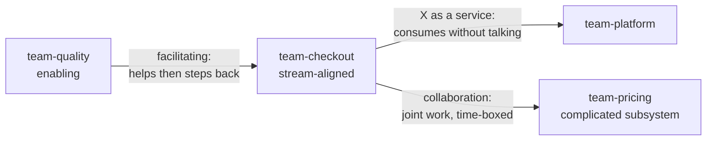
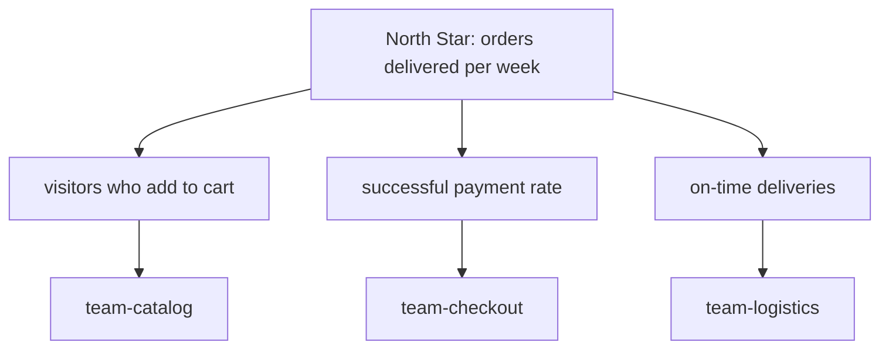
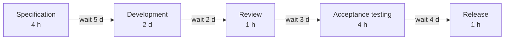
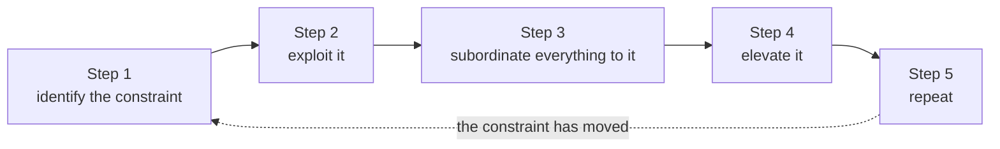
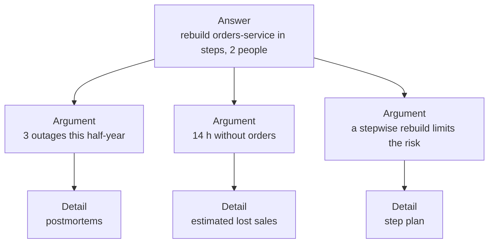

# Company culture and organization

!!! warning "Disclaimer"
    These notes are personal cheat sheets, not a source of truth. They reflect my own understanding and choices: their content remains subjective, despite the quotes and references it contains. It may be incomplete, simplified, inaccurate or outdated. Always check the official documentation before applying it. This content is provided as is, without any warranty: you use it at your own risk.

!!! abstract "Scales"
    The colored badges under the headings say at which scale a notion applies:

    - <span class="pill pill-scope pill-scope-code">Code</span> the classes, functions and modules of one program;
    - <span class="pill pill-scope pill-scope-app">Application</span> one service or application and its internal split;
    - <span class="pill pill-scope pill-scope-system">System</span> several services talking to each other over the network;
    - <span class="pill pill-scope pill-scope-infra">Infrastructure</span> servers, network, zones and clusters, physical or virtual;
    - <span class="pill pill-scope pill-scope-enterprise">Enterprise</span> the whole information system and its organization.

    Details and ambiguous words: [map of scales](architecture.md#map-of-scales).

An engineer talking to a manager, a head of product or a finance director switches language: no more latency or message queues, but goals, costs, risks and deadlines. This page gathers the vocabulary and the thinking frameworks most often quoted in companies: describing a team culture, organizing teams, setting goals, deciding, making work flow, thinking in terms of product and strategy, talking about money, presenting a technical choice to leadership and understanding career tracks.

Management, product and strategy books are here. The founding technical papers are gathered in [Founding texts](textes-fondateurs.md). The teams (`team-core`, `team-billing`), services (`orders-service`, `billing-service`), people (ada, grace) and all figures are examples.

## Terminology

| Word | Definition | Example |
|---|---|---|
| **Culture** | what people actually do when nobody is watching: how information flows, how a mistake is handled, who dares to disagree | in team-core, a junior can say in a meeting "I don't think this plan holds" without risk |
| **Governance** | who has the right to decide what, and how those decisions are checked | the architecture board approves anything that touches more than two teams |
| **Strategy** | the diagnosis of a situation and the small set of coherent choices that answer it | "our customers leave because of outages: this year, reliability comes before new features" |
| **OKR** | Objectives and Key Results: a qualitative objective and two to five measurable results that say whether it is reached | objective "frictionless payment", key result "checkout abandonment from 12% to 6%" |
| **KPI** | Key Performance Indicator: an indicator tracked continuously to know whether the business is healthy | monthly revenue, availability rate, number of support tickets |
| **ROI** | Return On Investment: what an investment brings back, relative to what it costs | €50,000 spent, €80,000 saved: 60% ROI |
| **CAPEX** | Capital Expenditure: an investment, depreciated over several years | buying servers, building a new platform |
| **OPEX** | Operating Expenditure: a running cost, counted in the year | the monthly cloud bill, annual licences, maintenance |
| **P&L** | Profit and Loss, the income statement: revenue minus costs over a period | "the product line's P&L has been negative for two quarters" |
| **Margin** | what is left of revenue once direct costs are paid | a €10 subscription that costs €3 in cloud and support: 70% gross margin |
| **Time to market** | the delay between the idea and availability to customers | three months to ship a new offer instead of nine |
| **Roadmap** | the ordered list of what we plan to ship, often per quarter | Q1: pay in instalments; Q2: mobile app |
| **Stakeholder** | anyone affected by a decision or able to influence it | support, finance, legal, the teams consuming the API |
| **Sponsor** | the leadership member who carries a project, defends it and unlocks the budget | the CTO sponsors the migration to the cloud |
| **Run and build** | run keeps the existing going (operations, support), build creates the new | "60% of our budget goes into run" |
| **Headcount** | the number of open or filled positions, often a team's budget unit | "we have two more positions in next year's budget" |
| **DORA** | DevOps Research and Assessment: a research programme (Nicole Forsgren, Jez Humble, Gene Kim, part of Google since 2018, to check) that publishes the yearly "State of DevOps" reports and summed up its findings in the book "Accelerate" (2018) | one of its four delivery metrics, deployment frequency: "orders-service deploys 3 times a day" |
| **Postmortem** | the written analysis of an incident, after the fact: what happened, why, what we change, without looking for someone to blame | "cause: the migration locks the table; action: 5 s lock timeout on migrations" |
| **Retrospective** | a regular team meeting, often at the end of a sprint, to look at how the team worked and pick one improvement | "we waited two days for reviews: let's try a daily review slot at 2 pm" |

A leadership meeting sentence, decoded:

```
"The quarter's P&L is under pressure: we freeze headcount and push back CAPEX projects;
 the top OKR remains time to market for the new payment."

P&L under pressure         costs rise faster than revenue
headcount freeze           no new position, hiring waits
CAPEX projects pushed back long investments (a new platform) wait
top OKR                    the goal that comes before all others this quarter
time to market             shipping the new payment fast matters more than the rest
```

## Team culture

<a class="pill pill-dora" href="https://dora.dev/capabilities/generative-organizational-culture/">DORA · Generative organizational culture</a> <a class="pill pill-dora" href="https://dora.dev/capabilities/learning-culture/">DORA · Learning culture</a>

A culture is not read in the values on the wall, but in behaviours: what happens to the person who brings bad news, or to the one who broke production.

### Westrum typology

<span class="pill pill-status pill-status-ok" title="Still valid, checked November 2026">Current · 11/2026</span>

Sociologist Ron Westrum classifies organizations by the way information flows in them ("A typology of organisation culture", Quality and Safety in Health Care, 2004). The <span class="term" data-term="westrum-typology">Westrum typology</span> distinguishes three cultures:

| Behaviour | Pathological (power-oriented) | Bureaucratic (rule-oriented) | Generative (performance-oriented) |
|---|---|---|---|
| cooperation | low | modest | high |
| bearer of bad news | punished | neglected | trained and heard |
| responsibilities | shirked | narrow | shared |
| bridging between teams | discouraged | tolerated | encouraged |
| failure | leads to scapegoating | leads to a prescribed sanction | leads to inquiry |
| novelty | crushed | leads to problems | implemented |

The same incident in the three cultures:

```
pathological    grace reports that the orders-service backup has not worked for 2 weeks.
                She is blamed for not seeing it earlier. Next time, she will keep quiet.
bureaucratic    the ticket is created, but it falls within no team's scope. It waits.
generative      she is thanked, it is fixed, and the postmortem adds an alert on the backup's age.
```

The DORA research programme measures this culture with a questionnaire inspired by Westrum, and links it to delivery performance (Nicole Forsgren, Jez Humble and Gene Kim, "Accelerate", 2018). That performance is measured with the four <span class="term" data-term="dora-metrics">DORA metrics</span>, for example the lead time from a commit to production (median of one day for orders-service, example figure).

:material-book-open-variant: Reference docs: [Ron Westrum, A typology of organisational cultures](https://pmc.ncbi.nlm.nih.gov/articles/PMC1765804/) (2004)
{ .doc-ref }

### Psychological safety

<span class="pill pill-status pill-status-ok" title="Still valid, checked November 2026">Current · 11/2026</span>

<span class="term" data-term="psychological-safety">Psychological safety</span> is the belief shared by team members that it is safe to take interpersonal risks there (ask a naive question, admit a mistake, contradict the boss) without being humiliated or punished. Amy Edmondson defined and measured it in "Psychological Safety and Learning Behavior in Work Teams" (Administrative Science Quarterly, 1999).

!!! noob "As noob"
    In a team where people feel safe, saying "I didn't understand" or "I broke production" costs a moment of embarrassment, not a reputation. Problems therefore surface early, while they are still small. The takeaway: **a team that hides mistakes does not make fewer of them, it finds them later.**

Google made it famous with Project Aristotle, an internal study of what makes a team effective, published on the re:Work site in 2015: psychological safety came first among five factors, ahead of dependability, structure and clarity, meaning and impact (to check on re:Work, the study was not published as a scientific paper).

It is not niceness. Edmondson crosses safety with standards:

| | Low standards | High standards |
|---|---|---|
| **High safety** | comfort zone: pleasant, little progress | learning zone: people dare and stretch |
| **Low safety** | apathy | anxiety: high goals, but problems are hidden |

Concrete signs: in MR reviews, juniors comment on seniors' code; in retrospectives, problems come from the whole team, not only the manager; "I don't know" is an accepted answer.

:material-book-open-variant: Reference docs: [Wikipedia, Psychological safety](https://en.wikipedia.org/wiki/Psychological_safety) (accessed November 2026); [Google re:Work, Understand team effectiveness](https://rework.withgoogle.com/print/guides/5721312655835136/) (2015, to check)
{ .doc-ref }

### Just culture

<span class="pill pill-status pill-status-ok" title="Still valid, checked November 2026">Current · 11/2026</span>

A <span class="term" data-term="just-culture">just culture</span> does not punish honest mistakes, but does not tolerate deliberate endangerment. The idea comes from industrial safety (James Reason, "Managing the Risks of Organizational Accidents", 1997) and was developed by Sidney Dekker ("Just Culture", 2007). David Marx distinguishes three behaviours, each with its response ("Patient Safety and the Just Culture", 2001, to check):

| Behaviour | Example | Response |
|---|---|---|
| human error | ada runs the migration on the wrong database, the two tabs look alike | console, then change the system (colour per environment, confirmation) |
| at-risk behaviour | grace skips the tests "because everybody does when it's urgent" | coach, and understand why the shortcut became normal |
| recklessness | someone disables a security alert knowing the danger, without saying so | sanction |

It is the foundation of the <span class="term" data-term="blameless">blameless postmortem</span>: see [Incidents](incidents.md#the-blameless-postmortem).

:material-book-open-variant: Reference docs: [Wikipedia, Just culture](https://en.wikipedia.org/wiki/Just_culture) (accessed November 2026)
{ .doc-ref }

### Learning culture

<span class="pill pill-status pill-status-ok" title="Still valid, checked November 2026">Current · 11/2026</span>

A learning organization turns its experiences into shared practices, instead of leaving them in a few people's heads (Peter Senge, "The Fifth Discipline", 1990). In practice: retrospectives that end with an action, postmortems read by other teams, time set aside for learning, internal demos, mistakes told in public by the seniors themselves.

A postmortem skeleton, then a typical one-hour retrospective agenda (examples):

```
postmortem: payment outage, 3 Nov, 42 min
timeline      14:02 migration started; 14:05 5xx alerts; 14:44 rollback
causes        the migration locks the orders table, no lock timeout
actions       5 s lock timeout on migrations (ada, 10 Nov); rehearsal on a copy of the database (grace)

retrospective
 5 min   the action decided last time: done or not?
15 min   what helped, what slowed us down (notes written in silence, then grouped)
30 min   discussion of the two topics with the most votes
10 min   one or two actions, each with an owner and a date
```

| I want... | I use... |
|---|---|
| to describe my organization's culture with facts, not with a vague "the atmosphere is good": what happens to the person who brings bad news, what we do after an outage | the Westrum typology and its six behaviours |
| to know whether people in my team dare to say "I didn't understand" or "I broke production", or whether they prefer to keep quiet in meetings | Edmondson's questions in an anonymous survey, then in discussion |
| to react to a mistake, like a migration run on the wrong database, without the team starting to hide the next ones | just culture: error, risk or recklessness |
| other teams to benefit from the lesson of an incident, instead of making the same mistake a few months later | published and read postmortems, a monthly cross-team review |

## Organizing teams

<a class="pill pill-scope pill-scope-system" href="../architecture/#map-of-scales">Scale · System</a> <a class="pill pill-scope pill-scope-enterprise" href="../architecture/#map-of-scales">Scale · Enterprise</a>

<a class="pill pill-dora" href="https://dora.dev/capabilities/loosely-coupled-teams/">DORA · Loosely coupled teams</a>

If two teams must agree on every change, their code ends up depending on each other too: how teams are organized is not just a management matter, it shapes the architecture. This is <span class="term" data-term="conway-law">Conway's law</span>, detailed in [Architecture](architecture.md#conways-law).

### Team Topologies

<span class="pill pill-status pill-status-ok" title="Still valid, checked November 2026">Current · 11/2026</span>

Matthew Skelton and Manuel Pais ("Team Topologies", 2019) propose four team types and three interaction modes. The splitting criterion is <span class="term" data-term="cognitive-load">cognitive load</span>: a team should not carry more than it can understand, for example not handle the order funnel, the CI and the price calculation engine all at once.

| Type | Role | Example |
|---|---|---|
| <span class="term" data-term="stream-aligned-team">stream-aligned team</span> | delivers a part of the product end to end | team-checkout: the order funnel, from need to production |
| <span class="term" data-term="platform-team">platform team</span> | provides self-service internal services | team-platform: CI, deployment, environments |
| <span class="term" data-term="enabling-team">enabling team</span> | helps a team acquire a skill, then steps back | team-quality coaches team-checkout on contract tests for six weeks |
| <span class="term" data-term="complicated-subsystem-team">complicated-subsystem team</span> | owns a component that needs rare expertise | team-pricing: the price calculation engine |

The three interaction modes:



The <span class="term" data-term="inverse-conway-maneuver">inverse Conway maneuver</span> starts from the architecture I want, then organizes teams to match: if I want a price engine separate from the order funnel, I first create a team that owns it, like team-pricing.

:material-book-open-variant: Reference docs: [Team Topologies, Key concepts](https://teamtopologies.com/key-concepts) (accessed November 2026)
{ .doc-ref }

### The Spotify model and its limits

Henrik Kniberg and Anders Ivarsson described Spotify's organization at that point in time in 2012 ("Scaling Agile @ Spotify with Tribes, Squads, Chapters & Guilds"):

| Name | What it is |
|---|---|
| squad | a small autonomous team with its mission |
| tribe | a group of squads on the same domain |
| chapter | people with the same craft within a tribe (all testers), with a common line manager |
| guild | a community of interest open to the whole company |

Cautions before copying it:

- the article described a snapshot, not a model to reproduce; Kniberg said so himself;
- Jeremiah Lee, a former employee, explains in "Spotify's Failed #SquadGoals" (2020) that the real organization was far from the diagram, notably on the line management of chapters;
- renaming teams to squads changes neither autonomy, nor architecture, nor culture.

:material-book-open-variant: Reference docs: [Kniberg and Ivarsson, Scaling Agile @ Spotify](https://blog.crisp.se/wp-content/uploads/2012/11/SpotifyScaling.pdf) (2012); [Jeremiah Lee, Spotify's Failed #SquadGoals](https://www.jeremiahlee.com/posts/failed-squad-goals/) (2020)
{ .doc-ref }

### RACI

<span class="pill pill-status pill-status-ok" title="Still valid, checked November 2026">Current · 11/2026</span>

A <span class="term" data-term="raci">RACI</span> matrix says, for each task, who does it (**R**esponsible), who answers for it and decides (**A**ccountable, a single person), who is asked beforehand (**C**onsulted) and who is told afterwards (**I**nformed). Its precise origin is not documented (1950s to 1970s, to check).

| Task: migrate the orders-service database | ada (dev) | grace (lead) | team-platform | support |
|---|---|---|---|---|
| write the migration plan | R | A | C | |
| approve the maintenance window | C | A | C | I |
| run the migration | R | A | C | I |
| notify customers | | A | | R |

Rule: a single A per row. Two As means nobody.

:material-book-open-variant: Reference docs: [Wikipedia, Responsibility assignment matrix](https://en.wikipedia.org/wiki/Responsibility_assignment_matrix) (accessed November 2026)
{ .doc-ref }

### Two-pizza teams

<span class="pill pill-status pill-status-ok" title="Still valid, checked November 2026">Current · 11/2026</span>

A <span class="term" data-term="two-pizza-team">two-pizza team</span> is small enough to be fed by two pizzas, about six to ten people. The rule is attributed to Jeff Bezos at Amazon in the early 2000s (to check, it is only known through anecdotes). The reason is arithmetic: the number of possible communication channels is n × (n - 1) / 2, so 6 channels for 4 people, 28 for 8 and 66 for 12.

| I want... | I use... |
|---|---|
| my teams to ship without waiting for the others on every change, for example team-checkout deploying without asking another team for an environment by hand | Team Topologies: stream-aligned teams, a self-service platform |
| to help a team master a new practice, like contract tests, without ending up writing its tests for it | an enabling team, with an end date |
| to know who decides on a task several teams share, like a database migration where everyone thinks someone else decides | a RACI matrix, a single A per row |
| to adopt the Spotify model (squads, tribes, chapters) because it seems to work elsewhere | read its critiques first, keep the idea (autonomy, communities), not the names |
| my team has grown to twelve people and every decision now needs a meeting with everyone | split it around two distinct streams |

:material-book-open-variant: Reference docs: [AWS Whitepaper, Two-pizza teams](https://docs.aws.amazon.com/whitepapers/latest/introduction-devops-aws/two-pizza-teams.html) (accessed November 2026)
{ .doc-ref }

## Setting and tracking goals

### OKR

<span class="pill pill-status pill-status-ok" title="Still valid, checked November 2026">Current · 11/2026</span>

<span class="term" data-term="okr">OKRs</span> come from Andy Grove at Intel ("High Output Management", 1983). John Doerr learned them at Intel, presented them to Google in 1999 and popularized them in "Measure What Matters" (2018). An OKR is:

- an **objective**: qualitative, motivating, what we want to change;
- two to five **key results**: measurable, checkable at the end of the period, outcomes and not tasks.

```
Objective       Teams ship without waiting for CI (Q3)
Key result 1    p95 pipeline time: from 28 min to 10 min
Key result 2    flaky test rate: from 4% to under 1%
Key result 3    CI satisfaction in the developer survey: from 2.9 to 4 out of 5

Bad key result: "move the runners to bigger machines" (a task, not an outcome)
```

Doerr distinguishes **committed** OKRs (to reach 100%) and **aspirational** ones (reaching 60 to 70% is already a success, to check depending on the organization). Mixing both without saying so creates misunderstandings.

:material-book-open-variant: Reference docs: [What Matters, OKR meaning, definition and examples](https://www.whatmatters.com/faqs/okr-meaning-definition-example) (accessed November 2026)
{ .doc-ref }

### KPI or OKR

A <span class="term" data-term="kpi">KPI</span> is a thermometer: it is watched all the time. An OKR is a desired change over a period.

| | KPI | OKR |
|---|---|---|
| question | "is everything fine?" | "what do we want to change this quarter?" |
| duration | permanent | one period (often a quarter) |
| example | my-api availability at 99.9% | "raise availability from 99.5% to 99.9%" |
| when it moves | we investigate | we adjust the plan |

A degrading KPI often becomes the subject of an OKR the following quarter.

:material-book-open-variant: Reference docs: [Wikipedia, Performance indicator](https://en.wikipedia.org/wiki/Performance_indicator) (accessed November 2026)
{ .doc-ref }

### North Star metric

<span class="pill pill-status pill-status-ok" title="Still valid, checked November 2026">Current · 11/2026</span>

The <span class="term" data-term="north-star-metric">North Star metric</span> is the single measure that captures the value the product brings to customers, and that predicts future revenue. The term was popularized in the growth marketing world, notably by Sean Ellis, around 2017 (to check). It is broken down into input metrics that teams can act on:



:material-book-open-variant: Reference docs: [Amplitude, The North Star Playbook](https://amplitude.com/books/north-star) (accessed November 2026)
{ .doc-ref }

### Avoiding the Goodhart trap

<span class="term" data-term="goodhart-law">Goodhart's law</span>: when a measure becomes a target, it ceases to be a good measure (Charles Goodhart, 1975, in Marilyn Strathern's 1997 wording). It and its cousins are detailed in [Laws and principles](lois-et-principes.md). The countermeasure: pair every goal with a **counter-metric** that degrades if people game it.

| Goal | Possible gaming | Counter-metric |
|---|---|---|
| reduce support ticket handling time | close tickets without solving them | reopened ticket rate |
| increase deployment frequency | split changes artificially | change failure rate |
| increase code coverage | tests without assertions | mutation score on critical code |

| I want... | I use... |
|---|---|
| to give the team an ambitious direction for the quarter, like "teams ship without waiting for CI", and know at the end whether we got there | an OKR: one objective, two to five measurable results |
| to know at all times whether an activity is healthy, like my-api's availability, and be warned as soon as it degrades | KPIs, with a threshold that triggers an investigation |
| team-catalog, team-checkout and team-logistics to pull in the same direction, instead of each optimizing its own number | a North Star metric and its tree of input metrics |
| a tracked number not to be artificially inflated, like support tickets closed without being solved to lower handling time | a counter-metric per goal, and never an individual ranking |

## Deciding

<a class="pill pill-practice" href="../livraison/#design-before-coding">Practice · Technical design</a>
<a class="pill pill-dora" href="https://dora.dev/capabilities/documentation-quality/">DORA · Documentation quality</a>

### Cynefin

<span class="pill pill-status pill-status-ok" title="Still valid, checked November 2026">Current · 11/2026</span>

The <span class="term" data-term="cynefin">Cynefin</span> framework (Dave Snowden, from 1999; "A Leader's Framework for Decision Making", with Mary Boone, Harvard Business Review, 2007) says we do not decide the same way depending on the nature of the situation:

<figure class="diagram"><svg viewBox="0 0 320 210" role="img" aria-label="Cynefin: four domains and confusion in the middle (after Dave Snowden)"><rect class="layer layer-2" x="10" y="10" width="145" height="90" rx="6"/><text class="label-strong" x="82.5" y="32" text-anchor="middle">Complex</text><text x="82.5" y="45" text-anchor="middle">probe, sense, respond</text><text x="82.5" y="57" text-anchor="middle">emergent practice</text><rect class="layer layer-1" x="165" y="10" width="145" height="90" rx="6"/><text class="label-strong" x="237.5" y="32" text-anchor="middle">Complicated</text><text x="237.5" y="45" text-anchor="middle">sense, analyze, respond</text><text x="237.5" y="57" text-anchor="middle">good practice</text><rect class="layer layer-3" x="10" y="110" width="145" height="90" rx="6"/><text class="label-strong" x="82.5" y="170" text-anchor="middle">Chaotic</text><text x="82.5" y="183" text-anchor="middle">act, sense, respond</text><text x="82.5" y="195" text-anchor="middle">novel practice</text><rect class="layer layer-1" x="165" y="110" width="145" height="90" rx="6"/><text class="label-strong" x="237.5" y="170" text-anchor="middle">Clear</text><text x="237.5" y="183" text-anchor="middle">sense, categorize, respond</text><text x="237.5" y="195" text-anchor="middle">best practice</text><ellipse class="layer layer-1" cx="160" cy="105" rx="44" ry="20" style="fill-opacity:1;fill:var(--md-default-bg-color)"/><text class="label-strong" x="160" y="108" text-anchor="middle">Confusion</text></svg><figcaption>Cynefin: four domains and confusion in the middle (after Dave Snowden)</figcaption></figure>

| Domain | Cause and effect | Method | Example |
|---|---|---|---|
| clear | obvious, known to all | sense, categorize, apply the best practice | renew an expiring certificate: follow the runbook |
| complicated | discoverable by an expert | sense, analyze, respond | size the orders-service database for twice the traffic |
| complex | visible only in hindsight | probe, sense, respond: safe experiments | find out whether customers want to pay in instalments |
| chaotic | no visible link | act, sense, respond: stabilize first | total outage in the middle of a sales evening |
| confusion | we do not know which domain we are in | break the situation into pieces | a meeting where everyone thinks they are discussing a different problem |

The classic mistake: treating a complex problem as complicated, with a detailed one-year plan where two-week experiments were needed.

:material-book-open-variant: Reference docs: [The Cynefin Co, About the Cynefin framework](https://thecynefin.co/about-us/about-cynefin-framework/) (accessed November 2026); [Snowden and Boone, A Leader's Framework for Decision Making](https://hbr.org/2007/11/a-leaders-framework-for-decision-making) (2007)
{ .doc-ref }

### Type 1 and type 2 decisions

<span class="pill pill-status pill-status-ok" title="Still valid, checked November 2026">Current · 11/2026</span>

Jeff Bezos, in his 2015 letter to shareholders, distinguishes two kinds of decisions:

- **type 1**: a <span class="term" data-term="one-way-door">one-way door</span>, hard or impossible to undo; it deserves time and care;
- **type 2**: a two-way door, a <span class="term" data-term="reversible-change">reversible change</span>; it should be made fast, by a small group.

```
type 1   choose the main database of the new platform
         sign a five-year contract with a vendor
type 2   choose a logging library behind an interface
         enable a feature for 5% of customers behind a feature flag
```

The trap described in the letter: applying the heavy type 1 process to every decision, which slows down the whole organization.

:material-book-open-variant: Reference docs: [Jeff Bezos, 2015 letter to shareholders](https://s2.q4cdn.com/299287126/files/doc_financials/annual/2015-Letter-to-Shareholders.PDF) (2016)
{ .doc-ref }

### RFCs and design documents

<span class="pill pill-status pill-status-ok" title="Still valid, checked November 2026">Current · 11/2026</span>

An **RFC** (Request for Comments) is a document that proposes a change and asks for feedback before the decision. The name comes from the Internet: RFC 1 was published in 1969 by Steve Crocker. In companies, people also say design doc. The template fits in a few headings:

```markdown
# RFC 014: usage-based billing in billing-service

Status: in review until 11/15 (example)
Context: why now, with the numbers
Goals and non-goals: what we aim for, what we do not address
Options considered: at least two, including "do nothing"
Proposal: the chosen option and why
Risks and open questions
Rollout and rollback plan
```

The final decision is then kept in an <span class="term" data-term="adr">ADR</span>: see [Design before coding](livraison.md#design-before-coding).

:material-book-open-variant: Reference docs: [RFC 1, Host Software](https://www.rfc-editor.org/rfc/rfc1) (1969)
{ .doc-ref }

### Advice process

<span class="pill pill-status pill-status-ok" title="Still valid, checked November 2026">Current · 11/2026</span>

In the <span class="term" data-term="advice-process">advice process</span>, anyone can make a decision, provided they have sought the advice of the people affected and of experts. The decider does not have to follow that advice. The principle comes from Dennis Bakke ("Joy at Work", 2005) and was taken up by Frederic Laloux ("Reinventing Organizations", 2014). Andrew Harmel-Law applies it to software architecture in "Scaling the Practice of Architecture, Conversationally" (martinfowler.com, 2021).

```
1. ada wants to replace the RabbitMQ queue of orders-service with a Kafka topic
2. she asks for advice from billing-service (consumer), the platform team and grace (Kafka expert)
3. billing-service worries about message order; the platform team prefers to wait for the cluster upgrade
4. ada decides: migrate after the upgrade, partition key on the order number
5. she writes ADR 027: context, advice received (including advice not followed), decision, consequences
```

:material-book-open-variant: Reference docs: [Andrew Harmel-Law, Scaling the Practice of Architecture, Conversationally](https://martinfowler.com/articles/scaling-architecture-conversationally.html) (2021)
{ .doc-ref }

### Disagree and commit

<span class="pill pill-status pill-status-ok" title="Still valid, checked November 2026">Current · 11/2026</span>

<span class="term" data-term="disagree-and-commit">Disagree and commit</span>: we voice our disagreement during the discussion, then, once the decision is made, we commit to making it succeed as if it were our own. Bezos describes it in his 2016 letter; the phrase is often traced back to Intel and Andy Grove (to check). It is not "shut up and obey": the disagreement is voiced, written down, and can be revisited if the facts change.

```
the team picks MongoDB for the catalog, grace would have preferred PostgreSQL
grace writes her disagreement in the ADR: "risk: reports with costly joins"
then she designs the best MongoDB schema she can, without slowing the project
six months later, if reports become a problem, her written objection is used to reopen the decision
```

:material-book-open-variant: Reference docs: [Jeff Bezos, 2016 letter to shareholders](https://www.aboutamazon.com/news/company-news/2016-letter-to-shareholders) (2017)
{ .doc-ref }

### The six-page narrative memo

<span class="pill pill-status pill-status-ok" title="Still valid, checked November 2026">Current · 11/2026</span>

The <span class="term" data-term="narrative-memo">narrative memo</span> replaces slides with a full text, read silently by everyone at the start of the meeting. The idea goes back to a 2004 email by Jeff Bezos banning PowerPoint from leadership meetings (to check; the six-page length is the form reported later). A text forces ideas to be linked together, where a bullet list lets them sit side by side.

```
slide     "Context: latency, costs, technical debt"
memo      "The p99 latency of orders-service has doubled since January, because each order
           calls four services. The redesign removes two of those calls; it costs three months
           for two people, and the expected gain is a p99 under 300 ms."
meeting   20 min of silent reading, then 40 min of questions
```

| I want... | I use... |
|---|---|
| to know how to decide on a question nobody knows the answer to, like whether customers want to pay in instalments | Cynefin: experiments if complex, analysis if complicated |
| to go fast on small choices without locking myself in on big ones: pick a logging library in an hour, but take time for the main database | type 1 or type 2: decide fast if it is easy to undo |
| to gather feedback before a choice that affects several teams, like moving billing-service to usage-based billing | a reviewed RFC, then an ADR |
| teams to make their own architecture decisions, without sending everything up to a board | the advice process, with a decision log |
| to move forward while someone in the team disagrees, like grace who would have preferred PostgreSQL to MongoDB for the catalog | disagree and commit, with the disagreement written down |
| no more decision meetings where nobody read the file and everyone discovers the topic on the slides | a narrative memo read at the start of the meeting |

:material-book-open-variant: Reference docs: [Jeff Bezos, 2017 letter to shareholders](https://www.aboutamazon.com/news/company-news/2017-letter-to-shareholders) (2018)
{ .doc-ref }

## Lean and flow

<a class="pill pill-dora" href="https://dora.dev/capabilities/work-visibility-in-value-stream/">DORA · Visibility of work in the value stream</a> <a class="pill pill-dora" href="https://dora.dev/capabilities/working-in-small-batches/">DORA · Working in small batches</a>

### Toyota Production System

<span class="pill pill-status pill-status-ok" title="Still valid, checked November 2026">Current · 11/2026</span>

**Lean** comes from the Toyota Production System, described by Taiichi Ohno ("Toyota Production System: Beyond Large-Scale Production", 1978 in Japan, 1988 in English), then popularized by James Womack and Daniel Jones ("Lean Thinking", 1996). Two pillars: **just in time** (produce what is asked, when it is asked) and **jidoka** (stop the line as soon as a defect appears: any worker can pull the andon cord).

Lean hunts <span class="term" data-term="lean-waste">waste</span>. Mary and Tom Poppendieck translate the seven factory wastes for software ("Lean Software Development: An Agile Toolkit", 2003):

| Factory | Software | Example |
|---|---|---|
| inventory | partially done work | a finished branch not merged for three weeks |
| overproduction | extra features | a PDF export nobody uses |
| extra processing | relearning | rediscovering why a choice was made, for lack of an ADR |
| transportation | handoffs | a request that goes through four teams before being handled |
| motion | task switching | a developer on five projects at once |
| waiting | delays | an MR waiting two days for a review |
| defects | defects | a bug found in production rather than in CI |

Their seven principles of lean software: eliminate waste, amplify learning, decide as late as possible, deliver as fast as possible, empower the team, build integrity in, see the whole.

:material-book-open-variant: Reference docs: [Toyota, Toyota Production System](https://global.toyota/en/company/vision-and-philosophy/production-system/) (accessed November 2026); [Lean Enterprise Institute, Toyota Production System](https://www.lean.org/lexicon-terms/toyota-production-system/) (accessed November 2026)
{ .doc-ref }

### Value stream mapping

<span class="pill pill-status pill-status-ok" title="Still valid, checked November 2026">Current · 11/2026</span>

<span class="term" data-term="value-stream-mapping">Value stream mapping</span> (Mike Rother and John Shook, "Learning to See", 1998) draws each step of a request with its work time and its wait time.

```
step                     work       wait before the next step
specification            4 h        5 days (prioritization)
development              2 days     2 days (code review)
review                   1 h        3 days (acceptance testing campaign)
acceptance testing       4 h        4 days (release window)
release                  1 h

total: about 3.2 days of work for 17.2 days of lead time
flow efficiency = 3.2 / 17.2, or 19% (example figures)
```



The gain is almost always in the waits, not in the work: cutting development from 2 days to 1 removes only one day from a lead time of over 17 days, while removing the wait for the release window removes 4.

:material-book-open-variant: Reference docs: [Lean Enterprise Institute, Value Stream Mapping](https://www.lean.org/lexicon-terms/value-stream-mapping/) (accessed November 2026)
{ .doc-ref }

### Theory of constraints

<span class="pill pill-status pill-status-ok" title="Still valid, checked November 2026">Current · 11/2026</span>

Eliyahu Goldratt, in the novel "The Goal" (1984), shows that a system's throughput depends on its <span class="term" data-term="bottleneck">bottleneck</span>. Optimizing elsewhere is useless. The <span class="term" data-term="theory-of-constraints">theory of constraints</span> offers five steps:

1. **identify** the constraint (in the example above, manual acceptance testing);
2. **exploit** it: it must never lose time (prepare test data in advance);
3. **subordinate** everything to it: do not produce faster than it absorbs;
4. **elevate** it: increase its capacity (automate acceptance tests);
5. **repeat**: the constraint has moved elsewhere.



:material-book-open-variant: Reference docs: [Wikipedia, Theory of constraints](https://en.wikipedia.org/wiki/Theory_of_constraints) (accessed November 2026)
{ .doc-ref }

### Little's law and WIP limits

<span class="term" data-term="littles-law">Little's law</span> (John Little, 1961) links three quantities of a stable system: work in progress = <span class="term" data-term="throughput">throughput</span> × average lead time. Turned around, lead time = work in progress / throughput. The systems side is in [Architecture](architecture.md#littles-law).

```
team-core finishes 5 tickets per week
with 20 tickets in progress   average lead time = 20 / 5 = 4 weeks
with 10 tickets in progress   average lead time = 10 / 5 = 2 weeks
```

If my team wants to ship faster without working more, it starts fewer things at once: with half as many tickets in progress, each ticket ships on average twice as early. That is the job of a <span class="term" data-term="wip-limit">WIP limit</span> (Work In Progress).

:material-book-open-variant: Reference docs: [Wikipedia, Little's law](https://en.wikipedia.org/wiki/Little%27s_law) (accessed November 2026)
{ .doc-ref }

### Kanban

<span class="pill pill-status pill-status-ok" title="Still valid, checked November 2026">Current · 11/2026</span>

The <span class="term" data-term="kanban">Kanban</span> method for knowledge work (David J. Anderson, "Kanban: Successful Evolutionary Change for Your Technology Business", 2010) starts from what exists: visualize the work, limit work in progress, manage flow, make policies explicit, improve in small steps.

```
TO DO       IN PROGRESS (max 3)    IN REVIEW (max 2)    DONE
TCK-41      TCK-38 ada             TCK-35               TCK-30
TCK-42      TCK-39 grace           TCK-36               TCK-31
TCK-43      TCK-40 ada

IN REVIEW is full: before starting TCK-41, ada reviews TCK-35.
```

| I want... | I use... |
|---|---|
| to understand why a request worth a few days of work takes three weeks to reach production | value stream mapping, work time and wait time |
| to know where to put people or budget to ship more, rather than speeding up a step that blocks nothing | the theory of constraints: the bottleneck first |
| tickets to ship faster without hiring or working overtime, while the team has twenty tickets open at once | limit work in progress (Little's law) |
| to see where work piles up, like MRs stacking up in review, and improve it step by step without reorganizing the whole team | a Kanban board with WIP limits |
| shared words to point at what wastes time, like an MR waiting two days for a review or an export nobody uses | the seven wastes of software (Poppendieck) |

:material-book-open-variant: Reference docs: [Kanban University, The Official Kanban Guide](https://kanban.university/kanban-guide/) (accessed November 2026)
{ .doc-ref }

## Product

### Product or project

| | Project | Product |
|---|---|---|
| end | a date and a scope | as long as the product has users |
| success | delivered on time, on budget | users achieve an outcome |
| team | assembled then disbanded | stable, keeps the knowledge |
| funding | per project | per team, over time |

Mik Kersten ("Project to Product", 2018) argues for moving software teams from project to product: software is never "done", and a team disbanded after delivery leaves a system nobody knows any more.

:material-book-open-variant: Reference docs: [Sriram Narayan, Products Over Projects](https://martinfowler.com/articles/products-over-projects.html) (2018)
{ .doc-ref }

### Jobs to be done

<span class="pill pill-status pill-status-ok" title="Still valid, checked November 2026">Current · 11/2026</span>

The <span class="term" data-term="jobs-to-be-done">Jobs to be done</span> framework (Clayton Christensen and co-authors, "Competing Against Luck", 2016) says a customer "hires" a product to make progress in a given situation. Christensen's classic example: customers buy a milkshake in the morning not for the taste, but because it fills a long commute and keeps them going until lunch. The competitor is not the other milkshake, it is the banana or the bagel.

```
When    I prepare the payroll of my 12 employees at the end of the month,
I want  to be sure every transfer went out,
so I    don't spend Monday answering worried employees.
```

:material-book-open-variant: Reference docs: [Christensen Institute, Jobs to Be Done](https://www.christenseninstitute.org/theory/jobs-to-be-done/) (accessed November 2026)
{ .doc-ref }

### Discovery and delivery

<span class="pill pill-status pill-status-ok" title="Still valid, checked November 2026">Current · 11/2026</span>

Marty Cagan ("Inspired", 2008, second edition in 2017) separates two activities run in parallel by the same team:

- <span class="term" data-term="product-discovery">discovery</span>: finding out what is worth building, with prototypes and user tests;
- **delivery**: building and shipping, reliably, what was validated.

Discovery addresses four risks before writing production code: **value** (will they buy or use it?), **usability** (can they figure out how to use it?), **feasibility** (can we build it?) and **viability** (does it work for the business: legal, sales, finance?). Teresa Torres describes a weekly discovery practice in "Continuous Discovery Habits" (2021).

A fictitious feature, pay in three instalments in orders-service, and one test per risk:

| Risk | Test before writing production code |
|---|---|
| value | a fake "pay in 3" button on 5% of carts: how many customers click? |
| usability | a clickable mock-up shown to five customers: do they understand the schedule? |
| feasibility | two days of technical exploration: does the payment provider support split payments? |
| viability | finance and legal approve the cost of defaults and the legal notices for credit |

:material-book-open-variant: Reference docs: [Marty Cagan, The Four Big Risks](https://www.svpg.com/the-four-big-risks/) (2017)
{ .doc-ref }

### Shape Up

<span class="pill pill-status pill-status-ok" title="Still valid, checked November 2026">Current · 11/2026</span>

Ryan Singer describes Basecamp's method in "Shape Up" (2019, free book online):

- **six-week** cycles, followed by a **two-week** cooldown;
- before the cycle, a project is **shaped**: the problem, the outline of the solution, the known pitfalls;
- <span class="term" data-term="appetite">appetite</span> replaces estimates: not "how long will it take?" but "how much time does this problem deserve?";
- a **betting table** picks the cycle's projects;
- a **circuit breaker**: a project not finished in six weeks is not extended by default.

One cycle, on an example:

```
previous cycle   shaping: grace shapes "accounting export" (problem, sketch, pitfalls), appetite 6 weeks
cooldown         betting table: 3 shaped projects, 2 picked; the 3rd is not put in a backlog
weeks 1 to 6     the team builds; in week 4, it cuts the PDF export to stay within the appetite
end of week 6    circuit breaker: the CSV export ships; unfinished, it would have been stopped, not extended
weeks 7 and 8    cooldown: fixes, small debt, free exploration; new betting table
```

:material-book-open-variant: Reference docs: [Ryan Singer, Shape Up](https://basecamp.com/shapeup) (2019)
{ .doc-ref }

### Build, buy or partner

<span class="pill pill-status pill-status-ok" title="Still valid, checked November 2026">Current · 11/2026</span>

The <span class="term" data-term="build-vs-buy">build or buy</span> choice comes back for every building block.

| Situation | Choice | Example |
|---|---|---|
| the building block is what sets me apart from competitors: it is partly why customers come to me | build | an online shop's recommendation engine |
| everyone has the same need, and the market already serves it well | buy (software or service) | payroll, email sending, monitoring |
| I need a capability fast and it is not my core business | partner | a payment partner for a new country |
| the need is common, but a strong constraint weighs on it, on data or on cost | buy, then reassess | a market solution, with a planned exit |

The cost of a built solution does not stop at delivery: it must be maintained for years. The price of a bought solution includes integration and the risk of <span class="term" data-term="vendor-lock-in">vendor lock-in</span>.

| I want... | I use... |
|---|---|
| to understand what customers are really after, beyond what they ask for, like the business owner who mostly wants to be sure every payroll transfer went out | Jobs to be done, with interviews about real situations |
| not to find out after release that nobody cares about a feature, like a PDF export nobody opens | discovery: test value and usability before the code |
| to stop a drifting project, where every week adds a request and pushes back the end date | <span class="term" data-term="shape-up">Shape Up</span>: fixed appetite, variable scope |
| to keep the team and what it knows about the system once delivery is done, instead of scattering it across other projects | product funding, not project funding |
| to decide whether to build a building block or buy it, like payroll or email sending | build what differentiates, buy the rest |

:material-book-open-variant: Reference docs: [Martin Fowler, Utility Vs Strategic Dichotomy](https://martinfowler.com/bliki/UtilityVsStrategicDichotomy.html) (2010)
{ .doc-ref }

## Strategy

### Wardley maps

<span class="pill pill-status pill-status-ok" title="Still valid, checked November 2026">Current · 11/2026</span>

A <span class="term" data-term="wardley-map">Wardley map</span> (Simon Wardley, method developed in the mid-2000s, to check) places each component of a value chain on two axes: its **visibility** to the user (vertical) and its **evolution** (horizontal), from genesis (new, uncertain) to custom-built, then product, then commodity (standard, metered).

!!! noob "As noob"
    I think of electricity: at first each factory had its own power plant, built to order; today we plug into the grid and pay by the meter (a commodity). A Wardley map places each building block of a product on that path, and is a reminder that everything eventually slides to the right. The takeaway: **we build what sets us apart, we buy what has become ordinary.**

<figure class="diagram"><svg viewBox="0 0 340 236" role="img" aria-label="Wardley map of an online shop (example)"><line class="set" style="stroke-width:0.6;stroke-dasharray:2 3" x1="112.5" y1="14" x2="112.5" y2="196"/><line class="set" style="stroke-width:0.6;stroke-dasharray:2 3" x1="185.0" y1="14" x2="185.0" y2="196"/><line class="set" style="stroke-width:0.6;stroke-dasharray:2 3" x1="257.5" y1="14" x2="257.5" y2="196"/><line class="set" x1="40" y1="196" x2="330" y2="196"/><line class="set" x1="40" y1="196" x2="40" y2="14"/><text x="76.2" y="208" text-anchor="middle">genesis</text><text x="148.8" y="208" text-anchor="middle">custom-built</text><text x="221.2" y="208" text-anchor="middle">product</text><text x="293.8" y="208" text-anchor="middle">commodity</text><text x="185.0" y="222" text-anchor="middle" class="label-strong">Evolution</text><text x="36" y="22" text-anchor="end">visible</text><text x="36" y="194" text-anchor="end">invisible</text><text x="12" y="105.0" text-anchor="middle" class="label-strong" transform="rotate(-90 12 105.0)">Visibility</text><line class="set" style="stroke-width:1" x1="219.8" y1="23.1" x2="219.8" y2="57.7"/><line class="set" style="stroke-width:1" x1="219.8" y1="57.7" x2="127.0" y2="90.4"/><line class="set" style="stroke-width:1" x1="219.8" y1="57.7" x2="231.4" y2="114.1"/><line class="set" style="stroke-width:1" x1="127.0" y1="90.4" x2="98.0" y2="130.5"/><line class="set" style="stroke-width:1" x1="98.0" y1="130.5" x2="295.2" y2="174.2"/><line class="set" style="stroke-width:1" x1="231.4" y1="114.1" x2="295.2" y2="174.2"/><line class="set" style="stroke-dasharray:4 3" x1="104.0" y1="130.5" x2="219.8" y2="130.5"/><polygon class="hit" points="219.8,130.5 213.4,133.2 213.4,127.8"/><text x="161.8" y="125.5" text-anchor="middle">drifts over time</text><circle class="hit" cx="219.8" cy="23.1" r="4"/><text x="226.8" y="18.1">customer</text><circle class="hit" cx="219.8" cy="57.7" r="4"/><text x="226.8" y="52.7">online shop</text><circle class="hit" cx="127.0" cy="90.4" r="4"/><text x="134.0" y="85.4">recommendations</text><circle class="hit" cx="98.0" cy="130.5" r="4"/><text x="91.0" y="133.5" text-anchor="end">in-house model</text><circle class="hit" cx="231.4" cy="114.1" r="4"/><text x="238.4" y="109.1">payment</text><circle class="hit" cx="295.2" cy="174.2" r="4"/><text x="288.2" y="177.2" text-anchor="end">compute (cloud)</text></svg><figcaption>Wardley map of an online shop (example)</figcaption></figure>

Reading: build what is in genesis or custom-built and differentiates (recommendations), buy or rent products and commodities (payment, compute). Components drift to the right over time: what is rare today will be ordinary tomorrow.

:material-book-open-variant: Reference docs: [Learn Wardley Mapping](https://learnwardleymapping.com/) (accessed November 2026); [Wikipedia, Wardley map](https://en.wikipedia.org/wiki/Wardley_map) (accessed November 2026)
{ .doc-ref }

### Good and bad strategy

<span class="pill pill-status pill-status-ok" title="Still valid, checked November 2026">Current · 11/2026</span>

Richard Rumelt ("Good Strategy Bad Strategy", 2011) gives the kernel of a good strategy: a **diagnosis** (what is really going on), a **guiding policy** (the chosen approach) and **coherent actions** (that reinforce each other). He spots bad strategy by four signs: fluff, failure to face the real challenge, mistaking goals for strategy, and bad strategic objectives.

```
bad        "Become the leader of the developer platform, innovative and customer-centric."

good       diagnosis   teams lose 30% of their time on CI and environments
           policy      a standard self-service path rather than per-team custom setups
           actions     a project template, a shared CI, preview environments,
                       and ending support for the three home-grown tools (example figures)
```

### The innovator's dilemma

Clayton Christensen ("The Innovator's Dilemma", 1997) explains why well-managed companies lose to newcomers. They invest in the **sustaining innovation** their best customers ask for, and neglect <span class="term" data-term="disruptive-innovation">disruptive innovation</span>: a product first worse and cheaper, aimed at overlooked customers, that improves until it is good enough for the main market. A frequently quoted example: small hard drives, first too limited for existing customers, replaced the large ones.

!!! noob "As noob"
    Early digital cameras took worse pictures than film: a film maker listening to its best customers had no reason to care. But digital improved faster than customers' needs grew, and one day it was good enough. The takeaway: **listening to one's best customers is rational, and that is exactly what keeps us from seeing the modest product that will take them.**

<figure class="diagram"><svg viewBox="0 0 320 210" role="img" aria-label="The innovator's dilemma (after Clayton Christensen, 1997)"><polygon class="layer layer-1" points="36,150 300,110 300,60 36,110"/><line class="set" x1="36" y1="170" x2="300" y2="170"/><line class="set" x1="36" y1="170" x2="36" y2="12"/><line class="set" x1="36.0" y1="100.0" x2="300.0" y2="20.0"/><polygon class="hit" points="300.0,20.0 294.6,24.5 293.0,19.3"/><line class="set" style="stroke-dasharray:4 3" x1="90.0" y1="168.0" x2="300.0" y2="80.0"/><polygon class="hit" points="300.0,80.0 295.1,85.0 293.0,80.0"/><text x="42" y="124">what the market</text><text x="42" y="134">can absorb</text><text x="70" y="78" transform="rotate(-17 70 78)">sustaining innovation</text><text x="140" y="162" transform="rotate(-23 140 162)">disruptive innovation</text><text x="168" y="186" text-anchor="middle">time</text><text x="20" y="91" text-anchor="middle" transform="rotate(-90 20 91)">performance</text></svg><figcaption>The innovator's dilemma (after Clayton Christensen, 1997)</figcaption></figure>

| I want... | I use... |
|---|---|
| to discuss with leadership what to build or buy, with a shared drawing rather than opinions | a Wardley map of the value chain |
| to know whether an announced strategy really is one, or just a slogan like "become the innovative, customer-centric leader" | Rumelt's kernel: diagnosis, policy, actions |
| to understand why a competitor with a simpler, cheaper product is winning customers | the innovator's dilemma |
| to write my team's technical strategy without it turning into a wish list | a quantified diagnosis, one policy, three to five actions |

:material-book-open-variant: Reference docs: [Christensen Institute, Disruptive Innovation](https://www.christenseninstitute.org/theory/disruptive-innovation/) (accessed November 2026)
{ .doc-ref }

## Money and costs

<a class="pill pill-scope pill-scope-infra" href="../architecture/#map-of-scales">Scale · Infrastructure</a> <a class="pill pill-scope pill-scope-enterprise" href="../architecture/#map-of-scales">Scale · Enterprise</a>

### CAPEX and OPEX

<span class="term" data-term="capex">CAPEX</span> is an investment that creates an asset used for several years: it is depreciated, meaning spread over its useful life in the accounts. <span class="term" data-term="opex">OPEX</span> is a running cost, counted in the year.

!!! noob "As noob"
    Buying a car is CAPEX: a large sum up front, which the accounts spread over the years the car is used. Leasing it monthly is OPEX: a regular expense, counted as it goes. The takeaway: **two options with a similar total cost do not show up the same way in the accounts, and that often weighs on the decision.**

```
buy 3 servers for €30,000, depreciated over 3 years  CAPEX: €10,000 per year in the income statement
rent the equivalent in the cloud, €1,200 per month   OPEX:  €14,400 per year
(example figures)
```

The cloud turns CAPEX into OPEX: no upfront purchase, but a bill that follows usage. Part of the development time of new software can also be capitalized (treated as CAPEX) under accounting standards, for example IAS 38 (to check with finance, rules vary by country and framework). That is why finance sometimes asks to separate time spent on a new product from time spent on maintenance.

:material-book-open-variant: Reference docs: [Wikipedia, Capital expenditure](https://en.wikipedia.org/wiki/Capital_expenditure) (accessed November 2026); [IFRS Foundation, IAS 38 Intangible Assets](https://www.ifrs.org/issued-standards/list-of-standards/ias-38-intangible-assets/) (accessed November 2026)
{ .doc-ref }

### Total cost of ownership

<span class="pill pill-status pill-status-ok" title="Still valid, checked November 2026">Current · 11/2026</span>

The <span class="term" data-term="total-cost-ownership">total cost of ownership</span> (TCO) adds up everything a solution costs over its lifetime, not just its purchase price.

| Over 3 years | Self-hosted | Managed service |
|---|---|---|
| licences or subscription | €0 | €54,000 |
| infrastructure | €36,000 | included |
| human time (operations, upgrades, on-call) | 0.5 person, i.e. €120,000 | 0.1 person, i.e. €24,000 |
| **total** | **€156,000** | **€78,000** |

Example figures. The most forgotten line is almost always human time.

:material-book-open-variant: Reference docs: [Wikipedia, Total cost of ownership](https://en.wikipedia.org/wiki/Total_cost_of_ownership) (accessed November 2026)
{ .doc-ref }

### Return on investment

<span class="term" data-term="roi">ROI</span> is computed as (gain - cost) / cost. The **payback period** says how long it takes to recover the investment.

```
cost: automate acceptance testing, 2 people for 2 months, i.e. €40,000
gain: 10 fewer days of manual acceptance testing per month, i.e. €5,000 per month

ROI over one year   (60,000 - 40,000) / 40,000 = 50%
payback period: 40,000 / 5,000 = 8 months
(example figures)
```

:material-book-open-variant: Reference docs: [Wikipedia, Return on investment](https://en.wikipedia.org/wiki/Return_on_investment) (accessed November 2026)
{ .doc-ref }

### Cost of delay

<span class="pill pill-status pill-status-ok" title="Still valid, checked November 2026">Current · 11/2026</span>

<span class="term" data-term="cost-of-delay">Cost of delay</span> (Donald Reinertsen, "The Principles of Product Development Flow", 2009) is what is lost per unit of time as long as something is not delivered. Dividing the cost of delay by the duration gives a priority order, often called CD3 (Cost of Delay Divided by Duration, to check for the origin of the acronym).

!!! noob "As noob"
    An umbrella delivered after the shower is worth very little: each week of delay has a price, and that price differs from one topic to another. Dividing that price by the duration of the work puts first what pays off fastest. The takeaway: **we do not prioritise by value alone, but by what each week of waiting costs.**

| Topic | Cost of delay per week | Duration | CD3 | Order |
|---|---|---|---|---|
| pay in instalments | €8,000 | 4 weeks | 2,000 | 2 |
| compliance fix (possible fine) | €15,000 | 3 weeks | 5,000 | 1 |
| back-office overhaul | €3,000 | 6 weeks | 500 | 3 |

Example figures. The value is less the exact calculation than the discussion it forces: "what do we lose if we wait?". The <span class="term" data-term="finops">FinOps</span> approach and how to prove a saving are in [Data and decision](donnees-decision.md#costs-and-savings).

| I want... | I use... |
|---|---|
| to compare buying servers and renting the equivalent in the cloud, when one is paid up front and the other every month | CAPEX and OPEX, over the same period |
| to compare honestly self-hosting a tool and using a managed service, without forgetting the time the team spends running it | TCO over 3 years, human time included |
| to convince leadership to fund a technical project, like automating acceptance testing | ROI and payback period, with written assumptions |
| to decide with leadership which topic goes first when everything looks urgent, like a compliance fix versus pay in instalments | cost of delay divided by duration |
| to prove an optimization really lowered the cloud bill, even if traffic changed in the meantime | the unit cost, before and after |

:material-book-open-variant: Reference docs: [Black Swan Farming, Cost of Delay](https://blackswanfarming.com/cost-of-delay/) (accessed November 2026)
{ .doc-ref }

## Communicating with leadership

### Pyramid principle

<span class="pill pill-status pill-status-ok" title="Still valid, checked November 2026">Current · 11/2026</span>

The <span class="term" data-term="pyramid-principle">pyramid principle</span> (Barbara Minto, "The Pyramid Principle", 1987 edition, to check): the conclusion first, then the arguments that support it, then the details, only if asked. For the introduction, Minto proposes the SCQA pattern: situation, complication, question, answer.

```
Situation     orders-service has handled every order since 2019.
Complication  it caused 3 outages this half-year, 14 h without orders in total.
Question      should we rework it now?
Answer        yes, over two quarters, in steps: I am asking for two people from team-core.
(example figures)
```



:material-book-open-variant: Reference docs: [Barbara Minto, The Minto Pyramid Principle](https://www.barbaraminto.com/) (accessed November 2026)
{ .doc-ref }

### One-pager

<span class="pill pill-status pill-status-ok" title="Still valid, checked November 2026">Current · 11/2026</span>

A one-pager fits on one page and reads in two minutes:

```markdown
# Request: rework orders-service in steps

Decision needed: 2 people from team-core for 2 quarters, by 11/30
Why: 3 outages this half-year, about €160,000 in lost sales (estimate)
Options: do nothing / gradual rework (recommended) / full rewrite
Cost: 2 quarters of 2 people, €1,500 per month more in cloud
Risks: forgotten business rules; mitigated by characterization tests
What would change the recommendation: a plan to replace the product within the year
```

### Risk register

<span class="pill pill-status pill-status-ok" title="Still valid, checked November 2026">Current · 11/2026</span>

A <span class="term" data-term="risk-register">risk register</span> lists known risks, their likelihood, their impact, an owner and a mitigation. It reassures leadership because it shows the risks are seen and tracked.

| Risk | Likelihood | Impact | Owner | Mitigation |
|---|---|---|---|---|
| lost orders during the switch | low | high | grace | progressive switch, daily reconciliation |
| the only person who knows the code leaves | medium | high | ada | pairing, documented decisions |
| schedule overrun | medium | medium | grace | mid-way checkpoint, reducible scope |

:material-book-open-variant: Reference docs: [Wikipedia, Risk register](https://en.wikipedia.org/wiki/Risk_register) (accessed November 2026)
{ .doc-ref }

### Presenting a technical trade-off in business terms

<span class="pill pill-status pill-status-ok" title="Still valid, checked November 2026">Current · 11/2026</span>

My manager or director already arbitrates money, time, risk and customers, not library versions: so every technical argument must be translated into one of these units, or it sounds like an engineer's whim.

| What the engineer says | What the decision maker hears |
|---|---|
| "<span class="term" data-term="technical-debt">technical debt</span> is high" | "each new feature takes twice as long as a year ago" |
| "we have no redundancy" | "the failure of a single server stops sales, about €10,000 per hour (example)" |
| "we need to upgrade the version" | "in six months, no more security patches: risk of incident and non-compliance" |
| "CI is slow" | "twenty people wait 30 min several times a day: the equivalent of two positions" |

Always present the "do nothing" option with its cost, make the <span class="term" data-term="trade-off">trade-off</span> explicit, and say whether the decision is type 1 or type 2. Gregor Hohpe describes this back and forth between the engine room and the penthouse in "The Software Architect Elevator" (2020).

| I want... | I use... |
|---|---|
| leadership to understand my request in two minutes, even if they only read the beginning | the pyramid principle: the conclusion first |
| to leave the meeting with a written decision, not with a "let's talk about it again" | a one-pager with the decision needed and its date |
| to show leadership that I see the project's risks and that each one is tracked by someone | a risk register with an owner per row |
| to defend a technical project in front of people who talk neither latency nor versions | a translation into money, time, risk or customers, and the "do nothing" option |

:material-book-open-variant: Reference docs: [Gregor Hohpe, The Architect Elevator](https://architectelevator.com/) (accessed November 2026)
{ .doc-ref }

## Career and roles

### Two tracks: expertise and management

<span class="pill pill-status pill-status-ok" title="Still valid, checked November 2026">Current · 11/2026</span>

Many companies offer two parallel tracks beyond senior level: the <span class="term" data-term="ic-track">individual contributor track</span> (staff, principal, distinguished) and the management track (manager, director, vice president). Both have comparable pay levels; neither is a promotion from the other.

```
                 senior engineer
                /               \
   staff engineer                engineering manager
   principal engineer            director of engineering
   distinguished engineer        VP engineering
   (influence through expertise) (influence through the team and the budget)
```

Camille Fournier describes the management track in "The Manager's Path" (2017). Charity Majors argues for moving back and forth between the two ("The Engineer/Manager Pendulum", 2017).

:material-book-open-variant: Reference docs: [Charity Majors, The Engineer/Manager Pendulum](https://charity.wtf/2017/05/11/the-engineer-manager-pendulum/) (2017)
{ .doc-ref }

### Staff+ archetypes

<span class="pill pill-status pill-status-ok" title="Still valid, checked November 2026">Current · 11/2026</span>

Will Larson ("Staff Engineer: Leadership beyond the management track", 2021) describes four <span class="term" data-term="staff-archetype">archetypes</span> of staff roles:

| Archetype | What they do | Example |
|---|---|---|
| tech lead | guides the approach and execution of one or several teams | ada owns the design and breakdown of the new payment |
| architect | keeps a technical domain coherent over time | grace is responsible for the public APIs and their rules |
| solver | digs into hard problems, one after another | an expert sent wherever performance collapses |
| right hand | extends a leader's reach, on their topics | the CTO's right hand on cross-cutting topics |

Tanya Reilly adds "The Staff Engineer's Path" (2022): big-picture thinking, executing cross-team projects, levelling up others.

| I want... | I use... |
|---|---|
| to choose, beyond senior level, between becoming an expert and becoming a manager, without thinking one is a promotion from the other | the two tracks, and the pendulum idea (Majors) |
| to describe the staff role I am aiming for, for example owning the design of the new payment or being responsible for the public APIs | Larson's four archetypes |

:material-book-open-variant: Reference docs: [Will Larson, Staff archetypes](https://staffeng.com/guides/staff-archetypes/) (2021)
{ .doc-ref }

## Pitfalls to avoid

- **Copying the Spotify model**: I rename my teams squads and tribes because the diagram seems to work elsewhere, and nothing changes, neither autonomy, nor architecture, nor culture; I keep the idea (autonomy, communities) and split teams according to their cognitive load and their flows ([see the Spotify model](#the-spotify-model-and-its-limits)).
- **Two A's on a RACI row**: I make two people accountable for the database migration, each thinks the other decides, and the decision is never made; I keep a single A per row ([see RACI](#raci)).
- **A key result that is a task**: I write "move the runners to bigger machines" as a key result, I tick the task without knowing whether CI got faster; I write measurable, verifiable results, and say whether the OKR is committed or aspirational ([see OKR](#okr)).
- **A goal with no counter-metric**: I set a support ticket handling time to bring down, and the team closes tickets without solving them; I pair each goal with a counter-metric that worsens if people cheat, like the reopened ticket rate ([see Goodhart](#avoiding-the-goodhart-trap)).
- **The heavy process for everything**: I give every library choice the caution of a one-way door, and the whole organisation slows down; I first classify the decision as type 1 or type 2, and decide reversible ones quickly ([see type 1 and type 2](#type-1-and-type-2-decisions)).
- **Speeding up outside the bottleneck**: I optimise a step that is not the constraint, like the build, while manual acceptance testing blocks everything, and throughput does not move; I identify the constraint before investing ([see the theory of constraints](#theory-of-constraints)).
- **Too much work in progress**: my team starts twenty tickets at once to "move forward on everything", and each ticket takes four weeks on average to come out; I set a WIP limit and finish before starting ([see Little's law](#littles-law-and-wip-limits)).
- **A raw technical argument in front of leadership**: I defend a rewrite by talking about library versions, it comes across as an engineer's whim and gets turned down; I translate into money, time, risk or customers, with the cost of the "do nothing" option ([see the trade-off in business terms](#presenting-a-technical-trade-off-in-business-terms)).

## What interviews ask

The typical questions:

- "How do you recognise a healthy team culture?", "What is psychological safety, and how do you foster it?" How I answer: I cite the Westrum typology and concrete signs (juniors comment on seniors' MRs, "I don't know" is accepted), and I point out it is not niceness without high standards ([Westrum typology](#westrum-typology), [Psychological safety](#psychological-safety)).
- "How would you organise teams around a platform?", "What do you think of the Spotify model?" How I answer: I split by cognitive load with Team Topologies, and I recall that the Spotify article described a snapshot, not a model to copy ([Team Topologies](#team-topologies), [The Spotify model](#the-spotify-model-and-its-limits)).
- "What is the difference between a KPI and an OKR?", "How do you stop a metric from being inflated artificially?" How I answer: I present a KPI as a permanent thermometer and an OKR as a wanted change over a period, and I give each goal its counter-metric ([KPI or OKR](#kpi-or-okr), [Goodhart](#avoiding-the-goodhart-trap)).
- "How do you make an important technical decision as a team?", "What do you do when you disagree with a decision?" How I answer: I classify the decision as type 1 or type 2, I use an RFC for heavy decisions, and I write down my objection before committing ([Type 1 and type 2](#type-1-and-type-2-decisions), [RFCs](#rfcs-and-design-documents), [Disagree and commit](#disagree-and-commit)).
- "Tell me about a disagreement with a colleague", "Tell me about a failure" How I answer: I tell a lived story with the STAR method (the situation, the task I owned, the action I took, the result I got), then what I learned and what I do differently since ([Disagree and commit](#disagree-and-commit)).
- "Our team delivers slowly, how do you find out why?" How I answer: I map the value stream to see where work waits, look for the constraint, then limit work in progress ([Value stream mapping](#value-stream-mapping), [Little's law](#littles-law-and-wip-limits)).
- "How do you convince leadership to fund a rewrite?" How I answer: I give the conclusion first, the cost of delay, the "do nothing" option and the type of decision ([Trade-off in business terms](#presenting-a-technical-trade-off-in-business-terms), [Cost of delay](#cost-of-delay)).

What makes a good answer: name the framework, illustrate it with a lived or realistic situation, then state its limit, like the Spotify model copied without its context.

## What to use in which situation

| Situation | I use |
|---|---|
| in my team, nobody dares to bring bad news, like a backup that has not worked for two weeks | Westrum typology, psychological safety, just culture |
| my teams spend their time waiting for each other: a feature does not ship until another team has done its part | Team Topologies, then Conway's law for the architecture |
| nobody knows who decides, and two people each think it is the other | a RACI matrix or the advice process |
| I must give the team a direction for the next quarter | OKRs, with a counter-metric per key result |
| I must decide fast and hesitate to start a long approval process | type 1 or type 2: reversible, we decide fast |
| nobody knows the solution in advance, like whether customers want to pay in instalments | Cynefin complex domain: short experiments |
| a request worth a few days of work takes weeks to reach production | value stream mapping, WIP limits |
| shipped features serve nobody, like a PDF export nobody opens | discovery, Jobs to be done |
| I hesitate between building a building block and buying it, like payroll or monitoring | build what differentiates, 3-year TCO for the rest |
| leadership must choose between several topics that all claim to be urgent | cost of delay divided by duration |
| I must present a technical project to the executive committee and leave with a decision | Minto pyramid, one-pager, risk register |
| I am shown a strategic plan made of slogans, with no diagnosis and no concrete action | Rumelt's kernel: diagnosis, policy, actions |

## Sources

- [Ron Westrum, "A typology of organisation culture", Quality and Safety in Health Care (2004)](https://qualitysafety.bmj.com/content/13/suppl_2/ii22)
- [Amy Edmondson, "Psychological Safety and Learning Behavior in Work Teams", Administrative Science Quarterly (1999)](https://doi.org/10.2307/2666999)
- [Google re:Work, "Guide: Understand team effectiveness" (2015, to check)](https://rework.withgoogle.com/print/guides/5721312655835136/)
- James Reason, "Managing the Risks of Organizational Accidents" (1997)
- Sidney Dekker, "Just Culture" (2007)
- Peter Senge, "The Fifth Discipline" (1990)
- Nicole Forsgren, Jez Humble and Gene Kim, "Accelerate" (2018)
- Matthew Skelton and Manuel Pais, "Team Topologies" (2019)
- [Henrik Kniberg and Anders Ivarsson, "Scaling Agile @ Spotify" (2012)](https://blog.crisp.se/wp-content/uploads/2012/11/SpotifyScaling.pdf)
- [Jeremiah Lee, "Spotify's Failed #SquadGoals" (2020)](https://www.jeremiahlee.com/posts/failed-squad-goals/)
- Andy Grove, "High Output Management" (1983)
- John Doerr, "Measure What Matters" (2018)
- [Jeff Bezos, letter to shareholders (2015, published in 2016)](https://s2.q4cdn.com/299287126/files/doc_financials/annual/2015-Letter-to-Shareholders.PDF)
- [Jeff Bezos, letter to shareholders (2016, published in 2017)](https://www.aboutamazon.com/news/company-news/2016-letter-to-shareholders)
- [Dave Snowden and Mary Boone, "A Leader's Framework for Decision Making", Harvard Business Review (2007)](https://hbr.org/2007/11/a-leaders-framework-for-decision-making)
- [Steve Crocker, RFC 1, "Host Software" (1969)](https://www.rfc-editor.org/rfc/rfc1)
- Dennis Bakke, "Joy at Work" (2005)
- Frederic Laloux, "Reinventing Organizations" (2014)
- [Andrew Harmel-Law, "Scaling the Practice of Architecture, Conversationally" (2021)](https://martinfowler.com/articles/scaling-architecture-conversationally.html)
- Taiichi Ohno, "Toyota Production System: Beyond Large-Scale Production" (1978, English translation 1988)
- James Womack and Daniel Jones, "Lean Thinking" (1996)
- Mary and Tom Poppendieck, "Lean Software Development: An Agile Toolkit" (2003)
- Mike Rother and John Shook, "Learning to See" (1998)
- Eliyahu Goldratt, "The Goal" (1984)
- John Little, "A Proof for the Queuing Formula: L = λW", Operations Research (1961)
- David J. Anderson, "Kanban: Successful Evolutionary Change for Your Technology Business" (2010)
- Mik Kersten, "Project to Product" (2018)
- Clayton Christensen, Taddy Hall, Karen Dillon and David Duncan, "Competing Against Luck" (2016)
- Marty Cagan, "Inspired" (2008, second edition 2017)
- Teresa Torres, "Continuous Discovery Habits" (2021)
- [Ryan Singer, "Shape Up" (2019)](https://basecamp.com/shapeup)
- [Simon Wardley, "Wardley Maps" (chapters published online from 2016, to check)](https://medium.com/wardleymaps)
- Richard Rumelt, "Good Strategy Bad Strategy" (2011)
- Clayton Christensen, "The Innovator's Dilemma" (1997)
- Donald Reinertsen, "The Principles of Product Development Flow" (2009)
- Barbara Minto, "The Pyramid Principle" (1987 edition, to check)
- Gregor Hohpe, "The Software Architect Elevator" (2020)
- Camille Fournier, "The Manager's Path" (2017)
- [Charity Majors, "The Engineer/Manager Pendulum" (2017)](https://charity.wtf/2017/05/11/the-engineer-manager-pendulum/)
- [Will Larson, "Staff Engineer: Leadership beyond the management track" (2021)](https://staffeng.com/book)
- Tanya Reilly, "The Staff Engineer's Path" (2022)
