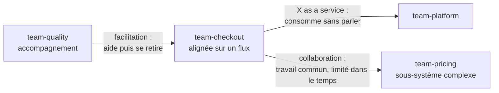
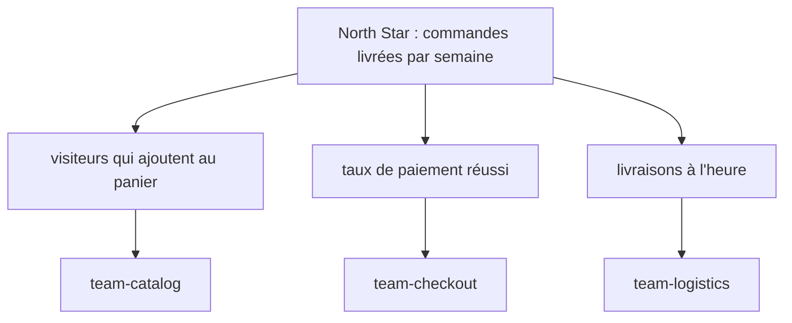
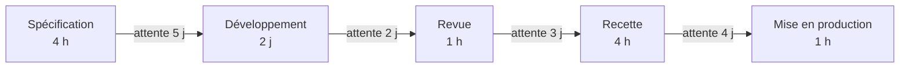
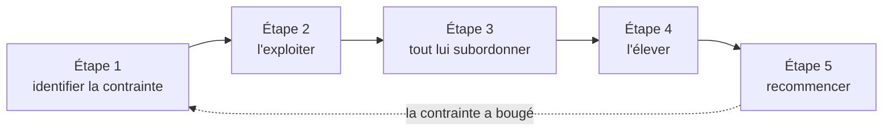
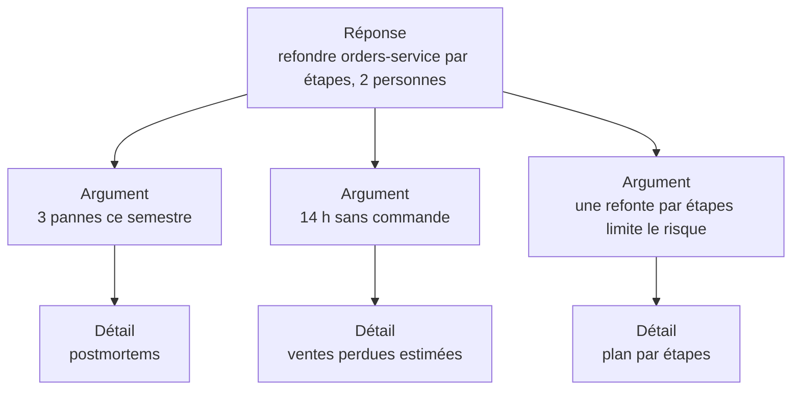

# Culture d'entreprise et organisation

!!! warning "Avertissement"
    Ces notes sont des pense-bêtes personnels, pas une source de vérité. Elles reflètent ma compréhension et mes choix : leur contenu reste subjectif, malgré les citations et les références qu'il contient. Il peut être incomplet, simplifié, inexact ou dépassé. Vérifiez toujours dans la documentation officielle avant de l'appliquer. Ce contenu est fourni tel quel, sans aucune garantie : son utilisation se fait sous votre seule responsabilité.

!!! abstract "Les échelles"
    Les pastilles de couleur sous les titres disent à quelle échelle une notion s'applique :

    - <span class="pill pill-scope pill-scope-code">Code</span> les classes, fonctions et modules d'un programme ;
    - <span class="pill pill-scope pill-scope-app">Application</span> un service ou une application et son découpage interne ;
    - <span class="pill pill-scope pill-scope-system">Système</span> plusieurs services qui communiquent par le réseau ;
    - <span class="pill pill-scope pill-scope-infra">Infrastructure</span> les serveurs, le réseau, les zones et les clusters, physiques ou virtuels ;
    - <span class="pill pill-scope pill-scope-enterprise">Entreprise</span> le système d'information entier et son organisation.

    Détail et mots ambigus : [carte des échelles](architecture.md#carte-des-echelles).

Un ingénieur qui parle à un manager, à une directrice produit ou à un directeur financier change de langue : il ne parle plus de latence ni de file de messages, mais d'objectifs, de coûts, de risques et de délais. Cette page rassemble le vocabulaire et les cadres de pensée les plus cités en entreprise : décrire une culture d'équipe, organiser les équipes, fixer des objectifs, décider, faire circuler le travail, penser produit et stratégie, parler d'argent, présenter un choix technique à la direction et comprendre les filières de carrière.

Les livres de gestion, de produit et de stratégie sont ici. Les articles techniques fondateurs sont rassemblés dans [Textes fondateurs](textes-fondateurs.md). Les équipes (`team-core`, `team-billing`), les services (`orders-service`, `billing-service`), les personnes (ada, grace) et tous les chiffres sont des exemples.

## Vocabulaire

| Mot | Définition | Exemple |
|---|---|---|
| **Culture** | ce que les gens font vraiment quand personne ne regarde : comment circule l'information, comment on traite une erreur, qui ose contredire | dans team-core, un junior peut dire en réunion « je crois que ce plan ne tient pas » sans risque |
| **Gouvernance** | qui a le droit de décider quoi, et comment on contrôle ces décisions | le comité d'architecture valide tout ce qui touche à plus de deux équipes |
| **Stratégie** | le diagnostic d'une situation et le petit nombre de choix cohérents pour y répondre | « nos clients partent à cause des pannes : cette année, la fiabilité passe avant les nouvelles fonctions » |
| **OKR** | Objectives and Key Results : un objectif qualitatif et deux à cinq résultats chiffrés qui disent s'il est atteint | objectif « un paiement sans friction », résultat clé « taux d'abandon au paiement de 12 % à 6 % » |
| **KPI** | Key Performance Indicator : un indicateur suivi en continu pour savoir si l'activité est en bonne santé | le chiffre d'affaires mensuel, le taux de disponibilité, le nombre de tickets support |
| **ROI** | Return On Investment : ce qu'un investissement rapporte, rapporté à ce qu'il coûte | 50 000 € dépensés, 80 000 € économisés : ROI de 60 % |
| **CAPEX** | Capital Expenditure : une dépense d'investissement, amortie sur plusieurs années | acheter des serveurs, construire une nouvelle plateforme |
| **OPEX** | Operating Expenditure : une dépense de fonctionnement, comptée dans l'année | la facture cloud mensuelle, les licences annuelles, la maintenance |
| **P&L** | Profit and Loss, le compte de résultat : les revenus moins les coûts sur une période | « le P&L de la ligne de produit est négatif depuis deux trimestres » |
| **Marge** | ce qui reste des revenus une fois les coûts directs payés | un abonnement à 10 € qui coûte 3 € de cloud et de support : marge brute de 70 % |
| **Time to market** | le délai entre l'idée et la mise à disposition aux clients | trois mois pour sortir une nouvelle offre au lieu de neuf |
| **Feuille de route** (roadmap) | la liste ordonnée de ce qu'on compte livrer, souvent par trimestre | T1 : paiement en plusieurs fois ; T2 : application mobile |
| **Partie prenante** (stakeholder) | toute personne touchée par une décision ou qui peut l'influencer | le support, la finance, le juridique, les équipes qui consomment l'API |
| **Sponsor** | la personne de la direction qui porte un projet, le défend et débloque le budget | la directrice technique sponsorise la migration vers le cloud |
| **Run et build** | le run fait tourner l'existant (exploitation, support), le build construit le nouveau | « 60 % de notre budget part dans le run » |
| **Effectif** (headcount) | le nombre de postes ouverts ou pourvus, souvent l'unité de budget d'une équipe | « on a deux postes de plus au budget de l'an prochain » |
| **DORA** | DevOps Research and Assessment : un programme de recherche (Nicole Forsgren, Jez Humble, Gene Kim, rattaché à Google depuis 2018, à vérifier) qui publie les rapports annuels « State of DevOps » et a résumé ses résultats dans le livre « Accelerate » (2018) | une de ses quatre métriques de livraison, la fréquence de déploiement : « orders-service déploie 3 fois par jour » |
| **Postmortem** | l'analyse écrite d'un incident, après coup : ce qui s'est passé, pourquoi, ce qu'on change, sans chercher de coupable | « cause : la migration verrouille la table ; action : timeout de verrou de 5 s sur les migrations » |
| **Rétrospective** | une réunion régulière de l'équipe, souvent en fin de sprint, pour regarder comment elle a travaillé et choisir une amélioration | « on a attendu les revues deux jours : on essaie un créneau de revue chaque jour à 14h » |

Une phrase de comité de direction, décodée :

```
« Le P&L du trimestre est sous pression : on gèle le headcount et on repousse les projets CAPEX ;
  l'OKR prioritaire reste le time to market du nouveau paiement. »

P&L sous pression          les coûts montent plus vite que les revenus
gel du headcount           aucun nouveau poste, les recrutements attendent
projets CAPEX repoussés    les investissements longs (une nouvelle plateforme) attendent
OKR prioritaire            l'objectif qui passe avant tous les autres ce trimestre
time to market             livrer vite le nouveau paiement compte plus que le reste
```

## Culture d'équipe

<a class="pill pill-dora" href="https://dora.dev/capabilities/generative-organizational-culture/">DORA · Generative organizational culture</a> <a class="pill pill-dora" href="https://dora.dev/capabilities/learning-culture/">DORA · Learning culture</a>

Une culture ne se lit pas dans les valeurs affichées au mur, mais dans les comportements : ce qui arrive à la personne qui annonce une mauvaise nouvelle, ou à celle qui a cassé la production.

### Typologie de Westrum

<span class="pill pill-status pill-status-ok" title="Toujours valable, vérifié en novembre 2026">Valable · 11/2026</span>

Le sociologue Ron Westrum classe les organisations selon la façon dont l'information y circule (« A typology of organisation culture », Quality and Safety in Health Care, 2004). La <span class="term" data-term="westrum-typology">typologie de Westrum</span> distingue trois cultures :

| Comportement | Pathologique (orientée pouvoir) | Bureaucratique (orientée règles) | Générative (orientée performance) |
|---|---|---|---|
| coopération | faible | modérée | forte |
| porteur de mauvaise nouvelle | puni | ignoré | formé et écouté |
| responsabilités | esquivées | cloisonnées | partagées |
| liens entre équipes | découragés | tolérés | encouragés |
| échec | on cherche un coupable | on applique une sanction prévue | on cherche à comprendre |
| nouveauté | étouffée | source de problèmes | mise en œuvre |

Le même incident dans les trois cultures :

```
pathologique    grace signale que la sauvegarde de orders-service ne marche plus depuis 2 semaines.
                On lui reproche de ne pas l'avoir vu plus tôt. La fois suivante, elle se taira.
bureaucratique  le ticket est créé, mais il n'entre dans le périmètre d'aucune équipe. Il attend.
générative      on la remercie, on corrige, et le postmortem ajoute une alerte sur l'âge de la sauvegarde.
```

Le programme de recherche DORA mesure cette culture avec un questionnaire inspiré de Westrum, et la relie à la performance de livraison (Nicole Forsgren, Jez Humble et Gene Kim, « Accelerate », 2018). Cette performance se mesure avec les quatre <span class="term" data-term="dora-metrics">métriques DORA</span>, par exemple le délai entre un commit et sa mise en production (médiane d'un jour pour orders-service, chiffre d'exemple).

:material-book-open-variant: Doc de référence : [Ron Westrum, A typology of organisational cultures](https://pmc.ncbi.nlm.nih.gov/articles/PMC1765804/) (2004)
{ .doc-ref }

### Sécurité psychologique

<span class="pill pill-status pill-status-ok" title="Toujours valable, vérifié en novembre 2026">Valable · 11/2026</span>

La <span class="term" data-term="psychological-safety">sécurité psychologique</span> est la croyance partagée par les membres d'une équipe qu'on peut y prendre un risque interpersonnel (poser une question naïve, avouer une erreur, contredire le chef) sans être humilié ni puni. Amy Edmondson l'a définie et mesurée dans « Psychological Safety and Learning Behavior in Work Teams » (Administrative Science Quarterly, 1999).

!!! noob "As noob"
    Dans une équipe où l'on se sent en sécurité, dire « je n'ai pas compris » ou « j'ai cassé la prod » coûte un moment de gêne, pas une réputation. Les problèmes remontent donc tôt, quand ils sont encore petits. La phrase à retenir : **une équipe où l'on cache les erreurs n'en fait pas moins, elle les découvre plus tard.**

Google l'a rendue célèbre avec le projet Aristotle, une étude interne sur ce qui rend une équipe efficace, publiée sur le site re:Work en 2015 : la sécurité psychologique arrivait en tête de cinq facteurs, devant la fiabilité des engagements, la clarté des rôles, le sens du travail et l'impact perçu (à vérifier sur re:Work, l'étude n'a pas été publiée comme article scientifique).

Ce n'est pas de la gentillesse. Edmondson croise la sécurité avec l'exigence :

| | Exigence faible | Exigence forte |
|---|---|---|
| **Sécurité forte** | zone de confort : on est bien, on progresse peu | zone d'apprentissage : on ose et on se dépasse |
| **Sécurité faible** | apathie | anxiété : on vise haut, mais on cache les problèmes |

Signes concrets : en revue de MR, les juniors commentent le code des seniors ; en rétrospective, les problèmes viennent de toute l'équipe, pas seulement du manager ; « je ne sais pas » est une réponse acceptée.

:material-book-open-variant: Doc de référence : [Wikipédia, Psychological safety](https://en.wikipedia.org/wiki/Psychological_safety) (consultée en novembre 2026) ; [Google re:Work, Understand team effectiveness](https://rework.withgoogle.com/print/guides/5721312655835136/) (2015, à vérifier)
{ .doc-ref }

### Culture juste

<span class="pill pill-status pill-status-ok" title="Toujours valable, vérifié en novembre 2026">Valable · 11/2026</span>

Une <span class="term" data-term="just-culture">culture juste</span> ne punit pas l'erreur honnête, mais ne tolère pas la mise en danger délibérée. L'idée vient de la sécurité industrielle (James Reason, « Managing the Risks of Organizational Accidents », 1997) et a été développée par Sidney Dekker (« Just Culture », 2007). David Marx distingue trois comportements, chacun avec sa réponse (« Patient Safety and the Just Culture », 2001, à vérifier) :

| Comportement | Exemple | Réponse |
|---|---|---|
| erreur humaine | ada lance la migration sur la mauvaise base, les deux onglets se ressemblent | consoler, puis changer le système (couleur par environnement, confirmation) |
| comportement à risque | grace saute les tests « parce que tout le monde le fait quand c'est urgent » | accompagner, et comprendre pourquoi le raccourci est devenu normal |
| imprudence | quelqu'un désactive une alerte de sécurité en sachant le danger, sans le dire | sanctionner |

C'est le socle du <span class="term" data-term="blameless">postmortem sans recherche de coupable</span> : voir [Incidents](incidents.md#le-postmortem-sans-recherche-de-coupable).

:material-book-open-variant: Doc de référence : [Wikipédia, Just culture](https://en.wikipedia.org/wiki/Just_culture) (consultée en novembre 2026)
{ .doc-ref }

### Culture de l'apprentissage

<span class="pill pill-status pill-status-ok" title="Toujours valable, vérifié en novembre 2026">Valable · 11/2026</span>

Une organisation apprenante transforme ses expériences en pratiques partagées, au lieu de les laisser dans la tête de quelques personnes (Peter Senge, « The Fifth Discipline », 1990). Concrètement : des rétrospectives qui finissent par une action, des postmortems lus par les autres équipes, du temps réservé pour apprendre, des démonstrations internes, des erreurs racontées en public par les seniors eux-mêmes.

Squelette d'un postmortem, puis ordre du jour typique d'une rétrospective d'une heure (exemples) :

```
postmortem : panne du paiement, 03/11, 42 min
chronologie   14:02 migration lancée ; 14:05 alertes 5xx ; 14:44 retour arrière
causes        la migration verrouille la table orders, aucun timeout de verrou
actions       timeout de 5 s sur les migrations (ada, 10/11) ; répétition sur une copie de la base (grace)

rétrospective
 5 min   l'action décidée la dernière fois : faite ou pas ?
15 min   ce qui a aidé, ce qui a freiné (notes écrites en silence, puis regroupées)
30 min   discussion des deux sujets qui ont reçu le plus de votes
10 min   une ou deux actions, chacune avec un responsable et une date
```

| Je veux... | J'utilise... |
|---|---|
| décrire la culture de mon organisation avec des faits, pas avec un vague « l'ambiance est bonne » : ce qui arrive à la personne qui annonce une mauvaise nouvelle, ce qu'on fait après une panne | la typologie de Westrum et ses six comportements |
| savoir si les gens de mon équipe osent dire « je n'ai pas compris » ou « j'ai cassé la prod », ou s'ils préfèrent se taire en réunion | les questions d'Edmondson en enquête anonyme, puis en discussion |
| réagir à une erreur, comme une migration lancée sur la mauvaise base, sans que l'équipe se mette à cacher les suivantes | la culture juste : erreur, risque ou imprudence |
| que les autres équipes profitent de la leçon d'un incident, au lieu de refaire la même erreur quelques mois plus tard | des postmortems publiés et lus, une revue mensuelle entre équipes |

## Organiser les équipes

<a class="pill pill-scope pill-scope-system" href="../architecture/#carte-des-echelles">Échelle · Système</a> <a class="pill pill-scope pill-scope-enterprise" href="../architecture/#carte-des-echelles">Échelle · Entreprise</a>

<a class="pill pill-dora" href="https://dora.dev/capabilities/loosely-coupled-teams/">DORA · Loosely coupled teams</a>

Si deux équipes doivent se mettre d'accord à chaque changement, leur code finit lui aussi par dépendre l'un de l'autre : l'organisation des équipes n'est pas qu'une affaire de management, elle façonne l'architecture. C'est la <span class="term" data-term="conway-law">loi de Conway</span>, détaillée dans [Architecture](architecture.md#loi-de-conway).

### Team Topologies

<span class="pill pill-status pill-status-ok" title="Toujours valable, vérifié en novembre 2026">Valable · 11/2026</span>

Matthew Skelton et Manuel Pais (« Team Topologies », 2019) proposent quatre types d'équipes et trois modes d'interaction. Le critère de découpage est la <span class="term" data-term="cognitive-load">charge cognitive</span> : une équipe ne doit pas porter plus qu'elle ne peut comprendre, par exemple ne pas gérer à la fois le tunnel de commande, la CI et le moteur de calcul des prix.

| Type | Rôle | Exemple |
|---|---|---|
| <span class="term" data-term="stream-aligned-team">équipe alignée sur un flux</span> | livre de bout en bout une partie du produit | team-checkout : le tunnel de commande, du besoin à la production |
| <span class="term" data-term="platform-team">équipe plateforme</span> | fournit des services internes en libre-service | team-platform : CI, déploiement, environnements |
| <span class="term" data-term="enabling-team">équipe d'accompagnement</span> | aide une équipe à acquérir une compétence, puis se retire | team-quality coache team-checkout sur les tests de contrat pendant six semaines |
| <span class="term" data-term="complicated-subsystem-team">équipe sous-système complexe</span> | porte un composant qui demande une expertise rare | team-pricing : le moteur de calcul des prix |

Les trois modes d'interaction :



La <span class="term" data-term="inverse-conway-maneuver">manœuvre de Conway inverse</span> part de l'architecture que je veux obtenir, puis organise les équipes en conséquence : si je veux un moteur de prix séparé du tunnel de commande, je crée d'abord une équipe qui en est responsable, comme team-pricing.

:material-book-open-variant: Doc de référence : [Team Topologies, Key concepts](https://teamtopologies.com/key-concepts) (consultée en novembre 2026)
{ .doc-ref }

### Le modèle Spotify et ses limites

Henrik Kniberg et Anders Ivarsson décrivent en 2012 l'organisation de Spotify à ce moment-là (« Scaling Agile @ Spotify with Tribes, Squads, Chapters & Guilds ») :

| Nom | Ce que c'est |
|---|---|
| squad | une petite équipe autonome, avec sa mission |
| tribe | un groupe de squads sur un même domaine |
| chapter | les personnes du même métier dans une tribe (tous les testeurs), avec un responsable hiérarchique commun |
| guild | une communauté d'intérêt ouverte à toute l'entreprise |

Précautions avant de le copier :

- l'article décrivait un instantané, pas un modèle à reproduire ; Kniberg l'a rappelé lui-même ;
- Jeremiah Lee, ancien employé, raconte dans « Spotify's Failed #SquadGoals » (2020) que l'organisation réelle était loin du schéma, notamment sur la responsabilité hiérarchique des chapters ;
- renommer les équipes en squads ne change ni l'autonomie, ni l'architecture, ni la culture.

:material-book-open-variant: Doc de référence : [Kniberg et Ivarsson, Scaling Agile @ Spotify](https://blog.crisp.se/wp-content/uploads/2012/11/SpotifyScaling.pdf) (2012) ; [Jeremiah Lee, Spotify's Failed #SquadGoals](https://www.jeremiahlee.com/posts/failed-squad-goals/) (2020)
{ .doc-ref }

### RACI

<span class="pill pill-status pill-status-ok" title="Toujours valable, vérifié en novembre 2026">Valable · 11/2026</span>

Une matrice <span class="term" data-term="raci">RACI</span> dit, pour chaque tâche, qui la fait (**R**esponsible), qui en répond et tranche (**A**ccountable, une seule personne), qui est consulté avant (**C**onsulted) et qui est informé après (**I**nformed). Son origine précise n'est pas documentée (années 1950 à 1970, à vérifier).

| Tâche : migrer la base de orders-service | ada (dev) | grace (lead) | team-platform | support |
|---|---|---|---|---|
| écrire le plan de migration | R | A | C | |
| valider la fenêtre de maintenance | C | A | C | I |
| exécuter la migration | R | A | C | I |
| prévenir les clients | | A | | R |

Règle : un seul A par ligne. Deux A, c'est personne.

:material-book-open-variant: Doc de référence : [Wikipédia, Responsibility assignment matrix](https://en.wikipedia.org/wiki/Responsibility_assignment_matrix) (consultée en novembre 2026)
{ .doc-ref }

### Équipes à deux pizzas

<span class="pill pill-status pill-status-ok" title="Toujours valable, vérifié en novembre 2026">Valable · 11/2026</span>

L'<span class="term" data-term="two-pizza-team">équipe à deux pizzas</span> est assez petite pour être nourrie par deux pizzas, soit environ six à dix personnes. La règle est attribuée à Jeff Bezos chez Amazon au début des années 2000 (à vérifier, elle n'est connue que par des récits). La raison est arithmétique : le nombre de canaux de communication possibles est n × (n - 1) / 2, soit 6 canaux à 4 personnes, 28 à 8 et 66 à 12.

| Je veux... | J'utilise... |
|---|---|
| que mes équipes livrent sans attendre les autres à chaque changement, par exemple que team-checkout puisse déployer sans demander un environnement à la main à une autre équipe | Team Topologies : des équipes alignées sur un flux, une plateforme en libre-service |
| aider une équipe à maîtriser une nouvelle pratique, comme les tests de contrat, sans finir par écrire ses tests à sa place | une équipe d'accompagnement, avec une date de fin |
| savoir qui tranche sur une tâche que plusieurs équipes partagent, comme une migration de base où chacun croit que c'est l'autre qui décide | une matrice RACI, un seul A par ligne |
| reprendre le modèle Spotify (squads, tribes, chapters) parce qu'il a l'air de marcher ailleurs | lire d'abord ses critiques, garder l'idée (autonomie, communautés), pas les noms |
| mon équipe a grossi jusqu'à douze personnes et chaque décision demande maintenant une réunion avec tout le monde | la scinder autour de deux flux distincts |

:material-book-open-variant: Doc de référence : [AWS Whitepaper, Two-pizza teams](https://docs.aws.amazon.com/whitepapers/latest/introduction-devops-aws/two-pizza-teams.html) (consultée en novembre 2026)
{ .doc-ref }

## Fixer et suivre des objectifs

### OKR

<span class="pill pill-status pill-status-ok" title="Toujours valable, vérifié en novembre 2026">Valable · 11/2026</span>

Les <span class="term" data-term="okr">OKR</span> viennent d'Andy Grove chez Intel (« High Output Management », 1983). John Doerr les a appris chez Intel, les a présentés à Google en 1999 et les a popularisés dans « Measure What Matters » (2018). Un OKR :

- un **objectif** : qualitatif, motivant, ce qu'on veut changer ;
- deux à cinq **résultats clés** : chiffrés, vérifiables à la fin de la période, des résultats et pas des tâches.

```
Objectif        Les équipes livrent sans attendre la CI (T3)
Résultat clé 1  temps de pipeline au p95 : de 28 min à 10 min
Résultat clé 2  taux de tests instables : de 4 % à moins de 1 %
Résultat clé 3  satisfaction CI dans l'enquête développeurs : de 2,9 à 4 sur 5

Mauvais résultat clé : « migrer les runners vers des machines plus grosses » (c'est une tâche, pas un résultat)
```

Doerr distingue les OKR **engagés** (à atteindre à 100 %) et **ambitieux** (atteindre 60 à 70 % est déjà un succès, à vérifier selon les organisations). Mélanger les deux sans le dire crée des malentendus.

:material-book-open-variant: Doc de référence : [What Matters, OKR meaning, definition and examples](https://www.whatmatters.com/faqs/okr-meaning-definition-example) (consultée en novembre 2026)
{ .doc-ref }

### KPI ou OKR

Un <span class="term" data-term="kpi">KPI</span> est un thermomètre : on le surveille en permanence. Un OKR est un changement voulu sur une période.

| | KPI | OKR |
|---|---|---|
| question | « est-ce que tout va bien ? » | « qu'est-ce qu'on veut changer ce trimestre ? » |
| durée | permanent | une période (souvent un trimestre) |
| exemple | disponibilité de my-api à 99,9 % | « faire passer la disponibilité de 99,5 % à 99,9 % » |
| quand il bouge | on enquête | on ajuste le plan |

Un KPI qui se dégrade devient souvent l'objet d'un OKR le trimestre suivant.

:material-book-open-variant: Doc de référence : [Wikipédia, Performance indicator](https://en.wikipedia.org/wiki/Performance_indicator) (consultée en novembre 2026)
{ .doc-ref }

### North Star metric

<span class="pill pill-status pill-status-ok" title="Toujours valable, vérifié en novembre 2026">Valable · 11/2026</span>

La <span class="term" data-term="north-star-metric">North Star metric</span> est l'unique mesure qui capte la valeur que le produit apporte aux clients, et qui annonce le revenu futur. Le terme est popularisé dans le milieu du growth marketing, notamment par Sean Ellis, vers 2017 (à vérifier). On la décompose en métriques d'entrée sur lesquelles les équipes agissent :



:material-book-open-variant: Doc de référence : [Amplitude, The North Star Playbook](https://amplitude.com/books/north-star) (consultée en novembre 2026)
{ .doc-ref }

### Éviter le piège de Goodhart

La <span class="term" data-term="goodhart-law">loi de Goodhart</span> : quand une mesure devient un objectif, elle cesse d'être une bonne mesure (Charles Goodhart, 1975, dans la formulation de Marilyn Strathern, 1997). Elle et ses cousines sont détaillées dans [Lois et principes](lois-et-principes.md). La parade : associer à chaque objectif une **contre-mesure** qui se dégrade si on triche.

| Objectif | Triche possible | Contre-mesure |
|---|---|---|
| réduire le temps de traitement des tickets support | fermer les tickets sans les résoudre | taux de tickets rouverts |
| augmenter la fréquence de déploiement | découper artificiellement les changements | taux d'échec des changements |
| augmenter la couverture de code | tests sans assertion | score de mutation sur le code critique |

| Je veux... | J'utilise... |
|---|---|
| donner à l'équipe une direction ambitieuse pour le trimestre, comme « les équipes livrent sans attendre la CI », et savoir à la fin si on y est arrivé | un OKR : un objectif, deux à cinq résultats chiffrés |
| savoir en continu si une activité va bien, comme la disponibilité de my-api, et être prévenu dès qu'elle se dégrade | des KPI, avec un seuil qui déclenche une enquête |
| que team-catalog, team-checkout et team-logistics tirent dans le même sens, au lieu que chacune optimise son propre chiffre | une North Star metric et son arbre de métriques d'entrée |
| qu'un chiffre suivi ne soit pas gonflé artificiellement, comme des tickets support fermés sans être résolus pour faire baisser le temps de traitement | une contre-mesure par objectif, et jamais de classement individuel |

## Décider

<a class="pill pill-practice" href="../livraison/#concevoir-avant-de-coder">Pratique · Conception technique</a>
<a class="pill pill-dora" href="https://dora.dev/capabilities/documentation-quality/">DORA · Documentation quality</a>

### Cynefin

<span class="pill pill-status pill-status-ok" title="Toujours valable, vérifié en novembre 2026">Valable · 11/2026</span>

Le cadre <span class="term" data-term="cynefin">Cynefin</span> (Dave Snowden, à partir de 1999 ; « A Leader's Framework for Decision Making », avec Mary Boone, Harvard Business Review, 2007) dit qu'on ne décide pas de la même façon selon la nature de la situation :

<figure class="diagram"><svg viewBox="0 0 320 210" role="img" aria-label="Cynefin : quatre domaines et la confusion au centre (d'après Dave Snowden)"><rect class="layer layer-2" x="10" y="10" width="145" height="90" rx="6"/><text class="label-strong" x="82.5" y="32" text-anchor="middle">Complexe</text><text x="82.5" y="45" text-anchor="middle">sonder, constater, répondre</text><text x="82.5" y="57" text-anchor="middle">pratique émergente</text><rect class="layer layer-1" x="165" y="10" width="145" height="90" rx="6"/><text class="label-strong" x="237.5" y="32" text-anchor="middle">Compliqué</text><text x="237.5" y="45" text-anchor="middle">constater, analyser, répondre</text><text x="237.5" y="57" text-anchor="middle">bonne pratique</text><rect class="layer layer-3" x="10" y="110" width="145" height="90" rx="6"/><text class="label-strong" x="82.5" y="170" text-anchor="middle">Chaotique</text><text x="82.5" y="183" text-anchor="middle">agir, constater, répondre</text><text x="82.5" y="195" text-anchor="middle">pratique nouvelle</text><rect class="layer layer-1" x="165" y="110" width="145" height="90" rx="6"/><text class="label-strong" x="237.5" y="170" text-anchor="middle">Clair</text><text x="237.5" y="183" text-anchor="middle">constater, classer, appliquer</text><text x="237.5" y="195" text-anchor="middle">meilleure pratique</text><ellipse class="layer layer-1" cx="160" cy="105" rx="44" ry="20" style="fill-opacity:1;fill:var(--md-default-bg-color)"/><text class="label-strong" x="160" y="108" text-anchor="middle">Confusion</text></svg><figcaption>Cynefin : quatre domaines et la confusion au centre (d'après Dave Snowden)</figcaption></figure>

| Domaine | Lien cause et effet | Méthode | Exemple |
|---|---|---|---|
| clair | évident, connu de tous | constater, classer, appliquer la bonne pratique | renouveler un certificat qui expire : suivre le runbook |
| compliqué | trouvable par un expert | constater, analyser, répondre | dimensionner la base de orders-service pour le double de trafic |
| complexe | visible seulement après coup | sonder, constater, répondre : des expériences sûres | savoir si les clients veulent le paiement en plusieurs fois |
| chaotique | aucun lien visible | agir, constater, répondre : stabiliser d'abord | panne totale en pleine soirée de soldes |
| confusion | on ne sait pas dans quel domaine on est | découper la situation en morceaux | une réunion où chacun croit parler d'un problème différent |

L'erreur classique : traiter un problème complexe comme compliqué, avec un plan détaillé sur un an là où il fallait des expériences de deux semaines.

:material-book-open-variant: Doc de référence : [The Cynefin Co, About the Cynefin framework](https://thecynefin.co/about-us/about-cynefin-framework/) (consultée en novembre 2026) ; [Snowden et Boone, A Leader's Framework for Decision Making](https://hbr.org/2007/11/a-leaders-framework-for-decision-making) (2007)
{ .doc-ref }

### Décisions de type 1 et de type 2

<span class="pill pill-status pill-status-ok" title="Toujours valable, vérifié en novembre 2026">Valable · 11/2026</span>

Jeff Bezos, dans sa lettre aux actionnaires de 2015, distingue deux sortes de décisions :

- **type 1** : une <span class="term" data-term="one-way-door">porte à sens unique</span>, difficile ou impossible à défaire ; elle mérite du temps et de la prudence ;
- **type 2** : une porte à double sens, un <span class="term" data-term="reversible-change">changement réversible</span> ; elle doit être prise vite, par une petite équipe.

```
type 1   choisir la base de données principale de la nouvelle plateforme
         signer un contrat de cinq ans avec un fournisseur
type 2   choisir une bibliothèque de logs derrière une interface
         activer une fonction pour 5 % des clients derrière un feature flag
```

Le piège décrit dans la lettre : appliquer le processus lourd du type 1 à toutes les décisions, ce qui ralentit l'organisation entière.

:material-book-open-variant: Doc de référence : [Jeff Bezos, lettre aux actionnaires 2015](https://s2.q4cdn.com/299287126/files/doc_financials/annual/2015-Letter-to-Shareholders.PDF) (2016)
{ .doc-ref }

### RFC et documents de conception

<span class="pill pill-status pill-status-ok" title="Toujours valable, vérifié en novembre 2026">Valable · 11/2026</span>

Une **RFC** (Request for Comments) est un document qui propose un changement et sollicite des avis avant la décision. Le nom vient de l'Internet : la RFC 1 a été publiée en 1969 par Steve Crocker. En entreprise, on parle aussi de document de conception (design doc). Le modèle tient en quelques rubriques :

```markdown
# RFC 014 : facturer à l'usage dans billing-service

Statut : en revue jusqu'au 15/11 (exemple)
Contexte : pourquoi maintenant, avec les chiffres
Objectifs et non-objectifs : ce qu'on vise, ce qu'on ne traite pas
Options étudiées : au moins deux, dont « ne rien faire »
Proposition : l'option choisie et pourquoi
Risques et questions ouvertes
Plan de déploiement et de retour arrière
```

La décision finale est ensuite gardée dans un <span class="term" data-term="adr">ADR</span> : voir [Concevoir avant de coder](livraison.md#concevoir-avant-de-coder).

:material-book-open-variant: Doc de référence : [RFC 1, Host Software](https://www.rfc-editor.org/rfc/rfc1) (1969)
{ .doc-ref }

### Advice process

<span class="pill pill-status pill-status-ok" title="Toujours valable, vérifié en novembre 2026">Valable · 11/2026</span>

Dans l'<span class="term" data-term="advice-process">advice process</span>, n'importe qui peut prendre une décision, à condition d'avoir demandé l'avis des personnes concernées et des experts. Celui qui décide n'est pas obligé de suivre ces avis. Le principe vient de Dennis Bakke (« Joy at Work », 2005) et a été repris par Frederic Laloux (« Reinventing Organizations », 2014). Andrew Harmel-Law l'applique à l'architecture logicielle dans « Scaling the Practice of Architecture, Conversationally » (martinfowler.com, 2021).

```
1. ada veut remplacer la file RabbitMQ de orders-service par un sujet Kafka
2. elle demande l'avis de billing-service (consommateur), de l'équipe plateforme et de grace (experte Kafka)
3. billing-service craint pour l'ordre des messages ; la plateforme préfère attendre la mise à jour du cluster
4. ada décide : migration après la mise à jour, clé de partition par numéro de commande
5. elle écrit l'ADR 027 : contexte, avis reçus (y compris ceux non suivis), décision, conséquences
```

:material-book-open-variant: Doc de référence : [Andrew Harmel-Law, Scaling the Practice of Architecture, Conversationally](https://martinfowler.com/articles/scaling-architecture-conversationally.html) (2021)
{ .doc-ref }

### Désaccord et engagement

<span class="pill pill-status pill-status-ok" title="Toujours valable, vérifié en novembre 2026">Valable · 11/2026</span>

Le <span class="term" data-term="disagree-and-commit">disagree and commit</span> : on exprime son désaccord pendant la discussion, puis, une fois la décision prise, on s'engage à la réussir comme si c'était la sienne. Bezos le décrit dans sa lettre de 2016 ; l'expression est souvent rattachée à Intel et à Andy Grove (à vérifier). Ce n'est pas « se taire et obéir » : le désaccord est dit, écrit, et peut être revu si les faits changent.

```
l'équipe choisit MongoDB pour le catalogue, grace aurait préféré PostgreSQL
grace écrit son désaccord dans l'ADR : « risque : rapports avec jointures coûteux »
puis elle conçoit le meilleur schéma MongoDB possible, sans freiner le projet
six mois plus tard, si les rapports posent problème, son objection écrite sert à rouvrir la décision
```

:material-book-open-variant: Doc de référence : [Jeff Bezos, lettre aux actionnaires 2016](https://www.aboutamazon.com/news/company-news/2016-letter-to-shareholders) (2017)
{ .doc-ref }

### Le mémo narratif de six pages

<span class="pill pill-status pill-status-ok" title="Toujours valable, vérifié en novembre 2026">Valable · 11/2026</span>

Le <span class="term" data-term="narrative-memo">mémo narratif</span> remplace les diapositives par un texte complet, lu en silence par tous au début de la réunion. L'idée remonte à un courriel de Jeff Bezos de 2004 qui bannit PowerPoint des réunions de direction (à vérifier ; la longueur de six pages est la forme rapportée plus tard). Un texte oblige à relier les idées entre elles, là où une liste à puces permet de les juxtaposer.

```
diapositive  « Contexte : latence, coûts, dette technique »
mémo         « La latence p99 de orders-service a doublé depuis janvier, parce que chaque commande
               appelle quatre services. La refonte supprime deux de ces appels ; elle coûte trois mois
               à deux personnes, et le gain attendu est un p99 sous 300 ms. »
réunion      20 min de lecture silencieuse, puis 40 min de questions
```

| Je veux... | J'utilise... |
|---|---|
| savoir comment décider face à une question dont personne ne connaît la réponse, comme savoir si les clients veulent le paiement en plusieurs fois | Cynefin : expériences si c'est complexe, analyse si c'est compliqué |
| aller vite sur les petits choix sans m'enfermer sur les gros : choisir une bibliothèque de logs en une heure, mais prendre le temps pour la base de données principale | type 1 ou type 2 : décision rapide si elle se défait facilement |
| recueillir les avis avant un choix qui touche plusieurs équipes, comme passer billing-service à la facturation à l'usage | une RFC relue, puis un ADR |
| que les équipes prennent elles-mêmes leurs décisions d'architecture, sans tout faire remonter à un comité | l'advice process, avec un registre des décisions |
| avancer alors que quelqu'un de l'équipe n'est pas d'accord, comme grace qui aurait préféré PostgreSQL à MongoDB pour le catalogue | disagree and commit, avec le désaccord écrit |
| ne plus avoir de réunions de décision où personne n'a lu le dossier et où tout le monde découvre le sujet sur les diapositives | un mémo narratif lu en début de réunion |

:material-book-open-variant: Doc de référence : [Jeff Bezos, lettre aux actionnaires 2017](https://www.aboutamazon.com/news/company-news/2017-letter-to-shareholders) (2018)
{ .doc-ref }

## Lean et flux

<a class="pill pill-dora" href="https://dora.dev/capabilities/work-visibility-in-value-stream/">DORA · Visibility of work in the value stream</a> <a class="pill pill-dora" href="https://dora.dev/capabilities/working-in-small-batches/">DORA · Working in small batches</a>

### Toyota Production System

<span class="pill pill-status pill-status-ok" title="Toujours valable, vérifié en novembre 2026">Valable · 11/2026</span>

Le **Lean** vient du Toyota Production System, décrit par Taiichi Ohno (« Toyota Production System: Beyond Large-Scale Production », 1978 au Japon, 1988 en anglais), puis popularisé par James Womack et Daniel Jones (« Lean Thinking », 1996). Deux piliers : le **juste à temps** (produire ce qui est demandé, quand c'est demandé) et le **jidoka** (arrêter la chaîne dès qu'un défaut apparaît : n'importe quel ouvrier peut tirer la corde andon).

Le Lean chasse le <span class="term" data-term="lean-waste">gaspillage</span>. Mary et Tom Poppendieck traduisent les sept gaspillages de l'usine pour le logiciel (« Lean Software Development: An Agile Toolkit », 2003) :

| Usine | Logiciel | Exemple |
|---|---|---|
| stocks | travail partiellement fait | une branche finie mais pas fusionnée depuis trois semaines |
| surproduction | fonctions en trop | un export PDF que personne n'utilise |
| traitements inutiles | réapprentissage | redécouvrir pourquoi un choix a été fait, faute d'ADR |
| transport | transferts | une demande qui passe par quatre équipes avant d'être traitée |
| mouvements | changements de tâche | une développeuse sur cinq projets à la fois |
| attente | délais | une MR qui attend deux jours une revue |
| défauts | défauts | un bug trouvé en production plutôt qu'en CI |

Leurs sept principes du Lean logiciel : éliminer le gaspillage, amplifier l'apprentissage, décider le plus tard possible, livrer le plus vite possible, donner le pouvoir à l'équipe, construire l'intégrité dedans, voir l'ensemble.

:material-book-open-variant: Doc de référence : [Toyota, Toyota Production System](https://global.toyota/en/company/vision-and-philosophy/production-system/) (consultée en novembre 2026) ; [Lean Enterprise Institute, Toyota Production System](https://www.lean.org/lexicon-terms/toyota-production-system/) (consultée en novembre 2026)
{ .doc-ref }

### Cartographie du flux de valeur

<span class="pill pill-status pill-status-ok" title="Toujours valable, vérifié en novembre 2026">Valable · 11/2026</span>

La <span class="term" data-term="value-stream-mapping">cartographie du flux de valeur</span> (Mike Rother et John Shook, « Learning to See », 1998) dessine chaque étape d'une demande avec son temps de travail et son temps d'attente.

```
étape                    travail    attente avant l'étape suivante
spécification            4 h        5 jours (priorisation)
développement            2 jours    2 jours (revue de code)
revue                    1 h        3 jours (campagne de recette)
recette                  4 h        4 jours (fenêtre de mise en production)
mise en production       1 h

total : environ 3,2 jours de travail pour 17,2 jours de délai
efficacité du flux = 3,2 / 17,2, soit 19 % (chiffres d'exemple)
```



Le gain est presque toujours dans les attentes, pas dans le travail : faire passer le développement de 2 jours à 1 jour ne retire qu'une journée à un délai de plus de 17 jours, alors que supprimer l'attente de la fenêtre de mise en production en retire 4.

:material-book-open-variant: Doc de référence : [Lean Enterprise Institute, Value Stream Mapping](https://www.lean.org/lexicon-terms/value-stream-mapping/) (consultée en novembre 2026)
{ .doc-ref }

### Théorie des contraintes

<span class="pill pill-status pill-status-ok" title="Toujours valable, vérifié en novembre 2026">Valable · 11/2026</span>

Eliyahu Goldratt, dans le roman « The Goal » (1984), montre que le débit d'un système dépend de son <span class="term" data-term="bottleneck">goulot d'étranglement</span>. Optimiser ailleurs ne sert à rien. La <span class="term" data-term="theory-of-constraints">théorie des contraintes</span> propose cinq étapes :

1. **identifier** la contrainte (dans l'exemple ci-dessus, la recette manuelle) ;
2. **l'exploiter** : qu'elle ne perde jamais de temps (préparer les données de recette à l'avance) ;
3. **tout lui subordonner** : ne pas produire plus vite qu'elle n'absorbe ;
4. **l'élever** : augmenter sa capacité (automatiser les tests de recette) ;
5. **recommencer** : la contrainte a bougé ailleurs.



:material-book-open-variant: Doc de référence : [Wikipédia, Theory of constraints](https://en.wikipedia.org/wiki/Theory_of_constraints) (consultée en novembre 2026)
{ .doc-ref }

### Loi de Little et limites de WIP

La <span class="term" data-term="littles-law">loi de Little</span> (John Little, 1961) relie trois grandeurs d'un système stable : travail en cours = <span class="term" data-term="throughput">débit</span> × délai moyen. Retournée, elle dit que le délai = travail en cours / débit. Le détail côté systèmes est dans [Architecture](architecture.md#loi-de-little).

```
team-core termine 5 tickets par semaine
avec 20 tickets en cours   délai moyen = 20 / 5 = 4 semaines
avec 10 tickets en cours   délai moyen = 10 / 5 = 2 semaines
```

Si mon équipe veut livrer plus vite sans travailler plus, elle commence moins de choses à la fois : avec moitié moins de tickets en cours, chaque ticket sort en moyenne deux fois plus tôt. C'est le rôle d'une <span class="term" data-term="wip-limit">limite de WIP</span> (Work In Progress).

:material-book-open-variant: Doc de référence : [Wikipédia, Little's law](https://en.wikipedia.org/wiki/Little%27s_law) (consultée en novembre 2026)
{ .doc-ref }

### Kanban

<span class="pill pill-status pill-status-ok" title="Toujours valable, vérifié en novembre 2026">Valable · 11/2026</span>

La méthode <span class="term" data-term="kanban">Kanban</span> pour le travail intellectuel (David J. Anderson, « Kanban: Successful Evolutionary Change for Your Technology Business », 2010) part de l'existant : visualiser le travail, limiter le travail en cours, gérer le flux, rendre les règles explicites, améliorer par petites touches.

```
À FAIRE     EN COURS (max 3)    EN REVUE (max 2)    FAIT
TCK-41      TCK-38 ada          TCK-35              TCK-30
TCK-42      TCK-39 grace        TCK-36              TCK-31
TCK-43      TCK-40 ada

EN REVUE est plein : avant de commencer TCK-41, ada va relire TCK-35.
```

| Je veux... | J'utilise... |
|---|---|
| comprendre pourquoi une demande qui représente quelques jours de travail met trois semaines à arriver en production | une cartographie du flux de valeur, temps de travail et d'attente |
| savoir où mettre des personnes ou du budget pour livrer plus, plutôt que d'accélérer une étape qui ne bloque rien | la théorie des contraintes : d'abord le goulot |
| que les tickets sortent plus vite sans recruter ni faire d'heures en plus, alors que l'équipe a vingt tickets ouverts en même temps | limiter le travail en cours (loi de Little) |
| voir où le travail s'accumule, comme des MR qui s'empilent en revue, et l'améliorer petit à petit sans réorganiser toute l'équipe | un tableau Kanban avec des limites de WIP |
| des mots communs pour pointer ce qui fait perdre du temps, comme une MR qui attend deux jours une revue ou un export que personne n'utilise | les sept gaspillages du logiciel (Poppendieck) |

:material-book-open-variant: Doc de référence : [Kanban University, The Official Kanban Guide](https://kanban.university/kanban-guide/) (consultée en novembre 2026)
{ .doc-ref }

## Produit

### Produit ou projet

| | Projet | Produit |
|---|---|---|
| fin | une date et un périmètre | tant que le produit a des utilisateurs |
| succès | livré à temps, dans le budget | les utilisateurs obtiennent un résultat |
| équipe | assemblée puis dispersée | stable, garde la connaissance |
| financement | par projet | par équipe, sur la durée |

Mik Kersten (« Project to Product », 2018) défend le passage du projet au produit pour les équipes logicielles : un logiciel n'est jamais « fini », et une équipe dispersée après la livraison laisse un système que plus personne ne connaît.

:material-book-open-variant: Doc de référence : [Sriram Narayan, Products Over Projects](https://martinfowler.com/articles/products-over-projects.html) (2018)
{ .doc-ref }

### Jobs to be done

<span class="pill pill-status pill-status-ok" title="Toujours valable, vérifié en novembre 2026">Valable · 11/2026</span>

Le cadre <span class="term" data-term="jobs-to-be-done">Jobs to be done</span> (Clayton Christensen et coauteurs, « Competing Against Luck », 2016) dit qu'un client « embauche » un produit pour accomplir un progrès dans une situation donnée. L'exemple classique de Christensen : des clients achètent un milk-shake le matin, non par goût, mais parce qu'il occupe un long trajet en voiture et tient jusqu'à midi. Le concurrent n'est pas l'autre milk-shake, c'est la banane ou le bagel.

```
Quand   je prépare la paie de mes 12 salariés en fin de mois,
je veux être sûr que chaque virement est parti,
pour    ne pas passer le lundi à répondre à des salariés inquiets.
```

:material-book-open-variant: Doc de référence : [Christensen Institute, Jobs to Be Done](https://www.christenseninstitute.org/theory/jobs-to-be-done/) (consultée en novembre 2026)
{ .doc-ref }

### Discovery et delivery

<span class="pill pill-status pill-status-ok" title="Toujours valable, vérifié en novembre 2026">Valable · 11/2026</span>

Marty Cagan (« Inspired », 2008, deuxième édition en 2017) sépare deux activités menées en parallèle par la même équipe :

- la <span class="term" data-term="product-discovery">discovery</span> : découvrir ce qui vaut la peine d'être construit, avec des prototypes et des tests auprès d'utilisateurs ;
- la **delivery** : construire et livrer, de façon fiable, ce qui a été validé.

La discovery traite quatre risques avant d'écrire le code de production : la **valeur** (vont-ils l'acheter ou l'utiliser ?), l'**utilisabilité** (sauront-ils s'en servir ?), la **faisabilité** (peut-on le construire ?) et la **viabilité** (est-ce tenable pour l'entreprise : juridique, ventes, finance ?). Teresa Torres décrit une pratique hebdomadaire de discovery dans « Continuous Discovery Habits » (2021).

Une fonction fictive, le paiement en trois fois dans orders-service, et un test par risque :

| Risque | Test avant d'écrire le code de production |
|---|---|
| valeur | un bouton « payer en 3 fois » factice sur 5 % des paniers : combien de clients cliquent ? |
| utilisabilité | une maquette cliquable montrée à cinq clients : comprennent-ils l'échéancier ? |
| faisabilité | deux jours d'exploration technique : le prestataire de paiement gère-t-il les paiements fractionnés ? |
| viabilité | la finance et le juridique valident le coût des impayés et les mentions légales du crédit |

:material-book-open-variant: Doc de référence : [Marty Cagan, The Four Big Risks](https://www.svpg.com/the-four-big-risks/) (2017)
{ .doc-ref }

### Shape Up

<span class="pill pill-status pill-status-ok" title="Toujours valable, vérifié en novembre 2026">Valable · 11/2026</span>

Ryan Singer décrit la méthode de Basecamp dans « Shape Up » (2019, livre gratuit en ligne) :

- des cycles de **six semaines**, suivis de **deux semaines** de récupération (cooldown) ;
- avant le cycle, un projet est **façonné** (shaping) : le problème, les grandes lignes de la solution, les pièges connus ;
- l'<span class="term" data-term="appetite">appétit</span> remplace l'estimation : on ne demande pas « combien de temps ça prendra ? » mais « combien de temps ce problème mérite-t-il ? » ;
- une **table des paris** (betting table) choisit les projets du cycle ;
- un **disjoncteur** : un projet non fini en six semaines n'est pas prolongé par défaut.

Un cycle, sur un exemple :

```
cycle précédent    shaping : grace façonne « export comptable » (problème, croquis, pièges), appétit 6 semaines
cooldown           table des paris : 3 projets façonnés, 2 retenus ; le 3e n'est pas mis en attente
semaines 1 à 6     l'équipe construit ; en semaine 4, elle coupe l'export PDF pour tenir l'appétit
fin de semaine 6   disjoncteur : l'export CSV est livré ; non fini, il aurait été arrêté, pas prolongé
semaines 7 et 8    cooldown : corrections, petite dette, exploration libre ; nouvelle table des paris
```

:material-book-open-variant: Doc de référence : [Ryan Singer, Shape Up](https://basecamp.com/shapeup) (2019)
{ .doc-ref }

### Construire, acheter ou s'associer

<span class="pill pill-status pill-status-ok" title="Toujours valable, vérifié en novembre 2026">Valable · 11/2026</span>

Le choix <span class="term" data-term="build-vs-buy">construire ou acheter</span> revient pour chaque brique.

| Situation | Choix | Exemple |
|---|---|---|
| la brique fait ma différence face aux concurrents : c'est en partie pour elle que les clients viennent chez moi | construire | le moteur de recommandation d'un site marchand |
| tout le monde a le même besoin, et le marché le sert déjà bien | acheter (logiciel ou service) | la paie, l'envoi d'emails, la supervision |
| j'ai besoin vite d'une capacité qui n'est pas mon métier | s'associer | un partenaire de paiement pour un nouveau pays |
| le besoin est courant, mais une contrainte forte pèse dessus, sur les données ou sur le coût | acheter, puis réévaluer | une solution du marché, avec une sortie prévue |

Le coût d'une solution construite ne s'arrête pas à sa livraison : il faut la maintenir des années. Le prix d'une solution achetée inclut l'intégration et le risque de <span class="term" data-term="vendor-lock-in">dépendance au fournisseur</span>.

| Je veux... | J'utilise... |
|---|---|
| comprendre ce que les clients cherchent vraiment, au-delà de ce qu'ils demandent, comme le gérant qui veut surtout être sûr que chaque virement de paie est parti | Jobs to be done, avec des entretiens sur des situations réelles |
| ne pas découvrir après la mise en production qu'une fonction n'intéresse personne, comme un export PDF que personne n'ouvre | la discovery : tester valeur et utilisabilité avant le code |
| arrêter un projet qui dérive, où chaque semaine ajoute une demande et repousse la date de fin | <span class="term" data-term="shape-up">Shape Up</span> : un appétit fixe, un périmètre variable |
| garder l'équipe et ce qu'elle sait du système une fois la livraison faite, au lieu de la disperser sur d'autres projets | un financement par produit, pas par projet |
| décider si on développe une brique ou si on l'achète, comme la paie ou l'envoi d'emails | construire ce qui différencie, acheter le reste |

:material-book-open-variant: Doc de référence : [Martin Fowler, Utility Vs Strategic Dichotomy](https://martinfowler.com/bliki/UtilityVsStrategicDichotomy.html) (2010)
{ .doc-ref }

## Stratégie

### Cartes de Wardley

<span class="pill pill-status pill-status-ok" title="Toujours valable, vérifié en novembre 2026">Valable · 11/2026</span>

Une <span class="term" data-term="wardley-map">carte de Wardley</span> (Simon Wardley, méthode développée au milieu des années 2000, à vérifier) place chaque composant d'une chaîne de valeur sur deux axes : sa **visibilité** pour l'utilisateur (vertical) et son **évolution** (horizontal), de la genèse (nouveau, incertain) au sur-mesure, puis au produit, puis à la commodité (standard, au compteur).

!!! noob "As noob"
    Je pense à l'électricité : au début, chaque usine avait sa propre centrale, construite sur mesure ; aujourd'hui, on se branche au réseau et on paie au compteur (une commodité). La carte de Wardley place chaque brique d'un produit sur ce chemin, et rappelle que tout finit par glisser vers la droite. La phrase à retenir : **on construit ce qui nous distingue, on achète ce qui est devenu banal.**

<figure class="diagram"><svg viewBox="0 0 340 236" role="img" aria-label="Carte de Wardley d'une boutique en ligne (exemple)"><line class="set" style="stroke-width:0.6;stroke-dasharray:2 3" x1="112.5" y1="14" x2="112.5" y2="196"/><line class="set" style="stroke-width:0.6;stroke-dasharray:2 3" x1="185.0" y1="14" x2="185.0" y2="196"/><line class="set" style="stroke-width:0.6;stroke-dasharray:2 3" x1="257.5" y1="14" x2="257.5" y2="196"/><line class="set" x1="40" y1="196" x2="330" y2="196"/><line class="set" x1="40" y1="196" x2="40" y2="14"/><text x="76.2" y="208" text-anchor="middle">genèse</text><text x="148.8" y="208" text-anchor="middle">sur-mesure</text><text x="221.2" y="208" text-anchor="middle">produit</text><text x="293.8" y="208" text-anchor="middle">commodité</text><text x="185.0" y="222" text-anchor="middle" class="label-strong">Évolution</text><text x="36" y="22" text-anchor="end">visible</text><text x="36" y="194" text-anchor="end">invisible</text><text x="12" y="105.0" text-anchor="middle" class="label-strong" transform="rotate(-90 12 105.0)">Visibilité</text><line class="set" style="stroke-width:1" x1="219.8" y1="23.1" x2="219.8" y2="57.7"/><line class="set" style="stroke-width:1" x1="219.8" y1="57.7" x2="127.0" y2="90.4"/><line class="set" style="stroke-width:1" x1="219.8" y1="57.7" x2="231.4" y2="114.1"/><line class="set" style="stroke-width:1" x1="127.0" y1="90.4" x2="98.0" y2="130.5"/><line class="set" style="stroke-width:1" x1="98.0" y1="130.5" x2="295.2" y2="174.2"/><line class="set" style="stroke-width:1" x1="231.4" y1="114.1" x2="295.2" y2="174.2"/><line class="set" style="stroke-dasharray:4 3" x1="104.0" y1="130.5" x2="219.8" y2="130.5"/><polygon class="hit" points="219.8,130.5 213.4,133.2 213.4,127.8"/><text x="161.8" y="125.5" text-anchor="middle">dérive avec le temps</text><circle class="hit" cx="219.8" cy="23.1" r="4"/><text x="226.8" y="18.1">client</text><circle class="hit" cx="219.8" cy="57.7" r="4"/><text x="226.8" y="52.7">boutique en ligne</text><circle class="hit" cx="127.0" cy="90.4" r="4"/><text x="134.0" y="85.4">recommandations</text><circle class="hit" cx="98.0" cy="130.5" r="4"/><text x="91.0" y="133.5" text-anchor="end">modèle maison</text><circle class="hit" cx="231.4" cy="114.1" r="4"/><text x="238.4" y="109.1">paiement</text><circle class="hit" cx="295.2" cy="174.2" r="4"/><text x="288.2" y="177.2" text-anchor="end">calcul (cloud)</text></svg><figcaption>Carte de Wardley d'une boutique en ligne (exemple)</figcaption></figure>

Lecture : construire ce qui est en genèse ou sur-mesure et différencie (les recommandations), acheter ou louer les produits et les commodités (le paiement, le calcul). Les composants dérivent vers la droite avec le temps : ce qui est rare aujourd'hui sera banal demain.

:material-book-open-variant: Doc de référence : [Learn Wardley Mapping](https://learnwardleymapping.com/) (consultée en novembre 2026) ; [Wikipédia, Wardley map](https://en.wikipedia.org/wiki/Wardley_map) (consultée en novembre 2026)
{ .doc-ref }

### Bonne et mauvaise stratégie

<span class="pill pill-status pill-status-ok" title="Toujours valable, vérifié en novembre 2026">Valable · 11/2026</span>

Richard Rumelt (« Good Strategy Bad Strategy », 2011) donne le noyau d'une bonne stratégie : un **diagnostic** (ce qui se passe vraiment), une **politique directrice** (l'approche choisie) et des **actions cohérentes** (qui se renforcent). Il reconnaît une mauvaise stratégie à quatre signes : des mots creux, l'absence de diagnostic du vrai problème, des objectifs pris pour une stratégie, et des objectifs irréalistes.

```
mauvaise   « Devenir le leader de la plateforme développeur, innovante et centrée client. »

bonne      diagnostic   les équipes perdent 30 % de leur temps sur la CI et les environnements
           politique    un chemin standard en libre-service plutôt que du sur-mesure par équipe
           actions      un template de projet, une CI partagée, des environnements de prévisualisation,
                        et l'arrêt du support des trois outils maison (chiffres d'exemple)
```

### Le dilemme de l'innovateur

Clayton Christensen (« The Innovator's Dilemma », 1997) explique pourquoi des entreprises bien gérées perdent face à des nouveaux venus. Elles investissent dans l'**innovation de continuité** que leurs meilleurs clients demandent, et négligent l'<span class="term" data-term="disruptive-innovation">innovation de rupture</span> : un produit d'abord moins bon et moins cher, destiné à des clients délaissés, qui s'améliore jusqu'à suffire au marché principal. Exemple souvent cité : les petits disques durs, d'abord trop limités pour les clients existants, ont remplacé les grands.

!!! noob "As noob"
    Les premiers appareils photo numériques faisaient de moins bonnes images que la pellicule : un fabricant de pellicule qui écoutait ses meilleurs clients n'avait aucune raison de s'y intéresser. Mais le numérique s'est amélioré plus vite que les besoins des clients, et un jour il a suffi. La phrase à retenir : **écouter ses meilleurs clients est rationnel, et c'est justement ce qui empêche de voir venir le produit modeste qui va les prendre.**

<figure class="diagram"><svg viewBox="0 0 320 210" role="img" aria-label="Le dilemme de l'innovateur (d'après Clayton Christensen, 1997)"><polygon class="layer layer-1" points="36,150 300,110 300,60 36,110"/><line class="set" x1="36" y1="170" x2="300" y2="170"/><line class="set" x1="36" y1="170" x2="36" y2="12"/><line class="set" x1="36.0" y1="100.0" x2="300.0" y2="20.0"/><polygon class="hit" points="300.0,20.0 294.6,24.5 293.0,19.3"/><line class="set" style="stroke-dasharray:4 3" x1="90.0" y1="168.0" x2="300.0" y2="80.0"/><polygon class="hit" points="300.0,80.0 295.1,85.0 293.0,80.0"/><text x="42" y="124">ce que le marché</text><text x="42" y="134">peut absorber</text><text x="70" y="78" transform="rotate(-17 70 78)">innovation de continuité</text><text x="140" y="162" transform="rotate(-23 140 162)">innovation de rupture</text><text x="168" y="186" text-anchor="middle">temps</text><text x="20" y="91" text-anchor="middle" transform="rotate(-90 20 91)">performance</text></svg><figcaption>Le dilemme de l'innovateur (d'après Clayton Christensen, 1997)</figcaption></figure>

| Je veux... | J'utilise... |
|---|---|
| discuter avec la direction de ce qu'il faut construire ou acheter, avec un dessin partagé plutôt qu'avec des opinions | une carte de Wardley de la chaîne de valeur |
| savoir si une stratégie annoncée en est vraiment une, ou seulement un slogan comme « devenir le leader innovant et centré client » | le noyau de Rumelt : diagnostic, politique, actions |
| comprendre pourquoi un concurrent au produit plus simple et moins cher gagne des clients | le dilemme de l'innovateur |
| écrire la stratégie technique de mon équipe sans qu'elle tourne à la liste de vœux | diagnostic chiffré, une politique, trois à cinq actions |

:material-book-open-variant: Doc de référence : [Christensen Institute, Disruptive Innovation](https://www.christenseninstitute.org/theory/disruptive-innovation/) (consultée en novembre 2026)
{ .doc-ref }

## Argent et coûts

<a class="pill pill-scope pill-scope-infra" href="../architecture/#carte-des-echelles">Échelle · Infrastructure</a> <a class="pill pill-scope pill-scope-enterprise" href="../architecture/#carte-des-echelles">Échelle · Entreprise</a>

### CAPEX et OPEX

Le <span class="term" data-term="capex">CAPEX</span> est un investissement qui crée un actif utilisé plusieurs années : il est amorti, c'est-à-dire réparti sur sa durée de vie dans les comptes. L'<span class="term" data-term="opex">OPEX</span> est une dépense de fonctionnement, comptée dans l'année.

!!! noob "As noob"
    Acheter une voiture, c'est du CAPEX : une grosse somme au départ, que la comptabilité étale sur les années où la voiture sert. La louer au mois, c'est de l'OPEX : une dépense régulière, comptée au fil de l'eau. La phrase à retenir : **deux options au coût total proche n'apparaissent pas de la même façon dans les comptes, et c'est souvent ce qui pèse dans la décision.**

```
acheter 3 serveurs à 30 000 €, amortis sur 3 ans    CAPEX : 10 000 € par an dans le compte de résultat
louer l'équivalent dans le cloud, 1 200 € par mois  OPEX  : 14 400 € par an
(chiffres d'exemple)
```

Le cloud transforme du CAPEX en OPEX : pas d'achat initial, mais une facture qui suit l'usage. Une partie du temps de développement d'un nouveau logiciel peut aussi être immobilisée (traitée comme du CAPEX) selon les normes comptables, par exemple IAS 38 (à vérifier avec la finance, les règles varient selon le pays et le référentiel). C'est pourquoi la finance demande parfois de séparer le temps passé sur un nouveau produit du temps passé sur la maintenance.

:material-book-open-variant: Doc de référence : [Wikipédia, Capital expenditure](https://en.wikipedia.org/wiki/Capital_expenditure) (consultée en novembre 2026) ; [IFRS Foundation, IAS 38 Intangible Assets](https://www.ifrs.org/issued-standards/list-of-standards/ias-38-intangible-assets/) (consultée en novembre 2026)
{ .doc-ref }

### Coût total de possession

<span class="pill pill-status pill-status-ok" title="Toujours valable, vérifié en novembre 2026">Valable · 11/2026</span>

Le <span class="term" data-term="total-cost-ownership">coût total de possession</span> (TCO) additionne tout ce que coûte une solution sur sa durée de vie, pas seulement son prix d'achat.

| Sur 3 ans | Héberger soi-même | Service managé |
|---|---|---|
| licences ou abonnement | 0 € | 54 000 € |
| infrastructure | 36 000 € | inclus |
| temps humain (exploitation, mises à jour, astreinte) | 0,5 personne, soit 120 000 € | 0,1 personne, soit 24 000 € |
| **total** | **156 000 €** | **78 000 €** |

Chiffres d'exemple. Le poste le plus oublié est presque toujours le temps humain.

:material-book-open-variant: Doc de référence : [Wikipédia, Total cost of ownership](https://en.wikipedia.org/wiki/Total_cost_of_ownership) (consultée en novembre 2026)
{ .doc-ref }

### Retour sur investissement

Le <span class="term" data-term="roi">ROI</span> se calcule ainsi : (gain - coût) / coût. Le **délai de récupération** (payback) dit en combien de temps l'investissement est remboursé.

```
coût : automatiser la recette, 2 personnes pendant 2 mois, soit 40 000 €
gain : 10 jours de recette manuelle par mois en moins, soit 5 000 € par mois

ROI sur un an     (60 000 - 40 000) / 40 000 = 50 %
délai de récupération : 40 000 / 5 000 = 8 mois
(chiffres d'exemple)
```

:material-book-open-variant: Doc de référence : [Wikipédia, Return on investment](https://en.wikipedia.org/wiki/Return_on_investment) (consultée en novembre 2026)
{ .doc-ref }

### Coût du retard

<span class="pill pill-status pill-status-ok" title="Toujours valable, vérifié en novembre 2026">Valable · 11/2026</span>

Le <span class="term" data-term="cost-of-delay">coût du retard</span> (Donald Reinertsen, « The Principles of Product Development Flow », 2009) est ce qu'on perd par unité de temps tant qu'une chose n'est pas livrée. Diviser le coût du retard par la durée donne un ordre de priorité, souvent appelé CD3 (Cost of Delay Divided by Duration, à vérifier pour l'origine du sigle).

!!! noob "As noob"
    Un parapluie livré après l'averse ne vaut plus grand-chose : chaque semaine de retard a un prix, et ce prix n'est pas le même pour tous les sujets. Diviser ce prix par la durée du travail fait passer en premier ce qui rapporte le plus vite. La phrase à retenir : **on ne priorise pas seulement par valeur, mais par ce que coûte chaque semaine d'attente.**

| Sujet | Coût du retard par semaine | Durée | CD3 | Ordre |
|---|---|---|---|---|
| paiement en plusieurs fois | 8 000 € | 4 semaines | 2 000 | 2 |
| correctif de conformité (amende possible) | 15 000 € | 3 semaines | 5 000 | 1 |
| refonte du back-office | 3 000 € | 6 semaines | 500 | 3 |

Chiffres d'exemple. L'intérêt est moins le calcul exact que la discussion qu'il force : « que perd-on si on attend ? ». La démarche <span class="term" data-term="finops">FinOps</span> et la façon de prouver une économie sont dans [Données et décision](donnees-decision.md#couts-et-economies).

| Je veux... | J'utilise... |
|---|---|
| comparer acheter des serveurs et louer l'équivalent dans le cloud, alors que l'un se paie d'un coup et l'autre tous les mois | CAPEX et OPEX, sur la même durée |
| comparer honnêtement héberger un outil soi-même et prendre un service managé, sans oublier le temps que l'équipe passe à le faire tourner | le TCO sur 3 ans, temps humain compris |
| convaincre la direction de financer un chantier technique, comme automatiser la recette | le ROI et le délai de récupération, avec les hypothèses écrites |
| décider avec la direction quel sujet passe en premier quand tout semble urgent, comme un correctif de conformité face au paiement en plusieurs fois | le coût du retard divisé par la durée |
| prouver qu'une optimisation a vraiment fait baisser la facture cloud, même si le trafic a changé entre-temps | le coût unitaire, avant et après |

:material-book-open-variant: Doc de référence : [Black Swan Farming, Cost of Delay](https://blackswanfarming.com/cost-of-delay/) (consultée en novembre 2026)
{ .doc-ref }

## Communiquer avec la direction

### Principe de la pyramide

<span class="pill pill-status pill-status-ok" title="Toujours valable, vérifié en novembre 2026">Valable · 11/2026</span>

Le <span class="term" data-term="pyramid-principle">principe de la pyramide</span> (Barbara Minto, « The Pyramid Principle », édition de 1987, à vérifier) : la conclusion d'abord, puis les arguments qui la soutiennent, puis les détails, seulement si on les demande. Pour l'introduction, Minto propose le schéma SCQA : situation, complication, question, réponse.

```
Situation     orders-service traite toutes les commandes depuis 2019.
Complication  il a causé 3 pannes ce semestre, 14 h sans commande au total.
Question      faut-il le refondre maintenant ?
Réponse       oui, en deux trimestres, par étapes : je demande deux personnes de team-core.
(chiffres d'exemple)
```



:material-book-open-variant: Doc de référence : [Barbara Minto, The Minto Pyramid Principle](https://www.barbaraminto.com/) (consultée en novembre 2026)
{ .doc-ref }

### One-pager

<span class="pill pill-status pill-status-ok" title="Toujours valable, vérifié en novembre 2026">Valable · 11/2026</span>

Le one-pager tient sur une page et se lit en deux minutes :

```markdown
# Demande : refondre orders-service par étapes

Décision attendue : 2 personnes de team-core pendant 2 trimestres, d'ici le 30/11
Pourquoi : 3 pannes ce semestre, environ 160 000 € de ventes perdues (estimation)
Options : ne rien faire / refonte progressive (recommandée) / réécriture complète
Coût : 2 trimestres de 2 personnes, 1 500 € par mois de cloud en plus
Risques : fonctions métier oubliées ; atténué par des tests de caractérisation
Ce qui changerait la recommandation : un plan de remplacement du produit dans l'année
```

### Registre des risques

<span class="pill pill-status pill-status-ok" title="Toujours valable, vérifié en novembre 2026">Valable · 11/2026</span>

Un <span class="term" data-term="risk-register">registre des risques</span> liste les risques connus, leur probabilité, leur impact, un responsable et une parade. Il rassure la direction parce qu'il montre que les risques sont vus et suivis.

| Risque | Probabilité | Impact | Responsable | Parade |
|---|---|---|---|---|
| perte de commandes pendant la bascule | faible | fort | grace | bascule progressive, réconciliation quotidienne |
| départ de la seule personne qui connaît le code | moyenne | fort | ada | binômage, documentation des décisions |
| dépassement de délai | moyenne | moyen | grace | point d'étape à mi-parcours, périmètre réductible |

:material-book-open-variant: Doc de référence : [Wikipédia, Risk register](https://en.wikipedia.org/wiki/Risk_register) (consultée en novembre 2026)
{ .doc-ref }

### Présenter un compromis technique en termes métier

<span class="pill pill-status pill-status-ok" title="Toujours valable, vérifié en novembre 2026">Valable · 11/2026</span>

Mon manager ou ma directrice arbitre déjà de l'argent, des délais, des risques et des clients, pas des versions de bibliothèque : chaque argument technique doit donc être traduit dans l'une de ces unités, sinon il passe pour un caprice d'ingénieur.

| Ce que dit l'ingénieur | Ce qu'entend le décideur |
|---|---|
| « la <span class="term" data-term="technical-debt">dette technique</span> est élevée » | « chaque nouvelle fonction prend deux fois plus de temps qu'il y a un an » |
| « on n'a pas de redondance » | « une panne d'un seul serveur arrête les ventes, environ 10 000 € de l'heure (exemple) » |
| « il faut migrer de version » | « dans six mois, plus de correctifs de sécurité : risque d'incident et de non-conformité » |
| « la CI est lente » | « vingt personnes attendent 30 min plusieurs fois par jour : l'équivalent de deux postes » |

Toujours présenter l'option « ne rien faire » avec son coût, rendre le <span class="term" data-term="trade-off">compromis</span> explicite, et dire si la décision est de type 1 ou de type 2. Gregor Hohpe décrit ce va-et-vient entre la salle des machines et la direction dans « The Software Architect Elevator » (2020).

| Je veux... | J'utilise... |
|---|---|
| que la direction comprenne ma demande en deux minutes, même si elle ne lit que le début | le principe de la pyramide : la conclusion d'abord |
| repartir de la réunion avec une décision écrite, pas avec un « on en reparle » | un one-pager avec la décision attendue et sa date |
| montrer à la direction que je vois les risques du projet et que chacun est suivi par quelqu'un | un registre des risques avec un responsable par ligne |
| défendre un chantier technique devant des gens qui ne parlent ni de latence ni de versions | une traduction en argent, délai, risque ou clients, et l'option « ne rien faire » |

:material-book-open-variant: Doc de référence : [Gregor Hohpe, The Architect Elevator](https://architectelevator.com/) (consultée en novembre 2026)
{ .doc-ref }

## Carrière et rôles

### Deux filières : expertise et management

<span class="pill pill-status pill-status-ok" title="Toujours valable, vérifié en novembre 2026">Valable · 11/2026</span>

Beaucoup d'entreprises proposent deux filières parallèles au-delà du niveau senior : la <span class="term" data-term="ic-track">filière d'expertise</span> (contributeur individuel : staff, principal, distinguished) et la filière de management (manager, directeur, vice-président). Les deux ont des niveaux de salaire comparables ; aucune n'est une promotion de l'autre.

```
                 senior engineer
                /               \
   staff engineer                engineering manager
   principal engineer            director of engineering
   distinguished engineer        VP engineering
   (influence par l'expertise)   (influence par l'équipe et le budget)
```

Camille Fournier décrit la filière management dans « The Manager's Path » (2017). Charity Majors défend l'idée d'aller et venir entre les deux (« The Engineer/Manager Pendulum », 2017).

:material-book-open-variant: Doc de référence : [Charity Majors, The Engineer/Manager Pendulum](https://charity.wtf/2017/05/11/the-engineer-manager-pendulum/) (2017)
{ .doc-ref }

### Les archétypes staff+

<span class="pill pill-status pill-status-ok" title="Toujours valable, vérifié en novembre 2026">Valable · 11/2026</span>

Will Larson (« Staff Engineer: Leadership beyond the management track », 2021) décrit quatre <span class="term" data-term="staff-archetype">archétypes</span> de rôles staff :

| Archétype | Ce qu'il fait | Exemple |
|---|---|---|
| tech lead | guide l'approche et l'exécution d'une ou plusieurs équipes | ada porte la conception et le découpage du nouveau paiement |
| architecte | garde la cohérence d'un domaine technique sur la durée | grace est responsable des API publiques et de leurs règles |
| solver | plonge dans les problèmes difficiles, l'un après l'autre | un expert envoyé là où la performance s'effondre |
| right hand | étend la portée d'un dirigeant, sur ses sujets | le bras droit de la directrice technique sur les sujets transverses |

Tanya Reilly complète avec « The Staff Engineer's Path » (2022) : vision d'ensemble, exécution des projets transverses, élévation du niveau des autres.

| Je veux... | J'utilise... |
|---|---|
| choisir, après le niveau senior, entre devenir expert et devenir manager, sans croire que l'un est une promotion de l'autre | les deux filières, et l'idée du pendule (Majors) |
| décrire le rôle staff que je vise, par exemple porter la conception du nouveau paiement ou être responsable des API publiques | les quatre archétypes de Larson |

:material-book-open-variant: Doc de référence : [Will Larson, Staff archetypes](https://staffeng.com/guides/staff-archetypes/) (2021)
{ .doc-ref }

## Pièges à éviter

- **Copier le modèle Spotify** : je renomme mes équipes en squads et en tribes parce que le schéma a l'air de marcher ailleurs, et rien ne change, ni l'autonomie, ni l'architecture, ni la culture ; je garde l'idée (autonomie, communautés) et je découpe les équipes d'après leur charge cognitive et leurs flux ([voir le modèle Spotify](#le-modele-spotify-et-ses-limites)).
- **Deux A dans une ligne de RACI** : je mets deux personnes « accountable » sur la migration de la base, chacune croit que l'autre tranche, et la décision n'est jamais prise ; je garde un seul A par ligne ([voir RACI](#raci)).
- **Un résultat clé qui est une tâche** : j'écris « migrer les runners vers des machines plus grosses » comme résultat clé, je coche la tâche sans savoir si la CI est devenue plus rapide ; j'écris des résultats chiffrés et vérifiables, et je dis si l'OKR est engagé ou ambitieux ([voir OKR](#okr)).
- **Un objectif sans contre-mesure** : je fixe un temps de traitement des tickets support à faire baisser, et l'équipe ferme des tickets sans les résoudre ; j'associe à chaque objectif une contre-mesure qui se dégrade si on triche, comme le taux de tickets rouverts ([voir Goodhart](#eviter-le-piege-de-goodhart)).
- **Le processus lourd pour tout** : j'applique à chaque choix de bibliothèque la prudence d'une porte à sens unique, et toute l'organisation ralentit ; je classe d'abord la décision en type 1 ou type 2, et je décide vite les décisions réversibles ([voir type 1 et type 2](#decisions-de-type-1-et-de-type-2)).
- **Accélérer hors du goulot** : j'optimise une étape qui n'est pas la contrainte, comme le build, alors que la recette manuelle bloque tout, et le débit ne bouge pas ; j'identifie la contrainte avant d'investir ([voir la théorie des contraintes](#theorie-des-contraintes)).
- **Trop de travail en cours** : mon équipe commence vingt tickets à la fois pour « avancer sur tout », et chaque ticket met en moyenne quatre semaines à sortir ; je pose une limite de WIP et je termine avant de commencer ([voir la loi de Little](#loi-de-little-et-limites-de-wip)).
- **Un argument technique brut devant la direction** : je défends une refonte en parlant de versions de bibliothèque, ça passe pour un caprice d'ingénieur et c'est refusé ; je traduis en argent, délais, risques ou clients, avec le coût de l'option « ne rien faire » ([voir le compromis en termes métier](#presenter-un-compromis-technique-en-termes-metier)).

## Ce qu'on demande en entretien

Les questions typiques :

- « Comment reconnais-tu une culture d'équipe saine ? », « Qu'est-ce que la sécurité psychologique, et comment la favorises-tu ? » Pour répondre : je cite la typologie de Westrum et des signes concrets (les juniors commentent les MR des seniors, « je ne sais pas » est accepté), et je précise que ce n'est pas de la gentillesse sans exigence ([Typologie de Westrum](#typologie-de-westrum), [Sécurité psychologique](#securite-psychologique)).
- « Comment organiserais-tu les équipes autour d'une plateforme ? », « Que penses-tu du modèle Spotify ? » Pour répondre : je découpe d'après la charge cognitive avec Team Topologies, et je rappelle que l'article Spotify décrivait un instantané, pas un modèle à copier ([Team Topologies](#team-topologies), [Le modèle Spotify](#le-modele-spotify-et-ses-limites)).
- « Quelle différence entre un KPI et un OKR ? », « Comment évites-tu qu'un indicateur soit gonflé artificiellement ? » Pour répondre : je présente le KPI comme un thermomètre permanent et l'OKR comme un changement voulu sur une période, et je donne à chaque objectif sa contre-mesure ([KPI ou OKR](#kpi-ou-okr), [Goodhart](#eviter-le-piege-de-goodhart)).
- « Comment prends-tu une décision technique importante en équipe ? », « Que fais-tu quand tu n'es pas d'accord avec une décision ? » Pour répondre : je classe la décision en type 1 ou type 2, je passe par une RFC pour les décisions lourdes, et j'écris mon objection avant de m'engager ([Type 1 et type 2](#decisions-de-type-1-et-de-type-2), [RFC](#rfc-et-documents-de-conception), [Désaccord et engagement](#desaccord-et-engagement)).
- « Parle-moi d'un désaccord avec un collègue », « Raconte un échec » Pour répondre : je raconte une histoire vécue avec la méthode STAR (la situation, la tâche qui m'incombait, l'action que j'ai menée, le résultat obtenu), puis ce que j'en ai appris et ce que je fais autrement depuis ([Désaccord et engagement](#desaccord-et-engagement)).
- « Notre équipe livre lentement, comment trouves-tu pourquoi ? » Pour répondre : je cartographie le flux de valeur pour voir où le travail attend, je cherche la contrainte, puis je limite le travail en cours ([Cartographie du flux de valeur](#cartographie-du-flux-de-valeur), [Loi de Little](#loi-de-little-et-limites-de-wip)).
- « Comment convaincs-tu ta direction de financer une refonte ? » Pour répondre : je donne la conclusion d'abord, le coût du retard, l'option « ne rien faire » et le type de décision ([Compromis en termes métier](#presenter-un-compromis-technique-en-termes-metier), [Coût du retard](#cout-du-retard)).

Ce qui fait une bonne réponse : nommer le cadre, l'illustrer par une situation vécue ou réaliste, puis dire sa limite, comme le modèle Spotify copié sans son contexte.

## Quoi utiliser dans quelle situation

| Situation | J'utilise |
|---|---|
| dans mon équipe, personne n'ose annoncer une mauvaise nouvelle, comme une sauvegarde qui ne marche plus depuis deux semaines | typologie de Westrum, sécurité psychologique, culture juste |
| mes équipes passent leur temps à s'attendre : une fonction ne sort pas tant qu'une autre équipe n'a pas fait sa part | Team Topologies, puis la loi de Conway pour l'architecture |
| personne ne sait qui tranche, et deux personnes croient chacune que c'est l'autre | une matrice RACI ou l'advice process |
| je dois donner une direction à l'équipe pour le prochain trimestre | des OKR, avec une contre-mesure par résultat clé |
| je dois décider vite et j'hésite à lancer un long circuit de validation | type 1 ou type 2 : réversible, on décide vite |
| personne ne connaît la solution à l'avance, comme savoir si les clients veulent payer en plusieurs fois | Cynefin domaine complexe : des expériences courtes |
| une demande de quelques jours de travail met des semaines à arriver en production | cartographie du flux de valeur, limites de WIP |
| des fonctions livrées ne servent à personne, comme un export PDF que personne n'ouvre | discovery, Jobs to be done |
| j'hésite entre développer une brique et l'acheter, comme la paie ou la supervision | construire ce qui différencie, TCO sur 3 ans pour le reste |
| la direction doit choisir entre plusieurs sujets qui se disent tous urgents | coût du retard divisé par la durée |
| je dois présenter un chantier technique au comité de direction et repartir avec une décision | pyramide de Minto, one-pager, registre des risques |
| on me présente un plan stratégique fait de slogans, sans diagnostic ni action concrète | le noyau de Rumelt : diagnostic, politique, actions |

## Sources

- [Ron Westrum, « A typology of organisation culture », Quality and Safety in Health Care (2004)](https://qualitysafety.bmj.com/content/13/suppl_2/ii22)
- [Amy Edmondson, « Psychological Safety and Learning Behavior in Work Teams », Administrative Science Quarterly (1999)](https://doi.org/10.2307/2666999)
- [Google re:Work, « Guide: Understand team effectiveness » (2015, à vérifier)](https://rework.withgoogle.com/print/guides/5721312655835136/)
- James Reason, « Managing the Risks of Organizational Accidents » (1997)
- Sidney Dekker, « Just Culture » (2007)
- Peter Senge, « The Fifth Discipline » (1990)
- Nicole Forsgren, Jez Humble et Gene Kim, « Accelerate » (2018)
- Matthew Skelton et Manuel Pais, « Team Topologies » (2019)
- [Henrik Kniberg et Anders Ivarsson, « Scaling Agile @ Spotify » (2012)](https://blog.crisp.se/wp-content/uploads/2012/11/SpotifyScaling.pdf)
- [Jeremiah Lee, « Spotify's Failed #SquadGoals » (2020)](https://www.jeremiahlee.com/posts/failed-squad-goals/)
- Andy Grove, « High Output Management » (1983)
- John Doerr, « Measure What Matters » (2018)
- [Jeff Bezos, lettre aux actionnaires (2015, publiée en 2016)](https://s2.q4cdn.com/299287126/files/doc_financials/annual/2015-Letter-to-Shareholders.PDF)
- [Jeff Bezos, lettre aux actionnaires (2016, publiée en 2017)](https://www.aboutamazon.com/news/company-news/2016-letter-to-shareholders)
- [Dave Snowden et Mary Boone, « A Leader's Framework for Decision Making », Harvard Business Review (2007)](https://hbr.org/2007/11/a-leaders-framework-for-decision-making)
- [Steve Crocker, RFC 1, « Host Software » (1969)](https://www.rfc-editor.org/rfc/rfc1)
- Dennis Bakke, « Joy at Work » (2005)
- Frederic Laloux, « Reinventing Organizations » (2014)
- [Andrew Harmel-Law, « Scaling the Practice of Architecture, Conversationally » (2021)](https://martinfowler.com/articles/scaling-architecture-conversationally.html)
- Taiichi Ohno, « Toyota Production System: Beyond Large-Scale Production » (1978, traduction anglaise de 1988)
- James Womack et Daniel Jones, « Lean Thinking » (1996)
- Mary et Tom Poppendieck, « Lean Software Development: An Agile Toolkit » (2003)
- Mike Rother et John Shook, « Learning to See » (1998)
- Eliyahu Goldratt, « The Goal » (1984)
- John Little, « A Proof for the Queuing Formula: L = λW », Operations Research (1961)
- David J. Anderson, « Kanban: Successful Evolutionary Change for Your Technology Business » (2010)
- Mik Kersten, « Project to Product » (2018)
- Clayton Christensen, Taddy Hall, Karen Dillon et David Duncan, « Competing Against Luck » (2016)
- Marty Cagan, « Inspired » (2008, deuxième édition 2017)
- Teresa Torres, « Continuous Discovery Habits » (2021)
- [Ryan Singer, « Shape Up » (2019)](https://basecamp.com/shapeup)
- [Simon Wardley, « Wardley Maps » (chapitres publiés en ligne à partir de 2016, à vérifier)](https://medium.com/wardleymaps)
- Richard Rumelt, « Good Strategy Bad Strategy » (2011)
- Clayton Christensen, « The Innovator's Dilemma » (1997)
- Donald Reinertsen, « The Principles of Product Development Flow » (2009)
- Barbara Minto, « The Pyramid Principle » (édition de 1987, à vérifier)
- Gregor Hohpe, « The Software Architect Elevator » (2020)
- Camille Fournier, « The Manager's Path » (2017)
- [Charity Majors, « The Engineer/Manager Pendulum » (2017)](https://charity.wtf/2017/05/11/the-engineer-manager-pendulum/)
- [Will Larson, « Staff Engineer: Leadership beyond the management track » (2021)](https://staffeng.com/book)
- Tanya Reilly, « The Staff Engineer's Path » (2022)
