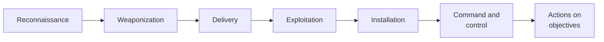
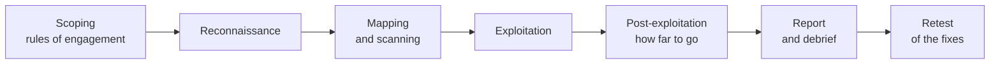
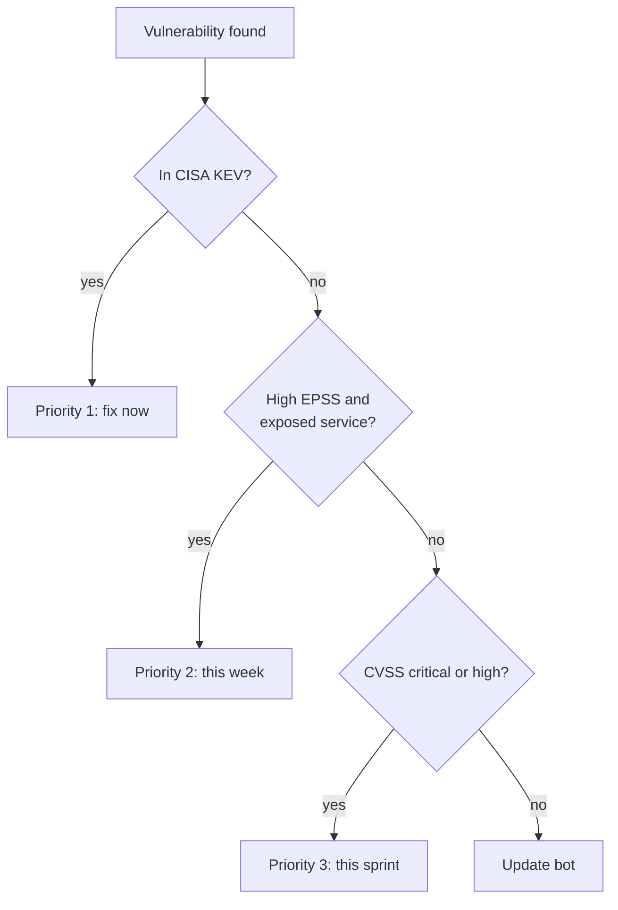
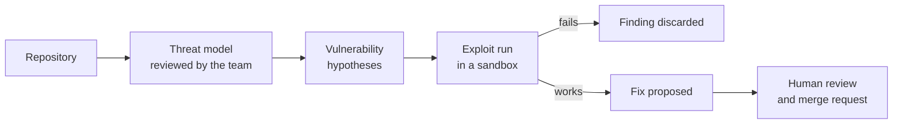

# Cybersecurity and ethical hacking

!!! warning "Disclaimer"
    These notes are personal cheat sheets, not a source of truth. They reflect my own understanding and choices: their content remains subjective, despite the quotes and references it contains. It may be incomplete, simplified, inaccurate or outdated. Always check the official documentation before applying it. This content is provided as is, without any warranty: you use it at your own risk.

!!! audience "Who and what for"
    - **Roles**: developer, QA engineer, security engineer, junior pentester, SRE, technical lead
    - **Uses**: I prepare for a pentest on my application and want to understand its report; I practice legally on a vulnerable machine before touching a real system; I triage a vulnerability by its CVSS score and its EPSS; I judge what AI tools that simulate attacks, like Daybreak, are worth; I turn a found vulnerability into a regression test

!!! abstract "Scales"
    The colored badges under the headings say at which scale a notion applies:

    - <span class="pill pill-scope pill-scope-code">Code</span> the classes, functions and modules of one program;
    - <span class="pill pill-scope pill-scope-app">Application</span> one service or application and its internal split;
    - <span class="pill pill-scope pill-scope-system">System</span> several services talking to each other over the network;
    - <span class="pill pill-scope pill-scope-infra">Infrastructure</span> servers, network, zones and clusters, physical or virtual;
    - <span class="pill pill-scope pill-scope-enterprise">Enterprise</span> the whole information system and its organization.

    Details and ambiguous words: [map of scales](architecture.md#map-of-scales).

This page looks at security from the attacker's side: how to look for a vulnerability with permission (ethical hacking), how to score it, how to practice without breaking the law, and what changes with AI tools that attack on their own. Everyday defense (OAuth, API vulnerabilities, STRIDE, zero trust, secrets, SIEM, SAST) is in [Security](securite.md), not repeated here. The settings that protect package installation are in [Package managers](gestionnaires-paquets.md#securing-installation).

!!! danger "Always with written permission"
    Testing a system that is not mine without written permission is a crime, even "to help", even without breaking anything. The commands on this page target my own machine, a local lab or a public target meant for it (`scanme.nmap.org`, training platforms).

Domain, application and account names are examples.

:material-swap-horizontal: The tools mentioned on this page: which ones replace each other, which ones combine? See [Complementary or competing](outils.md#complementary-or-competing).
{ .doc-ref }

## Terminology

**<span class="term" data-term="vulnerability">Vulnerability</span>**: a flaw that allows doing what should not be possible. Example: a route that returns grace's order when ada changes the identifier in the URL.

**<span class="term" data-term="exploit">Exploit</span>**: the code or sequence of actions that uses a vulnerability to get a concrete effect. Example: the script that reads 10,000 orders by incrementing the identifier.

**<span class="term" data-term="zero-day">Zero-day</span>**: a vulnerability the vendor does not know about yet, so with no fix available the day it is exploited.

**CVE**: the public identifier of a known vulnerability, for example CVE-2024-3094. **<span class="term" data-term="cvss">CVSS</span>**: its technical severity, from 0 to 10. **<span class="term" data-term="epss">EPSS</span>**: the probability it gets exploited within 30 days.

**<span class="term" data-term="attack-surface">Attack surface</span>**: everything an attacker can reach from outside. Example: the public API routes, the login page, a bucket, employee accounts.

**White hat, black hat, grey hat**: the ethical hacker who tests with permission, the criminal who attacks to harm or make money, and the one who tests without permission then warns. The grey hat is still breaking the law, even with good intentions.

**<span class="term" data-term="pentest">Penetration test (pentest)</span>**: an authorized attack, limited in time and scope, whose deliverable is a report of the vulnerabilities found and how to fix them.

**<span class="term" data-term="red-team">Red team, blue team, purple team</span>**: the team playing the attacker, the one defending (detection, response), and the exercise where both work together to improve detection.

**<span class="term" data-term="bug-bounty">Bug bounty</span>**: a program that pays outside researchers for each reported vulnerability, under published rules.

**<span class="term" data-term="ctf">CTF</span>** (Capture The Flag): a competition or exercise where you exploit deliberate vulnerabilities to retrieve a "flag", a secret string that proves success.

**<span class="term" data-term="sli">SLI</span>**: the indicator I measure. Example: the delay between the report of a critical vulnerability and its fix in production.

**<span class="term" data-term="slo">SLO</span>**: the internal target on that SLI. Example: 95% of reported critical vulnerabilities fixed in under 7 days.

**<span class="term" data-term="sla">SLA</span>**: the promise made by contract, with a penalty, looser than the SLO. Example: a customer contract promising to fix a critical vulnerability in under 30 days.

:material-book-open-variant: Reference docs: [NIST, Computer Security Resource Center Glossary](https://csrc.nist.gov/glossary) (accessed November 2026)
{ .doc-ref }

## The framework: permission, scope and disclosure

<a class="pill pill-scope pill-scope-enterprise" href="../architecture/#map-of-scales">Scale · Enterprise</a> <span class="pill pill-status pill-status-ok" title="Still valid, checked November 2026">Current · 11/2026</span>

What separates an ethical hacker from a criminal is not the technique, it is the framework. The same commands are a job with permission, and a crime without.

**The law.** In France, accessing or staying without right in a computer system is punished by article 323-1 of the Criminal Code (up to 3 years in prison and a 100,000 euro fine since the law of 24 January 2023), with heavier penalties if data is modified. Holding or distributing an attack tool "without legitimate reason" is punished too (article 323-3-1): research and authorized testing are legitimate reasons, hence the importance of being able to prove it. Most countries have comparable rules (Computer Misuse Act in the UK, CFAA in the US).

**Rules of engagement.** Before a pentest, a signed document sets:

| Item | Example |
|---|---|
| authorized scope | `staging.example.com` and the API `api-staging.example.com`, nothing else |
| out of scope | production, the identity provider, employee accounts |
| window | from 2 to 13 March, 9 am to 6 pm |
| forbidden techniques | denial of service, social engineering, data deletion |
| emergency contacts | who to call if a test breaks something or finds a critical vulnerability |
| data handling | data found is not copied, encrypted report, deletion at the end |

**Coordinated disclosure.** I find a vulnerability by chance on a site I am not testing: I do not exploit it further, I look for the security contact and warn them, then I leave time to fix it before talking about it publicly (often 90 days, the practice popularized by Google Project Zero). The `security.txt` file (RFC 9116, published in 2022) says where to write:

``` { .text .ex-ref title="Reference" }
$ curl https://example.com/.well-known/security.txt
Contact: mailto:security@example.com
Expires: 2027-06-30T23:00:00.000Z
Policy: https://example.com/security-policy
Preferred-Languages: fr, en
```

**When**: for every test on a system that is not entirely mine, including a customer's acceptance environment. **Why**: the framework protects the tester (proof of permission), the company (nothing broken in production) and users (no leak during the fix). **How**: signed rules of engagement before the first packet is sent, a `security.txt` on my own services, and a published disclosure policy.

**Risks.** A vague scope ("the whole domain") leads to touching a service hosted by a third party that authorized nothing: the tester is then at fault. Without `security.txt`, the person who finds a vulnerability in my system does not know whom to write to, and sometimes ends up publishing it.

:material-book-open-variant: Reference docs: [RFC 9116, A File Format to Aid in Security Vulnerability Disclosure](https://www.rfc-editor.org/rfc/rfc9116) (April 2022); [Légifrance, Criminal Code, attacks on automated data processing systems](https://www.legifrance.gouv.fr/codes/id/LEGISCTA000006149839) (version in force since January 2023)
{ .doc-ref }

!!! maturity "Measuring maturity"
    | Level | What I see in the team |
    |---|---|
    | N1 | security tests happen, with a verbal agreement or an email |
    | N2 | each test has signed rules of engagement, and public services have an up-to-date `security.txt` |
    | N3 | a published disclosure policy, a process to handle reports, and a bug bounty or vulnerability disclosure program |
    | N4 | the team tracks the response and fix delay of outside reports, and adjusts its process accordingly |

    **I measure**: the delay between receiving an outside report and the first reply; the `Expires` date of `security.txt`, checked by a synthetic test.

## How an attack unfolds

<a class="pill pill-scope pill-scope-system" href="../architecture/#map-of-scales">Scale · System</a> <a class="pill pill-scope pill-scope-infra" href="../architecture/#map-of-scales">Scale · Infrastructure</a> <span class="pill pill-status pill-status-ok" title="Still valid, checked November 2026">Current · 11/2026</span>

A real attack is rarely a single vulnerability: it is a chain of steps, and each step is a chance to detect it. Two models serve as a common language.

**The Cyber Kill Chain** (Lockheed Martin, 2011) splits an intrusion into seven steps, from reconnaissance to the final action.



**MITRE ATT&CK** (published in 2015) is finer: a matrix of tactics (the goal of the step: initial access, <span class="term" data-term="privilege-escalation">privilege escalation</span>, <span class="term" data-term="lateral-movement">lateral movement</span>, exfiltration) and, for each, hundreds of techniques seen in real attacks, each with an identifier. Example: `T1078 Valid Accounts`, using a stolen legitimate account.

A typical chain on a web application, told with ATT&CK:

| Step | What the attacker does | ATT&CK technique | What would have stopped it |
|---|---|---|---|
| initial access | exploits a SQL injection on `/search` | T1190 Exploit Public-Facing Application | [parameterized query](sql.md), WAF |
| execution | reads the administrator's password hash | T1552 Unsecured Credentials | [Argon2id](securite.md#storing-a-password) instead of SHA-256 |
| escalation | logs in as administrator | T1078 Valid Accounts | MFA on privileged accounts |
| lateral movement | reads the cloud key in an environment variable | T1552.001 Credentials in Files | [workload identity](securite.md#zero-trust-and-service-to-service-identity) instead of a key |
| exfiltration | copies the invoices bucket | T1530 Data from Cloud Storage | SIEM alert on a large export |

!!! noob "As noob"
    A burglary is not just "a badly closed door": there is scouting, getting in, looking for the car keys, then leaving with the car. Each step leaves a trace and can be blocked. **I do not look for the perfect lock: I break the chain in several places.**

**When**: to prepare a test, read a pentest or incident report, and choose what to detect first. **Why**: a vocabulary shared between simulated attackers, defenders and developers; and the idea that a single protection is not enough (defense in depth). **How**: I take the ATT&CK techniques relevant to my type of system and check, for each, whether I block it, detect it, or neither.

**Risks.** Trying to cover the whole ATT&CK matrix drowns the team: I start with the ten most frequent techniques for my sector, according to public reports like the Verizon DBIR.

:material-book-open-variant: Reference docs: [MITRE ATT&CK](https://attack.mitre.org/) (accessed November 2026); [Lockheed Martin, Cyber Kill Chain](https://www.lockheedmartin.com/en-us/capabilities/cyber/cyber-kill-chain.html) (accessed November 2026)
{ .doc-ref }

## Forms of offensive testing

<a class="pill pill-scope pill-scope-app" href="../architecture/#map-of-scales">Scale · Application</a> <a class="pill pill-scope pill-scope-enterprise" href="../architecture/#map-of-scales">Scale · Enterprise</a> <span class="pill pill-status pill-status-ok" title="Still valid, checked November 2026">Current · 11/2026</span>

"Doing a security test" covers exercises that have neither the same goal nor the same price. The [security testing tools](securite.md#security-testing-tools) table shows where they sit in the pipeline; here, what sets them apart.

| Form | The question | Duration and cost | Who |
|---|---|---|---|
| vulnerability scan | which known vulnerabilities are visible? | minutes, automatic | tool (Nessus, OpenVAS, nuclei) |
| penetration test | how far can one go on this scope? | 1 to 3 weeks | pentesters |
| red team | do our detection and response stop a real attacker? | weeks to months, stealthy | offensive team, the defense is not warned |
| purple team | do we detect each technique, and if not, why? | days, in the open | attack and defense together |
| <span class="term" data-term="bas">breach and attack simulation (BAS)</span> | do our protections still block these known techniques? | continuous, automatic | tool (Caldera, Atomic Red Team, Pentera) |
| bug bounty | what do hundreds of outside researchers find? | continuous, paid per vulnerability | researchers (HackerOne, YesWeHack, Intigriti) |

The amount of information given to the tester also changes the result: **black box** (nothing, like an outside attacker), **grey box** (a user account, the API docs), **white box** (the source code and the architecture). Grey box is often the best compromise: the tester does not lose three days finding the login page.

A pentest usually follows these phases (from the OWASP WSTG and PTES, the Penetration Testing Execution Standard):



**Reading a pentest report.** Each finding has a title, a severity, the steps to reproduce it, a proof (request and response) and a recommendation. I start with critical and high findings, reproduce each one before fixing it, and ask for the **retest**: without it, I do not know whether the fix holds.

**When**: scans continuously; a pentest before a sensitive production release and at least once a year or after a big change; red team when detection already exists and needs to be put to the test; bug bounty when the team can handle a flow of reports. **Why**: an automatic tool does not find a business logic flaw (refunding the same order twice); a person does. **How**: pick the form based on the question, set the scope, plan fix time and the retest in the schedule.

**Risks.** A yearly pentest gives a photo, not a film: a merge request the next day can reopen a vulnerability. A bug bounty opened too early brings hundreds of low-value reports the team has no time to triage. A report without a retest ends up in a shared folder.

:material-book-open-variant: Reference docs: [OWASP, Web Security Testing Guide](https://owasp.org/www-project-web-security-testing-guide/) (version 4.2, 2020)
{ .doc-ref }

!!! maturity "Measuring maturity"
    | Level | What I see in the team |
    |---|---|
    | N1 | a pentest happens when a customer or an audit demands it |
    | N2 | a vulnerability scan runs continuously, a pentest at least once a year, with a retest of the findings |
    | N3 | an attack simulation replays ATT&CK techniques continuously and alerts when a protection no longer blocks, a purple team exercise every six months |
    | N4 | the team tracks the share of priority ATT&CK techniques detected and the fix delay of findings, and picks its next tests accordingly |

    **I measure**: the median fix delay of a critical pentest finding, retest included; the share of priority ATT&CK techniques that trigger an alert.

## The toolbox

<a class="pill pill-scope pill-scope-app" href="../architecture/#map-of-scales">Scale · Application</a> <a class="pill pill-scope pill-scope-infra" href="../architecture/#map-of-scales">Scale · Infrastructure</a> <span class="pill pill-status pill-status-ok" title="Still valid, checked November 2026">Current · 11/2026</span>

*Burp Suite: competes with OWASP ZAP, Caido*<br>
*OWASP ZAP: competes with Burp Suite*<br>
*nmap: complements nuclei, Burp Suite*<br>
*Metasploit: complements nmap*
{ .tool-rel }

| Tool | What it does | Step |
|---|---|---|
| nmap | discovers machines and open ports, and the services listening | reconnaissance |
| ffuf, gobuster | guesses a site's hidden paths and files (`/admin`, `/backup.zip`) | reconnaissance |
| Burp Suite, OWASP ZAP, Caido | proxy between the browser and the site: I see, change and replay each request | web exploitation |
| sqlmap | detects and exploits SQL injections | exploitation |
| nuclei | runs thousands of detection templates for known vulnerabilities | scanning |
| Metasploit | library of ready-to-use exploits and payloads | exploitation, post-exploitation |
| Wireshark | captures and reads network traffic | analysis |
| hashcat, John the Ripper | recovers passwords from their hashes | post-exploitation |
| Kali Linux, Parrot OS | Linux distributions with all these tools preinstalled | tester's laptop |

Example on the public target the nmap project allows for practice:

``` { .text .ex-ref title="Reference" }
$ nmap -sV scanme.nmap.org
PORT      STATE    SERVICE    VERSION
22/tcp    open     ssh        OpenSSH 6.6.1p1 Ubuntu
80/tcp    open     http       Apache httpd 2.4.7 ((Ubuntu))
9929/tcp  open     nping-echo Nping echo
31337/tcp open     tcpwrapped
```

Illustrative output, versions to check. Reading: two classic services, with their version. An Apache 2.4.7 from 2014 has known vulnerabilities: that is the lead a pentester would follow.

For an authorized test, I pin the scope in a file, and the tool reads only that:

``` { .bash .ex-bad title="Avoid" }
# Avoid: a whole range "just in case", which hits out-of-scope machines, so unauthorized ones
nmap -sV -p- 203.0.113.0/24
```

``` { .bash .ex-good title="Recommended" }
# Good: only the targets listed in the rules of engagement, at a rate that does not degrade the service
nmap -sV --top-ports 1000 --max-rate 100 -iL scope.txt -oA results/staging-2026-03-02
```

The `203.0.113.0/24` addresses are reserved for documentation (RFC 5737, 2010). `-oA` keeps the output: the report must be able to say what was run, when, and against what.

**When**: on my lab, a training platform, or an authorized scope. **Why**: understanding what an attacker sees helps write code that does not let them through, and read a pentest report. **How**: Burp or ZAP first, it is the tool that teaches the most about the web: I look at my own application's requests and replay ada's request with grace's identifier.

**Risks.** An aggressive scan (`-T5`, `-p-`, nuclei without limits) can take down a fragile service or get the whole company's IP address blocked by the host. Metasploit and sqlmap sometimes change data: never in production without explicit agreement and a backup.

:material-book-open-variant: Reference docs: [Nmap Reference Guide](https://nmap.org/book/man.html) (accessed November 2026); [PortSwigger, Burp Suite documentation](https://portswigger.net/burp/documentation) (accessed November 2026)
{ .doc-ref }

## Practicing legally

<a class="pill pill-scope pill-scope-app" href="../architecture/#map-of-scales">Scale · Application</a> <span class="pill pill-status pill-status-ok" title="Still valid, checked November 2026">Current · 11/2026</span>

I want to understand a SQL injection or an XSS other than by reading a definition, without risking a crime. There are targets built to be attacked.

| Resource | What it is | For whom |
|---|---|---|
| PortSwigger Web Security Academy | free courses and labs on each web vulnerability, by the makers of Burp | developer, QA, web security beginner |
| OWASP Juice Shop | deliberately vulnerable online shop, to run at home, over 100 challenges | developer, trainer |
| DVWA | vulnerable PHP application with difficulty levels | beginner |
| Root Me | French challenge platform, free | all levels |
| TryHackMe | guided paths in the browser | beginner |
| Hack The Box | machines to compromise, harder | intermediate, advanced |
| public CTFs | team competitions, often online, listed on CTFtime | all levels |

``` { .bash .ex-ref title="Reference" }
# Example: run Juice Shop locally, reachable only from my machine
docker run --rm -p 127.0.0.1:3000:3000 bkimminich/juice-shop
```

`127.0.0.1:` in front of the port matters: without it, anyone on my network (a café's Wi-Fi) can attack this vulnerable application, and my machine with it.

**When**: before touching a real system, and to stay sharp. **Why**: you remember a vulnerability by exploiting it yourself; a developer who has already stolen a cookie with an XSS escapes their output without being reminded. **How**: one topic at a time (Web Security Academy, "Access control" chapter), then the same topic in Juice Shop, then the matching refusal test in my own code.

**Risks.** Exposing a vulnerable application on the internet or on the company network opens a real door. Training machines stay local or behind the platform's VPN.

:material-book-open-variant: Reference docs: [PortSwigger, Web Security Academy](https://portswigger.net/web-security) (accessed November 2026); [OWASP Juice Shop](https://owasp.org/www-project-juice-shop/) (accessed November 2026)
{ .doc-ref }

## Scoring and triaging a vulnerability

<a class="pill pill-scope pill-scope-app" href="../architecture/#map-of-scales">Scale · Application</a> <a class="pill pill-scope pill-scope-enterprise" href="../architecture/#map-of-scales">Scale · Enterprise</a> <span class="pill pill-status pill-status-ok" title="Still valid, checked November 2026">Current · 11/2026</span>

The scanner reports 340 vulnerabilities on my images. I cannot fix everything this week: I need an order. Three public sources complement each other.

| Source | Answers | Scale | By whom |
|---|---|---|---|
| CVSS (version 4.0, November 2023) | how serious is the vulnerability in theory? | 0 to 10 | FIRST |
| EPSS | what is the chance it gets exploited within 30 days? | 0 to 100% | FIRST, recomputed daily |
| CISA KEV (since 2021) | is it already exploited for real? | yes or no | US agency CISA |

A CVSS vector reads piece by piece:

``` { .text .ex-ref title="Reference" }
CVSS:4.0/AV:N/AC:L/AT:N/PR:N/UI:N/VC:H/VI:H/VA:H/SC:N/SI:N/SA:N
```

`AV:N` attack over the network, `AC:L` easy, `PR:N` no account, `UI:N` no victim action, `VC:H/VI:H/VA:H` high impact on confidentiality, integrity and availability of the affected system. Total close to 10: the worst case.

My triage order:



I also check whether the vulnerable code is actually called: a vulnerability in an XML function of a library I only use for JSON weighs less. Some SCA tools compute it (reachability analysis).

**When**: for each new batch of findings, and every morning for the KEV. **Why**: CVSS alone ranks thousands of vulnerabilities as "critical", of which only a small part will ever be exploited. **How**: KEV, then EPSS crossed with exposure, then CVSS, then the bot for the rest.

**Risks.** EPSS is a statistical model: a 1% vulnerability can be the one a targeted attacker picks. I never go beyond a maximum delay, even for unlikely vulnerabilities.

:material-book-open-variant: Reference docs: [FIRST, CVSS v4.0 Specification](https://www.first.org/cvss/v4.0/specification-document) (November 2023); [FIRST, EPSS](https://www.first.org/epss/) (accessed November 2026); [CISA, Known Exploited Vulnerabilities Catalog](https://www.cisa.gov/known-exploited-vulnerabilities-catalog) (accessed November 2026)
{ .doc-ref }

!!! maturity "Measuring maturity"
    | Level | What I see in the team |
    |---|---|
    | N1 | vulnerabilities are triaged by hand, by CVSS alone |
    | N2 | findings are enriched with KEV and EPSS and ranked by priority with a delay per level |
    | N3 | a KEV vulnerability on an exposed service opens a priority ticket on its own and blocks the next release |
    | N4 | the team tracks the fix delay per priority and the share of exploited vulnerabilities it had ranked low, and adjusts its thresholds |

    **I measure**: the median delay between a vulnerability entering the KEV and its fix on my services; the number of vulnerabilities past their deadline.

## Supply chain attacks

<a class="pill pill-scope pill-scope-system" href="../architecture/#map-of-scales">Scale · System</a> <a class="pill pill-scope pill-scope-enterprise" href="../architecture/#map-of-scales">Scale · Enterprise</a> <span class="pill pill-status pill-status-ok" title="Still valid, checked November 2026">Current · 11/2026</span>

Rather than attacking my application, the attacker compromises something it depends on: a library, a build tool, a base image. A single attack then hits thousands of victims. This is a <span class="term" data-term="supply-chain-attack">supply chain attack</span>.

| Date | Attack | Mechanism |
|---|---|---|
| November 2018 | event-stream (npm) | a stranger offers to take over an abandoned package, then adds code that steals cryptocurrency wallets |
| December 2020 | SolarWinds Orion | the vendor's build system is compromised: the official, signed update contains a backdoor |
| February 2021 | dependency confusion (Alex Birsan) | public packages with the names of big companies' internal packages get installed by their own tools |
| March 2024 | xz-utils (CVE-2024-3094) | after two years of useful contributions, a maintainer hides a backdoor in test files; found by chance thanks to an SSH slowdown |
| September 2025 | "Shai-Hulud" worm (npm) | stolen maintainer accounts publish booby-trapped versions that steal tokens and republish themselves into other packages (to check) |

What protects, layer by layer:

| Layer | Protection | Where to read more |
|---|---|---|
| what I install | lockfile with hashes, single registry, install scripts blocked, delay before accepting a version | [Package managers](gestionnaires-paquets.md#securing-installation) |
| what I choose | selection grid, OpenSSF Scorecard, dependency scan | [Choosing a dependency](securite.md#choosing-a-dependency) |
| what I build | build in an isolated CI, without production secrets, signed provenance (SLSA levels) | [SLSA](https://slsa.dev/spec/v1.0/) |
| what I ship | SBOM per release, signed images (Sigstore, cosign) checked at deployment | [Package managers](gestionnaires-paquets.md#securing-installation) |

!!! noob "As noob"
    Instead of burgling each house, the thief has a copy of the keys made at the neighborhood locksmith. All the houses are open at once, and no lock was forced. **I do not only check my door: I check where my keys come from.**

**When**: for each new dependency, for each change to the build pipeline. **Why**: these attacks slip past classic tests and scans, since the booby-trapped code arrives through a trusted channel. **How**: the protections in the table, from top to bottom, and short-lived CI tokens to limit what a booby-trapped package can steal.

**Risks.** No protection blocks a legitimate maintainer turning malicious (xz-utils): only time (a delay before adoption) and reviewing the differences between versions of critical dependencies reduce this risk.

:material-book-open-variant: Reference docs: [SLSA, Supply-chain Levels for Software Artifacts](https://slsa.dev/) (version 1.0, April 2023); [CISA, Defending Against Software Supply Chain Attacks](https://www.cisa.gov/resources-tools/resources/defending-against-software-supply-chain-attacks-0) (April 2021)
{ .doc-ref }

!!! maturity "Measuring maturity"
    | Level | What I see in the team |
    |---|---|
    | N1 | dependencies are installed with default settings and the build runs on shared runners with production secrets |
    | N2 | frozen lockfiles, single registry, SBOM per release, short-lived CI tokens |
    | N3 | deployment refuses an unsigned image or one without provenance, and a new dependency version waits a minimum delay |
    | N4 | the team tracks the time to answer "are we affected?" after a public alert, and the SLSA level of each pipeline |

    **I measure**: the time between a public supply chain alert and the list of affected services; the share of deployed images that are signed and verified.

## Social engineering

<a class="pill pill-scope pill-scope-enterprise" href="../architecture/#map-of-scales">Scale · Enterprise</a> <span class="pill pill-status pill-status-ok" title="Still valid, checked November 2026">Current · 11/2026</span>

<span class="term" data-term="social-engineering">Social engineering</span> attacks people rather than code: an email imitating the IT department (phishing), a call to the help desk asking to reset the MFA of a colleague "on the road", a USB stick left in the parking lot. It is still the most common initial access in public reports like the Verizon DBIR (to check for the current edition).

In testing, the company can order a **simulated phishing campaign**: a fake email sent to employees, measuring who clicks and who reports. It is done with the agreement of management and staff representatives, without humiliating anyone: the goal is to learn to report, not to punish.

**When**: in a red team exercise, or a yearly awareness campaign. **Why**: the best encryption is useless if someone gives their MFA code over the phone. **How**: phishing-resistant MFA (FIDO2 key, passkey), a call-back verification procedure for any sensitive request, a "report" button in the mail client.

**Risks.** A campaign that punishes clicks teaches people to stop reporting anything, for fear of being singled out. I mostly measure the report rate, not the click rate.

:material-book-open-variant: Reference docs: [CISA, Phishing Guidance: Stopping the Attack Cycle at Phase One](https://www.cisa.gov/resources-tools/resources/phishing-guidance-stopping-attack-cycle-phase-one) (October 2023)
{ .doc-ref }

## AI that attacks: simulation and vulnerability research

<a class="pill pill-scope pill-scope-code" href="../architecture/#map-of-scales">Scale · Code</a> <a class="pill pill-scope pill-scope-system" href="../architecture/#map-of-scales">Scale · System</a> <span class="pill pill-status pill-status-ok" title="Fast-moving topic, checked November 2026">Current · 11/2026</span>

!!! info "Section written in November 2026"
    This field changes month by month: product names, access, capabilities and published results. The figures quoted mostly come from the vendors themselves. Everything is to be checked again before a decision.

Since 2025, <span class="term" data-term="ai-agent">AI agents</span> no longer just review code: they explore an application, form a vulnerability hypothesis, write the exploit, run it in a sandbox to check that it works, then propose a fix. They chain the steps like a pentester, in a few hours instead of a few weeks.

**Three families not to confuse:**

| Family | What it does | Deterministic? | Examples |
|---|---|---|---|
| classic breach and attack simulation (BAS) | replays a list of known techniques (ATT&CK) and checks they are blocked or detected | yes | MITRE Caldera, Atomic Red Team, Pentera |
| pentest by AI agents | explores the running application, chains vulnerabilities, proves exploitation | no | XBOW, Daybreak Red Team |
| AI vulnerability research in code | reads the code, builds a threat model, looks for unknown vulnerabilities and proposes a tested fix | no | Codex Security (Daybreak), Claude Mythos Preview, Google Big Sleep |

**Public milestones:**

| Date | Milestone | Source reliability |
|---|---|---|
| June 2025 | XBOW, an autonomous pentester, takes first place on HackerOne's US leaderboard, with about 1,000 reports in 90 days; its results are reviewed by humans before submission | vendor announcement, picked up by the press |
| July 2025 | Google Big Sleep (DeepMind and Project Zero) is credited with finding the SQLite vulnerability CVE-2025-6965 before it was exploited | vendor announcement |
| August 2025 | DARPA AI Cyber Challenge (AIxCC) final: systems find and fix vulnerabilities in open source code on their own; Team Atlanta wins (to check) | secondary press |
| April 2026 | Anthropic announces Claude Mythos Preview and Project Glasswing: a model reserved for a coalition of defenders, not released to everyone, presented as able to find vulnerabilities in the main operating systems and browsers | vendor announcement |
| May 2026 | OpenAI launches Daybreak (details below) | vendor announcement, diverging details in the press |

[Take with caution: figures and capabilities announced by the vendors, few independent comparisons published]

### Daybreak
<span class="pill pill-status pill-status-ok" title="Recent product, checked November 2026 from public announcements">Current · 11/2026</span>

*Daybreak: competes with Claude Mythos Preview, XBOW; complements SAST, SCA; partly competes with human pentesting*
{ .tool-rel }

**Daybreak** is OpenAI's cybersecurity initiative, announced in May 2026 and expanded in June 2026 (dates to check). It relies on **Codex Security**, an agent released as a research preview in March 2026, and on GPT-5.5 models, including a "Cyber" variant reserved for verified defenders. According to the announcements and the press:

- **on code**: the agent analyzes a repository, produces a threat model the team can edit, looks for vulnerabilities, checks each one in an isolated environment, then proposes a fix to review (a feature called Defense Factory in some sources);
- **on the running application**: Daybreak Red Team coordinates several agents to attack a web application, validate existing scanners' findings and retest fixes (early access, to check);
- **access** is restricted and tiered according to the verification of the organization's identity, with a partner program (security vendors, hosting providers) and a track for open source maintainers.

A report published by a customer company describes a full chain simulated in about two hours: SQL injection, privilege escalation, credential theft, then pivoting to other systems [Take with caution: a single secondary article, not checked at the source].



**What these tools change for a team:**

| Before | With an offensive agent |
|---|---|
| one pentest a year, a snapshot at one moment | a test for each release, on staging |
| the scanner reports 300 findings, many of them false positives | the agent proves exploitation before reporting, so less noise (as announced) |
| a business logic flaw is only found by a person | the agent finds some, but the human expert stays better on the business (to check on my cases) |
| the fix is written then retested weeks later | the fix is proposed with the test that proves it closes the vulnerability |

**When**: alongside the human pentest, on an acceptance environment with fake data, for a scope authorized in writing, as for a pentester. Not in production without explicit agreement and action limits. **Why**: shrink the time between introducing a vulnerability and discovering it, from months to hours. **How**: scope and rules of engagement given to the agent, sandbox, human review of each finding before a ticket, and each confirmed vulnerability turned into a regression test:

``` { .python .ex-bad title="Avoid" }
# Avoid: only the happy path is tested, the route can lose its owner check without any test turning red
def test_ada_reads_her_order(api_client, ada_token, order_of_ada):
    response = api_client.get(
        f"/orders/{order_of_ada.id}",
        headers={"Authorization": f"Bearer {ada_token}"},
    )
    assert response.status_code == 200
```

``` { .python .ex-good title="Recommended" }
# Good: the confirmed vulnerability becomes a refusal test that runs on each merge request
def test_ada_cannot_read_order_of_grace(api_client, ada_token, order_of_grace):
    response = api_client.get(
        f"/orders/{order_of_grace.id}",
        headers={"Authorization": f"Bearer {ada_token}"},
    )
    assert response.status_code == 404
```

**Risks.**

- **False findings.** A model can describe a plausible vulnerability that does not exist. Open source maintainers, like curl's in 2025, complain about AI-generated reports without proof: I only accept a reproduced finding.
- **Leaving the scope.** An agent following a lead can hit an unauthorized system (a third-party service called by the application): technical scope (isolated network, host list), not only written in the instructions.
- **Destructive actions.** An exploit that works on an admin route can delete data: throwaway environment, accounts without delete rights, no real data.
- **Data sent to the vendor.** Code and findings go to a third party: I check the contract, retention period and processing region, as for any service.
- **Dual use.** The same capabilities serve attackers, hence the restricted access. For a defender, the consequence is simple: the delay between a vulnerability's publication and its exploitation gets shorter, so my fixes must ship faster.
- **The agents themselves can be attacked.** An agent reading a repository or a web page can receive hidden instructions (<span class="term" data-term="prompt-injection">prompt injection</span>): see [Context security](ia-agents.md#context-security) and the OWASP Top 10 for LLM Applications (2025 edition).

:material-book-open-variant: Reference docs: [OpenAI, Daybreak: securing the world](https://openai.com/index/daybreak-securing-the-world/) (2026, accessed November 2026); [Anthropic, Project Glasswing](https://www.anthropic.com/glasswing) (April 2026); [MITRE Caldera](https://caldera.mitre.org/) (accessed November 2026)
{ .doc-ref }

!!! maturity "Measuring maturity"
    | Level | What I see in the team |
    |---|---|
    | N1 | someone tries an AI assistant to review code from a security angle, without a framework |
    | N2 | a simulation tool or an offensive agent runs on staging, within a written scope, and each finding is reproduced by a person before a ticket |
    | N3 | the agent runs on each release candidate in a throwaway environment, and a confirmed vulnerability blocks the release and becomes a regression test |
    | N4 | the team tracks the share of the agent's findings that are confirmed, the number of vulnerabilities found by the agent then missed by the human pentest (and the reverse), and sizes both accordingly |

    **I measure**: the share of the agent's findings confirmed by a person (the true positive rate); the delay between introducing a vulnerability in a merge request and its discovery.

## Measuring success

I know my offensive tests are useful when the time a vulnerability stays open goes down, not when the number of vulnerabilities found goes up. Before changing anything (first pentest, bug bounty, AI agent), I record a baseline over a quarter: for example the median fix delay of a critical finding, the share of findings reopened at retest and the response delay to outside reports. I take the same measures the next quarter. The guard metric is noise: if the share of non-reproducible findings rises, the team wastes its time triaging, and will end up ignoring the real ones.

| Solution | Success indicator (SLI) | Likely SLO | Likely SLA |
|---|---|---|---|
| yearly pentest with retest | delay between the report delivery and the fix of critical findings, retest included | 95% in under 30 days | critical vulnerabilities fixed in under 30 days, often required in enterprise customers' security questionnaires |
| disclosure program and `security.txt` | first response delay to an outside report | 95% in under 3 business days | delay published in the disclosure policy, for example 5 business days |
| triage by KEV and EPSS | delay between a vulnerability entering the KEV and its fix on exposed services | 95% in under 7 days | not applicable: no external contract |
| offensive agent on staging | share of findings confirmed by a person | over 80% | not applicable: no external contract |
| purple team exercise | share of priority ATT&CK techniques that trigger an alert | over 90% | not applicable: no external contract |

[Take with caution: example values, to set with the security team and the business]

## Pitfalls to avoid

| Pitfall | What happens | Solution |
| --- | --- | --- |
| **Testing without written permission**: I scan a supplier's site "to check". | It is a crime, even without breaking anything. | I get signed rules of engagement before any test ([The framework](#the-framework-permission-scope-and-disclosure)). |
| **Triaging by CVSS alone**: I spend the week on "critical" vulnerabilities never exploited. | Meanwhile, a KEV vulnerability stays open. | I triage by KEV, then EPSS and exposure, then CVSS ([Scoring and triaging](#scoring-and-triaging-a-vulnerability)). |
| **A pentest without a retest**: I fix and I do not check again. | A partial fix leaves the vulnerability open. | I plan the retest together with the pentest ([Forms of offensive testing](#forms-of-offensive-testing)). |
| **Fixing without a regression test**: I fix the vulnerability without adding a test. | The vulnerability comes back at the next rewrite of the route. | Each confirmed vulnerability becomes a refusal test ([AI that attacks](#ai-that-attacks-simulation-and-vulnerability-research)). |
| **Believing an AI finding without reproducing it**: I take the finding as it is. | I fix a vulnerability that does not exist, or send a false report to a maintainer. | I only accept a finding with a replayed proof. |
| **Running an offensive agent on production**: I point the agent at the real environment. | It deletes data while proving an admin vulnerability. | I run it on a throwaway environment, with fake data and accounts without destructive rights. |
| **Exposing a vulnerable lab**: I run Juice Shop on `0.0.0.0` in a café. | My machine becomes a target. | I publish the port on `127.0.0.1` only ([Practicing legally](#practicing-legally)). |
| **Punishing clicks in a phishing campaign**: I sanction the people who click. | People stop reporting. | I measure and reward reporting ([Social engineering](#social-engineering)). |

## What interviews ask

Typical questions:

- "What is the difference between a pentest, a red team and a vulnerability scan?" How to answer: the question each one asks, the duration, who is warned, and the deliverable ([Forms of offensive testing](#forms-of-offensive-testing)).
- "You find a vulnerability on a website by chance, what do you do?" How to answer: I stop, I copy nothing, I look for `security.txt` or the security contact, I warn them and leave time to fix ([The framework](#the-framework-permission-scope-and-disclosure)).
- "How do you prioritize 300 vulnerabilities?", "What are CVSS, EPSS, KEV?" How to answer: the triage tree, with exposure and reachability ([Scoring and triaging a vulnerability](#scoring-and-triaging-a-vulnerability)).
- "What is MITRE ATT&CK? What do you use it for?" How to answer: tactics and techniques, then the "what would have stopped it" column on a web attack chain ([How an attack unfolds](#how-an-attack-unfolds)).
- "Tell me about a supply chain attack, and how you protect against it." How to answer: xz-utils or dependency confusion, then the protections layer by layer ([Supply chain attacks](#supply-chain-attacks)).
- "What do you think of AI tools that do pentesting, like Daybreak or XBOW?" How to answer: the three families, what they bring (frequency, proof of exploitation), their risks (false findings, scope, data), and the fact that they complement the human pentest without replacing it ([AI that attacks](#ai-that-attacks-simulation-and-vulnerability-research)).
- "How does a QA engineer or a developer contribute to offensive security?" How to answer: replay in Burp or ZAP one user's request with another's identifier, turn each finding into a refusal test, and practice on Juice Shop ([The toolbox](#the-toolbox), [Practicing legally](#practicing-legally)).

What makes a good answer: talking about the framework before the technique, and ending each vulnerability with how I make sure it does not come back.

The questions by role, with more detailed answers and worked exercises: [Staff Engineer](../entretiens/staff-engineer/questions.md), [QA Engineer](../entretiens/qa-engineer/questions.md).

## What to use in which situation

| Situation | I use |
|---|---|
| I want to understand a web vulnerability, like a SQL injection, by exploiting it myself without legal risk | PortSwigger Web Security Academy, then OWASP Juice Shop locally |
| I want to see and change my own application's requests, like replaying ada's request with grace's identifier | Burp Suite or OWASP ZAP |
| I want to know which ports and services are open on my acceptance servers | nmap, on the authorized scope |
| my sensitive application goes to production in a month and I want an outside view | a grey box penetration test, with a retest |
| detection exists and I want to know whether it stops a real attacker | a red team, then a purple team exercise |
| I want to check continuously that my protections still block known techniques | a breach and attack simulation (Caldera, Atomic Red Team) |
| I want to test each release candidate on staging without waiting for the yearly pentest | an AI offensive agent, within a written scope and a throwaway environment |
| the scanner reports hundreds of vulnerabilities and I do not know where to start | triage by CISA KEV, then EPSS and exposure, then CVSS |
| an outside researcher must be able to report a vulnerability to me | `security.txt` and a disclosure policy, then a bug bounty when the team can handle the flow |
| a public alert lands on a booby-trapped library and I must know whether I am affected | the SBOMs of my releases ([Package managers](gestionnaires-paquets.md#securing-installation)) |
| I want to measure and improve the teams' resistance to phishing | a simulated campaign, measured by the report rate |

## Further reading

- [OWASP Web Security Testing Guide, version 4.2 (December 2020)](https://owasp.org/www-project-web-security-testing-guide/)
- [MITRE ATT&CK (published in 2015, updated continuously)](https://attack.mitre.org/)
- [Lockheed Martin, Intelligence-Driven Computer Network Defense, the Kill Chain paper (2011)](https://www.lockheedmartin.com/content/dam/lockheed-martin/rms/documents/cyber/LM-White-Paper-Intel-Driven-Defense.pdf)
- [RFC 9116: security.txt (April 2022)](https://www.rfc-editor.org/rfc/rfc9116)
- [FIRST, CVSS v4.0 (November 2023)](https://www.first.org/cvss/v4.0/specification-document)
- [CISA, Known Exploited Vulnerabilities Catalog (since November 2021)](https://www.cisa.gov/known-exploited-vulnerabilities-catalog)
- [Alex Birsan, Dependency Confusion (February 2021)](https://medium.com/@alex.birsan/dependency-confusion-4a5d60fec610)
- [OWASP Top 10 for LLM Applications (2025 edition)](https://genai.owasp.org/llm-top-10/)
- [OpenAI, Daybreak: securing the world (2026)](https://openai.com/index/daybreak-securing-the-world/)
- [Infosecurity Magazine, OpenAI Launches Daybreak (May 2026)](https://www.infosecurity-magazine.com/news/openai-daybreak-secure-by-design/)
- [Anthropic, Project Glasswing (April 2026)](https://www.anthropic.com/glasswing)
- [XBOW, How XBOW reached the top of HackerOne (2025)](https://xbow.com/blog/top-1-how-xbow-did-it/)
- [ANSSI, guides and recommendations (publication date not stated)](https://cyber.gouv.fr/publications)
