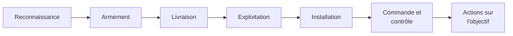
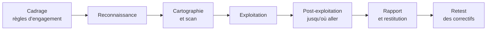
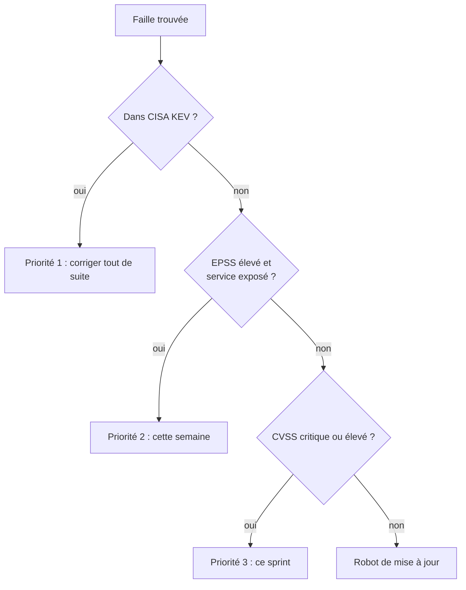
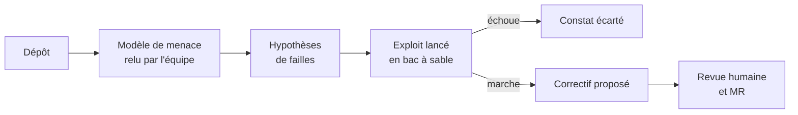

# Cybersécurité et hacking éthique

!!! warning "Avertissement"
    Ces notes sont des pense-bêtes personnels, pas une source de vérité. Elles reflètent ma compréhension et mes choix : leur contenu reste subjectif, malgré les citations et les références qu'il contient. Il peut être incomplet, simplifié, inexact ou dépassé. Vérifiez toujours dans la documentation officielle avant de l'appliquer. Ce contenu est fourni tel quel, sans aucune garantie : son utilisation se fait sous votre seule responsabilité.

!!! audience "Pour qui, pour quoi"
    - **Métiers** : développeur, QA, ingénieur sécurité, pentester débutant, SRE, responsable technique
    - **Usages** : je prépare l'arrivée d'un pentest sur mon application et je veux comprendre son rapport ; je m'entraîne légalement sur une machine vulnérable avant de toucher à un vrai système ; je trie une faille selon son score CVSS et son EPSS ; je juge ce que valent les outils d'IA qui simulent des attaques, comme Daybreak ; je transforme une faille trouvée en test de non-régression

!!! abstract "Les échelles"
    Les pastilles de couleur sous les titres disent à quelle échelle une notion s'applique :

    - <span class="pill pill-scope pill-scope-code">Code</span> les classes, fonctions et modules d'un programme ;
    - <span class="pill pill-scope pill-scope-app">Application</span> un service ou une application et son découpage interne ;
    - <span class="pill pill-scope pill-scope-system">Système</span> plusieurs services qui communiquent par le réseau ;
    - <span class="pill pill-scope pill-scope-infra">Infrastructure</span> les serveurs, le réseau, les zones et les clusters, physiques ou virtuels ;
    - <span class="pill pill-scope pill-scope-enterprise">Entreprise</span> le système d'information entier et son organisation.

    Détail et mots ambigus : [carte des échelles](architecture.md#carte-des-echelles).

Cette page prend la sécurité du côté de l'attaquant : comment on cherche une faille avec une autorisation (le hacking éthique), comment on la note, comment on s'entraîne sans enfreindre la loi, et ce que changent les outils d'IA qui attaquent tout seuls. La défense au quotidien (OAuth, failles des API, STRIDE, zero trust, secrets, SIEM, SAST) est dans [Sécurité](securite.md), sans répétition ici. Les réglages qui protègent l'installation des paquets sont dans [Gestionnaires de paquets](gestionnaires-paquets.md#securiser-linstallation).

!!! danger "Toujours avec une autorisation écrite"
    Tester un système qui n'est pas le mien sans autorisation écrite est un délit, même « pour aider », même sans rien casser. Les commandes de cette page visent ma machine, un laboratoire local ou une cible publique prévue pour ça (`scanme.nmap.org`, plateformes d'entraînement).

Les noms de domaines, d'applications et de comptes sont des exemples.

:material-swap-horizontal: Les outils cités dans cette page : lesquels se remplacent, lesquels se combinent ? Voir [Complémentaires ou concurrents](outils.md#complementaires-ou-concurrents).
{ .doc-ref }

## Vocabulaire

**<span class="term" data-term="vulnerability">Vulnérabilité</span>** (faille) : un défaut qui permet de faire ce qui ne devrait pas être possible. Exemple : une route qui renvoie la commande de grace quand ada change l'identifiant dans l'URL.

**<span class="term" data-term="exploit">Exploit</span>** : le code ou la suite d'actions qui utilise une faille pour obtenir un effet concret. Exemple : le script qui lit 10 000 commandes en incrémentant l'identifiant.

**<span class="term" data-term="zero-day">Zero-day</span>** : une faille que l'éditeur ne connaît pas encore, donc sans correctif disponible le jour où elle est exploitée.

**CVE** : l'identifiant public d'une faille connue, par exemple CVE-2024-3094. **<span class="term" data-term="cvss">CVSS</span>** : sa gravité technique, de 0 à 10. **<span class="term" data-term="epss">EPSS</span>** : la probabilité qu'elle soit exploitée dans les 30 jours.

**<span class="term" data-term="attack-surface">Surface d'attaque</span>** : tout ce qu'un attaquant peut toucher depuis l'extérieur. Exemple : les routes publiques de l'API, la page de connexion, un bucket, les comptes des employés.

**White hat, black hat, grey hat** : le hacker éthique qui teste avec autorisation, le pirate qui attaque pour nuire ou gagner de l'argent, et celui qui teste sans autorisation puis prévient. Le grey hat reste dans l'illégalité, même avec de bonnes intentions.

**<span class="term" data-term="pentest">Test d'intrusion (pentest)</span>** : une attaque autorisée, limitée dans le temps et le périmètre, dont le livrable est un rapport des failles trouvées et de leur correction.

**<span class="term" data-term="red-team">Red team, blue team, purple team</span>** : l'équipe qui joue l'attaquant, celle qui défend (détection, réponse), et l'exercice où les deux travaillent ensemble pour améliorer la détection.

**<span class="term" data-term="bug-bounty">Bug bounty</span>** : un programme qui paie des chercheurs extérieurs pour chaque faille signalée, selon des règles publiées.

**<span class="term" data-term="ctf">CTF</span>** (*Capture The Flag*) : une compétition ou un exercice où l'on exploite des failles volontaires pour récupérer un « drapeau », une chaîne secrète qui prouve la réussite.

**<span class="term" data-term="sli">SLI</span>** : l'indicateur que je mesure. Exemple : le délai entre le signalement d'une faille critique et son correctif en production.

**<span class="term" data-term="slo">SLO</span>** : l'objectif interne sur ce SLI. Exemple : 95 % des failles critiques signalées corrigées en moins de 7 jours.

**<span class="term" data-term="sla">SLA</span>** : la promesse faite par contrat, avec pénalité, plus lâche que le SLO. Exemple : un contrat client qui promet de corriger une faille critique en moins de 30 jours.

:material-book-open-variant: Doc de référence : [NIST, Computer Security Resource Center Glossary](https://csrc.nist.gov/glossary) (consultée en novembre 2026)
{ .doc-ref }

## Le cadre : autorisation, périmètre et divulgation

<a class="pill pill-scope pill-scope-enterprise" href="../architecture/#carte-des-echelles">Échelle · Entreprise</a> <span class="pill pill-status pill-status-ok" title="Toujours valable, vérifié en novembre 2026">Valable · 11/2026</span>

Ce qui sépare un hacker éthique d'un pirate n'est pas la technique, c'est le cadre. Les mêmes commandes sont un métier avec une autorisation, et un délit sans.

**La loi.** En France, accéder ou se maintenir sans droit dans un système informatique est puni par l'article 323-1 du Code pénal (jusqu'à 3 ans de prison et 100 000 euros d'amende depuis la loi du 24 janvier 2023), avec des peines plus lourdes si des données sont modifiées. Détenir ou diffuser un outil d'attaque « sans motif légitime » est puni aussi (article 323-3-1) : la recherche et le test autorisé sont des motifs légitimes, d'où l'importance de pouvoir le prouver. La plupart des pays ont des règles comparables (Computer Misuse Act au Royaume-Uni, CFAA aux États-Unis).

**Les règles d'engagement.** Avant un pentest, un document signé fixe :

| Élément | Exemple |
|---|---|
| périmètre autorisé | `staging.example.com` et l'API `api-staging.example.com`, rien d'autre |
| hors périmètre | la production, le fournisseur d'identité, les comptes des employés |
| fenêtre | du 2 au 13 mars, de 9 h à 18 h |
| techniques interdites | déni de service, ingénierie sociale, suppression de données |
| contacts d'urgence | qui appeler si un test casse quelque chose ou trouve une faille critique |
| traitement des données | données trouvées non copiées, rapport chiffré, effacement à la fin |

**La divulgation coordonnée.** Je trouve une faille par hasard sur un site que je ne teste pas : je ne l'exploite pas plus loin, je cherche le contact sécurité et je le préviens, puis je laisse le temps de corriger avant d'en parler publiquement (souvent 90 jours, l'usage popularisé par Google Project Zero). Le fichier `security.txt` (RFC 9116, publiée en 2022) indique où écrire :

``` { .text .ex-ref title="Référence" }
$ curl https://example.com/.well-known/security.txt
Contact: mailto:security@example.com
Expires: 2027-06-30T23:00:00.000Z
Policy: https://example.com/security-policy
Preferred-Languages: fr, en
```

**Quand** : à chaque test sur un système qui n'est pas entièrement à moi, y compris un environnement de recette d'un client. **Pourquoi** : le cadre protège le testeur (preuve d'autorisation), l'entreprise (pas de casse en production) et les utilisateurs (pas de fuite pendant la correction). **Comment** : règles d'engagement signées avant le premier paquet envoyé, un `security.txt` sur mes propres services, et une politique de divulgation publiée.

**Risques.** Un périmètre flou (« tout le domaine ») fait toucher un service hébergé par un tiers qui n'a rien autorisé : le testeur est alors en faute. Sans `security.txt`, la personne qui trouve une faille chez moi ne sait pas à qui écrire, et finit parfois par la publier.

:material-book-open-variant: Doc de référence : [RFC 9116, A File Format to Aid in Security Vulnerability Disclosure](https://www.rfc-editor.org/rfc/rfc9116) (avril 2022) ; [Légifrance, Code pénal, atteintes aux systèmes de traitement automatisé de données](https://www.legifrance.gouv.fr/codes/id/LEGISCTA000006149839) (version en vigueur depuis janvier 2023)
{ .doc-ref }

!!! maturity "Mesurer la maturité"
    | Niveau | Ce que j'observe dans l'équipe |
    |---|---|
    | N1 | des tests de sécurité ont lieu, avec un accord oral ou un mail |
    | N2 | chaque test a des règles d'engagement signées, et les services publics ont un `security.txt` à jour |
    | N3 | une politique de divulgation publiée, un circuit de traitement des signalements et un bug bounty ou un programme de divulgation |
    | N4 | l'équipe suit le délai de réponse et de correction des signalements extérieurs, et ajuste son circuit d'après ces chiffres |

    **Je mesure** : le délai entre la réception d'un signalement extérieur et la première réponse ; la date `Expires` de `security.txt`, vérifiée par un test synthétique.

## Comment se déroule une attaque

<a class="pill pill-scope pill-scope-system" href="../architecture/#carte-des-echelles">Échelle · Système</a> <a class="pill pill-scope pill-scope-infra" href="../architecture/#carte-des-echelles">Échelle · Infrastructure</a> <span class="pill pill-status pill-status-ok" title="Toujours valable, vérifié en novembre 2026">Valable · 11/2026</span>

Une attaque réelle est rarement une seule faille : c'est une chaîne d'étapes, et chaque étape est une occasion de la détecter. Deux modèles servent de langage commun.

**La Cyber Kill Chain** (Lockheed Martin, 2011) découpe une intrusion en sept étapes, de la reconnaissance à l'action finale.



**MITRE ATT&CK** (publié en 2015) est plus fin : une matrice de tactiques (le but de l'étape : accès initial, <span class="term" data-term="privilege-escalation">élévation de privilèges</span>, <span class="term" data-term="lateral-movement">mouvement latéral</span>, exfiltration) et, pour chacune, des centaines de techniques observées dans de vraies attaques, chacune avec un identifiant. Exemple : `T1078 Valid Accounts`, utiliser un compte légitime volé.

Une chaîne typique sur une application web, racontée avec ATT&CK :

| Étape | Ce que fait l'attaquant | Technique ATT&CK | Ce qui l'aurait arrêté |
|---|---|---|---|
| accès initial | exploite une injection SQL sur `/search` | T1190 Exploit Public-Facing Application | [requête paramétrée](sql.md), WAF |
| exécution | lit le hash du mot de passe administrateur | T1552 Unsecured Credentials | [Argon2id](securite.md#stocker-un-mot-de-passe) au lieu de SHA-256 |
| élévation | se connecte en administrateur | T1078 Valid Accounts | MFA sur les comptes à privilèges |
| mouvement latéral | lit la clé du cloud dans une variable d'environnement | T1552.001 Credentials in Files | [identité de charge de travail](securite.md#zero-trust-et-identite-entre-services) au lieu d'une clé |
| exfiltration | copie le bucket des factures | T1530 Data from Cloud Storage | alerte SIEM sur un gros export |

!!! noob "As noob"
    Un cambriolage n'est pas juste « une porte mal fermée » : il y a le repérage, l'entrée, la recherche des clés de la voiture, puis le départ avec la voiture. Chaque étape laisse une trace et peut être bloquée. **Je ne cherche pas la serrure parfaite : je casse la chaîne à plusieurs endroits.**

**Quand** : pour préparer un test, lire un rapport de pentest ou d'incident, et choisir quoi détecter en premier. **Pourquoi** : un vocabulaire partagé entre attaquants simulés, défenseurs et développeurs ; et l'idée qu'une seule protection ne suffit pas (la défense en profondeur). **Comment** : je prends les techniques ATT&CK qui concernent mon type de système, je vérifie pour chacune si je la bloque, si je la détecte, ou ni l'un ni l'autre.

**Risques.** Vouloir couvrir toute la matrice ATT&CK noie l'équipe : je commence par les dix techniques les plus fréquentes pour mon secteur, d'après des rapports publics comme le Verizon DBIR.

:material-book-open-variant: Doc de référence : [MITRE ATT&CK](https://attack.mitre.org/) (consultée en novembre 2026) ; [Lockheed Martin, Cyber Kill Chain](https://www.lockheedmartin.com/en-us/capabilities/cyber/cyber-kill-chain.html) (consultée en novembre 2026)
{ .doc-ref }

## Les formes de test offensif

<a class="pill pill-scope pill-scope-app" href="../architecture/#carte-des-echelles">Échelle · Application</a> <a class="pill pill-scope pill-scope-enterprise" href="../architecture/#carte-des-echelles">Échelle · Entreprise</a> <span class="pill pill-status pill-status-ok" title="Toujours valable, vérifié en novembre 2026">Valable · 11/2026</span>

« Faire un test de sécurité » recouvre des exercices qui n'ont ni le même but, ni le même prix. Le tableau des [outils de test de sécurité](securite.md#les-outils-de-test-de-securite) montre où ils se placent dans le pipeline ; ici, ce qui les distingue.

| Forme | La question | Durée et coût | Qui |
|---|---|---|---|
| scan de vulnérabilités | quelles failles connues sont visibles ? | minutes, automatique | outil (Nessus, OpenVAS, nuclei) |
| test d'intrusion | jusqu'où peut-on aller sur ce périmètre ? | 1 à 3 semaines | pentesteurs |
| red team | notre détection et notre réponse arrêtent-elles un vrai attaquant ? | semaines à mois, discret | équipe offensive, la défense n'est pas prévenue |
| purple team | détectons-nous chaque technique, et sinon pourquoi ? | jours, à découvert | attaque et défense ensemble |
| <span class="term" data-term="bas">simulation d'attaque (BAS)</span> | nos protections bloquent-elles toujours ces techniques connues ? | continu, automatique | outil (Caldera, Atomic Red Team, Pentera) |
| bug bounty | que trouvent des centaines de chercheurs extérieurs ? | continu, payé à la faille | chercheurs (HackerOne, YesWeHack, Intigriti) |

Le niveau d'information donné au testeur change aussi le résultat : **boîte noire** (rien, comme un attaquant extérieur), **boîte grise** (un compte utilisateur, la doc de l'API), **boîte blanche** (le code source et l'architecture). La boîte grise est souvent le meilleur compromis : le testeur ne perd pas trois jours à trouver la page de connexion.

Un pentest suit en général ces phases (d'après l'OWASP WSTG et le PTES, *Penetration Testing Execution Standard*) :



**Lire un rapport de pentest.** Chaque constat a un titre, une gravité, les étapes pour le reproduire, une preuve (requête et réponse) et une recommandation. Je commence par les constats critiques et élevés, je reproduis chacun avant de le corriger, et je demande le **retest** : sans lui, je ne sais pas si le correctif tient.

**Quand** : scan en continu ; pentest avant une mise en production sensible et au moins une fois par an ou après un gros changement ; red team quand la détection existe déjà et qu'on veut l'éprouver ; bug bounty quand l'équipe sait traiter un flux de signalements. **Pourquoi** : un outil automatique ne trouve pas une faille de logique métier (rembourser deux fois la même commande) ; une personne si. **Comment** : choisir la forme selon la question, fixer le périmètre, prévoir le temps de correction et le retest dans le planning.

**Risques.** Un pentest annuel donne une photo, pas un film : une MR du lendemain peut rouvrir une faille. Un bug bounty ouvert trop tôt ramène des centaines de signalements de faible valeur que l'équipe n'a pas le temps de trier. Un rapport sans retest finit dans un dossier partagé.

:material-book-open-variant: Doc de référence : [OWASP, Web Security Testing Guide](https://owasp.org/www-project-web-security-testing-guide/) (version 4.2, 2020)
{ .doc-ref }

!!! maturity "Mesurer la maturité"
    | Niveau | Ce que j'observe dans l'équipe |
    |---|---|
    | N1 | un pentest a lieu quand un client ou un audit l'exige |
    | N2 | un scan de vulnérabilités tourne en continu, un pentest par an au moins, avec retest des constats |
    | N3 | une simulation d'attaque rejoue des techniques ATT&CK en continu et alerte quand une protection ne bloque plus, un exercice purple team par semestre |
    | N4 | l'équipe suit la part des techniques ATT&CK prioritaires détectées et le délai de correction des constats, et choisit ses prochains tests d'après ces chiffres |

    **Je mesure** : le délai médian de correction d'un constat critique de pentest, retest compris ; la part des techniques ATT&CK prioritaires qui déclenchent une alerte.

## La boîte à outils

<a class="pill pill-scope pill-scope-app" href="../architecture/#carte-des-echelles">Échelle · Application</a> <a class="pill pill-scope pill-scope-infra" href="../architecture/#carte-des-echelles">Échelle · Infrastructure</a> <span class="pill pill-status pill-status-ok" title="Toujours valable, vérifié en novembre 2026">Valable · 11/2026</span>

*Burp Suite : concurrent de OWASP ZAP, Caido*<br>
*OWASP ZAP : concurrent de Burp Suite*<br>
*nmap : complémentaire de nuclei, Burp Suite*<br>
*Metasploit : complémentaire de nmap*
{ .tool-rel }

| Outil | Ce qu'il fait | Étape |
|---|---|---|
| nmap | découvre les machines et les ports ouverts, et les services qui écoutent | reconnaissance |
| ffuf, gobuster | devine les chemins et fichiers cachés d'un site (`/admin`, `/backup.zip`) | reconnaissance |
| Burp Suite, OWASP ZAP, Caido | proxy entre le navigateur et le site : je vois, modifie et rejoue chaque requête | exploitation web |
| sqlmap | détecte et exploite les injections SQL | exploitation |
| nuclei | lance des milliers de modèles de détection de failles connues | scan |
| Metasploit | bibliothèque d'exploits prêts à l'emploi et de charges utiles | exploitation, post-exploitation |
| Wireshark | capture et lit le trafic réseau | analyse |
| hashcat, John the Ripper | retrouve des mots de passe à partir de leurs hash | post-exploitation |
| Kali Linux, Parrot OS | distributions Linux avec tous ces outils préinstallés | poste du testeur |

Exemple sur la cible publique que le projet nmap autorise pour s'entraîner :

``` { .text .ex-ref title="Référence" }
$ nmap -sV scanme.nmap.org
PORT      STATE    SERVICE    VERSION
22/tcp    open     ssh        OpenSSH 6.6.1p1 Ubuntu
80/tcp    open     http       Apache httpd 2.4.7 ((Ubuntu))
9929/tcp  open     nping-echo Nping echo
31337/tcp open     tcpwrapped
```

Sortie illustrative, versions à vérifier. Lecture : deux services classiques, avec leur version. Un Apache 2.4.7 de 2014 a des failles connues : c'est la piste que suivrait un pentesteur.

Pour un test autorisé, je fige le périmètre dans un fichier, et l'outil ne lit que lui :

``` { .bash .ex-bad title="À éviter" }
# À éviter : une plage entière « au cas où », qui touche des machines hors périmètre, donc non autorisées
nmap -sV -p- 203.0.113.0/24
```

``` { .bash .ex-good title="Recommandé" }
# Bien : seulement les cibles listées dans les règles d'engagement, à un débit qui ne dégrade pas le service
nmap -sV --top-ports 1000 --max-rate 100 -iL scope.txt -oA results/staging-2026-03-02
```

Les adresses `203.0.113.0/24` sont réservées à la documentation (RFC 5737, 2010). `-oA` garde la sortie : le rapport doit pouvoir dire ce qui a été lancé, quand, et contre quoi.

**Quand** : sur mon laboratoire, une plateforme d'entraînement, ou un périmètre autorisé. **Pourquoi** : comprendre ce que voit un attaquant aide à écrire du code qui ne le laisse pas passer, et à lire un rapport de pentest. **Comment** : Burp ou ZAP d'abord, c'est l'outil qui apprend le plus sur le web : je regarde les requêtes de ma propre application et je rejoue celle de ada avec l'identifiant de grace.

**Risques.** Un scan agressif (`-T5`, `-p-`, nuclei sans limite) peut faire tomber un service fragile ou déclencher le blocage de l'adresse IP de toute l'entreprise par l'hébergeur. Metasploit et sqlmap modifient parfois des données : jamais en production sans accord explicite et sauvegarde.

:material-book-open-variant: Doc de référence : [Nmap Reference Guide](https://nmap.org/book/man.html) (consultée en novembre 2026) ; [PortSwigger, Burp Suite documentation](https://portswigger.net/burp/documentation) (consultée en novembre 2026)
{ .doc-ref }

## S'entraîner légalement

<a class="pill pill-scope pill-scope-app" href="../architecture/#carte-des-echelles">Échelle · Application</a> <span class="pill pill-status pill-status-ok" title="Toujours valable, vérifié en novembre 2026">Valable · 11/2026</span>

Je veux comprendre une injection SQL ou un XSS autrement qu'en lisant une définition, sans risquer un délit. Il existe des cibles faites pour être attaquées.

| Ressource | Ce que c'est | Pour qui |
|---|---|---|
| PortSwigger Web Security Academy | cours et laboratoires gratuits sur chaque faille web, par l'éditeur de Burp | développeur, QA, débutant en sécurité web |
| OWASP Juice Shop | boutique en ligne volontairement vulnérable, à lancer chez soi, plus de 100 défis | développeur, formateur |
| DVWA | application PHP vulnérable avec des niveaux de difficulté | débutant |
| Root Me | plateforme française de défis, gratuite | tous niveaux |
| TryHackMe | parcours guidés dans le navigateur | débutant |
| Hack The Box | machines à compromettre, plus difficiles | intermédiaire, avancé |
| CTF publics | compétitions en équipe, souvent en ligne, recensées sur CTFtime | tous niveaux |

``` { .bash .ex-ref title="Référence" }
# Exemple : lancer Juice Shop en local, accessible seulement depuis ma machine
docker run --rm -p 127.0.0.1:3000:3000 bkimminich/juice-shop
```

`127.0.0.1:` devant le port compte : sans lui, n'importe qui sur mon réseau (le Wi-Fi d'un café) peut attaquer cette application vulnérable, et ma machine avec.

**Quand** : avant de toucher à un vrai système, et pour garder la main. **Pourquoi** : on retient une faille en l'exploitant soi-même ; un développeur qui a déjà volé un cookie avec un XSS échappe ses sorties sans qu'on le lui rappelle. **Comment** : un sujet à la fois (Web Security Academy, chapitre « Access control »), puis le même sujet dans Juice Shop, puis le test de refus équivalent dans mon propre code.

**Risques.** Exposer une application vulnérable sur internet ou sur le réseau de l'entreprise ouvre une vraie porte. Les machines d'entraînement restent en local ou derrière le VPN de la plateforme.

:material-book-open-variant: Doc de référence : [PortSwigger, Web Security Academy](https://portswigger.net/web-security) (consultée en novembre 2026) ; [OWASP Juice Shop](https://owasp.org/www-project-juice-shop/) (consultée en novembre 2026)
{ .doc-ref }

## Noter et trier une faille

<a class="pill pill-scope pill-scope-app" href="../architecture/#carte-des-echelles">Échelle · Application</a> <a class="pill pill-scope pill-scope-enterprise" href="../architecture/#carte-des-echelles">Échelle · Entreprise</a> <span class="pill pill-status pill-status-ok" title="Toujours valable, vérifié en novembre 2026">Valable · 11/2026</span>

Le scanner sort 340 failles sur mes images. Je ne peux pas tout corriger cette semaine : il me faut un ordre. Trois sources publiques se complètent.

| Source | Répond à | Échelle | Par qui |
|---|---|---|---|
| CVSS (version 4.0, novembre 2023) | à quel point la faille est grave en théorie ? | 0 à 10 | FIRST |
| EPSS | quelle chance qu'elle soit exploitée dans les 30 jours ? | 0 à 100 % | FIRST, recalculé chaque jour |
| CISA KEV (depuis 2021) | est-elle déjà exploitée en vrai ? | oui ou non | agence américaine CISA |

Un vecteur CVSS se lit morceau par morceau :

``` { .text .ex-ref title="Référence" }
CVSS:4.0/AV:N/AC:L/AT:N/PR:N/UI:N/VC:H/VI:H/VA:H/SC:N/SI:N/SA:N
```

`AV:N` attaque par le réseau, `AC:L` facile, `PR:N` sans compte, `UI:N` sans action d'une victime, `VC:H/VI:H/VA:H` impact fort sur confidentialité, intégrité et disponibilité du système touché. Total proche de 10 : le pire cas.

Mon ordre de tri :



Je regarde aussi si le code vulnérable est vraiment appelé : une faille dans une fonction XML d'une bibliothèque que j'utilise seulement pour du JSON pèse moins. Certains outils SCA le calculent (analyse d'atteignabilité).

**Quand** : à chaque nouveau lot de constats, et chaque matin pour le KEV. **Pourquoi** : le CVSS seul classe des milliers de failles en « critique », dont une petite partie sera jamais exploitée. **Comment** : KEV, puis EPSS croisé avec l'exposition, puis CVSS, puis le robot pour le reste.

**Risques.** EPSS est un modèle statistique : une faille à 1 % peut être celle qu'un attaquant ciblé choisit. Je ne descends pas en dessous d'un délai maximal, même pour les failles peu probables.

:material-book-open-variant: Doc de référence : [FIRST, CVSS v4.0 Specification](https://www.first.org/cvss/v4.0/specification-document) (novembre 2023) ; [FIRST, EPSS](https://www.first.org/epss/) (consultée en novembre 2026) ; [CISA, Known Exploited Vulnerabilities Catalog](https://www.cisa.gov/known-exploited-vulnerabilities-catalog) (consultée en novembre 2026)
{ .doc-ref }

!!! maturity "Mesurer la maturité"
    | Niveau | Ce que j'observe dans l'équipe |
    |---|---|
    | N1 | les failles sont triées à la main, au CVSS seul |
    | N2 | les constats sont enrichis du KEV et de l'EPSS et rangés par priorité avec un délai par niveau |
    | N3 | une faille du KEV sur un service exposé ouvre seule un ticket prioritaire et bloque la livraison suivante |
    | N4 | l'équipe suit le délai de correction par priorité et la part des failles exploitées qu'elle avait classées basses, et ajuste ses seuils |

    **Je mesure** : le délai médian entre l'entrée d'une faille au KEV et son correctif sur mes services ; le nombre de failles en dépassement de délai.

## Attaques de la chaîne d'approvisionnement

<a class="pill pill-scope pill-scope-system" href="../architecture/#carte-des-echelles">Échelle · Système</a> <a class="pill pill-scope pill-scope-enterprise" href="../architecture/#carte-des-echelles">Échelle · Entreprise</a> <span class="pill pill-status pill-status-ok" title="Toujours valable, vérifié en novembre 2026">Valable · 11/2026</span>

Plutôt que d'attaquer mon application, l'attaquant pirate quelque chose dont elle dépend : une bibliothèque, un outil de build, une image de base. Une seule attaque touche alors des milliers de victimes. C'est une <span class="term" data-term="supply-chain-attack">attaque de la chaîne d'approvisionnement</span>.

| Date | Attaque | Mécanisme |
|---|---|---|
| novembre 2018 | event-stream (npm) | un inconnu propose de reprendre un paquet abandonné, puis y ajoute du code qui vole des portefeuilles de cryptomonnaie |
| décembre 2020 | SolarWinds Orion | le système de build de l'éditeur est compromis : la mise à jour officielle, signée, contient une porte dérobée |
| février 2021 | confusion de dépendances (Alex Birsan) | des paquets publics portant les noms de paquets internes de grandes entreprises sont installés par leurs propres outils |
| mars 2024 | xz-utils (CVE-2024-3094) | après deux ans de contributions utiles, un mainteneur cache une porte dérobée dans les fichiers de test ; découverte par hasard grâce à une lenteur de SSH |
| septembre 2025 | ver « Shai-Hulud » (npm) | des comptes de mainteneurs volés publient des versions piégées qui volent les jetons et se republient seules dans d'autres paquets (à vérifier) |

Ce qui protège, par couche :

| Couche | Protection | Où lire la suite |
|---|---|---|
| ce que j'installe | lockfile avec empreintes, registre unique, scripts d'installation bloqués, délai avant d'accepter une version | [Gestionnaires de paquets](gestionnaires-paquets.md#securiser-linstallation) |
| ce que je choisis | grille de choix, OpenSSF Scorecard, scan de dépendances | [Choisir une dépendance](securite.md#choisir-une-dependance) |
| ce que je construis | build en CI isolée, sans secret de production, provenance signée (niveaux SLSA) | [SLSA](https://slsa.dev/spec/v1.0/) |
| ce que je livre | SBOM par livraison, images signées (Sigstore, cosign) et vérifiées au déploiement | [Gestionnaires de paquets](gestionnaires-paquets.md#securiser-linstallation) |

!!! noob "As noob"
    Au lieu de cambrioler chaque maison, le voleur fait un double des clés chez le serrurier du quartier. Toutes les maisons sont ouvertes d'un coup, et aucune serrure n'a été forcée. **Je ne vérifie pas seulement ma porte : je vérifie d'où viennent mes clés.**

**Quand** : à chaque nouvelle dépendance, à chaque changement de pipeline de build. **Pourquoi** : ces attaques passent sous les tests et les scans classiques, car le code piégé arrive par un canal de confiance. **Comment** : les protections du tableau, du haut vers le bas, et des jetons de CI à durée courte pour limiter ce qu'un paquet piégé peut voler.

**Risques.** Aucune protection ne bloque un mainteneur légitime qui devient malveillant (xz-utils) : seul le temps (délai avant adoption) et la revue des différences entre versions des dépendances critiques réduisent ce risque.

:material-book-open-variant: Doc de référence : [SLSA, Supply-chain Levels for Software Artifacts](https://slsa.dev/) (version 1.0, avril 2023) ; [CISA, Defending Against Software Supply Chain Attacks](https://www.cisa.gov/resources-tools/resources/defending-against-software-supply-chain-attacks-0) (avril 2021)
{ .doc-ref }

!!! maturity "Mesurer la maturité"
    | Niveau | Ce que j'observe dans l'équipe |
    |---|---|
    | N1 | les dépendances sont installées avec les réglages par défaut et le build tourne sur des runners partagés avec des secrets de production |
    | N2 | lockfiles figés, registre unique, SBOM par livraison, jetons de CI à durée courte |
    | N3 | le déploiement refuse une image non signée ou sans provenance, et une nouvelle version de dépendance attend un délai minimum |
    | N4 | l'équipe suit le temps pour répondre à « sommes-nous touchés ? » après une alerte publique, et le niveau SLSA de chaque pipeline |

    **Je mesure** : le temps entre une alerte publique de chaîne d'approvisionnement et la liste des services touchés ; la part des images déployées signées et vérifiées.

## Ingénierie sociale

<a class="pill pill-scope pill-scope-enterprise" href="../architecture/#carte-des-echelles">Échelle · Entreprise</a> <span class="pill pill-status pill-status-ok" title="Toujours valable, vérifié en novembre 2026">Valable · 11/2026</span>

L'<span class="term" data-term="social-engineering">ingénierie sociale</span> attaque les personnes plutôt que le code : un mail qui imite le service informatique (*phishing*), un appel au support qui demande de réinitialiser le MFA d'un collègue « en déplacement », une clé USB laissée sur le parking. C'est encore l'accès initial le plus courant dans les rapports publics comme le Verizon DBIR (à vérifier pour l'édition en cours).

En test, l'entreprise peut commander une **campagne de phishing simulée** : un faux mail envoyé aux employés, avec mesure de qui clique et qui signale. Elle se fait avec l'accord de la direction et des représentants du personnel, sans humilier personne : le but est d'apprendre à signaler, pas de punir.

**Quand** : dans un exercice red team, ou une campagne de sensibilisation annuelle. **Pourquoi** : le meilleur chiffrement ne sert à rien si quelqu'un donne son code MFA au téléphone. **Comment** : MFA résistant au phishing (clé FIDO2, passkey), procédure de vérification par rappel pour toute demande sensible, bouton « signaler » dans la messagerie.

**Risques.** Une campagne qui sanctionne les clics apprend aux gens à ne plus rien signaler, de peur d'être repérés. Je mesure surtout le taux de signalement, pas le taux de clic.

:material-book-open-variant: Doc de référence : [CISA, Phishing Guidance: Stopping the Attack Cycle at Phase One](https://www.cisa.gov/resources-tools/resources/phishing-guidance-stopping-attack-cycle-phase-one) (octobre 2023)
{ .doc-ref }

## L'IA qui attaque : simulation et recherche de failles

<a class="pill pill-scope pill-scope-code" href="../architecture/#carte-des-echelles">Échelle · Code</a> <a class="pill pill-scope pill-scope-system" href="../architecture/#carte-des-echelles">Échelle · Système</a> <span class="pill pill-status pill-status-ok" title="Sujet en évolution rapide, vérifié en novembre 2026">Valable · 11/2026</span>

!!! info "Section rédigée en novembre 2026"
    Ce domaine change de mois en mois : noms de produits, accès, capacités et résultats publiés. Les chiffres cités viennent surtout des éditeurs eux-mêmes. Tout est à revérifier avant une décision.

Depuis 2025, des <span class="term" data-term="ai-agent">agents IA</span> ne se contentent plus de relire du code : ils explorent une application, formulent une hypothèse de faille, écrivent l'exploit, le lancent dans un bac à sable pour vérifier qu'il marche, puis proposent un correctif. Ils enchaînent les étapes comme un pentesteur, en quelques heures au lieu de quelques semaines.

**Trois familles à ne pas confondre :**

| Famille | Ce qu'elle fait | Déterministe ? | Exemples |
|---|---|---|---|
| simulation d'attaque classique (BAS) | rejoue une liste de techniques connues (ATT&CK) et vérifie qu'elles sont bloquées ou détectées | oui | MITRE Caldera, Atomic Red Team, Pentera |
| pentest par agents IA | explore l'application qui tourne, enchaîne des failles, prouve l'exploitation | non | XBOW, Daybreak Red Team |
| recherche de failles dans le code par IA | lit le code, construit un modèle de menace, cherche des failles inconnues et propose un correctif testé | non | Codex Security (Daybreak), Claude Mythos Preview, Google Big Sleep |

**Les jalons publics :**

| Date | Jalon | Fiabilité de la source |
|---|---|---|
| juin 2025 | XBOW, pentesteur autonome, prend la première place du classement américain de HackerOne, avec environ 1 000 signalements en 90 jours ; ses résultats sont relus par des humains avant envoi | annonce de l'éditeur, reprise par la presse |
| juillet 2025 | Google Big Sleep (DeepMind et Project Zero) est crédité d'avoir trouvé la faille SQLite CVE-2025-6965 avant son exploitation | annonce de l'éditeur |
| août 2025 | finale du DARPA AI Cyber Challenge (AIxCC) : des systèmes trouvent et corrigent seuls des failles dans du code open source ; victoire de Team Atlanta (à vérifier) | presse secondaire |
| avril 2026 | Anthropic annonce Claude Mythos Preview et Project Glasswing : un modèle réservé à une coalition de défenseurs, non publié pour tous, présenté comme capable de trouver des failles dans les principaux systèmes d'exploitation et navigateurs | annonce de l'éditeur |
| mai 2026 | OpenAI lance Daybreak (détail ci-dessous) | annonce de l'éditeur, détails divergents dans la presse |

[À prendre avec précaution : chiffres et capacités annoncés par les éditeurs, peu de comparaisons indépendantes publiées]

### Daybreak
<span class="pill pill-status pill-status-ok" title="Produit récent, vérifié en novembre 2026 à partir des annonces publiques">Valable · 11/2026</span>

*Daybreak : concurrent de Claude Mythos Preview, XBOW ; complémentaire de SAST, SCA ; concurrent en partie de pentest humain*
{ .tool-rel }

**Daybreak** est l'initiative de cybersécurité d'OpenAI, annoncée en mai 2026 et élargie en juin 2026 (dates à vérifier). Elle s'appuie sur **Codex Security**, un agent sorti en préversion de recherche en mars 2026, et sur des modèles GPT-5.5, dont une variante « Cyber » réservée à des défenseurs vérifiés. D'après les annonces et la presse :

- **sur le code** : l'agent analyse un dépôt, produit un modèle de menace modifiable par l'équipe, cherche des failles, vérifie chacune dans un environnement isolé, puis propose un correctif à relire (fonction appelée *Defense Factory* dans certaines sources) ;
- **sur l'application qui tourne** : *Daybreak Red Team* coordonne plusieurs agents pour attaquer une application web, valider les constats des scanners existants et retester les correctifs (accès anticipé, à vérifier) ;
- **l'accès** est réservé et gradué selon la vérification de l'identité de l'organisation, avec un programme de partenaires (éditeurs de sécurité, hébergeurs) et un volet pour les mainteneurs open source.

Un retour publié par une entreprise cliente décrit une chaîne complète simulée en environ deux heures : injection SQL, élévation de privilèges, vol d'identifiants, puis rebond vers d'autres systèmes [À prendre avec précaution : un seul article secondaire, non vérifié à la source].



**Ce que ces outils changent pour une équipe :**

| Avant | Avec un agent offensif |
|---|---|
| un pentest par an, une photo à un instant | un test à chaque version, sur staging |
| le scanner sort 300 constats, dont beaucoup de faux positifs | l'agent prouve l'exploitation avant de signaler, donc moins de bruit (annoncé) |
| la faille de logique métier n'est trouvée que par une personne | l'agent en trouve certaines, mais l'expert humain reste meilleur sur le métier (à vérifier sur mes cas) |
| le correctif est écrit puis retesté des semaines plus tard | le correctif est proposé avec le test qui prouve qu'il ferme la faille |

**Quand** : en complément du pentest humain, sur un environnement de recette avec des données fictives, pour un périmètre autorisé par écrit, comme pour un pentesteur. Pas en production sans accord explicite et sans limites d'actions. **Pourquoi** : réduire le temps entre l'introduction d'une faille et sa découverte, de mois à heures. **Comment** : périmètre et règles d'engagement donnés à l'agent, bac à sable, revue humaine de chaque constat avant ticket, et chaque faille confirmée transformée en test de non-régression :

``` { .python .ex-bad title="À éviter" }
# À éviter : seul le cas heureux est testé, la route peut perdre son contrôle de propriétaire sans qu'aucun test ne rougisse
def test_ada_reads_her_order(api_client, ada_token, order_of_ada):
    response = api_client.get(
        f"/orders/{order_of_ada.id}",
        headers={"Authorization": f"Bearer {ada_token}"},
    )
    assert response.status_code == 200
```

``` { .python .ex-good title="Recommandé" }
# Bien : la faille confirmée devient un test de refus qui tourne à chaque MR
def test_ada_cannot_read_order_of_grace(api_client, ada_token, order_of_grace):
    response = api_client.get(
        f"/orders/{order_of_grace.id}",
        headers={"Authorization": f"Bearer {ada_token}"},
    )
    assert response.status_code == 404
```

**Risques.**

- **Faux constats.** Un modèle peut décrire une faille plausible qui n'existe pas. Des mainteneurs open source, comme celui de curl en 2025, se plaignent de signalements générés par IA sans preuve : je n'accepte qu'un constat reproduit.
- **Sortie du périmètre.** Un agent qui suit une piste peut toucher un système non autorisé (un service tiers appelé par l'application) : périmètre technique (réseau isolé, liste d'hôtes), pas seulement écrit dans la consigne.
- **Actions destructrices.** Un exploit qui marche sur une route d'administration peut supprimer des données : environnement jetable, comptes sans droits de suppression, aucune donnée réelle.
- **Données envoyées à l'éditeur.** Le code et les constats partent chez un tiers : je vérifie le contrat, la durée de conservation et la région de traitement, comme pour tout service.
- **Double usage.** Les mêmes capacités servent aux attaquants, d'où l'accès réservé. Pour un défenseur, la conséquence est simple : le délai entre la publication d'une faille et son exploitation se raccourcit, donc mes correctifs doivent sortir plus vite.
- **Les agents eux-mêmes attaquables.** Un agent qui lit un dépôt ou une page web peut recevoir des consignes cachées (<span class="term" data-term="prompt-injection">injection de prompt</span>) : voir [Sécurité du contexte](ia-agents.md#securite-du-contexte) et l'OWASP Top 10 for LLM Applications (édition 2025).

:material-book-open-variant: Doc de référence : [OpenAI, Daybreak: securing the world](https://openai.com/index/daybreak-securing-the-world/) (2026, consultée en novembre 2026) ; [Anthropic, Project Glasswing](https://www.anthropic.com/glasswing) (avril 2026) ; [MITRE Caldera](https://caldera.mitre.org/) (consultée en novembre 2026)
{ .doc-ref }

!!! maturity "Mesurer la maturité"
    | Niveau | Ce que j'observe dans l'équipe |
    |---|---|
    | N1 | quelqu'un essaie un assistant IA pour relire du code sous l'angle de la sécurité, sans cadre |
    | N2 | un outil de simulation ou un agent offensif tourne sur staging, dans un périmètre écrit, et chaque constat est reproduit par une personne avant ticket |
    | N3 | l'agent tourne à chaque version candidate dans un environnement jetable, et une faille confirmée bloque la livraison et devient un test de non-régression |
    | N4 | l'équipe suit la part de constats de l'agent confirmés, le nombre de failles trouvées par l'agent puis manquées par le pentest humain (et l'inverse), et dimensionne les deux d'après ces chiffres |

    **Je mesure** : la part des constats de l'agent confirmés par une personne (le taux de vrais positifs) ; le délai entre l'introduction d'une faille dans une MR et sa découverte.

## Mesurer le succès

Je sais que mes tests offensifs servent quand le temps pendant lequel une faille reste ouverte baisse, pas quand le nombre de failles trouvées monte. Avant de changer (premier pentest, bug bounty, agent IA), je note une base sur un trimestre : par exemple le délai médian de correction d'un constat critique, la part des constats rouverts au retest et le délai de réponse aux signalements extérieurs. Je reprends les mêmes mesures le trimestre suivant. La métrique garde-fou est le bruit : si la part des constats non reproductibles monte, l'équipe perd son temps à trier, et finira par ignorer les vrais.

| Solution | Indicateur de succès (SLI) | SLO probable | SLA probable |
|---|---|---|---|
| pentest annuel avec retest | délai entre la remise du rapport et la correction des constats critiques, retest compris | 95 % en moins de 30 jours | correction des failles critiques en moins de 30 jours, souvent demandée dans les questionnaires de sécurité des clients entreprise |
| programme de divulgation et `security.txt` | délai de première réponse à un signalement extérieur | 95 % en moins de 3 jours ouvrés | délai publié dans la politique de divulgation, par exemple 5 jours ouvrés |
| tri par KEV et EPSS | délai entre l'entrée d'une faille au KEV et son correctif sur les services exposés | 95 % en moins de 7 jours | sans objet : pas de contrat externe |
| agent offensif sur staging | part des constats confirmés par une personne | plus de 80 % | sans objet : pas de contrat externe |
| exercice purple team | part des techniques ATT&CK prioritaires qui déclenchent une alerte | plus de 90 % | sans objet : pas de contrat externe |

[À prendre avec précaution : valeurs d'exemple, à fixer avec l'équipe sécurité et le métier]

## Pièges à éviter

| Piège | Ce qui se passe | Solution |
| --- | --- | --- |
| **Tester sans autorisation écrite** : je scanne le site d'un fournisseur « pour vérifier ». | C'est un délit, même sans rien casser. | J'obtiens des règles d'engagement signées avant tout test ([Le cadre](#le-cadre-autorisation-perimetre-et-divulgation)). |
| **Trier au CVSS seul** : je passe la semaine sur des failles « critiques » jamais exploitées. | Pendant ce temps, une faille du KEV reste ouverte. | Je trie par KEV, puis EPSS et exposition, puis CVSS ([Noter et trier](#noter-et-trier-une-faille)). |
| **Un pentest sans retest** : je corrige et je ne revérifie pas. | Un correctif partiel laisse la faille ouverte. | Je planifie le retest en même temps que le pentest ([Les formes de test offensif](#les-formes-de-test-offensif)). |
| **Corriger sans test de non-régression** : je corrige la faille sans ajouter de test. | La faille revient à la prochaine refonte de la route. | Chaque faille confirmée devient un test de refus ([L'IA qui attaque](#lia-qui-attaque-simulation-et-recherche-de-failles)). |
| **Croire un constat d'IA sans le reproduire** : j'accepte le constat tel quel. | Je corrige une faille qui n'existe pas, ou je publie un signalement faux chez un mainteneur. | Je n'accepte qu'un constat avec une preuve rejouée. |
| **Lancer un agent offensif sur la production** : je pointe l'agent sur l'environnement réel. | Il supprime des données en prouvant une faille d'administration. | Je le lance sur un environnement jetable, avec des données fictives et des comptes sans droits destructeurs. |
| **Exposer un laboratoire vulnérable** : je lance Juice Shop sur `0.0.0.0` dans un café. | Ma machine devient une cible. | Je publie le port sur `127.0.0.1` seulement ([S'entraîner légalement](#sentrainer-legalement)). |
| **Punir les clics dans une campagne de phishing** : je sanctionne les personnes qui cliquent. | Les gens arrêtent de signaler. | Je mesure et je récompense le signalement ([Ingénierie sociale](#ingenierie-sociale)). |

## Ce qu'on demande en entretien

Les questions typiques :

- « Quelle différence entre un pentest, une red team et un scan de vulnérabilités ? » Pour répondre : la question posée par chacun, la durée, qui est prévenu, et le livrable ([Les formes de test offensif](#les-formes-de-test-offensif)).
- « Tu trouves une faille sur un site par hasard, que fais-tu ? » Pour répondre : je m'arrête, je ne copie rien, je cherche `security.txt` ou le contact sécurité, je préviens et je laisse le temps de corriger ([Le cadre](#le-cadre-autorisation-perimetre-et-divulgation)).
- « Comment priorises-tu 300 failles ? », « Qu'est-ce que le CVSS, l'EPSS, le KEV ? » Pour répondre : l'arbre de tri, avec l'exposition et l'atteignabilité ([Noter et trier une faille](#noter-et-trier-une-faille)).
- « Qu'est-ce que MITRE ATT&CK ? À quoi ça te sert ? » Pour répondre : tactiques et techniques, puis la colonne « ce qui l'aurait arrêté » sur une chaîne d'attaque web ([Comment se déroule une attaque](#comment-se-deroule-une-attaque)).
- « Raconte une attaque de la chaîne d'approvisionnement, et comment tu t'en protèges. » Pour répondre : xz-utils ou la confusion de dépendances, puis les protections par couche ([Attaques de la chaîne d'approvisionnement](#attaques-de-la-chaine-dapprovisionnement)).
- « Que penses-tu des outils d'IA qui font du pentest, comme Daybreak ou XBOW ? » Pour répondre : les trois familles, ce qu'ils apportent (fréquence, preuve d'exploitation), leurs risques (faux constats, périmètre, données), et le fait qu'ils complètent le pentest humain sans le remplacer ([L'IA qui attaque](#lia-qui-attaque-simulation-et-recherche-de-failles)).
- « Comment un QA ou un développeur contribue-t-il à la sécurité offensive ? » Pour répondre : rejouer dans Burp ou ZAP la requête d'un utilisateur avec l'identifiant d'un autre, transformer chaque constat en test de refus, et s'entraîner sur Juice Shop ([La boîte à outils](#la-boite-a-outils), [S'entraîner légalement](#sentrainer-legalement)).

Ce qui fait une bonne réponse : parler du cadre avant la technique, et finir chaque faille par la façon dont je m'assure qu'elle ne revient pas.

## Quoi utiliser dans quelle situation

| Situation | J'utilise |
|---|---|
| je veux comprendre une faille web, comme une injection SQL, en l'exploitant moi-même sans risque juridique | PortSwigger Web Security Academy, puis OWASP Juice Shop en local |
| je veux voir et modifier les requêtes de ma propre application, comme rejouer la requête d'ada avec l'identifiant de grace | Burp Suite ou OWASP ZAP |
| je veux savoir quels ports et services sont ouverts sur mes serveurs de recette | nmap, sur le périmètre autorisé |
| mon application sensible part en production dans un mois et je veux un regard extérieur | un test d'intrusion en boîte grise, avec retest |
| la détection existe et je veux savoir si elle arrête un vrai attaquant | une red team, puis un exercice purple team |
| je veux vérifier en continu que mes protections bloquent toujours des techniques connues | une simulation d'attaque (Caldera, Atomic Red Team) |
| je veux tester chaque version candidate sur staging sans attendre le pentest annuel | un agent offensif IA, dans un périmètre écrit et un environnement jetable |
| le scanner remonte des centaines de failles et je ne sais pas par où commencer | tri par CISA KEV, puis EPSS et exposition, puis CVSS |
| un chercheur extérieur doit pouvoir me signaler une faille | `security.txt` et une politique de divulgation, puis un bug bounty quand l'équipe sait traiter le flux |
| une alerte publique tombe sur une bibliothèque piégée et je dois savoir si je suis touché | les SBOM de mes livraisons ([Gestionnaires de paquets](gestionnaires-paquets.md#securiser-linstallation)) |
| je veux mesurer et améliorer la résistance des équipes au phishing | une campagne simulée, mesurée au taux de signalement |

## Pour aller plus loin

- [OWASP Web Security Testing Guide, version 4.2 (décembre 2020)](https://owasp.org/www-project-web-security-testing-guide/)
- [MITRE ATT&CK (publié en 2015, mis à jour en continu)](https://attack.mitre.org/)
- [Lockheed Martin, Intelligence-Driven Computer Network Defense, l'article de la Kill Chain (2011)](https://www.lockheedmartin.com/content/dam/lockheed-martin/rms/documents/cyber/LM-White-Paper-Intel-Driven-Defense.pdf)
- [RFC 9116 : security.txt (avril 2022)](https://www.rfc-editor.org/rfc/rfc9116)
- [FIRST, CVSS v4.0 (novembre 2023)](https://www.first.org/cvss/v4.0/specification-document)
- [CISA, Known Exploited Vulnerabilities Catalog (depuis novembre 2021)](https://www.cisa.gov/known-exploited-vulnerabilities-catalog)
- [Alex Birsan, Dependency Confusion (février 2021)](https://medium.com/@alex.birsan/dependency-confusion-4a5d60fec610)
- [OWASP Top 10 for LLM Applications (édition 2025)](https://genai.owasp.org/llm-top-10/)
- [OpenAI, Daybreak: securing the world (2026)](https://openai.com/index/daybreak-securing-the-world/)
- [Infosecurity Magazine, OpenAI Launches Daybreak (mai 2026)](https://www.infosecurity-magazine.com/news/openai-daybreak-secure-by-design/)
- [Anthropic, Project Glasswing (avril 2026)](https://www.anthropic.com/glasswing)
- [XBOW, How XBOW reached the top of HackerOne (2025)](https://xbow.com/blog/top-1-how-xbow-did-it/)
- [ANSSI, guides et recommandations (date de publication non indiquée)](https://cyber.gouv.fr/publications)
