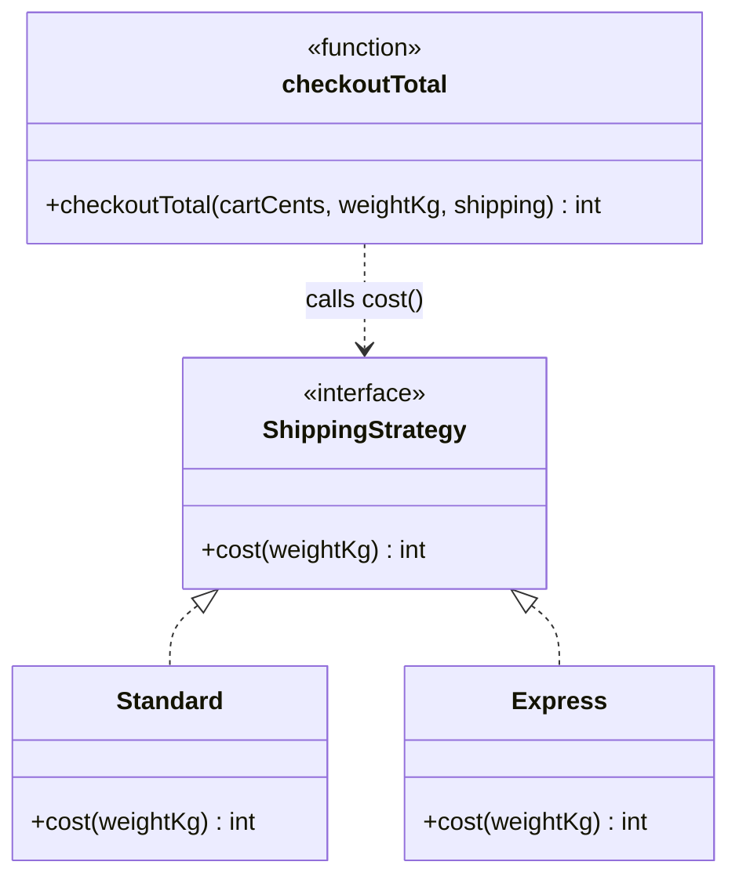
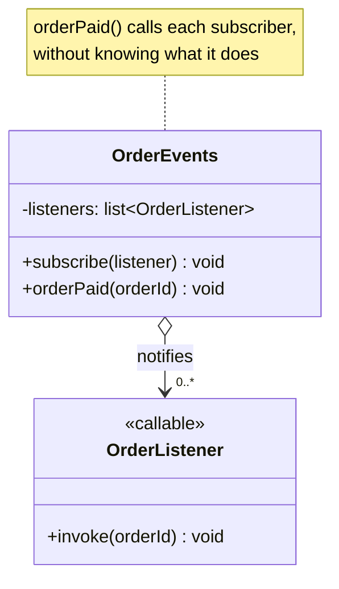
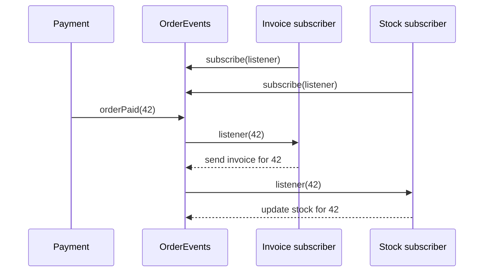
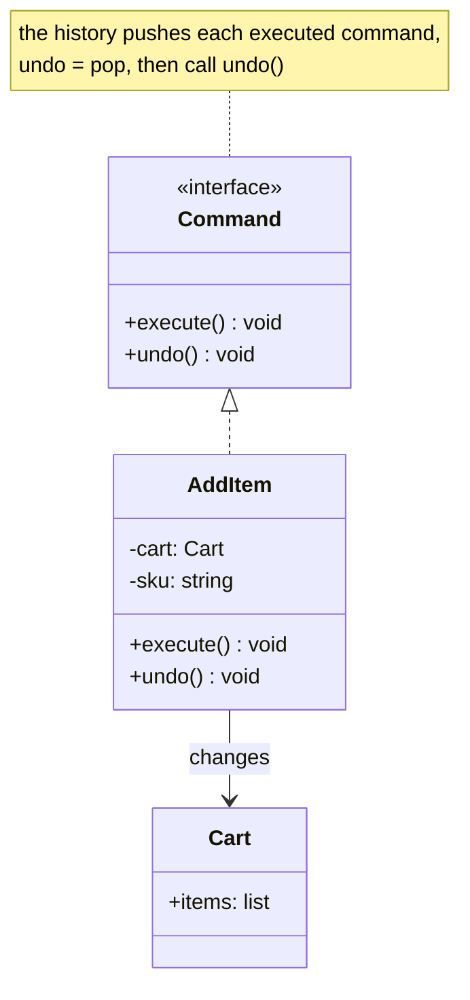
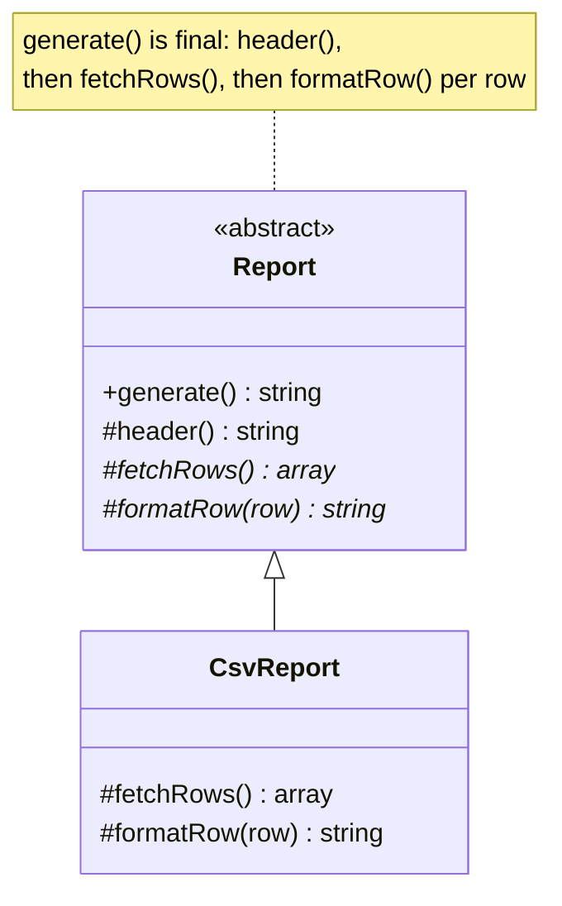
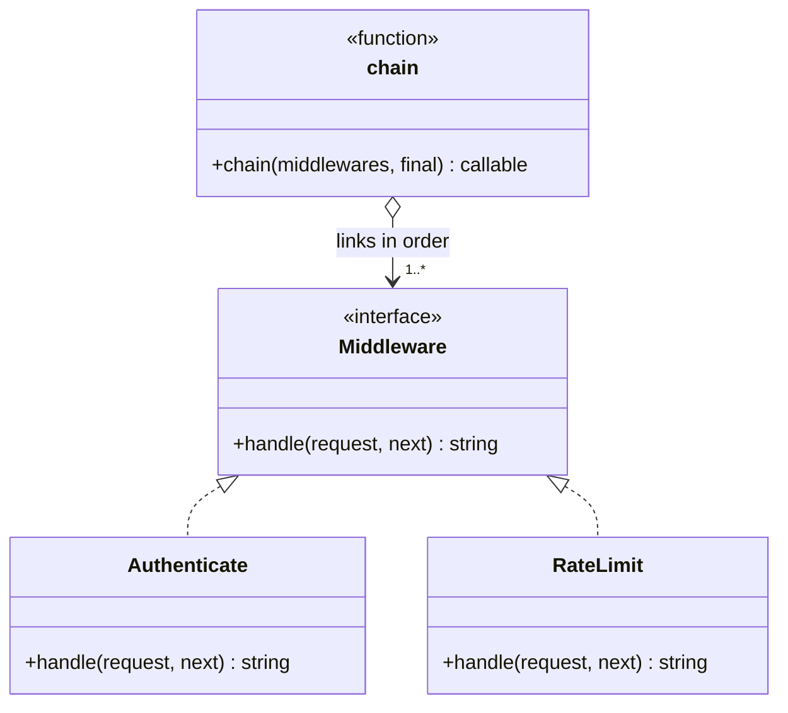
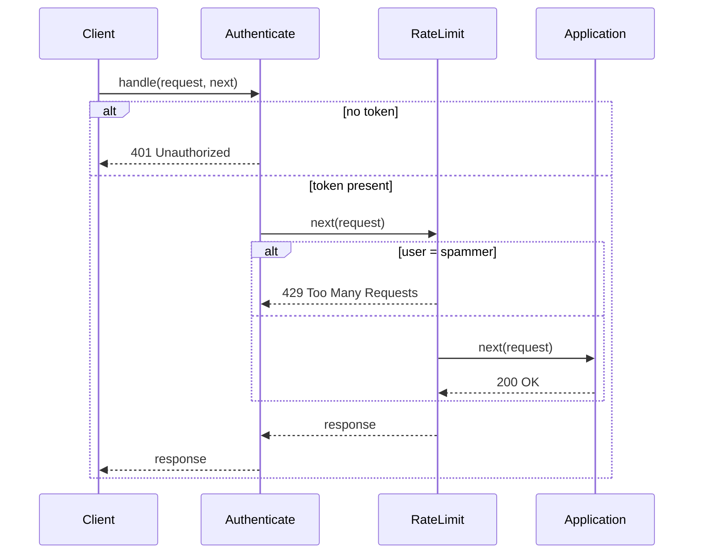
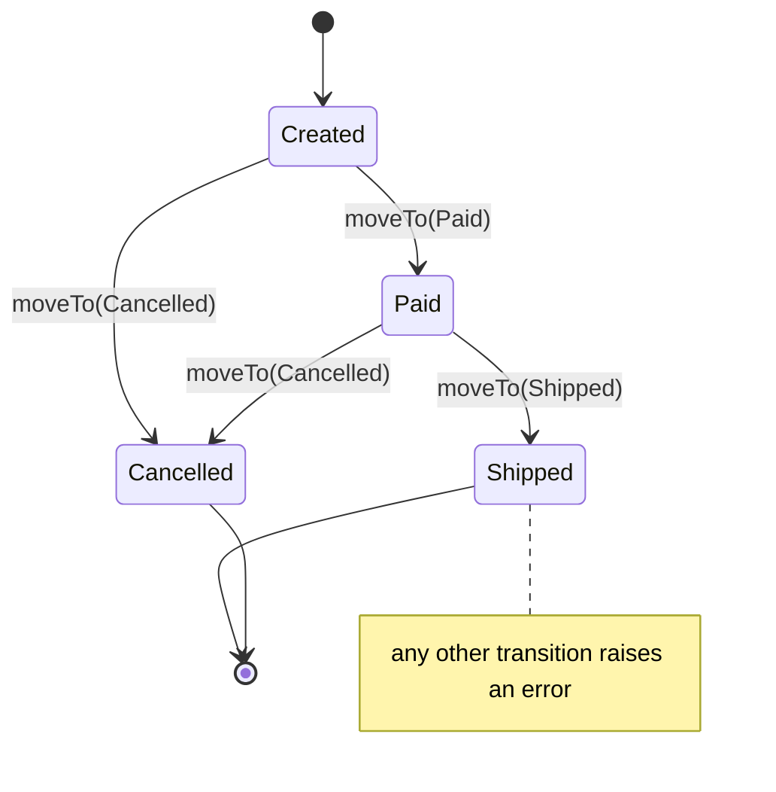
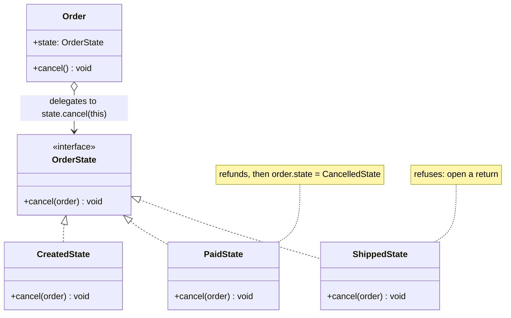

# Behavioral design patterns

!!! warning "Disclaimer"
    These notes are personal cheat sheets, not a source of truth. They reflect my own understanding and choices: their content remains subjective, despite the quotes and references it contains. It may be incomplete, simplified, inaccurate or outdated. Always check the official documentation before applying it. This content is provided as is, without any warranty: you use it at your own risk.

!!! audience "Who and what for"
    - **Roles**: back-end developer, front-end developer, test automation QA engineer, tech lead, architect...
    - **Uses**: I prepare an interview where I am asked "explain Strategy with an example", I replace an `if/elif` that grows with every new shipping mode, I want an "undo" button to really undo the last cart action, I review a merge request that adds a middleware and check its place in the chain, I prevent an order that has already shipped from being paid a second time...

!!! abstract "Scales"
    The colored badges under the headings say at which scale a notion applies:

    - <span class="pill pill-scope pill-scope-code">Code</span> the classes, functions and modules of one program;
    - <span class="pill pill-scope pill-scope-app">Application</span> one service or application and its internal split;
    - <span class="pill pill-scope pill-scope-system">System</span> several services talking to each other over the network;
    - <span class="pill pill-scope pill-scope-infra">Infrastructure</span> servers, network, zones and clusters, physical or virtual;
    - <span class="pill pill-scope pill-scope-enterprise">Enterprise</span> the whole information system and its organization.

    Details and ambiguous words: [map of scales](architecture.md#map-of-scales).

**Behavioral patterns** answer one question: how to split work between objects and make them talk, without each one depending on the details of the others. Example: the payment announces "order paid", and billing, stock and email each react on their own side, without the payment calling them one by one.

This page covers six GoF behavioral patterns, with the same example in PHP, Python and Java: Strategy, Observer, Command, Template Method, Chain of Responsibility and State. What a design pattern is, and the creational, structural and application architecture patterns, are on the [Design patterns](design-patterns.md) page. The principles that guide these choices (SOLID, KISS, YAGNI) are on the [Design principles](principes-conception.md) page. Service and data names are fictitious.

!!! tip "Choose the language"
    I click a language: **every example on the page** switches to it, and the choice is kept from one page to the next.

=== "PHP"

    Examples shown in **PHP 8.3** (`readonly` classes, `match`, enums).

=== "Python"

    Examples shown in **Python 3.12** (`Protocol`, `dataclass`, type hints).

=== "Java"

    Examples shown in **Java 21** (`record`, `switch` expressions, `enum`).

## Terminology

**<span class="term" data-term="interface-code">Interface</span>**: a contract that lists methods without writing them. Any class implementing it promises to provide them. In Python, a `Protocol` is often used: no need to declare it, having the right methods is enough.

**<span class="term" data-term="inheritance">Inheritance</span>**: a class takes the code of a parent class and extends it. **<span class="term" data-term="object-composition">Composition</span>**: an object holds another one and delegates part of the work to it. Strategy relies on composition, Template Method on inheritance.

**Abstract class**: an incomplete class, meant to be inherited: it cannot be instantiated directly. It can already hold shared code, and **abstract methods**: declared without a body, which every subclass must write. Example (see Template Method below): `Report` is abstract, `new Report()` fails; it writes `generate()` but only declares `fetch_rows()`. `CsvReport` inherits from `Report` and writes `fetch_rows()`. Difference with an interface: the abstract class already provides part of the code, the interface none.

**<span class="term" data-term="polymorphism">Polymorphism</span>**: calling the same method on objects of different classes, each reacting in its own way. `shipping.cost()` gives a different price for `Standard` and `Express`.

**<span class="term" data-term="coupling">Coupling</span>**: how much a piece of code depends on the details of another. Tight coupling: changing one forces changing the other. Observer and Chain of Responsibility mostly serve to reduce it.

**GoF** (*Gang of Four*): the four authors of "Design Patterns: Elements of Reusable Object-Oriented Software" (Gamma, Helm, Johnson and Vlissides, 1994), which named 23 patterns in three families: creational, structural, behavioral. This page covers the third one.

**<span class="term" data-term="middleware">Middleware</span>**: a link that runs before or after the code handling an HTTP request, like checking the token or writing the logs. A sequence of middlewares is a chain of responsibility.

**<span class="term" data-term="state-machine">State machine</span>**: an object that can only be in one state at a time (created, paid, shipped) and moves from one to another only through allowed transitions. It is what the State pattern builds.

**<span class="term" data-term="cognitive-complexity">Cognitive complexity</span>**: a measure of the effort needed to read a function, which grows with every `if`, loop or nesting level. A growing `if/elif` pushes it up, a strategy brings it back down.

**<span class="term" data-term="sli">SLI</span>** (Service Level Indicator): the number I measure to know whether a solution works, for example the number of files changed to add a shipping mode.

**<span class="term" data-term="slo">SLO</span>** (Service Level Objective): the internal target I set on that number, for example "a new shipping mode touches a single existing file, the strategy table".

**<span class="term" data-term="sla">SLA</span>** (Service Level Agreement): the contractual promise made to a customer, with a penalty if it is not kept, always looser than the SLO. A pattern choice stays internal to the code: it almost never has an SLA, except when it protects a service promised to the customer, like the authentication middleware in front of a public API.

## Behavioral patterns

<a class="pill pill-scope pill-scope-code" href="../architecture/#map-of-scales">Scale · Code</a>

How to split responsibilities and make objects talk to each other.

### Strategy
<span class="pill pill-status pill-status-ok" title="Still valid, checked November 2026">Current · 11/2026</span>

**Intent**: make several ways of doing the same thing interchangeable.

**Problem**: an `if/elif` grows with each new shipping method, in a function everyone edits, so every addition risks breaking the existing methods.

**Example**: each shipping method is a class with a `cost()` method. The cart total receives the strategy and calls it, without knowing which one it is.

!!! noob "As noob"
    The strategy is the GPS asking "car, bike or on foot?": the destination does not change, only the way the route is computed, and I can add a mode without touching the rest. The one thing to remember: **a big `if` becomes interchangeable objects that share the same method.**



**Without the pattern** (avoid): one function holds every shipping mode. Each new mode adds a branch to this shared code, and a typo in the mode name (`"exprss"`) silently drops the order into the standard rate.

=== "PHP"

    ```php
    <?php

    // Avoid: one branch per shipping mode, edited by every new mode
    function checkoutTotal(int $cartCents, float $weightKg, string $mode): int
    {
        if ($mode === 'express') {
            $shipping = 1500 + (int) ($weightKg * 200);
        } elseif ($mode === 'relay') {
            $shipping = 300 + (int) ($weightKg * 50);
        } else {
            $shipping = 500 + (int) ($weightKg * 100);
        }
        return $cartCents + $shipping;
    }
    ```

=== "Python"

    ```python
    # Avoid: one branch per shipping mode, edited by every new mode
    def checkout_total(cart_cents: int, weight_kg: float, mode: str) -> int:
        if mode == "express":
            shipping = 1500 + int(weight_kg * 200)
        elif mode == "relay":
            shipping = 300 + int(weight_kg * 50)
        else:
            shipping = 500 + int(weight_kg * 100)
        return cart_cents + shipping
    ```

=== "Java"

    ```java
    // Avoid: one branch per shipping mode, edited by every new mode
    static int checkoutTotal(int cartCents, double weightKg, String mode) {
        int shipping;
        if (mode.equals("express")) {
            shipping = 1500 + (int) (weightKg * 200);
        } else if (mode.equals("relay")) {
            shipping = 300 + (int) (weightKg * 50);
        } else {
            shipping = 500 + (int) (weightKg * 100);
        }
        return cartCents + shipping;
    }
    ```

**With the pattern**:

=== "PHP"

    ```php
    <?php

    // Example: the contract shared by every shipping mode
    interface ShippingStrategy
    {
        public function cost(float $weightKg): int;
    }

    // Good: one shipping mode per class, testable on its own
    final class Standard implements ShippingStrategy
    {
        public function cost(float $weightKg): int
        {
            return 500 + (int) ($weightKg * 100);
        }
    }

    // Good: adding a mode means adding a class, without touching the others
    final class Express implements ShippingStrategy
    {
        public function cost(float $weightKg): int
        {
            return 1500 + (int) ($weightKg * 200);
        }
    }

    // Good: receives the strategy and calls cost() without knowing which one it is
    function checkoutTotal(int $cartCents, float $weightKg, ShippingStrategy $shipping): int
    {
        return $cartCents + $shipping->cost($weightKg);
    }

    // Example: the caller picks the strategy
    checkoutTotal(3000, 2.0, new Express());
    ```

=== "Python"

    ```python
    from typing import Protocol


    # Example: the contract shared by every shipping mode
    class ShippingStrategy(Protocol):
        def cost(self, weight_kg: float) -> int: ...


    # Good: one shipping mode per class, testable on its own
    class Standard:
        def cost(self, weight_kg: float) -> int:
            return 500 + int(weight_kg * 100)


    # Good: adding a mode means adding a class, without touching the others
    class Express:
        def cost(self, weight_kg: float) -> int:
            return 1500 + int(weight_kg * 200)


    # Good: receives the strategy and calls cost() without knowing which one it is
    def checkout_total(cart_cents: int, weight_kg: float, shipping: ShippingStrategy) -> int:
        return cart_cents + shipping.cost(weight_kg)


    # Example: the caller picks the strategy
    checkout_total(3000, 2.0, Express())
    ```

=== "Java"

    ```java
    // Example: the contract shared by every shipping mode
    interface ShippingStrategy {
        int cost(double weightKg);
    }

    // Good: one shipping mode per class, testable on its own
    final class Standard implements ShippingStrategy {
        public int cost(double weightKg) { return 500 + (int) (weightKg * 100); }
    }

    // Good: adding a mode means adding a class, without touching the others
    final class Express implements ShippingStrategy {
        public int cost(double weightKg) { return 1500 + (int) (weightKg * 200); }
    }

    // Good: receives the strategy and calls cost() without knowing which one it is
    final class Checkout {
        static int total(int cartCents, double weightKg, ShippingStrategy shipping) {
            return cartCents + shipping.cost(weightKg);
        }
    }

    // Example: the caller picks the strategy
    Checkout.total(3000, 2.0, new Express());
    ```

**In frameworks**

=== "PHP"

    Symfony: security *voters*, or a service chosen by tag (`#[AutowireIterator]`).

=== "Python"

    `sorted(items, key=...)`: the `key` function is a strategy. In Python, a plain function is often enough.

=== "Java"

    a `Comparator` passed to `list.sort(...)`, the `PasswordEncoder` implementations in Spring Security.

| Use it when | Avoid it when |
|---|---|
| I have several ways of doing the same thing, chosen from data or a setting, like computing shipping costs for standard or express delivery. Each strategy is tested on its own. | I only have two cases, which will never change: an `if` stays simpler. |

**Risks.** The choice of strategy often moves into an `if` elsewhere, like the controller that reads `"express"`: the typo that fell into the standard rate now falls into the wrong strategy. I centralize the choice in a table and raise an error on an unknown name. One strategy per trivial case multiplies files for nothing: two stable cases stay an `if`.

:material-book-open-variant: Reference docs: [Refactoring.Guru, Strategy](https://refactoring.guru/design-patterns/strategy) (accessed November 2026)
{ .doc-ref }

### Observer
<span class="pill pill-status pill-status-ok" title="Still valid, checked November 2026">Current · 11/2026</span>

**Intent**: automatically notify several objects when an event happens, without the emitter knowing them.

**Problem**: `pay()` directly calls billing, stock and email. Adding a fourth step means changing the payment code.

**Example**: the payment publishes "order paid", each step subscribes on its own.

!!! noob "As noob"
    The observer is a newsletter: the author publishes without knowing who subscribed, each reader signs up or leaves on their own. Here subscribers are notified right away, inside the same program, with no message sent over the network. The one thing to remember: **the sender announces a fact, it does not know who reacts.**





**Without the pattern** (avoid): payment calls every follow-up task itself. Adding a fourth task means editing `pay()`, and if sending the email throws an exception, the stock update after it never runs.

=== "PHP"

    ```php
    <?php

    // Avoid: payment knows and calls every task, in a fixed order
    function pay(int $orderId): void
    {
        chargeCard($orderId);
        sendInvoice($orderId);
        sendConfirmationEmail($orderId);
        updateStock($orderId);
    }
    ```

=== "Python"

    ```python
    # Avoid: payment knows and calls every task, in a fixed order
    def pay(order_id: int) -> None:
        charge_card(order_id)
        send_invoice(order_id)
        send_confirmation_email(order_id)
        update_stock(order_id)
    ```

=== "Java"

    ```java
    // Avoid: payment knows and calls every task, in a fixed order
    static void pay(int orderId) {
        chargeCard(orderId);
        sendInvoice(orderId);
        sendConfirmationEmail(orderId);
        updateStock(orderId);
    }
    ```

**With the pattern**:

=== "PHP"

    ```php
    <?php

    // Good: the emitter keeps a list of subscribers and notifies them without knowing them
    final class OrderEvents
    {
        /** @var list<callable(int): void> */
        private array $listeners = [];

        public function subscribe(callable $listener): void
        {
            $this->listeners[] = $listener;
        }

        public function orderPaid(int $orderId): void
        {
            foreach ($this->listeners as $listener) {
                $listener($orderId);
            }
        }
    }

    // Example: each handler subscribes on its own, then the payment publishes
    $events = new OrderEvents();
    $events->subscribe(fn (int $id) => print("send invoice for $id\n"));
    $events->subscribe(fn (int $id) => print("update stock for $id\n"));
    $events->orderPaid(42);
    ```

=== "Python"

    ```python
    from collections.abc import Callable

    OrderListener = Callable[[int], None]


    # Good: the emitter keeps a list of subscribers and notifies them without knowing them
    class OrderEvents:
        def __init__(self) -> None:
            self._listeners: list[OrderListener] = []

        def subscribe(self, listener: OrderListener) -> None:
            self._listeners.append(listener)

        def order_paid(self, order_id: int) -> None:
            for listener in self._listeners:
                listener(order_id)


    # Example: each handler subscribes on its own, then the payment publishes
    events = OrderEvents()
    events.subscribe(lambda order_id: print(f"send invoice for {order_id}"))
    events.subscribe(lambda order_id: print(f"update stock for {order_id}"))
    events.order_paid(42)
    ```

=== "Java"

    ```java
    import java.util.ArrayList;
    import java.util.List;
    import java.util.function.IntConsumer;

    // Good: the emitter keeps a list of subscribers and notifies them without knowing them
    final class OrderEvents {
        private final List<IntConsumer> listeners = new ArrayList<>();

        void subscribe(IntConsumer listener) { listeners.add(listener); }

        void orderPaid(int orderId) {
            listeners.forEach(listener -> listener.accept(orderId));
        }
    }

    // Example: each handler subscribes on its own, then the payment publishes
    OrderEvents events = new OrderEvents();
    events.subscribe(id -> System.out.println("send invoice for " + id));
    events.subscribe(id -> System.out.println("update stock for " + id));
    events.orderPaid(42);
    ```

**In frameworks**

=== "PHP"

    Symfony: the `EventDispatcher` and `#[AsEventListener]`. Laravel: `Event::dispatch()`.

=== "Python"

    Django: *signals* (`post_save`).

=== "Java"

    Spring: `ApplicationEventPublisher` and `@EventListener`.

| Use it when | Avoid it when |
|---|---|
| several independent steps must react to the same fact, like billing, stock and email when an order is paid. Between different services, the same idea goes through a broker (Kafka, RabbitMQ). | the order of reactions matters, or an error in a subscriber must cancel the whole action: direct calls are more explicit. |

**Risks.** The flow becomes invisible: reading `pay()`, I no longer see who reacts, and a subscriber registered twice sends two emails without the code showing it. An exception in one subscriber can block the next ones, or be swallowed and go unnoticed. I list subscribers in one place, I isolate each subscriber (error logged, the others go on) and a test checks the list of reactions to "order paid".

:material-book-open-variant: Reference docs: [Refactoring.Guru, Observer](https://refactoring.guru/design-patterns/observer) (accessed November 2026)
{ .doc-ref }

### Command
<span class="pill pill-status pill-status-ok" title="Still valid, checked November 2026">Current · 11/2026</span>

**Intent**: turn an action into an object, which can be stored, queued, replayed or undone.

**Problem**: I want a user to be able to undo their last action, or an action to run later in a worker, but a plain method call leaves nothing to keep, queue or undo.

**Example**: "add an item to the cart" becomes an object with `execute()` and `undo()`. The history is a stack of commands.

!!! noob "As noob"
    The command is a written order slip instead of a request shouted across the room: since it is on paper, I can put it in a queue, handle it later, redo it, and if it also says how to undo the action, cancel it (that is how Ctrl+Z works). The one thing to remember: **an action becomes an object I can keep, replay or undo.**



**Without the pattern** (avoid): the action is a plain method call: once done, nothing is left to undo it. The "undo" button then removes the last item of the list, which is not always the one the user just added, for example when a promotion added a free gift right after.

=== "PHP"

    ```php
    <?php

    // Avoid: the action is a direct call, nothing is kept to undo it
    function addItem(array &$cart, string $sku): void
    {
        $cart[] = $sku;
    }

    // Avoid: undo guesses by removing the last item of the list
    function undoLast(array &$cart): void
    {
        array_pop($cart);
    }
    ```

=== "Python"

    ```python
    # Avoid: the action is a direct call, nothing is kept to undo it
    def add_item(cart: Cart, sku: str) -> None:
        cart.items.append(sku)


    # Avoid: undo guesses by removing the last item of the list
    def undo_last(cart: Cart) -> None:
        cart.items.pop()
    ```

=== "Java"

    ```java
    // Avoid: the action is a direct call, nothing is kept to undo it
    static void addItem(List<String> cart, String sku) {
        cart.add(sku);
    }

    // Avoid: undo guesses by removing the last item of the list
    static void undoLast(List<String> cart) {
        cart.remove(cart.size() - 1);
    }
    ```

**With the pattern**:

=== "PHP"

    ```php
    <?php

    // Example: every command knows how to execute and undo itself
    interface Command
    {
        public function execute(): void;
        public function undo(): void;
    }

    // Example: the object the commands modify
    final class Cart
    {
        public array $items = [];
    }

    // Good: the action becomes an object, with what it needs to undo it
    final class AddItem implements Command
    {
        public function __construct(private readonly Cart $cart, private readonly string $sku) {}

        public function execute(): void { $this->cart->items[] = $this->sku; }

        public function undo(): void
        {
            $this->cart->items = array_values(array_diff($this->cart->items, [$this->sku]));
        }
    }

    // Example: the history stacks the commands, undo pops the last one
    $cart = new Cart();
    $history = [];
    foreach ([new AddItem($cart, 'BK-0004'), new AddItem($cart, 'BK-0007')] as $command) {
        $command->execute();
        $history[] = $command;
    }
    array_pop($history)->undo();
    ```

=== "Python"

    ```python
    from dataclasses import dataclass
    from typing import Protocol


    # Example: every command knows how to execute and undo itself
    class Command(Protocol):
        def execute(self) -> None: ...
        def undo(self) -> None: ...


    # Example: the object the commands modify
    @dataclass
    class Cart:
        items: list[str]


    # Good: the action becomes an object, with what it needs to undo it
    @dataclass
    class AddItem:
        cart: Cart
        sku: str

        def execute(self) -> None:
            self.cart.items.append(self.sku)

        def undo(self) -> None:
            self.cart.items.remove(self.sku)


    # Example: the history stacks the commands, undo pops the last one
    cart = Cart([])
    history: list[Command] = []
    for command in (AddItem(cart, "BK-0004"), AddItem(cart, "BK-0007")):
        command.execute()
        history.append(command)
    history.pop().undo()
    ```

=== "Java"

    ```java
    import java.util.ArrayDeque;
    import java.util.ArrayList;
    import java.util.Deque;
    import java.util.List;

    // Example: every command knows how to execute and undo itself
    interface Command {
        void execute();
        void undo();
    }

    // Good: the action becomes an object, with what it needs to undo it
    record AddItem(List<String> cart, String sku) implements Command {
        public void execute() { cart.add(sku); }
        public void undo() { cart.remove(sku); }
    }

    // Example: the history stacks the commands, undo pops the last one
    List<String> cart = new ArrayList<>();
    Deque<Command> history = new ArrayDeque<>();
    for (Command command : List.of(new AddItem(cart, "BK-0004"), new AddItem(cart, "BK-0007"))) {
        command.execute();
        history.push(command);
    }
    history.pop().undo();
    ```

**In frameworks**

=== "PHP"

    Symfony Messenger: a message (`new SendInvoice(42)`) and its handler, run immediately or by a worker.

=== "Python"

    Celery: a task and its arguments are a serialized, queued command.

=== "Java"

    a `Runnable` passed to an `ExecutorService`, Axon Framework commands.

| Use it when | Avoid it when |
|---|---|
| I want to undo, replay, queue or log actions, like undoing the last "add to cart" or having a worker run an action later. Basis of <span class="term" data-term="cqrs">CQRS</span>. | the action is simple, run immediately and never undone: a method is enough. |

**Risks.** An `undo()` that does not restore the exact previous state corrupts the cart more surely than having no undo at all: I test each command with the pair `execute()` then `undo()`. A command queued and replayed by a worker after a network failure can run twice: it must give the same result when replayed, for example thanks to an action id already processed.

:material-book-open-variant: Reference docs: [Refactoring.Guru, Command](https://refactoring.guru/design-patterns/command) (accessed November 2026)
{ .doc-ref }

### Template Method
<span class="pill pill-status pill-status-ok" title="Still valid, checked November 2026">Current · 11/2026</span>

**Intent**: fix the steps of an algorithm in a parent class, and let subclasses fill in some steps.

**Problem**: three exports (CSV, PDF, Excel) copy the same sequence: read the data, write the header, format each row.

**Example**: `Report.generate()` fixes the order, `CsvReport` only provides `fetch_rows()` and `format_row()`.

!!! noob "As noob"
    The template method is a recipe with a blank: "preheat the oven, make the batter, add ___, bake 30 minutes". The recipe sets the order, each variant only picks what goes in the blank (chocolate, apples). The one thing to remember: **the parent class sets the order, subclasses only fill the steps that change.**



**Without the pattern** (avoid): every export copies the read, header, rows sequence. The day I change the header, I edit it in the CSV and forget the PDF: the two exports of the same report already carry different titles.

=== "PHP"

    ```php
    <?php

    // Avoid: the read, header, rows sequence is written in every export
    function csvReport(): string
    {
        $rows = [['FR', 1200], ['DE', 900]];
        return "Revenue report\n" . implode("\n", array_map(fn ($row) => "$row[0];$row[1]", $rows));
    }

    // Avoid: the same sequence copied, the header has already drifted
    function pdfReport(): string
    {
        $rows = [['FR', 1200], ['DE', 900]];
        return "Revenue\n" . implode("\n", array_map(fn ($row) => "$row[0]: $row[1]", $rows));
    }
    ```

=== "Python"

    ```python
    # Avoid: the read, header, rows sequence is written in every export
    def csv_report() -> str:
        rows = [("FR", 1200), ("DE", 900)]
        return "Revenue report\n" + "\n".join(f"{country};{amount}" for country, amount in rows)


    # Avoid: the same sequence copied, the header has already drifted
    def pdf_report() -> str:
        rows = [("FR", 1200), ("DE", 900)]
        return "Revenue\n" + "\n".join(f"{country}: {amount}" for country, amount in rows)
    ```

=== "Java"

    ```java
    // Avoid: the read, header, rows sequence is written in every export
    static String csvReport() {
        var rows = Map.of("FR", 1200, "DE", 900);
        return "Revenue report\n" + rows.entrySet().stream().map(row -> row.getKey() + ";" + row.getValue()).collect(Collectors.joining("\n"));
    }

    // Avoid: the same sequence copied, the header has already drifted
    static String pdfReport() {
        var rows = Map.of("FR", 1200, "DE", 900);
        return "Revenue\n" + rows.entrySet().stream().map(row -> row.getKey() + ": " + row.getValue()).collect(Collectors.joining("\n"));
    }
    ```

**With the pattern**:

=== "PHP"

    ```php
    <?php

    // Good: the parent class fixes the order of the steps once and for all
    abstract class Report
    {
        final public function generate(): string
        {
            $lines = array_map(fn (array $row) => $this->formatRow($row), $this->fetchRows());
            return $this->header() . "\n" . implode("\n", $lines);
        }

        protected function header(): string { return 'Revenue report'; }

        // Example: the steps each subclass must write
        abstract protected function fetchRows(): array;

        abstract protected function formatRow(array $row): string;
    }

    // Good: the subclass only provides the steps that change
    final class CsvReport extends Report
    {
        protected function fetchRows(): array { return [['FR', 1200], ['DE', 900]]; }

        protected function formatRow(array $row): string { return "$row[0];$row[1]"; }
    }

    // Example: the caller runs generate(), the order is guaranteed
    echo (new CsvReport())->generate();
    ```

=== "Python"

    ```python
    from abc import ABC, abstractmethod


    # Good: the parent class fixes the order of the steps once and for all
    class Report(ABC):
        def generate(self) -> str:
            rows = self.fetch_rows()
            return self.header() + "\n" + "\n".join(self.format_row(row) for row in rows)

        def header(self) -> str:
            return "Revenue report"

        # Example: the steps each subclass must write
        @abstractmethod
        def fetch_rows(self) -> list[tuple[str, int]]: ...

        @abstractmethod
        def format_row(self, row: tuple[str, int]) -> str: ...


    # Good: the subclass only provides the steps that change
    class CsvReport(Report):
        def fetch_rows(self) -> list[tuple[str, int]]:
            return [("FR", 1200), ("DE", 900)]

        def format_row(self, row: tuple[str, int]) -> str:
            return f"{row[0]};{row[1]}"


    # Example: the caller runs generate(), the order is guaranteed
    print(CsvReport().generate())
    ```

=== "Java"

    ```java
    import java.util.List;
    import java.util.stream.Collectors;

    // Good: the parent class fixes the order of the steps once and for all
    abstract class Report {
        final String generate() {
            return header() + "\n" + fetchRows().stream().map(this::formatRow).collect(Collectors.joining("\n"));
        }

        protected String header() { return "Revenue report"; }

        // Example: the steps each subclass must write
        protected abstract List<Object[]> fetchRows();

        protected abstract String formatRow(Object[] row);
    }

    // Good: the subclass only provides the steps that change
    final class CsvReport extends Report {
        protected List<Object[]> fetchRows() { return List.of(new Object[] {"FR", 1200}, new Object[] {"DE", 900}); }

        protected String formatRow(Object[] row) { return row[0] + ";" + row[1]; }
    }

    // Example: the caller runs generate(), the order is guaranteed
    System.out.println(new CsvReport().generate());
    ```

**In frameworks**

=== "PHP"

    PHPUnit: `setUp()` and `tearDown()` are the steps I fill in, the order is fixed by `TestCase`.

=== "Python"

    `unittest.TestCase` the same way, Django generic views (`get_queryset()`).

=== "Java"

    `AbstractList`, `HttpServlet.doGet()`, Spring's `JdbcTemplate`.

| Use it when | Avoid it when |
|---|---|
| I have several variants of the same flow where only a few steps change, like CSV, PDF and Excel exports that read the data and write the header the same way. | the inheritance gets deep, or each variant changes many steps: I prefer Strategy (composition). |

**Risks.** Every subclass depends on the parent's step order: changing `generate()` for one export silently breaks the others. A subclass that wants to change an unplanned step ends up overriding all of `generate()`, which copies the sequence. I keep few variable steps, I test each export, and I switch to Strategy as soon as one variant breaks the mold.

:material-book-open-variant: Reference docs: [Refactoring.Guru, Template Method](https://refactoring.guru/design-patterns/template-method) (accessed November 2026)
{ .doc-ref }

### Chain of Responsibility
<span class="pill pill-status pill-status-ok" title="Still valid, checked November 2026">Current · 11/2026</span>

**Intent**: pass a request through a series of links, each able to handle it, change it or stop it.

**Problem**: a controller that checks authentication, rate limits, language and logs itself, before doing its real job.

**Example**: HTTP <span class="term" data-term="middleware">*middlewares*</span>: authentication, then rate limiting, then the application. Each link can return an error without calling the next one.

!!! noob "As noob"
    The chain of responsibility is going through an airport: ticket, then security, then passport. Each desk can send me on to the next one or stop me there, and a desk can be added without changing the others. The one thing to remember: **each link handles its own part then passes it on, or stops it.**





**Without the pattern** (avoid): every controller runs all the checks itself before its real work. They are copied at the top of every controller, and the one where someone forgets authentication, here the export, answers anyone without a token.

=== "PHP"

    ```php
    <?php

    // Avoid: authentication and rate limiting copied at the top of every controller
    function listOrders(array $request): string
    {
        if (!isset($request['token'])) {
            return '401 Unauthorized';
        }
        if (($request['user'] ?? null) === 'spammer') {
            return '429 Too Many Requests';
        }
        return '200 OK';
    }

    // Avoid: incomplete copy, this controller answers without checking the token
    function exportOrders(array $request): string
    {
        if (($request['user'] ?? null) === 'spammer') {
            return '429 Too Many Requests';
        }
        return '200 OK';
    }
    ```

=== "Python"

    ```python
    # Avoid: authentication and rate limiting copied at the top of every controller
    def list_orders(request: dict[str, str]) -> str:
        if "token" not in request:
            return "401 Unauthorized"
        if request.get("user") == "spammer":
            return "429 Too Many Requests"
        return "200 OK"


    # Avoid: incomplete copy, this controller answers without checking the token
    def export_orders(request: dict[str, str]) -> str:
        if request.get("user") == "spammer":
            return "429 Too Many Requests"
        return "200 OK"
    ```

=== "Java"

    ```java
    // Avoid: authentication and rate limiting copied at the top of every controller
    static String listOrders(Map<String, String> request) {
        if (!request.containsKey("token")) {
            return "401 Unauthorized";
        }
        if ("spammer".equals(request.get("user"))) {
            return "429 Too Many Requests";
        }
        return "200 OK";
    }

    // Avoid: incomplete copy, this controller answers without checking the token
    static String exportOrders(Map<String, String> request) {
        if ("spammer".equals(request.get("user"))) {
            return "429 Too Many Requests";
        }
        return "200 OK";
    }
    ```

**With the pattern**:

=== "PHP"

    ```php
    <?php

    // Example: a link receives the request and the next link
    interface Middleware
    {
        public function handle(array $request, callable $next): string;
    }

    // Good: stops with 401 without a token, otherwise passes to the next one
    final class Authenticate implements Middleware
    {
        public function handle(array $request, callable $next): string
        {
            return isset($request['token']) ? $next($request) : '401 Unauthorized';
        }
    }

    // Good: stops with 429 on abuse, otherwise passes to the next one
    final class RateLimit implements Middleware
    {
        public function handle(array $request, callable $next): string
        {
            return ($request['user'] ?? '') === 'spammer' ? '429 Too Many Requests' : $next($request);
        }
    }

    // Example: links the middlewares in order, the last one calls the application
    function chain(array $middlewares, callable $final): callable
    {
        return array_reduce(
            array_reverse($middlewares),
            fn (callable $next, Middleware $m) => fn (array $request) => $m->handle($request, $next),
            $final,
        );
    }

    // Example: authentication, then rate limit, then the application
    $app = chain([new Authenticate(), new RateLimit()], fn (array $request) => '200 OK');
    $app(['token' => 'abc', 'user' => 'ada']);
    ```

=== "Python"

    ```python
    from collections.abc import Callable

    # Example: a link receives the request and the next link
    Request = dict[str, str]
    Handler = Callable[[Request], str]
    Middleware = Callable[[Request, Handler], str]


    # Good: stops with 401 without a token, otherwise passes to the next one
    def authenticate(request: Request, next_handler: Handler) -> str:
        if "token" not in request:
            return "401 Unauthorized"
        return next_handler(request)


    # Good: stops with 429 on abuse, otherwise passes to the next one
    def rate_limit(request: Request, next_handler: Handler) -> str:
        if request.get("user") == "spammer":
            return "429 Too Many Requests"
        return next_handler(request)


    # Example: links the middlewares in order, the last one calls the application
    def chain(middlewares: list[Middleware], final: Handler) -> Handler:
        handler = final
        for middleware in reversed(middlewares):
            handler = (lambda m, n: lambda request: m(request, n))(middleware, handler)
        return handler


    # Example: authentication, then rate limit, then the application
    app = chain([authenticate, rate_limit], lambda request: "200 OK")
    app({"token": "abc", "user": "ada"})
    ```

=== "Java"

    ```java
    import java.util.List;
    import java.util.Map;
    import java.util.function.Function;

    // Example: a link receives the request and the next link
    interface Middleware {
        String handle(Map<String, String> request, Function<Map<String, String>, String> next);
    }

    // Example: links the middlewares in order, the last one calls the application
    final class Chain {
        static Function<Map<String, String>, String> of(List<Middleware> middlewares, Function<Map<String, String>, String> last) {
            Function<Map<String, String>, String> handler = last;
            for (int i = middlewares.size() - 1; i >= 0; i--) {
                Middleware middleware = middlewares.get(i);
                Function<Map<String, String>, String> next = handler;
                handler = request -> middleware.handle(request, next);
            }
            return handler;
        }
    }

    // Good: stops with 401 without a token, otherwise passes to the next one
    Middleware authenticate = (request, next) -> request.containsKey("token") ? next.apply(request) : "401 Unauthorized";
    // Good: stops with 429 on abuse, otherwise passes to the next one
    Middleware rateLimit = (request, next) -> "spammer".equals(request.get("user")) ? "429 Too Many Requests" : next.apply(request);

    // Example: authentication, then rate limit, then the application
    var app = Chain.of(List.of(authenticate, rateLimit), request -> "200 OK");
    app.apply(Map.of("token", "abc", "user", "ada"));
    ```

**In frameworks**

=== "PHP"

    PSR-15 (`MiddlewareInterface`), Laravel middlewares.

=== "Python"

    Django and FastAPI (Starlette) middlewares.

=== "Java"

    Servlet `Filter`s, Spring Security's `SecurityFilterChain`.

| Use it when | Avoid it when |
|---|---|
| every request must go through the same steps before or after my code, like checking authentication, writing logs or adding headers, without copying them into every controller. | the order of the links becomes a trap nobody wrote down: I write the order down explicitly and test it. |

:material-book-open-variant: Reference docs: [Refactoring.Guru, Chain of Responsibility](https://refactoring.guru/design-patterns/chain-of-responsibility) (accessed November 2026); [PSR-15, HTTP Server Request Handlers](https://www.php-fig.org/psr/psr-15/) (2018)
{ .doc-ref }

### State
<span class="pill pill-status pill-status-ok" title="Still valid, checked November 2026">Current · 11/2026</span>

**Intent**: make an object's behavior depend on its state, and forbid impossible transitions.

**Problem**: a shipped order that can still be "paid" because nobody checked the state first.

**Example**: a table of allowed transitions: created to paid or cancelled, paid to shipped or cancelled. Anything else raises an error.

!!! noob "As noob"
    The state pattern is a traffic light: it does not go from green to red without amber, and what I am allowed to do depends on its color. The one thing to remember: **write the list of allowed transitions once, everything else is refused.**



**Without the pattern** (avoid): every method writes the status without looking at where the order starts from. Nothing stops a call to `pay()` on an order already shipped: it becomes "paid" again, and the job that ships paid orders sends it a second time.

=== "PHP"

    ```php
    <?php

    // Avoid: every method writes the status without checking the starting state
    final class Order
    {
        public string $status = 'created';

        public function pay(): void { $this->status = 'paid'; }

        public function ship(): void { $this->status = 'shipped'; }

        public function cancel(): void { $this->status = 'cancelled'; }
    }
    ```

=== "Python"

    ```python
    # Avoid: every method writes the status without checking the starting state
    class Order:
        def __init__(self) -> None:
            self.status = "created"

        def pay(self) -> None:
            self.status = "paid"

        def ship(self) -> None:
            self.status = "shipped"

        def cancel(self) -> None:
            self.status = "cancelled"
    ```

=== "Java"

    ```java
    // Avoid: every method writes the status without checking the starting state
    final class Order {
        String status = "created";

        void pay() { status = "paid"; }

        void ship() { status = "shipped"; }

        void cancel() { status = "cancelled"; }
    }
    ```

**With the pattern**:

=== "PHP"

    ```php
    <?php

    // Example: the possible states of an order
    enum OrderStatus: string
    {
        case Created = 'created';
        case Paid = 'paid';
        case Shipped = 'shipped';
        case Cancelled = 'cancelled';

        // Good: the table of allowed transitions, written only once
        public function canMoveTo(self $target): bool
        {
            return in_array($target, match ($this) {
                self::Created => [self::Paid, self::Cancelled],
                self::Paid => [self::Shipped, self::Cancelled],
                self::Shipped, self::Cancelled => [],
            }, true);
        }
    }

    // Good: every transition goes through moveTo(), which refuses forbidden ones
    final class Order
    {
        public OrderStatus $status = OrderStatus::Created;

        public function moveTo(OrderStatus $target): void
        {
            if (!$this->status->canMoveTo($target)) {
                throw new DomainException("cannot go from {$this->status->value} to {$target->value}");
            }
            $this->status = $target;
        }
    }

    // Example: created, then paid, then shipped: allowed transitions
    $order = new Order();
    $order->moveTo(OrderStatus::Paid);
    $order->moveTo(OrderStatus::Shipped);
    ```

=== "Python"

    ```python
    from enum import Enum


    # Example: the possible states of an order
    class OrderStatus(Enum):
        CREATED = "created"
        PAID = "paid"
        SHIPPED = "shipped"
        CANCELLED = "cancelled"


    # Good: the table of allowed transitions, written only once
    ALLOWED = {
        OrderStatus.CREATED: {OrderStatus.PAID, OrderStatus.CANCELLED},
        OrderStatus.PAID: {OrderStatus.SHIPPED, OrderStatus.CANCELLED},
        OrderStatus.SHIPPED: set(),
        OrderStatus.CANCELLED: set(),
    }


    # Good: every transition goes through move_to(), which refuses forbidden ones
    class Order:
        def __init__(self) -> None:
            self.status = OrderStatus.CREATED

        def move_to(self, target: OrderStatus) -> None:
            if target not in ALLOWED[self.status]:
                raise ValueError(f"cannot go from {self.status.value} to {target.value}")
            self.status = target


    # Example: created, then paid, then shipped: allowed transitions
    order = Order()
    order.move_to(OrderStatus.PAID)
    order.move_to(OrderStatus.SHIPPED)
    ```

=== "Java"

    ```java
    import java.util.Set;

    // Example: the possible states of an order
    enum OrderStatus {
        CREATED, PAID, SHIPPED, CANCELLED;

        // Good: the table of allowed transitions, written only once
        boolean canMoveTo(OrderStatus target) {
            return switch (this) {
                case CREATED -> Set.of(PAID, CANCELLED).contains(target);
                case PAID -> Set.of(SHIPPED, CANCELLED).contains(target);
                case SHIPPED, CANCELLED -> false;
            };
        }
    }

    // Good: every transition goes through moveTo(), which refuses forbidden ones
    final class Order {
        private OrderStatus status = OrderStatus.CREATED;

        void moveTo(OrderStatus target) {
            if (!status.canMoveTo(target)) {
                throw new IllegalStateException("cannot go from " + status + " to " + target);
            }
            status = target;
        }
    }

    // Example: created, then paid, then shipped: allowed transitions
    Order order = new Order();
    order.moveTo(OrderStatus.PAID);
    order.moveTo(OrderStatus.SHIPPED);
    ```

The transition table is the lightweight variant: it forbids wrong moves, but behavior is the same in every state. When one action does different things depending on the state, the GoF State gives one class per state. Here `cancel()` just closes a created order, refunds then closes a paid order, and refuses a shipped order.



=== "PHP"

    ```php
    <?php

    // Example: each state writes its own version of cancel()
    interface OrderState
    {
        public function cancel(Order $order): void;
    }

    // Good: created order, cancelling simply closes it
    final class CreatedState implements OrderState
    {
        public function cancel(Order $order): void
        {
            $order->state = new CancelledState();
        }
    }

    // Good: paid order, refunds, then closes
    final class PaidState implements OrderState
    {
        public function cancel(Order $order): void
        {
            $order->payments->refund($order->id);
            $order->state = new CancelledState();
        }
    }

    // Good: shipped order, refuses and asks to open a return
    final class ShippedState implements OrderState
    {
        public function cancel(Order $order): void
        {
            throw new DomainException('shipped: open a return instead');
        }
    }
    ```

=== "Python"

    ```python
    # Good: created order, cancelling simply closes it
    class CreatedState:
        def cancel(self, order: "Order") -> None:
            order.state = CancelledState()


    # Good: paid order, refunds, then closes
    class PaidState:
        def cancel(self, order: "Order") -> None:
            order.payments.refund(order.id)
            order.state = CancelledState()


    # Good: shipped order, refuses and asks to open a return
    class ShippedState:
        def cancel(self, order: "Order") -> None:
            raise ValueError("shipped: open a return instead")


    # Good: the order delegates cancel() to its current state
    class Order:
        def cancel(self) -> None:
            self.state.cancel(self)
    ```

=== "Java"

    ```java
    // Example: each state writes its own version of cancel()
    interface OrderState { void cancel(Order order); }

    // Good: created order, cancelling simply closes it
    final class CreatedState implements OrderState {
        public void cancel(Order order) { order.state = new CancelledState(); }
    }

    // Good: paid order, refunds, then closes
    final class PaidState implements OrderState {
        public void cancel(Order order) {
            order.payments.refund(order.id);
            order.state = new CancelledState();
        }
    }

    // Good: shipped order, refuses and asks to open a return
    final class ShippedState implements OrderState {
        public void cancel(Order order) { throw new IllegalStateException("shipped: open a return instead"); }
    }
    ```

**In frameworks**

=== "PHP"

    The Symfony Workflow component (state machine described in YAML).

=== "Python"

    The `transitions` library, or an `Enum` plus a table as above.

=== "Java"

    Spring Statemachine, or an `enum` with `switch` as above.

| Use it when | Avoid it when |
|---|---|
| my object has a lifecycle and some moves must be forbidden, like an order that is created, paid, then shipped, a ticket or a payment. The transition table is tested row by row. | my object only has two states: a boolean is enough. |

**Risks.** A transition table that only lives in the code does not protect the database: a fix-up SQL script or another service can write `shipped` directly. I back the rule with a database constraint, or I route every write through the object. A state missing from the table, like "refunded", blocks real orders: each new state comes with its test rows.

:material-book-open-variant: Reference docs: [Refactoring.Guru, State](https://refactoring.guru/design-patterns/state) (accessed November 2026)
{ .doc-ref }

!!! maturity "Measuring maturity"
    | Level | What I see in the team |
    |---|---|
    | N1 | a few `if/elif` chains on a type were replaced by a strategy or a state table, case by case, when someone thought of it |
    | N2 | every new variant goes through a strategy, lifecycles (order, payment) have a transition table tested row by row, and middlewares carry the shared checks |
    | N3 | the state machine refuses a forbidden transition by itself, the middleware chain is declared in one place, and a test breaks if its order changes |
    | N4 | the team tracks the cognitive complexity of `if/elif` functions and the number of forbidden transitions attempted in production, and refactors the areas where those numbers rise |

    **I measure**: the cognitive complexity of the most changed functions, read in static analysis; the number of "forbidden transition" errors per week, counted in the logs.

## Measuring success

I know a behavioral pattern paid off when the change it was meant to ease really gets smaller, without creating new bugs. Before introducing it, I write down a baseline from the last MRs in the area: for example, how many files I had to touch to add a shipping mode, and how many bugs followed (an email sent twice, an order paid after it shipped). I take the same measure on the next three to five changes. The guard metric is reading time: Observer and Chain of Responsibility hide part of the flow, so if a newcomer takes longer to find who reacts to "order paid", the pattern costs more than it brings.

| Solution or situation | Success indicator (SLI) | Likely SLO | Likely SLA |
|---|---|---|---|
| Strategy: I add a shipping mode, like pickup point | number of existing files changed by the MR that adds the mode | a single existing file (the strategy table), plus the new file | n/a: no external contract |
| Observer: a new process reacts to "order paid" | lines changed in `pay()` by the MR that adds the subscriber, and share of subscriber errors logged without blocking the other subscribers | zero lines in `pay()`, 100% of subscriber errors logged | n/a: no external contract |
| Command: cart "undo" button | share of commands whose `execute()` then `undo()` test gets back exactly the starting state, read in the test report | 100% of undoable commands | n/a: no external contract |
| Chain of Responsibility: authentication middleware in front of the API | share of protected routes that refuse a call without a token, tested in CI | 100%: a single open route is a security incident | the security commitment of the customer contract (no access without authentication), not a percentage |
| State: order lifecycle | number of forbidden transitions that reach the database, counted by a control query | zero per month | n/a: no external contract |

[Take with caution: example orders of magnitude, to set with the business]

## Pitfalls to avoid

- **Deep inheritance**: I stack a `Template Method` four levels deep, and nobody knows anymore which class writes which step. Beyond one level, I prefer composition (Strategy, Decorator).
- **Observer when order matters**: I go through subscribers while billing must succeed before the email is sent, or an error in a subscriber must cancel everything. Nothing in the code states that order, so the email can go out for an order whose billing failed. In that case, I write direct calls ([see Observer](#observer)).
- **The strategy choice copied everywhere**: I read `"express"` with an `if` in the controller, then in the export, then in the mobile API. A typo falls into the wrong strategy without any error. I centralize the choice in a single table and raise an error on an unknown name ([see Strategy](#strategy)).
- **The subscriber that fails silently**: an exception in the email subscriber is swallowed, or stops the stock subscriber that comes next from running. The customer gets nothing, the stock is wrong, and nobody sees it. I isolate each subscriber: its error is logged, the others go on ([see Observer](#observer)).
- **Approximate undo**: my `undo()` removes "the last item in the cart" instead of the one the command added, so when a promotion has just added a gift, undo removes the gift. Each command keeps what it did, and I test it with the `execute()` then `undo()` pair ([see Command](#command)).
- **Middleware order left to chance**: I declare the cache middleware before the authentication one, so a response cached for a logged-in user is served to a call without a token. I write the chain in one place and a test checks its order ([see Chain of Responsibility](#chain-of-responsibility)).
- **The state table that lives only in the code**: a SQL fix script writes `shipped` straight into the database, without going through the object, and the rule is bypassed. I back the table with a database constraint, or route every write through the object ([see State](#state)).

## What interviews ask

The typical questions:

- "Which design patterns do you use day to day?", "Give an example of Strategy in your code" How I answer: I start from a real case, like standard and express shipping costs, then say when an `if` is enough ([Strategy](#strategy)).
- "Composition or inheritance? When do you prefer Strategy over Template Method?" How I answer: I switch to Strategy as soon as inheritance goes beyond one level or each variant changes many steps ([Template Method](#template-method)).
- "Observer or direct calls?", "What is the risk of an event bus?" How I answer: I explain that the emitter no longer knows its subscribers, which makes adding a process easy, but that order and error handling are no longer written anywhere; when billing must succeed before the email, I keep direct calls ([Observer](#observer)).
- "How would you implement an undo button?", "What happens if a queued command is replayed?" How I answer: I turn the action into an object with `execute()` and `undo()`, kept in a stack, and I make the command replayable without a double effect, thanks to an already-processed action id ([Command](#command)).
- "What is a middleware, and which pattern is behind it?" How I answer: it is a chain of responsibility, each link handles what concerns it then passes on or stops the request, and the order of the chain is written down and tested ([Chain of Responsibility](#chain-of-responsibility)).
- "How do you prevent a shipped order from being paid a second time?" How I answer: I show a table of allowed transitions, tested row by row, backed by a database constraint ([State](#state)).
- "How do you know a pattern was worth it?" How I answer: I compare, before and after, the number of files touched to add a variant and the bugs that followed, with a guard metric on readability ([Measuring success](#measuring-success)).

What makes a good answer: name the problem before the pattern, show a concrete example, then say **when I would not use it**. That is what shows I choose a pattern instead of reciting it.

## Which pattern for which need

| I want... | I use... |
|---|---|
| to do the same calculation several ways depending on data, like different shipping costs for standard and express | Strategy |
| several modules to react to a fact, like "order paid", without the emitter knowing them | Observer |
| to queue, replay or undo an action, like a Ctrl+Z on the cart | Command |
| to share a flow where only a few steps change, like CSV and PDF exports | Template Method |
| every request to go through the same checks before and after my code, like authentication and rate limiting | Chain of Responsibility (middlewares) |
| to forbid impossible moves in a lifecycle, like paying for an order that has already shipped | State |
| to create the right object from a setting, plug in a third-party library, add caching around an object or test my logic without a database | a creational, structural or application architecture pattern, on the [Design patterns](design-patterns.md) page |

## Sources

- Erich Gamma, Richard Helm, Ralph Johnson and John Vlissides, "Design Patterns: Elements of Reusable Object-Oriented Software" (1994)
- [Refactoring.Guru, design patterns catalog (publication date not stated)](https://refactoring.guru/design-patterns)
- [PSR-15, HTTP Server Request Handlers (2018)](https://www.php-fig.org/psr/psr-15/)
