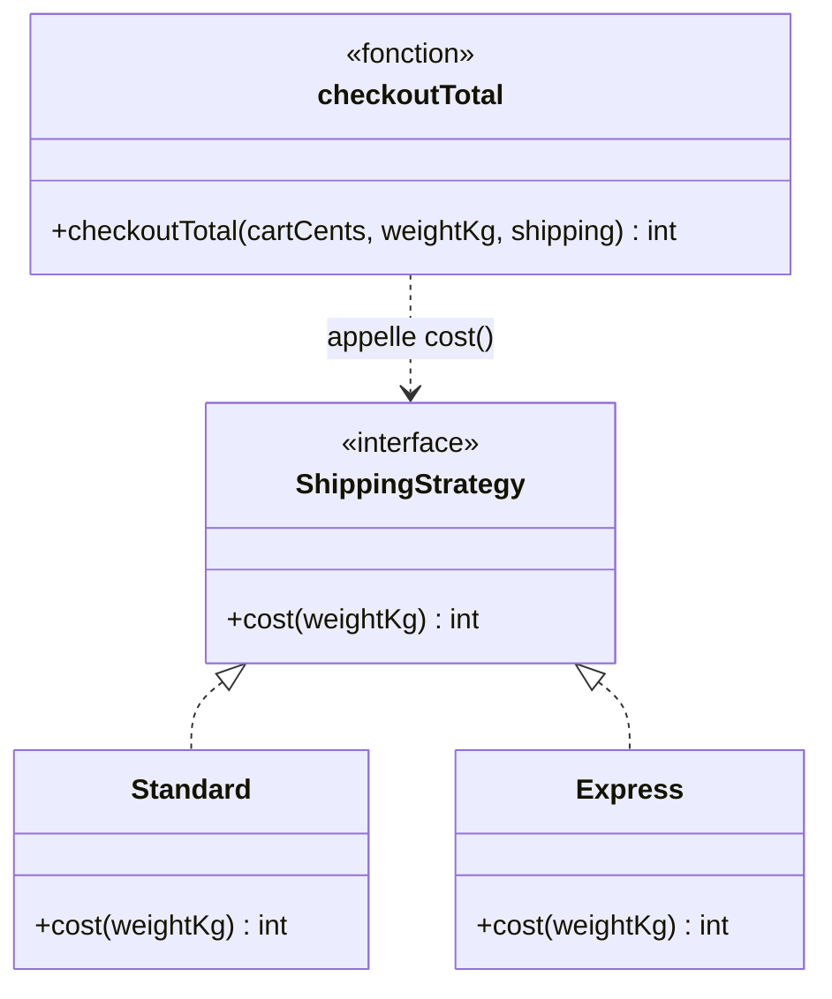
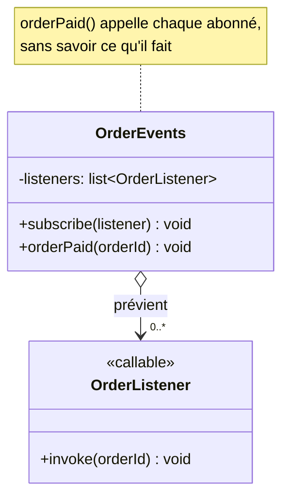
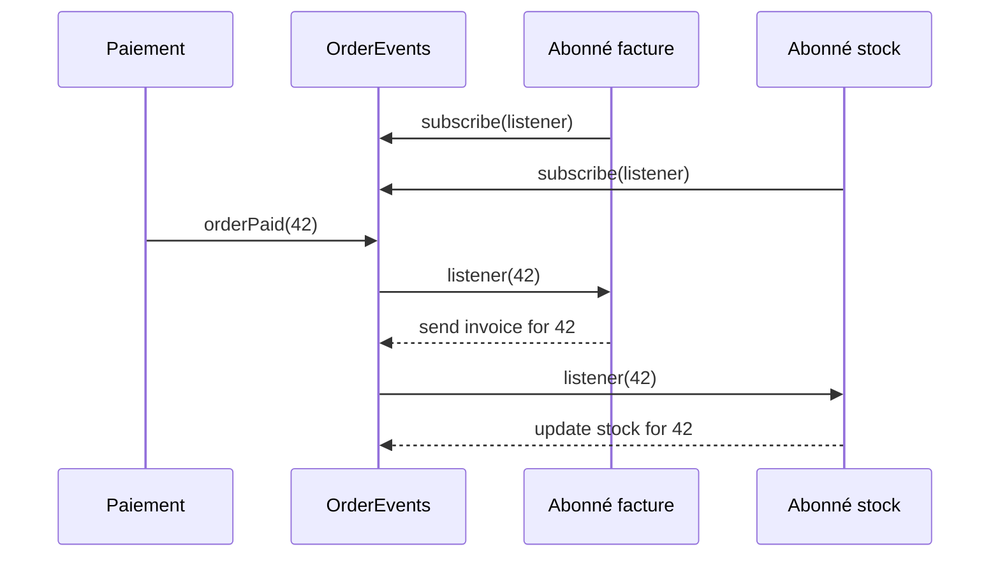
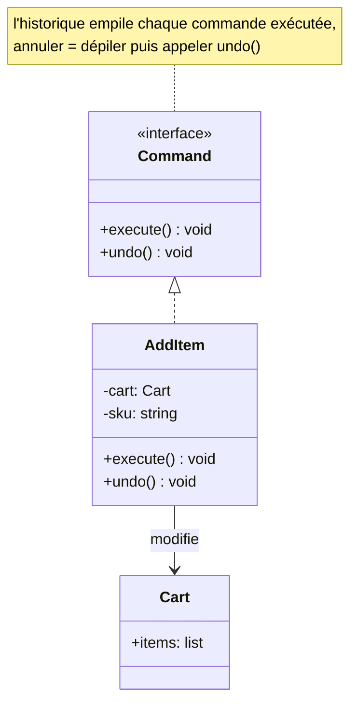
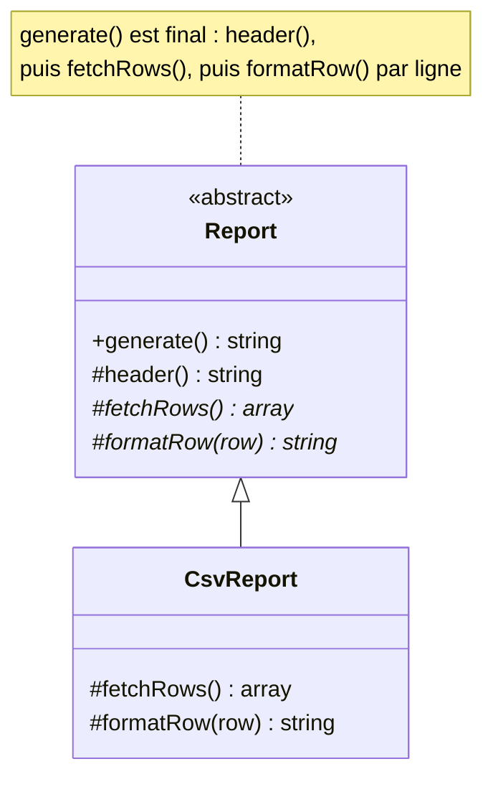
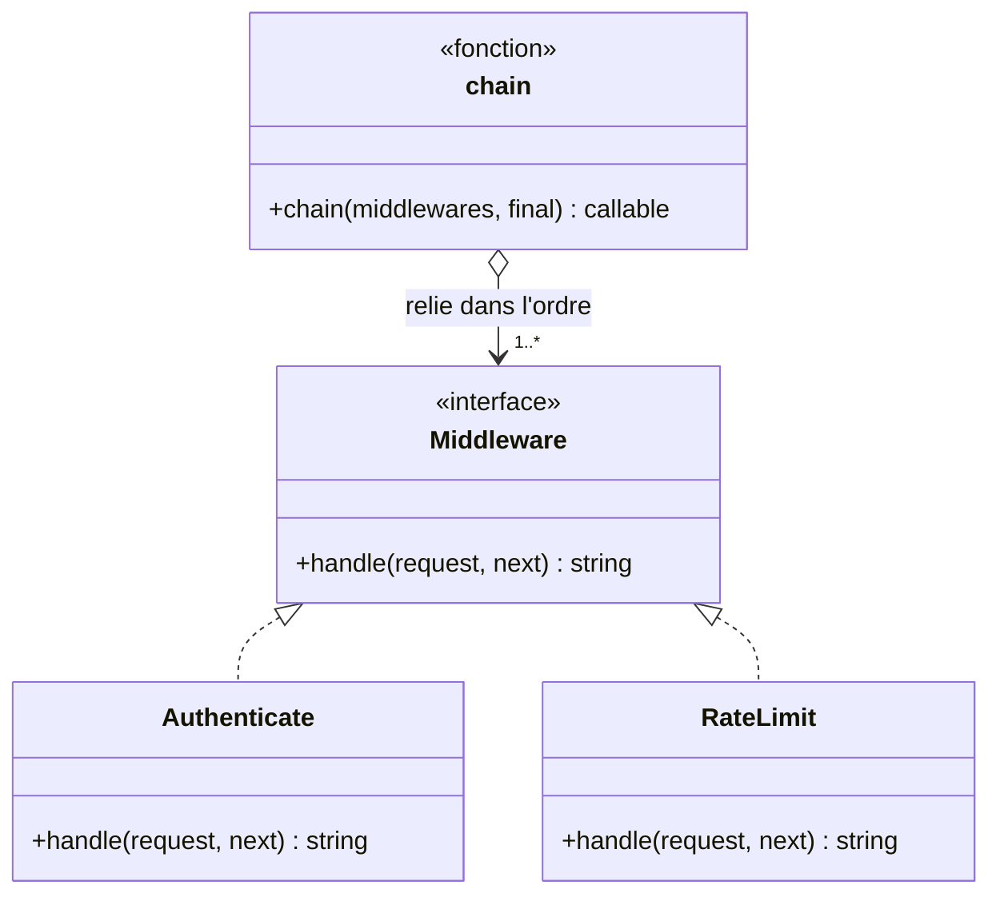
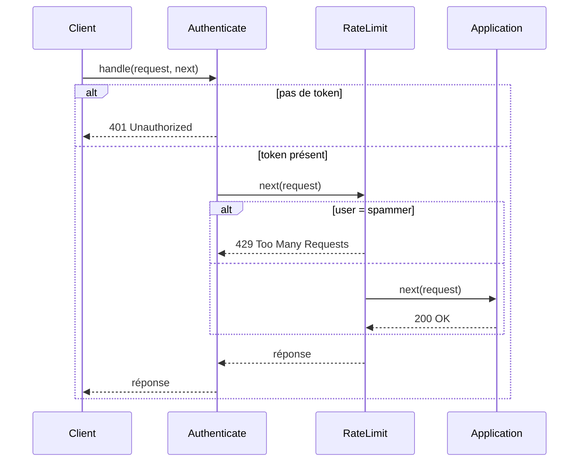
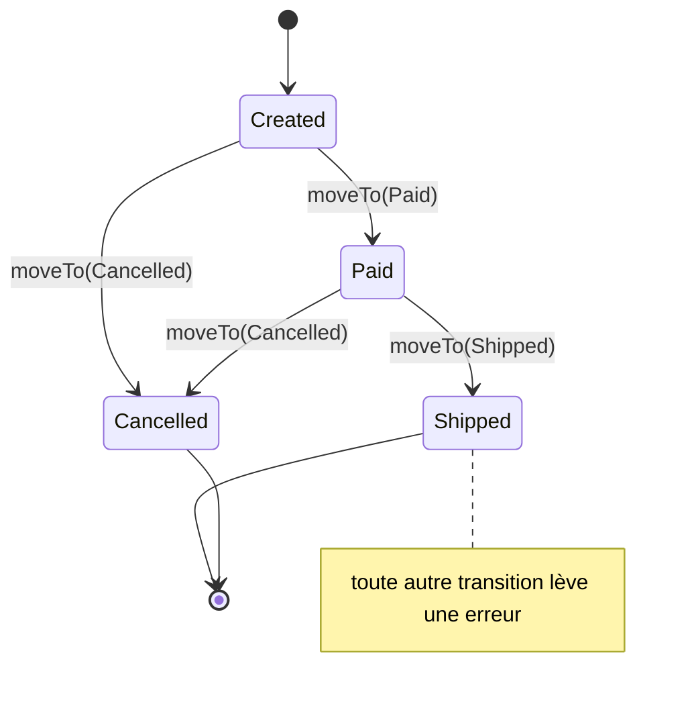
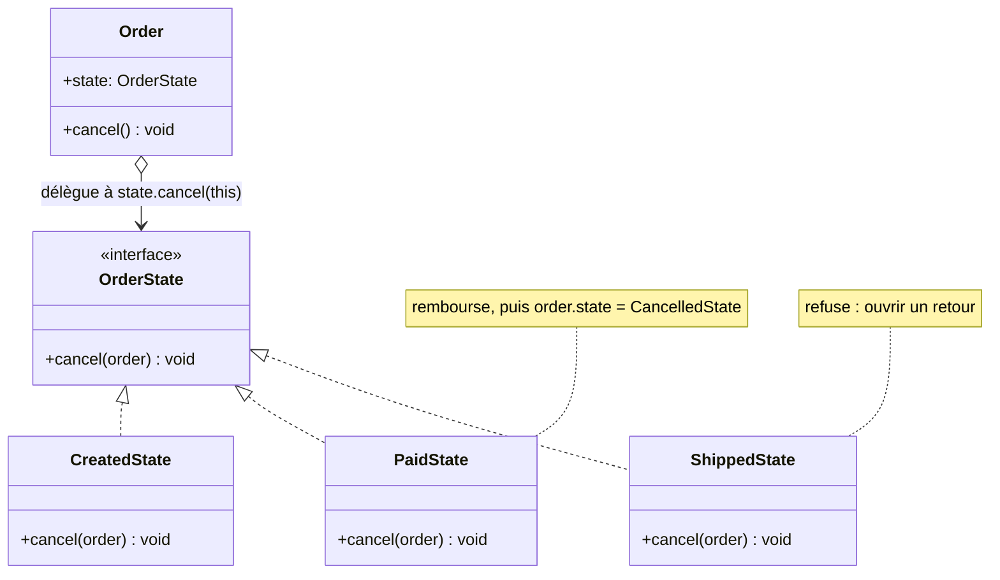

# Design patterns de comportement

!!! warning "Avertissement"
    Ces notes sont des pense-bêtes personnels, pas une source de vérité. Elles reflètent ma compréhension et mes choix : leur contenu reste subjectif, malgré les citations et les références qu'il contient. Il peut être incomplet, simplifié, inexact ou dépassé. Vérifiez toujours dans la documentation officielle avant de l'appliquer. Ce contenu est fourni tel quel, sans aucune garantie : son utilisation se fait sous votre seule responsabilité.

!!! audience "Pour qui, pour quoi"
    - **Métiers** : développeur back-end, développeur front-end, QA en automatisation de tests, tech lead, architecte...
    - **Usages** : je prépare un entretien où l'on me demande « explique-moi Strategy avec un exemple », je remplace un `if/elif` qui grossit à chaque nouveau mode de livraison, je veux qu'un bouton « annuler » défasse vraiment la dernière action du panier, je relis une MR qui ajoute un middleware et je vérifie sa place dans la chaîne, j'empêche qu'une commande déjà expédiée soit payée une deuxième fois...

!!! abstract "Les échelles"
    Les pastilles de couleur sous les titres disent à quelle échelle une notion s'applique :

    - <span class="pill pill-scope pill-scope-code">Code</span> les classes, fonctions et modules d'un programme ;
    - <span class="pill pill-scope pill-scope-app">Application</span> un service ou une application et son découpage interne ;
    - <span class="pill pill-scope pill-scope-system">Système</span> plusieurs services qui communiquent par le réseau ;
    - <span class="pill pill-scope pill-scope-infra">Infrastructure</span> les serveurs, le réseau, les zones et les clusters, physiques ou virtuels ;
    - <span class="pill pill-scope pill-scope-enterprise">Entreprise</span> le système d'information entier et son organisation.

    Détail et mots ambigus : [carte des échelles](architecture.md#carte-des-echelles).

Les **patterns de comportement** répondent à une question : comment répartir le travail entre des objets et les faire communiquer, sans que chacun dépende des détails des autres. Exemple : le paiement annonce « commande payée », et la facturation, le stock et l'e-mail réagissent chacun de leur côté, sans que le paiement les appelle un par un.

Cette page présente six patterns de comportement du GoF, avec le même exemple en PHP, Python et Java : Strategy, Observer, Command, Template Method, Chain of Responsibility et State. Ce qu'est un design pattern, et les patterns de création, de structure et d'architecture applicative, sont sur la page [Design patterns](design-patterns.md). Les principes qui guident ces choix (SOLID, KISS, YAGNI) sont sur la page [Principes de conception](principes-conception.md). Les noms des services et des données sont fictifs.

!!! tip "Choisir le langage"
    Je clique sur un langage : **tous les exemples de la page** passent dans ce langage, et le choix est gardé d'une page à l'autre.

=== "PHP"

    Exemples affichés en **PHP 8.3** (classes `readonly`, `match`, enums).

=== "Python"

    Exemples affichés en **Python 3.12** (`Protocol`, `dataclass`, annotations de type).

=== "Java"

    Exemples affichés en **Java 21** (`record`, `switch` en expression, `enum`).

## Vocabulaire

**<span class="term" data-term="interface-code">Interface</span>** : un contrat qui liste des méthodes sans les écrire. Toute classe qui l'implémente promet de les fournir. En Python, on utilise souvent un `Protocol` : pas besoin de déclarer qu'on l'implémente, il suffit d'avoir les bonnes méthodes.

**<span class="term" data-term="inheritance">Héritage</span>** : une classe reprend le code d'une classe parente et le complète. **<span class="term" data-term="object-composition">Composition</span>** : un objet en contient un autre et lui délègue une partie du travail. Strategy repose sur la composition, Template Method sur l'héritage.

**Classe abstraite** : une classe incomplète, faite pour être héritée : on ne peut pas l'instancier directement. Elle peut déjà contenir du code commun, et des **méthodes abstraites** : déclarées sans corps, que chaque sous-classe est obligée d'écrire. Exemple (voir Template Method plus bas) : `Report` est abstraite, `new Report()` échoue ; elle écrit `generate()` mais seulement déclare `fetch_rows()`. `CsvReport` hérite de `Report` et écrit `fetch_rows()`. Différence avec une interface : la classe abstraite fournit déjà une partie du code, l'interface aucun.

**<span class="term" data-term="polymorphism">Polymorphisme</span>** : appeler la même méthode sur des objets de classes différentes, chacun réagissant à sa façon. `shipping.cost()` donne un prix différent pour `Standard` et `Express`.

**<span class="term" data-term="coupling">Couplage</span>** : à quel point un morceau de code dépend des détails d'un autre. Fort couplage : changer l'un oblige à changer l'autre. Observer et Chain of Responsibility servent surtout à le réduire.

**GoF** (*Gang of Four*) : les quatre auteurs du livre « Design Patterns: Elements of Reusable Object-Oriented Software » (Gamma, Helm, Johnson et Vlissides, 1994), qui a nommé 23 patterns en trois familles : création, structure, comportement. Cette page couvre la troisième.

**<span class="term" data-term="middleware">Middleware</span>** : un maillon qui s'exécute avant ou après le code qui traite une requête HTTP, comme la vérification du token ou l'écriture des logs. Une suite de middlewares est une chaîne de responsabilité.

**<span class="term" data-term="state-machine">Machine à états</span>** : un objet qui ne peut être que dans un état à la fois (créée, payée, expédiée) et qui ne passe de l'un à l'autre que par des transitions autorisées. C'est ce que construit le pattern State.

**<span class="term" data-term="cognitive-complexity">Complexité cognitive</span>** : une mesure de l'effort qu'il faut pour lire une fonction, qui augmente avec chaque `if`, boucle ou imbrication. Un `if/elif` qui grossit la fait monter, une stratégie la fait redescendre.

**<span class="term" data-term="sli">SLI</span>** (Service Level Indicator, indicateur de niveau de service) : le chiffre que je mesure pour savoir si une solution marche, par exemple le nombre de fichiers modifiés pour ajouter un mode de livraison.

**<span class="term" data-term="slo">SLO</span>** (Service Level Objective, objectif de niveau de service) : la cible interne que je me fixe sur ce chiffre, par exemple « un nouveau mode de livraison ne touche qu'un seul fichier existant, la table des stratégies ».

**<span class="term" data-term="sla">SLA</span>** (Service Level Agreement, accord de niveau de service) : la promesse contractuelle faite à un client, avec une pénalité si elle n'est pas tenue, en général plus lâche que le SLO. Un choix de pattern reste interne au code : il n'a presque jamais de SLA, sauf quand il protège un service promis au client, comme le middleware d'authentification devant une API publique.

## Patterns de comportement

<a class="pill pill-scope pill-scope-code" href="../architecture/#carte-des-echelles">Échelle · Code</a>

Comment répartir les responsabilités et faire communiquer les objets.

### Strategy (stratégie)
<span class="pill pill-status pill-status-ok" title="Toujours valable, vérifié en novembre 2026">Valable · 11/2026</span>

**Intention** : rendre interchangeables plusieurs façons de faire la même chose.

**Problème** : un `if/elif` grossit à chaque nouveau mode de livraison, dans une fonction que tout le monde modifie, donc chaque ajout risque de casser les modes existants.

**Exemple** : chaque mode de livraison est une classe avec la méthode `cost()`. Le calcul du panier reçoit la stratégie et l'appelle, sans savoir laquelle c'est.

!!! noob "As noob"
    La stratégie, c'est le GPS qui me demande « voiture, vélo ou à pied ? » : la destination ne change pas, seule la façon de calculer l'itinéraire change, et on peut ajouter un mode sans toucher au reste. La phrase à retenir : **on remplace un gros `if` par des objets interchangeables qui ont la même méthode.**



**Sans le pattern** (à éviter) : une seule fonction contient tous les modes de livraison. Chaque nouveau mode ajoute une branche dans ce code partagé, et une faute de frappe dans le nom du mode (`"exprss"`) fait tomber la commande dans le tarif standard sans aucune erreur.

=== "PHP"

    ``` { .php .ex-bad title="À éviter" }
    <?php

    // À éviter : une branche par mode de livraison, que chaque nouveau mode vient modifier
    function checkoutTotal(int $cartCents, float $weightKg, string $mode): int
    {
        if ($mode === 'express') {
            $shipping = 1500 + (int) ($weightKg * 200);
        } elseif ($mode === 'relay') {
            $shipping = 300 + (int) ($weightKg * 50);
        } else {
            $shipping = 500 + (int) ($weightKg * 100);
        }
        return $cartCents + $shipping;
    }
    ```

=== "Python"

    ``` { .python .ex-bad title="À éviter" }
    # À éviter : une branche par mode de livraison, que chaque nouveau mode vient modifier
    def checkout_total(cart_cents: int, weight_kg: float, mode: str) -> int:
        if mode == "express":
            shipping = 1500 + int(weight_kg * 200)
        elif mode == "relay":
            shipping = 300 + int(weight_kg * 50)
        else:
            shipping = 500 + int(weight_kg * 100)
        return cart_cents + shipping
    ```

=== "Java"

    ``` { .java .ex-bad title="À éviter" }
    // À éviter : une branche par mode de livraison, que chaque nouveau mode vient modifier
    static int checkoutTotal(int cartCents, double weightKg, String mode) {
        int shipping;
        if (mode.equals("express")) {
            shipping = 1500 + (int) (weightKg * 200);
        } else if (mode.equals("relay")) {
            shipping = 300 + (int) (weightKg * 50);
        } else {
            shipping = 500 + (int) (weightKg * 100);
        }
        return cartCents + shipping;
    }
    ```

**Avec le pattern** :

=== "PHP"

    ``` { .php .ex-good title="Recommandé" }
    <?php

    // Exemple : le contrat commun à tous les modes de livraison
    interface ShippingStrategy
    {
        public function cost(float $weightKg): int;
    }

    // Bien : un mode de livraison par classe, testable seul
    final class Standard implements ShippingStrategy
    {
        public function cost(float $weightKg): int
        {
            return 500 + (int) ($weightKg * 100);
        }
    }

    // Bien : ajouter un mode, c'est ajouter une classe sans toucher aux autres
    final class Express implements ShippingStrategy
    {
        public function cost(float $weightKg): int
        {
            return 1500 + (int) ($weightKg * 200);
        }
    }

    // Bien : reçoit la stratégie et appelle cost(), sans savoir laquelle c'est
    function checkoutTotal(int $cartCents, float $weightKg, ShippingStrategy $shipping): int
    {
        return $cartCents + $shipping->cost($weightKg);
    }

    // Exemple : l'appelant choisit la stratégie
    checkoutTotal(3000, 2.0, new Express());
    ```

=== "Python"

    ``` { .python .ex-good title="Recommandé" }
    from typing import Protocol


    # Exemple : le contrat commun à tous les modes de livraison
    class ShippingStrategy(Protocol):
        def cost(self, weight_kg: float) -> int: ...


    # Bien : un mode de livraison par classe, testable seul
    class Standard:
        def cost(self, weight_kg: float) -> int:
            return 500 + int(weight_kg * 100)


    # Bien : ajouter un mode, c'est ajouter une classe sans toucher aux autres
    class Express:
        def cost(self, weight_kg: float) -> int:
            return 1500 + int(weight_kg * 200)


    # Bien : reçoit la stratégie et appelle cost(), sans savoir laquelle c'est
    def checkout_total(cart_cents: int, weight_kg: float, shipping: ShippingStrategy) -> int:
        return cart_cents + shipping.cost(weight_kg)


    # Exemple : l'appelant choisit la stratégie
    checkout_total(3000, 2.0, Express())
    ```

=== "Java"

    ``` { .java .ex-good title="Recommandé" }
    // Exemple : le contrat commun à tous les modes de livraison
    interface ShippingStrategy {
        int cost(double weightKg);
    }

    // Bien : un mode de livraison par classe, testable seul
    final class Standard implements ShippingStrategy {
        public int cost(double weightKg) { return 500 + (int) (weightKg * 100); }
    }

    // Bien : ajouter un mode, c'est ajouter une classe sans toucher aux autres
    final class Express implements ShippingStrategy {
        public int cost(double weightKg) { return 1500 + (int) (weightKg * 200); }
    }

    // Bien : reçoit la stratégie et appelle cost(), sans savoir laquelle c'est
    final class Checkout {
        static int total(int cartCents, double weightKg, ShippingStrategy shipping) {
            return cartCents + shipping.cost(weightKg);
        }
    }

    // Exemple : l'appelant choisit la stratégie
    Checkout.total(3000, 2.0, new Express());
    ```

**Dans les frameworks**

=== "PHP"

    Symfony : les *voters* de sécurité, ou un service choisi par tag (`#[AutowireIterator]`).

=== "Python"

    `sorted(items, key=...)` : la fonction `key` est une stratégie. En Python, une simple fonction suffit souvent.

=== "Java"

    `Comparator` passé à `list.sort(...)`, les implémentations de `PasswordEncoder` dans Spring Security.

| À utiliser quand | À éviter quand |
|---|---|
| j'ai plusieurs façons de faire la même chose, choisies selon une donnée ou un réglage, comme calculer les frais de port en standard ou en express. Chaque stratégie se teste seule. | je n'ai que deux cas, qui ne bougeront jamais : un `if` reste plus simple. |

**Risques.** Le choix de la stratégie se déplace souvent dans un `if` ailleurs, comme le contrôleur qui lit `"express"` : la faute de frappe qui tombait dans le tarif standard tombe maintenant dans la mauvaise stratégie. Je centralise le choix dans une table et je lève une erreur sur un nom inconnu. Une stratégie par cas trivial multiplie les fichiers pour rien : deux cas stables restent un `if`.

:material-book-open-variant: Doc de référence : [Refactoring.Guru, Strategy](https://refactoring.guru/fr/design-patterns/strategy) (consultée en novembre 2026)
{ .doc-ref }

### Observer (observateur)
<span class="pill pill-status pill-status-ok" title="Toujours valable, vérifié en novembre 2026">Valable · 11/2026</span>

**Intention** : prévenir automatiquement plusieurs objets quand un événement se produit, sans que l'émetteur les connaisse.

**Problème** : `pay()` appelle directement la facturation, le stock et l'e-mail. Ajouter un quatrième traitement oblige à modifier le paiement.

**Exemple** : le paiement publie « commande payée », chaque traitement s'abonne de son côté.

!!! noob "As noob"
    L'observateur, c'est une newsletter : l'auteur publie sans savoir qui est abonné, chacun s'inscrit ou se désinscrit de son côté. Ici les abonnés sont prévenus tout de suite, dans le même programme, sans message envoyé sur le réseau. La phrase à retenir : **l'émetteur annonce un fait, il ne sait pas qui réagit.**





**Sans le pattern** (à éviter) : le paiement appelle lui-même chaque traitement. Ajouter un quatrième traitement oblige à modifier `pay()`, et si l'envoi de l'e-mail lève une exception, la mise à jour du stock qui suit n'est jamais faite.

=== "PHP"

    ``` { .php .ex-bad title="À éviter" }
    <?php

    // À éviter : le paiement connaît et appelle chaque traitement, dans un ordre figé
    function pay(int $orderId): void
    {
        chargeCard($orderId);
        sendInvoice($orderId);
        sendConfirmationEmail($orderId);
        updateStock($orderId);
    }
    ```

=== "Python"

    ``` { .python .ex-bad title="À éviter" }
    # À éviter : le paiement connaît et appelle chaque traitement, dans un ordre figé
    def pay(order_id: int) -> None:
        charge_card(order_id)
        send_invoice(order_id)
        send_confirmation_email(order_id)
        update_stock(order_id)
    ```

=== "Java"

    ``` { .java .ex-bad title="À éviter" }
    // À éviter : le paiement connaît et appelle chaque traitement, dans un ordre figé
    static void pay(int orderId) {
        chargeCard(orderId);
        sendInvoice(orderId);
        sendConfirmationEmail(orderId);
        updateStock(orderId);
    }
    ```

**Avec le pattern** :

=== "PHP"

    ``` { .php .ex-good title="Recommandé" }
    <?php

    // Bien : l'émetteur garde une liste d'abonnés et les prévient sans les connaître
    final class OrderEvents
    {
        /** @var list<callable(int): void> */
        private array $listeners = [];

        public function subscribe(callable $listener): void
        {
            $this->listeners[] = $listener;
        }

        public function orderPaid(int $orderId): void
        {
            foreach ($this->listeners as $listener) {
                $listener($orderId);
            }
        }
    }

    // Exemple : chaque traitement s'abonne de son côté, puis le paiement publie
    $events = new OrderEvents();
    $events->subscribe(fn (int $id) => print("send invoice for $id\n"));
    $events->subscribe(fn (int $id) => print("update stock for $id\n"));
    $events->orderPaid(42);
    ```

=== "Python"

    ``` { .python .ex-good title="Recommandé" }
    from collections.abc import Callable

    OrderListener = Callable[[int], None]


    # Bien : l'émetteur garde une liste d'abonnés et les prévient sans les connaître
    class OrderEvents:
        def __init__(self) -> None:
            self._listeners: list[OrderListener] = []

        def subscribe(self, listener: OrderListener) -> None:
            self._listeners.append(listener)

        def order_paid(self, order_id: int) -> None:
            for listener in self._listeners:
                listener(order_id)


    # Exemple : chaque traitement s'abonne de son côté, puis le paiement publie
    events = OrderEvents()
    events.subscribe(lambda order_id: print(f"send invoice for {order_id}"))
    events.subscribe(lambda order_id: print(f"update stock for {order_id}"))
    events.order_paid(42)
    ```

=== "Java"

    ``` { .java .ex-good title="Recommandé" }
    import java.util.ArrayList;
    import java.util.List;
    import java.util.function.IntConsumer;

    // Bien : l'émetteur garde une liste d'abonnés et les prévient sans les connaître
    final class OrderEvents {
        private final List<IntConsumer> listeners = new ArrayList<>();

        void subscribe(IntConsumer listener) { listeners.add(listener); }

        void orderPaid(int orderId) {
            listeners.forEach(listener -> listener.accept(orderId));
        }
    }

    // Exemple : chaque traitement s'abonne de son côté, puis le paiement publie
    OrderEvents events = new OrderEvents();
    events.subscribe(id -> System.out.println("send invoice for " + id));
    events.subscribe(id -> System.out.println("update stock for " + id));
    events.orderPaid(42);
    ```

**Dans les frameworks**

=== "PHP"

    Symfony : l'`EventDispatcher` et les `#[AsEventListener]`. Laravel : `Event::dispatch()`.

=== "Python"

    Django : les *signals* (`post_save`).

=== "Java"

    Spring : `ApplicationEventPublisher` et `@EventListener`.

| À utiliser quand | À éviter quand |
|---|---|
| plusieurs traitements indépendants doivent réagir au même fait, comme la facturation, le stock et l'e-mail quand une commande est payée. Entre services différents, la même idée passe par un broker (Kafka, RabbitMQ). | l'ordre des réactions compte, ou une erreur dans un abonné doit annuler toute l'action : des appels directs sont plus explicites. |

**Risques.** Le flux devient invisible : en lisant `pay()`, je ne vois plus qui réagit, et un abonné enregistré deux fois envoie deux e-mails sans que le code le montre. Une exception dans un abonné peut bloquer les suivants, ou être avalée et passer inaperçue. Je liste les abonnés en un seul endroit, j'isole chaque abonné (erreur journalisée, les autres continuent) et un test vérifie la liste des réactions à « commande payée ».

:material-book-open-variant: Doc de référence : [Refactoring.Guru, Observer](https://refactoring.guru/fr/design-patterns/observer) (consultée en novembre 2026)
{ .doc-ref }

### Command (commande)
<span class="pill pill-status pill-status-ok" title="Toujours valable, vérifié en novembre 2026">Valable · 11/2026</span>

**Intention** : transformer une action en objet, qu'on peut stocker, mettre en file, rejouer ou annuler.

**Problème** : je veux qu'un utilisateur puisse annuler sa dernière action, ou qu'une action s'exécute plus tard dans un worker, mais un simple appel de méthode ne laisse rien à garder, à mettre en file ou à défaire.

**Exemple** : « ajouter un article au panier » devient un objet avec `execute()` et `undo()`. L'historique est une pile de commandes.

!!! noob "As noob"
    La commande, c'est un bon de commande écrit plutôt qu'une demande à voix haute : comme il est sur papier, on peut le poser dans une file, le traiter plus tard, le refaire, et s'il note aussi comment défaire l'action, l'annuler (c'est le principe du Ctrl+Z). La phrase à retenir : **une action devient un objet qu'on peut garder, rejouer ou annuler.**



**Sans le pattern** (à éviter) : l'action est un simple appel de méthode : une fois faite, il ne reste rien pour la défaire. Le bouton « annuler » retire alors le dernier article de la liste, qui n'est pas forcément celui que l'utilisateur vient d'ajouter, par exemple quand une promotion a ajouté un cadeau juste après.

=== "PHP"

    ``` { .php .ex-bad title="À éviter" }
    <?php

    // À éviter : l'action est un appel direct, rien n'est gardé pour la défaire
    function addItem(array &$cart, string $sku): void
    {
        $cart[] = $sku;
    }

    // À éviter : annuler devine en retirant le dernier article de la liste
    function undoLast(array &$cart): void
    {
        array_pop($cart);
    }
    ```

=== "Python"

    ``` { .python .ex-bad title="À éviter" }
    # À éviter : l'action est un appel direct, rien n'est gardé pour la défaire
    def add_item(cart: Cart, sku: str) -> None:
        cart.items.append(sku)


    # À éviter : annuler devine en retirant le dernier article de la liste
    def undo_last(cart: Cart) -> None:
        cart.items.pop()
    ```

=== "Java"

    ``` { .java .ex-bad title="À éviter" }
    // À éviter : l'action est un appel direct, rien n'est gardé pour la défaire
    static void addItem(List<String> cart, String sku) {
        cart.add(sku);
    }

    // À éviter : annuler devine en retirant le dernier article de la liste
    static void undoLast(List<String> cart) {
        cart.remove(cart.size() - 1);
    }
    ```

**Avec le pattern** :

=== "PHP"

    ``` { .php .ex-good title="Recommandé" }
    <?php

    // Exemple : toute commande sait s'exécuter et s'annuler
    interface Command
    {
        public function execute(): void;
        public function undo(): void;
    }

    // Exemple : l'objet que les commandes modifient
    final class Cart
    {
        public array $items = [];
    }

    // Bien : l'action devient un objet, avec de quoi la défaire
    final class AddItem implements Command
    {
        public function __construct(private readonly Cart $cart, private readonly string $sku) {}

        public function execute(): void { $this->cart->items[] = $this->sku; }

        public function undo(): void
        {
            $this->cart->items = array_values(array_diff($this->cart->items, [$this->sku]));
        }
    }

    // Exemple : l'historique empile les commandes, annuler dépile la dernière
    $cart = new Cart();
    $history = [];
    foreach ([new AddItem($cart, 'BK-0004'), new AddItem($cart, 'BK-0007')] as $command) {
        $command->execute();
        $history[] = $command;
    }
    array_pop($history)->undo();
    ```

=== "Python"

    ``` { .python .ex-good title="Recommandé" }
    from dataclasses import dataclass
    from typing import Protocol


    # Exemple : toute commande sait s'exécuter et s'annuler
    class Command(Protocol):
        def execute(self) -> None: ...
        def undo(self) -> None: ...


    # Exemple : l'objet que les commandes modifient
    @dataclass
    class Cart:
        items: list[str]


    # Bien : l'action devient un objet, avec de quoi la défaire
    @dataclass
    class AddItem:
        cart: Cart
        sku: str

        def execute(self) -> None:
            self.cart.items.append(self.sku)

        def undo(self) -> None:
            self.cart.items.remove(self.sku)


    # Exemple : l'historique empile les commandes, annuler dépile la dernière
    cart = Cart([])
    history: list[Command] = []
    for command in (AddItem(cart, "BK-0004"), AddItem(cart, "BK-0007")):
        command.execute()
        history.append(command)
    history.pop().undo()
    ```

=== "Java"

    ``` { .java .ex-good title="Recommandé" }
    import java.util.ArrayDeque;
    import java.util.ArrayList;
    import java.util.Deque;
    import java.util.List;

    // Exemple : toute commande sait s'exécuter et s'annuler
    interface Command {
        void execute();
        void undo();
    }

    // Bien : l'action devient un objet, avec de quoi la défaire
    record AddItem(List<String> cart, String sku) implements Command {
        public void execute() { cart.add(sku); }
        public void undo() { cart.remove(sku); }
    }

    // Exemple : l'historique empile les commandes, annuler dépile la dernière
    List<String> cart = new ArrayList<>();
    Deque<Command> history = new ArrayDeque<>();
    for (Command command : List.of(new AddItem(cart, "BK-0004"), new AddItem(cart, "BK-0007"))) {
        command.execute();
        history.push(command);
    }
    history.pop().undo();
    ```

**Dans les frameworks**

=== "PHP"

    Symfony Messenger : un message (`new SendInvoice(42)`) et son handler, exécuté tout de suite ou par un worker.

=== "Python"

    Celery : une tâche et ses arguments sont une commande sérialisée et mise en file.

=== "Java"

    `Runnable` passé à un `ExecutorService`, les commandes de l'Axon Framework.

| À utiliser quand | À éviter quand |
|---|---|
| je veux pouvoir annuler, rejouer, mettre en file ou journaliser des actions, comme annuler le dernier « ajouter au panier » ou faire exécuter une action plus tard par un worker. Base de <span class="term" data-term="cqrs">CQRS</span>. | l'action est simple, exécutée tout de suite et jamais annulée : une méthode suffit. |

**Risques.** Un `undo()` qui ne restaure pas exactement l'état d'avant corrompt le panier plus sûrement que l'absence d'annulation : je teste chaque commande par la paire `execute()` puis `undo()`. Une commande mise en file et rejouée par un worker après un échec réseau peut s'exécuter deux fois : elle doit donner le même résultat si on la rejoue, par exemple grâce à un identifiant d'action déjà traité.

:material-book-open-variant: Doc de référence : [Refactoring.Guru, Command](https://refactoring.guru/fr/design-patterns/command) (consultée en novembre 2026)
{ .doc-ref }

### Template Method (patron de méthode)
<span class="pill pill-status pill-status-ok" title="Toujours valable, vérifié en novembre 2026">Valable · 11/2026</span>

**Intention** : fixer les étapes d'un algorithme dans une classe parente, et laisser les sous-classes remplir certaines étapes.

**Problème** : trois exports (CSV, PDF, Excel) copient la même séquence : lire les données, écrire l'en-tête, formater chaque ligne.

**Exemple** : `Report.generate()` fixe l'ordre, `CsvReport` ne fournit que `fetch_rows()` et `format_row()`.

!!! noob "As noob"
    Le patron de méthode, c'est une recette à trous : « préchauffer le four, préparer la pâte, ajouter ___, cuire 30 minutes ». La recette impose l'ordre, chaque variante choisit seulement ce qui va dans le trou (chocolat, pommes). La phrase à retenir : **la classe parente fixe l'ordre, les sous-classes remplissent seulement les étapes qui changent.**



**Sans le pattern** (à éviter) : chaque export copie la séquence lire, en-tête, lignes. Le jour où je change l'en-tête, je le modifie dans le CSV et j'oublie le PDF : les deux exports du même rapport ne portent déjà plus le même titre.

=== "PHP"

    ``` { .php .ex-bad title="À éviter" }
    <?php

    // À éviter : la séquence lire, en-tête, lignes est écrite dans chaque export
    function csvReport(): string
    {
        $rows = [['FR', 1200], ['DE', 900]];
        return "Revenue report\n" . implode("\n", array_map(fn ($row) => "$row[0];$row[1]", $rows));
    }

    // À éviter : la même séquence recopiée, l'en-tête a déjà divergé
    function pdfReport(): string
    {
        $rows = [['FR', 1200], ['DE', 900]];
        return "Revenue\n" . implode("\n", array_map(fn ($row) => "$row[0]: $row[1]", $rows));
    }
    ```

=== "Python"

    ``` { .python .ex-bad title="À éviter" }
    # À éviter : la séquence lire, en-tête, lignes est écrite dans chaque export
    def csv_report() -> str:
        rows = [("FR", 1200), ("DE", 900)]
        return "Revenue report\n" + "\n".join(f"{country};{amount}" for country, amount in rows)


    # À éviter : la même séquence recopiée, l'en-tête a déjà divergé
    def pdf_report() -> str:
        rows = [("FR", 1200), ("DE", 900)]
        return "Revenue\n" + "\n".join(f"{country}: {amount}" for country, amount in rows)
    ```

=== "Java"

    ``` { .java .ex-bad title="À éviter" }
    // À éviter : la séquence lire, en-tête, lignes est écrite dans chaque export
    static String csvReport() {
        var rows = Map.of("FR", 1200, "DE", 900);
        return "Revenue report\n" + rows.entrySet().stream().map(row -> row.getKey() + ";" + row.getValue()).collect(Collectors.joining("\n"));
    }

    // À éviter : la même séquence recopiée, l'en-tête a déjà divergé
    static String pdfReport() {
        var rows = Map.of("FR", 1200, "DE", 900);
        return "Revenue\n" + rows.entrySet().stream().map(row -> row.getKey() + ": " + row.getValue()).collect(Collectors.joining("\n"));
    }
    ```

**Avec le pattern** :

=== "PHP"

    ``` { .php .ex-good title="Recommandé" }
    <?php

    // Bien : la classe parente fixe l'ordre des étapes, une fois pour toutes
    abstract class Report
    {
        final public function generate(): string
        {
            $lines = array_map(fn (array $row) => $this->formatRow($row), $this->fetchRows());
            return $this->header() . "\n" . implode("\n", $lines);
        }

        protected function header(): string { return 'Revenue report'; }

        // Exemple : les étapes que chaque sous-classe doit écrire
        abstract protected function fetchRows(): array;

        abstract protected function formatRow(array $row): string;
    }

    // Bien : la sous-classe ne fournit que les étapes qui changent
    final class CsvReport extends Report
    {
        protected function fetchRows(): array { return [['FR', 1200], ['DE', 900]]; }

        protected function formatRow(array $row): string { return "$row[0];$row[1]"; }
    }

    // Exemple : l'appelant lance generate(), l'ordre est garanti
    echo (new CsvReport())->generate();
    ```

=== "Python"

    ``` { .python .ex-good title="Recommandé" }
    from abc import ABC, abstractmethod


    # Bien : la classe parente fixe l'ordre des étapes, une fois pour toutes
    class Report(ABC):
        def generate(self) -> str:
            rows = self.fetch_rows()
            return self.header() + "\n" + "\n".join(self.format_row(row) for row in rows)

        def header(self) -> str:
            return "Revenue report"

        # Exemple : les étapes que chaque sous-classe doit écrire
        @abstractmethod
        def fetch_rows(self) -> list[tuple[str, int]]: ...

        @abstractmethod
        def format_row(self, row: tuple[str, int]) -> str: ...


    # Bien : la sous-classe ne fournit que les étapes qui changent
    class CsvReport(Report):
        def fetch_rows(self) -> list[tuple[str, int]]:
            return [("FR", 1200), ("DE", 900)]

        def format_row(self, row: tuple[str, int]) -> str:
            return f"{row[0]};{row[1]}"


    # Exemple : l'appelant lance generate(), l'ordre est garanti
    print(CsvReport().generate())
    ```

=== "Java"

    ``` { .java .ex-good title="Recommandé" }
    import java.util.List;
    import java.util.stream.Collectors;

    // Bien : la classe parente fixe l'ordre des étapes, une fois pour toutes
    abstract class Report {
        final String generate() {
            return header() + "\n" + fetchRows().stream().map(this::formatRow).collect(Collectors.joining("\n"));
        }

        protected String header() { return "Revenue report"; }

        // Exemple : les étapes que chaque sous-classe doit écrire
        protected abstract List<Object[]> fetchRows();

        protected abstract String formatRow(Object[] row);
    }

    // Bien : la sous-classe ne fournit que les étapes qui changent
    final class CsvReport extends Report {
        protected List<Object[]> fetchRows() { return List.of(new Object[] {"FR", 1200}, new Object[] {"DE", 900}); }

        protected String formatRow(Object[] row) { return row[0] + ";" + row[1]; }
    }

    // Exemple : l'appelant lance generate(), l'ordre est garanti
    System.out.println(new CsvReport().generate());
    ```

**Dans les frameworks**

=== "PHP"

    PHPUnit : `setUp()` et `tearDown()` sont les étapes que je remplis, l'ordre est fixé par `TestCase`.

=== "Python"

    `unittest.TestCase` de la même façon, les vues génériques de Django (`get_queryset()`).

=== "Java"

    `AbstractList`, `HttpServlet.doGet()`, `JdbcTemplate` de Spring.

| À utiliser quand | À éviter quand |
|---|---|
| j'ai plusieurs variantes d'un même déroulé où seules quelques étapes changent, comme des exports CSV, PDF et Excel qui lisent les données et écrivent l'en-tête de la même façon. | l'héritage devient profond, ou chaque variante change beaucoup d'étapes : je préfère Strategy (composition). |

**Risques.** Toute sous-classe dépend de l'ordre des étapes du parent : changer `generate()` pour un export casse les autres en silence. Une sous-classe qui veut changer une étape non prévue finit par surcharger `generate()` en entier, ce qui recopie la séquence. Je garde peu d'étapes variables, je teste chaque export, et je passe à Strategy dès qu'une variante sort du moule.

:material-book-open-variant: Doc de référence : [Refactoring.Guru, Template Method](https://refactoring.guru/fr/design-patterns/template-method) (consultée en novembre 2026)
{ .doc-ref }

### Chain of Responsibility (chaîne de responsabilité)
<span class="pill pill-status pill-status-ok" title="Toujours valable, vérifié en novembre 2026">Valable · 11/2026</span>

**Intention** : faire passer une requête dans une suite de maillons, chacun pouvant la traiter, la modifier ou l'arrêter.

**Problème** : un contrôleur qui vérifie lui-même l'authentification, la limite de débit, la langue et les logs, avant de faire son vrai travail.

**Exemple** : les <span class="term" data-term="middleware">*middlewares*</span> HTTP : authentification, puis limite de débit, puis l'application. Chaque maillon peut renvoyer une erreur sans appeler le suivant.

!!! noob "As noob"
    La chaîne de responsabilité, c'est le passage à l'aéroport : billet, puis sécurité, puis passeport. Chaque poste peut me laisser passer au suivant ou m'arrêter là, et on peut ajouter un poste sans changer les autres. La phrase à retenir : **chaque maillon traite ce qui le concerne puis passe la main, ou coupe court.**





**Sans le pattern** (à éviter) : chaque contrôleur fait lui-même toutes les vérifications avant son vrai travail. Elles sont recopiées en tête de chaque contrôleur, et celui où quelqu'un oublie l'authentification, ici l'export, répond à n'importe qui sans token.

=== "PHP"

    ``` { .php .ex-bad title="À éviter" }
    <?php

    // À éviter : authentification et limite de débit recopiées en tête de chaque contrôleur
    function listOrders(array $request): string
    {
        if (!isset($request['token'])) {
            return '401 Unauthorized';
        }
        if (($request['user'] ?? null) === 'spammer') {
            return '429 Too Many Requests';
        }
        return '200 OK';
    }

    // À éviter : copie incomplète, ce contrôleur répond sans vérifier le token
    function exportOrders(array $request): string
    {
        if (($request['user'] ?? null) === 'spammer') {
            return '429 Too Many Requests';
        }
        return '200 OK';
    }
    ```

=== "Python"

    ``` { .python .ex-bad title="À éviter" }
    # À éviter : authentification et limite de débit recopiées en tête de chaque contrôleur
    def list_orders(request: dict[str, str]) -> str:
        if "token" not in request:
            return "401 Unauthorized"
        if request.get("user") == "spammer":
            return "429 Too Many Requests"
        return "200 OK"


    # À éviter : copie incomplète, ce contrôleur répond sans vérifier le token
    def export_orders(request: dict[str, str]) -> str:
        if request.get("user") == "spammer":
            return "429 Too Many Requests"
        return "200 OK"
    ```

=== "Java"

    ``` { .java .ex-bad title="À éviter" }
    // À éviter : authentification et limite de débit recopiées en tête de chaque contrôleur
    static String listOrders(Map<String, String> request) {
        if (!request.containsKey("token")) {
            return "401 Unauthorized";
        }
        if ("spammer".equals(request.get("user"))) {
            return "429 Too Many Requests";
        }
        return "200 OK";
    }

    // À éviter : copie incomplète, ce contrôleur répond sans vérifier le token
    static String exportOrders(Map<String, String> request) {
        if ("spammer".equals(request.get("user"))) {
            return "429 Too Many Requests";
        }
        return "200 OK";
    }
    ```

**Avec le pattern** :

=== "PHP"

    ``` { .php .ex-good title="Recommandé" }
    <?php

    // Exemple : un maillon reçoit la requête et le maillon suivant
    interface Middleware
    {
        public function handle(array $request, callable $next): string;
    }

    // Bien : coupe court avec 401 sans token, sinon passe au suivant
    final class Authenticate implements Middleware
    {
        public function handle(array $request, callable $next): string
        {
            return isset($request['token']) ? $next($request) : '401 Unauthorized';
        }
    }

    // Bien : coupe court avec 429 en cas d'abus, sinon passe au suivant
    final class RateLimit implements Middleware
    {
        public function handle(array $request, callable $next): string
        {
            return ($request['user'] ?? '') === 'spammer' ? '429 Too Many Requests' : $next($request);
        }
    }

    // Exemple : relie les maillons dans l'ordre, le dernier appelle l'application
    function chain(array $middlewares, callable $final): callable
    {
        return array_reduce(
            array_reverse($middlewares),
            fn (callable $next, Middleware $m) => fn (array $request) => $m->handle($request, $next),
            $final,
        );
    }

    // Exemple : authentification, puis limite de débit, puis l'application
    $app = chain([new Authenticate(), new RateLimit()], fn (array $request) => '200 OK');
    $app(['token' => 'abc', 'user' => 'ada']);
    ```

=== "Python"

    ``` { .python .ex-good title="Recommandé" }
    from collections.abc import Callable

    # Exemple : un maillon reçoit la requête et le maillon suivant
    Request = dict[str, str]
    Handler = Callable[[Request], str]
    Middleware = Callable[[Request, Handler], str]


    # Bien : coupe court avec 401 sans token, sinon passe au suivant
    def authenticate(request: Request, next_handler: Handler) -> str:
        if "token" not in request:
            return "401 Unauthorized"
        return next_handler(request)


    # Bien : coupe court avec 429 en cas d'abus, sinon passe au suivant
    def rate_limit(request: Request, next_handler: Handler) -> str:
        if request.get("user") == "spammer":
            return "429 Too Many Requests"
        return next_handler(request)


    # Exemple : relie les maillons dans l'ordre, le dernier appelle l'application
    def chain(middlewares: list[Middleware], final: Handler) -> Handler:
        handler = final
        for middleware in reversed(middlewares):
            handler = (lambda m, n: lambda request: m(request, n))(middleware, handler)
        return handler


    # Exemple : authentification, puis limite de débit, puis l'application
    app = chain([authenticate, rate_limit], lambda request: "200 OK")
    app({"token": "abc", "user": "ada"})
    ```

=== "Java"

    ``` { .java .ex-good title="Recommandé" }
    import java.util.List;
    import java.util.Map;
    import java.util.function.Function;

    // Exemple : un maillon reçoit la requête et le maillon suivant
    interface Middleware {
        String handle(Map<String, String> request, Function<Map<String, String>, String> next);
    }

    // Exemple : relie les maillons dans l'ordre, le dernier appelle l'application
    final class Chain {
        static Function<Map<String, String>, String> of(List<Middleware> middlewares, Function<Map<String, String>, String> last) {
            Function<Map<String, String>, String> handler = last;
            for (int i = middlewares.size() - 1; i >= 0; i--) {
                Middleware middleware = middlewares.get(i);
                Function<Map<String, String>, String> next = handler;
                handler = request -> middleware.handle(request, next);
            }
            return handler;
        }
    }

    // Bien : coupe court avec 401 sans token, sinon passe au suivant
    Middleware authenticate = (request, next) -> request.containsKey("token") ? next.apply(request) : "401 Unauthorized";
    // Bien : coupe court avec 429 en cas d'abus, sinon passe au suivant
    Middleware rateLimit = (request, next) -> "spammer".equals(request.get("user")) ? "429 Too Many Requests" : next.apply(request);

    // Exemple : authentification, puis limite de débit, puis l'application
    var app = Chain.of(List.of(authenticate, rateLimit), request -> "200 OK");
    app.apply(Map.of("token", "abc", "user", "ada"));
    ```

**Dans les frameworks**

=== "PHP"

    PSR-15 (`MiddlewareInterface`), les middlewares de Laravel.

=== "Python"

    Les middlewares de Django et de FastAPI (Starlette).

=== "Java"

    Les `Filter` des servlets, la `SecurityFilterChain` de Spring Security.

| À utiliser quand | À éviter quand |
|---|---|
| chaque requête doit passer par les mêmes traitements avant ou après mon code, comme vérifier l'authentification, écrire les logs ou ajouter des en-têtes, sans les recopier dans chaque contrôleur. | l'ordre des maillons devient un piège que personne n'a écrit : j'écris l'ordre noir sur blanc et je le teste. |

:material-book-open-variant: Doc de référence : [Refactoring.Guru, Chain of Responsibility](https://refactoring.guru/fr/design-patterns/chain-of-responsibility) (consultée en novembre 2026) ; [PSR-15, HTTP Server Request Handlers](https://www.php-fig.org/psr/psr-15/) (2018)
{ .doc-ref }

### State (état)
<span class="pill pill-status pill-status-ok" title="Toujours valable, vérifié en novembre 2026">Valable · 11/2026</span>

**Intention** : faire dépendre le comportement d'un objet de son état, et interdire les transitions impossibles.

**Problème** : une commande expédiée qu'on peut encore « payer » parce que personne n'a vérifié l'état avant.

**Exemple** : une table des transitions autorisées : créée vers payée ou annulée, payée vers expédiée ou annulée. Tout le reste lève une erreur.

!!! noob "As noob"
    L'état, c'est un feu tricolore : il ne passe pas du vert au rouge sans l'orange, et ce que j'ai le droit de faire dépend de sa couleur. La phrase à retenir : **on écrit une fois la liste des passages autorisés, tout le reste est refusé.**



**Sans le pattern** (à éviter) : chaque méthode écrit le statut sans regarder d'où part la commande. Rien n'empêche d'appeler `pay()` sur une commande déjà expédiée : elle redevient « payée », et le traitement qui expédie les commandes payées l'envoie une deuxième fois.

=== "PHP"

    ``` { .php .ex-bad title="À éviter" }
    <?php

    // À éviter : chaque méthode écrit le statut sans vérifier l'état de départ
    final class Order
    {
        public string $status = 'created';

        public function pay(): void { $this->status = 'paid'; }

        public function ship(): void { $this->status = 'shipped'; }

        public function cancel(): void { $this->status = 'cancelled'; }
    }
    ```

=== "Python"

    ``` { .python .ex-bad title="À éviter" }
    # À éviter : chaque méthode écrit le statut sans vérifier l'état de départ
    class Order:
        def __init__(self) -> None:
            self.status = "created"

        def pay(self) -> None:
            self.status = "paid"

        def ship(self) -> None:
            self.status = "shipped"

        def cancel(self) -> None:
            self.status = "cancelled"
    ```

=== "Java"

    ``` { .java .ex-bad title="À éviter" }
    // À éviter : chaque méthode écrit le statut sans vérifier l'état de départ
    final class Order {
        String status = "created";

        void pay() { status = "paid"; }

        void ship() { status = "shipped"; }

        void cancel() { status = "cancelled"; }
    }
    ```

**Avec le pattern** :

=== "PHP"

    ``` { .php .ex-good title="Recommandé" }
    <?php

    // Exemple : les états possibles d'une commande
    enum OrderStatus: string
    {
        case Created = 'created';
        case Paid = 'paid';
        case Shipped = 'shipped';
        case Cancelled = 'cancelled';

        // Bien : la table des transitions autorisées, écrite une seule fois
        public function canMoveTo(self $target): bool
        {
            return in_array($target, match ($this) {
                self::Created => [self::Paid, self::Cancelled],
                self::Paid => [self::Shipped, self::Cancelled],
                self::Shipped, self::Cancelled => [],
            }, true);
        }
    }

    // Bien : toute transition passe par moveTo(), qui refuse les passages interdits
    final class Order
    {
        public OrderStatus $status = OrderStatus::Created;

        public function moveTo(OrderStatus $target): void
        {
            if (!$this->status->canMoveTo($target)) {
                throw new DomainException("cannot go from {$this->status->value} to {$target->value}");
            }
            $this->status = $target;
        }
    }

    // Exemple : créée, puis payée, puis expédiée : passages autorisés
    $order = new Order();
    $order->moveTo(OrderStatus::Paid);
    $order->moveTo(OrderStatus::Shipped);
    ```

=== "Python"

    ``` { .python .ex-good title="Recommandé" }
    from enum import Enum


    # Exemple : les états possibles d'une commande
    class OrderStatus(Enum):
        CREATED = "created"
        PAID = "paid"
        SHIPPED = "shipped"
        CANCELLED = "cancelled"


    # Bien : la table des transitions autorisées, écrite une seule fois
    ALLOWED = {
        OrderStatus.CREATED: {OrderStatus.PAID, OrderStatus.CANCELLED},
        OrderStatus.PAID: {OrderStatus.SHIPPED, OrderStatus.CANCELLED},
        OrderStatus.SHIPPED: set(),
        OrderStatus.CANCELLED: set(),
    }


    # Bien : toute transition passe par move_to(), qui refuse les passages interdits
    class Order:
        def __init__(self) -> None:
            self.status = OrderStatus.CREATED

        def move_to(self, target: OrderStatus) -> None:
            if target not in ALLOWED[self.status]:
                raise ValueError(f"cannot go from {self.status.value} to {target.value}")
            self.status = target


    # Exemple : créée, puis payée, puis expédiée : passages autorisés
    order = Order()
    order.move_to(OrderStatus.PAID)
    order.move_to(OrderStatus.SHIPPED)
    ```

=== "Java"

    ``` { .java .ex-good title="Recommandé" }
    import java.util.Set;

    // Exemple : les états possibles d'une commande
    enum OrderStatus {
        CREATED, PAID, SHIPPED, CANCELLED;

        // Bien : la table des transitions autorisées, écrite une seule fois
        boolean canMoveTo(OrderStatus target) {
            return switch (this) {
                case CREATED -> Set.of(PAID, CANCELLED).contains(target);
                case PAID -> Set.of(SHIPPED, CANCELLED).contains(target);
                case SHIPPED, CANCELLED -> false;
            };
        }
    }

    // Bien : toute transition passe par moveTo(), qui refuse les passages interdits
    final class Order {
        private OrderStatus status = OrderStatus.CREATED;

        void moveTo(OrderStatus target) {
            if (!status.canMoveTo(target)) {
                throw new IllegalStateException("cannot go from " + status + " to " + target);
            }
            status = target;
        }
    }

    // Exemple : créée, puis payée, puis expédiée : passages autorisés
    Order order = new Order();
    order.moveTo(OrderStatus.PAID);
    order.moveTo(OrderStatus.SHIPPED);
    ```

La table des transitions est la variante légère : elle interdit les mauvais passages, mais le comportement reste le même dans chaque état. Quand une même action fait des choses différentes selon l'état, le State du GoF donne une classe par état. Ici `cancel()` ferme simplement une commande créée, rembourse puis ferme une commande payée, et refuse une commande expédiée.



=== "PHP"

    ``` { .php .ex-good title="Recommandé" }
    <?php

    // Exemple : chaque état écrit sa propre version de cancel()
    interface OrderState
    {
        public function cancel(Order $order): void;
    }

    // Bien : commande créée, l'annulation la ferme simplement
    final class CreatedState implements OrderState
    {
        public function cancel(Order $order): void
        {
            $order->state = new CancelledState();
        }
    }

    // Bien : commande payée, rembourse puis ferme
    final class PaidState implements OrderState
    {
        public function cancel(Order $order): void
        {
            $order->payments->refund($order->id);
            $order->state = new CancelledState();
        }
    }

    // Bien : commande expédiée, refuse et demande d'ouvrir un retour
    final class ShippedState implements OrderState
    {
        public function cancel(Order $order): void
        {
            throw new DomainException('shipped: open a return instead');
        }
    }
    ```

=== "Python"

    ``` { .python .ex-good title="Recommandé" }
    # Bien : commande créée, l'annulation la ferme simplement
    class CreatedState:
        def cancel(self, order: "Order") -> None:
            order.state = CancelledState()


    # Bien : commande payée, rembourse puis ferme
    class PaidState:
        def cancel(self, order: "Order") -> None:
            order.payments.refund(order.id)
            order.state = CancelledState()


    # Bien : commande expédiée, refuse et demande d'ouvrir un retour
    class ShippedState:
        def cancel(self, order: "Order") -> None:
            raise ValueError("shipped: open a return instead")


    # Bien : la commande délègue cancel() à son état courant
    class Order:
        def cancel(self) -> None:
            self.state.cancel(self)
    ```

=== "Java"

    ``` { .java .ex-good title="Recommandé" }
    // Exemple : chaque état écrit sa propre version de cancel()
    interface OrderState { void cancel(Order order); }

    // Bien : commande créée, l'annulation la ferme simplement
    final class CreatedState implements OrderState {
        public void cancel(Order order) { order.state = new CancelledState(); }
    }

    // Bien : commande payée, rembourse puis ferme
    final class PaidState implements OrderState {
        public void cancel(Order order) {
            order.payments.refund(order.id);
            order.state = new CancelledState();
        }
    }

    // Bien : commande expédiée, refuse et demande d'ouvrir un retour
    final class ShippedState implements OrderState {
        public void cancel(Order order) { throw new IllegalStateException("shipped: open a return instead"); }
    }
    ```

**Dans les frameworks**

=== "PHP"

    Le composant Symfony Workflow (machine à états décrite en YAML).

=== "Python"

    La bibliothèque `transitions`, ou un `Enum` plus une table comme ci-dessus.

=== "Java"

    Spring Statemachine, ou un `enum` avec `switch` comme ci-dessus.

| À utiliser quand | À éviter quand |
|---|---|
| mon objet a un cycle de vie et certains passages doivent être interdits, comme une commande créée, payée puis expédiée, un ticket ou un paiement. La table des transitions se teste ligne par ligne. | mon objet n'a que deux états : un booléen suffit. |

**Risques.** Une table de transitions qui vit seulement dans le code ne protège pas la base : un script SQL de correction ou un autre service peut écrire `shipped` directement. Je double la règle par une contrainte en base, ou je fais passer toute écriture par l'objet. Un état oublié dans la table, comme « remboursée », bloque des commandes réelles : chaque nouvel état arrive avec ses lignes de test.

:material-book-open-variant: Doc de référence : [Refactoring.Guru, State](https://refactoring.guru/fr/design-patterns/state) (consultée en novembre 2026)
{ .doc-ref }

!!! maturity "Mesurer la maturité"
    | Niveau | Ce que j'observe dans l'équipe |
    |---|---|
    | N1 | quelques `if/elif` sur un type ont été remplacés par une stratégie ou une table d'états, au cas par cas, quand quelqu'un y pensait |
    | N2 | toute nouvelle variante passe par une stratégie, les cycles de vie (commande, paiement) ont une table de transitions testée ligne par ligne, et les middlewares portent les vérifications communes |
    | N3 | la machine à états refuse d'elle-même une transition interdite, la chaîne de middlewares est déclarée en un seul endroit, et un test casse si son ordre change |
    | N4 | l'équipe suit la complexité cognitive des fonctions à `if/elif` et le nombre de transitions interdites tentées en production, et refactore les zones où ces chiffres montent |

    **Je mesure** : la complexité cognitive des fonctions les plus modifiées, lue dans l'analyse statique ; le nombre d'erreurs « transition interdite » par semaine, compté dans les logs.

## Mesurer le succès

Je sais qu'un pattern de comportement a servi quand le changement qu'il devait faciliter devient vraiment plus petit, sans créer de nouveaux bugs. Avant de l'introduire, je note une base sur les dernières MR de la zone : par exemple, combien de fichiers il a fallu toucher pour ajouter un mode de livraison, et combien de bugs ont suivi (un e-mail envoyé deux fois, une commande payée après son expédition). Je reprends la même mesure sur les trois à cinq changements suivants. La métrique garde-fou est le temps de lecture : Observer et Chain of Responsibility cachent une partie du flux, donc si un nouveau venu met plus longtemps à retrouver qui réagit à « commande payée », le pattern coûte plus qu'il ne rapporte.

| Solution ou situation | Indicateur de succès (SLI) | SLO probable | SLA probable |
|---|---|---|---|
| Strategy : j'ajoute un mode de livraison, comme le point relais | nombre de fichiers existants modifiés par la MR qui ajoute le mode | un seul fichier existant (la table des stratégies), plus le nouveau fichier | sans objet : pas de contrat externe |
| Observer : un nouveau traitement réagit à « commande payée » | lignes modifiées dans `pay()` par la MR qui ajoute l'abonné, et part des erreurs d'abonné journalisées sans bloquer les autres abonnés | zéro ligne dans `pay()`, 100 % des erreurs d'abonné journalisées | sans objet : pas de contrat externe |
| Command : bouton « annuler » du panier | part des commandes dont le test `execute()` puis `undo()` retrouve exactement l'état de départ, lue dans le rapport de tests | 100 % des commandes annulables | sans objet : pas de contrat externe |
| Chain of Responsibility : middleware d'authentification devant l'API | part des routes protégées qui refusent un appel sans token, testée en CI | 100 % : une seule route ouverte est un incident de sécurité | l'engagement de sécurité du contrat client (aucun accès sans authentification), pas un pourcentage |
| State : cycle de vie d'une commande | nombre de transitions interdites qui atteignent la base, compté par une requête de contrôle | zéro par mois | sans objet : pas de contrat externe |

[À prendre avec précaution : ordres de grandeur d'exemple, à fixer avec le métier]

## Pièges à éviter

- **L'héritage profond** : j'empile un `Template Method` sur quatre niveaux, et plus personne ne sait quelle classe écrit quelle étape. Au-delà d'un niveau, je préfère la composition (Strategy, Decorator).
- **L'observateur quand l'ordre compte** : je passe par des abonnés alors que la facturation doit réussir avant l'envoi de l'e-mail, ou qu'une erreur dans un abonné doit tout annuler. Rien dans le code n'écrit cet ordre, donc l'e-mail peut partir pour une commande dont la facturation a échoué. Dans ce cas, j'écris des appels directs ([voir Observer](#observer-observateur)).
- **Le choix de la stratégie recopié partout** : je lis `"express"` avec un `if` dans le contrôleur, puis dans l'export, puis dans l'API mobile. Une faute de frappe tombe dans la mauvaise stratégie sans aucune erreur. Je centralise le choix dans une seule table et je lève une erreur sur un nom inconnu ([voir Strategy](#strategy-strategie)).
- **L'abonné qui plante en silence** : une exception dans l'abonné e-mail est avalée, ou empêche l'abonné stock qui suit de tourner. Le client ne reçoit rien, le stock est faux, et personne ne le voit. J'isole chaque abonné : son erreur est journalisée, les autres continuent ([voir Observer](#observer-observateur)).
- **L'annulation approximative** : mon `undo()` retire « le dernier article du panier » au lieu de celui que la commande a ajouté, donc quand une promotion vient d'ajouter un cadeau, l'annulation retire le cadeau. Chaque commande garde ce qu'elle a fait, et je la teste par la paire `execute()` puis `undo()` ([voir Command](#command-commande)).
- **L'ordre des middlewares laissé au hasard** : je déclare le middleware de cache avant celui d'authentification, donc une réponse mise en cache pour un utilisateur connecté est servie à un appel sans token. J'écris la chaîne en un seul endroit et un test vérifie son ordre ([voir Chain of Responsibility](#chain-of-responsibility-chaine-de-responsabilite)).
- **La table d'états qui ne vit que dans le code** : un script SQL de correction écrit `shipped` directement en base, sans passer par l'objet, et la règle est contournée. Je double la table par une contrainte en base, ou je fais passer toute écriture par l'objet ([voir State](#state-etat)).

## Ce qu'on demande en entretien

Les questions typiques :

- « Quels design patterns utilises-tu au quotidien ? », « Donne un exemple de Strategy dans ton code » Pour répondre : je pars d'un cas réel, comme les frais de port standard et express, puis je dis quand un `if` suffit ([Strategy](#strategy-strategie)).
- « Composition ou héritage ? Quand préférer Strategy à Template Method ? » Pour répondre : je passe à Strategy dès que l'héritage dépasse un niveau ou que chaque variante change beaucoup d'étapes ([Template Method](#template-method-patron-de-methode)).
- « Observer ou appels directs ? », « Quel est le risque d'un bus d'événements ? » Pour répondre : j'explique que l'émetteur ne connaît plus ses abonnés, ce qui facilite l'ajout d'un traitement, mais que l'ordre et la gestion d'erreur ne sont plus écrits nulle part ; quand la facturation doit réussir avant l'e-mail, je garde des appels directs ([Observer](#observer-observateur)).
- « Comment implémenterais-tu un bouton annuler ? », « Que se passe-t-il si une commande en file est rejouée ? » Pour répondre : je transforme l'action en objet avec `execute()` et `undo()`, rangé dans une pile, et je rends la commande rejouable sans effet en double, grâce à un identifiant d'action déjà traité ([Command](#command-commande)).
- « Qu'est-ce qu'un middleware, et quel pattern y a-t-il derrière ? » Pour répondre : c'est une chaîne de responsabilité, chaque maillon traite ce qui le concerne puis passe la main ou coupe court, et l'ordre de la chaîne est écrit et testé ([Chain of Responsibility](#chain-of-responsibility-chaine-de-responsabilite)).
- « Comment empêches-tu qu'une commande expédiée soit payée une deuxième fois ? » Pour répondre : je montre une table des transitions autorisées, testée ligne par ligne, doublée d'une contrainte en base ([State](#state-etat)).
- « Comment sais-tu qu'un pattern a valu le coup ? » Pour répondre : je compare, avant et après, le nombre de fichiers touchés pour ajouter une variante et les bugs qui ont suivi, avec une métrique garde-fou sur la lisibilité ([Mesurer le succès](#mesurer-le-succes)).

Ce qui fait une bonne réponse : nommer le problème avant le pattern, montrer un exemple concret, puis dire **quand je ne l'utiliserais pas**. C'est ce qui montre que je choisis un pattern au lieu de le réciter.

## Quel pattern pour quel besoin

| Je veux... | J'utilise... |
|---|---|
| faire un même calcul de plusieurs façons selon une donnée, comme des frais de port différents en standard et en express | Strategy |
| que plusieurs modules réagissent à un fait, comme « commande payée », sans que l'émetteur les connaisse | Observer |
| mettre une action en file, la rejouer ou l'annuler, comme un Ctrl+Z sur le panier | Command |
| partager un déroulé dont seules quelques étapes changent, comme des exports CSV et PDF | Template Method |
| faire passer chaque requête par les mêmes contrôles avant et après mon code, comme l'authentification et la limite de débit | Chain of Responsibility (middlewares) |
| interdire les passages impossibles d'un cycle de vie, comme payer une commande déjà expédiée | State |
| créer le bon objet selon un réglage, brancher une bibliothèque tierce, ajouter du cache autour d'un objet ou tester ma logique sans base de données | un pattern de création, de structure ou d'architecture applicative, sur la page [Design patterns](design-patterns.md) |

## Sources

- Erich Gamma, Richard Helm, Ralph Johnson et John Vlissides, « Design Patterns: Elements of Reusable Object-Oriented Software » (1994)
- [Refactoring.Guru, catalogue des design patterns (date de publication non indiquée)](https://refactoring.guru/fr/design-patterns)
- [PSR-15, HTTP Server Request Handlers (2018)](https://www.php-fig.org/psr/psr-15/)
