# Design patterns

!!! warning "Disclaimer"
    These notes are personal cheat sheets, not a source of truth. They reflect my own understanding and choices: their content remains subjective, despite the quotes and references it contains. It may be incomplete, simplified, inaccurate or outdated. Always check the official documentation before applying it. This content is provided as is, without any warranty: you use it at your own risk.

!!! abstract "Scales"
    The colored badges under the headings say at which scale a notion applies:

    - <span class="pill pill-scope pill-scope-code">Code</span> the classes, functions and modules of one program;
    - <span class="pill pill-scope pill-scope-app">Application</span> one service or application and its internal split;
    - <span class="pill pill-scope pill-scope-system">System</span> several services talking to each other over the network;
    - <span class="pill pill-scope pill-scope-infra">Infrastructure</span> servers, network, zones and clusters, physical or virtual;
    - <span class="pill pill-scope pill-scope-enterprise">Enterprise</span> the whole information system and its organization.

    Details and ambiguous words: [map of scales](architecture.md#map-of-scales).

A **design pattern** is a known, named solution to a design problem that keeps coming back. It is not code to copy: it is a shape of solution, which I adapt. Naming it also makes reviews faster: "put an adapter in front of this client" says in a few words what would take a paragraph.

This page covers the patterns most useful day to day, with the same example in PHP, Python and Java. Service and data names are fictitious. The principles that guide these choices (SOLID, STUPID, KISS, DRY, YAGNI) are on the [Design principles](principes-conception.md) page.

!!! tip "Choose the language"
    I click a language: **every example on the page** switches to it, and the choice is kept from one page to the next.

=== "PHP"

    Examples shown in **PHP 8.3** (`readonly` classes, `match`, enums).

=== "Python"

    Examples shown in **Python 3.12** (`Protocol`, `dataclass`, type hints).

=== "Java"

    Examples shown in **Java 21** (`record`, `switch` expressions, `enum`).

## Terminology

**Class**: a template for objects (their data and methods). **Object** (or instance): one copy created from a class.

**<span class="term" data-term="interface-code">Interface</span>**: a contract that lists methods without writing them. Any class implementing it promises to provide them. In Python, a `Protocol` is often used: no need to declare it, having the right methods is enough.

**<span class="term" data-term="inheritance">Inheritance</span>**: a class takes the code of a parent class and extends it. **<span class="term" data-term="object-composition">Composition</span>**: an object holds another one and delegates part of the work to it. Most patterns prefer composition, which is more flexible.

**Abstract class**: an incomplete class, meant to be inherited: it cannot be instantiated directly. It can already hold shared code, and **abstract methods**: declared without a body, which every subclass must write. Example (see Template Method below): `Report` is abstract, `new Report()` fails; it writes `generate()` but only declares `fetch_rows()`. `CsvReport` inherits from `Report` and writes `fetch_rows()`. Difference with an interface: the abstract class already provides part of the code, the interface none.

**<span class="term" data-term="polymorphism">Polymorphism</span>**: calling the same method on objects of different classes, each reacting in its own way. `shipping.cost()` gives a different price for `Standard` and `Express`.

**<span class="term" data-term="coupling">Coupling</span>**: how much a piece of code depends on the details of another. Tight coupling: changing one forces changing the other.

**GoF** (*Gang of Four*): the four authors of "Design Patterns: Elements of Reusable Object-Oriented Software" (Gamma, Helm, Johnson and Vlissides, 1994), which named 23 patterns in three families: creational, structural, behavioral.

## Creational patterns

<a class="pill pill-scope pill-scope-code" href="../architecture/#map-of-scales">Scale · Code</a>

How to build objects without the rest of the code depending on how they are built.

### Factory
<span class="pill pill-status pill-status-ok" title="Still valid, checked November 2026">Current · 11/2026</span>

**Intent**: centralize the creation of objects whose exact class depends on a parameter.

**Problem**: `if channel == "sms": SmsNotifier()` all over the code. Adding a channel means finding and changing every place.

**Example**: choosing how to notify a customer (email or SMS) from a setting. A single place knows which class to create.

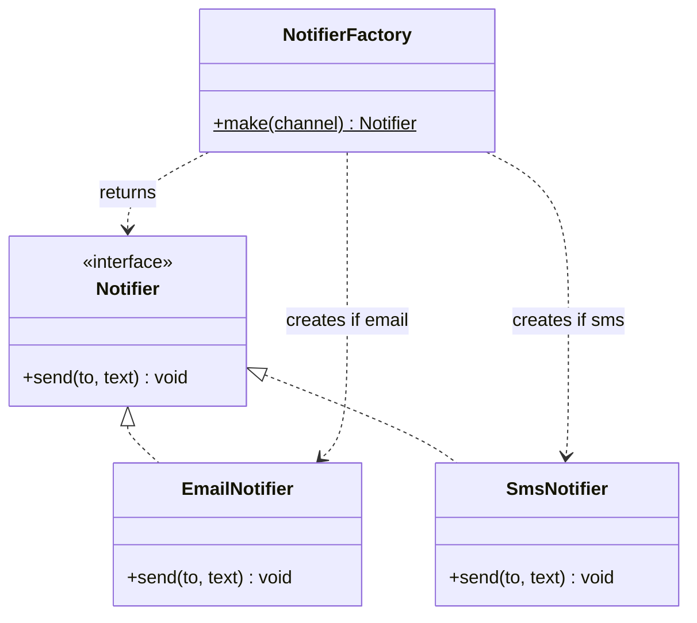

=== "PHP"

    ```php
    <?php

    // Example: the contract every notifier shares
    interface Notifier
    {
        public function send(string $to, string $text): void;
    }

    // Example: one class per channel, with the same send() method
    final class EmailNotifier implements Notifier
    {
        public function send(string $to, string $text): void { echo "email to $to: $text\n"; }
    }

    final class SmsNotifier implements Notifier
    {
        public function send(string $to, string $text): void { echo "sms to $to: $text\n"; }
    }

    // Good: the only place that knows which class to create for each channel
    final class NotifierFactory
    {
        public static function make(string $channel): Notifier
        {
            return match ($channel) {
                'email' => new EmailNotifier(),
                'sms' => new SmsNotifier(),
                default => throw new InvalidArgumentException("unknown channel: $channel"),
            };
        }
    }

    // Example: the caller asks for a channel without knowing the class
    NotifierFactory::make('sms')->send('ada', 'Your order has shipped');
    ```

=== "Python"

    ```python
    # Example: one class per channel, with the same send() method
    class EmailNotifier:
        def send(self, to: str, text: str) -> None:
            print(f"email to {to}: {text}")


    class SmsNotifier:
        def send(self, to: str, text: str) -> None:
            print(f"sms to {to}: {text}")


    # Good: the only place that knows which class to create for each channel
    def make_notifier(channel: str) -> EmailNotifier | SmsNotifier:
        notifiers = {"email": EmailNotifier, "sms": SmsNotifier}
        try:
            return notifiers[channel]()
        except KeyError:
            raise ValueError(f"unknown channel: {channel}") from None


    # Example: the caller asks for a channel without knowing the class
    make_notifier("sms").send("ada", "Your order has shipped")
    ```

=== "Java"

    ```java
    // Example: the contract every notifier shares
    interface Notifier {
        void send(String to, String text);
    }

    // Example: one class per channel, with the same send() method
    final class EmailNotifier implements Notifier {
        public void send(String to, String text) { System.out.println("email to " + to + ": " + text); }
    }

    final class SmsNotifier implements Notifier {
        public void send(String to, String text) { System.out.println("sms to " + to + ": " + text); }
    }

    // Good: the only place that knows which class to create for each channel
    final class NotifierFactory {
        static Notifier make(String channel) {
            return switch (channel) {
                case "email" -> new EmailNotifier();
                case "sms" -> new SmsNotifier();
                default -> throw new IllegalArgumentException("unknown channel: " + channel);
            };
        }
    }

    // Example: the caller asks for a channel without knowing the class
    NotifierFactory.make("sms").send("ada", "Your order has shipped");
    ```

**In frameworks**

=== "PHP"

    Symfony: service *factories* in `services.yaml` (`factory: [NotifierFactory, make]`).

=== "Python"

    Django: `get_user_model()`, or `logging.getLogger()` which builds and reuses loggers.

=== "Java"

    Spring: the `@Bean` methods of a `@Configuration` class are factories.

| Use it when | Avoid it when |
|---|---|
| the class to create depends on a setting or on data, like an email or SMS notifier depending on the chosen channel, or creation takes several steps. | I only ever create one class, always the same: a plain `new` is more readable. |

:material-book-open-variant: Reference docs: [Refactoring.Guru, Factory Method](https://refactoring.guru/design-patterns/factory-method) (accessed November 2026)
{ .doc-ref }

### Builder
<span class="pill pill-status pill-status-ok" title="Still valid, checked November 2026">Current · 11/2026</span>

**Intent**: build a complex object step by step, with readable defaults.

**Problem**: a constructor with eight parameters, five of them optional: `HttpRequest(url, "POST", {}, 5.0, None, True, ...)`. Nobody knows what the sixth one means.

**Example**: preparing an HTTP request: method, headers, timeout, each one named.

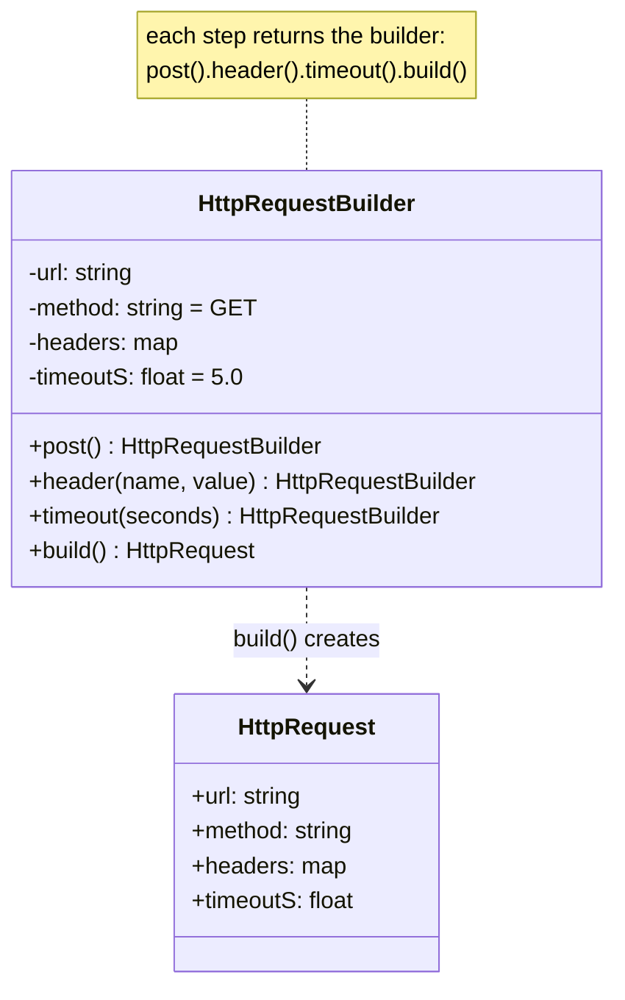

=== "PHP"

    ```php
    <?php

    // Example: the final immutable object the builder produces
    final readonly class HttpRequest
    {
        public function __construct(
            public string $url,
            public string $method,
            public array $headers,
            public float $timeoutS,
        ) {}
    }

    // Good: one named method per option, readable defaults
    final class HttpRequestBuilder
    {
        private string $method = 'GET';
        private array $headers = [];
        private float $timeoutS = 5.0;

        public function __construct(private readonly string $url) {}

        public function post(): self { $this->method = 'POST'; return $this; }

        public function header(string $name, string $value): self { $this->headers[$name] = $value; return $this; }

        public function timeout(float $seconds): self { $this->timeoutS = $seconds; return $this; }

        public function build(): HttpRequest
        {
            return new HttpRequest($this->url, $this->method, $this->headers, $this->timeoutS);
        }
    }

    // Example: each step is named, instead of eight anonymous parameters
    $request = (new HttpRequestBuilder('https://my-api/orders'))->post()->header('Idempotency-Key', '7f3c')->timeout(2)->build();
    ```

=== "Python"

    ```python
    from dataclasses import dataclass, field


    # Example: the final immutable object the builder produces
    @dataclass(frozen=True)
    class HttpRequest:
        url: str
        method: str
        headers: dict[str, str]
        timeout_s: float


    # Good: one named method per option, readable defaults
    @dataclass
    class HttpRequestBuilder:
        url: str
        method: str = "GET"
        headers: dict[str, str] = field(default_factory=dict)
        timeout_s: float = 5.0

        def post(self) -> "HttpRequestBuilder":
            self.method = "POST"
            return self

        def header(self, name: str, value: str) -> "HttpRequestBuilder":
            self.headers[name] = value
            return self

        def timeout(self, seconds: float) -> "HttpRequestBuilder":
            self.timeout_s = seconds
            return self

        def build(self) -> HttpRequest:
            return HttpRequest(self.url, self.method, dict(self.headers), self.timeout_s)


    # Example: each step is named, instead of eight anonymous parameters
    request = HttpRequestBuilder("https://my-api/orders").post().header("Idempotency-Key", "7f3c").timeout(2).build()
    ```

=== "Java"

    ```java
    import java.util.HashMap;
    import java.util.Map;

    // Example: the final immutable object the builder produces
    record HttpRequest(String url, String method, Map<String, String> headers, double timeoutS) {

        static Builder builder(String url) { return new Builder(url); }

        // Good: one named method per option, readable defaults
        static final class Builder {
            private final String url;
            private String method = "GET";
            private final Map<String, String> headers = new HashMap<>();
            private double timeoutS = 5.0;

            private Builder(String url) { this.url = url; }

            Builder post() { method = "POST"; return this; }

            Builder header(String name, String value) { headers.put(name, value); return this; }

            Builder timeout(double seconds) { timeoutS = seconds; return this; }

            HttpRequest build() { return new HttpRequest(url, method, Map.copyOf(headers), timeoutS); }
        }
    }

    // Example: each step is named, instead of eight anonymous parameters
    HttpRequest request = HttpRequest.builder("https://my-api/orders").post().header("Idempotency-Key", "7f3c").timeout(2).build();
    ```

**In frameworks**

=== "PHP"

    Doctrine: the `QueryBuilder` (`->select()->from()->where()`).

=== "Python"

    SQLAlchemy: `select(Order).where(...).order_by(...)`. In Python, keyword arguments with defaults are often enough.

=== "Java"

    Lombok `@Builder`, the JDK's `HttpRequest.newBuilder()`, `StringBuilder`.

| Use it when | Avoid it when |
|---|---|
| my object has many optional parameters, like an HTTP request with its method, headers and timeout, or it is built in several steps. Very handy for test data (`an_order().paid().build()`). | my object only has two or three parameters: a constructor (or keyword arguments in Python) is enough. |

:material-book-open-variant: Reference docs: [Refactoring.Guru, Builder](https://refactoring.guru/design-patterns/builder) (accessed November 2026)
{ .doc-ref }

### Singleton
<span class="pill pill-status pill-status-ok" title="Still valid, checked November 2026">Current · 11/2026</span>

**Intent**: guarantee that a class has a single instance, reachable everywhere.

**Problem**: my app reloads the configuration or recreates a connection pool on every call, so every request pays that cost for nothing.

**Example**: the application settings, read once at startup.

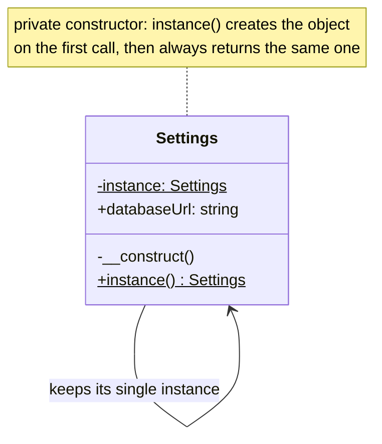

=== "PHP"

    ```php
    <?php

    // Example: a single instance, created once, then always returned
    final class Settings
    {
        private static ?Settings $instance = null;

        public readonly string $databaseUrl;

        private function __construct()
        {
            $this->databaseUrl = 'mysql://localhost/orders';
        }

        public static function instance(): self
        {
            return self::$instance ??= new self();
        }
    }

    // Example: two calls return the same object
    assert(Settings::instance() === Settings::instance());
    ```

=== "Python"

    ```python
    from functools import cache


    class Settings:
        def __init__(self) -> None:
            self.database_url = "postgresql://localhost/orders"


    # Example: a single instance, created once, then always returned
    @cache
    def get_settings() -> Settings:
        return Settings()


    # Example: two calls return the same object
    assert get_settings() is get_settings()
    ```

=== "Java"

    ```java
    // Example: a single instance, created once, then always returned
    enum Settings {
        INSTANCE;

        private final String databaseUrl = "jdbc:postgresql://localhost/orders";

        String databaseUrl() { return databaseUrl; }
    }

    // Example: two calls return the same object
    assert Settings.INSTANCE == Settings.INSTANCE;
    ```

**In frameworks**

=== "PHP"

    In Symfony and Laravel, the [service container](#injection-container) creates a single instance per service by default: nobody writes singletons by hand anymore.

=== "Python"

    A Python module is already imported only once. `functools.cache` on a function gives the same result without a special class.

=== "Java"

    Spring: beans are singletons by default. Written by hand, the `enum` form is the safest (thread-safe, serialization).

| Use it when | Avoid it when |
|---|---|
| I have a truly unique resource that nobody changes once created, like the configuration read at startup or the connection pool, and preferably the injection container manages it. | almost always in application code: a singleton is a global variable in disguise. All tests share its state, so one test can skew another, and I cannot replace it with a double. I prefer dependency injection. |

:material-book-open-variant: Reference docs: [Refactoring.Guru, Singleton](https://refactoring.guru/design-patterns/singleton) (accessed November 2026)
{ .doc-ref }

## Structural patterns

<a class="pill pill-scope pill-scope-code" href="../architecture/#map-of-scales">Scale · Code</a>

How to assemble objects into a more convenient shape, without changing their code.

### Adapter
<span class="pill pill-status pill-status-ok" title="Still valid, checked November 2026">Current · 11/2026</span>

**Intent**: fit an existing class into the interface my code expects, without changing that class.

**Problem**: the bank library speaks euros with `make_payment()`, my code expects `charge()` in cents. Changing my code everywhere would make the bank impossible to replace.

**Example**: an adapter translates the call and the units. The day I switch banks, I write another adapter, nothing else moves.

!!! noob "As noob"
    The adapter is a travel plug: my European charger does not fit a UK socket, I change neither the charger nor the wall, I slip an adapter in between. The one thing to remember: **an adapter changes the shape of the call, not what it does.**

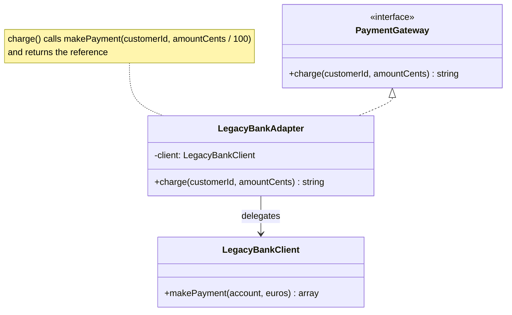

=== "PHP"

    ```php
    <?php

    // Example: the interface my code expects (cents, charge())
    interface PaymentGateway
    {
        public function charge(string $customerId, int $amountCents): string;
    }

    // Example: the third-party library I cannot change (euros)
    final class LegacyBankClient
    {
        public function makePayment(string $account, float $euros): array
        {
            return ['status' => 'OK', 'ref' => "BANK-$account-$euros"];
        }
    }

    // Good: translates the method name and cents to euros, without touching the client
    final class LegacyBankAdapter implements PaymentGateway
    {
        public function __construct(private readonly LegacyBankClient $client) {}

        public function charge(string $customerId, int $amountCents): string
        {
            return $this->client->makePayment($customerId, $amountCents / 100)['ref'];
        }
    }

    // Example: my code only sees PaymentGateway
    $gateway = new LegacyBankAdapter(new LegacyBankClient());
    $gateway->charge('ada', 3000);
    ```

=== "Python"

    ```python
    from typing import Protocol


    # Example: the interface my code expects (cents, charge())
    class PaymentGateway(Protocol):
        def charge(self, customer_id: str, amount_cents: int) -> str: ...


    # Example: the third-party library I cannot change (euros)
    class LegacyBankClient:
        """Third-party client we cannot change: amounts in euros, different method name."""

        def make_payment(self, account: str, euros: float) -> dict[str, str]:
            return {"status": "OK", "ref": f"BANK-{account}-{euros}"}


    # Good: translates the method name and cents to euros, without touching the client
    class LegacyBankAdapter:
        def __init__(self, client: LegacyBankClient) -> None:
            self._client = client

        def charge(self, customer_id: str, amount_cents: int) -> str:
            result = self._client.make_payment(customer_id, amount_cents / 100)
            return result["ref"]


    # Example: my code only sees PaymentGateway
    gateway: PaymentGateway = LegacyBankAdapter(LegacyBankClient())
    gateway.charge("ada", 3000)
    ```

=== "Java"

    ```java
    import java.util.Map;

    // Example: the interface my code expects (cents, charge())
    interface PaymentGateway {
        String charge(String customerId, int amountCents);
    }

    // Example: the third-party library I cannot change (euros)
    final class LegacyBankClient {
        Map<String, String> makePayment(String account, double euros) {
            return Map.of("status", "OK", "ref", "BANK-" + account + "-" + euros);
        }
    }

    // Good: translates the method name and cents to euros, without touching the client
    final class LegacyBankAdapter implements PaymentGateway {
        private final LegacyBankClient client;

        LegacyBankAdapter(LegacyBankClient client) { this.client = client; }

        public String charge(String customerId, int amountCents) {
            return client.makePayment(customerId, amountCents / 100.0).get("ref");
        }
    }

    // Example: my code only sees PaymentGateway
    PaymentGateway gateway = new LegacyBankAdapter(new LegacyBankClient());
    gateway.charge("ada", 3000);
    ```

**In frameworks**

=== "PHP"

    Flysystem: one adapter per storage (local disk, S3, GCS) behind the same interface.

=== "Python"

    `requests` *adapters* (`HTTPAdapter`) to change the transport layer.

=== "Java"

    `Arrays.asList()` adapts an array into a `List`, `InputStreamReader` adapts a byte stream into a character stream.

| Use it when | Avoid it when |
|---|---|
| I need to plug in a third-party service, legacy code or a library whose interface does not fit my code, like the bank library that speaks euros while my code counts in cents. It is also the basis of <span class="term" data-term="hexagonal-architecture">hexagonal architecture</span>. | I control the code on both sides: I change the interface directly. |

:material-book-open-variant: Reference docs: [Refactoring.Guru, Adapter](https://refactoring.guru/design-patterns/adapter) (accessed November 2026)
{ .doc-ref }

### Decorator
<span class="pill pill-status pill-status-ok" title="Still valid, checked November 2026">Current · 11/2026</span>

**Intent**: add behavior to an object by wrapping it in another one with the same interface.

**Problem**: adding caching, logs and metrics directly into the repository mixes everything up, and they can no longer be enabled separately.

**Example**: a caching repository wraps the real repository. The calling code sees no difference.

!!! noob "As noob"
    The decorator is a phone case: the phone works the same, the case adds protection, and I can stack several (case, screen film, wrist strap) or remove one without touching the phone. The one thing to remember: **same interface as the wrapped object, one more behavior.**

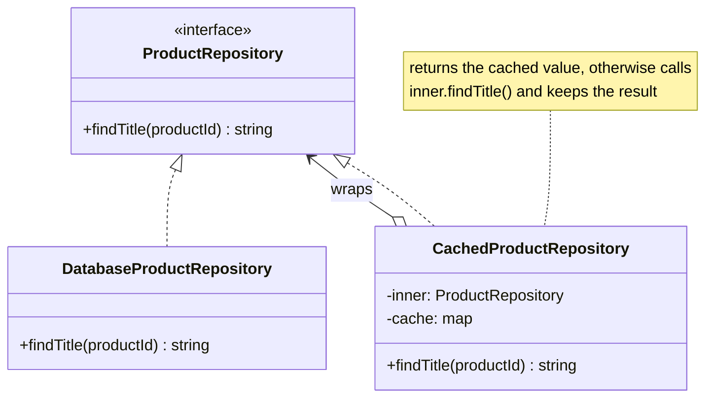

=== "PHP"

    ```php
    <?php

    // Example: the interface shared by the real repository and the decorator
    interface ProductRepository
    {
        public function findTitle(int $productId): string;
    }

    // Example: the real repository, slow (database call)
    final class DatabaseProductRepository implements ProductRepository
    {
        public function findTitle(int $productId): string
        {
            usleep(200_000);
            return "Product $productId";
        }
    }

    // Good: same interface, adds the cache and delegates the rest to inner
    final class CachedProductRepository implements ProductRepository
    {
        private array $cache = [];

        public function __construct(private readonly ProductRepository $inner) {}

        public function findTitle(int $productId): string
        {
            return $this->cache[$productId] ??= $this->inner->findTitle($productId);
        }
    }

    // Example: the cache wraps the real repository, the caller sees no difference
    $repository = new CachedProductRepository(new DatabaseProductRepository());
    ```

=== "Python"

    ```python
    import time
    from typing import Protocol


    # Example: the interface shared by the real repository and the decorator
    class ProductRepository(Protocol):
        def find_title(self, product_id: int) -> str: ...


    # Example: the real repository, slow (database call)
    class DatabaseProductRepository:
        def find_title(self, product_id: int) -> str:
            time.sleep(0.2)
            return f"Product {product_id}"


    # Good: same interface, adds the cache and delegates the rest to inner
    class CachedProductRepository:
        def __init__(self, inner: ProductRepository) -> None:
            self._inner = inner
            self._cache: dict[int, str] = {}

        def find_title(self, product_id: int) -> str:
            if product_id not in self._cache:
                self._cache[product_id] = self._inner.find_title(product_id)
            return self._cache[product_id]


    # Example: the cache wraps the real repository, the caller sees no difference
    repository: ProductRepository = CachedProductRepository(DatabaseProductRepository())
    ```

=== "Java"

    ```java
    import java.util.HashMap;
    import java.util.Map;

    // Example: the interface shared by the real repository and the decorator
    interface ProductRepository {
        String findTitle(int productId);
    }

    // Example: the real repository, slow (database call)
    final class DatabaseProductRepository implements ProductRepository {
        public String findTitle(int productId) { return "Product " + productId; }
    }

    // Good: same interface, adds the cache and delegates the rest to inner
    final class CachedProductRepository implements ProductRepository {
        private final ProductRepository inner;
        private final Map<Integer, String> cache = new HashMap<>();

        CachedProductRepository(ProductRepository inner) { this.inner = inner; }

        public String findTitle(int productId) {
            return cache.computeIfAbsent(productId, inner::findTitle);
        }
    }

    // Example: the cache wraps the real repository, the caller sees no difference
    ProductRepository repository = new CachedProductRepository(new DatabaseProductRepository());
    ```

**In frameworks**

=== "PHP"

    Symfony: `decorates:` in a service definition replaces a service with its decorator.

=== "Python"

    Beware the false friend: Python's `@` decorators wrap **functions** (`@functools.cache`, `@retry`). Same idea, applied to functions.

=== "Java"

    `BufferedInputStream(new FileInputStream(...))`, `Collections.unmodifiableList(list)`.

| Use it when | Avoid it when |
|---|---|
| I want to add caching, logs, retry, metrics or checks around an existing object, and turn them on one by one, like a cache in front of the orders repository. | I stack a dozen layers: when debugging, the call stack becomes unreadable. |

:material-book-open-variant: Reference docs: [Refactoring.Guru, Decorator](https://refactoring.guru/design-patterns/decorator) (accessed November 2026)
{ .doc-ref }

### Facade
<span class="pill pill-status pill-status-ok" title="Still valid, checked November 2026">Current · 11/2026</span>

**Intent**: offer a simple entry point in front of a set of complicated classes.

**Problem**: placing an order means reserving stock, charging, then scheduling delivery, in the right order. Every controller rewrites this sequence.

**Example**: `OrderFacade.place_order()` chains the three steps. Controllers only know the facade.

!!! noob "As noob"
    The facade is the waiter in a restaurant: I order a dish, they talk to the kitchen, the bar and the till in the right order. The classes behind still exist and can still be called directly if needed. The one thing to remember: **one simple door in front of several complicated rooms.**

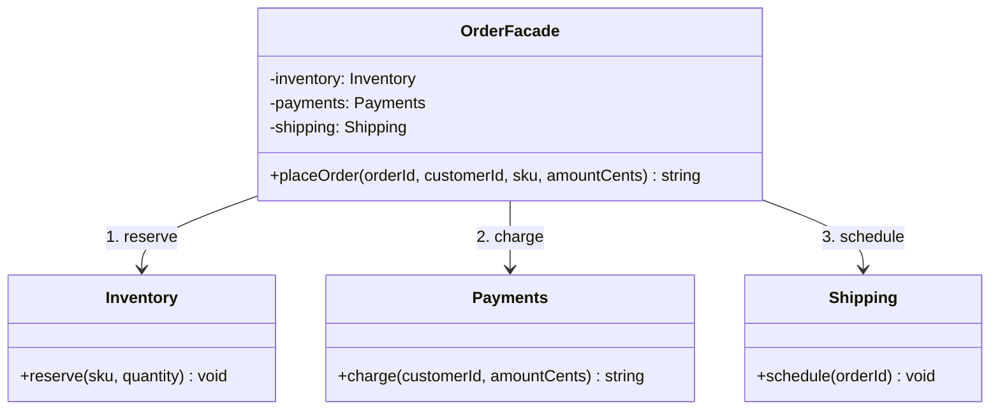

=== "PHP"

    ```php
    <?php

    // Example: the three subsystems, to call in the right order
    final class Inventory { public function reserve(string $sku, int $quantity): void {} }

    final class Payments { public function charge(string $customerId, int $amountCents): string { return 'PAY-1'; } }

    final class Shipping { public function schedule(int $orderId): void {} }

    // Good: a single entry point that chains stock, payment, then shipping
    final class OrderFacade
    {
        public function __construct(
            private readonly Inventory $inventory,
            private readonly Payments $payments,
            private readonly Shipping $shipping,
        ) {}

        public function placeOrder(int $orderId, string $customerId, string $sku, int $amountCents): string
        {
            $this->inventory->reserve($sku, 1);
            $paymentRef = $this->payments->charge($customerId, $amountCents);
            $this->shipping->schedule($orderId);
            return $paymentRef;
        }
    }

    // Example: the controller only knows the facade
    (new OrderFacade(new Inventory(), new Payments(), new Shipping()))->placeOrder(42, 'ada', 'BK-0004', 3000);
    ```

=== "Python"

    ```python
    # Example: the three subsystems, to call in the right order
    class Inventory:
        def reserve(self, sku: str, quantity: int) -> None: ...


    class Payments:
        def charge(self, customer_id: str, amount_cents: int) -> str:
            return "PAY-1"


    class Shipping:
        def schedule(self, order_id: int) -> None: ...


    # Good: a single entry point that chains stock, payment, then shipping
    class OrderFacade:
        def __init__(self, inventory: Inventory, payments: Payments, shipping: Shipping) -> None:
            self._inventory = inventory
            self._payments = payments
            self._shipping = shipping

        def place_order(self, order_id: int, customer_id: str, sku: str, amount_cents: int) -> str:
            self._inventory.reserve(sku, 1)
            payment_ref = self._payments.charge(customer_id, amount_cents)
            self._shipping.schedule(order_id)
            return payment_ref


    # Example: the controller only knows the facade
    OrderFacade(Inventory(), Payments(), Shipping()).place_order(42, "ada", "BK-0004", 3000)
    ```

=== "Java"

    ```java
    // Example: the three subsystems, to call in the right order
    final class Inventory { void reserve(String sku, int quantity) {} }

    final class Payments { String charge(String customerId, int amountCents) { return "PAY-1"; } }

    final class Shipping { void schedule(int orderId) {} }

    // Good: a single entry point that chains stock, payment, then shipping
    final class OrderFacade {
        private final Inventory inventory;
        private final Payments payments;
        private final Shipping shipping;

        OrderFacade(Inventory inventory, Payments payments, Shipping shipping) {
            this.inventory = inventory;
            this.payments = payments;
            this.shipping = shipping;
        }

        String placeOrder(int orderId, String customerId, String sku, int amountCents) {
            inventory.reserve(sku, 1);
            String paymentRef = payments.charge(customerId, amountCents);
            shipping.schedule(orderId);
            return paymentRef;
        }
    }

    // Example: the controller only knows the facade
    new OrderFacade(new Inventory(), new Payments(), new Shipping()).placeOrder(42, "ada", "BK-0004", 3000);
    ```

**In frameworks**

=== "PHP"

    Laravel calls its static accessors "Facades" (`Cache::get()`): mostly a shortcut to the container, not exactly the GoF pattern.

=== "Python"

    `requests.get()` is a facade in front of `Session`, `PreparedRequest` and the adapters.

=== "Java"

    `javax.faces.context.FacesContext`, or a Spring *service* layer that orchestrates several repositories.

| Use it when | Avoid it when |
|---|---|
| several classes must always be called together and in the same order, like reserving stock, charging, then scheduling delivery for every order. | the facade grows until it does everything: it becomes a "god object" to split. |

:material-book-open-variant: Reference docs: [Refactoring.Guru, Facade](https://refactoring.guru/design-patterns/facade) (accessed November 2026)
{ .doc-ref }

### Proxy
<span class="pill pill-status pill-status-ok" title="Still valid, checked November 2026">Current · 11/2026</span>

**Intent**: put an intermediate object that controls access to another one, with the same interface.

**Problem**: I have to check permissions at the start of every method of the report service, and the day someone forgets one method, anyone can read it.

**Example**: a proxy checks the `finance` role before letting the call through.

!!! noob "As noob"
    The proxy is the receptionist in front of an office: I ask them the same question I would ask the office, they check my badge before passing it on. Unlike the decorator, it does not add a feature: it decides whether, and when, the call goes through. The one thing to remember: **same interface, plus a gatekeeper that controls access.**

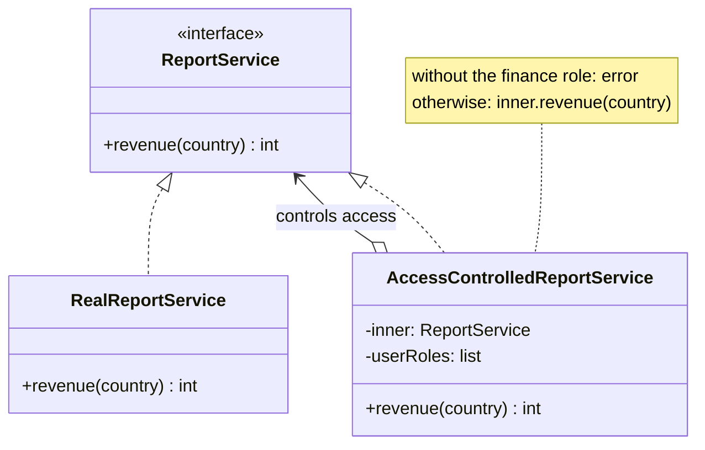

=== "PHP"

    ```php
    <?php

    // Example: the interface shared by the real service and the proxy
    interface ReportService
    {
        public function revenue(string $country): int;
    }

    // Example: the real service, with no access control
    final class RealReportService implements ReportService
    {
        public function revenue(string $country): int { return 1_250_000; }
    }

    // Good: same interface, checks the finance role before letting the call through
    final class AccessControlledReportService implements ReportService
    {
        public function __construct(private readonly ReportService $inner, private readonly array $userRoles) {}

        public function revenue(string $country): int
        {
            if (!in_array('finance', $this->userRoles, true)) {
                throw new RuntimeException('finance role required');
            }
            return $this->inner->revenue($country);
        }
    }

    // Example: the caller goes through the proxy, never straight to the real service
    (new AccessControlledReportService(new RealReportService(), ['finance']))->revenue('FR');
    ```

=== "Python"

    ```python
    from typing import Protocol


    # Example: the interface shared by the real service and the proxy
    class ReportService(Protocol):
        def revenue(self, country: str) -> int: ...


    # Example: the real service, with no access control
    class RealReportService:
        def revenue(self, country: str) -> int:
            return 1_250_000


    # Good: same interface, checks the finance role before letting the call through
    class AccessControlledReportService:
        def __init__(self, inner: ReportService, user_roles: set[str]) -> None:
            self._inner = inner
            self._roles = user_roles

        def revenue(self, country: str) -> int:
            if "finance" not in self._roles:
                raise PermissionError("finance role required")
            return self._inner.revenue(country)


    # Example: the caller goes through the proxy, never straight to the real service
    AccessControlledReportService(RealReportService(), {"finance"}).revenue("FR")
    ```

=== "Java"

    ```java
    import java.util.Set;

    // Example: the interface shared by the real service and the proxy
    interface ReportService {
        long revenue(String country);
    }

    // Example: the real service, with no access control
    final class RealReportService implements ReportService {
        public long revenue(String country) { return 1_250_000L; }
    }

    // Good: same interface, checks the finance role before letting the call through
    final class AccessControlledReportService implements ReportService {
        private final ReportService inner;
        private final Set<String> userRoles;

        AccessControlledReportService(ReportService inner, Set<String> userRoles) {
            this.inner = inner;
            this.userRoles = userRoles;
        }

        public long revenue(String country) {
            if (!userRoles.contains("finance")) {
                throw new SecurityException("finance role required");
            }
            return inner.revenue(country);
        }
    }

    // Example: the caller goes through the proxy, never straight to the real service
    new AccessControlledReportService(new RealReportService(), Set.of("finance")).revenue("FR");
    ```

**In frameworks**

=== "PHP"

    Doctrine: <span class="term" data-term="lazy-loading">lazily loaded</span> entities are generated proxies.

=== "Python"

    Django: `SimpleLazyObject` for `request.user`, loaded only if used.

=== "Java"

    Spring: `@Transactional` and `@Cacheable` work thanks to proxies generated around my beans.

| Use it when | Avoid it when |
|---|---|
| I want to control who reaches an object, like checking the `finance` role before opening a report, load it only when someone uses it, call a remote object as if it were local, or count calls. | I hesitate with the decorator: same shape, but the proxy **controls access**, the decorator **adds a feature**. The right name helps the reviewer. |

:material-book-open-variant: Reference docs: [Refactoring.Guru, Proxy](https://refactoring.guru/design-patterns/proxy) (accessed November 2026)
{ .doc-ref }

## Behavioral patterns

<a class="pill pill-scope pill-scope-code" href="../architecture/#map-of-scales">Scale · Code</a>

How to split responsibilities and make objects talk to each other.

### Strategy
<span class="pill pill-status pill-status-ok" title="Still valid, checked November 2026">Current · 11/2026</span>

**Intent**: make several ways of doing the same thing interchangeable.

**Problem**: an `if/elif` grows with each new shipping method, in a function everyone edits, so every addition risks breaking the existing methods.

**Example**: each shipping method is a class with a `cost()` method. The cart total receives the strategy and calls it, without knowing which one it is.

!!! noob "As noob"
    The strategy is the GPS asking "car, bike or on foot?": the destination does not change, only the way the route is computed, and I can add a mode without touching the rest. The one thing to remember: **a big `if` becomes interchangeable objects that share the same method.**

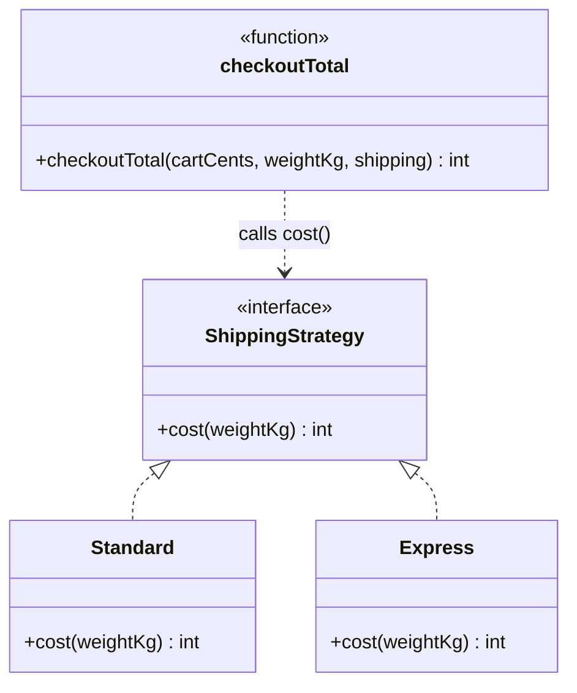

=== "PHP"

    ```php
    <?php

    // Example: the contract shared by every shipping mode
    interface ShippingStrategy
    {
        public function cost(float $weightKg): int;
    }

    // Good: one shipping mode per class, testable on its own
    final class Standard implements ShippingStrategy
    {
        public function cost(float $weightKg): int
        {
            return 500 + (int) ($weightKg * 100);
        }
    }

    // Good: adding a mode means adding a class, without touching the others
    final class Express implements ShippingStrategy
    {
        public function cost(float $weightKg): int
        {
            return 1500 + (int) ($weightKg * 200);
        }
    }

    // Good: receives the strategy and calls cost() without knowing which one it is
    function checkoutTotal(int $cartCents, float $weightKg, ShippingStrategy $shipping): int
    {
        return $cartCents + $shipping->cost($weightKg);
    }

    // Example: the caller picks the strategy
    checkoutTotal(3000, 2.0, new Express());
    ```

=== "Python"

    ```python
    from typing import Protocol


    # Example: the contract shared by every shipping mode
    class ShippingStrategy(Protocol):
        def cost(self, weight_kg: float) -> int: ...


    # Good: one shipping mode per class, testable on its own
    class Standard:
        def cost(self, weight_kg: float) -> int:
            return 500 + int(weight_kg * 100)


    # Good: adding a mode means adding a class, without touching the others
    class Express:
        def cost(self, weight_kg: float) -> int:
            return 1500 + int(weight_kg * 200)


    # Good: receives the strategy and calls cost() without knowing which one it is
    def checkout_total(cart_cents: int, weight_kg: float, shipping: ShippingStrategy) -> int:
        return cart_cents + shipping.cost(weight_kg)


    # Example: the caller picks the strategy
    checkout_total(3000, 2.0, Express())
    ```

=== "Java"

    ```java
    // Example: the contract shared by every shipping mode
    interface ShippingStrategy {
        int cost(double weightKg);
    }

    // Good: one shipping mode per class, testable on its own
    final class Standard implements ShippingStrategy {
        public int cost(double weightKg) { return 500 + (int) (weightKg * 100); }
    }

    // Good: adding a mode means adding a class, without touching the others
    final class Express implements ShippingStrategy {
        public int cost(double weightKg) { return 1500 + (int) (weightKg * 200); }
    }

    // Good: receives the strategy and calls cost() without knowing which one it is
    final class Checkout {
        static int total(int cartCents, double weightKg, ShippingStrategy shipping) {
            return cartCents + shipping.cost(weightKg);
        }
    }

    // Example: the caller picks the strategy
    Checkout.total(3000, 2.0, new Express());
    ```

**In frameworks**

=== "PHP"

    Symfony: security *voters*, or a service chosen by tag (`#[AutowireIterator]`).

=== "Python"

    `sorted(items, key=...)`: the `key` function is a strategy. In Python, a plain function is often enough.

=== "Java"

    a `Comparator` passed to `list.sort(...)`, the `PasswordEncoder` implementations in Spring Security.

| Use it when | Avoid it when |
|---|---|
| I have several ways of doing the same thing, chosen from data or a setting, like computing shipping costs for standard or express delivery. Each strategy is tested on its own. | I only have two cases, which will never change: an `if` stays simpler. |

:material-book-open-variant: Reference docs: [Refactoring.Guru, Strategy](https://refactoring.guru/design-patterns/strategy) (accessed November 2026)
{ .doc-ref }

### Observer
<span class="pill pill-status pill-status-ok" title="Still valid, checked November 2026">Current · 11/2026</span>

**Intent**: automatically notify several objects when an event happens, without the emitter knowing them.

**Problem**: `pay()` directly calls billing, stock and email. Adding a fourth step means changing the payment code.

**Example**: the payment publishes "order paid", each step subscribes on its own.

!!! noob "As noob"
    The observer is a newsletter: the author publishes without knowing who subscribed, each reader signs up or leaves on their own. Here subscribers are notified right away, inside the same program, with no message sent over the network. The one thing to remember: **the sender announces a fact, it does not know who reacts.**

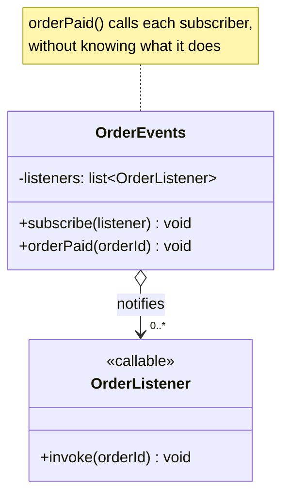

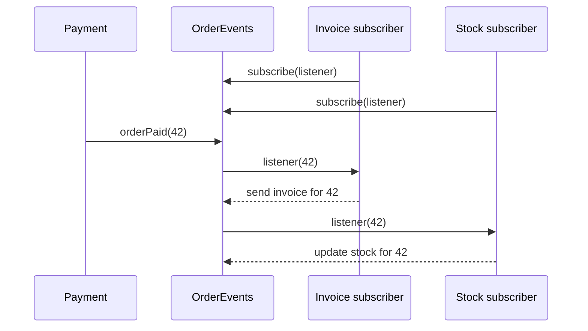

=== "PHP"

    ```php
    <?php

    // Good: the emitter keeps a list of subscribers and notifies them without knowing them
    final class OrderEvents
    {
        /** @var list<callable(int): void> */
        private array $listeners = [];

        public function subscribe(callable $listener): void
        {
            $this->listeners[] = $listener;
        }

        public function orderPaid(int $orderId): void
        {
            foreach ($this->listeners as $listener) {
                $listener($orderId);
            }
        }
    }

    // Example: each handler subscribes on its own, then the payment publishes
    $events = new OrderEvents();
    $events->subscribe(fn (int $id) => print("send invoice for $id\n"));
    $events->subscribe(fn (int $id) => print("update stock for $id\n"));
    $events->orderPaid(42);
    ```

=== "Python"

    ```python
    from collections.abc import Callable

    OrderListener = Callable[[int], None]


    # Good: the emitter keeps a list of subscribers and notifies them without knowing them
    class OrderEvents:
        def __init__(self) -> None:
            self._listeners: list[OrderListener] = []

        def subscribe(self, listener: OrderListener) -> None:
            self._listeners.append(listener)

        def order_paid(self, order_id: int) -> None:
            for listener in self._listeners:
                listener(order_id)


    # Example: each handler subscribes on its own, then the payment publishes
    events = OrderEvents()
    events.subscribe(lambda order_id: print(f"send invoice for {order_id}"))
    events.subscribe(lambda order_id: print(f"update stock for {order_id}"))
    events.order_paid(42)
    ```

=== "Java"

    ```java
    import java.util.ArrayList;
    import java.util.List;
    import java.util.function.IntConsumer;

    // Good: the emitter keeps a list of subscribers and notifies them without knowing them
    final class OrderEvents {
        private final List<IntConsumer> listeners = new ArrayList<>();

        void subscribe(IntConsumer listener) { listeners.add(listener); }

        void orderPaid(int orderId) {
            listeners.forEach(listener -> listener.accept(orderId));
        }
    }

    // Example: each handler subscribes on its own, then the payment publishes
    OrderEvents events = new OrderEvents();
    events.subscribe(id -> System.out.println("send invoice for " + id));
    events.subscribe(id -> System.out.println("update stock for " + id));
    events.orderPaid(42);
    ```

**In frameworks**

=== "PHP"

    Symfony: the `EventDispatcher` and `#[AsEventListener]`. Laravel: `Event::dispatch()`.

=== "Python"

    Django: *signals* (`post_save`).

=== "Java"

    Spring: `ApplicationEventPublisher` and `@EventListener`.

| Use it when | Avoid it when |
|---|---|
| several independent steps must react to the same fact, like billing, stock and email when an order is paid. Between different services, the same idea goes through a broker (Kafka, RabbitMQ). | the order of reactions matters, or an error in a subscriber must cancel the whole action: direct calls are more explicit. |

:material-book-open-variant: Reference docs: [Refactoring.Guru, Observer](https://refactoring.guru/design-patterns/observer) (accessed November 2026)
{ .doc-ref }

### Command
<span class="pill pill-status pill-status-ok" title="Still valid, checked November 2026">Current · 11/2026</span>

**Intent**: turn an action into an object, which can be stored, queued, replayed or undone.

**Problem**: I want a user to be able to undo their last action, or an action to run later in a worker, but a plain method call leaves nothing to keep, queue or undo.

**Example**: "add an item to the cart" becomes an object with `execute()` and `undo()`. The history is a stack of commands.

!!! noob "As noob"
    The command is a written order slip instead of a request shouted across the room: since it is on paper, I can put it in a queue, handle it later, redo it, and if it also says how to undo the action, cancel it (that is how Ctrl+Z works). The one thing to remember: **an action becomes an object I can keep, replay or undo.**

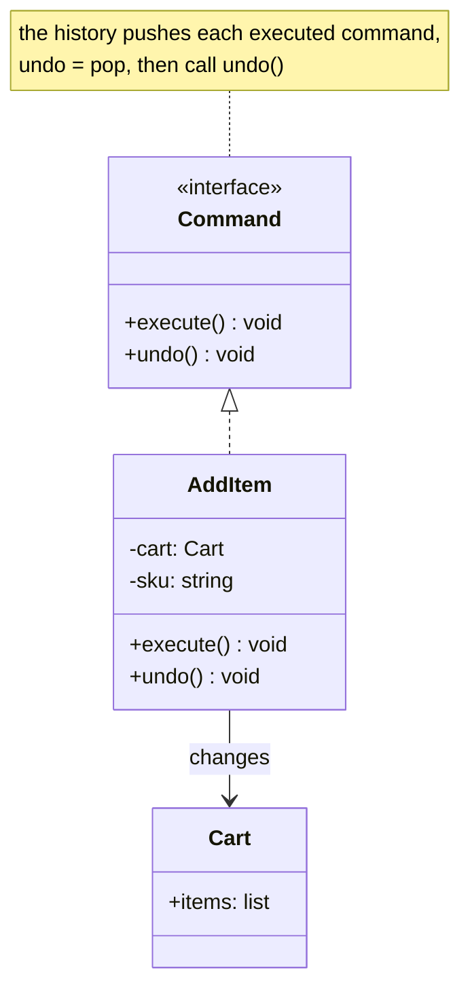

=== "PHP"

    ```php
    <?php

    // Example: every command knows how to execute and undo itself
    interface Command
    {
        public function execute(): void;
        public function undo(): void;
    }

    // Example: the object the commands modify
    final class Cart
    {
        public array $items = [];
    }

    // Good: the action becomes an object, with what it needs to undo it
    final class AddItem implements Command
    {
        public function __construct(private readonly Cart $cart, private readonly string $sku) {}

        public function execute(): void { $this->cart->items[] = $this->sku; }

        public function undo(): void
        {
            $this->cart->items = array_values(array_diff($this->cart->items, [$this->sku]));
        }
    }

    // Example: the history stacks the commands, undo pops the last one
    $cart = new Cart();
    $history = [];
    foreach ([new AddItem($cart, 'BK-0004'), new AddItem($cart, 'BK-0007')] as $command) {
        $command->execute();
        $history[] = $command;
    }
    array_pop($history)->undo();
    ```

=== "Python"

    ```python
    from dataclasses import dataclass
    from typing import Protocol


    # Example: every command knows how to execute and undo itself
    class Command(Protocol):
        def execute(self) -> None: ...
        def undo(self) -> None: ...


    # Example: the object the commands modify
    @dataclass
    class Cart:
        items: list[str]


    # Good: the action becomes an object, with what it needs to undo it
    @dataclass
    class AddItem:
        cart: Cart
        sku: str

        def execute(self) -> None:
            self.cart.items.append(self.sku)

        def undo(self) -> None:
            self.cart.items.remove(self.sku)


    # Example: the history stacks the commands, undo pops the last one
    cart = Cart([])
    history: list[Command] = []
    for command in (AddItem(cart, "BK-0004"), AddItem(cart, "BK-0007")):
        command.execute()
        history.append(command)
    history.pop().undo()
    ```

=== "Java"

    ```java
    import java.util.ArrayDeque;
    import java.util.ArrayList;
    import java.util.Deque;
    import java.util.List;

    // Example: every command knows how to execute and undo itself
    interface Command {
        void execute();
        void undo();
    }

    // Good: the action becomes an object, with what it needs to undo it
    record AddItem(List<String> cart, String sku) implements Command {
        public void execute() { cart.add(sku); }
        public void undo() { cart.remove(sku); }
    }

    // Example: the history stacks the commands, undo pops the last one
    List<String> cart = new ArrayList<>();
    Deque<Command> history = new ArrayDeque<>();
    for (Command command : List.of(new AddItem(cart, "BK-0004"), new AddItem(cart, "BK-0007"))) {
        command.execute();
        history.push(command);
    }
    history.pop().undo();
    ```

**In frameworks**

=== "PHP"

    Symfony Messenger: a message (`new SendInvoice(42)`) and its handler, run immediately or by a worker.

=== "Python"

    Celery: a task and its arguments are a serialized, queued command.

=== "Java"

    a `Runnable` passed to an `ExecutorService`, Axon Framework commands.

| Use it when | Avoid it when |
|---|---|
| I want to undo, replay, queue or log actions, like undoing the last "add to cart" or having a worker run an action later. Basis of <span class="term" data-term="cqrs">CQRS</span>. | the action is simple, run immediately and never undone: a method is enough. |

:material-book-open-variant: Reference docs: [Refactoring.Guru, Command](https://refactoring.guru/design-patterns/command) (accessed November 2026)
{ .doc-ref }

### Template Method
<span class="pill pill-status pill-status-ok" title="Still valid, checked November 2026">Current · 11/2026</span>

**Intent**: fix the steps of an algorithm in a parent class, and let subclasses fill in some steps.

**Problem**: three exports (CSV, PDF, Excel) copy the same sequence: read the data, write the header, format each row.

**Example**: `Report.generate()` fixes the order, `CsvReport` only provides `fetch_rows()` and `format_row()`.

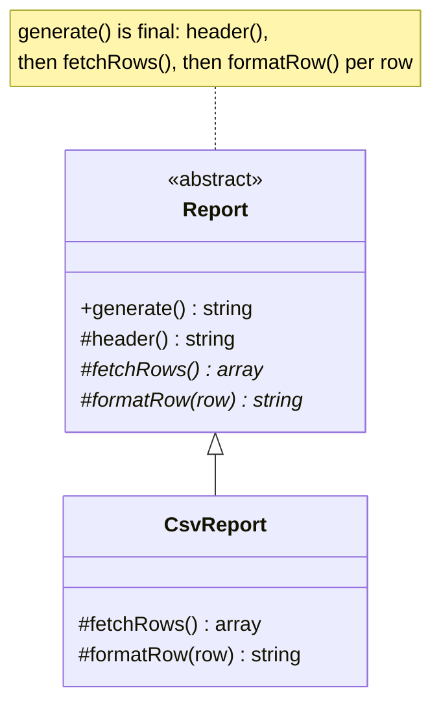

=== "PHP"

    ```php
    <?php

    // Good: the parent class fixes the order of the steps once and for all
    abstract class Report
    {
        final public function generate(): string
        {
            $lines = array_map(fn (array $row) => $this->formatRow($row), $this->fetchRows());
            return $this->header() . "\n" . implode("\n", $lines);
        }

        protected function header(): string { return 'Revenue report'; }

        // Example: the steps each subclass must write
        abstract protected function fetchRows(): array;

        abstract protected function formatRow(array $row): string;
    }

    // Good: the subclass only provides the steps that change
    final class CsvReport extends Report
    {
        protected function fetchRows(): array { return [['FR', 1200], ['DE', 900]]; }

        protected function formatRow(array $row): string { return "$row[0];$row[1]"; }
    }

    // Example: the caller runs generate(), the order is guaranteed
    echo (new CsvReport())->generate();
    ```

=== "Python"

    ```python
    from abc import ABC, abstractmethod


    # Good: the parent class fixes the order of the steps once and for all
    class Report(ABC):
        def generate(self) -> str:
            rows = self.fetch_rows()
            return self.header() + "\n" + "\n".join(self.format_row(row) for row in rows)

        def header(self) -> str:
            return "Revenue report"

        # Example: the steps each subclass must write
        @abstractmethod
        def fetch_rows(self) -> list[tuple[str, int]]: ...

        @abstractmethod
        def format_row(self, row: tuple[str, int]) -> str: ...


    # Good: the subclass only provides the steps that change
    class CsvReport(Report):
        def fetch_rows(self) -> list[tuple[str, int]]:
            return [("FR", 1200), ("DE", 900)]

        def format_row(self, row: tuple[str, int]) -> str:
            return f"{row[0]};{row[1]}"


    # Example: the caller runs generate(), the order is guaranteed
    print(CsvReport().generate())
    ```

=== "Java"

    ```java
    import java.util.List;
    import java.util.stream.Collectors;

    // Good: the parent class fixes the order of the steps once and for all
    abstract class Report {
        final String generate() {
            return header() + "\n" + fetchRows().stream().map(this::formatRow).collect(Collectors.joining("\n"));
        }

        protected String header() { return "Revenue report"; }

        // Example: the steps each subclass must write
        protected abstract List<Object[]> fetchRows();

        protected abstract String formatRow(Object[] row);
    }

    // Good: the subclass only provides the steps that change
    final class CsvReport extends Report {
        protected List<Object[]> fetchRows() { return List.of(new Object[] {"FR", 1200}, new Object[] {"DE", 900}); }

        protected String formatRow(Object[] row) { return row[0] + ";" + row[1]; }
    }

    // Example: the caller runs generate(), the order is guaranteed
    System.out.println(new CsvReport().generate());
    ```

**In frameworks**

=== "PHP"

    PHPUnit: `setUp()` and `tearDown()` are the steps I fill in, the order is fixed by `TestCase`.

=== "Python"

    `unittest.TestCase` the same way, Django generic views (`get_queryset()`).

=== "Java"

    `AbstractList`, `HttpServlet.doGet()`, Spring's `JdbcTemplate`.

| Use it when | Avoid it when |
|---|---|
| I have several variants of the same flow where only a few steps change, like CSV, PDF and Excel exports that read the data and write the header the same way. | the inheritance gets deep, or each variant changes many steps: I prefer Strategy (composition). |

:material-book-open-variant: Reference docs: [Refactoring.Guru, Template Method](https://refactoring.guru/design-patterns/template-method) (accessed November 2026)
{ .doc-ref }

### Chain of Responsibility
<span class="pill pill-status pill-status-ok" title="Still valid, checked November 2026">Current · 11/2026</span>

**Intent**: pass a request through a series of links, each able to handle it, change it or stop it.

**Problem**: a controller that checks authentication, rate limits, language and logs itself, before doing its real job.

**Example**: HTTP <span class="term" data-term="middleware">*middlewares*</span>: authentication, then rate limiting, then the application. Each link can return an error without calling the next one.

!!! noob "As noob"
    The chain of responsibility is going through an airport: ticket, then security, then passport. Each desk can send me on to the next one or stop me there, and a desk can be added without changing the others. The one thing to remember: **each link handles its own part then passes it on, or stops it.**

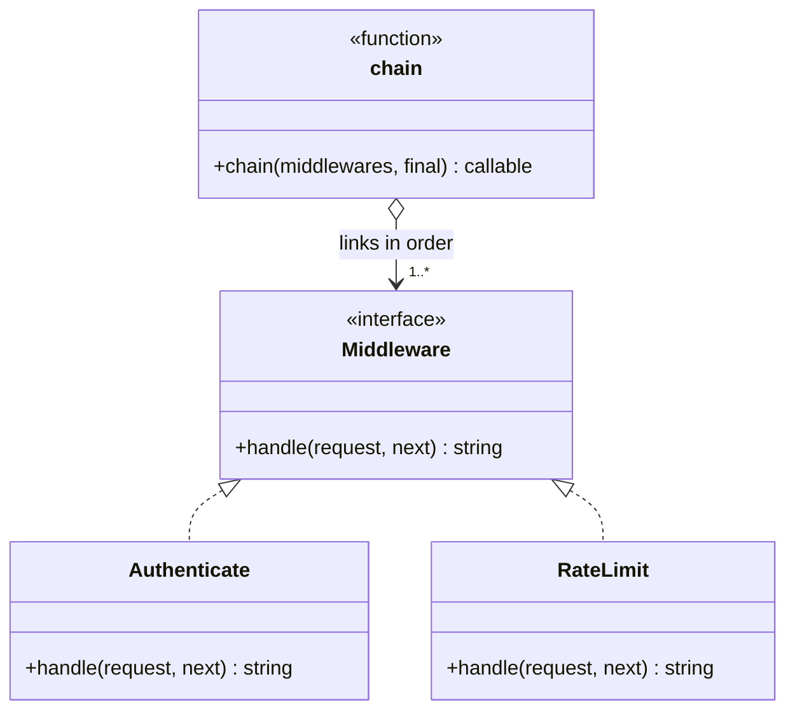

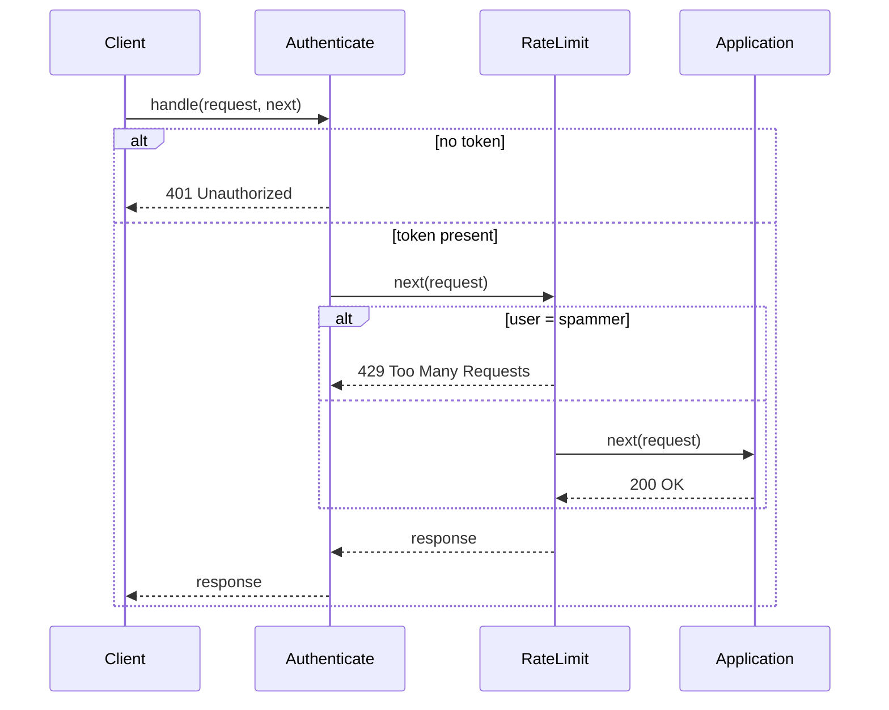

=== "PHP"

    ```php
    <?php

    // Example: a link receives the request and the next link
    interface Middleware
    {
        public function handle(array $request, callable $next): string;
    }

    // Good: stops with 401 without a token, otherwise passes to the next one
    final class Authenticate implements Middleware
    {
        public function handle(array $request, callable $next): string
        {
            return isset($request['token']) ? $next($request) : '401 Unauthorized';
        }
    }

    // Good: stops with 429 on abuse, otherwise passes to the next one
    final class RateLimit implements Middleware
    {
        public function handle(array $request, callable $next): string
        {
            return ($request['user'] ?? '') === 'spammer' ? '429 Too Many Requests' : $next($request);
        }
    }

    // Example: links the middlewares in order, the last one calls the application
    function chain(array $middlewares, callable $final): callable
    {
        return array_reduce(
            array_reverse($middlewares),
            fn (callable $next, Middleware $m) => fn (array $request) => $m->handle($request, $next),
            $final,
        );
    }

    // Example: authentication, then rate limit, then the application
    $app = chain([new Authenticate(), new RateLimit()], fn (array $request) => '200 OK');
    $app(['token' => 'abc', 'user' => 'ada']);
    ```

=== "Python"

    ```python
    from collections.abc import Callable

    # Example: a link receives the request and the next link
    Request = dict[str, str]
    Handler = Callable[[Request], str]
    Middleware = Callable[[Request, Handler], str]


    # Good: stops with 401 without a token, otherwise passes to the next one
    def authenticate(request: Request, next_handler: Handler) -> str:
        if "token" not in request:
            return "401 Unauthorized"
        return next_handler(request)


    # Good: stops with 429 on abuse, otherwise passes to the next one
    def rate_limit(request: Request, next_handler: Handler) -> str:
        if request.get("user") == "spammer":
            return "429 Too Many Requests"
        return next_handler(request)


    # Example: links the middlewares in order, the last one calls the application
    def chain(middlewares: list[Middleware], final: Handler) -> Handler:
        handler = final
        for middleware in reversed(middlewares):
            handler = (lambda m, n: lambda request: m(request, n))(middleware, handler)
        return handler


    # Example: authentication, then rate limit, then the application
    app = chain([authenticate, rate_limit], lambda request: "200 OK")
    app({"token": "abc", "user": "ada"})
    ```

=== "Java"

    ```java
    import java.util.List;
    import java.util.Map;
    import java.util.function.Function;

    // Example: a link receives the request and the next link
    interface Middleware {
        String handle(Map<String, String> request, Function<Map<String, String>, String> next);
    }

    // Example: links the middlewares in order, the last one calls the application
    final class Chain {
        static Function<Map<String, String>, String> of(List<Middleware> middlewares, Function<Map<String, String>, String> last) {
            Function<Map<String, String>, String> handler = last;
            for (int i = middlewares.size() - 1; i >= 0; i--) {
                Middleware middleware = middlewares.get(i);
                Function<Map<String, String>, String> next = handler;
                handler = request -> middleware.handle(request, next);
            }
            return handler;
        }
    }

    // Good: stops with 401 without a token, otherwise passes to the next one
    Middleware authenticate = (request, next) -> request.containsKey("token") ? next.apply(request) : "401 Unauthorized";
    // Good: stops with 429 on abuse, otherwise passes to the next one
    Middleware rateLimit = (request, next) -> "spammer".equals(request.get("user")) ? "429 Too Many Requests" : next.apply(request);

    // Example: authentication, then rate limit, then the application
    var app = Chain.of(List.of(authenticate, rateLimit), request -> "200 OK");
    app.apply(Map.of("token", "abc", "user", "ada"));
    ```

**In frameworks**

=== "PHP"

    PSR-15 (`MiddlewareInterface`), Laravel middlewares.

=== "Python"

    Django and FastAPI (Starlette) middlewares.

=== "Java"

    Servlet `Filter`s, Spring Security's `SecurityFilterChain`.

| Use it when | Avoid it when |
|---|---|
| every request must go through the same steps before or after my code, like checking authentication, writing logs or adding headers, without copying them into every controller. | the order of the links becomes a trap nobody wrote down: I write the order down explicitly and test it. |

:material-book-open-variant: Reference docs: [Refactoring.Guru, Chain of Responsibility](https://refactoring.guru/design-patterns/chain-of-responsibility) (accessed November 2026); [PSR-15, HTTP Server Request Handlers](https://www.php-fig.org/psr/psr-15/) (2018)
{ .doc-ref }

### State
<span class="pill pill-status pill-status-ok" title="Still valid, checked November 2026">Current · 11/2026</span>

**Intent**: make an object's behavior depend on its state, and forbid impossible transitions.

**Problem**: a shipped order that can still be "paid" because nobody checked the state first.

**Example**: a table of allowed transitions: created to paid or cancelled, paid to shipped or cancelled. Anything else raises an error.

!!! noob "As noob"
    The state pattern is a traffic light: it does not go from green to red without amber, and what I am allowed to do depends on its color. The one thing to remember: **write the list of allowed transitions once, everything else is refused.**

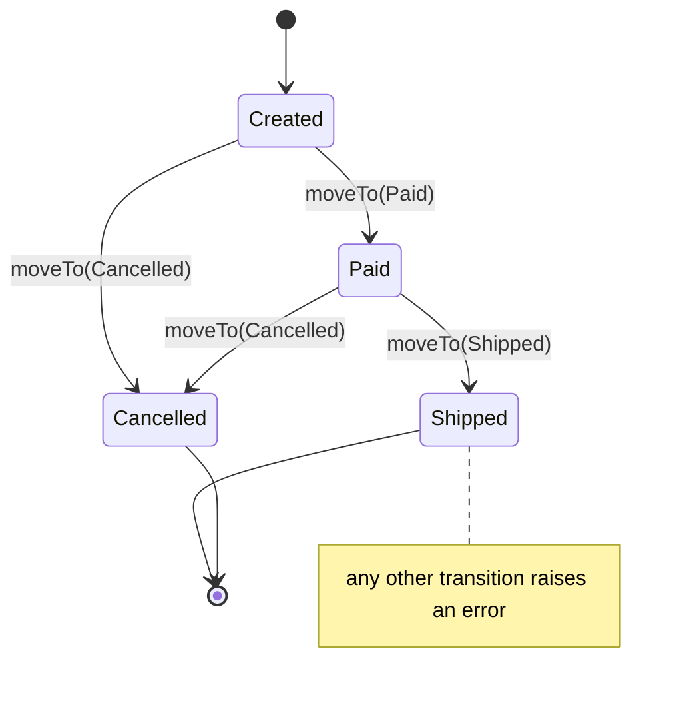

=== "PHP"

    ```php
    <?php

    // Example: the possible states of an order
    enum OrderStatus: string
    {
        case Created = 'created';
        case Paid = 'paid';
        case Shipped = 'shipped';
        case Cancelled = 'cancelled';

        // Good: the table of allowed transitions, written only once
        public function canMoveTo(self $target): bool
        {
            return in_array($target, match ($this) {
                self::Created => [self::Paid, self::Cancelled],
                self::Paid => [self::Shipped, self::Cancelled],
                self::Shipped, self::Cancelled => [],
            }, true);
        }
    }

    // Good: every transition goes through moveTo(), which refuses forbidden ones
    final class Order
    {
        public OrderStatus $status = OrderStatus::Created;

        public function moveTo(OrderStatus $target): void
        {
            if (!$this->status->canMoveTo($target)) {
                throw new DomainException("cannot go from {$this->status->value} to {$target->value}");
            }
            $this->status = $target;
        }
    }

    // Example: created, then paid, then shipped: allowed transitions
    $order = new Order();
    $order->moveTo(OrderStatus::Paid);
    $order->moveTo(OrderStatus::Shipped);
    ```

=== "Python"

    ```python
    from enum import Enum


    # Example: the possible states of an order
    class OrderStatus(Enum):
        CREATED = "created"
        PAID = "paid"
        SHIPPED = "shipped"
        CANCELLED = "cancelled"


    # Good: the table of allowed transitions, written only once
    ALLOWED = {
        OrderStatus.CREATED: {OrderStatus.PAID, OrderStatus.CANCELLED},
        OrderStatus.PAID: {OrderStatus.SHIPPED, OrderStatus.CANCELLED},
        OrderStatus.SHIPPED: set(),
        OrderStatus.CANCELLED: set(),
    }


    # Good: every transition goes through move_to(), which refuses forbidden ones
    class Order:
        def __init__(self) -> None:
            self.status = OrderStatus.CREATED

        def move_to(self, target: OrderStatus) -> None:
            if target not in ALLOWED[self.status]:
                raise ValueError(f"cannot go from {self.status.value} to {target.value}")
            self.status = target


    # Example: created, then paid, then shipped: allowed transitions
    order = Order()
    order.move_to(OrderStatus.PAID)
    order.move_to(OrderStatus.SHIPPED)
    ```

=== "Java"

    ```java
    import java.util.Set;

    // Example: the possible states of an order
    enum OrderStatus {
        CREATED, PAID, SHIPPED, CANCELLED;

        // Good: the table of allowed transitions, written only once
        boolean canMoveTo(OrderStatus target) {
            return switch (this) {
                case CREATED -> Set.of(PAID, CANCELLED).contains(target);
                case PAID -> Set.of(SHIPPED, CANCELLED).contains(target);
                case SHIPPED, CANCELLED -> false;
            };
        }
    }

    // Good: every transition goes through moveTo(), which refuses forbidden ones
    final class Order {
        private OrderStatus status = OrderStatus.CREATED;

        void moveTo(OrderStatus target) {
            if (!status.canMoveTo(target)) {
                throw new IllegalStateException("cannot go from " + status + " to " + target);
            }
            status = target;
        }
    }

    // Example: created, then paid, then shipped: allowed transitions
    Order order = new Order();
    order.moveTo(OrderStatus.PAID);
    order.moveTo(OrderStatus.SHIPPED);
    ```

The transition table is the lightweight variant: it forbids wrong moves, but behavior is the same in every state. When one action does different things depending on the state, the GoF State gives one class per state. Here `cancel()` just closes a created order, refunds then closes a paid order, and refuses a shipped order.

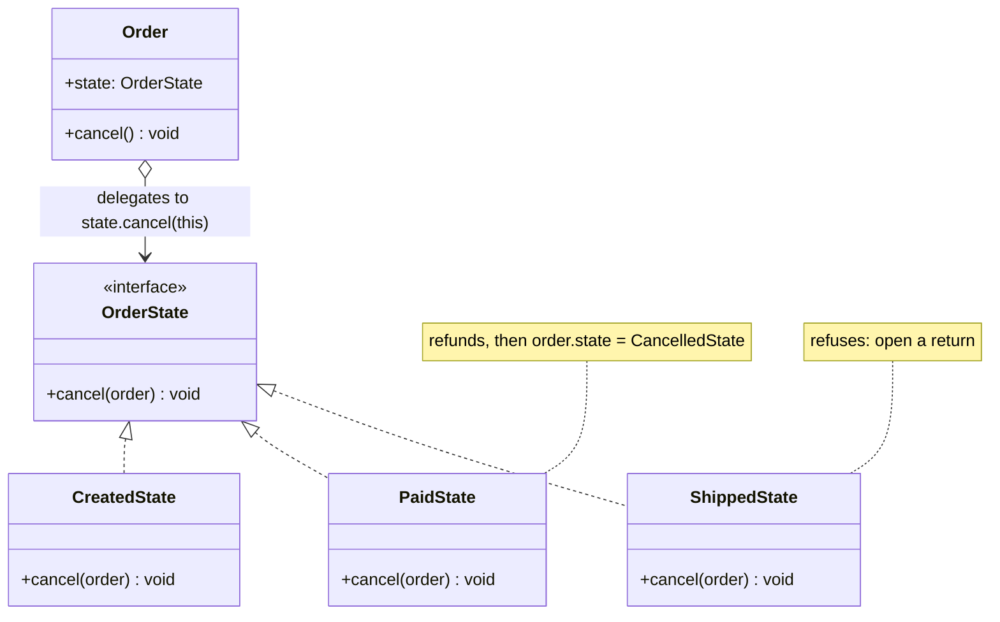

=== "PHP"

    ```php
    <?php

    // Example: each state writes its own version of cancel()
    interface OrderState
    {
        public function cancel(Order $order): void;
    }

    // Good: created order, cancelling simply closes it
    final class CreatedState implements OrderState
    {
        public function cancel(Order $order): void
        {
            $order->state = new CancelledState();
        }
    }

    // Good: paid order, refunds, then closes
    final class PaidState implements OrderState
    {
        public function cancel(Order $order): void
        {
            $order->payments->refund($order->id);
            $order->state = new CancelledState();
        }
    }

    // Good: shipped order, refuses and asks to open a return
    final class ShippedState implements OrderState
    {
        public function cancel(Order $order): void
        {
            throw new DomainException('shipped: open a return instead');
        }
    }
    ```

=== "Python"

    ```python
    # Good: created order, cancelling simply closes it
    class CreatedState:
        def cancel(self, order: "Order") -> None:
            order.state = CancelledState()


    # Good: paid order, refunds, then closes
    class PaidState:
        def cancel(self, order: "Order") -> None:
            order.payments.refund(order.id)
            order.state = CancelledState()


    # Good: shipped order, refuses and asks to open a return
    class ShippedState:
        def cancel(self, order: "Order") -> None:
            raise ValueError("shipped: open a return instead")


    # Good: the order delegates cancel() to its current state
    class Order:
        def cancel(self) -> None:
            self.state.cancel(self)
    ```

=== "Java"

    ```java
    // Example: each state writes its own version of cancel()
    interface OrderState { void cancel(Order order); }

    // Good: created order, cancelling simply closes it
    final class CreatedState implements OrderState {
        public void cancel(Order order) { order.state = new CancelledState(); }
    }

    // Good: paid order, refunds, then closes
    final class PaidState implements OrderState {
        public void cancel(Order order) {
            order.payments.refund(order.id);
            order.state = new CancelledState();
        }
    }

    // Good: shipped order, refuses and asks to open a return
    final class ShippedState implements OrderState {
        public void cancel(Order order) { throw new IllegalStateException("shipped: open a return instead"); }
    }
    ```

**In frameworks**

=== "PHP"

    The Symfony Workflow component (state machine described in YAML).

=== "Python"

    The `transitions` library, or an `Enum` plus a table as above.

=== "Java"

    Spring Statemachine, or an `enum` with `switch` as above.

| Use it when | Avoid it when |
|---|---|
| my object has a lifecycle and some moves must be forbidden, like an order that is created, paid, then shipped, a ticket or a payment. The transition table is tested row by row. | my object only has two states: a boolean is enough. |

:material-book-open-variant: Reference docs: [Refactoring.Guru, State](https://refactoring.guru/design-patterns/state) (accessed November 2026)
{ .doc-ref }

## Application architecture patterns

<a class="pill pill-scope pill-scope-app" href="../architecture/#map-of-scales">Scale · Application</a>

Not in the GoF book, but present in almost every web project.

### Repository
<span class="pill pill-status pill-status-ok" title="Still valid, checked November 2026">Current · 11/2026</span>

**Intent**: hide data access behind an interface that speaks the business language.

**Problem**: SQL queries scattered across controllers: the logic cannot be tested without a database, and changing a table breaks everything.

**Example**: `OrderRepository.get(42)`. In production, a SQL implementation. In unit tests, an in-memory implementation.

!!! noob "As noob"
    The repository is the librarian: I ask for "order 42", they know which shelf (which table, which query) to fetch it from, and I do not need to know how things are stored. The one thing to remember: **business code asks for objects, it never sees the SQL.**

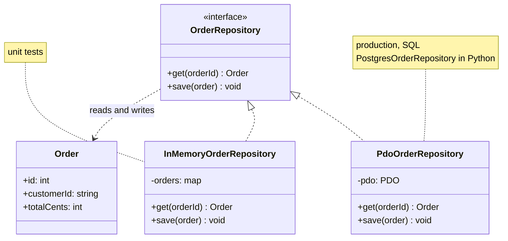

=== "PHP"

    ```php
    <?php

    // Example: the business object, with nothing about the database
    final readonly class Order
    {
        public function __construct(public int $id, public string $customerId, public int $totalCents) {}
    }

    // Good: the contract speaks business (get, save), never SQL
    interface OrderRepository
    {
        public function get(int $orderId): ?Order;
        public function save(Order $order): void;
    }

    // Good: in-memory version for unit tests, no database
    final class InMemoryOrderRepository implements OrderRepository
    {
        private array $orders = [];

        public function get(int $orderId): ?Order { return $this->orders[$orderId] ?? null; }

        public function save(Order $order): void { $this->orders[$order->id] = $order; }
    }

    // Good: production version, the only place that talks to the database
    final class PdoOrderRepository implements OrderRepository
    {
        public function __construct(private readonly PDO $pdo) {}

        public function get(int $orderId): ?Order
        {
            $statement = $this->pdo->prepare('SELECT id, customer_id, total_cents FROM orders WHERE id = ?');
            $statement->execute([$orderId]);
            $row = $statement->fetch(PDO::FETCH_NUM);
            return $row ? new Order((int) $row[0], $row[1], (int) $row[2]) : null;
        }

        public function save(Order $order): void
        {
            $this->pdo->prepare('REPLACE INTO orders VALUES (?, ?, ?)')
                ->execute([$order->id, $order->customerId, $order->totalCents]);
        }
    }
    ```

=== "Python"

    ```python
    from dataclasses import dataclass
    from typing import Protocol


    # Example: the business object, with nothing about the database
    @dataclass
    class Order:
        id: int
        customer_id: str
        total_cents: int


    # Good: the contract speaks business (get, save), never SQL
    class OrderRepository(Protocol):
        def get(self, order_id: int) -> Order | None: ...
        def save(self, order: Order) -> None: ...


    # Good: in-memory version for unit tests, no database
    class InMemoryOrderRepository:
        def __init__(self) -> None:
            self._orders: dict[int, Order] = {}

        def get(self, order_id: int) -> Order | None:
            return self._orders.get(order_id)

        def save(self, order: Order) -> None:
            self._orders[order.id] = order


    # Good: production version, the only place that talks to the database
    class PostgresOrderRepository:
        def __init__(self, connection) -> None:
            self._connection = connection

        def get(self, order_id: int) -> Order | None:
            row = self._connection.execute(
                "SELECT id, customer_id, total_cents FROM orders WHERE id = %s", (order_id,)
            ).fetchone()
            return Order(*row) if row else None

        def save(self, order: Order) -> None:
            self._connection.execute(
                "INSERT INTO orders VALUES (%s, %s, %s) ON CONFLICT (id) DO UPDATE SET total_cents = EXCLUDED.total_cents",
                (order.id, order.customer_id, order.total_cents),
            )
    ```

=== "Java"

    ```java
    import java.util.HashMap;
    import java.util.Map;
    import java.util.Optional;

    // Example: the business object, with nothing about the database
    record Order(int id, String customerId, int totalCents) {}

    // Good: the contract speaks business (get, save), never SQL
    interface OrderRepository {
        Optional<Order> get(int orderId);
        void save(Order order);
    }

    // Good: in-memory version for unit tests, no database
    final class InMemoryOrderRepository implements OrderRepository {
        private final Map<Integer, Order> orders = new HashMap<>();

        public Optional<Order> get(int orderId) { return Optional.ofNullable(orders.get(orderId)); }

        public void save(Order order) { orders.put(order.id(), order); }
    }

    // Good: production version, the only place that talks to the database
    interface JpaOrderRepository extends org.springframework.data.repository.CrudRepository<OrderEntity, Integer> {}
    ```

**In frameworks**

=== "PHP"

    Doctrine: `EntityRepository` and `$entityManager->getRepository(Order::class)`.

=== "Python"

    Django's <span class="term" data-term="orm">ORM</span> plays this role (`Order.objects.get(id=42)`). In hexagonal architecture, I write my own repository.

=== "Java"

    Spring Data: a `CrudRepository<Order, Integer>` interface, Spring writes the implementation.

| Use it when | Avoid it when |
|---|---|
| I want my business logic to know nothing about the database, so I can test it with an in-memory repository instead of a real database. | I am writing a small script or a CRUD with no logic: the ORM used directly is enough. |

:material-book-open-variant: Reference docs: [Martin Fowler, Repository](https://martinfowler.com/eaaCatalog/repository.html) (2002)
{ .doc-ref }

### Dependency injection
<span class="pill pill-status pill-status-ok" title="Still valid, checked November 2026">Current · 11/2026</span>

**Intent**: give an object what it needs (through its constructor) instead of letting it create it itself.

**Problem**: `OrderService` does `new PostgresOrderRepository()` in its code: it cannot be tested without a real database, nor switch storage.

**Example**: `OrderService` receives a repository and a notifier. In tests, it gets an in-memory repository and a fake notifier, with no database and no real sending.

!!! noob "As noob"
    Dependency injection is the cook who is handed the ingredients instead of going to the market: for a test, I hand them fake ingredients without changing the recipe. The one thing to remember: **an object receives what it needs, it does not build it.**

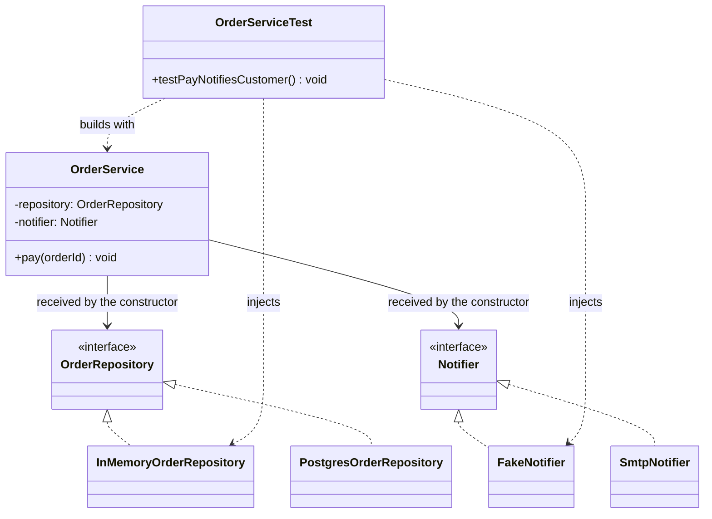

=== "PHP"

    ```php
    <?php

    // Good: receives its dependencies through the constructor, does not create them
    final class OrderService
    {
        public function __construct(
            private readonly OrderRepository $repository,
            private readonly Notifier $notifier,
        ) {}

        public function pay(int $orderId): void
        {
            $order = $this->repository->get($orderId) ?? throw new OutOfBoundsException((string) $orderId);
            $this->notifier->send($order->customerId, 'Payment received');
        }
    }

    // Example: the test injects an in-memory repository and a fake notifier
    final class OrderServiceTest extends PHPUnit\Framework\TestCase
    {
        public function testPayNotifiesCustomer(): void
        {
            $repository = new InMemoryOrderRepository();
            $repository->save(new Order(42, 'ada', 3000));
            $notifier = new FakeNotifier();
            (new OrderService($repository, $notifier))->pay(42);
            self::assertSame([['ada', 'Payment received']], $notifier->sent);
        }
    }
    ```

=== "Python"

    ```python
    # Good: receives its dependencies through the constructor, does not create them
    class OrderService:
        def __init__(self, repository: OrderRepository, notifier: Notifier) -> None:
            self._repository = repository
            self._notifier = notifier

        def pay(self, order_id: int) -> None:
            order = self._repository.get(order_id)
            if order is None:
                raise LookupError(order_id)
            self._notifier.send(order.customer_id, "Payment received")


    # Example: the test injects an in-memory repository and a fake notifier
    def test_pay_notifies_customer() -> None:
        repository = InMemoryOrderRepository()
        repository.save(Order(42, "ada", 3000))
        notifier = FakeNotifier()
        OrderService(repository, notifier).pay(42)
        assert notifier.sent == [("ada", "Payment received")]
    ```

=== "Java"

    ```java
    // Good: receives its dependencies through the constructor, does not create them
    final class OrderService {
        private final OrderRepository repository;
        private final Notifier notifier;

        OrderService(OrderRepository repository, Notifier notifier) {
            this.repository = repository;
            this.notifier = notifier;
        }

        void pay(int orderId) {
            Order order = repository.get(orderId).orElseThrow();
            notifier.send(order.customerId(), "Payment received");
        }
    }

    // Example: the test injects an in-memory repository and a fake notifier
    class OrderServiceTest {
        @org.junit.jupiter.api.Test
        void payNotifiesCustomer() {
            var repository = new InMemoryOrderRepository();
            repository.save(new Order(42, "ada", 3000));
            var notifier = new FakeNotifier();
            new OrderService(repository, notifier).pay(42);
            org.junit.jupiter.api.Assertions.assertEquals(List.of(List.of("ada", "Payment received")), notifier.sent);
        }
    }
    ```

The `FakeNotifier` in the tests is a <span class="term" data-term="fake-object">fake</span>: a class that replaces the real one during the test, and really works but in a simplified way. Here it sends nothing: it records each message in `sent`, and the test checks that list (see [test doubles](qualite.md#test-double-mock-stub-fake)).

=== "PHP"

    ```php
    <?php

    // Example: a fake that records the messages instead of sending them
    final class FakeNotifier implements Notifier
    {
        /** @var list<array{string, string}> */
        public array $sent = [];

        public function send(string $customerId, string $message): void
        {
            $this->sent[] = [$customerId, $message];
        }
    }
    ```

=== "Python"

    ```python
    # Example: a fake that records the messages instead of sending them
    class FakeNotifier:
        def __init__(self) -> None:
            self.sent: list[tuple[str, str]] = []

        def send(self, customer_id: str, message: str) -> None:
            self.sent.append((customer_id, message))
    ```

=== "Java"

    ```java
    // Example: a fake that records the messages instead of sending them
    final class FakeNotifier implements Notifier {
        final List<List<String>> sent = new ArrayList<>();

        @Override
        public void send(String customerId, String message) {
            sent.add(List.of(customerId, message));
        }
    }
    ```

**In frameworks**

=== "PHP"

    The Symfony [container](#injection-container) (*autowiring*) and Laravel's read the constructor types and inject everything on their own.

=== "Python"

    No container required: objects are passed to the constructor. FastAPI offers `Depends()` for routes.

=== "Java"

    Spring: constructor injection is the recommended form (no `@Autowired` on fields).

| Use it when | Avoid it when |
|---|---|
| almost always in application code: it is what makes code testable (in tests, `OrderService` gets a fake notifier instead of sending real messages) and what replaces singletons. | these are simple value objects (a date, an amount): I create them directly. |

:material-book-open-variant: Reference docs: [Martin Fowler, Inversion of Control Containers and the Dependency Injection pattern](https://martinfowler.com/articles/injection.html) (2004)
{ .doc-ref }

#### Injection container

**Definition**: an injection container (or <span class="term" data-term="di-container">service container</span>, *DI container*, nothing to do with a Docker container) is an object that builds my objects and their dependencies for me. It knows what to build from a configuration, or by reading the constructor types: that is *autowiring*. It also keeps the instances: one per service by default, which replaces the Singleton.

**Example**: without a container, the entry point (controller, command, `main`) wires everything by hand. With a container, it asks for `OrderService` and gets the object already wired.

!!! noob "As noob"
    The container is the warehouse clerk who prepares the order: I ask for "an `OrderService`", they fetch the repository and notifier it needs, put them together and hand it over ready. The one thing to remember: **the container does the injection for me, but I can perfectly well inject without one.**

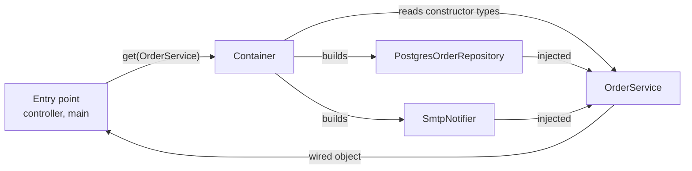

=== "PHP"

    Without a container:

    ```php
    <?php

    // Example: without a container, the entry point wires everything by hand
    $service = new OrderService(new PostgresOrderRepository($pdo), new SmtpNotifier($mailer));
    ```

    With the Symfony container, `config/services.yaml` turns on autowiring and says which class to use for each interface:

    ```yaml
    services:
        # Example: autowiring reads the constructor types
        _defaults:
            autowire: true
            autoconfigure: true

        # Example: every class in src/ becomes a service
        App\:
            resource: '../src/'

        # Example: which class to use for each interface
        App\Order\OrderRepository: '@App\Order\PostgresOrderRepository'
        App\Notification\Notifier: '@App\Notification\SmtpNotifier'
    ```

    A controller that declares `OrderService $service` in its constructor receives it fully built.

=== "Python"

    Without a container:

    ```python
    # Example: without a container, the entry point wires everything by hand
    service = OrderService(PostgresOrderRepository(dsn), SmtpNotifier())
    ```

    With a minimal hand-written container (a class that centralizes the wiring and keeps the instance):

    ```python
    # Example: a minimal container that centralises the wiring and keeps the instance
    class Container:
        def __init__(self, dsn: str) -> None:
            self._dsn = dsn
            self._order_service: OrderService | None = None

        def order_service(self) -> OrderService:
            if self._order_service is None:
                repository = PostgresOrderRepository(self._dsn)
                self._order_service = OrderService(repository, SmtpNotifier())
            return self._order_service


    # Example: the entry point asks for the already wired service
    container = Container(dsn="postgresql://localhost/orders")
    service = container.order_service()
    ```

    In FastAPI, `service: OrderService = Depends(get_order_service)` in a route signature plays the same role. The `dependency-injector` library also exists for large projects.

=== "Java"

    Without a container:

    ```java
    // Example: without a container, the entry point wires everything by hand
    var service = new OrderService(new JdbcOrderRepository(dataSource), new SmtpNotifier(mailSender));
    ```

    With Spring, annotate the classes and keep constructor injection: Spring finds the single implementation of each interface and passes it to the constructor.

    ```java
    // Example: the service keeps constructor injection
    @Service
    class OrderService {
        private final OrderRepository repository;
        private final Notifier notifier;

        OrderService(OrderRepository repository, Notifier notifier) {
            this.repository = repository;
            this.notifier = notifier;
        }
    }

    // Example: Spring finds the only implementation of each interface
    @Repository
    class JdbcOrderRepository implements OrderRepository { /* ... */ }

    @Component
    class SmtpNotifier implements Notifier { /* ... */ }
    ```

**Pitfall**: the container hides the wiring. The code no longer shows who builds what, and a configuration error only shows up at startup, sometimes on the first request. And calling the container from business code (`$container->get(OrderService::class)`) turns it into a *<span class="term" data-term="service-locator">service locator</span>*: dependencies vanish from the constructor signature, which is an anti-pattern. Only the entry point calls the container, the rest of the code receives its dependencies through the constructor.

:material-book-open-variant: Reference docs: [Symfony, Service Container](https://symfony.com/doc/current/service_container.html) (accessed November 2026); [Spring Framework, The IoC Container](https://docs.spring.io/spring-framework/reference/core/beans.html) (accessed November 2026)
{ .doc-ref }

## Pitfalls to avoid

- **Pattern for the pattern's sake**: I add a factory, an interface and a strategy for a single case. Result: three classes to read instead of an `if`. A pattern is justified by a present problem, not a future one.
- **The name without the shape**: I call a class that does everything `OrderManagerFactoryService`. A pattern name promises a precise structure, and the reviewer relies on it, so they misread what the code does.
- **Singletons everywhere**: I hide global state, so my tests affect each other: a test passes alone and fails after another one. Dependency injection solves the same problem cleanly.
- **Deep inheritance**: I stack a `Template Method` four levels deep, and nobody knows anymore which class writes which step. Beyond one level, I prefer composition (Strategy, Decorator).
- **The container called everywhere**: I call `$container->get(...)` from business code, so the container becomes a service locator and the dependencies vanish from the constructor signature. I call the container only at the entry point, the rest receives its dependencies through the constructor ([see the injection container](#injection-container)).
- **Observer when order matters**: I go through subscribers while billing must succeed before the email is sent, or an error in a subscriber must cancel everything. Nothing in the code states that order, so the email can go out for an order whose billing failed. In that case, I write direct calls ([see Observer](#observer)).
- **Stacked decorators**: I wrap an object in a dozen layers (cache, logs, retry, metrics), so when debugging the call stack becomes unreadable. I keep the useful layers and name them clearly ([see Decorator](#decorator)).

## What interviews ask

The typical questions:

- "Which design patterns do you use day to day?", "Give an example of Strategy in your code" How I answer: I start from a real case, like standard and express shipping costs, then say when an `if` is enough ([Strategy](#strategy)).
- "Why is the Singleton called an anti-pattern?", "What do you replace it with?" How I answer: I explain that it creates global state shared between tests, impossible to replace with a double, and that I let the injection container keep the single instance ([Singleton](#singleton)).
- "What is the difference between Decorator and Proxy?", "Between Adapter and Facade?" How I answer: I point out that it is the same shape with a different intent, the proxy controls access, the decorator adds a feature ([Proxy](#proxy)).
- "What is dependency injection, and how does it make code testable?", "What is a service locator?" How I answer: I show `OrderService` receiving a fake notifier in tests, and I explain that the service locator hides the dependencies ([Dependency injection](#dependency-injection)).
- "Composition or inheritance? When do you prefer Strategy over Template Method?" How I answer: I switch to Strategy as soon as inheritance goes beyond one level or each variant changes many steps ([Template Method](#template-method)).
- "Which pattern do you use to prepare readable test data?" How I answer: I use a Builder like `an_order().paid().build()` ([Builder](#builder)).

What makes a good answer: name the problem before the pattern, show a concrete example, then say **when I would not use it**. That is what shows I choose a pattern instead of reciting it.

## Which pattern for which need

| I want... | I use... |
|---|---|
| to do the same calculation several ways depending on data, like different shipping costs for standard and express | Strategy |
| to create the right object from a setting, like an email or SMS notifier, with that choice written in one place | Factory |
| to build an object with many options, like an HTTP request, or prepare readable test data | Builder |
| to plug in a third-party library, like the bank's, without all my code depending on the way it talks | Adapter |
| to add caching, logs or retry around an object, without touching its code | Decorator |
| to check permissions before anyone reaches an object, or load it only when someone uses it | Proxy |
| to stop copying the same sequence of calls into every controller, like stock, payment, then delivery | Facade |
| several modules to react to a fact, like "order paid", without the emitter knowing them | Observer |
| to queue, replay or undo an action, like a Ctrl+Z on the cart | Command |
| to share a flow where only a few steps change, like CSV and PDF exports | Template Method |
| every request to go through the same checks before and after my code, like authentication and rate limiting | Chain of Responsibility (middlewares) |
| to forbid impossible moves in a lifecycle, like paying for an order that has already shipped | State |
| to test my business logic without starting a database | Repository + dependency injection |
| a single shared instance, like the configuration or the connection pool | the [injection container](#injection-container), not a hand-written Singleton |

## Sources

- Erich Gamma, Richard Helm, Ralph Johnson and John Vlissides, "Design Patterns: Elements of Reusable Object-Oriented Software" (1994)
- Martin Fowler, "Patterns of Enterprise Application Architecture" (2002), for Repository
- [Martin Fowler, "Inversion of Control Containers and the Dependency Injection pattern" (2004)](https://martinfowler.com/articles/injection.html)
- [Refactoring.Guru, design patterns catalog (publication date not stated)](https://refactoring.guru/design-patterns)
- [PSR-15, HTTP Server Request Handlers (2018)](https://www.php-fig.org/psr/psr-15/)
