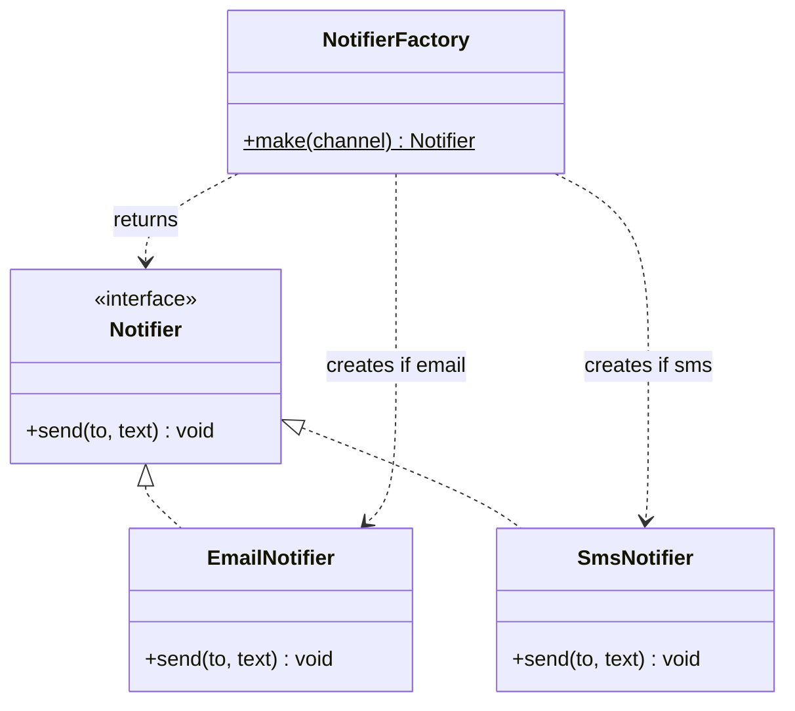
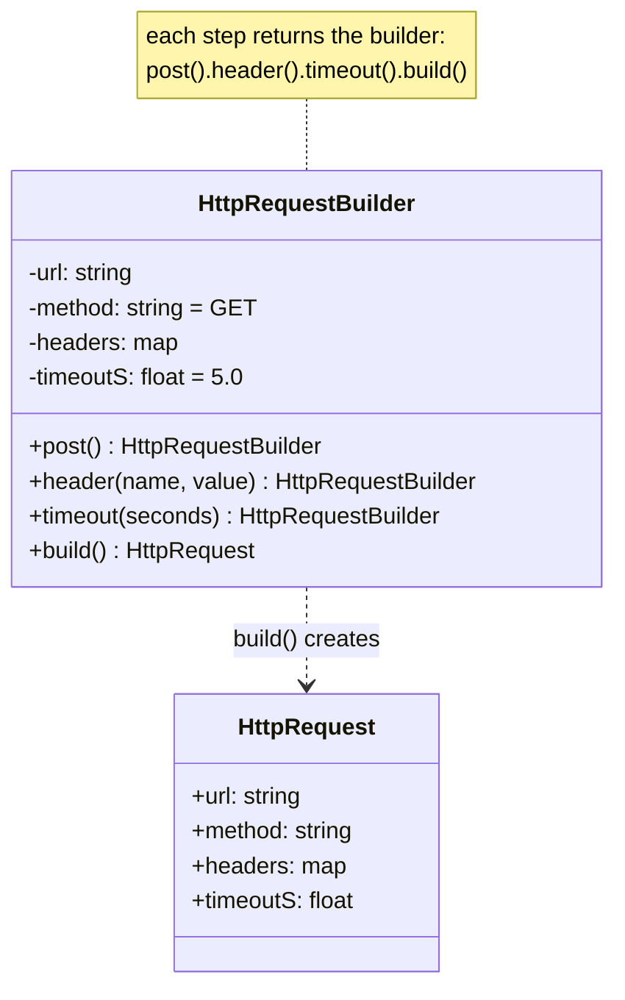
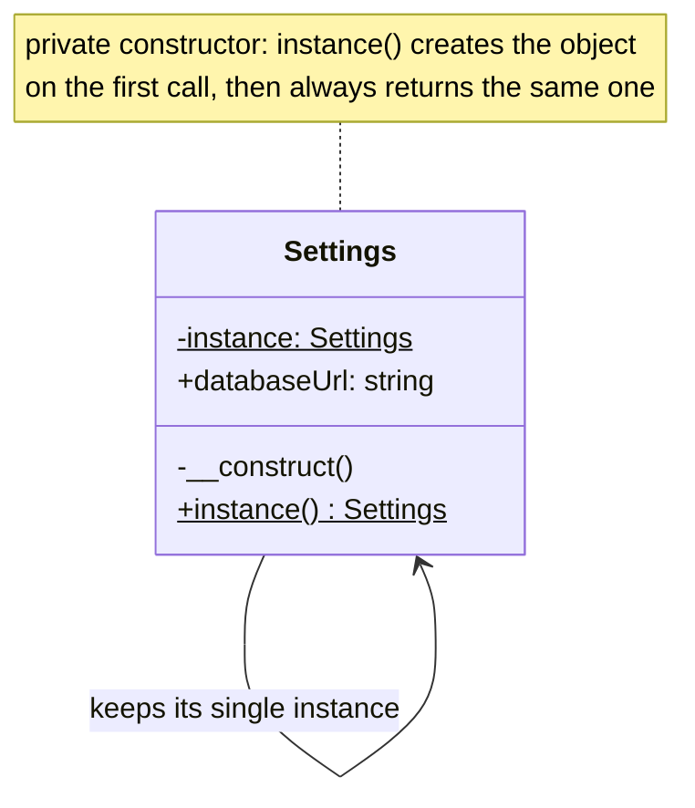
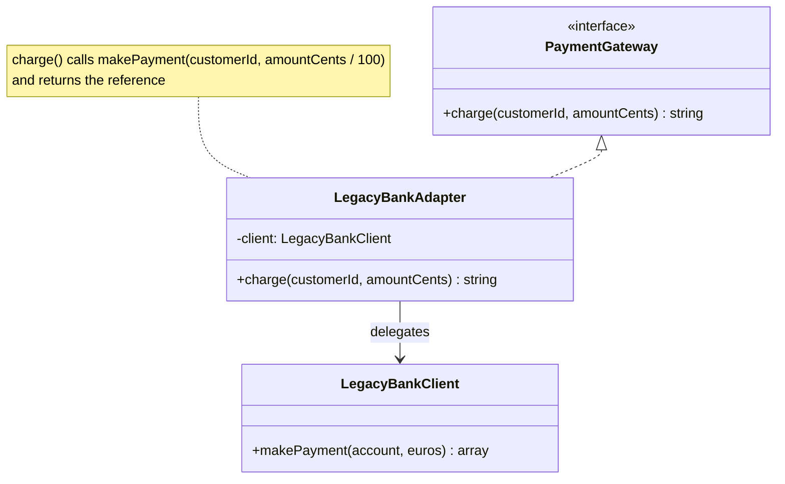
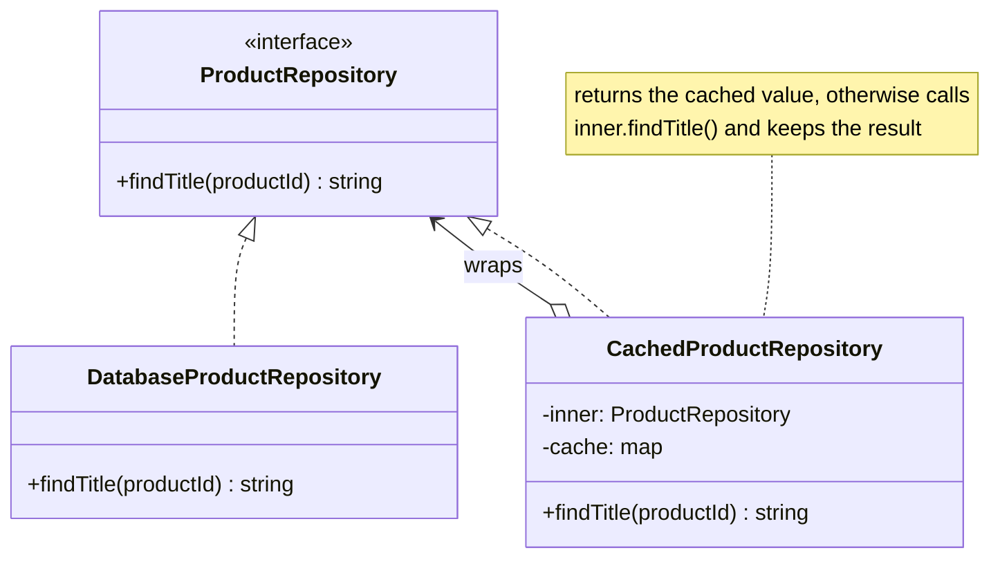
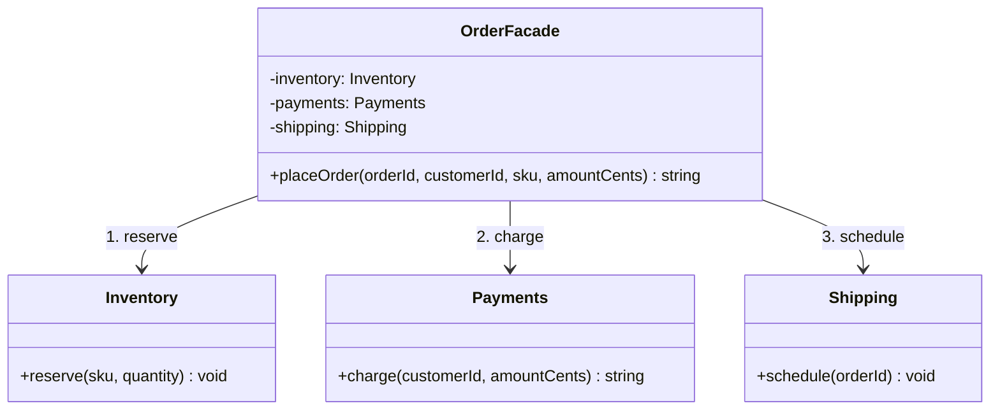
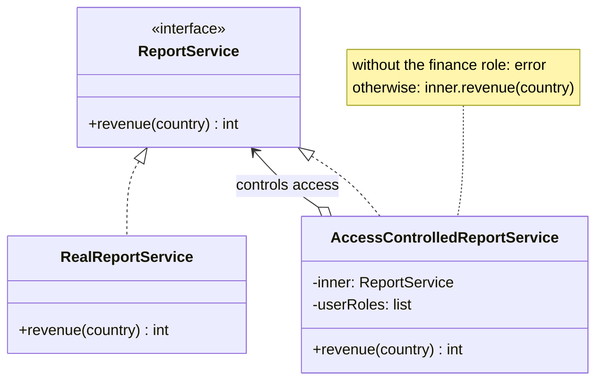
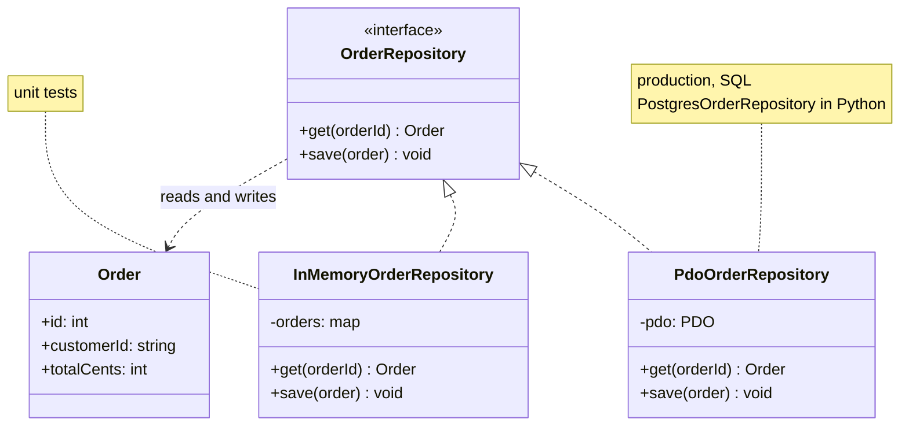
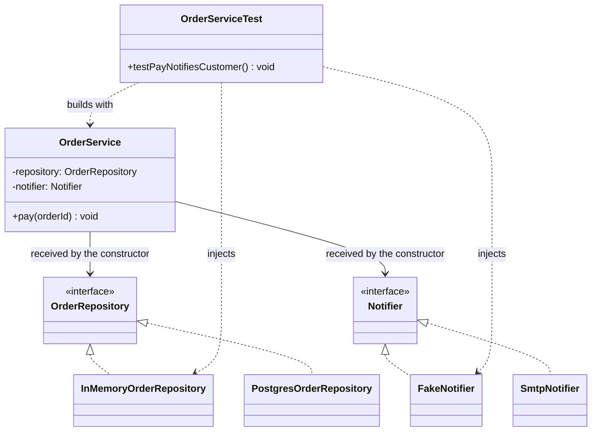
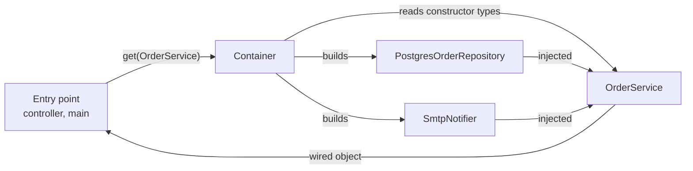

# Design patterns

!!! warning "Disclaimer"
    These notes are personal cheat sheets, not a source of truth. They reflect my own understanding and choices: their content remains subjective, despite the quotes and references it contains. It may be incomplete, simplified, inaccurate or outdated. Always check the official documentation before applying it. This content is provided as is, without any warranty: you use it at your own risk.

!!! audience "Who and what for"
    - **Roles**: back-end developer, front-end developer, test automation QA engineer, tech lead, architect...
    - **Uses**: I prepare an interview where I am asked "explain Adapter with an example", I centralize in a factory the choice between an email notifier and an SMS notifier, I review a merge request that adds a singleton and want to know if it is justified, I structure my test framework (an adapter in front of the HTTP client, a builder for test data)...

!!! abstract "Scales"
    The colored badges under the headings say at which scale a notion applies:

    - <span class="pill pill-scope pill-scope-code">Code</span> the classes, functions and modules of one program;
    - <span class="pill pill-scope pill-scope-app">Application</span> one service or application and its internal split;
    - <span class="pill pill-scope pill-scope-system">System</span> several services talking to each other over the network;
    - <span class="pill pill-scope pill-scope-infra">Infrastructure</span> servers, network, zones and clusters, physical or virtual;
    - <span class="pill pill-scope pill-scope-enterprise">Enterprise</span> the whole information system and its organization.

    Details and ambiguous words: [map of scales](architecture.md#map-of-scales).

A **design pattern** is a known, named solution to a design problem that keeps coming back. It is not code to copy: it is a shape of solution, which I adapt. Naming it also makes reviews faster: "put an adapter in front of this client" says in a few words what would take a paragraph.

!!! noob "As noob"
    A design pattern is like a knot name for a sailor: "tie a bowline" is enough, nobody explains every loop again, and each sailor adapts it to the rope in hand. The one thing to remember: **a pattern is a known solution with a name, not a piece of code to copy and paste.**

This page covers the creational, structural and application architecture patterns most useful day to day, with the same example in PHP, Python and Java. Service and data names are fictitious. The principles that guide these choices (SOLID, STUPID, KISS, DRY, YAGNI) are on the [Design principles](principes-conception.md) page. The behavioral patterns (Strategy, Observer, Command, Template Method, Chain of Responsibility, State) have their own page: [Behavioural design patterns](design-patterns-comportement.md).

!!! tip "Choose the language"
    I click a language: **every example on the page** switches to it, and the choice is kept from one page to the next.

=== "PHP"

    Examples shown in **PHP 8.3** (`readonly` classes, `match`, enums).

=== "Python"

    Examples shown in **Python 3.12** (`Protocol`, `dataclass`, type hints).

=== "Java"

    Examples shown in **Java 21** (`record`, `switch` expressions, `enum`).

## Terminology

**Class**: a template for objects (their data and methods). **Object** (or instance): one copy created from a class.

**<span class="term" data-term="interface-code">Interface</span>**: a contract that lists methods without writing them. Any class implementing it promises to provide them. In Python, a `Protocol` is often used: no need to declare it, having the right methods is enough.

**<span class="term" data-term="inheritance">Inheritance</span>**: a class takes the code of a parent class and extends it. **<span class="term" data-term="object-composition">Composition</span>**: an object holds another one and delegates part of the work to it. Most patterns prefer composition, which is more flexible.

**<span class="term" data-term="polymorphism">Polymorphism</span>**: calling the same method on objects of different classes, each reacting in its own way. `shipping.cost()` gives a different price for `Standard` and `Express`.

**<span class="term" data-term="coupling">Coupling</span>**: how much a piece of code depends on the details of another. Tight coupling: changing one forces changing the other.

**GoF** (*Gang of Four*): the four authors of "Design Patterns: Elements of Reusable Object-Oriented Software" (Gamma, Helm, Johnson and Vlissides, 1994), which named 23 patterns in three families: creational, structural, behavioral.

**<span class="term" data-term="sli">SLI</span>** (Service Level Indicator): the number I measure to know whether a solution works, for example the number of files changed to add a notification channel.

**<span class="term" data-term="slo">SLO</span>** (Service Level Objective): the internal target I set on that number, for example "a new channel touches a single existing file, the factory".

**<span class="term" data-term="sla">SLA</span>** (Service Level Agreement): the contractual promise made to a customer, with a penalty if it is not kept, usually looser than the SLO. A pattern choice stays internal to the code: it almost never has an SLA, except when it protects a service promised to the customer, like a cache in front of a public API.

## Creational patterns

<a class="pill pill-scope pill-scope-code" href="../architecture/#map-of-scales">Scale · Code</a>

How to build objects without the rest of the code depending on how they are built.

### Factory
<span class="pill pill-status pill-status-ok" title="Still valid, checked November 2026">Current · 11/2026</span>

**Intent**: centralize the creation of objects whose exact class depends on a parameter.

**Problem**: `if channel == "sms": SmsNotifier()` all over the code. Adding a channel means finding and changing every place.

**Example**: choosing how to notify a customer (email or SMS) from a setting. A single place knows which class to create.

!!! noob "As noob"
    The factory is the desk of a rental agency: I say "a small car" or "a van", the clerk fetches the right vehicle from the car park, I do not need to know where it is parked. If the agency adds bikes, only the desk learns about it. The one thing to remember: **one place decides which class to create, the others just ask for what they want.**



**Without the pattern** (avoid): every caller picks the class itself. The day I add a channel, I must find every `if` like this one in the code, and the one I miss crashes on that channel (variable never set) instead of notifying the customer.

=== "PHP"

    ``` { .php .ex-bad title="Avoid" }
    <?php

    // Avoid: every caller picks the class, this if is copied wherever we notify
    function notifyShipped(string $channel, string $customerId): void
    {
        if ($channel === 'email') {
            $notifier = new EmailNotifier();
        } elseif ($channel === 'sms') {
            $notifier = new SmsNotifier();
        }
        $notifier->send($customerId, 'Your order has shipped');
    }
    ```

=== "Python"

    ``` { .python .ex-bad title="Avoid" }
    # Avoid: every caller picks the class, this if is copied wherever we notify
    def notify_shipped(channel: str, customer_id: str) -> None:
        if channel == "email":
            notifier = EmailNotifier()
        elif channel == "sms":
            notifier = SmsNotifier()
        notifier.send(customer_id, "Your order has shipped")
    ```

=== "Java"

    ``` { .java .ex-bad title="Avoid" }
    // Avoid: every caller picks the class, this if is copied wherever we notify
    static void notifyShipped(String channel, String customerId) {
        Notifier notifier = null;
        if (channel.equals("email")) {
            notifier = new EmailNotifier();
        } else if (channel.equals("sms")) {
            notifier = new SmsNotifier();
        }
        notifier.send(customerId, "Your order has shipped");
    }
    ```

**With the pattern**:

=== "PHP"

    ``` { .php .ex-good title="Recommended" }
    <?php

    // Example: the contract every notifier shares
    interface Notifier
    {
        public function send(string $to, string $text): void;
    }

    // Example: one class per channel, with the same send() method
    final class EmailNotifier implements Notifier
    {
        public function send(string $to, string $text): void { echo "email to $to: $text\n"; }
    }

    final class SmsNotifier implements Notifier
    {
        public function send(string $to, string $text): void { echo "sms to $to: $text\n"; }
    }

    // Good: the only place that knows which class to create for each channel
    final class NotifierFactory
    {
        public static function make(string $channel): Notifier
        {
            return match ($channel) {
                'email' => new EmailNotifier(),
                'sms' => new SmsNotifier(),
                default => throw new InvalidArgumentException("unknown channel: $channel"),
            };
        }
    }

    // Example: the caller asks for a channel without knowing the class
    NotifierFactory::make('sms')->send('ada', 'Your order has shipped');
    ```

=== "Python"

    ``` { .python .ex-good title="Recommended" }
    # Example: one class per channel, with the same send() method
    class EmailNotifier:
        def send(self, to: str, text: str) -> None:
            print(f"email to {to}: {text}")


    class SmsNotifier:
        def send(self, to: str, text: str) -> None:
            print(f"sms to {to}: {text}")


    # Good: the only place that knows which class to create for each channel
    def make_notifier(channel: str) -> EmailNotifier | SmsNotifier:
        notifiers = {"email": EmailNotifier, "sms": SmsNotifier}
        try:
            return notifiers[channel]()
        except KeyError:
            raise ValueError(f"unknown channel: {channel}") from None


    # Example: the caller asks for a channel without knowing the class
    make_notifier("sms").send("ada", "Your order has shipped")
    ```

=== "Java"

    ``` { .java .ex-good title="Recommended" }
    // Example: the contract every notifier shares
    interface Notifier {
        void send(String to, String text);
    }

    // Example: one class per channel, with the same send() method
    final class EmailNotifier implements Notifier {
        public void send(String to, String text) { System.out.println("email to " + to + ": " + text); }
    }

    final class SmsNotifier implements Notifier {
        public void send(String to, String text) { System.out.println("sms to " + to + ": " + text); }
    }

    // Good: the only place that knows which class to create for each channel
    final class NotifierFactory {
        static Notifier make(String channel) {
            return switch (channel) {
                case "email" -> new EmailNotifier();
                case "sms" -> new SmsNotifier();
                default -> throw new IllegalArgumentException("unknown channel: " + channel);
            };
        }
    }

    // Example: the caller asks for a channel without knowing the class
    NotifierFactory.make("sms").send("ada", "Your order has shipped");
    ```

**In frameworks**

=== "PHP"

    Symfony: service *factories* in `services.yaml` (`factory: [NotifierFactory, make]`).

=== "Python"

    Django: `get_user_model()`, or `logging.getLogger()` which builds and reuses loggers.

=== "Java"

    Spring: the `@Bean` methods of a `@Configuration` class are factories.

| Use it when | Avoid it when |
|---|---|
| the class to create depends on a setting or on data, like an email or SMS notifier depending on the chosen channel, or creation takes several steps. | I only ever create one class, always the same: a plain `new` is more readable. |

**Risks.** A factory that grows with each channel ends up as a big `match` that everyone edits, which recreates the problem instead of solving it: I keep a plain lookup table, or I register each channel next to its class. A factory that returns `None` or a default channel for an unknown name hides a configuration mistake, and the customer is never notified: I raise a clear error at startup.

:material-book-open-variant: Reference docs: [Refactoring.Guru, Factory Method](https://refactoring.guru/design-patterns/factory-method) (accessed November 2026)
{ .doc-ref }

### Builder
<span class="pill pill-status pill-status-ok" title="Still valid, checked November 2026">Current · 11/2026</span>

**Intent**: build a complex object step by step, with readable defaults.

**Problem**: a constructor with eight parameters, five of them optional: `HttpRequest(url, "POST", {}, 5.0, None, True, ...)`. Nobody knows what the sixth one means.

**Example**: preparing an HTTP request: method, headers, timeout, each one named.

!!! noob "As noob"
    The builder is ordering a sandwich at the counter: "wholemeal bread, no onions, sauce on the side". Each choice is said by name, and what I do not mention gets the usual value, instead of an eight-box form to fill in order. The one thing to remember: **each option has a name, the others keep their default.**



**Without the pattern** (avoid): a version of `HttpRequest` whose constructor takes eight parameters. Reading the call, nothing says whether the first boolean turns on redirects or compression, and swapping two parameters of the same type compiles without error: the bug only shows in production.

=== "PHP"

    ``` { .php .ex-bad title="Avoid" }
    <?php

    // Avoid: eight parameters in a row, nobody knows what the last four mean
    $request = new HttpRequest('https://my-api/orders', 'POST', ['Idempotency-Key' => '7f3c'], 2.0, null, true, false, 3);
    ```

=== "Python"

    ``` { .python .ex-bad title="Avoid" }
    # Avoid: eight parameters in a row, nobody knows what the last four mean
    request = HttpRequest("https://my-api/orders", "POST", {"Idempotency-Key": "7f3c"}, 2.0, None, True, False, 3)
    ```

=== "Java"

    ``` { .java .ex-bad title="Avoid" }
    // Avoid: eight parameters in a row, nobody knows what the last four mean
    var request = new HttpRequest("https://my-api/orders", "POST", Map.of("Idempotency-Key", "7f3c"), 2.0, null, true, false, 3);
    ```

**With the pattern**:

=== "PHP"

    ``` { .php .ex-good title="Recommended" }
    <?php

    // Example: the final immutable object the builder produces
    final readonly class HttpRequest
    {
        public function __construct(
            public string $url,
            public string $method,
            public array $headers,
            public float $timeoutS,
        ) {}
    }

    // Good: one named method per option, readable defaults
    final class HttpRequestBuilder
    {
        private string $method = 'GET';
        private array $headers = [];
        private float $timeoutS = 5.0;

        public function __construct(private readonly string $url) {}

        public function post(): self { $this->method = 'POST'; return $this; }

        public function header(string $name, string $value): self { $this->headers[$name] = $value; return $this; }

        public function timeout(float $seconds): self { $this->timeoutS = $seconds; return $this; }

        public function build(): HttpRequest
        {
            return new HttpRequest($this->url, $this->method, $this->headers, $this->timeoutS);
        }
    }

    // Example: each step is named, instead of eight anonymous parameters
    $request = (new HttpRequestBuilder('https://my-api/orders'))->post()->header('Idempotency-Key', '7f3c')->timeout(2)->build();
    ```

=== "Python"

    ``` { .python .ex-good title="Recommended" }
    from dataclasses import dataclass, field


    # Example: the final immutable object the builder produces
    @dataclass(frozen=True)
    class HttpRequest:
        url: str
        method: str
        headers: dict[str, str]
        timeout_s: float


    # Good: one named method per option, readable defaults
    @dataclass
    class HttpRequestBuilder:
        url: str
        method: str = "GET"
        headers: dict[str, str] = field(default_factory=dict)
        timeout_s: float = 5.0

        def post(self) -> "HttpRequestBuilder":
            self.method = "POST"
            return self

        def header(self, name: str, value: str) -> "HttpRequestBuilder":
            self.headers[name] = value
            return self

        def timeout(self, seconds: float) -> "HttpRequestBuilder":
            self.timeout_s = seconds
            return self

        def build(self) -> HttpRequest:
            return HttpRequest(self.url, self.method, dict(self.headers), self.timeout_s)


    # Example: each step is named, instead of eight anonymous parameters
    request = HttpRequestBuilder("https://my-api/orders").post().header("Idempotency-Key", "7f3c").timeout(2).build()
    ```

=== "Java"

    ``` { .java .ex-good title="Recommended" }
    import java.util.HashMap;
    import java.util.Map;

    // Example: the final immutable object the builder produces
    record HttpRequest(String url, String method, Map<String, String> headers, double timeoutS) {

        static Builder builder(String url) { return new Builder(url); }

        // Good: one named method per option, readable defaults
        static final class Builder {
            private final String url;
            private String method = "GET";
            private final Map<String, String> headers = new HashMap<>();
            private double timeoutS = 5.0;

            private Builder(String url) { this.url = url; }

            Builder post() { method = "POST"; return this; }

            Builder header(String name, String value) { headers.put(name, value); return this; }

            Builder timeout(double seconds) { timeoutS = seconds; return this; }

            HttpRequest build() { return new HttpRequest(url, method, Map.copyOf(headers), timeoutS); }
        }
    }

    // Example: each step is named, instead of eight anonymous parameters
    HttpRequest request = HttpRequest.builder("https://my-api/orders").post().header("Idempotency-Key", "7f3c").timeout(2).build();
    ```

**In frameworks**

=== "PHP"

    Doctrine: the `QueryBuilder` (`->select()->from()->where()`).

=== "Python"

    SQLAlchemy: `select(Order).where(...).order_by(...)`. In Python, keyword arguments with defaults are often enough.

=== "Java"

    Lombok `@Builder`, the JDK's `HttpRequest.newBuilder()`, `StringBuilder`.

| Use it when | Avoid it when |
|---|---|
| my object has many optional parameters, like an HTTP request with its method, headers and timeout, or it is built in several steps. Very handy for test data (`an_order().paid().build()`). | my object only has two or three parameters: a constructor (or keyword arguments in Python) is enough. |

**Risks.** A builder that accepts calls in any order can produce an incomplete object, like a request with no URL, and the error only shows up when it is sent: I check required fields in `build()`. In tests, a builder that fills too many defaults hides what the test really checks: each test only states the values that matter to it, and the defaults stay realistic.

:material-book-open-variant: Reference docs: [Refactoring.Guru, Builder](https://refactoring.guru/design-patterns/builder) (accessed November 2026)
{ .doc-ref }

### Singleton
<span class="pill pill-status pill-status-ok" title="Still valid, checked November 2026">Current · 11/2026</span>

**Intent**: guarantee that a class has a single instance, reachable everywhere.

**Problem**: my app reloads the configuration or recreates a connection pool on every call, so every request pays that cost for nothing.

**Example**: the application settings, read once at startup.

!!! noob "As noob"
    The singleton is the one notice board in the staff room: everyone reads the same one, there is not one per office. Handy, but if someone writes a mistake on it, everyone sees it, and I cannot hang a blank one for the length of a test. The one thing to remember: **one shared instance, to keep for things that do not change, like settings read at startup.**



**Without the pattern** (avoid): every call reads the configuration file again. Every request pays for a disk read, and if the file changes while the app runs, two parts of the code can see two different values at the same time.

=== "PHP"

    ``` { .php .ex-bad title="Avoid" }
    <?php

    // Avoid: reads and parses the configuration file again on every call
    function databaseUrl(): string
    {
        $config = json_decode(file_get_contents('config.json'), true);
        return $config['database_url'];
    }
    ```

=== "Python"

    ``` { .python .ex-bad title="Avoid" }
    import json


    # Avoid: reads and parses the configuration file again on every call
    def database_url() -> str:
        with open("config.json") as file:
            return json.load(file)["database_url"]
    ```

=== "Java"

    ``` { .java .ex-bad title="Avoid" }
    // Avoid: reads and parses the configuration file again on every call
    static String databaseUrl() throws IOException {
        var config = new Properties();
        config.load(Files.newBufferedReader(Path.of("config.properties")));
        return config.getProperty("database_url");
    }
    ```

**With the pattern**:

=== "PHP"

    ``` { .php .ex-illus title="Illustration" }
    <?php

    // Example: a single instance, created once, then always returned
    final class Settings
    {
        private static ?Settings $instance = null;

        public readonly string $databaseUrl;

        private function __construct()
        {
            $this->databaseUrl = 'mysql://localhost/orders';
        }

        public static function instance(): self
        {
            return self::$instance ??= new self();
        }
    }

    // Example: two calls return the same object
    assert(Settings::instance() === Settings::instance());
    ```

=== "Python"

    ``` { .python .ex-illus title="Illustration" }
    from functools import cache


    class Settings:
        def __init__(self) -> None:
            self.database_url = "postgresql://localhost/orders"


    # Example: a single instance, created once, then always returned
    @cache
    def get_settings() -> Settings:
        return Settings()


    # Example: two calls return the same object
    assert get_settings() is get_settings()
    ```

=== "Java"

    ``` { .java .ex-illus title="Illustration" }
    // Example: a single instance, created once, then always returned
    enum Settings {
        INSTANCE;

        private final String databaseUrl = "jdbc:postgresql://localhost/orders";

        String databaseUrl() { return databaseUrl; }
    }

    // Example: two calls return the same object
    assert Settings.INSTANCE == Settings.INSTANCE;
    ```

**In frameworks**

=== "PHP"

    In Symfony and Laravel, the [service container](#injection-container) creates a single instance per service by default: nobody writes singletons by hand anymore.

=== "Python"

    A Python module is already imported only once. `functools.cache` on a function gives the same result without a special class.

=== "Java"

    Spring: beans are singletons by default. Written by hand, the `enum` form is the safest (thread-safe, serialization).

| Use it when | Avoid it when |
|---|---|
| I have a truly unique resource that nobody changes once created, like the configuration read at startup or the connection pool, and preferably the injection container manages it. | almost always in application code: a singleton is a global variable in disguise. All tests share its state, so one test can skew another, and I cannot replace it with a double. I prefer dependency injection. |

:material-book-open-variant: Reference docs: [Refactoring.Guru, Singleton](https://refactoring.guru/design-patterns/singleton) (accessed November 2026)
{ .doc-ref }

!!! maturity "Measuring maturity"
    | Level | What I see in the team |
    |---|---|
    | N1 | one or two people write factories or builders, the rest of the team still writes `new` behind `if` checks on the type, and hand-written singletons linger in the code |
    | N2 | all test data goes through shared builders (`an_order().paid().build()`), creating objects with variants is centralized in a factory, and the injection container manages single instances |
    | N3 | a static analysis rule refuses new `getInstance()` calls and constructors with more than five parameters, without a reviewer having to point it out |
    | N4 | the team tracks the number of remaining singletons and the number of files touched to add a variant, and decides to introduce or remove a factory from those numbers |

    **I measure**: the number of `getInstance()` calls and constructors with more than five parameters, counted by a repository search or by static analysis; the number of files changed by MRs that add a variant (a channel, a format), read in the MR tool.

## Structural patterns

<a class="pill pill-scope pill-scope-code" href="../architecture/#map-of-scales">Scale · Code</a>

How to assemble objects into a more convenient shape, without changing their code.

### Adapter
<span class="pill pill-status pill-status-ok" title="Still valid, checked November 2026">Current · 11/2026</span>

**Intent**: fit an existing class into the interface my code expects, without changing that class.

**Problem**: the bank library speaks euros with `make_payment()`, my code expects `charge()` in cents. Changing my code everywhere would make the bank impossible to replace.

**Example**: an adapter translates the call and the units. The day I switch banks, I write another adapter, nothing else moves.

!!! noob "As noob"
    The adapter is a travel plug: my European charger does not fit a UK socket, I change neither the charger nor the wall, I slip an adapter in between. The one thing to remember: **an adapter changes the shape of the call, not what it does.**



**Without the pattern** (avoid): my business code calls the bank library directly, with its method name and its euros, everywhere I take a payment. Changing banks means editing every one of those places, and the one where someone forgets to divide by 100 charges 3,000 euros instead of 30.

=== "PHP"

    ``` { .php .ex-bad title="Avoid" }
    <?php

    // Avoid: business code talks to the bank directly, conversion included, at every payment
    function checkout(LegacyBankClient $bank, string $customerId, int $amountCents): string
    {
        return $bank->makePayment($customerId, $amountCents / 100)['ref'];
    }
    ```

=== "Python"

    ``` { .python .ex-bad title="Avoid" }
    # Avoid: business code talks to the bank directly, conversion included, at every payment
    def checkout(bank: LegacyBankClient, customer_id: str, amount_cents: int) -> str:
        return bank.make_payment(customer_id, amount_cents / 100)["ref"]
    ```

=== "Java"

    ``` { .java .ex-bad title="Avoid" }
    // Avoid: business code talks to the bank directly, conversion included, at every payment
    static String checkout(LegacyBankClient bank, String customerId, int amountCents) {
        return bank.makePayment(customerId, amountCents / 100.0).get("ref");
    }
    ```

**With the pattern**:

=== "PHP"

    ``` { .php .ex-good title="Recommended" }
    <?php

    // Example: the interface my code expects (cents, charge())
    interface PaymentGateway
    {
        public function charge(string $customerId, int $amountCents): string;
    }

    // Example: the third-party library I cannot change (euros)
    final class LegacyBankClient
    {
        public function makePayment(string $account, float $euros): array
        {
            return ['status' => 'OK', 'ref' => "BANK-$account-$euros"];
        }
    }

    // Good: translates the method name and cents to euros, without touching the client
    final class LegacyBankAdapter implements PaymentGateway
    {
        public function __construct(private readonly LegacyBankClient $client) {}

        public function charge(string $customerId, int $amountCents): string
        {
            return $this->client->makePayment($customerId, $amountCents / 100)['ref'];
        }
    }

    // Example: my code only sees PaymentGateway
    $gateway = new LegacyBankAdapter(new LegacyBankClient());
    $gateway->charge('ada', 3000);
    ```

=== "Python"

    ``` { .python .ex-good title="Recommended" }
    from typing import Protocol


    # Example: the interface my code expects (cents, charge())
    class PaymentGateway(Protocol):
        def charge(self, customer_id: str, amount_cents: int) -> str: ...


    # Example: the third-party library I cannot change (euros)
    class LegacyBankClient:
        """Third-party client we cannot change: amounts in euros, different method name."""

        def make_payment(self, account: str, euros: float) -> dict[str, str]:
            return {"status": "OK", "ref": f"BANK-{account}-{euros}"}


    # Good: translates the method name and cents to euros, without touching the client
    class LegacyBankAdapter:
        def __init__(self, client: LegacyBankClient) -> None:
            self._client = client

        def charge(self, customer_id: str, amount_cents: int) -> str:
            result = self._client.make_payment(customer_id, amount_cents / 100)
            return result["ref"]


    # Example: my code only sees PaymentGateway
    gateway: PaymentGateway = LegacyBankAdapter(LegacyBankClient())
    gateway.charge("ada", 3000)
    ```

=== "Java"

    ``` { .java .ex-good title="Recommended" }
    import java.util.Map;

    // Example: the interface my code expects (cents, charge())
    interface PaymentGateway {
        String charge(String customerId, int amountCents);
    }

    // Example: the third-party library I cannot change (euros)
    final class LegacyBankClient {
        Map<String, String> makePayment(String account, double euros) {
            return Map.of("status", "OK", "ref", "BANK-" + account + "-" + euros);
        }
    }

    // Good: translates the method name and cents to euros, without touching the client
    final class LegacyBankAdapter implements PaymentGateway {
        private final LegacyBankClient client;

        LegacyBankAdapter(LegacyBankClient client) { this.client = client; }

        public String charge(String customerId, int amountCents) {
            return client.makePayment(customerId, amountCents / 100.0).get("ref");
        }
    }

    // Example: my code only sees PaymentGateway
    PaymentGateway gateway = new LegacyBankAdapter(new LegacyBankClient());
    gateway.charge("ada", 3000);
    ```

**In frameworks**

=== "PHP"

    Flysystem: one adapter per storage (local disk, S3, GCS) behind the same interface.

=== "Python"

    `requests` *adapters* (`HTTPAdapter`) to change the transport layer.

=== "Java"

    `Arrays.asList()` adapts an array into a `List`, `InputStreamReader` adapts a byte stream into a character stream.

| Use it when | Avoid it when |
|---|---|
| I need to plug in a third-party service, legacy code or a library whose interface does not fit my code, like the bank library that speaks euros while my code counts in cents. It is also the basis of <span class="term" data-term="hexagonal-architecture">hexagonal architecture</span>. | I control the code on both sides: I change the interface directly. |

**Risks.** An adapter that lets the provider's types and exceptions through protects nothing: on the day the bank changes, the business code still catches `BankApiError`. I translate errors and units too. An adapter that copies the whole provider API, method by method, is expensive to maintain: I only expose what my code needs.

:material-book-open-variant: Reference docs: [Refactoring.Guru, Adapter](https://refactoring.guru/design-patterns/adapter) (accessed November 2026)
{ .doc-ref }

### Decorator
<span class="pill pill-status pill-status-ok" title="Still valid, checked November 2026">Current · 11/2026</span>

**Intent**: add behavior to an object by wrapping it in another one with the same interface.

**Problem**: adding caching, logs and metrics directly into the repository mixes everything up, and they can no longer be enabled separately.

**Example**: a caching repository wraps the real repository. The calling code sees no difference.

!!! noob "As noob"
    The decorator is a phone case: the phone works the same, the case adds protection, and I can stack several (case, screen film, wrist strap) or remove one without touching the phone. The one thing to remember: **same interface as the wrapped object, one more behavior.**



**Without the pattern** (avoid): the cache is written inside the repository itself. I can no longer turn it off for a test or to understand stale data, and every addition (logs, metrics) makes the same class bigger.

=== "PHP"

    ``` { .php .ex-bad title="Avoid" }
    <?php

    // Avoid: the cache is mixed with database access, it cannot be removed without editing the class
    final class DatabaseProductRepository
    {
        private array $cache = [];

        public function findTitle(int $productId): string
        {
            if (!isset($this->cache[$productId])) {
                usleep(200_000);
                $this->cache[$productId] = "Product $productId";
            }
            return $this->cache[$productId];
        }
    }
    ```

=== "Python"

    ``` { .python .ex-bad title="Avoid" }
    import time


    # Avoid: the cache is mixed with database access, it cannot be removed without editing the class
    class DatabaseProductRepository:
        def __init__(self) -> None:
            self._cache: dict[int, str] = {}

        def find_title(self, product_id: int) -> str:
            if product_id not in self._cache:
                time.sleep(0.2)
                self._cache[product_id] = f"Product {product_id}"
            return self._cache[product_id]
    ```

=== "Java"

    ``` { .java .ex-bad title="Avoid" }
    // Avoid: the cache is mixed with database access, it cannot be removed without editing the class
    final class DatabaseProductRepository {
        private final Map<Integer, String> cache = new HashMap<>();

        String findTitle(int productId) {
            return cache.computeIfAbsent(productId, id -> "Product " + id);
        }
    }
    ```

**With the pattern**:

=== "PHP"

    ``` { .php .ex-good title="Recommended" }
    <?php

    // Example: the interface shared by the real repository and the decorator
    interface ProductRepository
    {
        public function findTitle(int $productId): string;
    }

    // Example: the real repository, slow (database call)
    final class DatabaseProductRepository implements ProductRepository
    {
        public function findTitle(int $productId): string
        {
            usleep(200_000);
            return "Product $productId";
        }
    }

    // Good: same interface, adds the cache and delegates the rest to inner
    final class CachedProductRepository implements ProductRepository
    {
        private array $cache = [];

        public function __construct(private readonly ProductRepository $inner) {}

        public function findTitle(int $productId): string
        {
            return $this->cache[$productId] ??= $this->inner->findTitle($productId);
        }
    }

    // Example: the cache wraps the real repository, the caller sees no difference
    $repository = new CachedProductRepository(new DatabaseProductRepository());
    ```

=== "Python"

    ``` { .python .ex-good title="Recommended" }
    import time
    from typing import Protocol


    # Example: the interface shared by the real repository and the decorator
    class ProductRepository(Protocol):
        def find_title(self, product_id: int) -> str: ...


    # Example: the real repository, slow (database call)
    class DatabaseProductRepository:
        def find_title(self, product_id: int) -> str:
            time.sleep(0.2)
            return f"Product {product_id}"


    # Good: same interface, adds the cache and delegates the rest to inner
    class CachedProductRepository:
        def __init__(self, inner: ProductRepository) -> None:
            self._inner = inner
            self._cache: dict[int, str] = {}

        def find_title(self, product_id: int) -> str:
            if product_id not in self._cache:
                self._cache[product_id] = self._inner.find_title(product_id)
            return self._cache[product_id]


    # Example: the cache wraps the real repository, the caller sees no difference
    repository: ProductRepository = CachedProductRepository(DatabaseProductRepository())
    ```

=== "Java"

    ``` { .java .ex-good title="Recommended" }
    import java.util.HashMap;
    import java.util.Map;

    // Example: the interface shared by the real repository and the decorator
    interface ProductRepository {
        String findTitle(int productId);
    }

    // Example: the real repository, slow (database call)
    final class DatabaseProductRepository implements ProductRepository {
        public String findTitle(int productId) { return "Product " + productId; }
    }

    // Good: same interface, adds the cache and delegates the rest to inner
    final class CachedProductRepository implements ProductRepository {
        private final ProductRepository inner;
        private final Map<Integer, String> cache = new HashMap<>();

        CachedProductRepository(ProductRepository inner) { this.inner = inner; }

        public String findTitle(int productId) {
            return cache.computeIfAbsent(productId, inner::findTitle);
        }
    }

    // Example: the cache wraps the real repository, the caller sees no difference
    ProductRepository repository = new CachedProductRepository(new DatabaseProductRepository());
    ```

**In frameworks**

=== "PHP"

    Symfony: `decorates:` in a service definition replaces a service with its decorator.

=== "Python"

    Beware the false friend: Python's `@` decorators wrap **functions** (`@functools.cache`, `@retry`). Same idea, applied to functions.

=== "Java"

    `BufferedInputStream(new FileInputStream(...))`, `Collections.unmodifiableList(list)`.

| Use it when | Avoid it when |
|---|---|
| I want to add caching, logs, retry, metrics or checks around an existing object, and turn them on one by one, like a cache in front of the orders repository. | I stack a dozen layers: when debugging, the call stack becomes unreadable. |

:material-book-open-variant: Reference docs: [Refactoring.Guru, Decorator](https://refactoring.guru/design-patterns/decorator) (accessed November 2026)
{ .doc-ref }

### Facade
<span class="pill pill-status pill-status-ok" title="Still valid, checked November 2026">Current · 11/2026</span>

**Intent**: offer a simple entry point in front of a set of complicated classes.

**Problem**: placing an order means reserving stock, charging, then scheduling delivery, in the right order. Every controller rewrites this sequence.

**Example**: `OrderFacade.place_order()` chains the three steps. Controllers only know the facade.

!!! noob "As noob"
    The facade is the waiter in a restaurant: I order a dish, they talk to the kitchen, the bar and the till in the right order. The classes behind still exist and can still be called directly if needed. The one thing to remember: **one simple door in front of several complicated rooms.**



**Without the pattern** (avoid): every entry point (web controller, mobile API, bulk import) rewrites the sequence. The day one of them charges before reserving stock, the customer pays for an item that is no longer available.

=== "PHP"

    ``` { .php .ex-bad title="Avoid" }
    <?php

    // Avoid: every controller rewrites the stock, payment, shipping sequence itself
    function checkoutController(int $orderId, string $customerId, string $sku, int $amountCents): string
    {
        (new Inventory())->reserve($sku, 1);
        $paymentRef = (new Payments())->charge($customerId, $amountCents);
        (new Shipping())->schedule($orderId);
        return $paymentRef;
    }
    ```

=== "Python"

    ``` { .python .ex-bad title="Avoid" }
    # Avoid: every controller rewrites the stock, payment, shipping sequence itself
    def checkout_controller(order_id: int, customer_id: str, sku: str, amount_cents: int) -> str:
        Inventory().reserve(sku, 1)
        payment_ref = Payments().charge(customer_id, amount_cents)
        Shipping().schedule(order_id)
        return payment_ref
    ```

=== "Java"

    ``` { .java .ex-bad title="Avoid" }
    // Avoid: every controller rewrites the stock, payment, shipping sequence itself
    static String checkoutController(int orderId, String customerId, String sku, int amountCents) {
        new Inventory().reserve(sku, 1);
        String paymentRef = new Payments().charge(customerId, amountCents);
        new Shipping().schedule(orderId);
        return paymentRef;
    }
    ```

**With the pattern**:

=== "PHP"

    ``` { .php .ex-good title="Recommended" }
    <?php

    // Example: the three subsystems, to call in the right order
    final class Inventory { public function reserve(string $sku, int $quantity): void {} }

    final class Payments { public function charge(string $customerId, int $amountCents): string { return 'PAY-1'; } }

    final class Shipping { public function schedule(int $orderId): void {} }

    // Good: a single entry point that chains stock, payment, then shipping
    final class OrderFacade
    {
        public function __construct(
            private readonly Inventory $inventory,
            private readonly Payments $payments,
            private readonly Shipping $shipping,
        ) {}

        public function placeOrder(int $orderId, string $customerId, string $sku, int $amountCents): string
        {
            $this->inventory->reserve($sku, 1);
            $paymentRef = $this->payments->charge($customerId, $amountCents);
            $this->shipping->schedule($orderId);
            return $paymentRef;
        }
    }

    // Example: the controller only knows the facade
    (new OrderFacade(new Inventory(), new Payments(), new Shipping()))->placeOrder(42, 'ada', 'BK-0004', 3000);
    ```

=== "Python"

    ``` { .python .ex-good title="Recommended" }
    # Example: the three subsystems, to call in the right order
    class Inventory:
        def reserve(self, sku: str, quantity: int) -> None: ...


    class Payments:
        def charge(self, customer_id: str, amount_cents: int) -> str:
            return "PAY-1"


    class Shipping:
        def schedule(self, order_id: int) -> None: ...


    # Good: a single entry point that chains stock, payment, then shipping
    class OrderFacade:
        def __init__(self, inventory: Inventory, payments: Payments, shipping: Shipping) -> None:
            self._inventory = inventory
            self._payments = payments
            self._shipping = shipping

        def place_order(self, order_id: int, customer_id: str, sku: str, amount_cents: int) -> str:
            self._inventory.reserve(sku, 1)
            payment_ref = self._payments.charge(customer_id, amount_cents)
            self._shipping.schedule(order_id)
            return payment_ref


    # Example: the controller only knows the facade
    OrderFacade(Inventory(), Payments(), Shipping()).place_order(42, "ada", "BK-0004", 3000)
    ```

=== "Java"

    ``` { .java .ex-good title="Recommended" }
    // Example: the three subsystems, to call in the right order
    final class Inventory { void reserve(String sku, int quantity) {} }

    final class Payments { String charge(String customerId, int amountCents) { return "PAY-1"; } }

    final class Shipping { void schedule(int orderId) {} }

    // Good: a single entry point that chains stock, payment, then shipping
    final class OrderFacade {
        private final Inventory inventory;
        private final Payments payments;
        private final Shipping shipping;

        OrderFacade(Inventory inventory, Payments payments, Shipping shipping) {
            this.inventory = inventory;
            this.payments = payments;
            this.shipping = shipping;
        }

        String placeOrder(int orderId, String customerId, String sku, int amountCents) {
            inventory.reserve(sku, 1);
            String paymentRef = payments.charge(customerId, amountCents);
            shipping.schedule(orderId);
            return paymentRef;
        }
    }

    // Example: the controller only knows the facade
    new OrderFacade(new Inventory(), new Payments(), new Shipping()).placeOrder(42, "ada", "BK-0004", 3000);
    ```

**In frameworks**

=== "PHP"

    Laravel calls its static accessors "Facades" (`Cache::get()`): mostly a shortcut to the container, not exactly the GoF pattern.

=== "Python"

    `requests.get()` is a facade in front of `Session`, `PreparedRequest` and the adapters.

=== "Java"

    `javax.faces.context.FacesContext`, or a Spring *service* layer that orchestrates several repositories.

| Use it when | Avoid it when |
|---|---|
| several classes must always be called together and in the same order, like reserving stock, charging, then scheduling delivery for every order. | the facade grows until it does everything: it becomes a "god object" to split. |

:material-book-open-variant: Reference docs: [Refactoring.Guru, Facade](https://refactoring.guru/design-patterns/facade) (accessed November 2026)
{ .doc-ref }

### Proxy
<span class="pill pill-status pill-status-ok" title="Still valid, checked November 2026">Current · 11/2026</span>

**Intent**: put an intermediate object that controls access to another one, with the same interface.

**Problem**: I have to check permissions at the start of every method of the report service, and the day someone forgets one method, anyone can read it.

**Example**: a proxy checks the `finance` role before letting the call through.

!!! noob "As noob"
    The proxy is the receptionist in front of an office: I ask them the same question I would ask the office, they check my badge before passing it on. Unlike the decorator, it does not add a feature: it decides whether, and when, the call goes through. The one thing to remember: **same interface, plus a gatekeeper that controls access.**



**Without the pattern** (avoid): every method checks the role itself. The check is copied everywhere, and the method added by someone who forgets it, here `margin()`, lets any logged-in user read the margin.

=== "PHP"

    ``` { .php .ex-bad title="Avoid" }
    <?php

    // Avoid: every method repeats the access check, and margin() forgot it
    final class ReportService
    {
        public function __construct(private readonly array $userRoles) {}

        public function revenue(string $country): int
        {
            if (!in_array('finance', $this->userRoles, true)) {
                throw new RuntimeException('finance role required');
            }
            return 1_250_000;
        }

        public function margin(string $country): int
        {
            return 310_000;
        }
    }
    ```

=== "Python"

    ``` { .python .ex-bad title="Avoid" }
    # Avoid: every method repeats the access check, and margin() forgot it
    class ReportService:
        def __init__(self, user_roles: set[str]) -> None:
            self._roles = user_roles

        def revenue(self, country: str) -> int:
            if "finance" not in self._roles:
                raise PermissionError("finance role required")
            return 1_250_000

        def margin(self, country: str) -> int:
            return 310_000
    ```

=== "Java"

    ``` { .java .ex-bad title="Avoid" }
    // Avoid: every method repeats the access check, and margin() forgot it
    final class ReportService {
        private final Set<String> userRoles;

        ReportService(Set<String> userRoles) { this.userRoles = userRoles; }

        long revenue(String country) {
            if (!userRoles.contains("finance")) {
                throw new SecurityException("finance role required");
            }
            return 1_250_000L;
        }

        long margin(String country) {
            return 310_000L;
        }
    }
    ```

**With the pattern**:

=== "PHP"

    ``` { .php .ex-good title="Recommended" }
    <?php

    // Example: the interface shared by the real service and the proxy
    interface ReportService
    {
        public function revenue(string $country): int;
    }

    // Example: the real service, with no access control
    final class RealReportService implements ReportService
    {
        public function revenue(string $country): int { return 1_250_000; }
    }

    // Good: same interface, checks the finance role before letting the call through
    final class AccessControlledReportService implements ReportService
    {
        public function __construct(private readonly ReportService $inner, private readonly array $userRoles) {}

        public function revenue(string $country): int
        {
            if (!in_array('finance', $this->userRoles, true)) {
                throw new RuntimeException('finance role required');
            }
            return $this->inner->revenue($country);
        }
    }

    // Example: the caller goes through the proxy, never straight to the real service
    (new AccessControlledReportService(new RealReportService(), ['finance']))->revenue('FR');
    ```

=== "Python"

    ``` { .python .ex-good title="Recommended" }
    from typing import Protocol


    # Example: the interface shared by the real service and the proxy
    class ReportService(Protocol):
        def revenue(self, country: str) -> int: ...


    # Example: the real service, with no access control
    class RealReportService:
        def revenue(self, country: str) -> int:
            return 1_250_000


    # Good: same interface, checks the finance role before letting the call through
    class AccessControlledReportService:
        def __init__(self, inner: ReportService, user_roles: set[str]) -> None:
            self._inner = inner
            self._roles = user_roles

        def revenue(self, country: str) -> int:
            if "finance" not in self._roles:
                raise PermissionError("finance role required")
            return self._inner.revenue(country)


    # Example: the caller goes through the proxy, never straight to the real service
    AccessControlledReportService(RealReportService(), {"finance"}).revenue("FR")
    ```

=== "Java"

    ``` { .java .ex-good title="Recommended" }
    import java.util.Set;

    // Example: the interface shared by the real service and the proxy
    interface ReportService {
        long revenue(String country);
    }

    // Example: the real service, with no access control
    final class RealReportService implements ReportService {
        public long revenue(String country) { return 1_250_000L; }
    }

    // Good: same interface, checks the finance role before letting the call through
    final class AccessControlledReportService implements ReportService {
        private final ReportService inner;
        private final Set<String> userRoles;

        AccessControlledReportService(ReportService inner, Set<String> userRoles) {
            this.inner = inner;
            this.userRoles = userRoles;
        }

        public long revenue(String country) {
            if (!userRoles.contains("finance")) {
                throw new SecurityException("finance role required");
            }
            return inner.revenue(country);
        }
    }

    // Example: the caller goes through the proxy, never straight to the real service
    new AccessControlledReportService(new RealReportService(), Set.of("finance")).revenue("FR");
    ```

**In frameworks**

=== "PHP"

    Doctrine: <span class="term" data-term="lazy-loading">lazily loaded</span> entities are generated proxies.

=== "Python"

    Django: `SimpleLazyObject` for `request.user`, loaded only if used.

=== "Java"

    Spring: `@Transactional` and `@Cacheable` work thanks to proxies generated around my beans.

| Use it when | Avoid it when |
|---|---|
| I want to control who reaches an object, like checking the `finance` role before opening a report, load it only when someone uses it, call a remote object as if it were local, or count calls. | I hesitate with the decorator: same shape, but the proxy **controls access**, the decorator **adds a feature**. The right name helps the reviewer. |

**Risks.** Access control only protects the calls that go through the proxy: if a controller receives the real service through a container configuration mistake, the check is silently skipped. I only register the proxy in the container, and a test calls the service without the `finance` role and expects a refusal. A lazy-loading proxy can also fire one query per item of a list (the N+1 problem), invisible from the calling code.

:material-book-open-variant: Reference docs: [Refactoring.Guru, Proxy](https://refactoring.guru/design-patterns/proxy) (accessed November 2026)
{ .doc-ref }

!!! maturity "Measuring maturity"
    | Level | What I see in the team |
    |---|---|
    | N1 | third-party services are sometimes wrapped in an adapter, but part of the business code still calls the provider library directly |
    | N2 | each third-party service has its adapter, caching and logging are decorators switched on by configuration, and each repeated business sequence goes through a facade |
    | N3 | an import rule checked in CI, which forbids business code from importing the provider SDK, fails the MR that bypasses the adapter or the access proxy |
    | N4 | the team tracks the number of places that import a third-party SDK directly and the time spent switching providers, and decides where to add or remove a layer from those numbers |

    **I measure**: the number of files that import a third-party SDK directly outside the adapters folder, counted by a repository search; the number of import rule violations caught in CI per month, read in the pipeline reports.

## Application architecture patterns

<a class="pill pill-scope pill-scope-app" href="../architecture/#map-of-scales">Scale · Application</a>

Not in the GoF book, but present in almost every web project.

### Repository
<span class="pill pill-status pill-status-ok" title="Still valid, checked November 2026">Current · 11/2026</span>

**Intent**: hide data access behind an interface that speaks the business language.

**Problem**: SQL queries scattered across controllers: the logic cannot be tested without a database, and changing a table breaks everything.

**Example**: `OrderRepository.get(42)`. In production, a SQL implementation. In unit tests, an in-memory implementation.

!!! noob "As noob"
    The repository is the librarian: I ask for "order 42", they know which shelf (which table, which query) to fetch it from, and I do not need to know how things are stored. The one thing to remember: **business code asks for objects, it never sees the SQL.**



**Without the pattern** (avoid): the SQL is written in the controller, mixed with the display rule. I cannot test that rule without a real database, and the day the `orders` table is renamed, I must find every query copied in the controllers.

=== "PHP"

    ``` { .php .ex-bad title="Avoid" }
    <?php

    // Avoid: the controller writes its own SQL and mixes the database with the business rule
    function showOrder(PDO $pdo, int $orderId): string
    {
        $statement = $pdo->prepare('SELECT id, customer_id, total_cents FROM orders WHERE id = ?');
        $statement->execute([$orderId]);
        $row = $statement->fetch();
        if ($row === false) {
            return '404 Not Found';
        }
        return "order {$row['id']}: " . $row['total_cents'] / 100 . ' EUR';
    }
    ```

=== "Python"

    ``` { .python .ex-bad title="Avoid" }
    # Avoid: the controller writes its own SQL and mixes the database with the business rule
    def show_order(connection, order_id: int) -> str:
        row = connection.execute(
            "SELECT id, customer_id, total_cents FROM orders WHERE id = %s", (order_id,)
        ).fetchone()
        if row is None:
            return "404 Not Found"
        return f"order {row[0]}: {row[2] / 100} EUR"
    ```

=== "Java"

    ``` { .java .ex-bad title="Avoid" }
    // Avoid: the controller writes its own SQL and mixes the database with the business rule
    static String showOrder(Connection connection, int orderId) throws SQLException {
        var statement = connection.prepareStatement("SELECT id, customer_id, total_cents FROM orders WHERE id = ?");
        statement.setInt(1, orderId);
        ResultSet row = statement.executeQuery();
        if (!row.next()) {
            return "404 Not Found";
        }
        return "order " + row.getInt("id") + ": " + row.getInt("total_cents") / 100.0 + " EUR";
    }
    ```

**With the pattern**:

=== "PHP"

    ``` { .php .ex-good title="Recommended" }
    <?php

    // Example: the business object, with nothing about the database
    final readonly class Order
    {
        public function __construct(public int $id, public string $customerId, public int $totalCents) {}
    }

    // Good: the contract speaks business (get, save), never SQL
    interface OrderRepository
    {
        public function get(int $orderId): ?Order;
        public function save(Order $order): void;
    }

    // Good: in-memory version for unit tests, no database
    final class InMemoryOrderRepository implements OrderRepository
    {
        private array $orders = [];

        public function get(int $orderId): ?Order { return $this->orders[$orderId] ?? null; }

        public function save(Order $order): void { $this->orders[$order->id] = $order; }
    }

    // Good: production version, the only place that talks to the database
    final class PdoOrderRepository implements OrderRepository
    {
        public function __construct(private readonly PDO $pdo) {}

        public function get(int $orderId): ?Order
        {
            $statement = $this->pdo->prepare('SELECT id, customer_id, total_cents FROM orders WHERE id = ?');
            $statement->execute([$orderId]);
            $row = $statement->fetch(PDO::FETCH_NUM);
            return $row ? new Order((int) $row[0], $row[1], (int) $row[2]) : null;
        }

        public function save(Order $order): void
        {
            $this->pdo->prepare('REPLACE INTO orders VALUES (?, ?, ?)')
                ->execute([$order->id, $order->customerId, $order->totalCents]);
        }
    }
    ```

=== "Python"

    ``` { .python .ex-good title="Recommended" }
    from dataclasses import dataclass
    from typing import Protocol


    # Example: the business object, with nothing about the database
    @dataclass
    class Order:
        id: int
        customer_id: str
        total_cents: int


    # Good: the contract speaks business (get, save), never SQL
    class OrderRepository(Protocol):
        def get(self, order_id: int) -> Order | None: ...
        def save(self, order: Order) -> None: ...


    # Good: in-memory version for unit tests, no database
    class InMemoryOrderRepository:
        def __init__(self) -> None:
            self._orders: dict[int, Order] = {}

        def get(self, order_id: int) -> Order | None:
            return self._orders.get(order_id)

        def save(self, order: Order) -> None:
            self._orders[order.id] = order


    # Good: production version, the only place that talks to the database
    class PostgresOrderRepository:
        def __init__(self, connection) -> None:
            self._connection = connection

        def get(self, order_id: int) -> Order | None:
            row = self._connection.execute(
                "SELECT id, customer_id, total_cents FROM orders WHERE id = %s", (order_id,)
            ).fetchone()
            return Order(*row) if row else None

        def save(self, order: Order) -> None:
            self._connection.execute(
                "INSERT INTO orders VALUES (%s, %s, %s) ON CONFLICT (id) DO UPDATE SET total_cents = EXCLUDED.total_cents",
                (order.id, order.customer_id, order.total_cents),
            )
    ```

=== "Java"

    ``` { .java .ex-good title="Recommended" }
    import java.util.HashMap;
    import java.util.Map;
    import java.util.Optional;

    // Example: the business object, with nothing about the database
    record Order(int id, String customerId, int totalCents) {}

    // Good: the contract speaks business (get, save), never SQL
    interface OrderRepository {
        Optional<Order> get(int orderId);
        void save(Order order);
    }

    // Good: in-memory version for unit tests, no database
    final class InMemoryOrderRepository implements OrderRepository {
        private final Map<Integer, Order> orders = new HashMap<>();

        public Optional<Order> get(int orderId) { return Optional.ofNullable(orders.get(orderId)); }

        public void save(Order order) { orders.put(order.id(), order); }
    }

    // Good: production version, the only place that talks to the database
    interface JpaOrderRepository extends org.springframework.data.repository.CrudRepository<OrderEntity, Integer> {}
    ```

**In frameworks**

=== "PHP"

    Doctrine: `EntityRepository` and `$entityManager->getRepository(Order::class)`.

=== "Python"

    Django's <span class="term" data-term="orm">ORM</span> plays this role (`Order.objects.get(id=42)`). In hexagonal architecture, I write my own repository.

=== "Java"

    Spring Data: a `CrudRepository<Order, Integer>` interface, Spring writes the implementation.

| Use it when | Avoid it when |
|---|---|
| I want my business logic to know nothing about the database, so I can test it with an in-memory repository instead of a real database. | I am writing a small script or a CRUD with no logic: the ORM used directly is enough. |

**Risks.** A repository that exposes generic methods (`findBy(array $criteria)`) leaks SQL into the business code, and an in-memory repository that is too simple lets tests pass that fail in production (unique constraint, ordering, missing transaction). I name methods after the business need (`unpaidOlderThan()`) and I also test the SQL version against a real database, in an integration test.

:material-book-open-variant: Reference docs: [Martin Fowler, Repository](https://martinfowler.com/eaaCatalog/repository.html) (2002)
{ .doc-ref }

### Dependency injection
<span class="pill pill-status pill-status-ok" title="Still valid, checked November 2026">Current · 11/2026</span>

**Intent**: give an object what it needs (through its constructor) instead of letting it create it itself.

**Problem**: `OrderService` does `new PostgresOrderRepository()` in its code: it cannot be tested without a real database, nor switch storage.

**Example**: `OrderService` receives a repository and a notifier. In tests, it gets an in-memory repository and a fake notifier, with no database and no real sending.

!!! noob "As noob"
    Dependency injection is the cook who is handed the ingredients instead of going to the market: for a test, I hand them fake ingredients without changing the recipe. The one thing to remember: **an object receives what it needs, it does not build it.**



**Without the pattern** (avoid): the service creates its own dependencies. The unit test then opens a real database connection and sends a real email to the customer on every run, and it fails on the machine of anyone without a local database.

=== "PHP"

    ``` { .php .ex-bad title="Avoid" }
    <?php

    // Avoid: the service builds its database and notifier, they cannot be replaced in a test
    final class OrderService
    {
        private OrderRepository $repository;
        private Notifier $notifier;

        public function __construct()
        {
            $this->repository = new PdoOrderRepository(new PDO('pgsql:host=localhost;dbname=orders'));
            $this->notifier = new SmtpNotifier();
        }
    }
    ```

=== "Python"

    ``` { .python .ex-bad title="Avoid" }
    import psycopg


    # Avoid: the service builds its database and notifier, they cannot be replaced in a test
    class OrderService:
        def __init__(self) -> None:
            self._repository = PostgresOrderRepository(psycopg.connect("postgresql://localhost/orders"))
            self._notifier = SmtpNotifier()
    ```

=== "Java"

    ``` { .java .ex-bad title="Avoid" }
    // Avoid: the service builds its database and notifier, they cannot be replaced in a test
    final class OrderService {
        private final OrderRepository repository;
        private final Notifier notifier;

        OrderService() throws SQLException {
            this.repository = new PostgresOrderRepository(DriverManager.getConnection("jdbc:postgresql://localhost/orders"));
            this.notifier = new SmtpNotifier();
        }
    }
    ```

**With the pattern**:

=== "PHP"

    ``` { .php .ex-good title="Recommended" }
    <?php

    // Good: receives its dependencies through the constructor, does not create them
    final class OrderService
    {
        public function __construct(
            private readonly OrderRepository $repository,
            private readonly Notifier $notifier,
        ) {}

        public function pay(int $orderId): void
        {
            $order = $this->repository->get($orderId) ?? throw new OutOfBoundsException((string) $orderId);
            $this->notifier->send($order->customerId, 'Payment received');
        }
    }

    // Example: the test injects an in-memory repository and a fake notifier
    final class OrderServiceTest extends PHPUnit\Framework\TestCase
    {
        public function testPayNotifiesCustomer(): void
        {
            $repository = new InMemoryOrderRepository();
            $repository->save(new Order(42, 'ada', 3000));
            $notifier = new FakeNotifier();
            (new OrderService($repository, $notifier))->pay(42);
            self::assertSame([['ada', 'Payment received']], $notifier->sent);
        }
    }
    ```

=== "Python"

    ``` { .python .ex-good title="Recommended" }
    # Good: receives its dependencies through the constructor, does not create them
    class OrderService:
        def __init__(self, repository: OrderRepository, notifier: Notifier) -> None:
            self._repository = repository
            self._notifier = notifier

        def pay(self, order_id: int) -> None:
            order = self._repository.get(order_id)
            if order is None:
                raise LookupError(order_id)
            self._notifier.send(order.customer_id, "Payment received")


    # Example: the test injects an in-memory repository and a fake notifier
    def test_pay_notifies_customer() -> None:
        repository = InMemoryOrderRepository()
        repository.save(Order(42, "ada", 3000))
        notifier = FakeNotifier()
        OrderService(repository, notifier).pay(42)
        assert notifier.sent == [("ada", "Payment received")]
    ```

=== "Java"

    ``` { .java .ex-good title="Recommended" }
    // Good: receives its dependencies through the constructor, does not create them
    final class OrderService {
        private final OrderRepository repository;
        private final Notifier notifier;

        OrderService(OrderRepository repository, Notifier notifier) {
            this.repository = repository;
            this.notifier = notifier;
        }

        void pay(int orderId) {
            Order order = repository.get(orderId).orElseThrow();
            notifier.send(order.customerId(), "Payment received");
        }
    }

    // Example: the test injects an in-memory repository and a fake notifier
    class OrderServiceTest {
        @org.junit.jupiter.api.Test
        void payNotifiesCustomer() {
            var repository = new InMemoryOrderRepository();
            repository.save(new Order(42, "ada", 3000));
            var notifier = new FakeNotifier();
            new OrderService(repository, notifier).pay(42);
            org.junit.jupiter.api.Assertions.assertEquals(List.of(List.of("ada", "Payment received")), notifier.sent);
        }
    }
    ```

The `FakeNotifier` in the tests is a <span class="term" data-term="fake-object">fake</span>: a class that replaces the real one during the test, and really works but in a simplified way. Here it sends nothing: it records each message in `sent`, and the test checks that list (see [test doubles](qualite.md#test-double-mock-stub-fake)).

=== "PHP"

    ``` { .php .ex-illus title="Illustration" }
    <?php

    // Example: a fake that records the messages instead of sending them
    final class FakeNotifier implements Notifier
    {
        /** @var list<array{string, string}> */
        public array $sent = [];

        public function send(string $customerId, string $message): void
        {
            $this->sent[] = [$customerId, $message];
        }
    }
    ```

=== "Python"

    ``` { .python .ex-illus title="Illustration" }
    # Example: a fake that records the messages instead of sending them
    class FakeNotifier:
        def __init__(self) -> None:
            self.sent: list[tuple[str, str]] = []

        def send(self, customer_id: str, message: str) -> None:
            self.sent.append((customer_id, message))
    ```

=== "Java"

    ``` { .java .ex-illus title="Illustration" }
    // Example: a fake that records the messages instead of sending them
    final class FakeNotifier implements Notifier {
        final List<List<String>> sent = new ArrayList<>();

        @Override
        public void send(String customerId, String message) {
            sent.add(List.of(customerId, message));
        }
    }
    ```

**In frameworks**

=== "PHP"

    The Symfony [container](#injection-container) (*autowiring*) and Laravel's read the constructor types and inject everything on their own.

=== "Python"

    No container required: objects are passed to the constructor. FastAPI offers `Depends()` for routes.

=== "Java"

    Spring: constructor injection is the recommended form (no `@Autowired` on fields).

| Use it when | Avoid it when |
|---|---|
| almost always in application code: it is what makes code testable (in tests, `OrderService` gets a fake notifier instead of sending real messages) and what replaces singletons. | these are simple value objects (a date, an amount): I create them directly. |

**Risks.** Injection makes a constructor that receives eight dependencies bearable, while it signals a class that does too much: I split it instead of accepting it. Fakes too far from the real thing, like a fake notifier that never fails, let tests pass that prove nothing: I keep a few integration tests with the real implementations.

:material-book-open-variant: Reference docs: [Martin Fowler, Inversion of Control Containers and the Dependency Injection pattern](https://martinfowler.com/articles/injection.html) (2004)
{ .doc-ref }

#### Injection container

**Definition**: an injection container (or <span class="term" data-term="di-container">service container</span>, *DI container*, nothing to do with a Docker container) is an object that builds my objects and their dependencies for me. It knows what to build from a configuration, or by reading the constructor types: that is *autowiring*. It also keeps the instances: one per service by default, which replaces the Singleton.

**Example**: without a container, the entry point (controller, command, `main`) wires everything by hand. With a container, it asks for `OrderService` and gets the object already wired.

!!! noob "As noob"
    The container is the warehouse clerk who prepares the order: I ask for "an `OrderService`", they fetch the repository and notifier it needs, put them together and hand it over ready. The one thing to remember: **the container does the injection for me, but I can perfectly well inject without one.**



=== "PHP"

    Without a container:

    ``` { .php .ex-illus title="Illustration" }
    <?php

    // Example: without a container, the entry point wires everything by hand
    $service = new OrderService(new PostgresOrderRepository($pdo), new SmtpNotifier($mailer));
    ```

    With the Symfony container, `config/services.yaml` turns on autowiring and says which class to use for each interface:

    ``` { .yaml .ex-ref title="Reference" }
    services:
        # Example: autowiring reads the constructor types
        _defaults:
            autowire: true
            autoconfigure: true

        # Example: every class in src/ becomes a service
        App\:
            resource: '../src/'

        # Example: which class to use for each interface
        App\Order\OrderRepository: '@App\Order\PostgresOrderRepository'
        App\Notification\Notifier: '@App\Notification\SmtpNotifier'
    ```

    A controller that declares `OrderService $service` in its constructor receives it fully built.

=== "Python"

    Without a container:

    ``` { .python .ex-illus title="Illustration" }
    # Example: without a container, the entry point wires everything by hand
    service = OrderService(PostgresOrderRepository(dsn), SmtpNotifier())
    ```

    With a minimal hand-written container (a class that centralizes the wiring and keeps the instance):

    ``` { .python .ex-illus title="Illustration" }
    # Example: a minimal container that centralises the wiring and keeps the instance
    class Container:
        def __init__(self, dsn: str) -> None:
            self._dsn = dsn
            self._order_service: OrderService | None = None

        def order_service(self) -> OrderService:
            if self._order_service is None:
                repository = PostgresOrderRepository(self._dsn)
                self._order_service = OrderService(repository, SmtpNotifier())
            return self._order_service


    # Example: the entry point asks for the already wired service
    container = Container(dsn="postgresql://localhost/orders")
    service = container.order_service()
    ```

    In FastAPI, `service: OrderService = Depends(get_order_service)` in a route signature plays the same role. The `dependency-injector` library also exists for large projects.

=== "Java"

    Without a container:

    ``` { .java .ex-illus title="Illustration" }
    // Example: without a container, the entry point wires everything by hand
    var service = new OrderService(new JdbcOrderRepository(dataSource), new SmtpNotifier(mailSender));
    ```

    With Spring, annotate the classes and keep constructor injection: Spring finds the single implementation of each interface and passes it to the constructor.

    ``` { .java .ex-ref title="Reference" }
    // Example: the service keeps constructor injection
    @Service
    class OrderService {
        private final OrderRepository repository;
        private final Notifier notifier;

        OrderService(OrderRepository repository, Notifier notifier) {
            this.repository = repository;
            this.notifier = notifier;
        }
    }

    // Example: Spring finds the only implementation of each interface
    @Repository
    class JdbcOrderRepository implements OrderRepository { /* ... */ }

    @Component
    class SmtpNotifier implements Notifier { /* ... */ }
    ```

**Pitfall**: the container hides the wiring. The code no longer shows who builds what, and a configuration error only shows up at startup, sometimes on the first request. And calling the container from business code (`$container->get(OrderService::class)`) turns it into a *<span class="term" data-term="service-locator">service locator</span>*: dependencies vanish from the constructor signature, which is an anti-pattern. Only the entry point calls the container, the rest of the code receives its dependencies through the constructor.

:material-book-open-variant: Reference docs: [Symfony, Service Container](https://symfony.com/doc/current/service_container.html) (accessed November 2026); [Spring Framework, The IoC Container](https://docs.spring.io/spring-framework/reference/core/beans.html) (accessed November 2026)
{ .doc-ref }

!!! maturity "Measuring maturity"
    | Level | What I see in the team |
    |---|---|
    | N1 | some services receive their dependencies through the constructor, but others still do `new PostgresOrderRepository()` and their tests open a real database |
    | N2 | all business code receives its dependencies through the constructor, each repository has an in-memory version, and unit tests run with no database or network |
    | N3 | a rule checked in CI forbids business code from importing the ORM or calling the container, and a unit test that opens a connection fails by itself |
    | N4 | the team tracks the duration of the unit suite and the share of tests that touch a database, and adjusts its boundaries (where to put a repository, where to skip it) from those numbers |

    **I measure**: the duration of the unit suite and the number of tests that open a connection, read in the test report; the number of container calls outside entry points, counted by a repository search.

## Measuring success

I know a pattern paid off when the change it was meant to ease really gets smaller. Before introducing it, I write down a baseline from the last MRs in the area: for example, how many files I had to touch to add a notification channel, and how many regression bugs followed. I take the same measure on the next three to five changes. The guard metric is reading time: if a newcomer takes longer to follow an action (more files to open, a deeper call stack), the pattern costs more than it brings.

| Solution or situation | Success indicator (SLI) | Likely SLO | Likely SLA |
|---|---|---|---|
| Factory: I add a variant, like a notification channel | number of existing files changed by the MR that adds the variant | a single existing file (the factory), plus the new files | n/a: no external contract |
| Builder for test data | number of setup lines per test, read in the tests | fewer than five setup lines in 90% of tests | n/a: no external contract |
| Adapter in front of a third-party service, like the bank library | number of files outside the adapters folder that import the provider SDK | zero, checked in CI | n/a: no external contract |
| Caching Decorator in front of the orders repository | cache hit rate and p95 response time of the call | hit rate above 80%, p95 under 50 ms | p95 under 300 ms per month on the public API that relies on it: the margin absorbs the days the cache is flushed |
| Access control Proxy in front of financial reports | share of calls without the `finance` role that are refused, tested in CI and read in the logs | 100%: a single accepted call is a security incident | the confidentiality commitment of the customer contract (no data leak), not a percentage |
| Repository and dependency injection | duration of the unit test suite, with no database or network | under 2 minutes in CI | n/a: no external contract |

[Take with caution: example orders of magnitude, to set with the business]

!!! noob "As noob"
    The SLO is the rule I set for myself, like "I answer my messages within the day"; the SLA is what I sign with a customer, with a penalty if I break it, like "answer within three working days or refund". I always keep my internal rule stricter than my promise, to keep a margin. The takeaway: **the SLO is my internal target, the SLA is the looser commitment I sign with a customer.**

## Pitfalls to avoid

- **Pattern for the pattern's sake**: I add a factory, an interface and a strategy for a single case. Result: three classes to read instead of an `if`. A pattern is justified by a present problem, not a future one.
- **The name without the shape**: I call a class that does everything `OrderManagerFactoryService`. A pattern name promises a precise structure, and the reviewer relies on it, so they misread what the code does.
- **Singletons everywhere**: I hide global state, so my tests affect each other: a test passes alone and fails after another one. Dependency injection solves the same problem cleanly.
- **The container called everywhere**: I call `$container->get(...)` from business code, so the container becomes a service locator and the dependencies vanish from the constructor signature. I call the container only at the entry point, the rest receives its dependencies through the constructor ([see the injection container](#injection-container)).
- **Stacked decorators**: I wrap an object in a dozen layers (cache, logs, retry, metrics), so when debugging the call stack becomes unreadable. I keep the useful layers and name them clearly ([see Decorator](#decorator)).

## What interviews ask

The typical questions:

- "Why is the Singleton called an anti-pattern?", "What do you replace it with?" How I answer: I explain that it creates global state shared between tests, impossible to replace with a double, and that I let the injection container keep the single instance ([Singleton](#singleton)).
- "What is the difference between Decorator and Proxy?", "Between Adapter and Facade?" How I answer: I point out that it is the same shape with a different intent, the proxy controls access, the decorator adds a feature ([Proxy](#proxy)).
- "What is dependency injection, and how does it make code testable?", "What is a service locator?" How I answer: I show `OrderService` receiving a fake notifier in tests, and I explain that the service locator hides the dependencies ([Dependency injection](#dependency-injection)).
- "Which pattern do you use to prepare readable test data?" How I answer: I use a Builder like `an_order().paid().build()` ([Builder](#builder)).
- "How do you know a pattern was worth it?" How I answer: I compare, before and after, the number of files touched to add a variant and the regression bugs, with a guard metric on readability, the time a newcomer needs to follow an action ([Measuring success](#measuring-success)).

What makes a good answer: name the problem before the pattern, show a concrete example, then say **when I would not use it**. That is what shows I choose a pattern instead of reciting it.

## Which pattern for which need

| I want... | I use... |
|---|---|
| to create the right object from a setting, like an email or SMS notifier, with that choice written in one place | Factory |
| to build an object with many options, like an HTTP request, or prepare readable test data | Builder |
| to plug in a third-party library, like the bank's, without all my code depending on the way it talks | Adapter |
| to add caching, logs or retry around an object, without touching its code | Decorator |
| to check permissions before anyone reaches an object, or load it only when someone uses it | Proxy |
| to stop copying the same sequence of calls into every controller, like stock, payment, then delivery | Facade |
| to test my business logic without starting a database | Repository + dependency injection |
| a single shared instance, like the configuration or the connection pool | the [injection container](#injection-container), not a hand-written Singleton |
| to make several ways of doing something interchangeable, notify several modules of an event, undo an action or forbid an impossible move in a lifecycle | a behavioral pattern, on the [Behavioural design patterns](design-patterns-comportement.md) page |

## Sources

- Erich Gamma, Richard Helm, Ralph Johnson and John Vlissides, "Design Patterns: Elements of Reusable Object-Oriented Software" (1994)
- Martin Fowler, "Patterns of Enterprise Application Architecture" (2002), for Repository
- [Martin Fowler, "Inversion of Control Containers and the Dependency Injection pattern" (2004)](https://martinfowler.com/articles/injection.html)
- [Refactoring.Guru, design patterns catalog (publication date not stated)](https://refactoring.guru/design-patterns)
