# Design patterns

!!! warning "Avertissement"
    Ces notes sont des pense-bêtes personnels, pas une source de vérité. Elles reflètent ma compréhension et mes choix : leur contenu reste subjectif, malgré les citations et les références qu'il contient. Il peut être incomplet, simplifié, inexact ou dépassé. Vérifiez toujours dans la documentation officielle avant de l'appliquer. Ce contenu est fourni tel quel, sans aucune garantie : son utilisation se fait sous votre seule responsabilité.

!!! abstract "Les échelles"
    Les pastilles de couleur sous les titres disent à quelle échelle une notion s'applique :

    - <span class="pill pill-scope pill-scope-code">Code</span> les classes, fonctions et modules d'un programme ;
    - <span class="pill pill-scope pill-scope-app">Application</span> un service ou une application et son découpage interne ;
    - <span class="pill pill-scope pill-scope-system">Système</span> plusieurs services qui communiquent par le réseau ;
    - <span class="pill pill-scope pill-scope-infra">Infrastructure</span> les serveurs, le réseau, les zones et les clusters, physiques ou virtuels ;
    - <span class="pill pill-scope pill-scope-enterprise">Entreprise</span> le système d'information entier et son organisation.

    Détail et mots ambigus : [carte des échelles](architecture.md#carte-des-echelles).

Un **design pattern** (patron de conception) est une solution connue et nommée à un problème de conception qui revient souvent. Ce n'est pas du code à copier : c'est une forme de solution, qu'on adapte. Le nommer permet aussi de se comprendre vite en revue : « mets un adapter devant ce client » dit en trois mots ce qui prendrait un paragraphe.

Cette page présente les patterns les plus utiles au quotidien, avec le même exemple en PHP, Python et Java. Les noms des services et des données sont fictifs. Les principes qui guident ces choix (SOLID, STUPID, KISS, DRY, YAGNI) sont sur la page [Principes de conception](principes-conception.md).

!!! tip "Choisir le langage"
    Je clique sur un langage : **tous les exemples de la page** passent dans ce langage, et le choix est gardé d'une page à l'autre.

=== "PHP"

    Exemples affichés en **PHP 8.3** (classes `readonly`, `match`, enums).

=== "Python"

    Exemples affichés en **Python 3.12** (`Protocol`, `dataclass`, annotations de type).

=== "Java"

    Exemples affichés en **Java 21** (`record`, `switch` en expression, `enum`).

## Vocabulaire

**Classe** : un modèle d'objet (ses données et ses méthodes). **Objet** (ou instance) : un exemplaire créé à partir d'une classe.

**<span class="term" data-term="interface-code">Interface</span>** : un contrat qui liste des méthodes sans les écrire. Toute classe qui l'implémente promet de les fournir. En Python, on utilise souvent un `Protocol` : pas besoin de déclarer qu'on l'implémente, il suffit d'avoir les bonnes méthodes.

**<span class="term" data-term="inheritance">Héritage</span>** : une classe reprend le code d'une classe parente et le complète. **<span class="term" data-term="object-composition">Composition</span>** : un objet en contient un autre et lui délègue une partie du travail. La plupart des patterns préfèrent la composition, plus souple.

**Classe abstraite** : une classe incomplète, faite pour être héritée : on ne peut pas l'instancier directement. Elle peut déjà contenir du code commun, et des **méthodes abstraites** : déclarées sans corps, que chaque sous-classe est obligée d'écrire. Exemple (voir Template Method plus bas) : `Report` est abstraite, `new Report()` échoue ; elle écrit `generate()` mais seulement déclare `fetch_rows()`. `CsvReport` hérite de `Report` et écrit `fetch_rows()`. Différence avec une interface : la classe abstraite fournit déjà une partie du code, l'interface aucun.

**<span class="term" data-term="polymorphism">Polymorphisme</span>** : appeler la même méthode sur des objets de classes différentes, chacun réagissant à sa façon. `shipping.cost()` donne un prix différent pour `Standard` et `Express`.

**<span class="term" data-term="coupling">Couplage</span>** : à quel point un morceau de code dépend des détails d'un autre. Fort couplage : changer l'un oblige à changer l'autre.

**GoF** (*Gang of Four*) : les quatre auteurs du livre « Design Patterns: Elements of Reusable Object-Oriented Software » (Gamma, Helm, Johnson et Vlissides, 1994), qui a nommé 23 patterns en trois familles : création, structure, comportement.

## Patterns de création

<a class="pill pill-scope pill-scope-code" href="../architecture/#carte-des-echelles">Échelle · Code</a>

Comment fabriquer des objets sans que le reste du code dépende de la façon de les fabriquer.

### Factory (fabrique)
<span class="pill pill-status pill-status-ok" title="Toujours valable, vérifié en novembre 2026">Valable · 11/2026</span>

**Intention** : centraliser la création d'objets dont la classe exacte dépend d'un paramètre.

**Problème** : des `if channel == "sms": SmsNotifier()` partout dans le code. Ajouter un canal oblige à retrouver et modifier chaque endroit.

**Exemple** : on choisit le moyen de prévenir un client (e-mail ou SMS) à partir d'un réglage. Un seul endroit sait quelle classe créer.

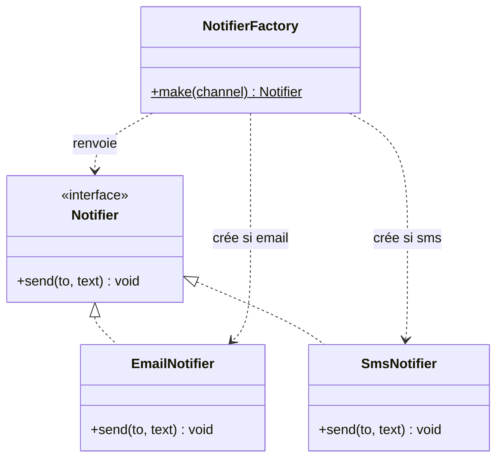

=== "PHP"

    ```php
    <?php

    // Exemple : le contrat commun à tous les notifiers
    interface Notifier
    {
        public function send(string $to, string $text): void;
    }

    // Exemple : une classe par canal, avec la même méthode send()
    final class EmailNotifier implements Notifier
    {
        public function send(string $to, string $text): void { echo "email to $to: $text\n"; }
    }

    final class SmsNotifier implements Notifier
    {
        public function send(string $to, string $text): void { echo "sms to $to: $text\n"; }
    }

    // Bien : seul endroit qui sait quelle classe créer pour chaque canal
    final class NotifierFactory
    {
        public static function make(string $channel): Notifier
        {
            return match ($channel) {
                'email' => new EmailNotifier(),
                'sms' => new SmsNotifier(),
                default => throw new InvalidArgumentException("unknown channel: $channel"),
            };
        }
    }

    // Exemple : l'appelant demande un canal, sans connaître la classe
    NotifierFactory::make('sms')->send('ada', 'Your order has shipped');
    ```

=== "Python"

    ```python
    # Exemple : une classe par canal, avec la même méthode send()
    class EmailNotifier:
        def send(self, to: str, text: str) -> None:
            print(f"email to {to}: {text}")


    class SmsNotifier:
        def send(self, to: str, text: str) -> None:
            print(f"sms to {to}: {text}")


    # Bien : seul endroit qui sait quelle classe créer pour chaque canal
    def make_notifier(channel: str) -> EmailNotifier | SmsNotifier:
        notifiers = {"email": EmailNotifier, "sms": SmsNotifier}
        try:
            return notifiers[channel]()
        except KeyError:
            raise ValueError(f"unknown channel: {channel}") from None


    # Exemple : l'appelant demande un canal, sans connaître la classe
    make_notifier("sms").send("ada", "Your order has shipped")
    ```

=== "Java"

    ```java
    // Exemple : le contrat commun à tous les notifiers
    interface Notifier {
        void send(String to, String text);
    }

    // Exemple : une classe par canal, avec la même méthode send()
    final class EmailNotifier implements Notifier {
        public void send(String to, String text) { System.out.println("email to " + to + ": " + text); }
    }

    final class SmsNotifier implements Notifier {
        public void send(String to, String text) { System.out.println("sms to " + to + ": " + text); }
    }

    // Bien : seul endroit qui sait quelle classe créer pour chaque canal
    final class NotifierFactory {
        static Notifier make(String channel) {
            return switch (channel) {
                case "email" -> new EmailNotifier();
                case "sms" -> new SmsNotifier();
                default -> throw new IllegalArgumentException("unknown channel: " + channel);
            };
        }
    }

    // Exemple : l'appelant demande un canal, sans connaître la classe
    NotifierFactory.make("sms").send("ada", "Your order has shipped");
    ```

**Dans les frameworks**

=== "PHP"

    Symfony : les *factories* de services dans `services.yaml` (`factory: [NotifierFactory, make]`).

=== "Python"

    Django : `get_user_model()`, ou `logging.getLogger()` qui fabrique et réutilise les loggers.

=== "Java"

    Spring : les méthodes `@Bean` d'une classe `@Configuration` sont des factories.

| À utiliser quand | À éviter quand |
|---|---|
| la classe à créer dépend d'un réglage ou d'une donnée, comme un notifier e-mail ou SMS selon le canal choisi, ou la création demande plusieurs étapes. | je n'ai qu'une seule classe à créer, toujours la même : un simple `new` est plus lisible. |

:material-book-open-variant: Doc de référence : [Refactoring.Guru, Factory Method](https://refactoring.guru/fr/design-patterns/factory-method) (consultée en novembre 2026)
{ .doc-ref }

### Builder (monteur)
<span class="pill pill-status pill-status-ok" title="Toujours valable, vérifié en novembre 2026">Valable · 11/2026</span>

**Intention** : construire un objet complexe étape par étape, avec des valeurs par défaut lisibles.

**Problème** : un constructeur à huit paramètres, dont cinq optionnels : `HttpRequest(url, "POST", {}, 5.0, None, True, ...)`. Personne ne sait ce que veut dire le sixième.

**Exemple** : préparer une requête HTTP : méthode, en-têtes, délai d'attente, chacun nommé.

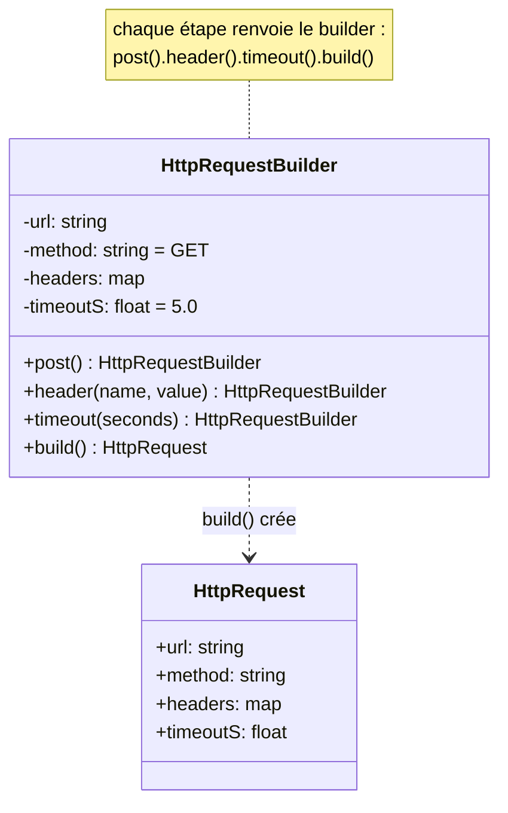

=== "PHP"

    ```php
    <?php

    // Exemple : l'objet final, immuable, que le builder fabrique
    final readonly class HttpRequest
    {
        public function __construct(
            public string $url,
            public string $method,
            public array $headers,
            public float $timeoutS,
        ) {}
    }

    // Bien : une méthode nommée par option, des valeurs par défaut lisibles
    final class HttpRequestBuilder
    {
        private string $method = 'GET';
        private array $headers = [];
        private float $timeoutS = 5.0;

        public function __construct(private readonly string $url) {}

        public function post(): self { $this->method = 'POST'; return $this; }

        public function header(string $name, string $value): self { $this->headers[$name] = $value; return $this; }

        public function timeout(float $seconds): self { $this->timeoutS = $seconds; return $this; }

        public function build(): HttpRequest
        {
            return new HttpRequest($this->url, $this->method, $this->headers, $this->timeoutS);
        }
    }

    // Exemple : chaque étape est nommée, au lieu de huit paramètres anonymes
    $request = (new HttpRequestBuilder('https://my-api/orders'))->post()->header('Idempotency-Key', '7f3c')->timeout(2)->build();
    ```

=== "Python"

    ```python
    from dataclasses import dataclass, field


    # Exemple : l'objet final, immuable, que le builder fabrique
    @dataclass(frozen=True)
    class HttpRequest:
        url: str
        method: str
        headers: dict[str, str]
        timeout_s: float


    # Bien : une méthode nommée par option, des valeurs par défaut lisibles
    @dataclass
    class HttpRequestBuilder:
        url: str
        method: str = "GET"
        headers: dict[str, str] = field(default_factory=dict)
        timeout_s: float = 5.0

        def post(self) -> "HttpRequestBuilder":
            self.method = "POST"
            return self

        def header(self, name: str, value: str) -> "HttpRequestBuilder":
            self.headers[name] = value
            return self

        def timeout(self, seconds: float) -> "HttpRequestBuilder":
            self.timeout_s = seconds
            return self

        def build(self) -> HttpRequest:
            return HttpRequest(self.url, self.method, dict(self.headers), self.timeout_s)


    # Exemple : chaque étape est nommée, au lieu de huit paramètres anonymes
    request = HttpRequestBuilder("https://my-api/orders").post().header("Idempotency-Key", "7f3c").timeout(2).build()
    ```

=== "Java"

    ```java
    import java.util.HashMap;
    import java.util.Map;

    // Exemple : l'objet final, immuable, que le builder fabrique
    record HttpRequest(String url, String method, Map<String, String> headers, double timeoutS) {

        static Builder builder(String url) { return new Builder(url); }

        // Bien : une méthode nommée par option, des valeurs par défaut lisibles
        static final class Builder {
            private final String url;
            private String method = "GET";
            private final Map<String, String> headers = new HashMap<>();
            private double timeoutS = 5.0;

            private Builder(String url) { this.url = url; }

            Builder post() { method = "POST"; return this; }

            Builder header(String name, String value) { headers.put(name, value); return this; }

            Builder timeout(double seconds) { timeoutS = seconds; return this; }

            HttpRequest build() { return new HttpRequest(url, method, Map.copyOf(headers), timeoutS); }
        }
    }

    // Exemple : chaque étape est nommée, au lieu de huit paramètres anonymes
    HttpRequest request = HttpRequest.builder("https://my-api/orders").post().header("Idempotency-Key", "7f3c").timeout(2).build();
    ```

**Dans les frameworks**

=== "PHP"

    Doctrine : le `QueryBuilder` (`->select()->from()->where()`).

=== "Python"

    SQLAlchemy : `select(Order).where(...).order_by(...)`. En Python, les arguments nommés avec valeurs par défaut suffisent souvent.

=== "Java"

    Lombok `@Builder`, `HttpRequest.newBuilder()` du JDK, `StringBuilder`.

| À utiliser quand | À éviter quand |
|---|---|
| mon objet a beaucoup de paramètres optionnels, comme une requête HTTP avec sa méthode, ses en-têtes et son délai d'attente, ou il se construit en plusieurs étapes. Très utile pour les données de test (`an_order().paid().build()`). | mon objet n'a que deux ou trois paramètres : un constructeur (ou des arguments nommés en Python) suffit. |

:material-book-open-variant: Doc de référence : [Refactoring.Guru, Builder](https://refactoring.guru/fr/design-patterns/builder) (consultée en novembre 2026)
{ .doc-ref }

### Singleton
<span class="pill pill-status pill-status-ok" title="Toujours valable, vérifié en novembre 2026">Valable · 11/2026</span>

**Intention** : garantir qu'une classe n'a qu'une seule instance, accessible partout.

**Problème** : mon appli relit la configuration ou recrée un pool de connexions à chaque appel, donc chaque requête paie ce coût pour rien.

**Exemple** : les réglages de l'application, lus une fois au démarrage.

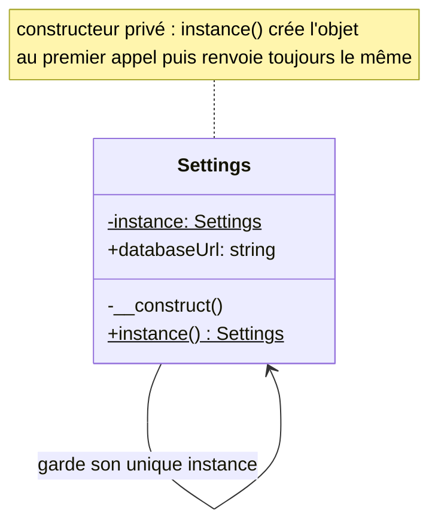

=== "PHP"

    ```php
    <?php

    // Exemple : une seule instance, créée une fois puis toujours renvoyée
    final class Settings
    {
        private static ?Settings $instance = null;

        public readonly string $databaseUrl;

        private function __construct()
        {
            $this->databaseUrl = 'mysql://localhost/orders';
        }

        public static function instance(): self
        {
            return self::$instance ??= new self();
        }
    }

    // Exemple : deux appels renvoient le même objet
    assert(Settings::instance() === Settings::instance());
    ```

=== "Python"

    ```python
    from functools import cache


    class Settings:
        def __init__(self) -> None:
            self.database_url = "postgresql://localhost/orders"


    # Exemple : une seule instance, créée une fois puis toujours renvoyée
    @cache
    def get_settings() -> Settings:
        return Settings()


    # Exemple : deux appels renvoient le même objet
    assert get_settings() is get_settings()
    ```

=== "Java"

    ```java
    // Exemple : une seule instance, créée une fois puis toujours renvoyée
    enum Settings {
        INSTANCE;

        private final String databaseUrl = "jdbc:postgresql://localhost/orders";

        String databaseUrl() { return databaseUrl; }
    }

    // Exemple : deux appels renvoient le même objet
    assert Settings.INSTANCE == Settings.INSTANCE;
    ```

**Dans les frameworks**

=== "PHP"

    Dans Symfony et Laravel, le [conteneur de services](#conteneur-dinjection) crée par défaut une seule instance par service : on n'écrit plus de singleton à la main.

=== "Python"

    Un module Python est déjà importé une seule fois. `functools.cache` sur une fonction donne le même résultat sans classe spéciale.

=== "Java"

    Spring : les beans sont des singletons par défaut. Écrit à la main, la forme `enum` est la plus sûre (thread-safe, sérialisation).

| À utiliser quand | À éviter quand |
|---|---|
| j'ai une ressource vraiment unique, que personne ne modifie une fois créée, comme la configuration lue au démarrage ou le pool de connexions, et de préférence c'est le conteneur d'injection qui la gère. | presque toujours en code applicatif : un singleton est une variable globale déguisée. Tous les tests partagent son état, donc un test peut en fausser un autre, et je ne peux pas le remplacer par un double. Je préfère l'injection de dépendances. |

:material-book-open-variant: Doc de référence : [Refactoring.Guru, Singleton](https://refactoring.guru/fr/design-patterns/singleton) (consultée en novembre 2026)
{ .doc-ref }

## Patterns de structure

<a class="pill pill-scope pill-scope-code" href="../architecture/#carte-des-echelles">Échelle · Code</a>

Comment assembler des objets pour obtenir une forme plus pratique, sans modifier leur code.

### Adapter (adaptateur)
<span class="pill pill-status pill-status-ok" title="Toujours valable, vérifié en novembre 2026">Valable · 11/2026</span>

**Intention** : faire entrer une classe existante dans l'interface que mon code attend, sans modifier cette classe.

**Problème** : la bibliothèque de la banque parle en euros avec `make_payment()`, mon code attend `charge()` en centimes. Changer mon code partout la rendrait impossible à remplacer.

**Exemple** : un adaptateur traduit l'appel et les unités. Le jour où on change de banque, on écrit un autre adaptateur, le reste ne bouge pas.

!!! noob "As noob"
    L'adaptateur, c'est l'adaptateur de prise en voyage : mon chargeur européen ne rentre pas dans la prise anglaise, je ne change ni le chargeur ni le mur, je glisse un adaptateur entre les deux. La phrase à retenir : **l'adaptateur change la forme de l'appel, pas ce qu'il fait.**

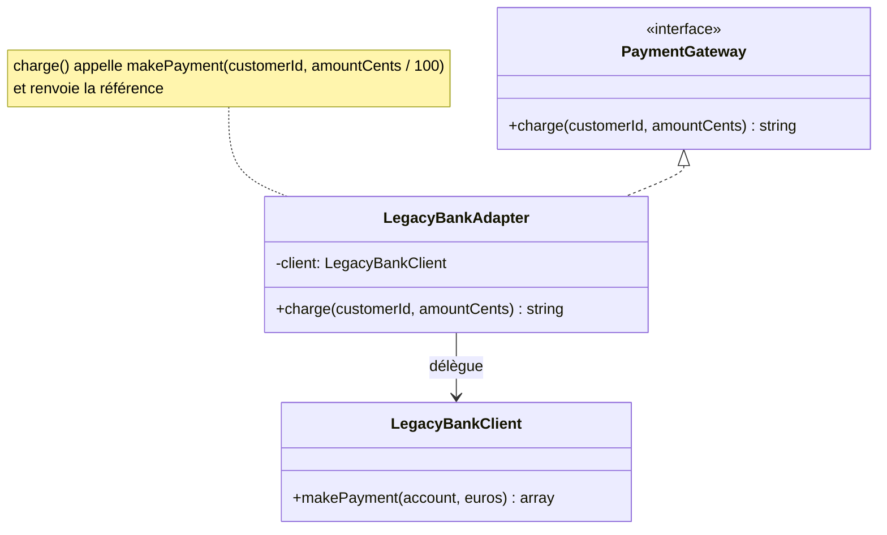

=== "PHP"

    ```php
    <?php

    // Exemple : l'interface que mon code attend (centimes, charge())
    interface PaymentGateway
    {
        public function charge(string $customerId, int $amountCents): string;
    }

    // Exemple : la bibliothèque tierce que je ne peux pas modifier (euros)
    final class LegacyBankClient
    {
        public function makePayment(string $account, float $euros): array
        {
            return ['status' => 'OK', 'ref' => "BANK-$account-$euros"];
        }
    }

    // Bien : traduit le nom de méthode et les centimes en euros, sans toucher au client
    final class LegacyBankAdapter implements PaymentGateway
    {
        public function __construct(private readonly LegacyBankClient $client) {}

        public function charge(string $customerId, int $amountCents): string
        {
            return $this->client->makePayment($customerId, $amountCents / 100)['ref'];
        }
    }

    // Exemple : mon code ne voit que PaymentGateway
    $gateway = new LegacyBankAdapter(new LegacyBankClient());
    $gateway->charge('ada', 3000);
    ```

=== "Python"

    ```python
    from typing import Protocol


    # Exemple : l'interface que mon code attend (centimes, charge())
    class PaymentGateway(Protocol):
        def charge(self, customer_id: str, amount_cents: int) -> str: ...


    # Exemple : la bibliothèque tierce que je ne peux pas modifier (euros)
    class LegacyBankClient:
        """Third-party client we cannot change: amounts in euros, different method name."""

        def make_payment(self, account: str, euros: float) -> dict[str, str]:
            return {"status": "OK", "ref": f"BANK-{account}-{euros}"}


    # Bien : traduit le nom de méthode et les centimes en euros, sans toucher au client
    class LegacyBankAdapter:
        def __init__(self, client: LegacyBankClient) -> None:
            self._client = client

        def charge(self, customer_id: str, amount_cents: int) -> str:
            result = self._client.make_payment(customer_id, amount_cents / 100)
            return result["ref"]


    # Exemple : mon code ne voit que PaymentGateway
    gateway: PaymentGateway = LegacyBankAdapter(LegacyBankClient())
    gateway.charge("ada", 3000)
    ```

=== "Java"

    ```java
    import java.util.Map;

    // Exemple : l'interface que mon code attend (centimes, charge())
    interface PaymentGateway {
        String charge(String customerId, int amountCents);
    }

    // Exemple : la bibliothèque tierce que je ne peux pas modifier (euros)
    final class LegacyBankClient {
        Map<String, String> makePayment(String account, double euros) {
            return Map.of("status", "OK", "ref", "BANK-" + account + "-" + euros);
        }
    }

    // Bien : traduit le nom de méthode et les centimes en euros, sans toucher au client
    final class LegacyBankAdapter implements PaymentGateway {
        private final LegacyBankClient client;

        LegacyBankAdapter(LegacyBankClient client) { this.client = client; }

        public String charge(String customerId, int amountCents) {
            return client.makePayment(customerId, amountCents / 100.0).get("ref");
        }
    }

    // Exemple : mon code ne voit que PaymentGateway
    PaymentGateway gateway = new LegacyBankAdapter(new LegacyBankClient());
    gateway.charge("ada", 3000);
    ```

**Dans les frameworks**

=== "PHP"

    Flysystem : un adaptateur par stockage (disque local, S3, GCS) derrière la même interface.

=== "Python"

    Les *adapters* de `requests` (`HTTPAdapter`) pour changer la couche de transport.

=== "Java"

    `Arrays.asList()` adapte un tableau en `List`, `InputStreamReader` adapte un flux d'octets en flux de caractères.

| À utiliser quand | À éviter quand |
|---|---|
| je dois brancher un service tiers, un vieux code ou une bibliothèque dont l'interface ne colle pas à mon code, comme la bibliothèque de la banque qui parle en euros quand mon code compte en centimes. C'est aussi la base de l'<span class="term" data-term="hexagonal-architecture">architecture hexagonale</span>. | je contrôle le code des deux côtés : je change directement l'interface. |

:material-book-open-variant: Doc de référence : [Refactoring.Guru, Adapter](https://refactoring.guru/fr/design-patterns/adapter) (consultée en novembre 2026)
{ .doc-ref }

### Decorator (décorateur)
<span class="pill pill-status pill-status-ok" title="Toujours valable, vérifié en novembre 2026">Valable · 11/2026</span>

**Intention** : ajouter un comportement à un objet en l'enveloppant dans un autre qui a la même interface.

**Problème** : ajouter du cache, des logs et des métriques directement dans le repository mélange tout, et on ne peut plus les activer séparément.

**Exemple** : un repository avec cache enveloppe le vrai repository. Le code appelant ne voit pas la différence.

!!! noob "As noob"
    Le décorateur, c'est la coque d'un téléphone : le téléphone s'utilise pareil, la coque ajoute une protection, et on peut en empiler plusieurs (coque, film, dragonne) ou en retirer une sans toucher au téléphone. La phrase à retenir : **même interface que l'objet enveloppé, un comportement en plus.**

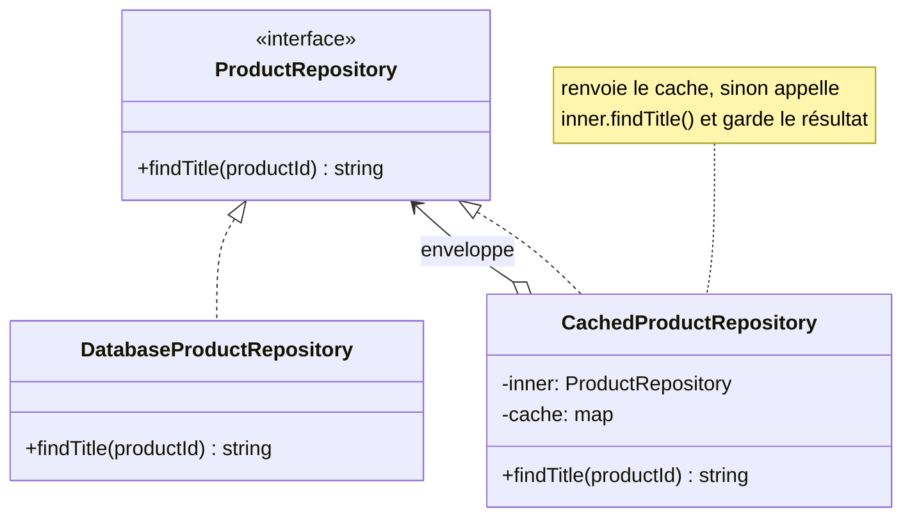

=== "PHP"

    ```php
    <?php

    // Exemple : l'interface commune au vrai repository et au décorateur
    interface ProductRepository
    {
        public function findTitle(int $productId): string;
    }

    // Exemple : le vrai repository, lent (appel à la base)
    final class DatabaseProductRepository implements ProductRepository
    {
        public function findTitle(int $productId): string
        {
            usleep(200_000);
            return "Product $productId";
        }
    }

    // Bien : même interface, ajoute le cache et délègue le reste à inner
    final class CachedProductRepository implements ProductRepository
    {
        private array $cache = [];

        public function __construct(private readonly ProductRepository $inner) {}

        public function findTitle(int $productId): string
        {
            return $this->cache[$productId] ??= $this->inner->findTitle($productId);
        }
    }

    // Exemple : le cache enveloppe le vrai repository, l'appelant ne voit rien
    $repository = new CachedProductRepository(new DatabaseProductRepository());
    ```

=== "Python"

    ```python
    import time
    from typing import Protocol


    # Exemple : l'interface commune au vrai repository et au décorateur
    class ProductRepository(Protocol):
        def find_title(self, product_id: int) -> str: ...


    # Exemple : le vrai repository, lent (appel à la base)
    class DatabaseProductRepository:
        def find_title(self, product_id: int) -> str:
            time.sleep(0.2)
            return f"Product {product_id}"


    # Bien : même interface, ajoute le cache et délègue le reste à inner
    class CachedProductRepository:
        def __init__(self, inner: ProductRepository) -> None:
            self._inner = inner
            self._cache: dict[int, str] = {}

        def find_title(self, product_id: int) -> str:
            if product_id not in self._cache:
                self._cache[product_id] = self._inner.find_title(product_id)
            return self._cache[product_id]


    # Exemple : le cache enveloppe le vrai repository, l'appelant ne voit rien
    repository: ProductRepository = CachedProductRepository(DatabaseProductRepository())
    ```

=== "Java"

    ```java
    import java.util.HashMap;
    import java.util.Map;

    // Exemple : l'interface commune au vrai repository et au décorateur
    interface ProductRepository {
        String findTitle(int productId);
    }

    // Exemple : le vrai repository, lent (appel à la base)
    final class DatabaseProductRepository implements ProductRepository {
        public String findTitle(int productId) { return "Product " + productId; }
    }

    // Bien : même interface, ajoute le cache et délègue le reste à inner
    final class CachedProductRepository implements ProductRepository {
        private final ProductRepository inner;
        private final Map<Integer, String> cache = new HashMap<>();

        CachedProductRepository(ProductRepository inner) { this.inner = inner; }

        public String findTitle(int productId) {
            return cache.computeIfAbsent(productId, inner::findTitle);
        }
    }

    // Exemple : le cache enveloppe le vrai repository, l'appelant ne voit rien
    ProductRepository repository = new CachedProductRepository(new DatabaseProductRepository());
    ```

**Dans les frameworks**

=== "PHP"

    Symfony : `decorates:` dans la définition d'un service remplace un service par son décorateur.

=== "Python"

    Attention au faux ami : les décorateurs `@` de Python enveloppent des **fonctions** (`@functools.cache`, `@retry`). Même idée, appliquée aux fonctions.

=== "Java"

    `BufferedInputStream(new FileInputStream(...))`, `Collections.unmodifiableList(list)`.

| À utiliser quand | À éviter quand |
|---|---|
| je veux ajouter du cache, des logs, des retry, des métriques ou des contrôles autour d'un objet existant, et pouvoir les activer un par un, comme un cache devant le repository des commandes. | j'empile une dizaine de couches : au débogage, la pile d'appels devient illisible. |

:material-book-open-variant: Doc de référence : [Refactoring.Guru, Decorator](https://refactoring.guru/fr/design-patterns/decorator) (consultée en novembre 2026)
{ .doc-ref }

### Facade (façade)
<span class="pill pill-status pill-status-ok" title="Toujours valable, vérifié en novembre 2026">Valable · 11/2026</span>

**Intention** : offrir une porte d'entrée simple devant un ensemble de classes compliquées.

**Problème** : passer une commande demande de réserver le stock, payer, puis planifier la livraison, dans le bon ordre. Chaque contrôleur réécrit cette séquence.

**Exemple** : `OrderFacade.place_order()` enchaîne les trois étapes. Les contrôleurs ne connaissent qu'elle.

!!! noob "As noob"
    La façade, c'est le serveur au restaurant : je commande un plat, il parle à la cuisine, au bar et à la caisse dans le bon ordre. Les classes derrière existent toujours et restent appelables directement si besoin. La phrase à retenir : **une porte simple devant plusieurs pièces compliquées.**

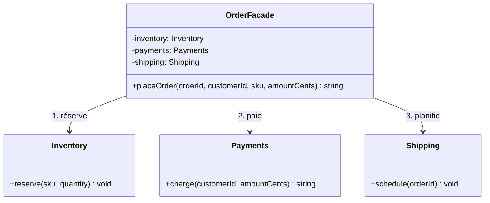

=== "PHP"

    ```php
    <?php

    // Exemple : les trois sous-systèmes, à appeler dans le bon ordre
    final class Inventory { public function reserve(string $sku, int $quantity): void {} }

    final class Payments { public function charge(string $customerId, int $amountCents): string { return 'PAY-1'; } }

    final class Shipping { public function schedule(int $orderId): void {} }

    // Bien : une seule porte d'entrée qui enchaîne stock, paiement puis livraison
    final class OrderFacade
    {
        public function __construct(
            private readonly Inventory $inventory,
            private readonly Payments $payments,
            private readonly Shipping $shipping,
        ) {}

        public function placeOrder(int $orderId, string $customerId, string $sku, int $amountCents): string
        {
            $this->inventory->reserve($sku, 1);
            $paymentRef = $this->payments->charge($customerId, $amountCents);
            $this->shipping->schedule($orderId);
            return $paymentRef;
        }
    }

    // Exemple : le contrôleur ne connaît que la façade
    (new OrderFacade(new Inventory(), new Payments(), new Shipping()))->placeOrder(42, 'ada', 'BK-0004', 3000);
    ```

=== "Python"

    ```python
    # Exemple : les trois sous-systèmes, à appeler dans le bon ordre
    class Inventory:
        def reserve(self, sku: str, quantity: int) -> None: ...


    class Payments:
        def charge(self, customer_id: str, amount_cents: int) -> str:
            return "PAY-1"


    class Shipping:
        def schedule(self, order_id: int) -> None: ...


    # Bien : une seule porte d'entrée qui enchaîne stock, paiement puis livraison
    class OrderFacade:
        def __init__(self, inventory: Inventory, payments: Payments, shipping: Shipping) -> None:
            self._inventory = inventory
            self._payments = payments
            self._shipping = shipping

        def place_order(self, order_id: int, customer_id: str, sku: str, amount_cents: int) -> str:
            self._inventory.reserve(sku, 1)
            payment_ref = self._payments.charge(customer_id, amount_cents)
            self._shipping.schedule(order_id)
            return payment_ref


    # Exemple : le contrôleur ne connaît que la façade
    OrderFacade(Inventory(), Payments(), Shipping()).place_order(42, "ada", "BK-0004", 3000)
    ```

=== "Java"

    ```java
    // Exemple : les trois sous-systèmes, à appeler dans le bon ordre
    final class Inventory { void reserve(String sku, int quantity) {} }

    final class Payments { String charge(String customerId, int amountCents) { return "PAY-1"; } }

    final class Shipping { void schedule(int orderId) {} }

    // Bien : une seule porte d'entrée qui enchaîne stock, paiement puis livraison
    final class OrderFacade {
        private final Inventory inventory;
        private final Payments payments;
        private final Shipping shipping;

        OrderFacade(Inventory inventory, Payments payments, Shipping shipping) {
            this.inventory = inventory;
            this.payments = payments;
            this.shipping = shipping;
        }

        String placeOrder(int orderId, String customerId, String sku, int amountCents) {
            inventory.reserve(sku, 1);
            String paymentRef = payments.charge(customerId, amountCents);
            shipping.schedule(orderId);
            return paymentRef;
        }
    }

    // Exemple : le contrôleur ne connaît que la façade
    new OrderFacade(new Inventory(), new Payments(), new Shipping()).placeOrder(42, "ada", "BK-0004", 3000);
    ```

**Dans les frameworks**

=== "PHP"

    Laravel appelle « Facades » ses accès statiques (`Cache::get()`) : c'est surtout un raccourci vers le conteneur, pas exactement le pattern du GoF.

=== "Python"

    `requests.get()` est une façade devant `Session`, `PreparedRequest` et les adaptateurs.

=== "Java"

    `javax.faces.context.FacesContext`, ou une couche *service* Spring qui orchestre plusieurs repositories.

| À utiliser quand | À éviter quand |
|---|---|
| plusieurs classes doivent toujours être appelées ensemble et dans le même ordre, comme réserver le stock, payer puis planifier la livraison à chaque commande. | la façade grossit jusqu'à tout faire : elle devient un « god object » à découper. |

:material-book-open-variant: Doc de référence : [Refactoring.Guru, Facade](https://refactoring.guru/fr/design-patterns/facade) (consultée en novembre 2026)
{ .doc-ref }

### Proxy (mandataire)
<span class="pill pill-status pill-status-ok" title="Toujours valable, vérifié en novembre 2026">Valable · 11/2026</span>

**Intention** : placer un objet intermédiaire qui contrôle l'accès à un autre, avec la même interface.

**Problème** : je dois vérifier les droits au début de chaque méthode du service de rapports, et le jour où quelqu'un oublie une méthode, n'importe qui peut la lire.

**Exemple** : un proxy vérifie le rôle `finance` avant de laisser passer l'appel.

!!! noob "As noob"
    Le proxy, c'est l'agent d'accueil devant un bureau : je lui pose la même question qu'au bureau, il vérifie mon badge avant de la transmettre. Contrairement au décorateur, il n'ajoute pas une fonction : il décide si, et quand, l'appel passe. La phrase à retenir : **même interface, mais un gardien qui contrôle l'accès.**

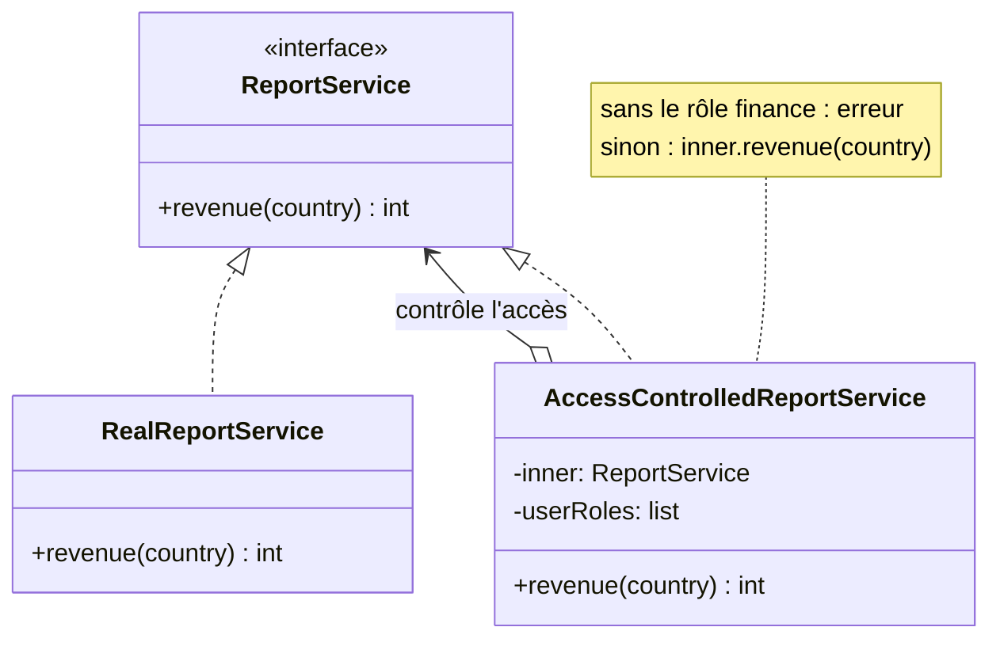

=== "PHP"

    ```php
    <?php

    // Exemple : l'interface commune au vrai service et au proxy
    interface ReportService
    {
        public function revenue(string $country): int;
    }

    // Exemple : le vrai service, sans aucun contrôle d'accès
    final class RealReportService implements ReportService
    {
        public function revenue(string $country): int { return 1_250_000; }
    }

    // Bien : même interface, vérifie le rôle finance avant de laisser passer
    final class AccessControlledReportService implements ReportService
    {
        public function __construct(private readonly ReportService $inner, private readonly array $userRoles) {}

        public function revenue(string $country): int
        {
            if (!in_array('finance', $this->userRoles, true)) {
                throw new RuntimeException('finance role required');
            }
            return $this->inner->revenue($country);
        }
    }

    // Exemple : l'appelant passe par le proxy, jamais directement par le vrai service
    (new AccessControlledReportService(new RealReportService(), ['finance']))->revenue('FR');
    ```

=== "Python"

    ```python
    from typing import Protocol


    # Exemple : l'interface commune au vrai service et au proxy
    class ReportService(Protocol):
        def revenue(self, country: str) -> int: ...


    # Exemple : le vrai service, sans aucun contrôle d'accès
    class RealReportService:
        def revenue(self, country: str) -> int:
            return 1_250_000


    # Bien : même interface, vérifie le rôle finance avant de laisser passer
    class AccessControlledReportService:
        def __init__(self, inner: ReportService, user_roles: set[str]) -> None:
            self._inner = inner
            self._roles = user_roles

        def revenue(self, country: str) -> int:
            if "finance" not in self._roles:
                raise PermissionError("finance role required")
            return self._inner.revenue(country)


    # Exemple : l'appelant passe par le proxy, jamais directement par le vrai service
    AccessControlledReportService(RealReportService(), {"finance"}).revenue("FR")
    ```

=== "Java"

    ```java
    import java.util.Set;

    // Exemple : l'interface commune au vrai service et au proxy
    interface ReportService {
        long revenue(String country);
    }

    // Exemple : le vrai service, sans aucun contrôle d'accès
    final class RealReportService implements ReportService {
        public long revenue(String country) { return 1_250_000L; }
    }

    // Bien : même interface, vérifie le rôle finance avant de laisser passer
    final class AccessControlledReportService implements ReportService {
        private final ReportService inner;
        private final Set<String> userRoles;

        AccessControlledReportService(ReportService inner, Set<String> userRoles) {
            this.inner = inner;
            this.userRoles = userRoles;
        }

        public long revenue(String country) {
            if (!userRoles.contains("finance")) {
                throw new SecurityException("finance role required");
            }
            return inner.revenue(country);
        }
    }

    // Exemple : l'appelant passe par le proxy, jamais directement par le vrai service
    new AccessControlledReportService(new RealReportService(), Set.of("finance")).revenue("FR");
    ```

**Dans les frameworks**

=== "PHP"

    Doctrine : les entités chargées en différé (<span class="term" data-term="lazy-loading">*lazy loading*</span>) sont des proxies générés.

=== "Python"

    Django : `SimpleLazyObject` pour `request.user`, chargé seulement s'il est utilisé.

=== "Java"

    Spring : `@Transactional` et `@Cacheable` fonctionnent grâce à des proxies générés autour de mes beans.

| À utiliser quand | À éviter quand |
|---|---|
| je veux contrôler qui atteint un objet, comme vérifier le rôle `finance` avant d'ouvrir un rapport, ne le charger qu'au moment où on s'en sert, appeler un objet distant comme s'il était local, ou compter les appels. | j'hésite avec le décorateur : même forme, mais le proxy **contrôle l'accès**, le décorateur **ajoute une fonctionnalité**. Le bon nom aide le relecteur en revue. |

:material-book-open-variant: Doc de référence : [Refactoring.Guru, Proxy](https://refactoring.guru/fr/design-patterns/proxy) (consultée en novembre 2026)
{ .doc-ref }

## Patterns de comportement

<a class="pill pill-scope pill-scope-code" href="../architecture/#carte-des-echelles">Échelle · Code</a>

Comment répartir les responsabilités et faire communiquer les objets.

### Strategy (stratégie)
<span class="pill pill-status pill-status-ok" title="Toujours valable, vérifié en novembre 2026">Valable · 11/2026</span>

**Intention** : rendre interchangeables plusieurs façons de faire la même chose.

**Problème** : un `if/elif` grossit à chaque nouveau mode de livraison, dans une fonction que tout le monde modifie, donc chaque ajout risque de casser les modes existants.

**Exemple** : chaque mode de livraison est une classe avec la méthode `cost()`. Le calcul du panier reçoit la stratégie et l'appelle, sans savoir laquelle c'est.

!!! noob "As noob"
    La stratégie, c'est le GPS qui me demande « voiture, vélo ou à pied ? » : la destination ne change pas, seule la façon de calculer l'itinéraire change, et on peut ajouter un mode sans toucher au reste. La phrase à retenir : **on remplace un gros `if` par des objets interchangeables qui ont la même méthode.**

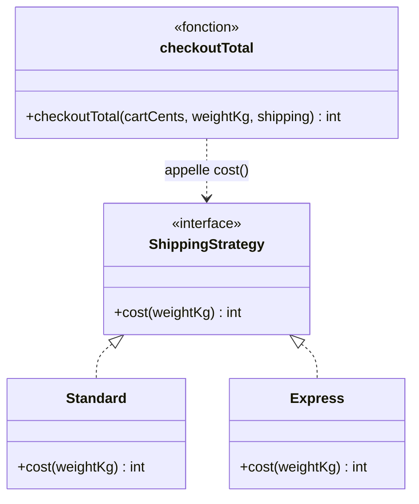

=== "PHP"

    ```php
    <?php

    // Exemple : le contrat commun à tous les modes de livraison
    interface ShippingStrategy
    {
        public function cost(float $weightKg): int;
    }

    // Bien : un mode de livraison par classe, testable seul
    final class Standard implements ShippingStrategy
    {
        public function cost(float $weightKg): int
        {
            return 500 + (int) ($weightKg * 100);
        }
    }

    // Bien : ajouter un mode, c'est ajouter une classe sans toucher aux autres
    final class Express implements ShippingStrategy
    {
        public function cost(float $weightKg): int
        {
            return 1500 + (int) ($weightKg * 200);
        }
    }

    // Bien : reçoit la stratégie et appelle cost(), sans savoir laquelle c'est
    function checkoutTotal(int $cartCents, float $weightKg, ShippingStrategy $shipping): int
    {
        return $cartCents + $shipping->cost($weightKg);
    }

    // Exemple : l'appelant choisit la stratégie
    checkoutTotal(3000, 2.0, new Express());
    ```

=== "Python"

    ```python
    from typing import Protocol


    # Exemple : le contrat commun à tous les modes de livraison
    class ShippingStrategy(Protocol):
        def cost(self, weight_kg: float) -> int: ...


    # Bien : un mode de livraison par classe, testable seul
    class Standard:
        def cost(self, weight_kg: float) -> int:
            return 500 + int(weight_kg * 100)


    # Bien : ajouter un mode, c'est ajouter une classe sans toucher aux autres
    class Express:
        def cost(self, weight_kg: float) -> int:
            return 1500 + int(weight_kg * 200)


    # Bien : reçoit la stratégie et appelle cost(), sans savoir laquelle c'est
    def checkout_total(cart_cents: int, weight_kg: float, shipping: ShippingStrategy) -> int:
        return cart_cents + shipping.cost(weight_kg)


    # Exemple : l'appelant choisit la stratégie
    checkout_total(3000, 2.0, Express())
    ```

=== "Java"

    ```java
    // Exemple : le contrat commun à tous les modes de livraison
    interface ShippingStrategy {
        int cost(double weightKg);
    }

    // Bien : un mode de livraison par classe, testable seul
    final class Standard implements ShippingStrategy {
        public int cost(double weightKg) { return 500 + (int) (weightKg * 100); }
    }

    // Bien : ajouter un mode, c'est ajouter une classe sans toucher aux autres
    final class Express implements ShippingStrategy {
        public int cost(double weightKg) { return 1500 + (int) (weightKg * 200); }
    }

    // Bien : reçoit la stratégie et appelle cost(), sans savoir laquelle c'est
    final class Checkout {
        static int total(int cartCents, double weightKg, ShippingStrategy shipping) {
            return cartCents + shipping.cost(weightKg);
        }
    }

    // Exemple : l'appelant choisit la stratégie
    Checkout.total(3000, 2.0, new Express());
    ```

**Dans les frameworks**

=== "PHP"

    Symfony : les *voters* de sécurité, ou un service choisi par tag (`#[AutowireIterator]`).

=== "Python"

    `sorted(items, key=...)` : la fonction `key` est une stratégie. En Python, une simple fonction suffit souvent.

=== "Java"

    `Comparator` passé à `list.sort(...)`, les implémentations de `PasswordEncoder` dans Spring Security.

| À utiliser quand | À éviter quand |
|---|---|
| j'ai plusieurs façons de faire la même chose, choisies selon une donnée ou un réglage, comme calculer les frais de port en standard ou en express. Chaque stratégie se teste seule. | je n'ai que deux cas, qui ne bougeront jamais : un `if` reste plus simple. |

:material-book-open-variant: Doc de référence : [Refactoring.Guru, Strategy](https://refactoring.guru/fr/design-patterns/strategy) (consultée en novembre 2026)
{ .doc-ref }

### Observer (observateur)
<span class="pill pill-status pill-status-ok" title="Toujours valable, vérifié en novembre 2026">Valable · 11/2026</span>

**Intention** : prévenir automatiquement plusieurs objets quand un événement se produit, sans que l'émetteur les connaisse.

**Problème** : `pay()` appelle directement la facturation, le stock et l'e-mail. Ajouter un quatrième traitement oblige à modifier le paiement.

**Exemple** : le paiement publie « commande payée », chaque traitement s'abonne de son côté.

!!! noob "As noob"
    L'observateur, c'est une newsletter : l'auteur publie sans savoir qui est abonné, chacun s'inscrit ou se désinscrit de son côté. Ici les abonnés sont prévenus tout de suite, dans le même programme, sans message envoyé sur le réseau. La phrase à retenir : **l'émetteur annonce un fait, il ne sait pas qui réagit.**

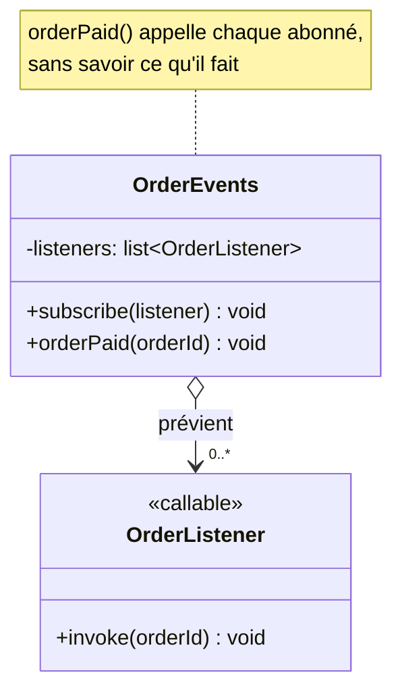

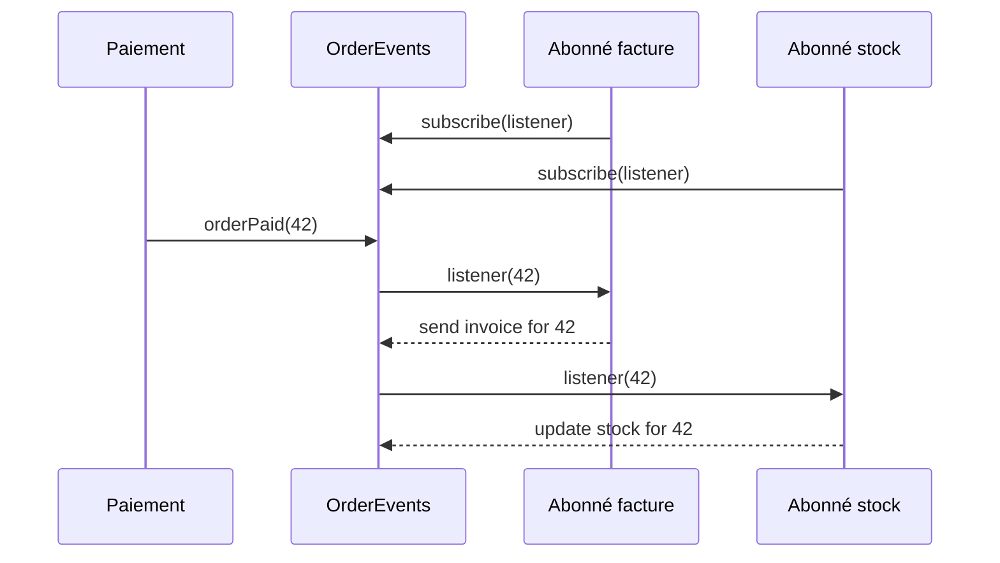

=== "PHP"

    ```php
    <?php

    // Bien : l'émetteur garde une liste d'abonnés et les prévient sans les connaître
    final class OrderEvents
    {
        /** @var list<callable(int): void> */
        private array $listeners = [];

        public function subscribe(callable $listener): void
        {
            $this->listeners[] = $listener;
        }

        public function orderPaid(int $orderId): void
        {
            foreach ($this->listeners as $listener) {
                $listener($orderId);
            }
        }
    }

    // Exemple : chaque traitement s'abonne de son côté, puis le paiement publie
    $events = new OrderEvents();
    $events->subscribe(fn (int $id) => print("send invoice for $id\n"));
    $events->subscribe(fn (int $id) => print("update stock for $id\n"));
    $events->orderPaid(42);
    ```

=== "Python"

    ```python
    from collections.abc import Callable

    OrderListener = Callable[[int], None]


    # Bien : l'émetteur garde une liste d'abonnés et les prévient sans les connaître
    class OrderEvents:
        def __init__(self) -> None:
            self._listeners: list[OrderListener] = []

        def subscribe(self, listener: OrderListener) -> None:
            self._listeners.append(listener)

        def order_paid(self, order_id: int) -> None:
            for listener in self._listeners:
                listener(order_id)


    # Exemple : chaque traitement s'abonne de son côté, puis le paiement publie
    events = OrderEvents()
    events.subscribe(lambda order_id: print(f"send invoice for {order_id}"))
    events.subscribe(lambda order_id: print(f"update stock for {order_id}"))
    events.order_paid(42)
    ```

=== "Java"

    ```java
    import java.util.ArrayList;
    import java.util.List;
    import java.util.function.IntConsumer;

    // Bien : l'émetteur garde une liste d'abonnés et les prévient sans les connaître
    final class OrderEvents {
        private final List<IntConsumer> listeners = new ArrayList<>();

        void subscribe(IntConsumer listener) { listeners.add(listener); }

        void orderPaid(int orderId) {
            listeners.forEach(listener -> listener.accept(orderId));
        }
    }

    // Exemple : chaque traitement s'abonne de son côté, puis le paiement publie
    OrderEvents events = new OrderEvents();
    events.subscribe(id -> System.out.println("send invoice for " + id));
    events.subscribe(id -> System.out.println("update stock for " + id));
    events.orderPaid(42);
    ```

**Dans les frameworks**

=== "PHP"

    Symfony : l'`EventDispatcher` et les `#[AsEventListener]`. Laravel : `Event::dispatch()`.

=== "Python"

    Django : les *signals* (`post_save`).

=== "Java"

    Spring : `ApplicationEventPublisher` et `@EventListener`.

| À utiliser quand | À éviter quand |
|---|---|
| plusieurs traitements indépendants doivent réagir au même fait, comme la facturation, le stock et l'e-mail quand une commande est payée. Entre services différents, la même idée passe par un broker (Kafka, RabbitMQ). | l'ordre des réactions compte, ou une erreur dans un abonné doit annuler toute l'action : des appels directs sont plus explicites. |

:material-book-open-variant: Doc de référence : [Refactoring.Guru, Observer](https://refactoring.guru/fr/design-patterns/observer) (consultée en novembre 2026)
{ .doc-ref }

### Command (commande)
<span class="pill pill-status pill-status-ok" title="Toujours valable, vérifié en novembre 2026">Valable · 11/2026</span>

**Intention** : transformer une action en objet, qu'on peut stocker, mettre en file, rejouer ou annuler.

**Problème** : je veux qu'un utilisateur puisse annuler sa dernière action, ou qu'une action s'exécute plus tard dans un worker, mais un simple appel de méthode ne laisse rien à garder, à mettre en file ou à défaire.

**Exemple** : « ajouter un article au panier » devient un objet avec `execute()` et `undo()`. L'historique est une pile de commandes.

!!! noob "As noob"
    La commande, c'est un bon de commande écrit plutôt qu'une demande à voix haute : comme il est sur papier, on peut le poser dans une file, le traiter plus tard, le refaire, et s'il note aussi comment défaire l'action, l'annuler (c'est le principe du Ctrl+Z). La phrase à retenir : **une action devient un objet qu'on peut garder, rejouer ou annuler.**

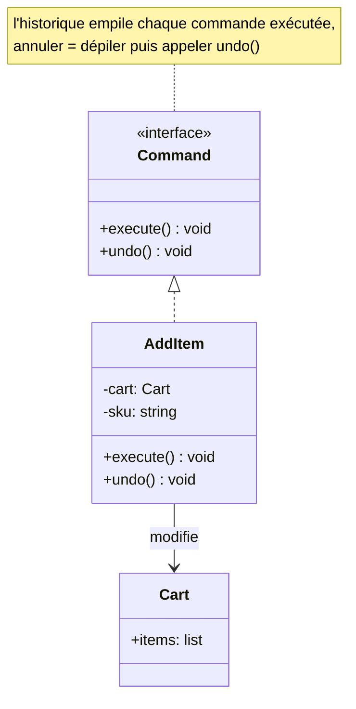

=== "PHP"

    ```php
    <?php

    // Exemple : toute commande sait s'exécuter et s'annuler
    interface Command
    {
        public function execute(): void;
        public function undo(): void;
    }

    // Exemple : l'objet que les commandes modifient
    final class Cart
    {
        public array $items = [];
    }

    // Bien : l'action devient un objet, avec de quoi la défaire
    final class AddItem implements Command
    {
        public function __construct(private readonly Cart $cart, private readonly string $sku) {}

        public function execute(): void { $this->cart->items[] = $this->sku; }

        public function undo(): void
        {
            $this->cart->items = array_values(array_diff($this->cart->items, [$this->sku]));
        }
    }

    // Exemple : l'historique empile les commandes, annuler dépile la dernière
    $cart = new Cart();
    $history = [];
    foreach ([new AddItem($cart, 'BK-0004'), new AddItem($cart, 'BK-0007')] as $command) {
        $command->execute();
        $history[] = $command;
    }
    array_pop($history)->undo();
    ```

=== "Python"

    ```python
    from dataclasses import dataclass
    from typing import Protocol


    # Exemple : toute commande sait s'exécuter et s'annuler
    class Command(Protocol):
        def execute(self) -> None: ...
        def undo(self) -> None: ...


    # Exemple : l'objet que les commandes modifient
    @dataclass
    class Cart:
        items: list[str]


    # Bien : l'action devient un objet, avec de quoi la défaire
    @dataclass
    class AddItem:
        cart: Cart
        sku: str

        def execute(self) -> None:
            self.cart.items.append(self.sku)

        def undo(self) -> None:
            self.cart.items.remove(self.sku)


    # Exemple : l'historique empile les commandes, annuler dépile la dernière
    cart = Cart([])
    history: list[Command] = []
    for command in (AddItem(cart, "BK-0004"), AddItem(cart, "BK-0007")):
        command.execute()
        history.append(command)
    history.pop().undo()
    ```

=== "Java"

    ```java
    import java.util.ArrayDeque;
    import java.util.ArrayList;
    import java.util.Deque;
    import java.util.List;

    // Exemple : toute commande sait s'exécuter et s'annuler
    interface Command {
        void execute();
        void undo();
    }

    // Bien : l'action devient un objet, avec de quoi la défaire
    record AddItem(List<String> cart, String sku) implements Command {
        public void execute() { cart.add(sku); }
        public void undo() { cart.remove(sku); }
    }

    // Exemple : l'historique empile les commandes, annuler dépile la dernière
    List<String> cart = new ArrayList<>();
    Deque<Command> history = new ArrayDeque<>();
    for (Command command : List.of(new AddItem(cart, "BK-0004"), new AddItem(cart, "BK-0007"))) {
        command.execute();
        history.push(command);
    }
    history.pop().undo();
    ```

**Dans les frameworks**

=== "PHP"

    Symfony Messenger : un message (`new SendInvoice(42)`) et son handler, exécuté tout de suite ou par un worker.

=== "Python"

    Celery : une tâche et ses arguments sont une commande sérialisée et mise en file.

=== "Java"

    `Runnable` passé à un `ExecutorService`, les commandes de l'Axon Framework.

| À utiliser quand | À éviter quand |
|---|---|
| je veux pouvoir annuler, rejouer, mettre en file ou journaliser des actions, comme annuler le dernier « ajouter au panier » ou faire exécuter une action plus tard par un worker. Base de <span class="term" data-term="cqrs">CQRS</span>. | l'action est simple, exécutée tout de suite et jamais annulée : une méthode suffit. |

:material-book-open-variant: Doc de référence : [Refactoring.Guru, Command](https://refactoring.guru/fr/design-patterns/command) (consultée en novembre 2026)
{ .doc-ref }

### Template Method (patron de méthode)
<span class="pill pill-status pill-status-ok" title="Toujours valable, vérifié en novembre 2026">Valable · 11/2026</span>

**Intention** : fixer les étapes d'un algorithme dans une classe parente, et laisser les sous-classes remplir certaines étapes.

**Problème** : trois exports (CSV, PDF, Excel) copient la même séquence : lire les données, écrire l'en-tête, formater chaque ligne.

**Exemple** : `Report.generate()` fixe l'ordre, `CsvReport` ne fournit que `fetch_rows()` et `format_row()`.

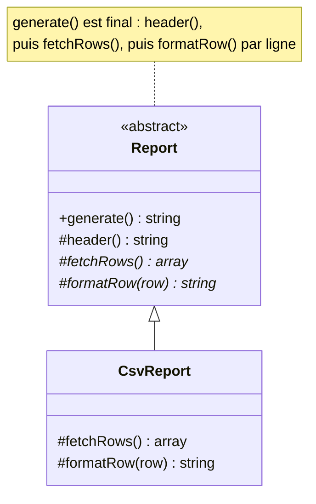

=== "PHP"

    ```php
    <?php

    // Bien : la classe parente fixe l'ordre des étapes, une fois pour toutes
    abstract class Report
    {
        final public function generate(): string
        {
            $lines = array_map(fn (array $row) => $this->formatRow($row), $this->fetchRows());
            return $this->header() . "\n" . implode("\n", $lines);
        }

        protected function header(): string { return 'Revenue report'; }

        // Exemple : les étapes que chaque sous-classe doit écrire
        abstract protected function fetchRows(): array;

        abstract protected function formatRow(array $row): string;
    }

    // Bien : la sous-classe ne fournit que les étapes qui changent
    final class CsvReport extends Report
    {
        protected function fetchRows(): array { return [['FR', 1200], ['DE', 900]]; }

        protected function formatRow(array $row): string { return "$row[0];$row[1]"; }
    }

    // Exemple : l'appelant lance generate(), l'ordre est garanti
    echo (new CsvReport())->generate();
    ```

=== "Python"

    ```python
    from abc import ABC, abstractmethod


    # Bien : la classe parente fixe l'ordre des étapes, une fois pour toutes
    class Report(ABC):
        def generate(self) -> str:
            rows = self.fetch_rows()
            return self.header() + "\n" + "\n".join(self.format_row(row) for row in rows)

        def header(self) -> str:
            return "Revenue report"

        # Exemple : les étapes que chaque sous-classe doit écrire
        @abstractmethod
        def fetch_rows(self) -> list[tuple[str, int]]: ...

        @abstractmethod
        def format_row(self, row: tuple[str, int]) -> str: ...


    # Bien : la sous-classe ne fournit que les étapes qui changent
    class CsvReport(Report):
        def fetch_rows(self) -> list[tuple[str, int]]:
            return [("FR", 1200), ("DE", 900)]

        def format_row(self, row: tuple[str, int]) -> str:
            return f"{row[0]};{row[1]}"


    # Exemple : l'appelant lance generate(), l'ordre est garanti
    print(CsvReport().generate())
    ```

=== "Java"

    ```java
    import java.util.List;
    import java.util.stream.Collectors;

    // Bien : la classe parente fixe l'ordre des étapes, une fois pour toutes
    abstract class Report {
        final String generate() {
            return header() + "\n" + fetchRows().stream().map(this::formatRow).collect(Collectors.joining("\n"));
        }

        protected String header() { return "Revenue report"; }

        // Exemple : les étapes que chaque sous-classe doit écrire
        protected abstract List<Object[]> fetchRows();

        protected abstract String formatRow(Object[] row);
    }

    // Bien : la sous-classe ne fournit que les étapes qui changent
    final class CsvReport extends Report {
        protected List<Object[]> fetchRows() { return List.of(new Object[] {"FR", 1200}, new Object[] {"DE", 900}); }

        protected String formatRow(Object[] row) { return row[0] + ";" + row[1]; }
    }

    // Exemple : l'appelant lance generate(), l'ordre est garanti
    System.out.println(new CsvReport().generate());
    ```

**Dans les frameworks**

=== "PHP"

    PHPUnit : `setUp()` et `tearDown()` sont les étapes que je remplis, l'ordre est fixé par `TestCase`.

=== "Python"

    `unittest.TestCase` de la même façon, les vues génériques de Django (`get_queryset()`).

=== "Java"

    `AbstractList`, `HttpServlet.doGet()`, `JdbcTemplate` de Spring.

| À utiliser quand | À éviter quand |
|---|---|
| j'ai plusieurs variantes d'un même déroulé où seules quelques étapes changent, comme des exports CSV, PDF et Excel qui lisent les données et écrivent l'en-tête de la même façon. | l'héritage devient profond, ou chaque variante change beaucoup d'étapes : je préfère Strategy (composition). |

:material-book-open-variant: Doc de référence : [Refactoring.Guru, Template Method](https://refactoring.guru/fr/design-patterns/template-method) (consultée en novembre 2026)
{ .doc-ref }

### Chain of Responsibility (chaîne de responsabilité)
<span class="pill pill-status pill-status-ok" title="Toujours valable, vérifié en novembre 2026">Valable · 11/2026</span>

**Intention** : faire passer une requête dans une suite de maillons, chacun pouvant la traiter, la modifier ou l'arrêter.

**Problème** : un contrôleur qui vérifie lui-même l'authentification, la limite de débit, la langue et les logs, avant de faire son vrai travail.

**Exemple** : les <span class="term" data-term="middleware">*middlewares*</span> HTTP : authentification, puis limite de débit, puis l'application. Chaque maillon peut renvoyer une erreur sans appeler le suivant.

!!! noob "As noob"
    La chaîne de responsabilité, c'est le passage à l'aéroport : billet, puis sécurité, puis passeport. Chaque poste peut me laisser passer au suivant ou m'arrêter là, et on peut ajouter un poste sans changer les autres. La phrase à retenir : **chaque maillon traite ce qui le concerne puis passe la main, ou coupe court.**

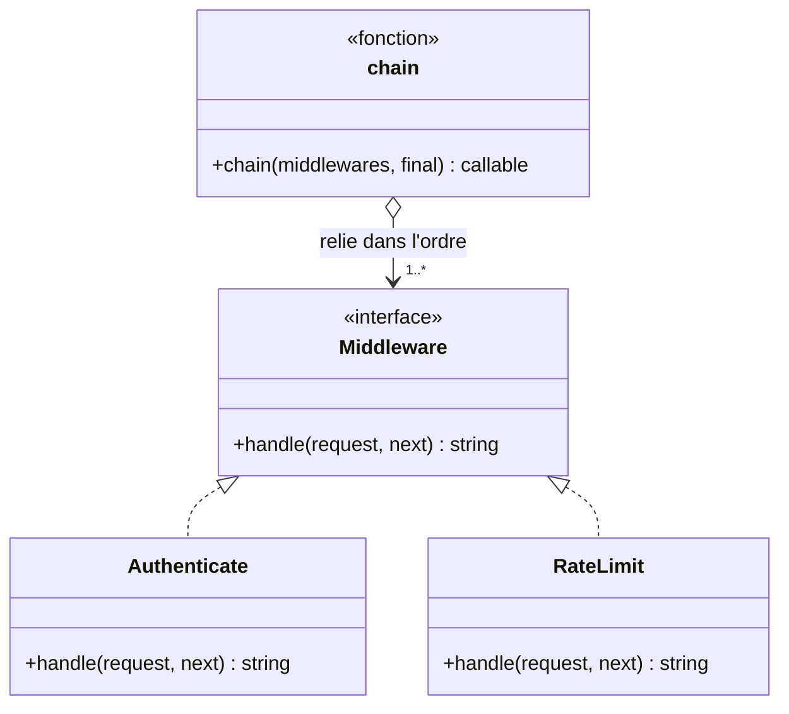

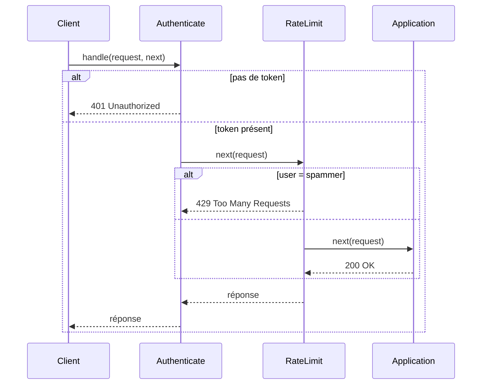

=== "PHP"

    ```php
    <?php

    // Exemple : un maillon reçoit la requête et le maillon suivant
    interface Middleware
    {
        public function handle(array $request, callable $next): string;
    }

    // Bien : coupe court avec 401 sans token, sinon passe au suivant
    final class Authenticate implements Middleware
    {
        public function handle(array $request, callable $next): string
        {
            return isset($request['token']) ? $next($request) : '401 Unauthorized';
        }
    }

    // Bien : coupe court avec 429 en cas d'abus, sinon passe au suivant
    final class RateLimit implements Middleware
    {
        public function handle(array $request, callable $next): string
        {
            return ($request['user'] ?? '') === 'spammer' ? '429 Too Many Requests' : $next($request);
        }
    }

    // Exemple : relie les maillons dans l'ordre, le dernier appelle l'application
    function chain(array $middlewares, callable $final): callable
    {
        return array_reduce(
            array_reverse($middlewares),
            fn (callable $next, Middleware $m) => fn (array $request) => $m->handle($request, $next),
            $final,
        );
    }

    // Exemple : authentification, puis limite de débit, puis l'application
    $app = chain([new Authenticate(), new RateLimit()], fn (array $request) => '200 OK');
    $app(['token' => 'abc', 'user' => 'ada']);
    ```

=== "Python"

    ```python
    from collections.abc import Callable

    # Exemple : un maillon reçoit la requête et le maillon suivant
    Request = dict[str, str]
    Handler = Callable[[Request], str]
    Middleware = Callable[[Request, Handler], str]


    # Bien : coupe court avec 401 sans token, sinon passe au suivant
    def authenticate(request: Request, next_handler: Handler) -> str:
        if "token" not in request:
            return "401 Unauthorized"
        return next_handler(request)


    # Bien : coupe court avec 429 en cas d'abus, sinon passe au suivant
    def rate_limit(request: Request, next_handler: Handler) -> str:
        if request.get("user") == "spammer":
            return "429 Too Many Requests"
        return next_handler(request)


    # Exemple : relie les maillons dans l'ordre, le dernier appelle l'application
    def chain(middlewares: list[Middleware], final: Handler) -> Handler:
        handler = final
        for middleware in reversed(middlewares):
            handler = (lambda m, n: lambda request: m(request, n))(middleware, handler)
        return handler


    # Exemple : authentification, puis limite de débit, puis l'application
    app = chain([authenticate, rate_limit], lambda request: "200 OK")
    app({"token": "abc", "user": "ada"})
    ```

=== "Java"

    ```java
    import java.util.List;
    import java.util.Map;
    import java.util.function.Function;

    // Exemple : un maillon reçoit la requête et le maillon suivant
    interface Middleware {
        String handle(Map<String, String> request, Function<Map<String, String>, String> next);
    }

    // Exemple : relie les maillons dans l'ordre, le dernier appelle l'application
    final class Chain {
        static Function<Map<String, String>, String> of(List<Middleware> middlewares, Function<Map<String, String>, String> last) {
            Function<Map<String, String>, String> handler = last;
            for (int i = middlewares.size() - 1; i >= 0; i--) {
                Middleware middleware = middlewares.get(i);
                Function<Map<String, String>, String> next = handler;
                handler = request -> middleware.handle(request, next);
            }
            return handler;
        }
    }

    // Bien : coupe court avec 401 sans token, sinon passe au suivant
    Middleware authenticate = (request, next) -> request.containsKey("token") ? next.apply(request) : "401 Unauthorized";
    // Bien : coupe court avec 429 en cas d'abus, sinon passe au suivant
    Middleware rateLimit = (request, next) -> "spammer".equals(request.get("user")) ? "429 Too Many Requests" : next.apply(request);

    // Exemple : authentification, puis limite de débit, puis l'application
    var app = Chain.of(List.of(authenticate, rateLimit), request -> "200 OK");
    app.apply(Map.of("token", "abc", "user", "ada"));
    ```

**Dans les frameworks**

=== "PHP"

    PSR-15 (`MiddlewareInterface`), les middlewares de Laravel.

=== "Python"

    Les middlewares de Django et de FastAPI (Starlette).

=== "Java"

    Les `Filter` des servlets, la `SecurityFilterChain` de Spring Security.

| À utiliser quand | À éviter quand |
|---|---|
| chaque requête doit passer par les mêmes traitements avant ou après mon code, comme vérifier l'authentification, écrire les logs ou ajouter des en-têtes, sans les recopier dans chaque contrôleur. | l'ordre des maillons devient un piège que personne n'a écrit : j'écris l'ordre noir sur blanc et je le teste. |

:material-book-open-variant: Doc de référence : [Refactoring.Guru, Chain of Responsibility](https://refactoring.guru/fr/design-patterns/chain-of-responsibility) (consultée en novembre 2026) ; [PSR-15, HTTP Server Request Handlers](https://www.php-fig.org/psr/psr-15/) (2018)
{ .doc-ref }

### State (état)
<span class="pill pill-status pill-status-ok" title="Toujours valable, vérifié en novembre 2026">Valable · 11/2026</span>

**Intention** : faire dépendre le comportement d'un objet de son état, et interdire les transitions impossibles.

**Problème** : une commande expédiée qu'on peut encore « payer » parce que personne n'a vérifié l'état avant.

**Exemple** : une table des transitions autorisées : créée vers payée ou annulée, payée vers expédiée ou annulée. Tout le reste lève une erreur.

!!! noob "As noob"
    L'état, c'est un feu tricolore : il ne passe pas du vert au rouge sans l'orange, et ce que j'ai le droit de faire dépend de sa couleur. La phrase à retenir : **on écrit une fois la liste des passages autorisés, tout le reste est refusé.**

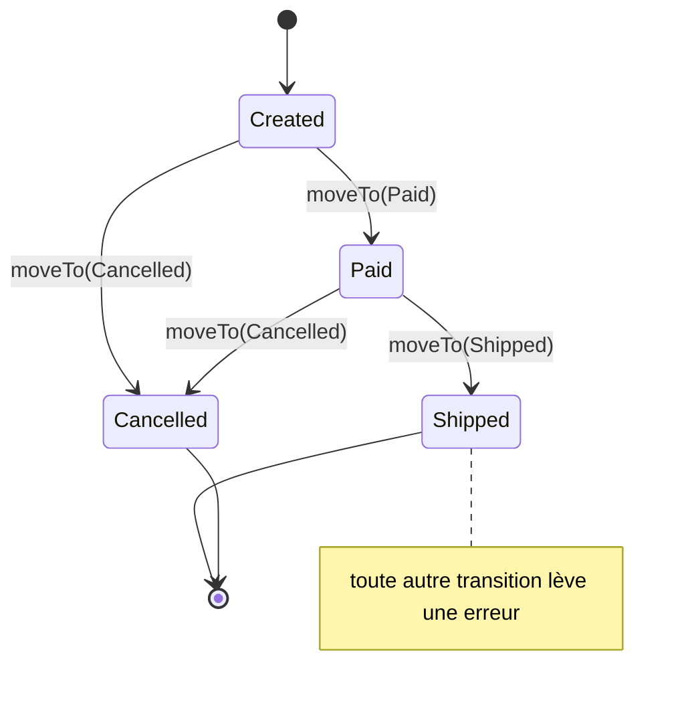

=== "PHP"

    ```php
    <?php

    // Exemple : les états possibles d'une commande
    enum OrderStatus: string
    {
        case Created = 'created';
        case Paid = 'paid';
        case Shipped = 'shipped';
        case Cancelled = 'cancelled';

        // Bien : la table des transitions autorisées, écrite une seule fois
        public function canMoveTo(self $target): bool
        {
            return in_array($target, match ($this) {
                self::Created => [self::Paid, self::Cancelled],
                self::Paid => [self::Shipped, self::Cancelled],
                self::Shipped, self::Cancelled => [],
            }, true);
        }
    }

    // Bien : toute transition passe par moveTo(), qui refuse les passages interdits
    final class Order
    {
        public OrderStatus $status = OrderStatus::Created;

        public function moveTo(OrderStatus $target): void
        {
            if (!$this->status->canMoveTo($target)) {
                throw new DomainException("cannot go from {$this->status->value} to {$target->value}");
            }
            $this->status = $target;
        }
    }

    // Exemple : créée, puis payée, puis expédiée : passages autorisés
    $order = new Order();
    $order->moveTo(OrderStatus::Paid);
    $order->moveTo(OrderStatus::Shipped);
    ```

=== "Python"

    ```python
    from enum import Enum


    # Exemple : les états possibles d'une commande
    class OrderStatus(Enum):
        CREATED = "created"
        PAID = "paid"
        SHIPPED = "shipped"
        CANCELLED = "cancelled"


    # Bien : la table des transitions autorisées, écrite une seule fois
    ALLOWED = {
        OrderStatus.CREATED: {OrderStatus.PAID, OrderStatus.CANCELLED},
        OrderStatus.PAID: {OrderStatus.SHIPPED, OrderStatus.CANCELLED},
        OrderStatus.SHIPPED: set(),
        OrderStatus.CANCELLED: set(),
    }


    # Bien : toute transition passe par move_to(), qui refuse les passages interdits
    class Order:
        def __init__(self) -> None:
            self.status = OrderStatus.CREATED

        def move_to(self, target: OrderStatus) -> None:
            if target not in ALLOWED[self.status]:
                raise ValueError(f"cannot go from {self.status.value} to {target.value}")
            self.status = target


    # Exemple : créée, puis payée, puis expédiée : passages autorisés
    order = Order()
    order.move_to(OrderStatus.PAID)
    order.move_to(OrderStatus.SHIPPED)
    ```

=== "Java"

    ```java
    import java.util.Set;

    // Exemple : les états possibles d'une commande
    enum OrderStatus {
        CREATED, PAID, SHIPPED, CANCELLED;

        // Bien : la table des transitions autorisées, écrite une seule fois
        boolean canMoveTo(OrderStatus target) {
            return switch (this) {
                case CREATED -> Set.of(PAID, CANCELLED).contains(target);
                case PAID -> Set.of(SHIPPED, CANCELLED).contains(target);
                case SHIPPED, CANCELLED -> false;
            };
        }
    }

    // Bien : toute transition passe par moveTo(), qui refuse les passages interdits
    final class Order {
        private OrderStatus status = OrderStatus.CREATED;

        void moveTo(OrderStatus target) {
            if (!status.canMoveTo(target)) {
                throw new IllegalStateException("cannot go from " + status + " to " + target);
            }
            status = target;
        }
    }

    // Exemple : créée, puis payée, puis expédiée : passages autorisés
    Order order = new Order();
    order.moveTo(OrderStatus.PAID);
    order.moveTo(OrderStatus.SHIPPED);
    ```

La table des transitions est la variante légère : elle interdit les mauvais passages, mais le comportement reste le même dans chaque état. Quand une même action fait des choses différentes selon l'état, le State du GoF donne une classe par état. Ici `cancel()` ferme simplement une commande créée, rembourse puis ferme une commande payée, et refuse une commande expédiée.

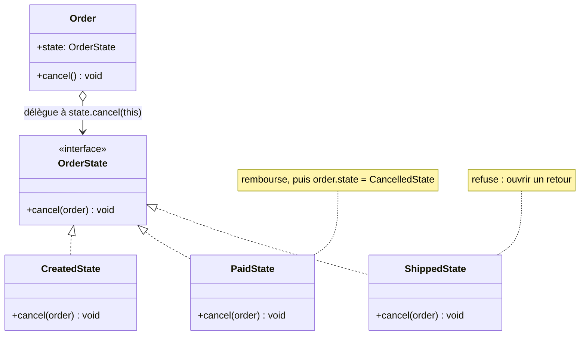

=== "PHP"

    ```php
    <?php

    // Exemple : chaque état écrit sa propre version de cancel()
    interface OrderState
    {
        public function cancel(Order $order): void;
    }

    // Bien : commande créée, l'annulation la ferme simplement
    final class CreatedState implements OrderState
    {
        public function cancel(Order $order): void
        {
            $order->state = new CancelledState();
        }
    }

    // Bien : commande payée, rembourse puis ferme
    final class PaidState implements OrderState
    {
        public function cancel(Order $order): void
        {
            $order->payments->refund($order->id);
            $order->state = new CancelledState();
        }
    }

    // Bien : commande expédiée, refuse et demande d'ouvrir un retour
    final class ShippedState implements OrderState
    {
        public function cancel(Order $order): void
        {
            throw new DomainException('shipped: open a return instead');
        }
    }
    ```

=== "Python"

    ```python
    # Bien : commande créée, l'annulation la ferme simplement
    class CreatedState:
        def cancel(self, order: "Order") -> None:
            order.state = CancelledState()


    # Bien : commande payée, rembourse puis ferme
    class PaidState:
        def cancel(self, order: "Order") -> None:
            order.payments.refund(order.id)
            order.state = CancelledState()


    # Bien : commande expédiée, refuse et demande d'ouvrir un retour
    class ShippedState:
        def cancel(self, order: "Order") -> None:
            raise ValueError("shipped: open a return instead")


    # Bien : la commande délègue cancel() à son état courant
    class Order:
        def cancel(self) -> None:
            self.state.cancel(self)
    ```

=== "Java"

    ```java
    // Exemple : chaque état écrit sa propre version de cancel()
    interface OrderState { void cancel(Order order); }

    // Bien : commande créée, l'annulation la ferme simplement
    final class CreatedState implements OrderState {
        public void cancel(Order order) { order.state = new CancelledState(); }
    }

    // Bien : commande payée, rembourse puis ferme
    final class PaidState implements OrderState {
        public void cancel(Order order) {
            order.payments.refund(order.id);
            order.state = new CancelledState();
        }
    }

    // Bien : commande expédiée, refuse et demande d'ouvrir un retour
    final class ShippedState implements OrderState {
        public void cancel(Order order) { throw new IllegalStateException("shipped: open a return instead"); }
    }
    ```

**Dans les frameworks**

=== "PHP"

    Le composant Symfony Workflow (machine à états décrite en YAML).

=== "Python"

    La bibliothèque `transitions`, ou un `Enum` plus une table comme ci-dessus.

=== "Java"

    Spring Statemachine, ou un `enum` avec `switch` comme ci-dessus.

| À utiliser quand | À éviter quand |
|---|---|
| mon objet a un cycle de vie et certains passages doivent être interdits, comme une commande créée, payée puis expédiée, un ticket ou un paiement. La table des transitions se teste ligne par ligne. | mon objet n'a que deux états : un booléen suffit. |

:material-book-open-variant: Doc de référence : [Refactoring.Guru, State](https://refactoring.guru/fr/design-patterns/state) (consultée en novembre 2026)
{ .doc-ref }

## Patterns d'architecture applicative

<a class="pill pill-scope pill-scope-app" href="../architecture/#carte-des-echelles">Échelle · Application</a>

Pas dans le livre du GoF, mais présents dans presque tous les projets web.

### Repository (dépôt)
<span class="pill pill-status pill-status-ok" title="Toujours valable, vérifié en novembre 2026">Valable · 11/2026</span>

**Intention** : cacher l'accès aux données derrière une interface qui parle le langage du métier.

**Problème** : des requêtes SQL éparpillées dans les contrôleurs : impossible de tester la logique sans base, et changer de table casse tout.

**Exemple** : `OrderRepository.get(42)`. En production, une implémentation SQL. Dans les tests unitaires, une implémentation en mémoire.

!!! noob "As noob"
    Le repository, c'est le bibliothécaire : je demande « la commande 42 », il sait dans quel rayon (quelle table, quelle requête) aller la chercher, et je n'ai pas besoin de connaître le rangement. La phrase à retenir : **le code métier demande des objets, il ne voit jamais le SQL.**

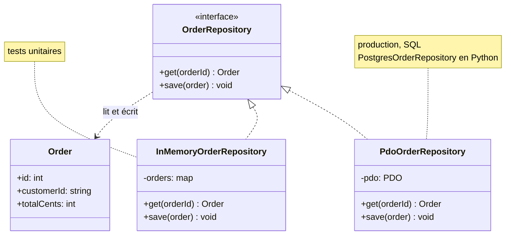

=== "PHP"

    ```php
    <?php

    // Exemple : l'objet métier, sans rien sur la base
    final readonly class Order
    {
        public function __construct(public int $id, public string $customerId, public int $totalCents) {}
    }

    // Bien : le contrat parle métier (get, save), jamais SQL
    interface OrderRepository
    {
        public function get(int $orderId): ?Order;
        public function save(Order $order): void;
    }

    // Bien : version en mémoire pour les tests unitaires, sans base
    final class InMemoryOrderRepository implements OrderRepository
    {
        private array $orders = [];

        public function get(int $orderId): ?Order { return $this->orders[$orderId] ?? null; }

        public function save(Order $order): void { $this->orders[$order->id] = $order; }
    }

    // Bien : version de production, seul endroit qui parle à la base
    final class PdoOrderRepository implements OrderRepository
    {
        public function __construct(private readonly PDO $pdo) {}

        public function get(int $orderId): ?Order
        {
            $statement = $this->pdo->prepare('SELECT id, customer_id, total_cents FROM orders WHERE id = ?');
            $statement->execute([$orderId]);
            $row = $statement->fetch(PDO::FETCH_NUM);
            return $row ? new Order((int) $row[0], $row[1], (int) $row[2]) : null;
        }

        public function save(Order $order): void
        {
            $this->pdo->prepare('REPLACE INTO orders VALUES (?, ?, ?)')
                ->execute([$order->id, $order->customerId, $order->totalCents]);
        }
    }
    ```

=== "Python"

    ```python
    from dataclasses import dataclass
    from typing import Protocol


    # Exemple : l'objet métier, sans rien sur la base
    @dataclass
    class Order:
        id: int
        customer_id: str
        total_cents: int


    # Bien : le contrat parle métier (get, save), jamais SQL
    class OrderRepository(Protocol):
        def get(self, order_id: int) -> Order | None: ...
        def save(self, order: Order) -> None: ...


    # Bien : version en mémoire pour les tests unitaires, sans base
    class InMemoryOrderRepository:
        def __init__(self) -> None:
            self._orders: dict[int, Order] = {}

        def get(self, order_id: int) -> Order | None:
            return self._orders.get(order_id)

        def save(self, order: Order) -> None:
            self._orders[order.id] = order


    # Bien : version de production, seul endroit qui parle à la base
    class PostgresOrderRepository:
        def __init__(self, connection) -> None:
            self._connection = connection

        def get(self, order_id: int) -> Order | None:
            row = self._connection.execute(
                "SELECT id, customer_id, total_cents FROM orders WHERE id = %s", (order_id,)
            ).fetchone()
            return Order(*row) if row else None

        def save(self, order: Order) -> None:
            self._connection.execute(
                "INSERT INTO orders VALUES (%s, %s, %s) ON CONFLICT (id) DO UPDATE SET total_cents = EXCLUDED.total_cents",
                (order.id, order.customer_id, order.total_cents),
            )
    ```

=== "Java"

    ```java
    import java.util.HashMap;
    import java.util.Map;
    import java.util.Optional;

    // Exemple : l'objet métier, sans rien sur la base
    record Order(int id, String customerId, int totalCents) {}

    // Bien : le contrat parle métier (get, save), jamais SQL
    interface OrderRepository {
        Optional<Order> get(int orderId);
        void save(Order order);
    }

    // Bien : version en mémoire pour les tests unitaires, sans base
    final class InMemoryOrderRepository implements OrderRepository {
        private final Map<Integer, Order> orders = new HashMap<>();

        public Optional<Order> get(int orderId) { return Optional.ofNullable(orders.get(orderId)); }

        public void save(Order order) { orders.put(order.id(), order); }
    }

    // Bien : version de production, seul endroit qui parle à la base
    interface JpaOrderRepository extends org.springframework.data.repository.CrudRepository<OrderEntity, Integer> {}
    ```

**Dans les frameworks**

=== "PHP"

    Doctrine : `EntityRepository` et `$entityManager->getRepository(Order::class)`.

=== "Python"

    L'<span class="term" data-term="orm">ORM</span> de Django joue ce rôle (`Order.objects.get(id=42)`). En architecture hexagonale, on écrit son propre repository.

=== "Java"

    Spring Data : une interface `CrudRepository<Order, Integer>`, Spring écrit l'implémentation.

| À utiliser quand | À éviter quand |
|---|---|
| je veux que ma logique métier ne sache rien de la base de données, pour la tester avec un repository en mémoire au lieu d'une vraie base. | j'écris un petit script ou un CRUD sans logique : l'ORM utilisé directement suffit. |

:material-book-open-variant: Doc de référence : [Martin Fowler, Repository](https://martinfowler.com/eaaCatalog/repository.html) (2002)
{ .doc-ref }

### Injection de dépendances
<span class="pill pill-status pill-status-ok" title="Toujours valable, vérifié en novembre 2026">Valable · 11/2026</span>

**Intention** : donner à un objet ce dont il a besoin (par son constructeur) au lieu qu'il le crée lui-même.

**Problème** : `OrderService` fait `new PostgresOrderRepository()` dans son code : impossible de le tester sans vraie base, ni de changer de stockage.

**Exemple** : `OrderService` reçoit un repository et un notifier. En test, on lui passe un repository en mémoire et un faux notifier, sans base ni envoi réel.

!!! noob "As noob"
    L'injection de dépendances, c'est le cuisinier à qui on fournit les ingrédients au lieu qu'il aille lui-même au marché : pour un test, on lui donne des ingrédients factices sans changer sa recette. La phrase à retenir : **un objet reçoit ce dont il a besoin, il ne le fabrique pas.**

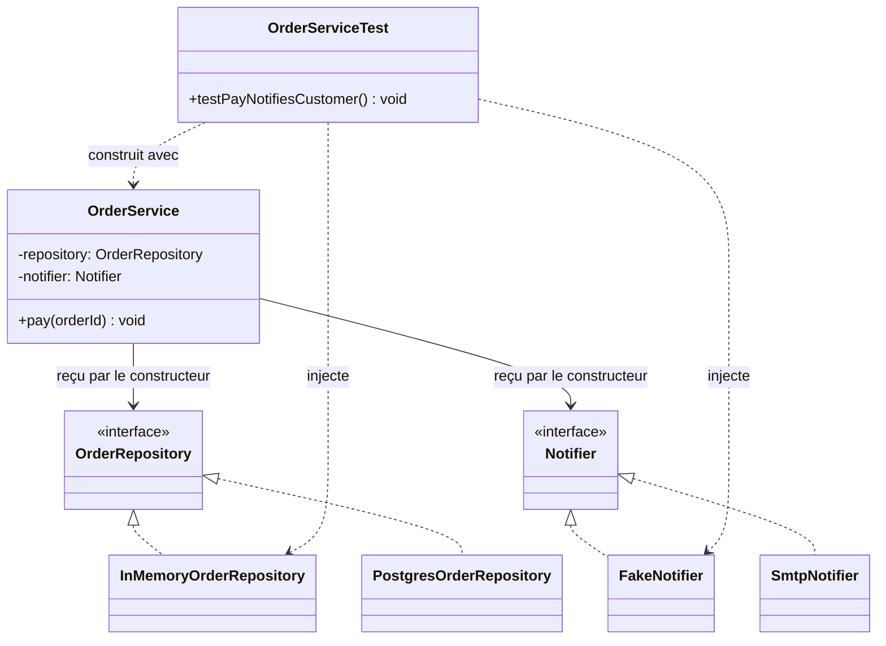

=== "PHP"

    ```php
    <?php

    // Bien : reçoit ses dépendances par le constructeur, ne les crée pas
    final class OrderService
    {
        public function __construct(
            private readonly OrderRepository $repository,
            private readonly Notifier $notifier,
        ) {}

        public function pay(int $orderId): void
        {
            $order = $this->repository->get($orderId) ?? throw new OutOfBoundsException((string) $orderId);
            $this->notifier->send($order->customerId, 'Payment received');
        }
    }

    // Exemple : le test injecte un repository en mémoire et un faux notifier
    final class OrderServiceTest extends PHPUnit\Framework\TestCase
    {
        public function testPayNotifiesCustomer(): void
        {
            $repository = new InMemoryOrderRepository();
            $repository->save(new Order(42, 'ada', 3000));
            $notifier = new FakeNotifier();
            (new OrderService($repository, $notifier))->pay(42);
            self::assertSame([['ada', 'Payment received']], $notifier->sent);
        }
    }
    ```

=== "Python"

    ```python
    # Bien : reçoit ses dépendances par le constructeur, ne les crée pas
    class OrderService:
        def __init__(self, repository: OrderRepository, notifier: Notifier) -> None:
            self._repository = repository
            self._notifier = notifier

        def pay(self, order_id: int) -> None:
            order = self._repository.get(order_id)
            if order is None:
                raise LookupError(order_id)
            self._notifier.send(order.customer_id, "Payment received")


    # Exemple : le test injecte un repository en mémoire et un faux notifier
    def test_pay_notifies_customer() -> None:
        repository = InMemoryOrderRepository()
        repository.save(Order(42, "ada", 3000))
        notifier = FakeNotifier()
        OrderService(repository, notifier).pay(42)
        assert notifier.sent == [("ada", "Payment received")]
    ```

=== "Java"

    ```java
    // Bien : reçoit ses dépendances par le constructeur, ne les crée pas
    final class OrderService {
        private final OrderRepository repository;
        private final Notifier notifier;

        OrderService(OrderRepository repository, Notifier notifier) {
            this.repository = repository;
            this.notifier = notifier;
        }

        void pay(int orderId) {
            Order order = repository.get(orderId).orElseThrow();
            notifier.send(order.customerId(), "Payment received");
        }
    }

    // Exemple : le test injecte un repository en mémoire et un faux notifier
    class OrderServiceTest {
        @org.junit.jupiter.api.Test
        void payNotifiesCustomer() {
            var repository = new InMemoryOrderRepository();
            repository.save(new Order(42, "ada", 3000));
            var notifier = new FakeNotifier();
            new OrderService(repository, notifier).pay(42);
            org.junit.jupiter.api.Assertions.assertEquals(List.of(List.of("ada", "Payment received")), notifier.sent);
        }
    }
    ```

Le `FakeNotifier` des tests est un <span class="term" data-term="fake-object">fake</span> (faux) : une classe qui remplace la vraie pendant le test, qui marche vraiment mais en version simplifiée. Ici, il n'envoie rien : il note chaque message dans `sent`, et le test vérifie cette liste (voir [doubles de test](qualite.md#double-de-test-mock-stub-fake)).

=== "PHP"

    ```php
    <?php

    // Exemple : un fake qui note les messages au lieu de les envoyer
    final class FakeNotifier implements Notifier
    {
        /** @var list<array{string, string}> */
        public array $sent = [];

        public function send(string $customerId, string $message): void
        {
            $this->sent[] = [$customerId, $message];
        }
    }
    ```

=== "Python"

    ```python
    # Exemple : un fake qui note les messages au lieu de les envoyer
    class FakeNotifier:
        def __init__(self) -> None:
            self.sent: list[tuple[str, str]] = []

        def send(self, customer_id: str, message: str) -> None:
            self.sent.append((customer_id, message))
    ```

=== "Java"

    ```java
    // Exemple : un fake qui note les messages au lieu de les envoyer
    final class FakeNotifier implements Notifier {
        final List<List<String>> sent = new ArrayList<>();

        @Override
        public void send(String customerId, String message) {
            sent.add(List.of(customerId, message));
        }
    }
    ```

**Dans les frameworks**

=== "PHP"

    Le [conteneur](#conteneur-dinjection) de Symfony (*autowiring*) et celui de Laravel lisent les types du constructeur et injectent tout seuls.

=== "Python"

    Pas de conteneur obligatoire : on passe les objets au constructeur. FastAPI propose `Depends()` pour les routes.

=== "Java"

    Spring : l'injection par constructeur est la forme recommandée (pas d'`@Autowired` sur les champs).

| À utiliser quand | À éviter quand |
|---|---|
| presque toujours dans le code applicatif : c'est ce qui rend le code testable (en test, `OrderService` reçoit un faux notifier au lieu d'envoyer de vrais messages) et ce qui remplace les singletons. | ce sont des objets de valeur simples (une date, un montant) : je les crée directement. |

:material-book-open-variant: Doc de référence : [Martin Fowler, Inversion of Control Containers and the Dependency Injection pattern](https://martinfowler.com/articles/injection.html) (2004)
{ .doc-ref }

#### Conteneur d'injection

**Définition** : un conteneur d'injection (ou <span class="term" data-term="di-container">conteneur de services</span>, *DI container*, rien à voir avec un conteneur Docker) est un objet qui construit mes objets et leurs dépendances à ma place. Il sait quoi construire grâce à une configuration, ou en lisant les types des constructeurs : c'est l'*autowiring* (câblage automatique). Il garde aussi les instances : par défaut une seule par service, ce qui remplace le Singleton.

**Exemple** : sans conteneur, le point d'entrée (contrôleur, commande, `main`) assemble tout à la main. Avec un conteneur, il demande `OrderService` et reçoit l'objet déjà câblé.

!!! noob "As noob"
    Le conteneur, c'est le magasinier qui prépare la commande : je demande « un `OrderService` », il va chercher le repository et le notifier dont il a besoin, les assemble et me le rend prêt. La phrase à retenir : **le conteneur fait l'injection à ma place, mais on peut très bien injecter sans conteneur.**

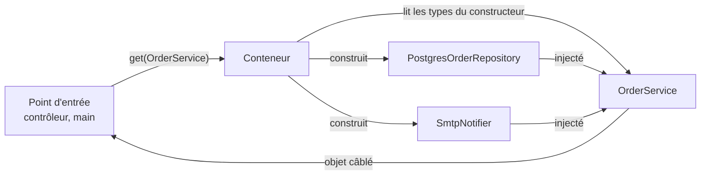

=== "PHP"

    Sans conteneur :

    ```php
    <?php

    // Exemple : sans conteneur, le point d'entrée assemble tout à la main
    $service = new OrderService(new PostgresOrderRepository($pdo), new SmtpNotifier($mailer));
    ```

    Avec le conteneur de Symfony, `config/services.yaml` active l'autowiring et dit quelle classe utiliser pour chaque interface :

    ```yaml
    services:
        # Exemple : l'autowiring lit les types des constructeurs
        _defaults:
            autowire: true
            autoconfigure: true

        # Exemple : toutes les classes de src/ deviennent des services
        App\:
            resource: '../src/'

        # Exemple : quelle classe utiliser pour chaque interface
        App\Order\OrderRepository: '@App\Order\PostgresOrderRepository'
        App\Notification\Notifier: '@App\Notification\SmtpNotifier'
    ```

    Un contrôleur qui déclare `OrderService $service` dans son constructeur le reçoit tout construit.

=== "Python"

    Sans conteneur :

    ```python
    # Exemple : sans conteneur, le point d'entrée assemble tout à la main
    service = OrderService(PostgresOrderRepository(dsn), SmtpNotifier())
    ```

    Avec un conteneur minimal écrit à la main (une classe qui centralise le câblage et garde l'instance) :

    ```python
    # Exemple : un conteneur minimal qui centralise le câblage et garde l'instance
    class Container:
        def __init__(self, dsn: str) -> None:
            self._dsn = dsn
            self._order_service: OrderService | None = None

        def order_service(self) -> OrderService:
            if self._order_service is None:
                repository = PostgresOrderRepository(self._dsn)
                self._order_service = OrderService(repository, SmtpNotifier())
            return self._order_service


    # Exemple : le point d'entrée demande le service déjà câblé
    container = Container(dsn="postgresql://localhost/orders")
    service = container.order_service()
    ```

    Dans FastAPI, `service: OrderService = Depends(get_order_service)` dans la signature d'une route joue le même rôle. La bibliothèque `dependency-injector` existe aussi pour les gros projets.

=== "Java"

    Sans conteneur :

    ```java
    // Exemple : sans conteneur, le point d'entrée assemble tout à la main
    var service = new OrderService(new JdbcOrderRepository(dataSource), new SmtpNotifier(mailSender));
    ```

    Avec Spring, on annote les classes et on garde l'injection par constructeur : Spring trouve la seule implémentation de chaque interface et la passe au constructeur.

    ```java
    // Exemple : le service garde l'injection par constructeur
    @Service
    class OrderService {
        private final OrderRepository repository;
        private final Notifier notifier;

        OrderService(OrderRepository repository, Notifier notifier) {
            this.repository = repository;
            this.notifier = notifier;
        }
    }

    // Exemple : Spring trouve la seule implémentation de chaque interface
    @Repository
    class JdbcOrderRepository implements OrderRepository { /* ... */ }

    @Component
    class SmtpNotifier implements Notifier { /* ... */ }
    ```

**Piège** : le conteneur cache le câblage. On ne voit plus dans le code qui fabrique quoi, et une erreur de configuration n'apparaît qu'au démarrage, parfois à la première requête. Et appeler le conteneur depuis le code métier (`$container->get(OrderService::class)`) en fait un *<span class="term" data-term="service-locator">service locator</span>* : les dépendances disparaissent de la signature du constructeur, c'est un anti-pattern. Le conteneur ne s'appelle qu'au point d'entrée, le reste du code reçoit ses dépendances par le constructeur.

:material-book-open-variant: Doc de référence : [Symfony, Service Container](https://symfony.com/doc/current/service_container.html) (consultée en novembre 2026) ; [Spring Framework, The IoC Container](https://docs.spring.io/spring-framework/reference/core/beans.html) (consultée en novembre 2026)
{ .doc-ref }

## Pièges à éviter

- **Le pattern pour le pattern** : j'ajoute une factory, une interface et une stratégie pour un seul cas. Résultat : trois classes à lire au lieu d'un `if`. Un pattern se justifie par un problème présent, pas futur.
- **Le nom sans la forme** : j'appelle `OrderManagerFactoryService` une classe qui fait tout. Le nom d'un pattern promet une structure précise, le relecteur s'y fie, donc il se trompe sur ce que fait le code.
- **Le Singleton partout** : je cache un état global, donc mes tests s'influencent entre eux : un test passe seul et échoue après un autre. L'injection de dépendances règle le même problème proprement.
- **L'héritage profond** : j'empile un `Template Method` sur quatre niveaux, et plus personne ne sait quelle classe écrit quelle étape. Au-delà d'un niveau, je préfère la composition (Strategy, Decorator).
- **Le conteneur appelé partout** : j'appelle `$container->get(...)` depuis le code métier, donc le conteneur devient un service locator et les dépendances disparaissent de la signature du constructeur. Je n'appelle le conteneur qu'au point d'entrée, le reste reçoit ses dépendances par le constructeur ([voir le conteneur d'injection](#conteneur-dinjection)).
- **L'observateur quand l'ordre compte** : je passe par des abonnés alors que la facturation doit réussir avant l'envoi de l'e-mail, ou qu'une erreur dans un abonné doit tout annuler. Rien dans le code n'écrit cet ordre, donc l'e-mail peut partir pour une commande dont la facturation a échoué. Dans ce cas, j'écris des appels directs ([voir Observer](#observer-observateur)).
- **Les décorateurs empilés** : j'enveloppe un objet dans une dizaine de couches (cache, logs, retry, métriques), donc au débogage la pile d'appels devient illisible. Je garde les couches utiles et je les nomme clairement ([voir Decorator](#decorator-decorateur)).

## Ce qu'on demande en entretien

Les questions typiques :

- « Quels design patterns utilises-tu au quotidien ? », « Donne un exemple de Strategy dans ton code » Pour répondre : je pars d'un cas réel, comme les frais de port standard et express, puis je dis quand un `if` suffit ([Strategy](#strategy-strategie)).
- « Pourquoi dit-on que le Singleton est un anti-pattern ? », « Par quoi le remplacer ? » Pour répondre : j'explique qu'il crée un état global partagé entre les tests, impossible à remplacer par un double, et que je laisse le conteneur d'injection garder l'instance unique ([Singleton](#singleton)).
- « Quelle différence entre Decorator et Proxy ? », « Entre Adapter et Facade ? » Pour répondre : je rappelle que c'est la même forme avec une intention différente, le proxy contrôle l'accès, le décorateur ajoute une fonctionnalité ([Proxy](#proxy-mandataire)).
- « Qu'est-ce que l'injection de dépendances, et en quoi rend-elle le code testable ? », « Qu'est-ce qu'un service locator ? » Pour répondre : je montre `OrderService` qui reçoit un faux notifier en test, et j'explique que le service locator cache les dépendances ([Injection de dépendances](#injection-de-dependances)).
- « Composition ou héritage ? Quand préférer Strategy à Template Method ? » Pour répondre : je passe à Strategy dès que l'héritage dépasse un niveau ou que chaque variante change beaucoup d'étapes ([Template Method](#template-method-patron-de-methode)).
- « Quel pattern utilises-tu pour préparer des données de test lisibles ? » Pour répondre : j'utilise un Builder comme `an_order().paid().build()` ([Builder](#builder-monteur)).

Ce qui fait une bonne réponse : nommer le problème avant le pattern, montrer un exemple concret, puis dire **quand je ne l'utiliserais pas**. C'est ce qui montre que je choisis un pattern au lieu de le réciter.

## Quel pattern pour quel besoin

| Je veux... | J'utilise... |
|---|---|
| faire un même calcul de plusieurs façons selon une donnée, comme des frais de port différents en standard et en express | Strategy |
| créer le bon objet selon un réglage, comme un notifier e-mail ou SMS, en écrivant ce choix à un seul endroit | Factory |
| construire un objet avec beaucoup d'options, comme une requête HTTP, ou préparer des données de test lisibles | Builder |
| brancher une bibliothèque tierce, comme celle de la banque, sans que tout mon code dépende de sa façon de parler | Adapter |
| ajouter du cache, des logs ou des retry autour d'un objet, sans toucher à son code | Decorator |
| vérifier les droits avant qu'on atteigne un objet, ou ne le charger qu'au moment où quelqu'un s'en sert | Proxy |
| arrêter de recopier dans chaque contrôleur la même suite d'appels, comme stock, paiement puis livraison | Facade |
| que plusieurs modules réagissent à un fait, comme « commande payée », sans que l'émetteur les connaisse | Observer |
| mettre une action en file, la rejouer ou l'annuler, comme un Ctrl+Z sur le panier | Command |
| partager un déroulé dont seules quelques étapes changent, comme des exports CSV et PDF | Template Method |
| faire passer chaque requête par les mêmes contrôles avant et après mon code, comme l'authentification et la limite de débit | Chain of Responsibility (middlewares) |
| interdire les passages impossibles d'un cycle de vie, comme payer une commande déjà expédiée | State |
| tester ma logique métier sans démarrer de base de données | Repository + injection de dépendances |
| une seule instance partagée, comme la configuration ou le pool de connexions | le [conteneur d'injection](#conteneur-dinjection), pas un Singleton écrit à la main |

## Sources

- Erich Gamma, Richard Helm, Ralph Johnson et John Vlissides, « Design Patterns: Elements of Reusable Object-Oriented Software » (1994)
- Martin Fowler, « Patterns of Enterprise Application Architecture » (2002), pour Repository
- [Martin Fowler, « Inversion of Control Containers and the Dependency Injection pattern » (2004)](https://martinfowler.com/articles/injection.html)
- [Refactoring.Guru, catalogue des design patterns (date de publication non indiquée)](https://refactoring.guru/fr/design-patterns)
- [PSR-15, HTTP Server Request Handlers (2018)](https://www.php-fig.org/psr/psr-15/)
