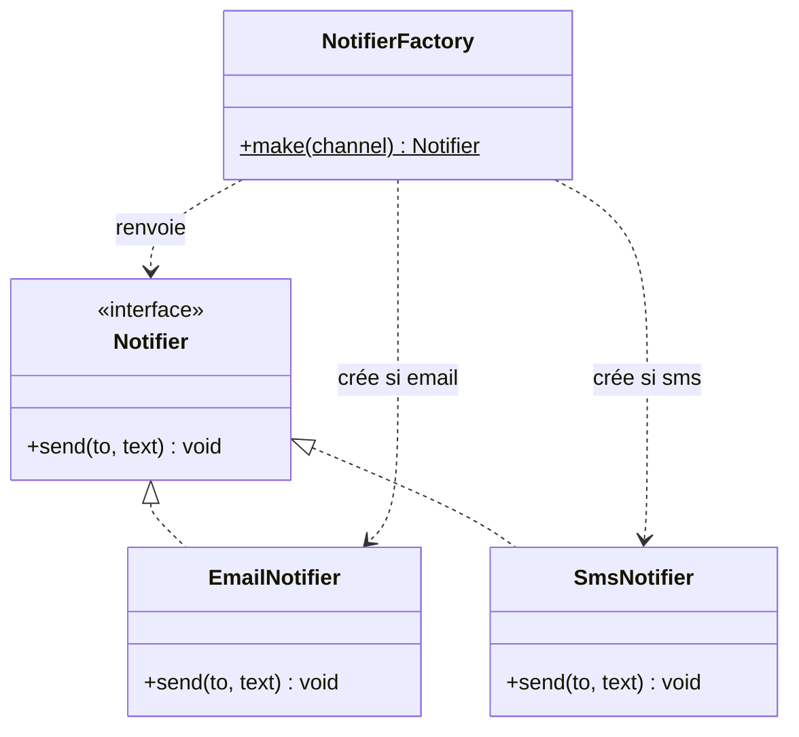
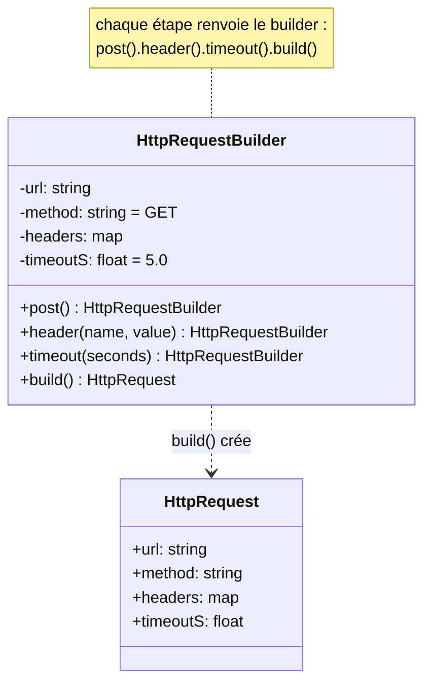
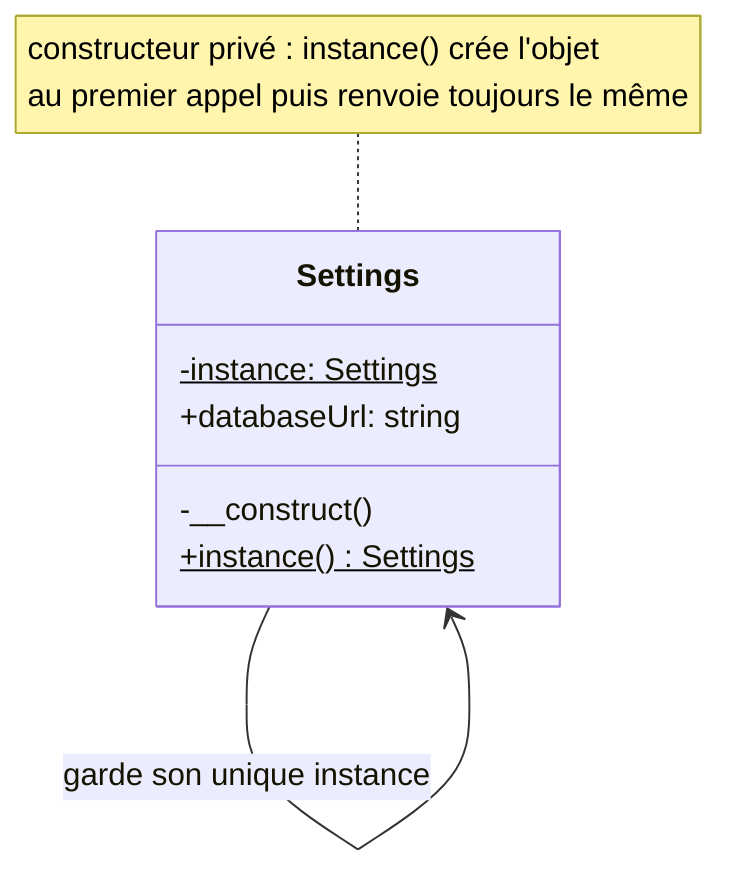
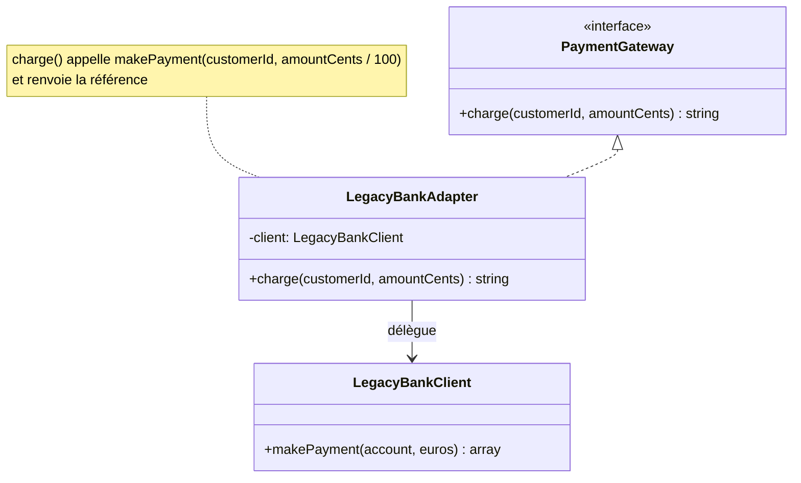
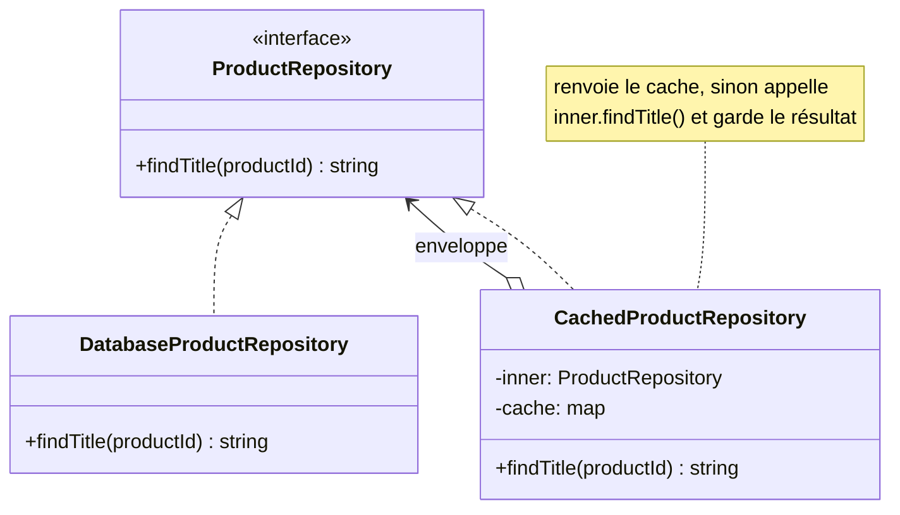
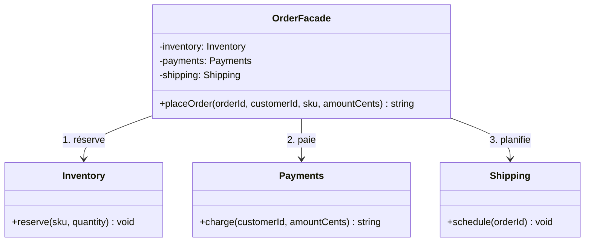
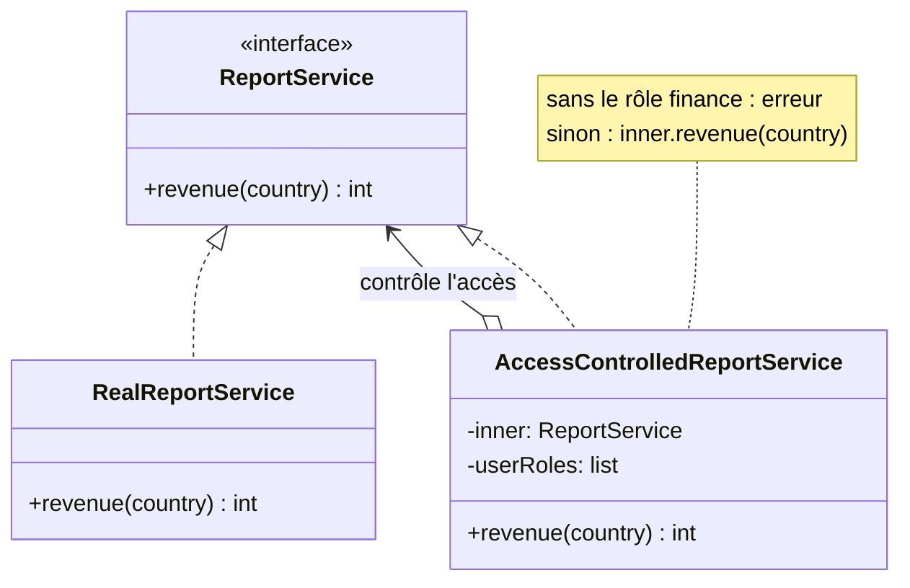
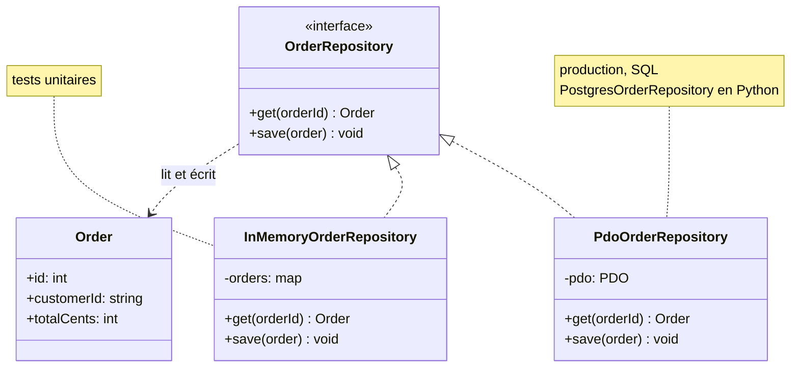
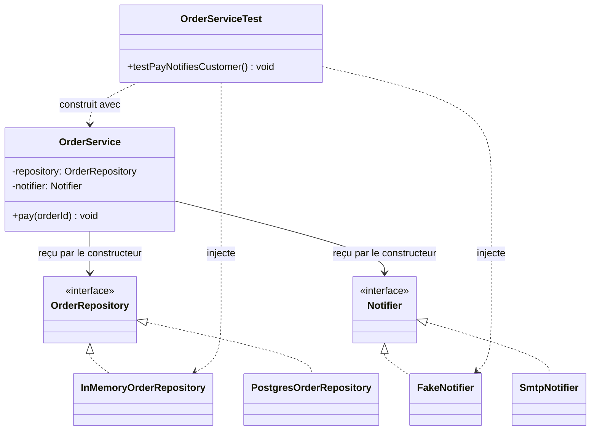
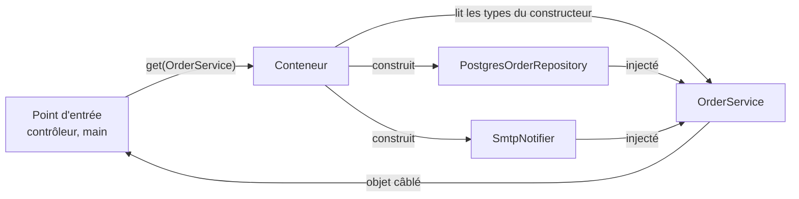

# Design patterns

!!! warning "Avertissement"
    Ces notes sont des pense-bêtes personnels, pas une source de vérité. Elles reflètent ma compréhension et mes choix : leur contenu reste subjectif, malgré les citations et les références qu'il contient. Il peut être incomplet, simplifié, inexact ou dépassé. Vérifiez toujours dans la documentation officielle avant de l'appliquer. Ce contenu est fourni tel quel, sans aucune garantie : son utilisation se fait sous votre seule responsabilité.

!!! audience "Pour qui, pour quoi"
    - **Métiers** : développeur back-end, développeur front-end, QA en automatisation de tests, tech lead, architecte...
    - **Usages** : je prépare un entretien où l'on me demande « explique-moi Adapter avec un exemple », je centralise dans une fabrique le choix entre un notifier e-mail et un notifier SMS, je relis une MR qui ajoute un singleton et je veux savoir s'il est justifié, je structure mon framework de tests (un adapter devant le client HTTP, un builder pour les données de test)...

!!! abstract "Les échelles"
    Les pastilles de couleur sous les titres disent à quelle échelle une notion s'applique :

    - <span class="pill pill-scope pill-scope-code">Code</span> les classes, fonctions et modules d'un programme ;
    - <span class="pill pill-scope pill-scope-app">Application</span> un service ou une application et son découpage interne ;
    - <span class="pill pill-scope pill-scope-system">Système</span> plusieurs services qui communiquent par le réseau ;
    - <span class="pill pill-scope pill-scope-infra">Infrastructure</span> les serveurs, le réseau, les zones et les clusters, physiques ou virtuels ;
    - <span class="pill pill-scope pill-scope-enterprise">Entreprise</span> le système d'information entier et son organisation.

    Détail et mots ambigus : [carte des échelles](architecture.md#carte-des-echelles).

Un **design pattern** (patron de conception) est une solution connue et nommée à un problème de conception qui revient souvent. Ce n'est pas du code à copier : c'est une forme de solution, qu'on adapte. Le nommer permet aussi de se comprendre vite en revue : « mets un adapter devant ce client » dit en trois mots ce qui prendrait un paragraphe.

!!! noob "As noob"
    Un design pattern, c'est comme un nom de nœud pour un marin : « fais un nœud de chaise » suffit, personne ne réexplique chaque boucle, et chacun l'adapte à la corde qu'il a dans les mains. La phrase à retenir : **un pattern est une solution connue qui porte un nom, pas un morceau de code à copier-coller.**

Cette page présente les patterns de création, de structure et d'architecture applicative les plus utiles au quotidien, avec le même exemple en PHP, Python et Java. Les noms des services et des données sont fictifs. Les principes qui guident ces choix (SOLID, STUPID, KISS, DRY, YAGNI) sont sur la page [Principes de conception](principes-conception.md). Les patterns de comportement (Strategy, Observer, Command, Template Method, Chain of Responsibility, State) ont leur propre page : [Design patterns de comportement](design-patterns-comportement.md).

!!! tip "Choisir le langage"
    Je clique sur un langage : **tous les exemples de la page** passent dans ce langage, et le choix est gardé d'une page à l'autre.

=== "PHP"

    Exemples affichés en **PHP 8.3** (classes `readonly`, `match`, enums).

=== "Python"

    Exemples affichés en **Python 3.12** (`Protocol`, `dataclass`, annotations de type).

=== "Java"

    Exemples affichés en **Java 21** (`record`, `switch` en expression, `enum`).

## Vocabulaire

**Classe** : un modèle d'objet (ses données et ses méthodes). **Objet** (ou instance) : un exemplaire créé à partir d'une classe.

**<span class="term" data-term="interface-code">Interface</span>** : un contrat qui liste des méthodes sans les écrire. Toute classe qui l'implémente promet de les fournir. En Python, on utilise souvent un `Protocol` : pas besoin de déclarer qu'on l'implémente, il suffit d'avoir les bonnes méthodes.

**<span class="term" data-term="inheritance">Héritage</span>** : une classe reprend le code d'une classe parente et le complète. **<span class="term" data-term="object-composition">Composition</span>** : un objet en contient un autre et lui délègue une partie du travail. La plupart des patterns préfèrent la composition, plus souple.

**<span class="term" data-term="polymorphism">Polymorphisme</span>** : appeler la même méthode sur des objets de classes différentes, chacun réagissant à sa façon. `shipping.cost()` donne un prix différent pour `Standard` et `Express`.

**<span class="term" data-term="coupling">Couplage</span>** : à quel point un morceau de code dépend des détails d'un autre. Fort couplage : changer l'un oblige à changer l'autre.

**GoF** (*Gang of Four*) : les quatre auteurs du livre « Design Patterns: Elements of Reusable Object-Oriented Software » (Gamma, Helm, Johnson et Vlissides, 1994), qui a nommé 23 patterns en trois familles : création, structure, comportement.

**<span class="term" data-term="sli">SLI</span>** (Service Level Indicator, indicateur de niveau de service) : le chiffre que je mesure pour savoir si une solution marche, par exemple le nombre de fichiers modifiés pour ajouter un canal de notification.

**<span class="term" data-term="slo">SLO</span>** (Service Level Objective, objectif de niveau de service) : la cible interne que je me fixe sur ce chiffre, par exemple « un nouveau canal ne touche qu'un seul fichier existant, la fabrique ».

**<span class="term" data-term="sla">SLA</span>** (Service Level Agreement, accord de niveau de service) : la promesse contractuelle faite à un client, avec une pénalité si elle n'est pas tenue, en général plus lâche que le SLO. Un choix de pattern reste interne au code : il n'a presque jamais de SLA, sauf quand il protège un service promis au client, comme un cache devant une API publique.

## Patterns de création

<a class="pill pill-scope pill-scope-code" href="../architecture/#carte-des-echelles">Échelle · Code</a>

Comment fabriquer des objets sans que le reste du code dépende de la façon de les fabriquer.

### Factory (fabrique)
<span class="pill pill-status pill-status-ok" title="Toujours valable, vérifié en novembre 2026">Valable · 11/2026</span>

**Intention** : centraliser la création d'objets dont la classe exacte dépend d'un paramètre.

**Problème** : des `if channel == "sms": SmsNotifier()` partout dans le code. Ajouter un canal oblige à retrouver et modifier chaque endroit.

**Exemple** : on choisit le moyen de prévenir un client (e-mail ou SMS) à partir d'un réglage. Un seul endroit sait quelle classe créer.

!!! noob "As noob"
    La fabrique, c'est le guichet d'une agence de location : je dis « une citadine » ou « un utilitaire », l'employé va chercher le bon véhicule au parking, je n'ai pas besoin de savoir où il est garé. Si l'agence ajoute des vélos, seul le guichet l'apprend. La phrase à retenir : **un seul endroit décide quelle classe créer, les autres demandent juste ce qu'ils veulent.**



**Sans le pattern** (à éviter) : chaque appelant choisit lui-même la classe. Le jour où j'ajoute un canal, je dois retrouver chaque `if` de ce genre dans le code, et celui que j'oublie plante sur ce canal (variable jamais remplie) au lieu de prévenir le client.

=== "PHP"

    ```php
    <?php

    // À éviter : chaque appelant choisit la classe, ce if est copié partout où on notifie
    function notifyShipped(string $channel, string $customerId): void
    {
        if ($channel === 'email') {
            $notifier = new EmailNotifier();
        } elseif ($channel === 'sms') {
            $notifier = new SmsNotifier();
        }
        $notifier->send($customerId, 'Your order has shipped');
    }
    ```

=== "Python"

    ```python
    # À éviter : chaque appelant choisit la classe, ce if est copié partout où on notifie
    def notify_shipped(channel: str, customer_id: str) -> None:
        if channel == "email":
            notifier = EmailNotifier()
        elif channel == "sms":
            notifier = SmsNotifier()
        notifier.send(customer_id, "Your order has shipped")
    ```

=== "Java"

    ```java
    // À éviter : chaque appelant choisit la classe, ce if est copié partout où on notifie
    static void notifyShipped(String channel, String customerId) {
        Notifier notifier = null;
        if (channel.equals("email")) {
            notifier = new EmailNotifier();
        } else if (channel.equals("sms")) {
            notifier = new SmsNotifier();
        }
        notifier.send(customerId, "Your order has shipped");
    }
    ```

**Avec le pattern** :

=== "PHP"

    ```php
    <?php

    // Exemple : le contrat commun à tous les notifiers
    interface Notifier
    {
        public function send(string $to, string $text): void;
    }

    // Exemple : une classe par canal, avec la même méthode send()
    final class EmailNotifier implements Notifier
    {
        public function send(string $to, string $text): void { echo "email to $to: $text\n"; }
    }

    final class SmsNotifier implements Notifier
    {
        public function send(string $to, string $text): void { echo "sms to $to: $text\n"; }
    }

    // Bien : seul endroit qui sait quelle classe créer pour chaque canal
    final class NotifierFactory
    {
        public static function make(string $channel): Notifier
        {
            return match ($channel) {
                'email' => new EmailNotifier(),
                'sms' => new SmsNotifier(),
                default => throw new InvalidArgumentException("unknown channel: $channel"),
            };
        }
    }

    // Exemple : l'appelant demande un canal, sans connaître la classe
    NotifierFactory::make('sms')->send('ada', 'Your order has shipped');
    ```

=== "Python"

    ```python
    # Exemple : une classe par canal, avec la même méthode send()
    class EmailNotifier:
        def send(self, to: str, text: str) -> None:
            print(f"email to {to}: {text}")


    class SmsNotifier:
        def send(self, to: str, text: str) -> None:
            print(f"sms to {to}: {text}")


    # Bien : seul endroit qui sait quelle classe créer pour chaque canal
    def make_notifier(channel: str) -> EmailNotifier | SmsNotifier:
        notifiers = {"email": EmailNotifier, "sms": SmsNotifier}
        try:
            return notifiers[channel]()
        except KeyError:
            raise ValueError(f"unknown channel: {channel}") from None


    # Exemple : l'appelant demande un canal, sans connaître la classe
    make_notifier("sms").send("ada", "Your order has shipped")
    ```

=== "Java"

    ```java
    // Exemple : le contrat commun à tous les notifiers
    interface Notifier {
        void send(String to, String text);
    }

    // Exemple : une classe par canal, avec la même méthode send()
    final class EmailNotifier implements Notifier {
        public void send(String to, String text) { System.out.println("email to " + to + ": " + text); }
    }

    final class SmsNotifier implements Notifier {
        public void send(String to, String text) { System.out.println("sms to " + to + ": " + text); }
    }

    // Bien : seul endroit qui sait quelle classe créer pour chaque canal
    final class NotifierFactory {
        static Notifier make(String channel) {
            return switch (channel) {
                case "email" -> new EmailNotifier();
                case "sms" -> new SmsNotifier();
                default -> throw new IllegalArgumentException("unknown channel: " + channel);
            };
        }
    }

    // Exemple : l'appelant demande un canal, sans connaître la classe
    NotifierFactory.make("sms").send("ada", "Your order has shipped");
    ```

**Dans les frameworks**

=== "PHP"

    Symfony : les *factories* de services dans `services.yaml` (`factory: [NotifierFactory, make]`).

=== "Python"

    Django : `get_user_model()`, ou `logging.getLogger()` qui fabrique et réutilise les loggers.

=== "Java"

    Spring : les méthodes `@Bean` d'une classe `@Configuration` sont des factories.

| À utiliser quand | À éviter quand |
|---|---|
| la classe à créer dépend d'un réglage ou d'une donnée, comme un notifier e-mail ou SMS selon le canal choisi, ou la création demande plusieurs étapes. | je n'ai qu'une seule classe à créer, toujours la même : un simple `new` est plus lisible. |

**Risques.** Une fabrique qui grossit à chaque canal finit en grand `match` que tout le monde modifie, ce qui recrée le problème au lieu de le résoudre : je garde une simple table de correspondance, ou j'enregistre chaque canal à côté de sa classe. Une fabrique qui renvoie `None` ou un canal par défaut pour un nom inconnu masque une faute de réglage, et le client n'est jamais prévenu : je lève une erreur claire dès le démarrage.

:material-book-open-variant: Doc de référence : [Refactoring.Guru, Factory Method](https://refactoring.guru/fr/design-patterns/factory-method) (consultée en novembre 2026)
{ .doc-ref }

### Builder (monteur)
<span class="pill pill-status pill-status-ok" title="Toujours valable, vérifié en novembre 2026">Valable · 11/2026</span>

**Intention** : construire un objet complexe étape par étape, avec des valeurs par défaut lisibles.

**Problème** : un constructeur à huit paramètres, dont cinq optionnels : `HttpRequest(url, "POST", {}, 5.0, None, True, ...)`. Personne ne sait ce que veut dire le sixième.

**Exemple** : préparer une requête HTTP : méthode, en-têtes, délai d'attente, chacun nommé.

!!! noob "As noob"
    Le builder, c'est la commande d'un sandwich au comptoir : « pain complet, sans oignons, sauce à part ». Chaque choix est dit avec son nom, et ce que je ne précise pas prend la valeur habituelle, au lieu d'une fiche de huit cases à remplir dans l'ordre. La phrase à retenir : **chaque option a un nom, les autres gardent leur valeur par défaut.**



**Sans le pattern** (à éviter) : une version de `HttpRequest` dont le constructeur prend huit paramètres. En lisant l'appel, rien ne dit si le premier booléen active les redirections ou la compression, et inverser deux paramètres du même type compile sans erreur : le bug ne se voit qu'en production.

=== "PHP"

    ```php
    <?php

    // À éviter : huit paramètres à la suite, personne ne sait ce que veulent dire les quatre derniers
    $request = new HttpRequest('https://my-api/orders', 'POST', ['Idempotency-Key' => '7f3c'], 2.0, null, true, false, 3);
    ```

=== "Python"

    ```python
    # À éviter : huit paramètres à la suite, personne ne sait ce que veulent dire les quatre derniers
    request = HttpRequest("https://my-api/orders", "POST", {"Idempotency-Key": "7f3c"}, 2.0, None, True, False, 3)
    ```

=== "Java"

    ```java
    // À éviter : huit paramètres à la suite, personne ne sait ce que veulent dire les quatre derniers
    var request = new HttpRequest("https://my-api/orders", "POST", Map.of("Idempotency-Key", "7f3c"), 2.0, null, true, false, 3);
    ```

**Avec le pattern** :

=== "PHP"

    ```php
    <?php

    // Exemple : l'objet final, immuable, que le builder fabrique
    final readonly class HttpRequest
    {
        public function __construct(
            public string $url,
            public string $method,
            public array $headers,
            public float $timeoutS,
        ) {}
    }

    // Bien : une méthode nommée par option, des valeurs par défaut lisibles
    final class HttpRequestBuilder
    {
        private string $method = 'GET';
        private array $headers = [];
        private float $timeoutS = 5.0;

        public function __construct(private readonly string $url) {}

        public function post(): self { $this->method = 'POST'; return $this; }

        public function header(string $name, string $value): self { $this->headers[$name] = $value; return $this; }

        public function timeout(float $seconds): self { $this->timeoutS = $seconds; return $this; }

        public function build(): HttpRequest
        {
            return new HttpRequest($this->url, $this->method, $this->headers, $this->timeoutS);
        }
    }

    // Exemple : chaque étape est nommée, au lieu de huit paramètres anonymes
    $request = (new HttpRequestBuilder('https://my-api/orders'))->post()->header('Idempotency-Key', '7f3c')->timeout(2)->build();
    ```

=== "Python"

    ```python
    from dataclasses import dataclass, field


    # Exemple : l'objet final, immuable, que le builder fabrique
    @dataclass(frozen=True)
    class HttpRequest:
        url: str
        method: str
        headers: dict[str, str]
        timeout_s: float


    # Bien : une méthode nommée par option, des valeurs par défaut lisibles
    @dataclass
    class HttpRequestBuilder:
        url: str
        method: str = "GET"
        headers: dict[str, str] = field(default_factory=dict)
        timeout_s: float = 5.0

        def post(self) -> "HttpRequestBuilder":
            self.method = "POST"
            return self

        def header(self, name: str, value: str) -> "HttpRequestBuilder":
            self.headers[name] = value
            return self

        def timeout(self, seconds: float) -> "HttpRequestBuilder":
            self.timeout_s = seconds
            return self

        def build(self) -> HttpRequest:
            return HttpRequest(self.url, self.method, dict(self.headers), self.timeout_s)


    # Exemple : chaque étape est nommée, au lieu de huit paramètres anonymes
    request = HttpRequestBuilder("https://my-api/orders").post().header("Idempotency-Key", "7f3c").timeout(2).build()
    ```

=== "Java"

    ```java
    import java.util.HashMap;
    import java.util.Map;

    // Exemple : l'objet final, immuable, que le builder fabrique
    record HttpRequest(String url, String method, Map<String, String> headers, double timeoutS) {

        static Builder builder(String url) { return new Builder(url); }

        // Bien : une méthode nommée par option, des valeurs par défaut lisibles
        static final class Builder {
            private final String url;
            private String method = "GET";
            private final Map<String, String> headers = new HashMap<>();
            private double timeoutS = 5.0;

            private Builder(String url) { this.url = url; }

            Builder post() { method = "POST"; return this; }

            Builder header(String name, String value) { headers.put(name, value); return this; }

            Builder timeout(double seconds) { timeoutS = seconds; return this; }

            HttpRequest build() { return new HttpRequest(url, method, Map.copyOf(headers), timeoutS); }
        }
    }

    // Exemple : chaque étape est nommée, au lieu de huit paramètres anonymes
    HttpRequest request = HttpRequest.builder("https://my-api/orders").post().header("Idempotency-Key", "7f3c").timeout(2).build();
    ```

**Dans les frameworks**

=== "PHP"

    Doctrine : le `QueryBuilder` (`->select()->from()->where()`).

=== "Python"

    SQLAlchemy : `select(Order).where(...).order_by(...)`. En Python, les arguments nommés avec valeurs par défaut suffisent souvent.

=== "Java"

    Lombok `@Builder`, `HttpRequest.newBuilder()` du JDK, `StringBuilder`.

| À utiliser quand | À éviter quand |
|---|---|
| mon objet a beaucoup de paramètres optionnels, comme une requête HTTP avec sa méthode, ses en-têtes et son délai d'attente, ou il se construit en plusieurs étapes. Très utile pour les données de test (`an_order().paid().build()`). | mon objet n'a que deux ou trois paramètres : un constructeur (ou des arguments nommés en Python) suffit. |

**Risques.** Un builder qui accepte n'importe quel ordre d'appels peut produire un objet incomplet, comme une requête sans URL, et l'erreur n'apparaît qu'à l'envoi : je vérifie les champs obligatoires dans `build()`. Dans les tests, un builder qui remplit trop de valeurs par défaut cache ce que le test vérifie vraiment : chaque test ne précise que les valeurs qui comptent pour lui, et les défauts restent réalistes.

:material-book-open-variant: Doc de référence : [Refactoring.Guru, Builder](https://refactoring.guru/fr/design-patterns/builder) (consultée en novembre 2026)
{ .doc-ref }

### Singleton
<span class="pill pill-status pill-status-ok" title="Toujours valable, vérifié en novembre 2026">Valable · 11/2026</span>

**Intention** : garantir qu'une classe n'a qu'une seule instance, accessible partout.

**Problème** : mon appli relit la configuration ou recrée un pool de connexions à chaque appel, donc chaque requête paie ce coût pour rien.

**Exemple** : les réglages de l'application, lus une fois au démarrage.

!!! noob "As noob"
    Le singleton, c'est l'unique tableau d'affichage de la salle des profs : tout le monde lit le même, il n'y en a pas un par bureau. Pratique, mais si quelqu'un y écrit une erreur, tout le monde la voit, et je ne peux pas en accrocher un vierge le temps d'un test. La phrase à retenir : **une seule instance partagée, à réserver à ce qui ne change pas, comme des réglages lus au démarrage.**



**Sans le pattern** (à éviter) : chaque appel relit le fichier de configuration. Chaque requête paie une lecture disque, et si le fichier change pendant que l'appli tourne, deux parties du code peuvent voir deux valeurs différentes au même moment.

=== "PHP"

    ```php
    <?php

    // À éviter : relit et analyse le fichier de configuration à chaque appel
    function databaseUrl(): string
    {
        $config = json_decode(file_get_contents('config.json'), true);
        return $config['database_url'];
    }
    ```

=== "Python"

    ```python
    import json


    # À éviter : relit et analyse le fichier de configuration à chaque appel
    def database_url() -> str:
        with open("config.json") as file:
            return json.load(file)["database_url"]
    ```

=== "Java"

    ```java
    // À éviter : relit et analyse le fichier de configuration à chaque appel
    static String databaseUrl() throws IOException {
        var config = new Properties();
        config.load(Files.newBufferedReader(Path.of("config.properties")));
        return config.getProperty("database_url");
    }
    ```

**Avec le pattern** :

=== "PHP"

    ```php
    <?php

    // Exemple : une seule instance, créée une fois puis toujours renvoyée
    final class Settings
    {
        private static ?Settings $instance = null;

        public readonly string $databaseUrl;

        private function __construct()
        {
            $this->databaseUrl = 'mysql://localhost/orders';
        }

        public static function instance(): self
        {
            return self::$instance ??= new self();
        }
    }

    // Exemple : deux appels renvoient le même objet
    assert(Settings::instance() === Settings::instance());
    ```

=== "Python"

    ```python
    from functools import cache


    class Settings:
        def __init__(self) -> None:
            self.database_url = "postgresql://localhost/orders"


    # Exemple : une seule instance, créée une fois puis toujours renvoyée
    @cache
    def get_settings() -> Settings:
        return Settings()


    # Exemple : deux appels renvoient le même objet
    assert get_settings() is get_settings()
    ```

=== "Java"

    ```java
    // Exemple : une seule instance, créée une fois puis toujours renvoyée
    enum Settings {
        INSTANCE;

        private final String databaseUrl = "jdbc:postgresql://localhost/orders";

        String databaseUrl() { return databaseUrl; }
    }

    // Exemple : deux appels renvoient le même objet
    assert Settings.INSTANCE == Settings.INSTANCE;
    ```

**Dans les frameworks**

=== "PHP"

    Dans Symfony et Laravel, le [conteneur de services](#conteneur-dinjection) crée par défaut une seule instance par service : on n'écrit plus de singleton à la main.

=== "Python"

    Un module Python est déjà importé une seule fois. `functools.cache` sur une fonction donne le même résultat sans classe spéciale.

=== "Java"

    Spring : les beans sont des singletons par défaut. Écrit à la main, la forme `enum` est la plus sûre (thread-safe, sérialisation).

| À utiliser quand | À éviter quand |
|---|---|
| j'ai une ressource vraiment unique, que personne ne modifie une fois créée, comme la configuration lue au démarrage ou le pool de connexions, et de préférence c'est le conteneur d'injection qui la gère. | presque toujours en code applicatif : un singleton est une variable globale déguisée. Tous les tests partagent son état, donc un test peut en fausser un autre, et je ne peux pas le remplacer par un double. Je préfère l'injection de dépendances. |

:material-book-open-variant: Doc de référence : [Refactoring.Guru, Singleton](https://refactoring.guru/fr/design-patterns/singleton) (consultée en novembre 2026)
{ .doc-ref }

!!! maturity "Mesurer la maturité"
    | Niveau | Ce que j'observe dans l'équipe |
    |---|---|
    | N1 | une ou deux personnes écrivent des fabriques ou des builders, le reste de l'équipe fait encore des `new` derrière des `if` sur le type, et des singletons écrits à la main traînent dans le code |
    | N2 | les données de test passent toutes par des builders partagés (`an_order().paid().build()`), la création des objets à variantes est centralisée dans une fabrique, et le conteneur d'injection gère les instances uniques |
    | N3 | une règle d'analyse statique refuse les nouveaux `getInstance()` et les constructeurs à plus de cinq paramètres, sans qu'un relecteur ait à le signaler |
    | N4 | l'équipe suit le nombre de singletons restants et le nombre de fichiers touchés pour ajouter une variante, et décide d'introduire ou de retirer une fabrique d'après ces chiffres |

    **Je mesure** : le nombre de `getInstance()` et de constructeurs à plus de cinq paramètres, compté par une recherche dans le dépôt ou par l'analyse statique ; le nombre de fichiers modifiés par les MR qui ajoutent une variante (un canal, un format), lu dans l'outil de MR.

## Patterns de structure

<a class="pill pill-scope pill-scope-code" href="../architecture/#carte-des-echelles">Échelle · Code</a>

Comment assembler des objets pour obtenir une forme plus pratique, sans modifier leur code.

### Adapter (adaptateur)
<span class="pill pill-status pill-status-ok" title="Toujours valable, vérifié en novembre 2026">Valable · 11/2026</span>

**Intention** : faire entrer une classe existante dans l'interface que mon code attend, sans modifier cette classe.

**Problème** : la bibliothèque de la banque parle en euros avec `make_payment()`, mon code attend `charge()` en centimes. Changer mon code partout la rendrait impossible à remplacer.

**Exemple** : un adaptateur traduit l'appel et les unités. Le jour où on change de banque, on écrit un autre adaptateur, le reste ne bouge pas.

!!! noob "As noob"
    L'adaptateur, c'est l'adaptateur de prise en voyage : mon chargeur européen ne rentre pas dans la prise anglaise, je ne change ni le chargeur ni le mur, je glisse un adaptateur entre les deux. La phrase à retenir : **l'adaptateur change la forme de l'appel, pas ce qu'il fait.**



**Sans le pattern** (à éviter) : mon code métier appelle directement la bibliothèque de la banque, avec son nom de méthode et ses euros, à chaque endroit où je fais payer. Changer de banque oblige à modifier tous ces endroits, et celui où quelqu'un oublie la division par 100 facture 3 000 € au lieu de 30 €.

=== "PHP"

    ```php
    <?php

    // À éviter : le code métier parle directement à la banque, conversion comprise, à chaque paiement
    function checkout(LegacyBankClient $bank, string $customerId, int $amountCents): string
    {
        return $bank->makePayment($customerId, $amountCents / 100)['ref'];
    }
    ```

=== "Python"

    ```python
    # À éviter : le code métier parle directement à la banque, conversion comprise, à chaque paiement
    def checkout(bank: LegacyBankClient, customer_id: str, amount_cents: int) -> str:
        return bank.make_payment(customer_id, amount_cents / 100)["ref"]
    ```

=== "Java"

    ```java
    // À éviter : le code métier parle directement à la banque, conversion comprise, à chaque paiement
    static String checkout(LegacyBankClient bank, String customerId, int amountCents) {
        return bank.makePayment(customerId, amountCents / 100.0).get("ref");
    }
    ```

**Avec le pattern** :

=== "PHP"

    ```php
    <?php

    // Exemple : l'interface que mon code attend (centimes, charge())
    interface PaymentGateway
    {
        public function charge(string $customerId, int $amountCents): string;
    }

    // Exemple : la bibliothèque tierce que je ne peux pas modifier (euros)
    final class LegacyBankClient
    {
        public function makePayment(string $account, float $euros): array
        {
            return ['status' => 'OK', 'ref' => "BANK-$account-$euros"];
        }
    }

    // Bien : traduit le nom de méthode et les centimes en euros, sans toucher au client
    final class LegacyBankAdapter implements PaymentGateway
    {
        public function __construct(private readonly LegacyBankClient $client) {}

        public function charge(string $customerId, int $amountCents): string
        {
            return $this->client->makePayment($customerId, $amountCents / 100)['ref'];
        }
    }

    // Exemple : mon code ne voit que PaymentGateway
    $gateway = new LegacyBankAdapter(new LegacyBankClient());
    $gateway->charge('ada', 3000);
    ```

=== "Python"

    ```python
    from typing import Protocol


    # Exemple : l'interface que mon code attend (centimes, charge())
    class PaymentGateway(Protocol):
        def charge(self, customer_id: str, amount_cents: int) -> str: ...


    # Exemple : la bibliothèque tierce que je ne peux pas modifier (euros)
    class LegacyBankClient:
        """Third-party client we cannot change: amounts in euros, different method name."""

        def make_payment(self, account: str, euros: float) -> dict[str, str]:
            return {"status": "OK", "ref": f"BANK-{account}-{euros}"}


    # Bien : traduit le nom de méthode et les centimes en euros, sans toucher au client
    class LegacyBankAdapter:
        def __init__(self, client: LegacyBankClient) -> None:
            self._client = client

        def charge(self, customer_id: str, amount_cents: int) -> str:
            result = self._client.make_payment(customer_id, amount_cents / 100)
            return result["ref"]


    # Exemple : mon code ne voit que PaymentGateway
    gateway: PaymentGateway = LegacyBankAdapter(LegacyBankClient())
    gateway.charge("ada", 3000)
    ```

=== "Java"

    ```java
    import java.util.Map;

    // Exemple : l'interface que mon code attend (centimes, charge())
    interface PaymentGateway {
        String charge(String customerId, int amountCents);
    }

    // Exemple : la bibliothèque tierce que je ne peux pas modifier (euros)
    final class LegacyBankClient {
        Map<String, String> makePayment(String account, double euros) {
            return Map.of("status", "OK", "ref", "BANK-" + account + "-" + euros);
        }
    }

    // Bien : traduit le nom de méthode et les centimes en euros, sans toucher au client
    final class LegacyBankAdapter implements PaymentGateway {
        private final LegacyBankClient client;

        LegacyBankAdapter(LegacyBankClient client) { this.client = client; }

        public String charge(String customerId, int amountCents) {
            return client.makePayment(customerId, amountCents / 100.0).get("ref");
        }
    }

    // Exemple : mon code ne voit que PaymentGateway
    PaymentGateway gateway = new LegacyBankAdapter(new LegacyBankClient());
    gateway.charge("ada", 3000);
    ```

**Dans les frameworks**

=== "PHP"

    Flysystem : un adaptateur par stockage (disque local, S3, GCS) derrière la même interface.

=== "Python"

    Les *adapters* de `requests` (`HTTPAdapter`) pour changer la couche de transport.

=== "Java"

    `Arrays.asList()` adapte un tableau en `List`, `InputStreamReader` adapte un flux d'octets en flux de caractères.

| À utiliser quand | À éviter quand |
|---|---|
| je dois brancher un service tiers, un vieux code ou une bibliothèque dont l'interface ne colle pas à mon code, comme la bibliothèque de la banque qui parle en euros quand mon code compte en centimes. C'est aussi la base de l'<span class="term" data-term="hexagonal-architecture">architecture hexagonale</span>. | je contrôle le code des deux côtés : je change directement l'interface. |

**Risques.** Un adaptateur qui laisse passer les types et les exceptions du fournisseur ne protège rien : le jour du changement de banque, le code métier attrape encore `BankApiError`. Je traduis aussi les erreurs et les unités. Un adaptateur qui recopie toute l'API du fournisseur, méthode par méthode, coûte cher à maintenir : je n'expose que ce dont mon code a besoin.

:material-book-open-variant: Doc de référence : [Refactoring.Guru, Adapter](https://refactoring.guru/fr/design-patterns/adapter) (consultée en novembre 2026)
{ .doc-ref }

### Decorator (décorateur)
<span class="pill pill-status pill-status-ok" title="Toujours valable, vérifié en novembre 2026">Valable · 11/2026</span>

**Intention** : ajouter un comportement à un objet en l'enveloppant dans un autre qui a la même interface.

**Problème** : ajouter du cache, des logs et des métriques directement dans le repository mélange tout, et on ne peut plus les activer séparément.

**Exemple** : un repository avec cache enveloppe le vrai repository. Le code appelant ne voit pas la différence.

!!! noob "As noob"
    Le décorateur, c'est la coque d'un téléphone : le téléphone s'utilise pareil, la coque ajoute une protection, et on peut en empiler plusieurs (coque, film, dragonne) ou en retirer une sans toucher au téléphone. La phrase à retenir : **même interface que l'objet enveloppé, un comportement en plus.**



**Sans le pattern** (à éviter) : le cache est écrit dans le repository lui-même. Je ne peux plus le couper pour un test ou pour comprendre une donnée périmée, et chaque ajout (logs, métriques) vient grossir la même classe.

=== "PHP"

    ```php
    <?php

    // À éviter : le cache est mélangé à l'accès à la base, impossible de l'enlever sans modifier la classe
    final class DatabaseProductRepository
    {
        private array $cache = [];

        public function findTitle(int $productId): string
        {
            if (!isset($this->cache[$productId])) {
                usleep(200_000);
                $this->cache[$productId] = "Product $productId";
            }
            return $this->cache[$productId];
        }
    }
    ```

=== "Python"

    ```python
    import time


    # À éviter : le cache est mélangé à l'accès à la base, impossible de l'enlever sans modifier la classe
    class DatabaseProductRepository:
        def __init__(self) -> None:
            self._cache: dict[int, str] = {}

        def find_title(self, product_id: int) -> str:
            if product_id not in self._cache:
                time.sleep(0.2)
                self._cache[product_id] = f"Product {product_id}"
            return self._cache[product_id]
    ```

=== "Java"

    ```java
    // À éviter : le cache est mélangé à l'accès à la base, impossible de l'enlever sans modifier la classe
    final class DatabaseProductRepository {
        private final Map<Integer, String> cache = new HashMap<>();

        String findTitle(int productId) {
            return cache.computeIfAbsent(productId, id -> "Product " + id);
        }
    }
    ```

**Avec le pattern** :

=== "PHP"

    ```php
    <?php

    // Exemple : l'interface commune au vrai repository et au décorateur
    interface ProductRepository
    {
        public function findTitle(int $productId): string;
    }

    // Exemple : le vrai repository, lent (appel à la base)
    final class DatabaseProductRepository implements ProductRepository
    {
        public function findTitle(int $productId): string
        {
            usleep(200_000);
            return "Product $productId";
        }
    }

    // Bien : même interface, ajoute le cache et délègue le reste à inner
    final class CachedProductRepository implements ProductRepository
    {
        private array $cache = [];

        public function __construct(private readonly ProductRepository $inner) {}

        public function findTitle(int $productId): string
        {
            return $this->cache[$productId] ??= $this->inner->findTitle($productId);
        }
    }

    // Exemple : le cache enveloppe le vrai repository, l'appelant ne voit rien
    $repository = new CachedProductRepository(new DatabaseProductRepository());
    ```

=== "Python"

    ```python
    import time
    from typing import Protocol


    # Exemple : l'interface commune au vrai repository et au décorateur
    class ProductRepository(Protocol):
        def find_title(self, product_id: int) -> str: ...


    # Exemple : le vrai repository, lent (appel à la base)
    class DatabaseProductRepository:
        def find_title(self, product_id: int) -> str:
            time.sleep(0.2)
            return f"Product {product_id}"


    # Bien : même interface, ajoute le cache et délègue le reste à inner
    class CachedProductRepository:
        def __init__(self, inner: ProductRepository) -> None:
            self._inner = inner
            self._cache: dict[int, str] = {}

        def find_title(self, product_id: int) -> str:
            if product_id not in self._cache:
                self._cache[product_id] = self._inner.find_title(product_id)
            return self._cache[product_id]


    # Exemple : le cache enveloppe le vrai repository, l'appelant ne voit rien
    repository: ProductRepository = CachedProductRepository(DatabaseProductRepository())
    ```

=== "Java"

    ```java
    import java.util.HashMap;
    import java.util.Map;

    // Exemple : l'interface commune au vrai repository et au décorateur
    interface ProductRepository {
        String findTitle(int productId);
    }

    // Exemple : le vrai repository, lent (appel à la base)
    final class DatabaseProductRepository implements ProductRepository {
        public String findTitle(int productId) { return "Product " + productId; }
    }

    // Bien : même interface, ajoute le cache et délègue le reste à inner
    final class CachedProductRepository implements ProductRepository {
        private final ProductRepository inner;
        private final Map<Integer, String> cache = new HashMap<>();

        CachedProductRepository(ProductRepository inner) { this.inner = inner; }

        public String findTitle(int productId) {
            return cache.computeIfAbsent(productId, inner::findTitle);
        }
    }

    // Exemple : le cache enveloppe le vrai repository, l'appelant ne voit rien
    ProductRepository repository = new CachedProductRepository(new DatabaseProductRepository());
    ```

**Dans les frameworks**

=== "PHP"

    Symfony : `decorates:` dans la définition d'un service remplace un service par son décorateur.

=== "Python"

    Attention au faux ami : les décorateurs `@` de Python enveloppent des **fonctions** (`@functools.cache`, `@retry`). Même idée, appliquée aux fonctions.

=== "Java"

    `BufferedInputStream(new FileInputStream(...))`, `Collections.unmodifiableList(list)`.

| À utiliser quand | À éviter quand |
|---|---|
| je veux ajouter du cache, des logs, des retry, des métriques ou des contrôles autour d'un objet existant, et pouvoir les activer un par un, comme un cache devant le repository des commandes. | j'empile une dizaine de couches : au débogage, la pile d'appels devient illisible. |

:material-book-open-variant: Doc de référence : [Refactoring.Guru, Decorator](https://refactoring.guru/fr/design-patterns/decorator) (consultée en novembre 2026)
{ .doc-ref }

### Facade (façade)
<span class="pill pill-status pill-status-ok" title="Toujours valable, vérifié en novembre 2026">Valable · 11/2026</span>

**Intention** : offrir une porte d'entrée simple devant un ensemble de classes compliquées.

**Problème** : passer une commande demande de réserver le stock, payer, puis planifier la livraison, dans le bon ordre. Chaque contrôleur réécrit cette séquence.

**Exemple** : `OrderFacade.place_order()` enchaîne les trois étapes. Les contrôleurs ne connaissent qu'elle.

!!! noob "As noob"
    La façade, c'est le serveur au restaurant : je commande un plat, il parle à la cuisine, au bar et à la caisse dans le bon ordre. Les classes derrière existent toujours et restent appelables directement si besoin. La phrase à retenir : **une porte simple devant plusieurs pièces compliquées.**



**Sans le pattern** (à éviter) : chaque point d'entrée (contrôleur web, API mobile, import en masse) réécrit la séquence. Le jour où l'un d'eux paie avant de réserver le stock, le client est débité pour un article qui n'est plus disponible.

=== "PHP"

    ```php
    <?php

    // À éviter : chaque contrôleur réécrit lui-même la séquence stock, paiement, livraison
    function checkoutController(int $orderId, string $customerId, string $sku, int $amountCents): string
    {
        (new Inventory())->reserve($sku, 1);
        $paymentRef = (new Payments())->charge($customerId, $amountCents);
        (new Shipping())->schedule($orderId);
        return $paymentRef;
    }
    ```

=== "Python"

    ```python
    # À éviter : chaque contrôleur réécrit lui-même la séquence stock, paiement, livraison
    def checkout_controller(order_id: int, customer_id: str, sku: str, amount_cents: int) -> str:
        Inventory().reserve(sku, 1)
        payment_ref = Payments().charge(customer_id, amount_cents)
        Shipping().schedule(order_id)
        return payment_ref
    ```

=== "Java"

    ```java
    // À éviter : chaque contrôleur réécrit lui-même la séquence stock, paiement, livraison
    static String checkoutController(int orderId, String customerId, String sku, int amountCents) {
        new Inventory().reserve(sku, 1);
        String paymentRef = new Payments().charge(customerId, amountCents);
        new Shipping().schedule(orderId);
        return paymentRef;
    }
    ```

**Avec le pattern** :

=== "PHP"

    ```php
    <?php

    // Exemple : les trois sous-systèmes, à appeler dans le bon ordre
    final class Inventory { public function reserve(string $sku, int $quantity): void {} }

    final class Payments { public function charge(string $customerId, int $amountCents): string { return 'PAY-1'; } }

    final class Shipping { public function schedule(int $orderId): void {} }

    // Bien : une seule porte d'entrée qui enchaîne stock, paiement puis livraison
    final class OrderFacade
    {
        public function __construct(
            private readonly Inventory $inventory,
            private readonly Payments $payments,
            private readonly Shipping $shipping,
        ) {}

        public function placeOrder(int $orderId, string $customerId, string $sku, int $amountCents): string
        {
            $this->inventory->reserve($sku, 1);
            $paymentRef = $this->payments->charge($customerId, $amountCents);
            $this->shipping->schedule($orderId);
            return $paymentRef;
        }
    }

    // Exemple : le contrôleur ne connaît que la façade
    (new OrderFacade(new Inventory(), new Payments(), new Shipping()))->placeOrder(42, 'ada', 'BK-0004', 3000);
    ```

=== "Python"

    ```python
    # Exemple : les trois sous-systèmes, à appeler dans le bon ordre
    class Inventory:
        def reserve(self, sku: str, quantity: int) -> None: ...


    class Payments:
        def charge(self, customer_id: str, amount_cents: int) -> str:
            return "PAY-1"


    class Shipping:
        def schedule(self, order_id: int) -> None: ...


    # Bien : une seule porte d'entrée qui enchaîne stock, paiement puis livraison
    class OrderFacade:
        def __init__(self, inventory: Inventory, payments: Payments, shipping: Shipping) -> None:
            self._inventory = inventory
            self._payments = payments
            self._shipping = shipping

        def place_order(self, order_id: int, customer_id: str, sku: str, amount_cents: int) -> str:
            self._inventory.reserve(sku, 1)
            payment_ref = self._payments.charge(customer_id, amount_cents)
            self._shipping.schedule(order_id)
            return payment_ref


    # Exemple : le contrôleur ne connaît que la façade
    OrderFacade(Inventory(), Payments(), Shipping()).place_order(42, "ada", "BK-0004", 3000)
    ```

=== "Java"

    ```java
    // Exemple : les trois sous-systèmes, à appeler dans le bon ordre
    final class Inventory { void reserve(String sku, int quantity) {} }

    final class Payments { String charge(String customerId, int amountCents) { return "PAY-1"; } }

    final class Shipping { void schedule(int orderId) {} }

    // Bien : une seule porte d'entrée qui enchaîne stock, paiement puis livraison
    final class OrderFacade {
        private final Inventory inventory;
        private final Payments payments;
        private final Shipping shipping;

        OrderFacade(Inventory inventory, Payments payments, Shipping shipping) {
            this.inventory = inventory;
            this.payments = payments;
            this.shipping = shipping;
        }

        String placeOrder(int orderId, String customerId, String sku, int amountCents) {
            inventory.reserve(sku, 1);
            String paymentRef = payments.charge(customerId, amountCents);
            shipping.schedule(orderId);
            return paymentRef;
        }
    }

    // Exemple : le contrôleur ne connaît que la façade
    new OrderFacade(new Inventory(), new Payments(), new Shipping()).placeOrder(42, "ada", "BK-0004", 3000);
    ```

**Dans les frameworks**

=== "PHP"

    Laravel appelle « Facades » ses accès statiques (`Cache::get()`) : c'est surtout un raccourci vers le conteneur, pas exactement le pattern du GoF.

=== "Python"

    `requests.get()` est une façade devant `Session`, `PreparedRequest` et les adaptateurs.

=== "Java"

    `javax.faces.context.FacesContext`, ou une couche *service* Spring qui orchestre plusieurs repositories.

| À utiliser quand | À éviter quand |
|---|---|
| plusieurs classes doivent toujours être appelées ensemble et dans le même ordre, comme réserver le stock, payer puis planifier la livraison à chaque commande. | la façade grossit jusqu'à tout faire : elle devient un « god object » à découper. |

:material-book-open-variant: Doc de référence : [Refactoring.Guru, Facade](https://refactoring.guru/fr/design-patterns/facade) (consultée en novembre 2026)
{ .doc-ref }

### Proxy (mandataire)
<span class="pill pill-status pill-status-ok" title="Toujours valable, vérifié en novembre 2026">Valable · 11/2026</span>

**Intention** : placer un objet intermédiaire qui contrôle l'accès à un autre, avec la même interface.

**Problème** : je dois vérifier les droits au début de chaque méthode du service de rapports, et le jour où quelqu'un oublie une méthode, n'importe qui peut la lire.

**Exemple** : un proxy vérifie le rôle `finance` avant de laisser passer l'appel.

!!! noob "As noob"
    Le proxy, c'est l'agent d'accueil devant un bureau : je lui pose la même question qu'au bureau, il vérifie mon badge avant de la transmettre. Contrairement au décorateur, il n'ajoute pas une fonction : il décide si, et quand, l'appel passe. La phrase à retenir : **même interface, mais un gardien qui contrôle l'accès.**



**Sans le pattern** (à éviter) : chaque méthode vérifie elle-même le rôle. Le contrôle est copié partout, et la méthode ajoutée par quelqu'un qui l'oublie, ici `margin()`, laisse n'importe quel utilisateur connecté lire la marge.

=== "PHP"

    ```php
    <?php

    // À éviter : chaque méthode répète le contrôle d'accès, et margin() l'a oublié
    final class ReportService
    {
        public function __construct(private readonly array $userRoles) {}

        public function revenue(string $country): int
        {
            if (!in_array('finance', $this->userRoles, true)) {
                throw new RuntimeException('finance role required');
            }
            return 1_250_000;
        }

        public function margin(string $country): int
        {
            return 310_000;
        }
    }
    ```

=== "Python"

    ```python
    # À éviter : chaque méthode répète le contrôle d'accès, et margin() l'a oublié
    class ReportService:
        def __init__(self, user_roles: set[str]) -> None:
            self._roles = user_roles

        def revenue(self, country: str) -> int:
            if "finance" not in self._roles:
                raise PermissionError("finance role required")
            return 1_250_000

        def margin(self, country: str) -> int:
            return 310_000
    ```

=== "Java"

    ```java
    // À éviter : chaque méthode répète le contrôle d'accès, et margin() l'a oublié
    final class ReportService {
        private final Set<String> userRoles;

        ReportService(Set<String> userRoles) { this.userRoles = userRoles; }

        long revenue(String country) {
            if (!userRoles.contains("finance")) {
                throw new SecurityException("finance role required");
            }
            return 1_250_000L;
        }

        long margin(String country) {
            return 310_000L;
        }
    }
    ```

**Avec le pattern** :

=== "PHP"

    ```php
    <?php

    // Exemple : l'interface commune au vrai service et au proxy
    interface ReportService
    {
        public function revenue(string $country): int;
    }

    // Exemple : le vrai service, sans aucun contrôle d'accès
    final class RealReportService implements ReportService
    {
        public function revenue(string $country): int { return 1_250_000; }
    }

    // Bien : même interface, vérifie le rôle finance avant de laisser passer
    final class AccessControlledReportService implements ReportService
    {
        public function __construct(private readonly ReportService $inner, private readonly array $userRoles) {}

        public function revenue(string $country): int
        {
            if (!in_array('finance', $this->userRoles, true)) {
                throw new RuntimeException('finance role required');
            }
            return $this->inner->revenue($country);
        }
    }

    // Exemple : l'appelant passe par le proxy, jamais directement par le vrai service
    (new AccessControlledReportService(new RealReportService(), ['finance']))->revenue('FR');
    ```

=== "Python"

    ```python
    from typing import Protocol


    # Exemple : l'interface commune au vrai service et au proxy
    class ReportService(Protocol):
        def revenue(self, country: str) -> int: ...


    # Exemple : le vrai service, sans aucun contrôle d'accès
    class RealReportService:
        def revenue(self, country: str) -> int:
            return 1_250_000


    # Bien : même interface, vérifie le rôle finance avant de laisser passer
    class AccessControlledReportService:
        def __init__(self, inner: ReportService, user_roles: set[str]) -> None:
            self._inner = inner
            self._roles = user_roles

        def revenue(self, country: str) -> int:
            if "finance" not in self._roles:
                raise PermissionError("finance role required")
            return self._inner.revenue(country)


    # Exemple : l'appelant passe par le proxy, jamais directement par le vrai service
    AccessControlledReportService(RealReportService(), {"finance"}).revenue("FR")
    ```

=== "Java"

    ```java
    import java.util.Set;

    // Exemple : l'interface commune au vrai service et au proxy
    interface ReportService {
        long revenue(String country);
    }

    // Exemple : le vrai service, sans aucun contrôle d'accès
    final class RealReportService implements ReportService {
        public long revenue(String country) { return 1_250_000L; }
    }

    // Bien : même interface, vérifie le rôle finance avant de laisser passer
    final class AccessControlledReportService implements ReportService {
        private final ReportService inner;
        private final Set<String> userRoles;

        AccessControlledReportService(ReportService inner, Set<String> userRoles) {
            this.inner = inner;
            this.userRoles = userRoles;
        }

        public long revenue(String country) {
            if (!userRoles.contains("finance")) {
                throw new SecurityException("finance role required");
            }
            return inner.revenue(country);
        }
    }

    // Exemple : l'appelant passe par le proxy, jamais directement par le vrai service
    new AccessControlledReportService(new RealReportService(), Set.of("finance")).revenue("FR");
    ```

**Dans les frameworks**

=== "PHP"

    Doctrine : les entités chargées en différé (<span class="term" data-term="lazy-loading">*lazy loading*</span>) sont des proxies générés.

=== "Python"

    Django : `SimpleLazyObject` pour `request.user`, chargé seulement s'il est utilisé.

=== "Java"

    Spring : `@Transactional` et `@Cacheable` fonctionnent grâce à des proxies générés autour de mes beans.

| À utiliser quand | À éviter quand |
|---|---|
| je veux contrôler qui atteint un objet, comme vérifier le rôle `finance` avant d'ouvrir un rapport, ne le charger qu'au moment où on s'en sert, appeler un objet distant comme s'il était local, ou compter les appels. | j'hésite avec le décorateur : même forme, mais le proxy **contrôle l'accès**, le décorateur **ajoute une fonctionnalité**. Le bon nom aide le relecteur en revue. |

**Risques.** Le contrôle d'accès ne protège que les appels qui passent par le proxy : si un contrôleur reçoit le vrai service par une erreur de configuration du conteneur, la vérification saute en silence. Je n'enregistre que le proxy dans le conteneur, et un test appelle le service sans le rôle `finance` en attendant un refus. Un proxy de chargement paresseux peut aussi déclencher une requête par élément d'une liste (le problème N+1), invisible depuis le code appelant.

:material-book-open-variant: Doc de référence : [Refactoring.Guru, Proxy](https://refactoring.guru/fr/design-patterns/proxy) (consultée en novembre 2026)
{ .doc-ref }

!!! maturity "Mesurer la maturité"
    | Niveau | Ce que j'observe dans l'équipe |
    |---|---|
    | N1 | les services tiers sont parfois enveloppés dans un adaptateur, mais une partie du code métier appelle encore directement la bibliothèque du fournisseur |
    | N2 | chaque service tiers a son adaptateur, le cache et les logs sont des décorateurs activés par configuration, et chaque séquence métier répétée passe par une façade |
    | N3 | une règle d'import vérifiée en CI, qui interdit au code métier d'importer le SDK du fournisseur, fait échouer la MR qui contourne l'adaptateur ou le proxy de droits |
    | N4 | l'équipe suit le nombre d'endroits qui importent directement un SDK tiers et le temps passé à changer de fournisseur, et décide où ajouter ou retirer une couche d'après ces chiffres |

    **Je mesure** : le nombre de fichiers qui importent directement un SDK tiers hors du dossier des adaptateurs, compté par une recherche dans le dépôt ; le nombre de violations de règles d'import détectées en CI par mois, lu dans les rapports de pipeline.

## Patterns d'architecture applicative

<a class="pill pill-scope pill-scope-app" href="../architecture/#carte-des-echelles">Échelle · Application</a>

Pas dans le livre du GoF, mais présents dans presque tous les projets web.

### Repository (dépôt)
<span class="pill pill-status pill-status-ok" title="Toujours valable, vérifié en novembre 2026">Valable · 11/2026</span>

**Intention** : cacher l'accès aux données derrière une interface qui parle le langage du métier.

**Problème** : des requêtes SQL éparpillées dans les contrôleurs : impossible de tester la logique sans base, et changer de table casse tout.

**Exemple** : `OrderRepository.get(42)`. En production, une implémentation SQL. Dans les tests unitaires, une implémentation en mémoire.

!!! noob "As noob"
    Le repository, c'est le bibliothécaire : je demande « la commande 42 », il sait dans quel rayon (quelle table, quelle requête) aller la chercher, et je n'ai pas besoin de connaître le rangement. La phrase à retenir : **le code métier demande des objets, il ne voit jamais le SQL.**



**Sans le pattern** (à éviter) : le SQL est écrit dans le contrôleur, mélangé à la règle d'affichage. Je ne peux pas tester cette règle sans vraie base, et le jour où la table `orders` est renommée, je dois retrouver chaque requête copiée dans les contrôleurs.

=== "PHP"

    ```php
    <?php

    // À éviter : le contrôleur écrit son SQL et mélange la base avec la règle métier
    function showOrder(PDO $pdo, int $orderId): string
    {
        $statement = $pdo->prepare('SELECT id, customer_id, total_cents FROM orders WHERE id = ?');
        $statement->execute([$orderId]);
        $row = $statement->fetch();
        if ($row === false) {
            return '404 Not Found';
        }
        return "order {$row['id']}: " . $row['total_cents'] / 100 . ' EUR';
    }
    ```

=== "Python"

    ```python
    # À éviter : le contrôleur écrit son SQL et mélange la base avec la règle métier
    def show_order(connection, order_id: int) -> str:
        row = connection.execute(
            "SELECT id, customer_id, total_cents FROM orders WHERE id = %s", (order_id,)
        ).fetchone()
        if row is None:
            return "404 Not Found"
        return f"order {row[0]}: {row[2] / 100} EUR"
    ```

=== "Java"

    ```java
    // À éviter : le contrôleur écrit son SQL et mélange la base avec la règle métier
    static String showOrder(Connection connection, int orderId) throws SQLException {
        var statement = connection.prepareStatement("SELECT id, customer_id, total_cents FROM orders WHERE id = ?");
        statement.setInt(1, orderId);
        ResultSet row = statement.executeQuery();
        if (!row.next()) {
            return "404 Not Found";
        }
        return "order " + row.getInt("id") + ": " + row.getInt("total_cents") / 100.0 + " EUR";
    }
    ```

**Avec le pattern** :

=== "PHP"

    ```php
    <?php

    // Exemple : l'objet métier, sans rien sur la base
    final readonly class Order
    {
        public function __construct(public int $id, public string $customerId, public int $totalCents) {}
    }

    // Bien : le contrat parle métier (get, save), jamais SQL
    interface OrderRepository
    {
        public function get(int $orderId): ?Order;
        public function save(Order $order): void;
    }

    // Bien : version en mémoire pour les tests unitaires, sans base
    final class InMemoryOrderRepository implements OrderRepository
    {
        private array $orders = [];

        public function get(int $orderId): ?Order { return $this->orders[$orderId] ?? null; }

        public function save(Order $order): void { $this->orders[$order->id] = $order; }
    }

    // Bien : version de production, seul endroit qui parle à la base
    final class PdoOrderRepository implements OrderRepository
    {
        public function __construct(private readonly PDO $pdo) {}

        public function get(int $orderId): ?Order
        {
            $statement = $this->pdo->prepare('SELECT id, customer_id, total_cents FROM orders WHERE id = ?');
            $statement->execute([$orderId]);
            $row = $statement->fetch(PDO::FETCH_NUM);
            return $row ? new Order((int) $row[0], $row[1], (int) $row[2]) : null;
        }

        public function save(Order $order): void
        {
            $this->pdo->prepare('REPLACE INTO orders VALUES (?, ?, ?)')
                ->execute([$order->id, $order->customerId, $order->totalCents]);
        }
    }
    ```

=== "Python"

    ```python
    from dataclasses import dataclass
    from typing import Protocol


    # Exemple : l'objet métier, sans rien sur la base
    @dataclass
    class Order:
        id: int
        customer_id: str
        total_cents: int


    # Bien : le contrat parle métier (get, save), jamais SQL
    class OrderRepository(Protocol):
        def get(self, order_id: int) -> Order | None: ...
        def save(self, order: Order) -> None: ...


    # Bien : version en mémoire pour les tests unitaires, sans base
    class InMemoryOrderRepository:
        def __init__(self) -> None:
            self._orders: dict[int, Order] = {}

        def get(self, order_id: int) -> Order | None:
            return self._orders.get(order_id)

        def save(self, order: Order) -> None:
            self._orders[order.id] = order


    # Bien : version de production, seul endroit qui parle à la base
    class PostgresOrderRepository:
        def __init__(self, connection) -> None:
            self._connection = connection

        def get(self, order_id: int) -> Order | None:
            row = self._connection.execute(
                "SELECT id, customer_id, total_cents FROM orders WHERE id = %s", (order_id,)
            ).fetchone()
            return Order(*row) if row else None

        def save(self, order: Order) -> None:
            self._connection.execute(
                "INSERT INTO orders VALUES (%s, %s, %s) ON CONFLICT (id) DO UPDATE SET total_cents = EXCLUDED.total_cents",
                (order.id, order.customer_id, order.total_cents),
            )
    ```

=== "Java"

    ```java
    import java.util.HashMap;
    import java.util.Map;
    import java.util.Optional;

    // Exemple : l'objet métier, sans rien sur la base
    record Order(int id, String customerId, int totalCents) {}

    // Bien : le contrat parle métier (get, save), jamais SQL
    interface OrderRepository {
        Optional<Order> get(int orderId);
        void save(Order order);
    }

    // Bien : version en mémoire pour les tests unitaires, sans base
    final class InMemoryOrderRepository implements OrderRepository {
        private final Map<Integer, Order> orders = new HashMap<>();

        public Optional<Order> get(int orderId) { return Optional.ofNullable(orders.get(orderId)); }

        public void save(Order order) { orders.put(order.id(), order); }
    }

    // Bien : version de production, seul endroit qui parle à la base
    interface JpaOrderRepository extends org.springframework.data.repository.CrudRepository<OrderEntity, Integer> {}
    ```

**Dans les frameworks**

=== "PHP"

    Doctrine : `EntityRepository` et `$entityManager->getRepository(Order::class)`.

=== "Python"

    L'<span class="term" data-term="orm">ORM</span> de Django joue ce rôle (`Order.objects.get(id=42)`). En architecture hexagonale, on écrit son propre repository.

=== "Java"

    Spring Data : une interface `CrudRepository<Order, Integer>`, Spring écrit l'implémentation.

| À utiliser quand | À éviter quand |
|---|---|
| je veux que ma logique métier ne sache rien de la base de données, pour la tester avec un repository en mémoire au lieu d'une vraie base. | j'écris un petit script ou un CRUD sans logique : l'ORM utilisé directement suffit. |

**Risques.** Un repository qui expose des méthodes génériques (`findBy(array $criteria)`) laisse fuir le SQL dans le métier, et un repository en mémoire trop simple fait passer des tests qui échouent en production (contrainte d'unicité, tri, transaction absente). Je nomme les méthodes selon le besoin métier (`unpaidOlderThan()`) et je teste aussi la version SQL contre une vraie base, en test d'intégration.

:material-book-open-variant: Doc de référence : [Martin Fowler, Repository](https://martinfowler.com/eaaCatalog/repository.html) (2002)
{ .doc-ref }

### Injection de dépendances
<span class="pill pill-status pill-status-ok" title="Toujours valable, vérifié en novembre 2026">Valable · 11/2026</span>

**Intention** : donner à un objet ce dont il a besoin (par son constructeur) au lieu qu'il le crée lui-même.

**Problème** : `OrderService` fait `new PostgresOrderRepository()` dans son code : impossible de le tester sans vraie base, ni de changer de stockage.

**Exemple** : `OrderService` reçoit un repository et un notifier. En test, on lui passe un repository en mémoire et un faux notifier, sans base ni envoi réel.

!!! noob "As noob"
    L'injection de dépendances, c'est le cuisinier à qui on fournit les ingrédients au lieu qu'il aille lui-même au marché : pour un test, on lui donne des ingrédients factices sans changer sa recette. La phrase à retenir : **un objet reçoit ce dont il a besoin, il ne le fabrique pas.**



**Sans le pattern** (à éviter) : le service crée lui-même ses dépendances. Le test unitaire ouvre alors une vraie connexion à la base et envoie un vrai e-mail au client à chaque exécution, et il échoue sur la machine de quiconque n'a pas de base locale.

=== "PHP"

    ```php
    <?php

    // À éviter : le service fabrique sa base et son notifier, impossible de les remplacer en test
    final class OrderService
    {
        private OrderRepository $repository;
        private Notifier $notifier;

        public function __construct()
        {
            $this->repository = new PdoOrderRepository(new PDO('pgsql:host=localhost;dbname=orders'));
            $this->notifier = new SmtpNotifier();
        }
    }
    ```

=== "Python"

    ```python
    import psycopg


    # À éviter : le service fabrique sa base et son notifier, impossible de les remplacer en test
    class OrderService:
        def __init__(self) -> None:
            self._repository = PostgresOrderRepository(psycopg.connect("postgresql://localhost/orders"))
            self._notifier = SmtpNotifier()
    ```

=== "Java"

    ```java
    // À éviter : le service fabrique sa base et son notifier, impossible de les remplacer en test
    final class OrderService {
        private final OrderRepository repository;
        private final Notifier notifier;

        OrderService() throws SQLException {
            this.repository = new PostgresOrderRepository(DriverManager.getConnection("jdbc:postgresql://localhost/orders"));
            this.notifier = new SmtpNotifier();
        }
    }
    ```

**Avec le pattern** :

=== "PHP"

    ```php
    <?php

    // Bien : reçoit ses dépendances par le constructeur, ne les crée pas
    final class OrderService
    {
        public function __construct(
            private readonly OrderRepository $repository,
            private readonly Notifier $notifier,
        ) {}

        public function pay(int $orderId): void
        {
            $order = $this->repository->get($orderId) ?? throw new OutOfBoundsException((string) $orderId);
            $this->notifier->send($order->customerId, 'Payment received');
        }
    }

    // Exemple : le test injecte un repository en mémoire et un faux notifier
    final class OrderServiceTest extends PHPUnit\Framework\TestCase
    {
        public function testPayNotifiesCustomer(): void
        {
            $repository = new InMemoryOrderRepository();
            $repository->save(new Order(42, 'ada', 3000));
            $notifier = new FakeNotifier();
            (new OrderService($repository, $notifier))->pay(42);
            self::assertSame([['ada', 'Payment received']], $notifier->sent);
        }
    }
    ```

=== "Python"

    ```python
    # Bien : reçoit ses dépendances par le constructeur, ne les crée pas
    class OrderService:
        def __init__(self, repository: OrderRepository, notifier: Notifier) -> None:
            self._repository = repository
            self._notifier = notifier

        def pay(self, order_id: int) -> None:
            order = self._repository.get(order_id)
            if order is None:
                raise LookupError(order_id)
            self._notifier.send(order.customer_id, "Payment received")


    # Exemple : le test injecte un repository en mémoire et un faux notifier
    def test_pay_notifies_customer() -> None:
        repository = InMemoryOrderRepository()
        repository.save(Order(42, "ada", 3000))
        notifier = FakeNotifier()
        OrderService(repository, notifier).pay(42)
        assert notifier.sent == [("ada", "Payment received")]
    ```

=== "Java"

    ```java
    // Bien : reçoit ses dépendances par le constructeur, ne les crée pas
    final class OrderService {
        private final OrderRepository repository;
        private final Notifier notifier;

        OrderService(OrderRepository repository, Notifier notifier) {
            this.repository = repository;
            this.notifier = notifier;
        }

        void pay(int orderId) {
            Order order = repository.get(orderId).orElseThrow();
            notifier.send(order.customerId(), "Payment received");
        }
    }

    // Exemple : le test injecte un repository en mémoire et un faux notifier
    class OrderServiceTest {
        @org.junit.jupiter.api.Test
        void payNotifiesCustomer() {
            var repository = new InMemoryOrderRepository();
            repository.save(new Order(42, "ada", 3000));
            var notifier = new FakeNotifier();
            new OrderService(repository, notifier).pay(42);
            org.junit.jupiter.api.Assertions.assertEquals(List.of(List.of("ada", "Payment received")), notifier.sent);
        }
    }
    ```

Le `FakeNotifier` des tests est un <span class="term" data-term="fake-object">fake</span> (faux) : une classe qui remplace la vraie pendant le test, qui marche vraiment mais en version simplifiée. Ici, il n'envoie rien : il note chaque message dans `sent`, et le test vérifie cette liste (voir [doubles de test](qualite.md#double-de-test-mock-stub-fake)).

=== "PHP"

    ```php
    <?php

    // Exemple : un fake qui note les messages au lieu de les envoyer
    final class FakeNotifier implements Notifier
    {
        /** @var list<array{string, string}> */
        public array $sent = [];

        public function send(string $customerId, string $message): void
        {
            $this->sent[] = [$customerId, $message];
        }
    }
    ```

=== "Python"

    ```python
    # Exemple : un fake qui note les messages au lieu de les envoyer
    class FakeNotifier:
        def __init__(self) -> None:
            self.sent: list[tuple[str, str]] = []

        def send(self, customer_id: str, message: str) -> None:
            self.sent.append((customer_id, message))
    ```

=== "Java"

    ```java
    // Exemple : un fake qui note les messages au lieu de les envoyer
    final class FakeNotifier implements Notifier {
        final List<List<String>> sent = new ArrayList<>();

        @Override
        public void send(String customerId, String message) {
            sent.add(List.of(customerId, message));
        }
    }
    ```

**Dans les frameworks**

=== "PHP"

    Le [conteneur](#conteneur-dinjection) de Symfony (*autowiring*) et celui de Laravel lisent les types du constructeur et injectent tout seuls.

=== "Python"

    Pas de conteneur obligatoire : on passe les objets au constructeur. FastAPI propose `Depends()` pour les routes.

=== "Java"

    Spring : l'injection par constructeur est la forme recommandée (pas d'`@Autowired` sur les champs).

| À utiliser quand | À éviter quand |
|---|---|
| presque toujours dans le code applicatif : c'est ce qui rend le code testable (en test, `OrderService` reçoit un faux notifier au lieu d'envoyer de vrais messages) et ce qui remplace les singletons. | ce sont des objets de valeur simples (une date, un montant) : je les crée directement. |

**Risques.** L'injection rend supportable un constructeur qui reçoit huit dépendances, alors qu'il signale une classe qui en fait trop : je la découpe au lieu de l'accepter. Des faux trop éloignés du vrai, comme un faux notifier qui n'échoue jamais, font passer des tests qui ne prouvent rien : je garde quelques tests d'intégration avec les vraies implémentations.

:material-book-open-variant: Doc de référence : [Martin Fowler, Inversion of Control Containers and the Dependency Injection pattern](https://martinfowler.com/articles/injection.html) (2004)
{ .doc-ref }

#### Conteneur d'injection

**Définition** : un conteneur d'injection (ou <span class="term" data-term="di-container">conteneur de services</span>, *DI container*, rien à voir avec un conteneur Docker) est un objet qui construit mes objets et leurs dépendances à ma place. Il sait quoi construire grâce à une configuration, ou en lisant les types des constructeurs : c'est l'*autowiring* (câblage automatique). Il garde aussi les instances : par défaut une seule par service, ce qui remplace le Singleton.

**Exemple** : sans conteneur, le point d'entrée (contrôleur, commande, `main`) assemble tout à la main. Avec un conteneur, il demande `OrderService` et reçoit l'objet déjà câblé.

!!! noob "As noob"
    Le conteneur, c'est le magasinier qui prépare la commande : je demande « un `OrderService` », il va chercher le repository et le notifier dont il a besoin, les assemble et me le rend prêt. La phrase à retenir : **le conteneur fait l'injection à ma place, mais on peut très bien injecter sans conteneur.**



=== "PHP"

    Sans conteneur :

    ```php
    <?php

    // Exemple : sans conteneur, le point d'entrée assemble tout à la main
    $service = new OrderService(new PostgresOrderRepository($pdo), new SmtpNotifier($mailer));
    ```

    Avec le conteneur de Symfony, `config/services.yaml` active l'autowiring et dit quelle classe utiliser pour chaque interface :

    ```yaml
    services:
        # Exemple : l'autowiring lit les types des constructeurs
        _defaults:
            autowire: true
            autoconfigure: true

        # Exemple : toutes les classes de src/ deviennent des services
        App\:
            resource: '../src/'

        # Exemple : quelle classe utiliser pour chaque interface
        App\Order\OrderRepository: '@App\Order\PostgresOrderRepository'
        App\Notification\Notifier: '@App\Notification\SmtpNotifier'
    ```

    Un contrôleur qui déclare `OrderService $service` dans son constructeur le reçoit tout construit.

=== "Python"

    Sans conteneur :

    ```python
    # Exemple : sans conteneur, le point d'entrée assemble tout à la main
    service = OrderService(PostgresOrderRepository(dsn), SmtpNotifier())
    ```

    Avec un conteneur minimal écrit à la main (une classe qui centralise le câblage et garde l'instance) :

    ```python
    # Exemple : un conteneur minimal qui centralise le câblage et garde l'instance
    class Container:
        def __init__(self, dsn: str) -> None:
            self._dsn = dsn
            self._order_service: OrderService | None = None

        def order_service(self) -> OrderService:
            if self._order_service is None:
                repository = PostgresOrderRepository(self._dsn)
                self._order_service = OrderService(repository, SmtpNotifier())
            return self._order_service


    # Exemple : le point d'entrée demande le service déjà câblé
    container = Container(dsn="postgresql://localhost/orders")
    service = container.order_service()
    ```

    Dans FastAPI, `service: OrderService = Depends(get_order_service)` dans la signature d'une route joue le même rôle. La bibliothèque `dependency-injector` existe aussi pour les gros projets.

=== "Java"

    Sans conteneur :

    ```java
    // Exemple : sans conteneur, le point d'entrée assemble tout à la main
    var service = new OrderService(new JdbcOrderRepository(dataSource), new SmtpNotifier(mailSender));
    ```

    Avec Spring, on annote les classes et on garde l'injection par constructeur : Spring trouve la seule implémentation de chaque interface et la passe au constructeur.

    ```java
    // Exemple : le service garde l'injection par constructeur
    @Service
    class OrderService {
        private final OrderRepository repository;
        private final Notifier notifier;

        OrderService(OrderRepository repository, Notifier notifier) {
            this.repository = repository;
            this.notifier = notifier;
        }
    }

    // Exemple : Spring trouve la seule implémentation de chaque interface
    @Repository
    class JdbcOrderRepository implements OrderRepository { /* ... */ }

    @Component
    class SmtpNotifier implements Notifier { /* ... */ }
    ```

**Piège** : le conteneur cache le câblage. On ne voit plus dans le code qui fabrique quoi, et une erreur de configuration n'apparaît qu'au démarrage, parfois à la première requête. Et appeler le conteneur depuis le code métier (`$container->get(OrderService::class)`) en fait un *<span class="term" data-term="service-locator">service locator</span>* : les dépendances disparaissent de la signature du constructeur, c'est un anti-pattern. Le conteneur ne s'appelle qu'au point d'entrée, le reste du code reçoit ses dépendances par le constructeur.

:material-book-open-variant: Doc de référence : [Symfony, Service Container](https://symfony.com/doc/current/service_container.html) (consultée en novembre 2026) ; [Spring Framework, The IoC Container](https://docs.spring.io/spring-framework/reference/core/beans.html) (consultée en novembre 2026)
{ .doc-ref }

!!! maturity "Mesurer la maturité"
    | Niveau | Ce que j'observe dans l'équipe |
    |---|---|
    | N1 | une partie des services reçoit ses dépendances par le constructeur, mais d'autres font encore `new PostgresOrderRepository()` et leurs tests ouvrent une vraie base |
    | N2 | tout le code métier reçoit ses dépendances par le constructeur, chaque repository a une version en mémoire, et les tests unitaires tournent sans base ni réseau |
    | N3 | une règle vérifiée en CI interdit au code métier d'importer l'ORM ou d'appeler le conteneur, et un test unitaire qui ouvre une connexion échoue de lui-même |
    | N4 | l'équipe suit la durée de la suite unitaire et la part des tests qui touchent une base, et ajuste ses frontières (où mettre un repository, où s'en passer) d'après ces chiffres |

    **Je mesure** : la durée de la suite unitaire et le nombre de tests qui ouvrent une connexion, lus dans le rapport de tests ; le nombre d'appels au conteneur hors des points d'entrée, compté par une recherche dans le dépôt.

## Mesurer le succès

Je sais qu'un pattern a servi quand le changement qu'il devait faciliter devient vraiment plus petit. Avant de l'introduire, je note une base sur les dernières MR de la zone : par exemple, combien de fichiers il a fallu toucher pour ajouter un canal de notification, et combien de bugs de régression ont suivi. Je reprends la même mesure sur les trois à cinq changements suivants. La métrique garde-fou est le temps de lecture : si un nouveau venu met plus longtemps à suivre une action (plus de fichiers à ouvrir, une pile d'appels plus profonde), le pattern coûte plus qu'il ne rapporte.

| Solution ou situation | Indicateur de succès (SLI) | SLO probable | SLA probable |
|---|---|---|---|
| Factory : j'ajoute une variante, comme un canal de notification | nombre de fichiers existants modifiés par la MR qui ajoute la variante | un seul fichier existant (la fabrique), plus les nouveaux fichiers | sans objet : pas de contrat externe |
| Builder pour les données de test | nombre de lignes de préparation par test, lu dans les tests | moins de cinq lignes de préparation dans 90 % des tests | sans objet : pas de contrat externe |
| Adapter devant un service tiers, comme la bibliothèque de la banque | nombre de fichiers hors du dossier des adaptateurs qui importent le SDK du fournisseur | zéro, vérifié en CI | sans objet : pas de contrat externe |
| Decorator de cache devant le repository des commandes | taux de réussite du cache et temps de réponse p95 de l'appel | taux de réussite au-dessus de 80 %, p95 sous 50 ms | p95 sous 300 ms par mois sur l'API publique qui s'appuie dessus : la marge absorbe les jours où le cache est vidé |
| Proxy de contrôle d'accès devant les rapports financiers | part des appels sans le rôle `finance` qui sont refusés, testée en CI et lue dans les logs | 100 % : un seul appel accepté est un incident de sécurité | l'engagement de confidentialité du contrat client (aucune fuite de données), pas un pourcentage |
| Repository et injection de dépendances | durée de la suite de tests unitaires, sans base ni réseau | moins de 2 minutes en CI | sans objet : pas de contrat externe |

[À prendre avec précaution : ordres de grandeur d'exemple, à fixer avec le métier]

!!! noob "As noob"
    Le SLO, c'est la règle que je me fixe moi-même, comme « je réponds à mes messages dans la journée » ; le SLA, c'est ce que je signe avec un client, avec une pénalité si je ne le tiens pas, comme « réponse sous trois jours ouvrés ou remboursement ». Je garde toujours ma règle interne plus exigeante que ma promesse, pour avoir de la marge. La phrase à retenir : **le SLO est ma cible interne, le SLA est l'engagement plus lâche que je signe avec un client.**

## Pièges à éviter

- **Le pattern pour le pattern** : j'ajoute une factory, une interface et une stratégie pour un seul cas. Résultat : trois classes à lire au lieu d'un `if`. Un pattern se justifie par un problème présent, pas futur.
- **Le nom sans la forme** : j'appelle `OrderManagerFactoryService` une classe qui fait tout. Le nom d'un pattern promet une structure précise, le relecteur s'y fie, donc il se trompe sur ce que fait le code.
- **Le Singleton partout** : je cache un état global, donc mes tests s'influencent entre eux : un test passe seul et échoue après un autre. L'injection de dépendances règle le même problème proprement.
- **Le conteneur appelé partout** : j'appelle `$container->get(...)` depuis le code métier, donc le conteneur devient un service locator et les dépendances disparaissent de la signature du constructeur. Je n'appelle le conteneur qu'au point d'entrée, le reste reçoit ses dépendances par le constructeur ([voir le conteneur d'injection](#conteneur-dinjection)).
- **Les décorateurs empilés** : j'enveloppe un objet dans une dizaine de couches (cache, logs, retry, métriques), donc au débogage la pile d'appels devient illisible. Je garde les couches utiles et je les nomme clairement ([voir Decorator](#decorator-decorateur)).

## Ce qu'on demande en entretien

Les questions typiques :

- « Pourquoi dit-on que le Singleton est un anti-pattern ? », « Par quoi le remplacer ? » Pour répondre : j'explique qu'il crée un état global partagé entre les tests, impossible à remplacer par un double, et que je laisse le conteneur d'injection garder l'instance unique ([Singleton](#singleton)).
- « Quelle différence entre Decorator et Proxy ? », « Entre Adapter et Facade ? » Pour répondre : je rappelle que c'est la même forme avec une intention différente, le proxy contrôle l'accès, le décorateur ajoute une fonctionnalité ([Proxy](#proxy-mandataire)).
- « Qu'est-ce que l'injection de dépendances, et en quoi rend-elle le code testable ? », « Qu'est-ce qu'un service locator ? » Pour répondre : je montre `OrderService` qui reçoit un faux notifier en test, et j'explique que le service locator cache les dépendances ([Injection de dépendances](#injection-de-dependances)).
- « Quel pattern utilises-tu pour préparer des données de test lisibles ? » Pour répondre : j'utilise un Builder comme `an_order().paid().build()` ([Builder](#builder-monteur)).
- « Comment sais-tu qu'un pattern a valu le coup ? » Pour répondre : je compare, avant et après, le nombre de fichiers touchés pour ajouter une variante et les bugs de régression, avec une métrique garde-fou sur la lisibilité, le temps qu'il faut à un nouveau venu pour suivre une action ([Mesurer le succès](#mesurer-le-succes)).

Ce qui fait une bonne réponse : nommer le problème avant le pattern, montrer un exemple concret, puis dire **quand je ne l'utiliserais pas**. C'est ce qui montre que je choisis un pattern au lieu de le réciter.

## Quel pattern pour quel besoin

| Je veux... | J'utilise... |
|---|---|
| créer le bon objet selon un réglage, comme un notifier e-mail ou SMS, en écrivant ce choix à un seul endroit | Factory |
| construire un objet avec beaucoup d'options, comme une requête HTTP, ou préparer des données de test lisibles | Builder |
| brancher une bibliothèque tierce, comme celle de la banque, sans que tout mon code dépende de sa façon de parler | Adapter |
| ajouter du cache, des logs ou des retry autour d'un objet, sans toucher à son code | Decorator |
| vérifier les droits avant qu'on atteigne un objet, ou ne le charger qu'au moment où quelqu'un s'en sert | Proxy |
| arrêter de recopier dans chaque contrôleur la même suite d'appels, comme stock, paiement puis livraison | Facade |
| tester ma logique métier sans démarrer de base de données | Repository + injection de dépendances |
| une seule instance partagée, comme la configuration ou le pool de connexions | le [conteneur d'injection](#conteneur-dinjection), pas un Singleton écrit à la main |
| rendre interchangeables plusieurs façons de faire, prévenir plusieurs modules d'un événement, annuler une action ou interdire un passage impossible dans un cycle de vie | un pattern de comportement, sur la page [Design patterns de comportement](design-patterns-comportement.md) |

## Sources

- Erich Gamma, Richard Helm, Ralph Johnson et John Vlissides, « Design Patterns: Elements of Reusable Object-Oriented Software » (1994)
- Martin Fowler, « Patterns of Enterprise Application Architecture » (2002), pour Repository
- [Martin Fowler, « Inversion of Control Containers and the Dependency Injection pattern » (2004)](https://martinfowler.com/articles/injection.html)
- [Refactoring.Guru, catalogue des design patterns (date de publication non indiquée)](https://refactoring.guru/fr/design-patterns)
