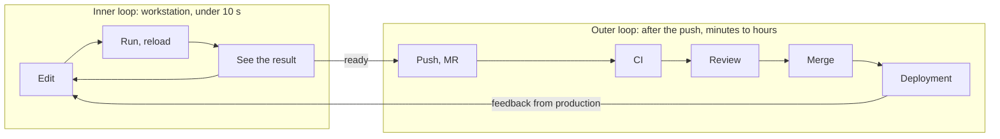
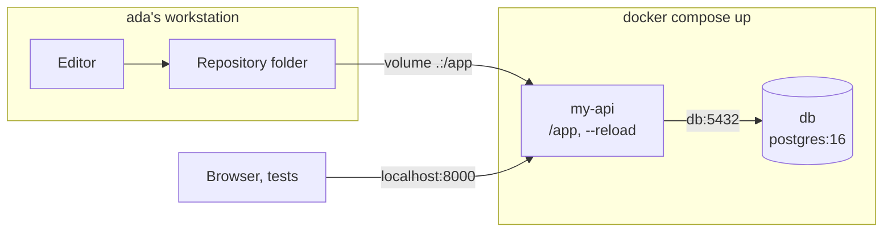
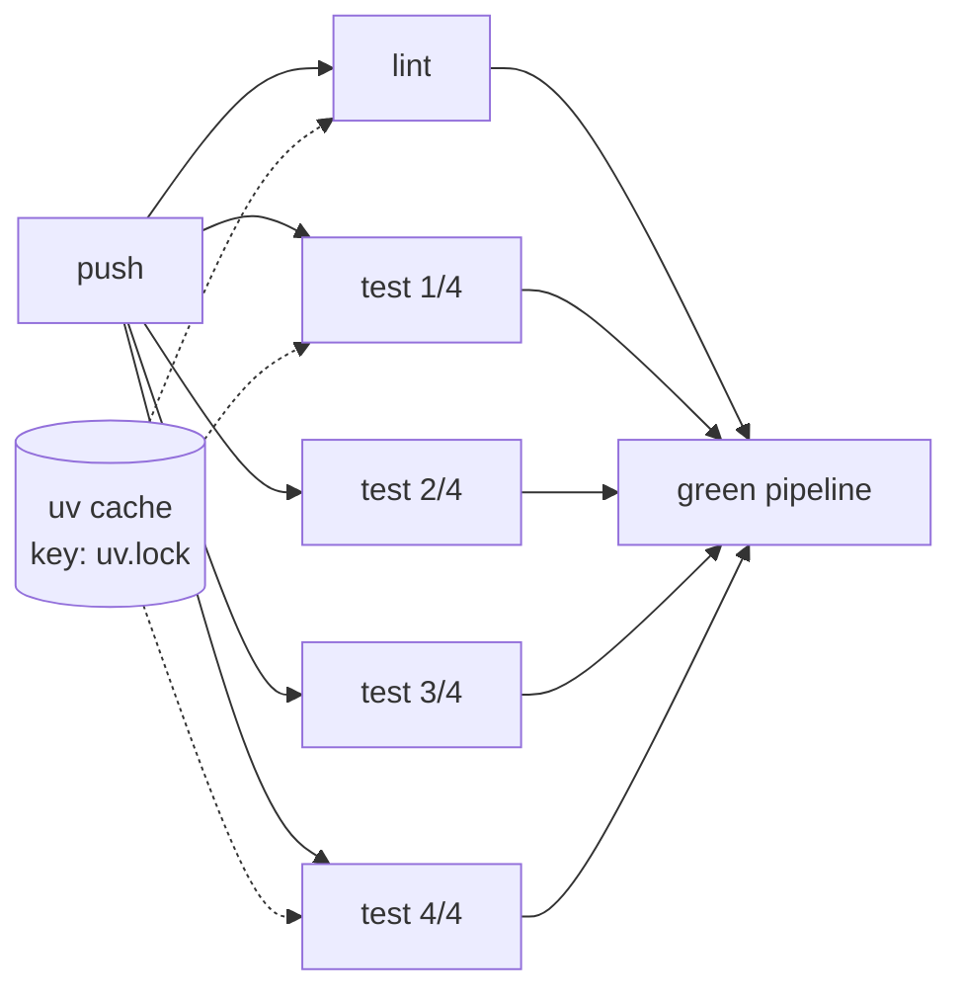
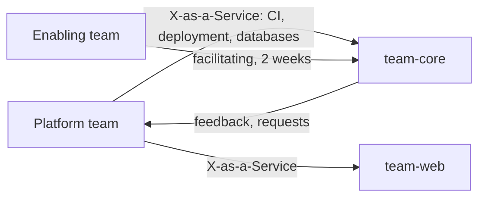
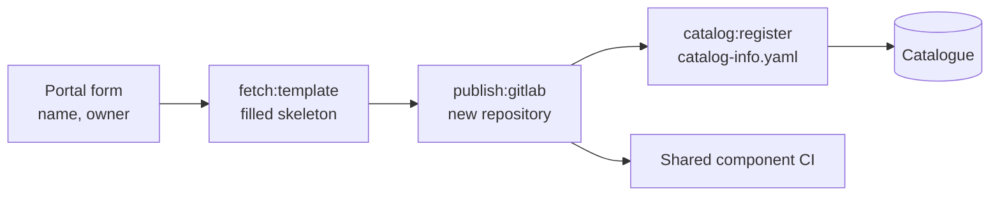
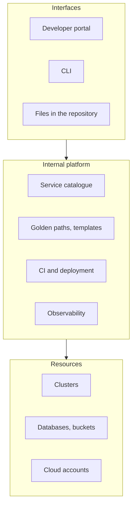
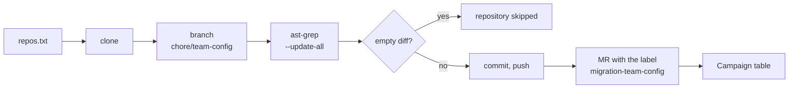
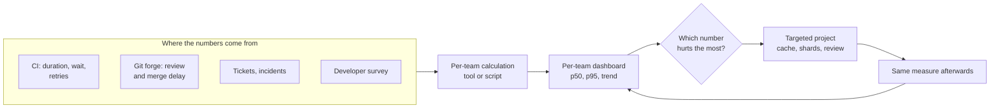

# Developer Experience and platform

!!! warning "Disclaimer"
    These notes are personal cheat sheets, not a source of truth. They reflect my own understanding and choices: their content remains subjective, despite the quotes and references it contains. It may be incomplete, simplified, inaccurate or outdated. Always check the official documentation before applying it. This content is provided as is, without any warranty: you use it at your own risk.

!!! abstract "Scales"
    The colored badges under the headings say at which scale a notion applies:

    - <span class="pill pill-scope pill-scope-code">Code</span> the classes, functions and modules of one program;
    - <span class="pill pill-scope pill-scope-app">Application</span> one service or application and its internal split;
    - <span class="pill pill-scope pill-scope-system">System</span> several services talking to each other over the network;
    - <span class="pill pill-scope pill-scope-infra">Infrastructure</span> servers, network, zones and clusters, physical or virtual;
    - <span class="pill pill-scope pill-scope-enterprise">Enterprise</span> the whole information system and its organization.

    Details and ambiguous words: [map of scales](architecture.md#map-of-scales).

<span class="term" data-term="developer-experience">Developer Experience</span> (DevX) is what developers live through while they work: the time they spend waiting, the obstacles they hit, how hard it is to find a piece of information. When it takes two days to run a project locally, or twenty minutes to know whether a test passes, the team delivers less and gets more tired. This page gathers the notions and tools that make that daily work smoother: setting up a project, shortening the wait between a change and its result, providing an internal platform, golden paths, reliable documentation, and running migrations across hundreds of repositories. The `orders-service` and `my-api` services, the `team-core` team and the people `ada` and `grace` are fictitious. Numbers are examples.

What already lives elsewhere is not repeated here: DORA metrics, SPACE and the DevEx framework are in [Delivery and engineering practices](livraison.md#measuring-developer-experience-space-and-devex), the <span class="term" data-term="mise">mise</span>, <span class="term" data-term="uv">uv</span>, Renovate and Backstage tools in the [Technical tools overview](outils.md#developer-tooling-mise-uv-ruff-yarn).

*Renovate: competes with Dependabot; complements Snyk, Trivy*<br>
*uv: competes with pip, Poetry, pdm; complements mise*
{ .tool-rel }


:material-swap-horizontal: The tools mentioned on this page: which ones replace each other, which ones combine? See [Complementary or competing](outils.md#complementary-or-competing).
{ .doc-ref }

## Terminology

**<span class="term" data-term="developer-experience">Developer experience</span> (DX or DevX)**: the way developers live their work every day, from the idea to the code in production: installing a project, understanding the code, running the tests, waiting for CI, deploying, finding the documentation.

**<span class="term" data-term="process-friction">Friction</span>**: anything that slows down or discourages a developer without adding value. Example: an 18-step README where three steps are wrong.

**<span class="term" data-term="cognitive-load">Cognitive load</span>**: the amount of things a person must keep in mind to do a task. The notion comes from the psychology of learning (John Sweller, 1988); the book "Team Topologies" (Matthew Skelton and Manuel Pais, 2019) applies it to teams. Example: having to know Kubernetes, Terraform and three cloud consoles to deploy a simple fix.

**<span class="term" data-term="flow-state">Flow state</span>** (deep focus): the deep concentration where work moves forward without apparent effort, described by Mihaly Csikszentmihalyi, "Flow" (1990). Every wait longer than a few seconds and every interruption can break it.

**<span class="term" data-term="inner-loop">Inner loop</span>**: a developer's local cycle, edit, run, see the result, repeated dozens of times an hour. **<span class="term" data-term="outer-loop">Outer loop</span>**: what happens after the push: CI, review, merge, deployment.

**<span class="term" data-term="internal-developer-platform">Internal platform</span> (IDP)**: the set of internal tools and services that let a team create, test, deploy and run a service without depending on another team. Watch out, the acronym IDP sometimes also means *Internal Developer Portal*, the website that gives access to this platform: the portal is only one interface of the platform.

**<span class="term" data-term="golden-path">Golden path</span>** (or *paved road*): the recommended, tooled way to do a common task, easier than the alternatives without being mandatory.

**<span class="term" data-term="self-service">Self-service</span>**: a team gets a resource (a database, a bucket, an environment) without opening a ticket or waiting for someone.

**<span class="term" data-term="toil">Toil</span>**: manual, repetitive, automatable work with no lasting value, which grows with the size of the system. The definition comes from the book "Site Reliability Engineering" (Google, 2016), chapter "Eliminating Toil". Example: creating by hand, on a ticket request, every new repository with its CI.

| Word | Question it asks | Example measure |
|---|---|---|
| friction | what wastes time? | 2 days between the clone and the first green test |
| cognitive load | how many things must I know? | 14 steps in the deployment guide |
| flow state | how long without interruption? | 2-hour blocks without meetings per week |
| inner loop | how many seconds to see the result? | 45 s to rerun a test |
| toil | what repeated work could disappear? | 40 "create a repository" tickets per quarter |

:material-book-open-variant: Reference docs: [Google, "Site Reliability Engineering", chapter "Eliminating Toil"](https://sre.google/sre-book/eliminating-toil/) (2016)
{ .doc-ref }

## Inner loop and outer loop

<a class="pill pill-scope pill-scope-code" href="../architecture/#map-of-scales">Scale · Code</a> <span class="pill pill-status pill-status-ok" title="Still valid, checked November 2026">Current · 11/2026</span>

The two loops have neither the same frequency nor the same acceptable duration, and I do not speed them up with the same tools. An example day for `ada` on `orders-service`:

```
inner loop (on the laptop, dozens of times an hour)
  10:00:00  ada edits calculate_total()
  10:00:01  the server reloads the code by itself
  10:00:03  pytest reruns only the failing test: green
  10:00:40  ada edits the "100% discount" case, the test passes again in 2 s

outer loop (after the push, a few times a day)
  10:42     push and MR opened
  10:43     CI: lint, tests, image, finished at 10:55
  11:30     first review by grace
  14:10     merge, automatic deployment
  14:25     in production
```



| Loop | Frequency | Target order of magnitude | What often slows it down |
|---|---|---|---|
| inner | dozens of times an hour | under 10 s per round | rebuilding an image, rerunning the whole suite, restarting services |
| outer | a few times a day | a CI of about 10 min, a review within half a day | sequential CI, flaky tests, waiting for review, manual approval |

The orders of magnitude rely on two sources: Jakob Nielsen's response time limits, "Response Times: The 3 Important Limits" (1993), where 1 s keeps the train of thought and 10 s loses attention, and Martin Fowler's "Continuous Integration" article (2000, revised in 2024), which aims for a build of about ten minutes. They are landmarks, not standards.

A second saved in the inner loop counts much more than it seems: 2 minutes of waiting per round, at 30 rounds a day, make one hour a day per person (example), and above all as many breaks in focus. In the outer loop, it is often the **waiting** (review, approval, runner queue) that weighs more than the computing: a <span class="term" data-term="value-stream-mapping">value stream map</span> shows it.

!!! noob "As noob"
    The inner loop is tasting the sauce while cooking: I do it every two minutes, so it has to be instant. The outer loop is having the head chef approve the dish before it goes out: rarer, longer, and mostly the wait for the chef is what costs. The takeaway: **in the inner loop I hunt seconds, in the outer loop I hunt waiting.**

:material-book-open-variant: Reference docs: [Jakob Nielsen, "Response Times: The 3 Important Limits"](https://www.nngroup.com/articles/response-times-3-important-limits/) (1993); [Martin Fowler, "Continuous Integration"](https://martinfowler.com/articles/continuousIntegration.html) (2000, revised in 2024)
{ .doc-ref }

## Setting up a project in one command

<a class="pill pill-scope pill-scope-app" href="../architecture/#map-of-scales">Scale · Application</a> <span class="pill pill-status pill-status-ok" title="Still valid, checked November 2026">Current · 11/2026</span>

I join a team, clone `orders-service`, and it takes two days and the help of three people to run the first test. <span class="term" data-term="project-setup">Project setup</span> is everything I must do between `git clone` and the first test passing locally. The goal: a newcomer does it alone, without asking for help, with a few commands that are the same from one repository to the next.

Three rules:

- **everything is in the repository**: tool versions in a file read by a <span class="term" data-term="tool-version-manager">version manager</span> (mise, asdf), dependencies in a <span class="term" data-term="lockfile">lockfile</span>, local services in a Docker Compose file;
- **the same command names everywhere**: `setup`, `test`, `dev`, `doctor`. This is the idea behind "Scripts to Rule Them All" (GitHub, 2015);
- **the setup is tested**: a weekly CI job replays it on a blank image, otherwise it degrades without anyone noticing.

*mise: competes with asdf; complements uv*<br>
*asdf: competes with mise*
{ .tool-rel }


A newcomer's path becomes:

```bash
git clone git@git.example.com:team-core/orders-service.git
cd orders-service
mise install
mise run setup
mise run test
```

The matching `mise.toml` file is shown in the [Technical tools overview](outils.md#developer-tooling-mise-uv-ruff-yarn). The `doctor` command checks that the laptop is ready and says how to fix what is missing, instead of an obscure error message three steps later:

```python
"""Check that the laptop can run orders-service and explain how to fix it."""

import shutil
import subprocess
import sys

# Good: each required tool comes with its fix, not an obscure error
REQUIRED_COMMANDS = {
    "docker": "install Docker, then restart the terminal",
    "uv": "run 'mise install' at the root of the repository",
}


def docker_is_running() -> bool:
    """Tell whether the Docker daemon answers."""
    result = subprocess.run(["docker", "info"], capture_output=True, check=False)
    return result.returncode == 0


# Good: returns each problem with the way to fix it
def find_problems() -> list[str]:
    """Return the list of problems found, each with its fix."""
    problems = [
        f"command '{name}' not found: {fix}"
        for name, fix in REQUIRED_COMMANDS.items()
        if shutil.which(name) is None
    ]
    if shutil.which("docker") and not docker_is_running():
        problems.append("Docker is installed but stopped: start Docker")
    return problems


def main() -> int:
    """Print the diagnosis and return 1 if the laptop is not ready."""
    problems = find_problems()
    for problem in problems:
        print(f"KO  {problem}")
    if not problems:
        print("OK  the laptop is ready, run: mise run test")
    return 1 if problems else 0


if __name__ == "__main__":
    sys.exit(main())
```

| I want... | I use... |
|---|---|
| my project needs a precise version of Python, Node or Terraform, and the whole team must have the same one, without reinstalling by hand when switching projects | mise or asdf (see the [Technical tools overview](outils.md#developer-tooling-mise-uv-ruff-yarn)) |
| I move from one repository to another and want to type the same commands everywhere, like `setup` to install and `test` to run the tests, without rereading each README | mise tasks, a `Makefile`, or `script/setup`, `script/test` scripts |
| my service needs a PostgreSQL database and other services to run locally, and I want to start everything with a single command | Docker Compose |
| my project needs system tools or native libraries on top of the language, like a database client or an image processing library, and I want to describe everything in one place | a Dev Container (see below) |
| a newcomer sees the setup fail on an obscure message and does not know what to fix, for example because Docker is installed but stopped | a `doctor` script that says what to fix |
| nobody has run the setup from scratch in months, and I want to know it is broken before the next newcomer runs into it | a CI job that replays it on a blank image |

:material-book-open-variant: Reference docs: [GitHub, "Scripts to Rule Them All"](https://github.com/github/scripts-to-rule-them-all) (2015); [mise, documentation](https://mise.jdx.dev/) (accessed November 2026)
{ .doc-ref }

### Docker Compose and code mounted through a volume

<span class="pill pill-status pill-status-ok" title="Still valid, checked November 2026">Current · 11/2026</span>


*Docker: complements Kubernetes, Helm*
{ .tool-rel }

Docker Compose describes, in a `compose.yaml` file, the <span class="term" data-term="docker">Docker</span> containers the project needs locally, and starts them together with `docker compose up`. A <span class="term" data-term="docker-volume">volume</span> links a folder on the workstation to a folder in the container: here the repository code, so a save in the editor is seen right away by the server, without rebuilding the image.

```yaml
# Example: my-api and its Postgres database, started together locally
services:
  # Good: code mounted as a volume and --reload, a save is seen right away
  my-api:
    build: .
    command: uvicorn app.main:app --host 0.0.0.0 --reload
    ports: ["8000:8000"]
    volumes:
      - .:/app
    environment:
      DATABASE_URL: postgresql://app:app@db:5432/app
    depends_on: [db]
  # Example: throwaway Postgres for the dev machine
  db:
    image: postgres:16
    environment:
      POSTGRES_USER: app
      POSTGRES_PASSWORD: app
      POSTGRES_DB: app
```



`- .:/app` mounts the repository root into `/app`; `--reload` restarts the server on every change; `my-api` reaches the database by its service name, `db`. The password is for the local workstation only. Pitfall: the volume hides what the image had installed in `/app` (a `.venv`, `node_modules`); install dependencies outside that folder, or protect them with a dedicated volume.

:material-book-open-variant: Reference docs: [Docker, Compose](https://docs.docker.com/compose/) (accessed November 2026); [Docker, Bind mounts](https://docs.docker.com/engine/storage/bind-mounts/) (accessed November 2026)
{ .doc-ref }

## Speeding up the inner loop

<a class="pill pill-scope pill-scope-code" href="../architecture/#map-of-scales">Scale · Code</a> <span class="pill pill-status pill-status-ok" title="Still valid, checked November 2026">Current · 11/2026</span>

I change one line and wait a minute to find out whether it works: after thirty tries, I have lost half an hour and my focus. Three principles shorten that wait: **run only what is touched**, **keep what is already ready**, **leave slow checks to CI**. The levers:

- <span class="term" data-term="hot-reload">hot reload</span>: the application picks up the change without restarting;
- **targeted tests**: rerun one test, the failing tests, or those linked to the changed file. When a tool picks these tests automatically from the code dependencies, it is called <span class="term" data-term="test-impact-analysis">test impact analysis</span>;
- **watch mode**: the tool reruns the relevant tests by itself on every save;
- the <span class="term" data-term="build-cache">build cache</span>: reuse a compilation or test result when its inputs have not changed;
- the <span class="term" data-term="incremental-build">incremental build</span>: recompile only the changed files and those that depend on them.

```bash
uvicorn my_api.main:app --reload
pytest -x --lf
pytest tests/test_orders.py::test_total_with_discount
npx vitest related src/cart.ts --run
npx tsc --noEmit --incremental
```

In order: the server reloads on every save; pytest reruns first the tests that failed last time and stops at the first failure; a single test; Vitest runs the tests that import `cart.ts`; TypeScript only rechecks what changed since last time. Options to check in the documentation of the version I use.

*pytest: competes with unittest; complements Testcontainers*
{ .tool-rel }


The "before" and "after" columns are measured by timing the loop itself, on the workstation: `time pytest -x --lf` for one try, or hyperfine for an average over several tries (`hyperfine 'pytest tests/test_orders.py'`). Measure the most frequent action of the day first, not the slowest one.

| Action on my-api | Before | After | Lever |
|---|---|---|---|
| edit an endpoint and see the result | 2 min (rebuild the image, restart) | 1 s | code mounted in the container, `--reload` |
| rerun the failing test | 45 s (the whole suite) | 2 s | `pytest --lf` |
| check types after a change | 20 s | 3 s | incremental build |

Example numbers. The Docker image serves CI and production; locally, the code can be mounted into the container through a volume, without rebuilding the image on every try (sample `compose.yaml` in [Docker Compose and code mounted through a volume](#docker-compose-and-code-mounted-through-a-volume)).

| I want... | I use... |
|---|---|
| I change an endpoint of `my-api` and want to see the result within a second, without restarting the server | the framework's hot reload |
| a single test failed in the whole suite, and I want to rerun only that one while I fix it | `pytest --lf`, `jest --onlyFailures` |
| I change `cart.ts` and want only the tests that depend on it to rerun on every save | a watch mode, `vitest related`, a test selection plugin |
| a small change recompiles the whole project, and I wait every time | the compiler's incremental build, a build cache |
| my end-to-end tests take several minutes and block my laptop, but I do not want to drop them | leave them to CI |

:material-book-open-variant: Reference docs: [pytest, "How to re-run failed tests and maintain state between test runs"](https://docs.pytest.org/en/stable/how-to/cache.html) (stable version, accessed November 2026); [Vitest, Command Line Interface](https://vitest.dev/guide/cli) (accessed November 2026); [hyperfine](https://github.com/sharkdp/hyperfine) (accessed November 2026)
{ .doc-ref }

## Local or remote environment

<a class="pill pill-scope pill-scope-infra" href="../architecture/#map-of-scales">Scale · Infrastructure</a> <span class="pill pill-status pill-status-ok" title="Still valid, checked November 2026">Current · 11/2026</span>

!!! info "Section written in November 2026"
    Remote environment services and their features change fast. The names given are examples, to check at the time of reading.

A <span class="term" data-term="devcontainer">Dev Container</span> is a complete development environment (image, tools, editor extensions, install commands) described by a `devcontainer.json` file in the repository, and run in a container. The *Development Containers Specification* (containers.dev, started by Microsoft, published as an open specification in 2022) lets several editors and services read the same file.

!!! noob "As noob"
    A Dev Container is a kitchen trunk delivered with its instructions: utensils, spices and setup steps are inside, and everyone opens it the same way, on their laptop or on a remote machine. No more "works on my machine" because of a different tool version. The takeaway: **the development setup is described in the repository, like the code.**

A <span class="term" data-term="remote-dev-environment">remote development environment</span> runs this workstation on a server or in the cloud; I connect to it from a local editor or a browser. Examples of this kind of tool: GitHub Codespaces, Coder, Gitpod (to check, the offer changes).

```json
{
  "name": "orders-service",
  "image": "mcr.microsoft.com/devcontainers/python:3.12",
  "features": {
    "ghcr.io/devcontainers/features/docker-in-docker:2": {}
  },
  "postCreateCommand": "pip install uv && uv sync --frozen",
  "forwardPorts": [8000]
}
```

The same file works locally (the editor starts the container on the laptop) and remotely (the service starts the container on its machines). Image and identifiers given as examples, to check.

| Criterion | Local with a version manager | Local Dev Container | Remote environment |
|---|---|---|---|
| setup | a few minutes | a few minutes, after the first image download | under a minute if the image is prebuilt |
| offline work | yes | yes | no |
| computing power | the laptop's | the laptop's | the server's, adjustable |
| sensitive data | copied to the laptop | copied to the laptop | stays in the company cloud |
| cost | nothing extra | nothing extra | billed per hour of use |
| maintenance | low | an image to keep up to date | an image and a service to run or pay for |

The rule: take the lightest option that solves the problem. <span class="term" data-term="dev-prod-parity">Dev/prod parity</span> is sought where the gaps have already caused bugs (same database engine, same language version), not by copying all of production to the laptop.

| I want... | I use... |
|---|---|
| my project only needs the right version of Python or Node, nothing else | mise or asdf |
| my project depends on several system tools and native libraries that are painful to install on every laptop | a local Dev Container |
| the data must not leave the company cloud, or the team's laptops are too weak for the project | a remote environment based on the same Dev Container |
| I want an environment reproduced exactly the same on every laptop, and my team already knows the tool that does it | <span class="term" data-term="nix">Nix</span> |

:material-book-open-variant: Reference docs: [Development Containers Specification](https://containers.dev/) (2022); [Visual Studio Code, "Developing inside a Container"](https://code.visualstudio.com/docs/devcontainers/containers) (accessed November 2026)
{ .doc-ref }

## A fast and reliable CI

<a class="pill pill-scope pill-scope-app" href="../architecture/#map-of-scales">Scale · Application</a> <a class="pill pill-scope pill-scope-infra" href="../architecture/#map-of-scales">Scale · Infrastructure</a> <span class="pill pill-status pill-status-ok" title="Still valid, checked November 2026">Current · 11/2026</span>

<a class="pill pill-dora" href="https://dora.dev/capabilities/continuous-integration/">DORA · Continuous integration</a> <a class="pill pill-dora" href="https://dora.dev/capabilities/test-automation/">DORA · Test automation</a>

I push my MR and CI takes 30 minutes: I move on to something else, and when it fails I have forgotten where I was. If on top of that it sometimes fails for no reason, the team learns to rerun without reading the error. A useful CI therefore has two qualities: it is **fast**, so the developer waits for the result without switching tasks, and **reliable**, so a red result is always real information. I measure first: pipeline duration at p50 and p95, wait before a <span class="term" data-term="runner">runner</span> is free, and the <span class="term" data-term="critical-path">critical path</span> (the chain of dependent jobs that sets the minimum duration).

The p50 (the median) is the duration under which half of the pipelines finish; the <span class="term" data-term="p95">p95</span>, the one under which 95% of them finish. Example with 10 pipelines of 8, 8, 9, 9, 9, 10, 10, 11, 12 and 28 min: the p50 is about 9.5 min, the p95 lands between 21 and 28 min depending on the calculation method, pulled entirely by the single 28 min run. The median tells what a developer usually lives through, the p95 tells what makes them switch tasks.

!!! noob "As noob"
    I think of my commute: the median is how long it takes on a normal day; the p95 is the duration I only exceed about one day in twenty, when it rains and a train is cancelled. I pick my departure time from those bad days, not from the average. The takeaway: **the p50 tells the everyday, the p95 tells what makes me miss the meeting.**

To know where the time goes, I lay a real pipeline on a timeline. The numbers come from the CI itself: the pipeline page shows each job with its wait and its duration, the GitLab jobs API gives `queued_duration` and `duration` for hundreds of runs, and the CI/CD analytics page charts pipeline duration over time. Look at the runner wait and the critical path first, and only then at the longest job.

```mermaid
gantt
    title MR pipeline, 12 min in total
    dateFormat HH:mm
    axisFormat %H:%M
    section Wait
    free runner         :done, q, 10:43, 10:45
    section Jobs
    lint                :l, 10:45, 10:47
    test 1/4            :t1, 10:45, 10:50
    test 2/4            :t2, 10:45, 10:49
    test 3/4            :t3, 10:45, 10:50
    test 4/4 critical   :crit, t4, 10:45, 10:55
```



Reading (example figures): 2 min of wait before the first job, then shard 4 alone sets the end of the pipeline, 10 min against 4 to 5 for the others. Rebalancing the shards from measured durations (`pytest --store-durations` with pytest-split) pays off more than a fifth shard, and runner wait is fixed on the capacity side, not in the tests.

The levers, in the order where they often pay off the most:

1. **remove useless waiting**: jobs that start as soon as their real dependencies are done (`needs` in GitLab CI), instead of waiting for a whole stage to finish;
2. **cache** dependencies, with the lockfile as the key, and Docker layers (<span class="term" data-term="docker-layer-cache">layer cache</span>, dependencies copied before the code);
3. **parallelise** a long test suite into <span class="term" data-term="test-shard">shards</span>;
4. **run only what is concerned**: rules on changed files, or the "affected" commands of monorepo tools, with a <span class="term" data-term="remote-build-cache">remote build cache</span>.

*GitLab CI: competes with GitHub Actions, Jenkins*
{ .tool-rel }


```yaml
# Good: shared base, uv cache keyed on the lockfile
.python:
  image: python:3.12-slim
  variables:
    UV_CACHE_DIR: .uv-cache
  cache:
    key:
      files: [uv.lock]
    paths: [.uv-cache]
  before_script:
    - pip install uv
    - uv sync --frozen

# Good: needs: [] starts the job without waiting for a whole stage
lint:
  extends: .python
  needs: []
  script: uv run ruff check .

# Good: 4 shards, run only when code, tests or the lockfile change
test:
  extends: .python
  needs: []
  parallel: 4
  script: uv run pytest --splits 4 --group "$CI_NODE_INDEX"
  rules:
    - changes: [src/**/*, tests/**/*, uv.lock]
```



`needs: []` starts `lint` and `test` at the same time; `parallel: 4` creates four jobs, and the pytest-split plugin gives each one a quarter of the tests; `rules: changes` avoids running the tests when only the documentation changes. Keywords to check for my version of GitLab and of the plugin.

Reliability matters as much as speed: a <span class="term" data-term="flaky-test">flaky test</span> teaches teams to rerun without reading. Causes and strategy (quarantine, owner, deadline) are in [Software quality and testing](qualite.md#flaky-tests-and-parallelisation). A simple indicator: the share of pipelines rerun on the same commit.

| I want... | I use... |
|---|---|
| my CI is slow and I do not know whether it is the wait for a runner, a job that is too long, or jobs waiting for each other | duration per job, runner wait, critical path |
| every pipeline downloads all dependencies again, even though the lockfile has not changed | a cache keyed on the lockfile |
| the lint job waits for a whole stage to finish although it does not need it, so the pipeline lasts longer than necessary | `needs` (GitLab CI), explicit dependencies between jobs |
| my test suite takes 15 min and alone sets the duration of the pipeline | parallel shards |
| I fix a typo in the README and the whole test suite runs again | rules on changed files, test impact analysis |
| each team has copied and tweaked its own CI, and an improvement made in one never reaches the others | a shared, versioned CI component |

:material-book-open-variant: Reference docs: [GitLab, CI/CD YAML syntax reference](https://docs.gitlab.com/ci/yaml/) (accessed November 2026); [GitLab, CI/CD analytics](https://docs.gitlab.com/user/analytics/ci_cd_analytics/) (accessed November 2026)
{ .doc-ref }

### Shared, versioned CI component

<span class="pill pill-status pill-status-ok" title="Still valid, checked November 2026">Current · 11/2026</span>

A <span class="term" data-term="versioned-component">CI component</span> is a reusable piece of pipeline (jobs, their images, their cache), kept in a single repository, published with a version number, and included by every project. The project no longer copies the jobs: it keeps one `include` line and a version. In GitLab these are CI/CD components, generally available since GitLab 17.0 (2024, to check); the GitHub equivalent is the *reusable workflow* (`uses: team-platform/ci/.github/workflows/python.yml@v1.4.0`).

A project's `.gitlab-ci.yml`:

```yaml
# Good: one include line and a version, no more copied jobs
include:
  - component: git.example.com/team-platform/ci/python@1.4.0
    inputs:
      python_version: "3.12"
```

The component repository, `team-platform/ci`:

```
team-platform/ci/
├── templates/
│   └── python.yml      the "python" component
├── .gitlab-ci.yml      tests the component, publishes a release on each tag
├── CHANGELOG.md
└── README.md
```

```yaml
# templates/python.yml
# Example: parameters the component accepts, with their default
spec:
  inputs:
    python_version:
      default: "3.12"
---
# Example: shared jobs, the Python version comes from the input
lint:
  image: python:$[[ inputs.python_version ]]-slim
  needs: []
  script:
    - pip install uv
    - uv run ruff check .

test:
  image: python:$[[ inputs.python_version ]]-slim
  needs: []
  script:
    - pip install uv
    - uv run pytest
```

The part before `---` declares the accepted parameters; `$[[ inputs.python_version ]]` is replaced at include time. Syntax to check for my GitLab version.

How a fix reaches the projects:

```
day 0   the platform team adds the uv cache to the component, tags 1.5.0
day 1   the dependency update bot (Renovate) opens an MR "python 1.4.0 -> 1.5.0" in each project
day 1   each MR's CI runs with the new version; minor version and green CI: automatic merge
day 7   the campaign table lists the projects still on 1.4.0, often those whose CI was already red
```

Pitfall: including `@main` or `~latest` avoids the MRs, but a change to the component then breaks every project on the same day, with no review and no easy rollback. A pinned version plus an automatic MR keeps both: propagation and control.

:material-book-open-variant: Reference docs: [GitLab, CI/CD components](https://docs.gitlab.com/ci/components/) (accessed November 2026)
{ .doc-ref }

## Platform engineering: the platform as a product

<a class="pill pill-scope pill-scope-infra" href="../architecture/#map-of-scales">Scale · Infrastructure</a> <a class="pill pill-scope pill-scope-enterprise" href="../architecture/#map-of-scales">Scale · Enterprise</a> <span class="pill pill-status pill-status-ok" title="Still valid, checked November 2026">Current · 11/2026</span>

<a class="pill pill-dora" href="https://dora.dev/capabilities/loosely-coupled-teams/">DORA · Loosely coupled teams</a>

Every product team has to write its own CI, configure its deployments and create its databases by hand, so it spends more time on tooling than on its product. **Platform engineering** means building an <span class="term" data-term="internal-developer-platform">internal platform</span> that product teams consume in self-service, to reduce their cognitive load. Evan Bottcher, "What I Talk About When I Talk About Platforms" (martinfowler.com, 2018), defines it as a set of services, tools and knowledge that makes teams autonomous; he insists on one point: the platform is an **internal product**, with users, a roadmap and a measure of adoption.

!!! noob "As noob"
    The internal platform is the central kitchen of a restaurant chain: each restaurant could make its own stocks and sauces, but the central kitchen delivers them ready, and each chef focuses on their dishes. If the sauces are poor or late, the chefs go back to making their own: that is why it is run as a product, with customers to satisfy. The takeaway: **a successful platform is measured by how many teams choose to use it.**

"Team Topologies" (Matthew Skelton and Manuel Pais, 2019) gives the vocabulary for teams:

| Team type | Role | Example |
|---|---|---|
| <span class="term" data-term="stream-aligned-team">stream-aligned team</span> | delivers a part of the product end to end | team-core, which owns orders-service |
| <span class="term" data-term="platform-team">platform team</span> | provides internal services in self-service | shared CI, deployment, databases on demand |
| <span class="term" data-term="enabling-team">enabling team</span> | helps a team gain a skill, then steps back | two weeks with team-core to set up contract tests |
| complicated-subsystem team | owns a component that needs rare expertise | a pricing engine |

The book also describes three interaction modes: collaboration, *X-as-a-Service* (I consume without coordinating) and facilitating. It suggests starting with the <span class="term" data-term="thinnest-viable-platform">Thinnest Viable Platform</span>: the smallest thing that really speeds teams up, sometimes a simple documentation page.



The **CNCF Platforms White Paper** (CNCF TAG App Delivery, 2023, date and list to check) describes the attributes of a good platform: treated as a product, focused on its users' experience, documented with onboarding, self-service, reducing cognitive load, optional and composable, secure by default. The same group published a platform engineering maturity model (2023, to check).

Treating the platform as a product, concretely:

- start from users' frequent tasks (deploy, roll back, create a service), not from a feature list;
- first deliver one task covered end to end;
- publish a roadmap and a feedback channel;
- measure voluntary <span class="term" data-term="adoption">adoption</span> and satisfaction: a team that works around the platform sends a product signal, not a lack of discipline.

| Situation | Choice |
|---|---|
| my company has 3 teams and a single way to deploy, which everyone already knows | no platform team: a doc page and a CI template are enough |
| a team must learn a new skill, like setting up contract tests, and nobody on it has done it before | an enabling team, for a limited time |
| many teams open the same infrastructure tickets, like "create a database" or "create a repository", and wait for someone every time | a platform team and self-service |
| the platform exists, but only 30% of services use it and the others keep doing things their own way | go and see the teams that do not use it, before adding features |

:material-book-open-variant: Reference docs: [Evan Bottcher, "What I Talk About When I Talk About Platforms"](https://martinfowler.com/articles/talk-about-platforms.html) (2018); [CNCF TAG App Delivery, "Platforms White Paper"](https://tag-app-delivery.cncf.io/whitepapers/platforms/) (2023, to check)
{ .doc-ref }

## Golden paths and templates

<a class="pill pill-scope pill-scope-app" href="../architecture/#map-of-scales">Scale · Application</a> <a class="pill pill-scope pill-scope-infra" href="../architecture/#map-of-scales">Scale · Infrastructure</a> <span class="pill pill-status pill-status-ok" title="Still valid, checked November 2026">Current · 11/2026</span>

A <span class="term" data-term="golden-path">golden path</span> covers a common task end to end: for example "create a Python HTTP service and deploy it", with a repository template, ready CI, deployment, dashboards and basic alerts. The term was popularised by Spotify Engineering, "How We Use Golden Paths to Solve Fragmentation in Our Software Ecosystem" (2020); Netflix speaks of a *paved road* (date to check). The path can be left: a team may step off it, but then takes on the <span class="term" data-term="cost-of-difference">cost of its difference</span> (its CI, its updates, its on-call documentation).

!!! noob "As noob"
    The golden path is the marked, maintained trail to the most visited summit: I can always cut through the woods, but then I carry my own map, water and rescue plan. The takeaway: **the official path is the easiest one, not the only one allowed.**

<span class="term" data-term="scaffolding">Scaffolding</span> generates a project's initial structure from a template. Its trap is <span class="term" data-term="template-drift">template drift</span>: each project keeps the choices of the day it was created, and the new template version never reaches it. Two remedies:

- **a thin template**: the minimum in the template, the maximum in shared, versioned building blocks ([CI component](#shared-versioned-ci-component), base image, configuration library), which are updated through a version bump;
- **a tool that can update**: <span class="term" data-term="copier">Copier</span> records the template version in the project and reapplies its changes with `copier update`; cruft does the same for cookiecutter.

**Backstage Software Templates**: in the Backstage portal, a form starts the generation, creates the repository and registers it in the catalogue. A template is a YAML file that describes the requested parameters and the steps:

```yaml
# Example: Backstage template, parameters asked in the form
apiVersion: scaffolder.backstage.io/v1beta3
kind: Template
metadata:
  name: python-http-service
  title: Python HTTP service
spec:
  owner: team-platform
  type: service
  parameters:
    - title: The service
      required: [name, owner]
      properties:
        name:
          type: string
        owner:
          type: string
  # Example: copies the skeleton, creates the repo, registers it in the catalog
  steps:
    - id: fetch
      action: fetch:template
      input:
        url: ./skeleton
        values:
          name: ${{ parameters.name }}
          owner: ${{ parameters.owner }}
    - id: publish
      action: publish:gitlab
      input:
        repoUrl: git.example.com?owner=team-core&repo=${{ parameters.name }}
    - id: register
      action: catalog:register
      input:
        repoContentsUrl: ${{ steps.publish.output.repoContentsUrl }}
        catalogInfoPath: /catalog-info.yaml
```



Action and field names to check in the documentation of the Backstage version I use.

| Element | In the template | In a shared, versioned building block |
|---|---|---|
| folder structure, first test | yes | no |
| CI pipeline | one `include` line | the CI component |
| logging and metrics configuration | no | a small internal library |
| base image | its reference | the image itself, rebuilt and published |
| catalogue file | yes, prefilled | no |

| I want... | I use... |
|---|---|
| a team wants to create a new service that already follows the rules (CI, logs, alerts) in a few minutes, not in three weeks | a golden path with a creation form |
| services created two years ago kept the old CI and do not receive the fixes made since in the template | a thin template and versioned blocks, updated by automatic MRs |
| I prefer to generate a project from my terminal, and to be able to update it later when the template changes | Copier, or cookiecutter with cruft |
| I want people to create their service by filling in a form in the portal, without touching the command line | Backstage Software Templates |
| a team has a good reason to leave the path, for example a service written in another language than the template's | a written exception, with what remains mandatory and what it takes on |

:material-book-open-variant: Reference docs: [Spotify Engineering, "How We Use Golden Paths to Solve Fragmentation in Our Software Ecosystem"](https://engineering.atspotify.com/2020/08/how-we-use-golden-paths-to-solve-fragmentation-in-our-software-ecosystem/) (2020); [Backstage, Software Templates](https://backstage.io/docs/features/software-templates/) (accessed November 2026)
{ .doc-ref }

## Developer portal and catalogue

<a class="pill pill-scope pill-scope-enterprise" href="../architecture/#map-of-scales">Scale · Enterprise</a> <span class="pill pill-status pill-status-ok" title="Still valid, checked November 2026">Current · 11/2026</span>

A <span class="term" data-term="developer-portal">developer portal</span> is a single internal site that gathers services, their owners, their documentation and common actions (create a service, see the CI status). Its core is the <span class="term" data-term="service-catalog">service catalogue</span>: the list of all components, with their owning team, their dependencies and their useful links. Backstage and its `catalog-info.yaml` file are presented in the [Technical tools overview](outils.md#collaboration-jira-confluence-slack-backstage).

The portal is an **interface** of the platform, not the platform itself: if deploying still means opening a ticket and waiting for someone, a nice portal on top saves no time. The order that often works:

1. a catalogue file in each repository, added by an automatic MR and checked by CI (does the owner exist?);
2. a page generated from these files, or a minimal portal;
3. only then, creation templates, built-in documentation, plugins.



A wrong catalogue is worse than no catalogue: it sends the incident alert to a team that no longer exists. The data must therefore come from the repositories and be checked automatically, not typed into a spreadsheet.

| Question with no answer today | What the catalogue provides |
|---|---|
| "who owns this service?" | the `owner` field, checked by CI |
| "who calls this API before I change it?" | the `providesApis` and `consumesApis` relations |
| "where are the docs, the dashboard?" | the component's links |
| "which services are orphaned or obsolete?" | lifecycle and owner, filterable |

| I want... | I use... |
|---|---|
| an alert goes off at night and nobody knows which team owns the service | one catalogue file per repository, checked by CI |
| newcomers do not know where to find the list of services, their docs and their dashboards | a portal, once the catalogue is reliable |
| I want a portal, but my team has no time to build and maintain one more application | a commercial portal or a generated page that reads the same files |

Backstage is open source but remains an application to develop and maintain.

:material-book-open-variant: Reference docs: [Backstage, Software Catalog](https://backstage.io/docs/features/software-catalog/) (accessed November 2026); [internaldeveloperplatform.org](https://internaldeveloperplatform.org/) (accessed November 2026)
{ .doc-ref }

## Documentation

<span class="pill pill-status pill-status-ok" title="Still valid, checked November 2026">Current · 11/2026</span>

<a class="pill pill-dora" href="https://dora.dev/capabilities/documentation-quality/">DORA · Documentation quality</a>

My team has a wiki nobody updates: the code changes, the page stays, and it ends up giving wrong instructions. **<span class="term" data-term="docs-as-code">Docs as code</span>** fixes this: technical documentation is written in Markdown in the repository, changed in the same MR as the code, reviewed, then published by CI (with MkDocs, for example). It therefore gets the same tools and the same review as the code. The practice was popularised by the Write the Docs community in the 2010s (date to check).

<span class="term" data-term="diataxis">Diátaxis</span> (Daniele Procida, presented from about 2017, site diataxis.fr, date to check) separates four types of documentation, each for one reader need. A page that mixes all four serves no reader well.

!!! noob "As noob"
    I think of cooking: the step-by-step recipe for a beginner (tutorial), the card on "rescuing a split mayonnaise" (how-to guide), the table of cooking times (reference) and the article on the chemistry of emulsions (explanation). Each one serves a different moment, and a text mixing all four loses everyone. The takeaway: **before writing, pick which of the reader's four needs I am serving.**

| Type | The reader wants... | Typical question on orders-service |
|---|---|---|
| tutorial | to learn by doing | "I am new, how do I make a first change?" |
| how-to guide | to accomplish a precise task | "how do I deploy to production?" |
| reference | to check a piece of information | "which variable sets the timeout?" |
| explanation | to understand a choice | "why a message queue here?" |

<figure class="diagram"><svg viewBox="0 0 220 160" role="img" aria-label="The four Diátaxis types"><rect class="layer layer-2" x="50" y="10" width="80" height="60"/><rect class="layer layer-1" x="130" y="10" width="80" height="60"/><rect class="layer layer-1" x="50" y="70" width="80" height="60"/><rect class="layer layer-2" x="130" y="70" width="80" height="60"/><text x="90" y="43" text-anchor="middle" class="label-strong">tutorial</text><text x="170" y="43" text-anchor="middle" class="label-strong">how-to guide</text><text x="90" y="103" text-anchor="middle" class="label-strong">explanation</text><text x="170" y="103" text-anchor="middle" class="label-strong">reference</text><text x="45" y="43" text-anchor="end">action</text><text x="45" y="103" text-anchor="end">cognition</text><text x="90" y="145" text-anchor="middle">study</text><text x="170" y="145" text-anchor="middle">work</text></svg><figcaption>The four Diátaxis types (Daniele Procida)</figcaption></figure>

```text
orders-service/
├── mkdocs.yml
└── docs/
    ├── index.md
    ├── tutorials/
    │   └── first-change.md
    ├── how-to/
    │   └── deploy-to-production.md
    ├── reference/
    │   ├── configuration.md
    │   └── api.md
    └── explanation/
        └── why-a-queue.md
```

What to measure: the most read pages, searches with no result, the date of last change, and the questions that keep coming back in chat channels. A wrong page does more damage than a missing one: fix it or delete it.

| I want... | I use... |
|---|---|
| my docs still tell people to run a command removed months ago, because nobody thinks of updating them when the code changes | docs as code: Markdown in the repository, published by CI |
| my pages mix the step-by-step guide for beginners, the list of variables and the explanation of choices, and nobody finds what they are looking for | the four Diátaxis types |
| my API docs list fields that no longer exist, or miss the new ones | a reference generated from the OpenAPI schema |
| people ask me the same question every week in the help channel, like "how do I deploy to production?" | one page per frequent question, then answer with a link |

:material-book-open-variant: Reference docs: [Daniele Procida, Diátaxis](https://diataxis.fr/) (publication date not given); [Write the Docs, "Docs as Code"](https://www.writethedocs.org/guide/docs-as-code/) (accessed November 2026)
{ .doc-ref }

## Onboarding

<span class="term" data-term="onboarding">Onboarding</span> is how a newcomer joins: access, laptop, tools, first tasks. If ada waits several days for her access, then struggles to start her first project, she feels useless, and the team does not know where things get stuck. Two simple indicators show it:

- the **time to first commit** (or first MR opened): it mostly measures access and project setup;
- the <span class="term" data-term="time-to-first-change">time to first change in production</span>: it measures the whole chain, review and deployment included.

These indicators are common in DevX experience reports, with no single reference source. Complete them with the newcomer's feeling after 30 days.

| Day | Step | Measure |
|---|---|---|
| D-5 | accounts and access created from the team profile, automatically | access ready on D1 (yes or no) |
| D1 | laptop set up by script, first project started in one command | time to first green test |
| D2 | a small real task, labelled "first ticket", paired with ada | MR opened |
| D3 | MR merged and deployed | time to first change in production |
| D30 | five questions and a <span class="term" data-term="retrospective">retrospective</span> | blockers mentioned, feeling |

Example path. Each blocker noted becomes a ticket, and the newcomer fixes the documentation that blocked them: they are best placed to see what is missing.

| I want... | I use... |
|---|---|
| a newcomer spends their first day waiting for accounts and access | access profiles per team, requested automatically |
| a newcomer must be able to start their first project alone, without asking for help at every step | one-command setup, with `doctor` |
| I want a newcomer to contribute to real code quickly, for example a small fix merged in their first week | a "first ticket" label on small real tasks |
| I improved onboarding and want to know whether the next newcomers really get up to speed faster | time to first change, arrival after arrival |

## Large-scale migrations

<a class="pill pill-scope pill-scope-code" href="../architecture/#map-of-scales">Scale · Code</a> <a class="pill pill-scope pill-scope-enterprise" href="../architecture/#map-of-scales">Scale · Enterprise</a> <span class="pill pill-status pill-status-ok" title="Still valid, checked November 2026">Current · 11/2026</span>

Moving 300 repositories to a new Python version, retiring an internal library used by 60 services: at this scale, a migration is a **programme**, not an instruction sent by email. Three tools:

- the <span class="term" data-term="codemod">codemod</span>: a program that rewrites code automatically while understanding its structure (libcst for Python, OpenRewrite for Java, jscodeshift for JavaScript; creation dates to check). For common cases, existing tools are enough: `pyupgrade`, or ruff rules with `--fix`. Full example [below](#codemod-example-changing-an-import-in-48-repositories);
- the <span class="term" data-term="dependency-update-bot">dependency update bot</span> (Renovate, Dependabot): it automatically opens MRs for each new version of a dependency, an image or a CI component;
- the <span class="term" data-term="migration-campaign">campaign</span>: a public table that tracks each repository (MR opened, CI green, merged).

*Dependabot: competes with Renovate*<br>
*ruff: replaces flake8, black; complements mypy*
{ .tool-rel }


An example Renovate configuration: automatic merge of patches and minor versions when CI is green, human review for major versions.

```json
{
  "extends": ["config:recommended"],
  "packageRules": [
    {
      "matchUpdateTypes": ["minor", "patch"],
      "automerge": true
    },
    {
      "matchUpdateTypes": ["major"],
      "labels": ["breaking-change"]
    }
  ]
}
```

Preset and option names to check in the Renovate documentation.

<span class="term" data-term="deprecation">Deprecation</span> happens in announced steps. <span class="term" data-term="hyrum-law">Hyrum's law</span> (Hyrum Wright, stated around 2012, popularised by "Software Engineering at Google", Titus Winters, Tom Manshreck and Hyrum Wright, 2020) reminds that with enough users, every observable behaviour is used by someone: the inventory of usages comes first.

!!! noob "As noob"
    I move the kitchen light switch ten centimetres: the lease says nothing about it, but someone used to reach for it in the dark and will now fumble around. Software used by many people always has someone relying on a detail nobody promised (a sort order, an error message, a delay). The takeaway: **before removing something, find out who actually uses it, not just what the documentation says.**

```
month 0     announcement, migration guide, warning on every import of legacy-config
month 1     codemod and automatic MRs in the 48 services that only use 2 functions
month 2     lint rule: no new usage accepted
month 3-5   direct support for the 12 remaining services
month 6     archiving: the library is no longer published
```

Example schedule. The end of the campaign is always the longest part: the last repositories are the most unusual. The team retiring a tool carries a good share of the migration cost, otherwise it does not move (chapters "Large-Scale Changes" and "Deprecation" of Google's book, 2020).

| I want... | I use... |
|---|---|
| my repositories use dozens of dependencies and Docker images, and nobody can follow their new versions by hand | Renovate or Dependabot |
| I must make the same code change in 300 repositories, like replacing an import, without doing it all by hand | a codemod, then one MR per repository, in waves |
| I want to retire an old tool, but I do not know which services still use it | a code search across all repositories, call logs |
| during the migration, new services start using the old tool, so the list to migrate grows instead of shrinking | a warning, then a lint rule |
| I do not want a team to find out on shutdown day that its service depended on the retired tool | a public schedule, steps, a campaign table |

:material-book-open-variant: Reference docs: [Renovate, documentation](https://docs.renovatebot.com/) (accessed November 2026); [Titus Winters et al., "Software Engineering at Google", chapter "Large-Scale Changes"](https://abseil.io/resources/swe-book/html/ch22.html) (2020)
{ .doc-ref }

### Codemod example: changing an import in 48 repositories

The services must move from the `legacy_config` library to `team_config`, which exposes the same `load` function.

```python
# before
from legacy_config import load

# What changes: same load function, imported from team_config
from team_config import load
```

An <span class="term" data-term="ast-grep">ast-grep</span> rule makes the replacement by reading the structure of the code, not its text: it ignores comments and strings that would contain the same words, and tolerates spacing variations.

!!! noob "As noob"
    `sed` looks for letters, like a word processor's "find and replace"; ast-grep reads sentences, like a proofreader who can tell a verb from a noun. So it replaces the import of `legacy_config`, not the word `legacy_config` lying around in a comment. The takeaway: **the more the shape of the code to change varies, the more I need a tool that understands its structure.**

```yaml
# rules/legacy-config.yml
# Example: ast-grep rule rewriting the import, whatever names are imported
id: legacy-config-import
language: python
rule:
  pattern: from legacy_config import $$$NAMES
fix: from team_config import $$$NAMES
```

For a case this simple, `sed` is often enough: `git ls-files '*.py' | xargs sed -i 's/^from legacy_config import /from team_config import /'` (GNU sed; on macOS, `sed -i ''`). As soon as the shape varies (`import legacy_config as cfg`, then `cfg.load()`), I need a real codemod, in libcst for example.

The loop that applies the rule and opens one MR per repository, from a `repos.txt` list (`team-core/orders-service`, `team-core/payments-service`...):

```bash
# Example: for each repo in repos.txt, applies the rule and opens an MR
RULE="$PWD/rules/legacy-config.yml"
while read -r repo; do
  (
    git clone --depth 1 "git@git.example.com:$repo.git" "work/$repo" && cd "work/$repo" || exit 1
    git switch -c chore/team-config
    ast-grep scan --rule "$RULE" --update-all
    git diff --quiet && exit 0
    git commit -am "refactor: import load from team_config"
    git push -u origin chore/team-config
    glab mr create --fill --label migration-team-config --yes
  )
done < repos.txt
```



A repository with no change is skipped; the shared label feeds the campaign table. ast-grep and glab options to check in their documentation. Beyond a few dozen repositories, dedicated tools run the same loop with tracking and retry on error (multi-gitter, Sourcegraph Batch Changes; to check).

:material-book-open-variant: Reference docs: [ast-grep, documentation](https://ast-grep.github.io/) (accessed November 2026); [LibCST, documentation](https://libcst.readthedocs.io/) (accessed November 2026)
{ .doc-ref }

## Measuring without monitoring people

<span class="pill pill-status pill-status-ok" title="Still valid, checked November 2026">Current · 11/2026</span>

<a class="pill pill-dora" href="https://dora.dev/capabilities/job-satisfaction/">DORA · Job satisfaction</a> <a class="pill pill-dora" href="https://dora.dev/capabilities/well-being/">DORA · Well-being</a>

The measurement frameworks (<span class="term" data-term="dora-metrics">DORA metrics</span>, SPACE, DevEx) are presented in [Delivery and engineering practices](livraison.md#measuring-developer-experience-space-and-devex). What matters on the DevX side is how to use them:

- **measure teams and systems, never people**: as soon as a number is used to judge someone, it gets gamed, this is <span class="term" data-term="goodhart-law">Goodhart's law</span>;
- **cross two sources**: what tools record (CI duration, review delay) and what developers say in a survey;
- **few indicators, each linked to a possible decision**;
- **a public charter**: what is measured, what it is for, what is off limits.

A useful <span class="term" data-term="developer-survey">developer survey</span> is short (under ten minutes), repeated with the same questions, anonymous with an <span class="term" data-term="anonymity-threshold">anonymity threshold</span> (no group with fewer than 5 answers is shown, for example), and followed by a published summary with the actions decided. A survey with no follow-up makes the answers to the next one drop.

| Indicator | Level | Source | What it helps decide |
|---|---|---|---|
| CI duration at p95 | repository, CI template | CI | invest in caching or shards |
| time to first review | team | Git forge | set up a reviewer rotation |
| time to first green test | repository | timing, newcomer | fix the project setup |
| "I get CI results fast enough" (out of 5) | team, at least 5 answers | survey | confirm the gain is felt |
| commits or lines per person | never | none | nothing: refuse it |

| I want... | I use... |
|---|---|
| my management wants to know whether the team's delivery improves from one quarter to the next | the team's DORA metrics, compared with itself |
| I want to know what really bothers developers day to day, beyond what the tools show | a short, regular survey, plus interviews |
| my team spent a month speeding up CI and must show it was worth it | a baseline, then the same measure afterwards |
| someone asks me for a ranking of developers, for example by number of commits | a reasoned refusal and a proposal of team-level measures |

The full loop, from the source of a number to the measure after the project:



**Tooling the measurement.** Computing DORA metrics by hand in a spreadsheet lasts a few weeks. An **<span class="term" data-term="engineering-metrics-platform">engineering metrics platform</span>** automatically collects data from the Git forge, the CI, the ticket tracker and incidents, and computes the indicators per team. Apache DevLake (open source project of the Apache foundation, incubating, to check) is the self-hosted option; there are commercial products (LinearB, Swarmia, DX, for example).

- **When**: once the indicators are chosen and tied to decisions, and manual computation becomes the bottleneck. Not before: a dashboard with no question to answer turns into a surveillance tool.
- **Why**: numbers computed the same way for every team, with no manual entry, and a baseline available before every initiative.
- **How**: plug the sources one at a time, define what a "deployment" and an "incident" are for the tool (that is where numbers go wrong), display per team only, and publish the charter before the first dashboard.

:material-book-open-variant: Reference docs: [Forsgren et al., "The SPACE of Developer Productivity", ACM Queue](https://queue.acm.org/detail.cfm?id=3454124) (2021); [Noda et al., "DevEx: What Actually Drives Productivity", ACM Queue](https://queue.acm.org/detail.cfm?id=3595878) (2023)
{ .doc-ref }

## AI coding assistants

<a class="pill pill-scope pill-scope-code" href="../architecture/#map-of-scales">Scale · Code</a> <span class="pill pill-status pill-status-ok" title="Still valid, checked November 2026">Current · 11/2026</span>

!!! info "Section written in November 2026"
    Tools, their terms of use and studies on their effects change very fast. To check at the time of reading.

An <span class="term" data-term="ai-coding-assistant">AI coding assistant</span> joins the DevX tooling like any other tool: a frame (data sent, secrets, accounts), a measured pilot, training in effective uses, and the same rules as before (all merged code is reviewed and passes CI). The concepts (context, agents, skills, MCP) are in [AI: agents, skills and context](ia-agents.md), measuring team usage in [AI in the enterprise](ia-entreprise.md#measuring-ai-assistant-usage-in-a-team).

Two points specific to DevX:

- **what helps humans helps agents**: one-command setup, fast and targeted tests, an instruction file in the repository (`AGENTS.md`, `CLAUDE.md`) that says how to run the tests. An agent that can check its work in a few seconds stays wrong for less time;
- **measure on the flow, not on activity**: the suggestion <span class="term" data-term="acceptance-rate">acceptance rate</span> comes from the vendor and says nothing about the value delivered.

| Study | Result | Source reliability |
|---|---|---|
| Sida Peng et al., "The Impact of AI on Developer Productivity: Evidence from GitHub Copilot" (2023) | about 55% faster on a short, isolated task | [Take with caution: preprint, a single task, authors linked to the vendor] |
| METR, "Measuring the Impact of Early-2025 AI on Experienced Open-Source Developer Productivity" (July 2025) | 19% slower on real tasks, while developers believed they were faster | [Take with caution: 16 developers, early-2025 tools, specific context] |

| I want... | I use... |
|---|---|
| my company just bought an AI coding assistant and wants to roll it out to every team | a written frame, a pilot with a baseline, training |
| someone asks me whether the assistant really makes the team deliver faster, beyond the vendor's numbers | lead time, change failure rate, MR size, survey, with a comparison group |
| I want the AI agents that change my repository to make fewer mistakes and check their own work | the same levers as for humans, plus an instruction file |

:material-book-open-variant: Reference docs: [METR, "Measuring the Impact of Early-2025 AI on Experienced Open-Source Developer Productivity"](https://metr.org/blog/2025-07-10-early-2025-ai-experienced-os-dev-study/) (July 2025); [Sida Peng et al., "The Impact of AI on Developer Productivity: Evidence from GitHub Copilot"](https://arxiv.org/abs/2302.06590) (2023)
{ .doc-ref }

## Pitfalls to avoid

- **Setup never replayed**: I leave the project setup untested, it decays without anyone noticing, and the next newcomer spends two days stuck on a wrong step; I have a weekly CI job replay it on a blank image ([see the setup](#setting-up-a-project-in-one-command)).
- **Volume hiding the dependencies**: I mount the repository in `/app` without realising the volume hides the `.venv` or `node_modules` the image installed, so the application no longer finds its dependencies; I install dependencies outside that folder, or protect them with a dedicated volume ([see Docker Compose](#docker-compose-and-code-mounted-through-a-volume)).
- **Speeding up the wrong job**: I shorten the longest job without looking at runner wait time or the critical path, so the pipeline gains almost nothing; I first lay a real pipeline on a timeline, then fix the wait, the cache and the shard balance ([see CI](#a-fast-and-reliable-ci)).
- **Tolerated flaky tests**: I let tests fail at random, the team learns to rerun without reading the error, and a real red goes unnoticed; I quarantine those tests with an owner and a deadline, and I track the share of pipelines rerun on the same commit.
- **Component included at `@main`**: I include the CI component without a pinned version to avoid MRs, and a single change breaks every project on the same day, with no review and no easy rollback; I pin the version and let a bot open the version bump MRs ([see the CI component](#shared-versioned-ci-component)).
- **Thick template**: I put the whole CI and configuration in the template, and each project stays frozen on its creation day, never receiving the fixes; I keep a thin template and shared, versioned building blocks ([see golden paths](#golden-paths-and-templates)).
- **Portal before a reliable catalogue**: I build a nice portal while deploying still takes a ticket, or I fill the catalogue by hand, and the incident alert goes to a team that no longer exists; I make the data come from the repositories, checked by CI, and the portal comes afterwards ([see the portal](#developer-portal-and-catalogue)).
- **Measuring individuals**: I accept a ranking of developers by commit count, the numbers become a target and get gamed; I measure teams and systems, cross tools with a survey, and publish a charter ([see measuring](#measuring-without-monitoring-people)).

## What interviews ask

The typical questions:

- "How would you measure a team's developer experience?", "What do you answer if you are asked to rank developers by commit count?" How I answer: I cross what the tools record with a short survey, and I measure teams, never individuals ([Measuring without monitoring people](#measuring-without-monitoring-people)).
- "Our CI takes 30 minutes, where do you start?" How I answer: I measure p50, p95, runner wait time and the critical path before touching the jobs, then I mention `needs`, the cache keyed on the lockfile and shards ([A fast and reliable CI](#a-fast-and-reliable-ci)).
- "A newcomer takes two days to run the tests, what do you do?" How I answer: I describe a one-command setup with `doctor`, replayed by CI, and time to first production change as the measure ([Setting up a project](#setting-up-a-project-in-one-command), [Onboarding](#onboarding)).
- "What is an internal platform, and when do you create a platform team?", "Golden path or mandatory rule?" How I answer: I talk about a platform treated as a product, voluntary adoption, the thinnest viable platform, and a paved path a team can leave by taking on the cost of its difference ([Platform engineering](#platform-engineering-the-platform-as-a-product), [Golden paths](#golden-paths-and-templates)).
- "How do you move 300 repositories to a new version without spending a year on it?" How I answer: I mention the codemod, MRs in waves, the update bot, the campaign board and Hyrum's law for the inventory of usages ([Large-scale migrations](#large-scale-migrations)).
- "How would you roll out an AI coding assistant to the teams?" How I answer: I propose a written framework, a pilot measured on flow rather than on acceptance rate, and the same review and CI rules ([AI coding assistants](#ai-coding-assistants)).

What makes a good answer: start from a measured wait (seconds, minutes, days) before suggesting a tool, and say what I would refuse to measure.

## What to use in which situation

| Situation | I use |
|---|---|
| a newcomer needs two days to run the tests of their first project, and has to ask for help at every step | versions in the repository, one-command `setup` and `doctor`, tested by CI |
| every time I change a line locally, I wait two minutes to see the result | hot reload, targeted tests, incremental build |
| my project depends on native libraries that are hard to install, or its data must not leave the cloud | a Dev Container, locally or in a remote environment |
| my CI takes 30 minutes, so every developer switches tasks while waiting for the result | critical path measurement, `needs`, cache keyed on the lockfile, shards |
| developers rerun red pipelines "just to see", without reading the error, because some tests fail at random | flaky test detection, quarantine with an owner |
| the infrastructure team gets the same tickets every week, like "create a database" or "create a repository" | a platform team, self-service with guardrails |
| a team needs three weeks to create a new service ready for production | a golden path with a thin template and versioned blocks |
| services generated long ago kept the old CI and no longer receive fixes | Copier or cruft, and shared components updated by Renovate |
| an alert comes in and nobody knows which team the service belongs to | one catalogue file per repository, checked by CI, then a portal |
| people ask me the same questions every week in the help channel | docs as code, Diátaxis, one page per frequent question |
| I must move 300 repositories to a new version, like a new Python version | codemod, MRs in waves, campaign table |
| I want to retire a tool, but services still use it | inventory, deprecation schedule, migration carried by the retiring team |
| management wants an individual ranking of developers, for example by number of commits | team and system measures, survey, public charter |
| an AI assistant was just bought for every developer, and I am expected to make it save time | a pilot measured on the flow, same review and CI rules |

## Sources

- John Sweller, "Cognitive Load During Problem Solving: Effects on Learning", Cognitive Science (1988)
- Mihaly Csikszentmihalyi, "Flow: The Psychology of Optimal Experience" (1990)
- [Jakob Nielsen, "Response Times: The 3 Important Limits" (1993)](https://www.nngroup.com/articles/response-times-3-important-limits/)
- [Martin Fowler, "Continuous Integration" (2000, revised in 2024)](https://martinfowler.com/articles/continuousIntegration.html)
- [Adam Wiggins, "The Twelve-Factor App" (2011)](https://12factor.net/)
- [GitHub, "Scripts to Rule Them All" (2015)](https://github.com/github/scripts-to-rule-them-all)
- Betsy Beyer et al., "Site Reliability Engineering" (Google, 2016), chapter "Eliminating Toil"
- [Evan Bottcher, "What I Talk About When I Talk About Platforms" (2018)](https://martinfowler.com/articles/talk-about-platforms.html)
- Matthew Skelton and Manuel Pais, "Team Topologies" (2019)
- [Spotify Engineering, "How We Use Golden Paths to Solve Fragmentation in Our Software Ecosystem" (2020)](https://engineering.atspotify.com/2020/08/how-we-use-golden-paths-to-solve-fragmentation-in-our-software-ecosystem/)
- Titus Winters, Tom Manshreck and Hyrum Wright, "Software Engineering at Google" (2020), chapters "Deprecation" and "Large-Scale Changes"
- [Development Containers Specification (2022)](https://containers.dev/)
- [CNCF TAG App Delivery, "Platforms White Paper" (2023, to check)](https://tag-app-delivery.cncf.io/whitepapers/platforms/)
- [Daniele Procida, Diátaxis (publication date not stated, from about 2017)](https://diataxis.fr/)
- [Backstage, Software Templates documentation (read in November 2026)](https://backstage.io/docs/features/software-templates/)
- [Renovate, documentation (read in November 2026)](https://docs.renovatebot.com/)
- [Noda et al., "DevEx: What Actually Drives Productivity", ACM Queue (2023)](https://queue.acm.org/detail.cfm?id=3595878)
- [Sida Peng et al., "The Impact of AI on Developer Productivity: Evidence from GitHub Copilot" (2023)](https://arxiv.org/abs/2302.06590)
- [METR, "Measuring the Impact of Early-2025 AI on Experienced Open-Source Developer Productivity" (July 2025)](https://metr.org/blog/2025-07-10-early-2025-ai-experienced-os-dev-study/)
