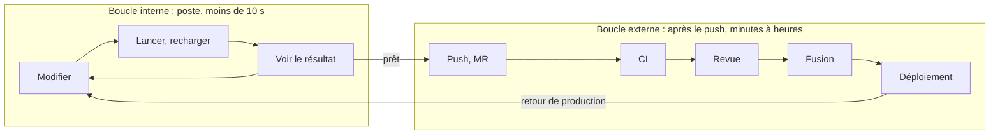
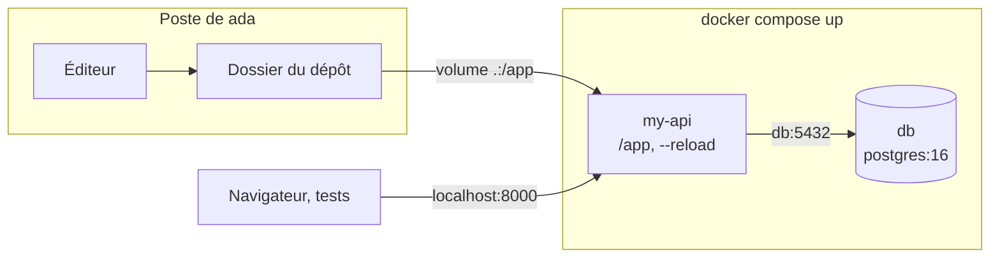
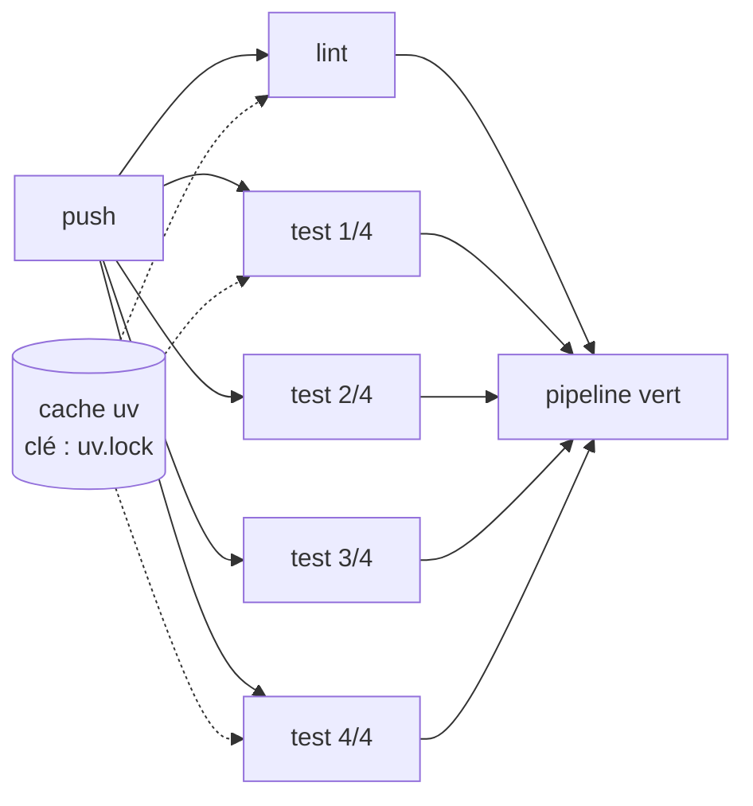
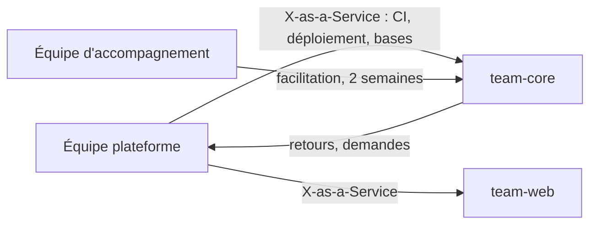
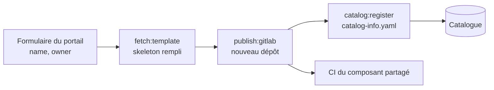
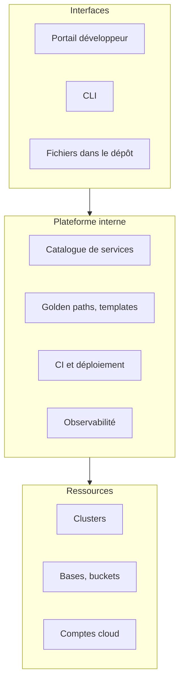
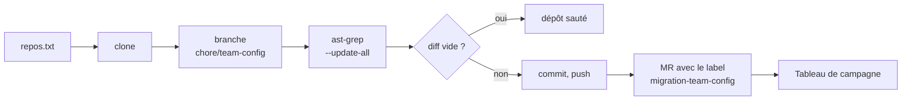
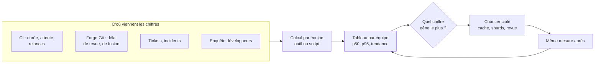

# Developer Experience et plateforme

!!! warning "Avertissement"
    Ces notes sont des pense-bêtes personnels, pas une source de vérité. Elles reflètent ma compréhension et mes choix : leur contenu reste subjectif, malgré les citations et les références qu'il contient. Il peut être incomplet, simplifié, inexact ou dépassé. Vérifiez toujours dans la documentation officielle avant de l'appliquer. Ce contenu est fourni tel quel, sans aucune garantie : son utilisation se fait sous votre seule responsabilité.

!!! abstract "Les échelles"
    Les pastilles de couleur sous les titres disent à quelle échelle une notion s'applique :

    - <span class="pill pill-scope pill-scope-code">Code</span> les classes, fonctions et modules d'un programme ;
    - <span class="pill pill-scope pill-scope-app">Application</span> un service ou une application et son découpage interne ;
    - <span class="pill pill-scope pill-scope-system">Système</span> plusieurs services qui communiquent par le réseau ;
    - <span class="pill pill-scope pill-scope-infra">Infrastructure</span> les serveurs, le réseau, les zones et les clusters, physiques ou virtuels ;
    - <span class="pill pill-scope pill-scope-enterprise">Entreprise</span> le système d'information entier et son organisation.

    Détail et mots ambigus : [carte des échelles](architecture.md#carte-des-echelles).

La <span class="term" data-term="developer-experience">Developer Experience</span> (DevX), c'est ce que vit un développeur pendant qu'il travaille : le temps qu'il passe à attendre, les obstacles qu'il rencontre, la peine qu'il a à trouver une information. Quand il faut deux jours pour lancer un projet en local, ou vingt minutes pour savoir si un test passe, l'équipe livre moins et se fatigue plus. Cette page rassemble les notions et les outils qui rendent ce quotidien plus fluide : mettre un projet en route, raccourcir l'attente entre une modification et son résultat, fournir une plateforme interne, des chemins balisés, une documentation fiable, et mener des migrations sur des centaines de dépôts. Les services `orders-service` et `my-api`, l'équipe `team-core` et les personnes `ada` et `grace` sont fictifs. Les chiffres sont des exemples.

Ce qui est déjà ailleurs n'est pas répété ici : les métriques DORA, SPACE et le cadre DevEx sont dans [Livraison et pratiques d'ingénierie](livraison.md#mesurer-lexperience-developpeur-space-et-devex), les outils <span class="term" data-term="mise">mise</span>, <span class="term" data-term="uv">uv</span>, Renovate et Backstage dans le [Panorama des outils techniques](outils.md#outils-de-developpement-mise-uv-ruff-yarn).

*Renovate : concurrent de Dependabot ; complémentaire de Snyk, Trivy*<br>
*uv : concurrent de pip, Poetry, pdm ; complémentaire de mise*
{ .tool-rel }


:material-swap-horizontal: Les outils cités dans cette page : lesquels se remplacent, lesquels se combinent ? Voir [Complémentaires ou concurrents](outils.md#complementaires-ou-concurrents).
{ .doc-ref }

## Vocabulaire

**<span class="term" data-term="developer-experience">Developer experience</span> (DX ou DevX)** : la façon dont les développeurs vivent leur travail au quotidien, de l'idée jusqu'au code en production : installer un projet, comprendre le code, lancer les tests, attendre la CI, déployer, trouver la documentation.

**<span class="term" data-term="process-friction">Friction</span>** : tout ce qui ralentit ou décourage un développeur sans apporter de valeur. Exemple : un README de 18 étapes dont trois sont fausses.

**<span class="term" data-term="cognitive-load">Charge cognitive</span>** : la quantité de choses qu'une personne doit garder en tête pour accomplir une tâche. La notion vient de la psychologie de l'apprentissage (John Sweller, 1988) ; le livre « Team Topologies » (Matthew Skelton et Manuel Pais, 2019) l'applique aux équipes. Exemple : devoir connaître Kubernetes, Terraform et trois consoles cloud pour déployer un simple correctif.

**<span class="term" data-term="flow-state">État de flow</span>** (état de concentration) : la concentration profonde où le travail avance sans effort apparent, décrite par Mihaly Csikszentmihalyi, « Flow » (1990). Chaque attente de plus de quelques secondes et chaque interruption risquent de le casser.

**<span class="term" data-term="inner-loop">Boucle interne</span>** : le cycle local d'un développeur, modifier, lancer, voir le résultat, répété des dizaines de fois par heure. **<span class="term" data-term="outer-loop">Boucle externe</span>** : ce qui se passe après le push : CI, revue, fusion, déploiement.

**<span class="term" data-term="internal-developer-platform">Plateforme interne</span> (IDP)** : l'ensemble des outils et services internes qui permettent à une équipe de créer, tester, déployer et exploiter un service sans dépendre d'une autre équipe. Attention, le sigle IDP désigne aussi parfois l'*Internal Developer Portal*, le site web qui donne accès à cette plateforme : le portail n'est qu'une interface de la plateforme.

**<span class="term" data-term="golden-path">Golden path</span>** (chemin balisé, ou *paved road*) : la manière recommandée et outillée de faire une tâche courante, plus facile que les alternatives sans être obligatoire.

**<span class="term" data-term="self-service">Libre-service</span>** : une équipe obtient une ressource (une base, un bucket, un environnement) sans ouvrir de ticket ni attendre quelqu'un.

**<span class="term" data-term="toil">Toil</span>** (travail de corvée) : un travail manuel, répétitif, automatisable, sans valeur durable, qui grandit avec la taille du système. La définition vient du livre « Site Reliability Engineering » (Google, 2016), chapitre « Eliminating Toil ». Exemple : créer à la main, sur demande par ticket, chaque nouveau dépôt avec sa CI.

| Mot | Question qu'il pose | Exemple de mesure |
|---|---|---|
| friction | qu'est-ce qui fait perdre du temps ? | 2 jours entre le clone et le premier test vert |
| charge cognitive | combien de choses faut-il savoir ? | 14 étapes dans le guide de déploiement |
| état de flow | combien de temps sans interruption ? | blocs de 2 h sans réunion par semaine |
| boucle interne | combien de secondes pour voir le résultat ? | 45 s pour relancer un test |
| toil | quel travail répété pourrait disparaître ? | 40 tickets « créer un dépôt » par trimestre |

:material-book-open-variant: Doc de référence : [Google, « Site Reliability Engineering », chapitre « Eliminating Toil »](https://sre.google/sre-book/eliminating-toil/) (2016)
{ .doc-ref }

## Boucle interne et boucle externe

<a class="pill pill-scope pill-scope-code" href="../architecture/#carte-des-echelles">Échelle · Code</a> <span class="pill pill-status pill-status-ok" title="Toujours valable, vérifié en novembre 2026">Valable · 11/2026</span>

Les deux boucles n'ont ni la même fréquence ni la même durée acceptable, et on ne les accélère pas avec les mêmes outils. Une journée d'exemple pour `ada` sur `orders-service` :

```
boucle interne (sur le poste, des dizaines de fois par heure)
  10:00:00  ada modifie calculate_total()
  10:00:01  le serveur recharge le code tout seul
  10:00:03  pytest relance le seul test en échec : vert
  10:00:40  ada modifie le cas « remise à 100 % », le test repasse en 2 s

boucle externe (après le push, quelques fois par jour)
  10:42     push et ouverture de la MR
  10:43     CI : lint, tests, image, terminée à 10:55
  11:30     première revue par grace
  14:10     fusion, déploiement automatique
  14:25     en production
```



| Boucle | Fréquence | Ordre de grandeur visé | Ce qui la ralentit souvent |
|---|---|---|---|
| interne | des dizaines de fois par heure | moins de 10 s par tour | reconstruire une image, relancer toute la suite, redémarrer les services |
| externe | quelques fois par jour | une CI d'environ 10 min, une revue dans la demi-journée | CI séquentielle, tests instables, attente de revue, validation manuelle |

Les ordres de grandeur s'appuient sur deux sources : les seuils de temps de réponse de Jakob Nielsen, « Response Times: The 3 Important Limits » (1993), où 1 s garde le fil de la pensée et 10 s fait perdre l'attention, et l'article « Continuous Integration » de Martin Fowler (2000, révisé en 2024), qui vise un build d'une dizaine de minutes. Ce sont des repères, pas des normes.

Une seconde gagnée dans la boucle interne compte beaucoup plus qu'elle n'en a l'air : 2 minutes d'attente par tour, à 30 tours par jour, font une heure par jour et par personne (exemple), et surtout autant de ruptures de concentration. Dans la boucle externe, c'est souvent l'**attente** (revue, validation, file de runners) qui pèse plus que le calcul : une <span class="term" data-term="value-stream-mapping">cartographie du flux de valeur</span> le montre.

!!! noob "As noob"
    La boucle interne, c'est goûter la sauce en cuisinant : on le fait toutes les deux minutes, il faut que ce soit instantané. La boucle externe, c'est faire valider le plat par le chef avant de le servir : plus rare, plus long, et c'est surtout l'attente du chef qui coûte. La phrase à retenir : **dans la boucle interne on chasse les secondes, dans la boucle externe on chasse l'attente.**

:material-book-open-variant: Doc de référence : [Jakob Nielsen, « Response Times: The 3 Important Limits »](https://www.nngroup.com/articles/response-times-3-important-limits/) (1993) ; [Martin Fowler, « Continuous Integration »](https://martinfowler.com/articles/continuousIntegration.html) (2000, révisé en 2024)
{ .doc-ref }

## Mettre un projet en route en une commande

<a class="pill pill-scope pill-scope-app" href="../architecture/#carte-des-echelles">Échelle · Application</a> <span class="pill pill-status pill-status-ok" title="Toujours valable, vérifié en novembre 2026">Valable · 11/2026</span>

J'arrive dans une équipe, je clone `orders-service`, et il me faut deux jours et l'aide de trois personnes pour lancer le premier test. La <span class="term" data-term="project-setup">mise en route</span> est tout ce qu'il faut faire entre `git clone` et le premier test qui passe en local. L'objectif : un nouvel arrivant la fait seul, sans demander d'aide, en quelques commandes toujours identiques d'un dépôt à l'autre.

Trois règles :

- **tout est dans le dépôt** : les versions d'outils dans un fichier lu par un <span class="term" data-term="tool-version-manager">gestionnaire de versions</span> (mise, asdf), les dépendances dans un <span class="term" data-term="lockfile">lockfile</span>, les services locaux dans un fichier Docker Compose ;
- **les mêmes noms de commandes partout** : `setup`, `test`, `dev`, `doctor`. C'est l'idée de « Scripts to Rule Them All » (GitHub, 2015) ;
- **la mise en route est testée** : un job de CI hebdomadaire la rejoue sur une image vierge, sinon elle se dégrade sans que personne s'en aperçoive.

*mise : concurrent de asdf ; complémentaire de uv*<br>
*asdf : concurrent de mise*
{ .tool-rel }


Le parcours d'un nouvel arrivant devient :

```bash
git clone git@git.example.com:team-core/orders-service.git
cd orders-service
mise install
mise run setup
mise run test
```

Le fichier `mise.toml` correspondant est montré dans le [Panorama des outils](outils.md#outils-de-developpement-mise-uv-ruff-yarn). La commande `doctor` vérifie que le poste est prêt et dit comment corriger ce qui manque, au lieu d'un message d'erreur obscur trois étapes plus loin :

```python
"""Vérifie que le poste peut lancer orders-service et explique comment corriger."""

import shutil
import subprocess
import sys

# Bien : chaque outil requis vient avec sa correction, pas une erreur obscure
REQUIRED_COMMANDS = {
    "docker": "installer Docker, puis relancer le terminal",
    "uv": "lancer « mise install » à la racine du dépôt",
}


def docker_is_running() -> bool:
    """Indique si le démon Docker répond."""
    result = subprocess.run(["docker", "info"], capture_output=True, check=False)
    return result.returncode == 0


# Bien : renvoie chaque problème avec la façon de le corriger
def find_problems() -> list[str]:
    """Renvoie la liste des problèmes trouvés, chacun avec sa correction."""
    problems = [
        f"commande « {name} » introuvable : {fix}"
        for name, fix in REQUIRED_COMMANDS.items()
        if shutil.which(name) is None
    ]
    if shutil.which("docker") and not docker_is_running():
        problems.append("Docker est installé mais arrêté : démarrer Docker")
    return problems


def main() -> int:
    """Affiche le diagnostic et renvoie 1 si le poste n'est pas prêt."""
    problems = find_problems()
    for problem in problems:
        print(f"KO  {problem}")
    if not problems:
        print("OK  le poste est prêt, lancer : mise run test")
    return 1 if problems else 0


if __name__ == "__main__":
    sys.exit(main())
```

| Je veux... | J'utilise... |
|---|---|
| mon projet a besoin d'une version précise de Python, de Node ou de Terraform, et toute l'équipe doit avoir la même, sans réinstaller à la main en changeant de projet | mise ou asdf (voir [Panorama des outils](outils.md#outils-de-developpement-mise-uv-ruff-yarn)) |
| je passe d'un dépôt à l'autre et je veux taper partout les mêmes commandes, comme `setup` pour installer et `test` pour lancer les tests, sans relire chaque README | des tâches mise, un `Makefile`, ou des scripts `script/setup`, `script/test` |
| mon service a besoin d'une base PostgreSQL et d'autres services pour tourner en local, et je veux tout démarrer d'une seule commande | Docker Compose |
| mon projet a besoin d'outils système ou de bibliothèques natives en plus du langage, comme un client de base de données ou une bibliothèque de traitement d'images, et je veux tout décrire au même endroit | un Dev Container (voir plus bas) |
| un nouvel arrivant voit la mise en route échouer sur un message obscur et ne sait pas quoi corriger, par exemple parce que Docker est installé mais arrêté | un script `doctor` qui dit quoi corriger |
| personne n'a refait la mise en route depuis des mois, et je veux savoir qu'elle est cassée avant que le prochain arrivant tombe dessus | un job de CI qui la rejoue sur une image vierge |

:material-book-open-variant: Doc de référence : [GitHub, « Scripts to Rule Them All »](https://github.com/github/scripts-to-rule-them-all) (2015) ; [mise, documentation](https://mise.jdx.dev/) (consultée en novembre 2026)
{ .doc-ref }

### Docker Compose et code monté par un volume

<span class="pill pill-status pill-status-ok" title="Toujours valable, vérifié en novembre 2026">Valable · 11/2026</span>


*Docker : complémentaire de Kubernetes, Helm*
{ .tool-rel }

Docker Compose décrit dans un fichier `compose.yaml` les conteneurs <span class="term" data-term="docker">Docker</span> dont le projet a besoin en local, et les démarre ensemble avec `docker compose up`. Un <span class="term" data-term="docker-volume">volume</span> relie un dossier du poste à un dossier du conteneur : ici le code du dépôt, si bien qu'une sauvegarde dans l'éditeur est vue tout de suite par le serveur, sans reconstruire l'image.

```yaml
# Exemple : my-api et sa base Postgres, démarrés ensemble en local
services:
  # Bien : code monté en volume et --reload, une sauvegarde est vue tout de suite
  my-api:
    build: .
    command: uvicorn app.main:app --host 0.0.0.0 --reload
    ports: ["8000:8000"]
    volumes:
      - .:/app
    environment:
      DATABASE_URL: postgresql://app:app@db:5432/app
    depends_on: [db]
  # Exemple : Postgres jetable pour le poste de dev
  db:
    image: postgres:16
    environment:
      POSTGRES_USER: app
      POSTGRES_PASSWORD: app
      POSTGRES_DB: app
```



`- .:/app` monte la racine du dépôt dans `/app` ; `--reload` redémarre le serveur à chaque modification ; `my-api` joint la base par son nom de service, `db`. Le mot de passe ne sert qu'au poste local. Piège : le volume masque ce que l'image avait installé dans `/app` (un `.venv`, des `node_modules`) ; on installe alors les dépendances hors de ce dossier, ou on les protège par un volume dédié.

:material-book-open-variant: Doc de référence : [Docker, Compose](https://docs.docker.com/compose/) (consultée en novembre 2026) ; [Docker, Bind mounts](https://docs.docker.com/engine/storage/bind-mounts/) (consultée en novembre 2026)
{ .doc-ref }

## Accélérer la boucle interne

<a class="pill pill-scope pill-scope-code" href="../architecture/#carte-des-echelles">Échelle · Code</a> <span class="pill pill-status pill-status-ok" title="Toujours valable, vérifié en novembre 2026">Valable · 11/2026</span>

Je modifie une ligne et j'attends une minute pour savoir si ça marche : au bout de trente essais, j'ai perdu une demi-heure et ma concentration. Trois principes raccourcissent cette attente : **ne lancer que ce qui est touché**, **garder ce qui est déjà prêt**, **laisser les contrôles lents à la CI**. Les leviers :

- le <span class="term" data-term="hot-reload">rechargement à chaud</span> : l'application prend en compte le changement sans redémarrer ;
- les **tests ciblés** : relancer un test, les tests en échec, ou ceux liés au fichier modifié. Quand un outil choisit ces tests automatiquement à partir des dépendances du code, on parle de <span class="term" data-term="test-impact-analysis">sélection de tests par impact</span> ;
- le **mode surveillance** (*watch*) : l'outil relance tout seul les tests concernés à chaque sauvegarde ;
- le <span class="term" data-term="build-cache">cache de build</span> : réutiliser un résultat de compilation ou de test quand ses entrées n'ont pas changé ;
- le <span class="term" data-term="incremental-build">build incrémental</span> : ne recompiler que les fichiers modifiés et ceux qui en dépendent.

```bash
uvicorn my_api.main:app --reload
pytest -x --lf
pytest tests/test_orders.py::test_total_with_discount
npx vitest related src/cart.ts --run
npx tsc --noEmit --incremental
```

Dans l'ordre : le serveur se recharge à chaque sauvegarde ; pytest relance d'abord les tests en échec la dernière fois et s'arrête au premier échec ; un seul test ; Vitest lance les tests qui importent `cart.ts` ; TypeScript ne revérifie que ce qui a changé depuis la dernière fois. Options à vérifier dans la documentation de la version utilisée.

*pytest : concurrent de unittest ; complémentaire de Testcontainers*
{ .tool-rel }


Les colonnes « avant » et « après » se mesurent en chronométrant le tour lui-même, sur le poste : `time pytest -x --lf` pour un essai, ou hyperfine pour une moyenne sur plusieurs essais (`hyperfine 'pytest tests/test_orders.py'`). On mesure d'abord le geste le plus fréquent de la journée, pas le plus lent.

| Action sur my-api | Avant | Après | Levier |
|---|---|---|---|
| modifier un endpoint et voir le résultat | 2 min (reconstruire l'image, redémarrer) | 1 s | code monté dans le conteneur, `--reload` |
| relancer le test en échec | 45 s (toute la suite) | 2 s | `pytest --lf` |
| vérifier les types après une modification | 20 s | 3 s | build incrémental |

Chiffres d'exemple. L'image Docker sert à la CI et à la production ; en local, le code peut être monté dans le conteneur par un volume, sans reconstruire l'image à chaque essai (exemple de `compose.yaml` dans [Docker Compose et code monté par un volume](#docker-compose-et-code-monte-par-un-volume)).

| Je veux... | J'utilise... |
|---|---|
| je modifie un endpoint de `my-api` et je veux voir le résultat dans la seconde, sans redémarrer le serveur | le rechargement à chaud du framework |
| un seul test a échoué sur toute la suite, et je veux relancer seulement celui-là pendant que je le corrige | `pytest --lf`, `jest --onlyFailures` |
| je modifie `cart.ts` et je veux que seuls les tests qui en dépendent se relancent à chaque sauvegarde | un mode surveillance, `vitest related`, un plugin de sélection de tests |
| une petite modification relance la compilation de tout le projet, et j'attends à chaque fois | le build incrémental du compilateur, un cache de build |
| mes tests de bout en bout prennent plusieurs minutes et bloquent mon poste, mais je ne veux pas les abandonner | les laisser à la CI |

:material-book-open-variant: Doc de référence : [pytest, « How to re-run failed tests and maintain state between test runs »](https://docs.pytest.org/en/stable/how-to/cache.html) (version stable, consultée en novembre 2026) ; [Vitest, Command Line Interface](https://vitest.dev/guide/cli) (consultée en novembre 2026) ; [hyperfine](https://github.com/sharkdp/hyperfine) (consultée en novembre 2026)
{ .doc-ref }

## Environnement local ou distant

<a class="pill pill-scope pill-scope-infra" href="../architecture/#carte-des-echelles">Échelle · Infrastructure</a> <span class="pill pill-status pill-status-ok" title="Toujours valable, vérifié en novembre 2026">Valable · 11/2026</span>

!!! info "Section rédigée en novembre 2026"
    Les services d'environnements distants et leurs fonctions changent vite. Les noms cités sont des exemples, à vérifier au moment de la lecture.

Un <span class="term" data-term="devcontainer">Dev Container</span> est un environnement de développement complet (image, outils, extensions de l'éditeur, commandes d'installation) décrit par un fichier `devcontainer.json` dans le dépôt, et lancé dans un conteneur. La *Development Containers Specification* (containers.dev, initiée par Microsoft, publiée comme spécification ouverte en 2022) permet à plusieurs éditeurs et services de lire le même fichier.

!!! noob "As noob"
    Un Dev Container, c'est une malle de cuisine livrée avec sa notice : ustensiles, épices et étapes d'installation sont dedans, et chacun l'ouvre à l'identique, sur son poste ou sur une machine distante. Fini le « chez moi ça marche » dû à une version d'outil différente. La phrase à retenir : **le poste de développement est décrit dans le dépôt, comme le code.**

Un <span class="term" data-term="remote-dev-environment">environnement de développement distant</span> fait tourner ce poste sur un serveur ou dans le cloud ; on s'y connecte depuis un éditeur local ou un navigateur. Exemples de ce type d'outil : GitHub Codespaces, Coder, Gitpod (à vérifier, l'offre évolue).

```json
{
  "name": "orders-service",
  "image": "mcr.microsoft.com/devcontainers/python:3.12",
  "features": {
    "ghcr.io/devcontainers/features/docker-in-docker:2": {}
  },
  "postCreateCommand": "pip install uv && uv sync --frozen",
  "forwardPorts": [8000]
}
```

Le même fichier sert en local (l'éditeur lance le conteneur sur le poste) et à distance (le service lance le conteneur sur ses machines). Image et identifiants donnés à titre d'exemple, à vérifier.

| Critère | Local avec gestionnaire de versions | Dev Container en local | Environnement distant |
|---|---|---|---|
| mise en route | quelques minutes | quelques minutes, après le premier téléchargement d'image | moins d'une minute si l'image est préconstruite |
| travail hors ligne | oui | oui | non |
| puissance | celle du portable | celle du portable | celle du serveur, réglable |
| données sensibles | copiées sur le portable | copiées sur le portable | restent dans le cloud de l'entreprise |
| coût | aucun en plus | aucun en plus | facture par heure d'utilisation |
| maintenance | faible | une image à tenir à jour | une image et un service à exploiter ou à payer |

La règle : prendre le plus léger qui résout le problème. La <span class="term" data-term="dev-prod-parity">parité dev/prod</span> se cherche là où les écarts ont déjà causé des bugs (même moteur de base de données, même version du langage), pas en copiant toute la production sur le poste.

| Je veux... | J'utilise... |
|---|---|
| mon projet a seulement besoin de la bonne version de Python ou de Node, rien d'autre | mise ou asdf |
| mon projet dépend de plusieurs outils système et de bibliothèques natives, pénibles à installer sur chaque poste | un Dev Container en local |
| les données ne doivent pas quitter le cloud de l'entreprise, ou les portables de l'équipe sont trop peu puissants pour le projet | un environnement distant fondé sur le même Dev Container |
| je veux un environnement reproduit exactement à l'identique sur chaque poste, et mon équipe connaît déjà l'outil qui fait ça | <span class="term" data-term="nix">Nix</span> |

:material-book-open-variant: Doc de référence : [Development Containers Specification](https://containers.dev/) (2022) ; [Visual Studio Code, « Developing inside a Container »](https://code.visualstudio.com/docs/devcontainers/containers) (consultée en novembre 2026)
{ .doc-ref }

## Une CI rapide et fiable

<a class="pill pill-scope pill-scope-app" href="../architecture/#carte-des-echelles">Échelle · Application</a> <a class="pill pill-scope pill-scope-infra" href="../architecture/#carte-des-echelles">Échelle · Infrastructure</a> <span class="pill pill-status pill-status-ok" title="Toujours valable, vérifié en novembre 2026">Valable · 11/2026</span>

<a class="pill pill-dora" href="https://dora.dev/capabilities/continuous-integration/">DORA · Continuous integration</a> <a class="pill pill-dora" href="https://dora.dev/capabilities/test-automation/">DORA · Test automation</a>

Je pousse ma MR et la CI met 30 minutes : je passe à autre chose, et quand elle échoue j'ai oublié où j'en étais. Si en plus elle échoue parfois sans raison, l'équipe apprend à relancer sans lire l'erreur. Une CI utile a donc deux qualités : elle est **rapide**, pour que le développeur attende le résultat sans changer de tâche, et **fiable**, pour qu'un rouge soit toujours une vraie information. On mesure d'abord : durée du pipeline au p50 et au p95, attente avant qu'un <span class="term" data-term="runner">runner</span> soit libre, et <span class="term" data-term="critical-path">chemin critique</span> (la suite de jobs dépendants qui fixe la durée minimale).

Le p50 (la médiane) est la durée sous laquelle passe la moitié des pipelines ; le <span class="term" data-term="p95">p95</span>, celle sous laquelle passent 95 % d'entre eux. Exemple sur 10 pipelines de 8, 8, 9, 9, 9, 10, 10, 11, 12 et 28 min : le p50 vaut environ 9,5 min, le p95 tombe entre 21 et 28 min selon la méthode de calcul, entièrement tiré par le seul pipeline de 28 min. La médiane dit ce que vit un développeur d'habitude, le p95 dit ce qui le fait changer de tâche.

!!! noob "As noob"
    Je pense à mon trajet pour aller au travail : la médiane, c'est la durée d'un jour normal ; le p95, c'est la durée que je ne dépasse qu'environ un jour sur vingt, quand il pleut et qu'un train saute. On choisit l'heure de départ d'après ces mauvais jours, pas d'après la moyenne. La phrase à retenir : **le p50 dit le quotidien, le p95 dit ce qui fait rater le rendez-vous.**

Pour savoir où part le temps, on pose un pipeline réel sur une ligne de temps. Les chiffres viennent de la CI elle-même : la page du pipeline montre chaque job avec son attente et sa durée, l'API des jobs de GitLab donne `queued_duration` et `duration` pour des centaines d'exécutions, et la page d'analytique CI/CD trace la durée des pipelines dans le temps. On regarde d'abord l'attente de runner et le chemin critique, ensuite seulement le job le plus long.

```mermaid
gantt
    title Pipeline de la MR, 12 min au total
    dateFormat HH:mm
    axisFormat %H:%M
    section Attente
    runner libre        :done, q, 10:43, 10:45
    section Jobs
    lint                :l, 10:45, 10:47
    test 1/4            :t1, 10:45, 10:50
    test 2/4            :t2, 10:45, 10:49
    test 3/4            :t3, 10:45, 10:50
    test 4/4 critique   :crit, t4, 10:45, 10:55
```



Lecture (chiffres d'exemple) : 2 min d'attente avant le premier job, puis le shard 4 fixe seul la fin du pipeline, 10 min contre 4 à 5 pour les autres. Rééquilibrer les shards à partir des durées mesurées (`pytest --store-durations` avec pytest-split) rapporte plus qu'un cinquième shard, et l'attente de runner se règle côté capacité, pas côté tests.

Les leviers, dans l'ordre où ils rapportent souvent le plus :

1. **supprimer l'attente inutile** : des jobs qui démarrent dès que leurs vraies dépendances sont finies (`needs` dans GitLab CI), au lieu d'attendre la fin de tout un stage ;
2. **mettre en cache** les dépendances, avec le lockfile comme clé, et les couches Docker (<span class="term" data-term="docker-layer-cache">cache de couches</span>, dépendances copiées avant le code) ;
3. **paralléliser** une longue suite de tests en <span class="term" data-term="test-shard">shards</span> ;
4. **ne lancer que ce qui est concerné** : règles sur les fichiers modifiés, ou les commandes « affected » des outils de monorepo, avec un <span class="term" data-term="remote-build-cache">cache de build distant</span>.

*GitLab CI : concurrent de GitHub Actions, Jenkins*
{ .tool-rel }


```yaml
# Bien : base commune, cache uv dont la clé est le lockfile
.python:
  image: python:3.12-slim
  variables:
    UV_CACHE_DIR: .uv-cache
  cache:
    key:
      files: [uv.lock]
    paths: [.uv-cache]
  before_script:
    - pip install uv
    - uv sync --frozen

# Bien : needs: [] démarre le job sans attendre la fin d'un stage
lint:
  extends: .python
  needs: []
  script: uv run ruff check .

# Bien : 4 shards, lancés seulement si le code, les tests ou le lockfile changent
test:
  extends: .python
  needs: []
  parallel: 4
  script: uv run pytest --splits 4 --group "$CI_NODE_INDEX"
  rules:
    - changes: [src/**/*, tests/**/*, uv.lock]
```



`needs: []` fait démarrer `lint` et `test` en même temps ; `parallel: 4` crée quatre jobs, et le plugin pytest-split donne à chacun un quart des tests ; `rules: changes` évite de lancer les tests quand seule la documentation change. Mots-clés à vérifier pour ma version de GitLab et du plugin.

La fiabilité compte autant que la vitesse : un <span class="term" data-term="flaky-test">test instable</span> apprend aux équipes à relancer sans lire. Les causes et la stratégie (quarantaine, responsable, date limite) sont dans [Qualité et tests](qualite.md#tests-instables-et-parallelisation). Un indicateur simple : la part des pipelines relancés sur le même commit.

| Je veux... | J'utilise... |
|---|---|
| ma CI est lente et je ne sais pas si c'est l'attente d'un runner, un job trop long, ou des jobs qui s'attendent les uns les autres | durée par job, attente de runner, chemin critique |
| chaque pipeline retélécharge toutes les dépendances, alors que le lockfile n'a pas changé | un cache dont la clé est le lockfile |
| le lint attend la fin d'un stage entier alors qu'il n'en a pas besoin, donc le pipeline dure plus longtemps que nécessaire | `needs` (GitLab CI), dépendances explicites entre jobs |
| ma suite de tests dure 15 min et fixe à elle seule la durée du pipeline | des shards parallèles |
| je corrige une faute dans le README et toute la suite de tests se relance | des règles sur les fichiers modifiés, la sélection de tests par impact |
| chaque équipe a copié et bricolé sa propre CI, et une amélioration faite chez l'une n'arrive jamais chez les autres | un composant de CI partagé et versionné |

:material-book-open-variant: Doc de référence : [GitLab, CI/CD YAML syntax reference](https://docs.gitlab.com/ci/yaml/) (consultée en novembre 2026) ; [GitLab, CI/CD analytics](https://docs.gitlab.com/user/analytics/ci_cd_analytics/) (consultée en novembre 2026)
{ .doc-ref }

### Composant de CI partagé et versionné

<span class="pill pill-status pill-status-ok" title="Toujours valable, vérifié en novembre 2026">Valable · 11/2026</span>

Un <span class="term" data-term="versioned-component">composant de CI</span> est un morceau de pipeline réutilisable (des jobs, leurs images, leur cache), rangé dans un seul dépôt, publié avec un numéro de version, et inclus par chaque projet. Le projet ne copie plus les jobs : il garde une ligne d'`include` et une version. Dans GitLab, ce sont les CI/CD components, disponibles en version stable depuis GitLab 17.0 (2024, à vérifier) ; l'équivalent GitHub est le *reusable workflow* (`uses: team-platform/ci/.github/workflows/python.yml@v1.4.0`).

Le `.gitlab-ci.yml` d'un projet :

```yaml
# Bien : une ligne d'include et une version, plus de jobs copiés
include:
  - component: git.example.com/team-platform/ci/python@1.4.0
    inputs:
      python_version: "3.12"
```

Le dépôt du composant, `team-platform/ci` :

```
team-platform/ci/
├── templates/
│   └── python.yml      le composant "python"
├── .gitlab-ci.yml      teste le composant, publie une version à chaque tag
├── CHANGELOG.md
└── README.md
```

```yaml
# templates/python.yml
# Exemple : paramètres acceptés par le composant, avec leur défaut
spec:
  inputs:
    python_version:
      default: "3.12"
---
# Exemple : jobs partagés, la version de Python vient de l'input
lint:
  image: python:$[[ inputs.python_version ]]-slim
  needs: []
  script:
    - pip install uv
    - uv run ruff check .

test:
  image: python:$[[ inputs.python_version ]]-slim
  needs: []
  script:
    - pip install uv
    - uv run pytest
```

La partie avant `---` déclare les paramètres acceptés ; `$[[ inputs.python_version ]]` est remplacé au moment de l'inclusion. Syntaxe à vérifier pour ma version de GitLab.

Comment une correction arrive dans les projets :

```
jour 0   l'équipe plateforme ajoute le cache uv au composant, tague 1.5.0
jour 1   le robot de mise à jour (Renovate) ouvre dans chaque projet une MR "python 1.4.0 -> 1.5.0"
jour 1   la CI de chaque MR tourne avec la nouvelle version ; version mineure et CI verte : fusion automatique
jour 7   le tableau de campagne liste les projets restés en 1.4.0, souvent ceux dont la CI était déjà rouge
```

Piège : inclure `@main` ou `~latest` évite les MR, mais une modification du composant casse alors tous les projets le même jour, sans revue ni retour arrière simple. Une version figée plus une MR automatique garde les deux : la propagation et le contrôle.

:material-book-open-variant: Doc de référence : [GitLab, CI/CD components](https://docs.gitlab.com/ci/components/) (consultée en novembre 2026)
{ .doc-ref }

## Platform engineering : la plateforme comme produit

<a class="pill pill-scope pill-scope-infra" href="../architecture/#carte-des-echelles">Échelle · Infrastructure</a> <a class="pill pill-scope pill-scope-enterprise" href="../architecture/#carte-des-echelles">Échelle · Entreprise</a> <span class="pill pill-status pill-status-ok" title="Toujours valable, vérifié en novembre 2026">Valable · 11/2026</span>

<a class="pill pill-dora" href="https://dora.dev/capabilities/loosely-coupled-teams/">DORA · Loosely coupled teams</a>

Chaque équipe produit doit écrire sa CI, configurer ses déploiements et créer ses bases à la main, donc elle passe plus de temps sur l'outillage que sur son produit. Le **platform engineering** consiste à construire une <span class="term" data-term="internal-developer-platform">plateforme interne</span> que les équipes produit consomment en libre-service, pour réduire leur charge cognitive. Evan Bottcher, « What I Talk About When I Talk About Platforms » (martinfowler.com, 2018), la définit comme un ensemble de services, d'outils et de connaissances qui rend les équipes autonomes ; il insiste sur un point : la plateforme est un **produit interne**, avec des utilisateurs, une feuille de route et une mesure de l'adoption.

!!! noob "As noob"
    La plateforme interne, c'est la cuisine centrale d'une chaîne de restaurants : chaque restaurant pourrait faire ses propres fonds de sauce, mais la cuisine centrale les fournit prêts, et chaque chef se concentre sur ses plats. Si les fonds sont mauvais ou livrés en retard, les chefs recommencent à les faire eux-mêmes : c'est pour ça qu'on la traite comme un produit, avec des clients à satisfaire. La phrase à retenir : **une plateforme réussie se mesure au nombre d'équipes qui choisissent de s'en servir.**

« Team Topologies » (Matthew Skelton et Manuel Pais, 2019) donne le vocabulaire des équipes :

| Type d'équipe | Rôle | Exemple |
|---|---|---|
| <span class="term" data-term="stream-aligned-team">équipe alignée sur un flux</span> | livre une partie du produit de bout en bout | team-core, qui possède orders-service |
| <span class="term" data-term="platform-team">équipe plateforme</span> | fournit des services internes en libre-service | CI commune, déploiement, bases à la demande |
| <span class="term" data-term="enabling-team">équipe d'accompagnement</span> | aide une équipe à acquérir une compétence, puis se retire | deux semaines avec team-core pour mettre en place des tests de contrat |
| équipe sous-système complexe | garde un composant qui demande une expertise rare | un moteur de calcul de prix |

Le livre décrit aussi trois modes d'interaction : collaboration, *X-as-a-Service* (on consomme sans se coordonner) et facilitation. Il propose de commencer par la <span class="term" data-term="thinnest-viable-platform">plateforme minimale viable</span> (*Thinnest Viable Platform*) : la plus petite chose qui accélère vraiment les équipes, parfois une simple page de documentation.



Le **CNCF Platforms White Paper** (TAG App Delivery de la CNCF, 2023, date et liste à vérifier) décrit les attributs d'une bonne plateforme : traitée comme un produit, centrée sur l'expérience de ses utilisateurs, documentée avec un onboarding, en libre-service, qui réduit la charge cognitive, optionnelle et composable, sûre par défaut. Le même groupe a publié un modèle de maturité du platform engineering (2023, à vérifier).

Traiter la plateforme comme un produit, concrètement :

- partir des tâches fréquentes des utilisateurs (déployer, revenir en arrière, créer un service), pas d'une liste de fonctions ;
- livrer d'abord une tâche couverte de bout en bout ;
- publier une feuille de route et un canal de retour ;
- mesurer l'<span class="term" data-term="adoption">adoption</span> volontaire et la satisfaction : une équipe qui contourne la plateforme envoie un signal produit, pas un manque de discipline.

| Situation | Choix |
|---|---|
| mon entreprise a 3 équipes et une seule façon de déployer, que tout le monde connaît déjà | pas d'équipe plateforme : une page de doc et un modèle de CI suffisent |
| une équipe doit apprendre une compétence nouvelle, comme mettre en place des tests de contrat, et personne chez elle ne l'a déjà fait | une équipe d'accompagnement, pour une durée limitée |
| beaucoup d'équipes ouvrent les mêmes tickets d'infrastructure, comme « créer une base » ou « créer un dépôt », et attendent chaque fois quelqu'un | une équipe plateforme et du libre-service |
| la plateforme existe, mais seuls 30 % des services l'utilisent et les autres continuent à leur façon | aller voir les équipes qui ne l'utilisent pas, avant d'ajouter des fonctions |

:material-book-open-variant: Doc de référence : [Evan Bottcher, « What I Talk About When I Talk About Platforms »](https://martinfowler.com/articles/talk-about-platforms.html) (2018) ; [CNCF TAG App Delivery, « Platforms White Paper »](https://tag-app-delivery.cncf.io/whitepapers/platforms/) (2023, à vérifier)
{ .doc-ref }

## Golden paths et templates

<a class="pill pill-scope pill-scope-app" href="../architecture/#carte-des-echelles">Échelle · Application</a> <a class="pill pill-scope pill-scope-infra" href="../architecture/#carte-des-echelles">Échelle · Infrastructure</a> <span class="pill pill-status pill-status-ok" title="Toujours valable, vérifié en novembre 2026">Valable · 11/2026</span>

Un <span class="term" data-term="golden-path">golden path</span> couvre une tâche courante de bout en bout : par exemple « créer un service HTTP Python et le déployer », avec un template de dépôt, une CI prête, un déploiement, des tableaux de bord et des alertes de base. Le terme a été popularisé par Spotify Engineering, « How We Use Golden Paths to Solve Fragmentation in Our Software Ecosystem » (2020) ; Netflix parle de *paved road* (date à vérifier). Le chemin reste quittable : une équipe peut en sortir, mais elle prend alors en charge le <span class="term" data-term="cost-of-difference">coût de sa différence</span> (sa CI, ses mises à jour, sa documentation d'astreinte).

!!! noob "As noob"
    Le golden path, c'est le sentier balisé et entretenu vers le sommet le plus visité : on peut toujours couper par la forêt, mais on porte alors soi-même la carte, l'eau et les secours. La phrase à retenir : **le chemin officiel est le plus facile, pas le seul autorisé.**

Le <span class="term" data-term="scaffolding">scaffolding</span> génère la structure initiale d'un projet depuis un template. Son piège est la <span class="term" data-term="template-drift">dérive de template</span> : chaque projet garde les choix du jour de sa création, et la nouvelle version du template ne lui parvient jamais. Deux parades :

- **un template mince** : le minimum dans le template, le maximum dans des briques partagées et versionnées ([composant de CI](#composant-de-ci-partage-et-versionne), image de base, bibliothèque de configuration), qui se mettent à jour par une montée de version ;
- **un outil qui sait mettre à jour** : <span class="term" data-term="copier">Copier</span> enregistre la version du template dans le projet et réapplique ses changements avec `copier update` ; cruft fait la même chose pour cookiecutter.

**Backstage Software Templates** : dans le portail Backstage, un formulaire lance la génération, crée le dépôt et l'enregistre dans le catalogue. Un template est un fichier YAML qui décrit les paramètres demandés et les étapes :

```yaml
# Exemple : template Backstage, paramètres demandés dans le formulaire
apiVersion: scaffolder.backstage.io/v1beta3
kind: Template
metadata:
  name: python-http-service
  title: Service HTTP Python
spec:
  owner: team-platform
  type: service
  parameters:
    - title: Le service
      required: [name, owner]
      properties:
        name:
          type: string
        owner:
          type: string
  # Exemple : copie le squelette, crée le dépôt, l'enregistre dans le catalogue
  steps:
    - id: fetch
      action: fetch:template
      input:
        url: ./skeleton
        values:
          name: ${{ parameters.name }}
          owner: ${{ parameters.owner }}
    - id: publish
      action: publish:gitlab
      input:
        repoUrl: git.example.com?owner=team-core&repo=${{ parameters.name }}
    - id: register
      action: catalog:register
      input:
        repoContentsUrl: ${{ steps.publish.output.repoContentsUrl }}
        catalogInfoPath: /catalog-info.yaml
```



Noms d'actions et de champs à vérifier dans la documentation de la version de Backstage utilisée.

| Élément | Dans le template | Dans une brique partagée et versionnée |
|---|---|---|
| structure des dossiers, premier test | oui | non |
| pipeline de CI | une ligne d'`include` | le composant de CI |
| configuration des logs et des métriques | non | une petite bibliothèque interne |
| image de base | sa référence | l'image elle-même, reconstruite et publiée |
| fichier de catalogue | oui, prérempli | non |

| Je veux... | J'utilise... |
|---|---|
| une équipe veut créer un nouveau service qui respecte déjà les règles (CI, logs, alertes) en quelques minutes, pas en trois semaines | un golden path avec un formulaire de création |
| les services créés il y a deux ans ont gardé l'ancienne CI et ne reçoivent pas les corrections faites depuis dans le template | un template mince et des briques versionnées, mises à jour par MR automatique |
| je préfère générer un projet depuis mon terminal, et pouvoir le mettre à jour plus tard quand le template évolue | Copier, ou cookiecutter avec cruft |
| je veux qu'une personne crée son service en remplissant un formulaire dans le portail, sans toucher à la ligne de commande | Backstage Software Templates |
| une équipe a une bonne raison de sortir du chemin, par exemple un service écrit dans un autre langage que celui du template | un écart écrit, avec ce qui reste obligatoire et ce qu'elle prend en charge |

:material-book-open-variant: Doc de référence : [Spotify Engineering, « How We Use Golden Paths to Solve Fragmentation in Our Software Ecosystem »](https://engineering.atspotify.com/2020/08/how-we-use-golden-paths-to-solve-fragmentation-in-our-software-ecosystem/) (2020) ; [Backstage, Software Templates](https://backstage.io/docs/features/software-templates/) (consultée en novembre 2026)
{ .doc-ref }

## Portail développeur et catalogue

<a class="pill pill-scope pill-scope-enterprise" href="../architecture/#carte-des-echelles">Échelle · Entreprise</a> <span class="pill pill-status pill-status-ok" title="Toujours valable, vérifié en novembre 2026">Valable · 11/2026</span>

Un <span class="term" data-term="developer-portal">portail développeur</span> est un site interne unique qui rassemble les services, leurs propriétaires, leur documentation et les actions courantes (créer un service, voir l'état de la CI). Son cœur est le <span class="term" data-term="service-catalog">catalogue de services</span> : la liste de tous les composants, avec leur équipe propriétaire, leurs dépendances et leurs liens utiles. Backstage et son fichier `catalog-info.yaml` sont présentés dans le [Panorama des outils](outils.md#collaboration-jira-confluence-slack-backstage).

Le portail est une **interface** de la plateforme, pas la plateforme elle-même : si déployer demande toujours d'ouvrir un ticket et d'attendre quelqu'un, un beau portail par-dessus ne fait gagner aucun temps. L'ordre qui fonctionne souvent :

1. un fichier de catalogue dans chaque dépôt, ajouté par une MR automatique et vérifié par la CI (le propriétaire existe-t-il ?) ;
2. une page générée depuis ces fichiers, ou un portail minimal ;
3. ensuite seulement, les templates de création, la documentation intégrée, les plugins.



Un catalogue faux est pire que pas de catalogue : il envoie l'alerte d'incident à une équipe qui n'existe plus. Les données doivent donc venir des dépôts et être vérifiées automatiquement, pas saisies dans un tableur.

| Question sans réponse aujourd'hui | Ce que le catalogue fournit |
|---|---|
| « à qui appartient ce service ? » | le champ `owner`, vérifié par la CI |
| « qui appelle cette API avant que je la change ? » | les relations `providesApis` et `consumesApis` |
| « où est la doc, le tableau de bord ? » | les liens du composant |
| « quels services sont orphelins ou obsolètes ? » | le cycle de vie et le propriétaire, filtrables |

| Je veux... | J'utilise... |
|---|---|
| une alerte sonne la nuit et personne ne sait quelle équipe possède le service concerné | un fichier de catalogue par dépôt, vérifié par la CI |
| les nouveaux arrivants ne savent pas où trouver la liste des services, leur doc et leurs tableaux de bord | un portail, une fois le catalogue fiable |
| je veux un portail, mais mon équipe n'a pas le temps de développer et de maintenir une application de plus | un portail commercial ou une page générée qui lit les mêmes fichiers |

Backstage est open source mais reste une application à développer et à maintenir.

:material-book-open-variant: Doc de référence : [Backstage, Software Catalog](https://backstage.io/docs/features/software-catalog/) (consultée en novembre 2026) ; [internaldeveloperplatform.org](https://internaldeveloperplatform.org/) (consultée en novembre 2026)
{ .doc-ref }

## Documentation

<span class="pill pill-status pill-status-ok" title="Toujours valable, vérifié en novembre 2026">Valable · 11/2026</span>

<a class="pill pill-dora" href="https://dora.dev/capabilities/documentation-quality/">DORA · Documentation quality</a>

Mon équipe a un wiki que personne ne met à jour : le code change, la page reste, et elle finit par donner de fausses consignes. Le **<span class="term" data-term="docs-as-code">docs as code</span>** règle ce problème : la documentation technique est écrite en Markdown dans le dépôt, modifiée dans la même MR que le code, relue, puis publiée par la CI (avec MkDocs, par exemple). Elle a donc les mêmes outils et la même revue que le code. La pratique a été popularisée par la communauté Write the Docs dans les années 2010 (date à vérifier).

<span class="term" data-term="diataxis">Diátaxis</span> (Daniele Procida, présenté à partir de 2017 environ, site diataxis.fr, date à vérifier) sépare quatre types de documentation, chacun pour un besoin du lecteur. Une page qui mélange les quatre ne sert bien aucun lecteur.

!!! noob "As noob"
    Je pense à la cuisine : la recette pas à pas pour un débutant (tutoriel), la fiche « rattraper une mayonnaise ratée » (guide pratique), le tableau des temps de cuisson (référence) et l'article sur la chimie de l'émulsion (explication). Chacun sert à un moment différent, et un texte qui mélange les quatre perd tout le monde. La phrase à retenir : **avant d'écrire, on choisit lequel des quatre besoins du lecteur on sert.**

| Type | Le lecteur veut... | Question type sur orders-service |
|---|---|---|
| tutoriel | apprendre en faisant | « je débute, comment faire un premier changement ? » |
| guide pratique | accomplir une tâche précise | « comment déployer en production ? » |
| référence | vérifier une information | « quelle variable règle le timeout ? » |
| explication | comprendre un choix | « pourquoi une file de messages ici ? » |

<figure class="diagram"><svg viewBox="0 0 220 160" role="img" aria-label="Les quatre types de Diátaxis"><rect class="layer layer-2" x="50" y="10" width="80" height="60"/><rect class="layer layer-1" x="130" y="10" width="80" height="60"/><rect class="layer layer-1" x="50" y="70" width="80" height="60"/><rect class="layer layer-2" x="130" y="70" width="80" height="60"/><text x="90" y="43" text-anchor="middle" class="label-strong">tutoriel</text><text x="170" y="43" text-anchor="middle" class="label-strong">guide pratique</text><text x="90" y="103" text-anchor="middle" class="label-strong">explication</text><text x="170" y="103" text-anchor="middle" class="label-strong">référence</text><text x="45" y="43" text-anchor="end">agir</text><text x="45" y="103" text-anchor="end">comprendre</text><text x="90" y="145" text-anchor="middle">apprendre</text><text x="170" y="145" text-anchor="middle">travailler</text></svg><figcaption>Les quatre types de Diátaxis (Daniele Procida)</figcaption></figure>

```text
orders-service/
├── mkdocs.yml
└── docs/
    ├── index.md
    ├── tutorials/
    │   └── premier-changement.md
    ├── how-to/
    │   └── deployer-en-production.md
    ├── reference/
    │   ├── configuration.md
    │   └── api.md
    └── explanation/
        └── pourquoi-une-file.md
```

Ce qu'on mesure : les pages les plus lues, les recherches sans résultat, la date de dernière modification, et les questions qui reviennent dans les canaux de discussion. Une page fausse fait plus de dégâts qu'une page manquante : on la corrige ou on la supprime.

| Je veux... | J'utilise... |
|---|---|
| ma doc dit encore de lancer une commande supprimée depuis des mois, parce que personne ne pense à la mettre à jour quand le code change | docs as code : Markdown dans le dépôt, publié par la CI |
| mes pages mélangent le pas à pas pour débutant, la liste des variables et l'explication des choix, et personne n'y trouve ce qu'il cherche | les quatre types de Diátaxis |
| la doc de mon API annonce des champs qui n'existent plus, ou oublie les nouveaux | une référence générée depuis le schéma OpenAPI |
| on me pose la même question chaque semaine dans le canal d'aide, comme « comment déployer en production ? » | une page par question fréquente, puis répondre par un lien |

:material-book-open-variant: Doc de référence : [Daniele Procida, Diátaxis](https://diataxis.fr/) (date de publication non indiquée) ; [Write the Docs, « Docs as Code »](https://www.writethedocs.org/guide/docs-as-code/) (consultée en novembre 2026)
{ .doc-ref }

## Onboarding

L'<span class="term" data-term="onboarding">onboarding</span> est l'intégration d'un nouvel arrivant : accès, poste, outils, premières tâches. Si ada attend ses accès plusieurs jours, puis peine à lancer son premier projet, elle a l'impression de ne servir à rien, et l'équipe ne sait pas où ça bloque. Deux indicateurs simples le montrent :

- le **délai jusqu'au premier commit** (ou première MR ouverte) : il mesure surtout les accès et la mise en route ;
- le <span class="term" data-term="time-to-first-change">délai jusqu'au premier changement en production</span> : il mesure toute la chaîne, revue et déploiement compris.

Ces indicateurs sont courants dans les retours d'expérience DevX, sans source de référence unique. On les complète par le ressenti du nouvel arrivant après 30 jours.

| Jour | Étape | Mesure |
|---|---|---|
| J-5 | comptes et accès créés selon le profil d'équipe, automatiquement | accès prêts à J1 (oui ou non) |
| J1 | poste installé par script, premier projet lancé en une commande | temps jusqu'au premier test vert |
| J2 | une petite tâche réelle, étiquetée « premier ticket », en binôme avec ada | MR ouverte |
| J3 | MR fusionnée et déployée | délai jusqu'au premier changement en production |
| J30 | cinq questions et une <span class="term" data-term="retrospective">rétrospective</span> | blocages cités, ressenti |

Exemple de parcours. Chaque blocage noté devient un ticket, et le nouvel arrivant corrige lui-même la documentation qui l'a bloqué : il est le mieux placé pour voir ce qui manque.

| Je veux... | J'utilise... |
|---|---|
| un nouvel arrivant passe sa première journée à attendre ses comptes et ses accès | des profils d'accès par équipe, demandés automatiquement |
| un nouvel arrivant doit pouvoir lancer son premier projet seul, sans demander d'aide à chaque étape | la mise en route en une commande, avec `doctor` |
| je veux qu'un nouvel arrivant contribue vite à du vrai code, par exemple une petite correction fusionnée dès sa première semaine | une étiquette « premier ticket » sur de petites tâches réelles |
| j'ai amélioré l'onboarding et je veux savoir si les arrivants suivants vont vraiment plus vite | le délai jusqu'au premier changement, arrivée après arrivée |

## Migrations à grande échelle

<a class="pill pill-scope pill-scope-code" href="../architecture/#carte-des-echelles">Échelle · Code</a> <a class="pill pill-scope pill-scope-enterprise" href="../architecture/#carte-des-echelles">Échelle · Entreprise</a> <span class="pill pill-status pill-status-ok" title="Toujours valable, vérifié en novembre 2026">Valable · 11/2026</span>

Passer 300 dépôts à une nouvelle version de Python, retirer une bibliothèque interne utilisée par 60 services : à cette échelle, une migration est un **programme**, pas une consigne envoyée par e-mail. Trois outils :

- le <span class="term" data-term="codemod">codemod</span> : un programme qui réécrit le code automatiquement en comprenant sa structure (libcst pour Python, OpenRewrite pour Java, jscodeshift pour JavaScript ; dates de création à vérifier). Pour des cas courants, des outils existants suffisent : `pyupgrade`, ou les règles de ruff avec `--fix`. Exemple complet [plus bas](#exemple-de-codemod-changer-un-import-dans-48-depots) ;
- le <span class="term" data-term="dependency-update-bot">robot de mise à jour des dépendances</span> (Renovate, Dependabot) : il ouvre automatiquement des MR pour chaque nouvelle version d'une dépendance, d'une image ou d'un composant de CI ;
- la <span class="term" data-term="migration-campaign">campagne</span> : un tableau public qui suit chaque dépôt (MR ouverte, CI verte, fusionnée).

*Dependabot : concurrent de Renovate*<br>
*ruff : remplace flake8, black ; complémentaire de mypy*
{ .tool-rel }


Une configuration Renovate d'exemple : fusion automatique des correctifs et versions mineures quand la CI est verte, revue humaine pour les versions majeures.

```json
{
  "extends": ["config:recommended"],
  "packageRules": [
    {
      "matchUpdateTypes": ["minor", "patch"],
      "automerge": true
    },
    {
      "matchUpdateTypes": ["major"],
      "labels": ["breaking-change"]
    }
  ]
}
```

Noms de presets et d'options à vérifier dans la documentation de Renovate.

La <span class="term" data-term="deprecation">mise en obsolescence</span> (deprecation) se fait par étapes annoncées. La <span class="term" data-term="hyrum-law">loi de Hyrum</span> (Hyrum Wright, formulée vers 2012, popularisée par « Software Engineering at Google », Titus Winters, Tom Manshreck et Hyrum Wright, 2020) rappelle qu'avec assez d'utilisateurs, chaque comportement observable est utilisé par quelqu'un : l'inventaire des usages vient en premier.

!!! noob "As noob"
    Je déplace l'interrupteur de la cuisine de dix centimètres : le bail n'en dit rien, mais quelqu'un allumait à tâtons dans le noir et va chercher longtemps. Un logiciel utilisé par beaucoup de monde a toujours quelqu'un qui dépend d'un détail jamais promis (un ordre de tri, un message d'erreur, un délai). La phrase à retenir : **avant de retirer quelque chose, on cherche qui s'en sert vraiment, pas seulement ce que dit la documentation.**

```
mois 0     annonce, guide de migration, avertissement à chaque import de legacy-config
mois 1     codemod et MR automatiques dans les 48 services qui n'utilisent que 2 fonctions
mois 2     règle de lint : plus aucun nouvel usage accepté
mois 3-5   accompagnement direct des 12 services restants
mois 6     archivage : la bibliothèque n'est plus publiée
```

Calendrier d'exemple. La fin de la campagne est toujours la partie la plus longue : les derniers dépôts sont les plus atypiques. L'équipe qui retire un outil porte une bonne part du coût de la migration, sinon elle n'avance pas (chapitres « Large-Scale Changes » et « Deprecation » du livre de Google, 2020).

| Je veux... | J'utilise... |
|---|---|
| mes dépôts utilisent des dizaines de dépendances et d'images Docker, et personne ne peut suivre leurs nouvelles versions à la main | Renovate ou Dependabot |
| je dois faire la même modification de code dans 300 dépôts, comme remplacer un import, sans tout faire à la main | un codemod, puis une MR par dépôt, par vagues |
| je veux retirer un vieil outil, mais je ne sais pas quels services s'en servent encore | une recherche de code sur tous les dépôts, des journaux d'appel |
| pendant la migration, de nouveaux services se mettent à utiliser l'ancien outil, donc la liste à migrer grandit au lieu de baisser | un avertissement, puis une règle de lint |
| je ne veux pas qu'une équipe découvre le jour de l'arrêt que son service dépendait de l'outil retiré | un calendrier public, des étapes, un tableau de campagne |

:material-book-open-variant: Doc de référence : [Renovate, documentation](https://docs.renovatebot.com/) (consultée en novembre 2026) ; [Titus Winters et al., « Software Engineering at Google », chapitre « Large-Scale Changes »](https://abseil.io/resources/swe-book/html/ch22.html) (2020)
{ .doc-ref }

### Exemple de codemod : changer un import dans 48 dépôts

Les services doivent passer de la bibliothèque `legacy_config` à `team_config`, qui expose la même fonction `load`.

```python
# avant
from legacy_config import load

# Ce qui change : même fonction load, importée depuis team_config
from team_config import load
```

Une règle <span class="term" data-term="ast-grep">ast-grep</span> fait le remplacement en lisant la structure du code, pas son texte : elle ignore les commentaires et les chaînes qui contiendraient les mêmes mots, et tolère les variations d'espaces.

!!! noob "As noob"
    `sed` cherche des lettres, comme le « rechercher et remplacer » d'un traitement de texte ; ast-grep lit des phrases, comme un correcteur qui sait distinguer un verbe d'un nom. Il remplace donc l'import de `legacy_config`, pas le mot `legacy_config` qui traîne dans un commentaire. La phrase à retenir : **plus la forme du code à transformer varie, plus il faut un outil qui comprend sa structure.**

```yaml
# rules/legacy-config.yml
# Exemple : règle ast-grep qui réécrit l'import, quels que soient les noms importés
id: legacy-config-import
language: python
rule:
  pattern: from legacy_config import $$$NAMES
fix: from team_config import $$$NAMES
```

Pour un cas aussi simple, `sed` suffit souvent : `git ls-files '*.py' | xargs sed -i 's/^from legacy_config import /from team_config import /'` (sed GNU ; sous macOS, `sed -i ''`). Dès que la forme varie (`import legacy_config as cfg`, puis `cfg.load()`), il faut un vrai codemod, en libcst par exemple.

La boucle qui applique la règle et ouvre une MR par dépôt, à partir d'une liste `repos.txt` (`team-core/orders-service`, `team-core/payments-service`...) :

```bash
# Exemple : pour chaque dépôt de repos.txt, applique la règle et ouvre une MR
RULE="$PWD/rules/legacy-config.yml"
while read -r repo; do
  (
    git clone --depth 1 "git@git.example.com:$repo.git" "work/$repo" && cd "work/$repo" || exit 1
    git switch -c chore/team-config
    ast-grep scan --rule "$RULE" --update-all
    git diff --quiet && exit 0
    git commit -am "refactor: import load from team_config"
    git push -u origin chore/team-config
    glab mr create --fill --label migration-team-config --yes
  )
done < repos.txt
```



Un dépôt sans changement est sauté ; le label commun alimente le tableau de campagne. Options d'ast-grep et de glab à vérifier dans leur documentation. Au-delà de quelques dizaines de dépôts, des outils dédiés font la même boucle avec suivi et reprise sur erreur (multi-gitter, Sourcegraph Batch Changes ; à vérifier).

:material-book-open-variant: Doc de référence : [ast-grep, documentation](https://ast-grep.github.io/) (consultée en novembre 2026) ; [LibCST, documentation](https://libcst.readthedocs.io/) (consultée en novembre 2026)
{ .doc-ref }

## Mesurer sans surveiller

<span class="pill pill-status pill-status-ok" title="Toujours valable, vérifié en novembre 2026">Valable · 11/2026</span>

<a class="pill pill-dora" href="https://dora.dev/capabilities/job-satisfaction/">DORA · Job satisfaction</a> <a class="pill pill-dora" href="https://dora.dev/capabilities/well-being/">DORA · Well-being</a>

Les cadres de mesure (<span class="term" data-term="dora-metrics">métriques DORA</span>, SPACE, DevEx) sont présentés dans [Livraison et pratiques d'ingénierie](livraison.md#mesurer-lexperience-developpeur-space-et-devex). Ce qui compte côté DevX, c'est la façon de s'en servir :

- **mesurer des équipes et des systèmes, jamais des personnes** : dès qu'un chiffre sert à juger quelqu'un, il est manipulé, c'est la <span class="term" data-term="goodhart-law">loi de Goodhart</span> ;
- **croiser deux sources** : ce que les outils enregistrent (durée de CI, délai de revue) et ce que les développeurs déclarent dans une enquête ;
- **peu d'indicateurs, chacun relié à une décision** possible ;
- **une charte publique** : ce qu'on mesure, à quoi ça sert, ce qu'on s'interdit.

Une <span class="term" data-term="developer-survey">enquête développeurs</span> utile est courte (moins de dix minutes), répétée avec les mêmes questions, anonyme avec un <span class="term" data-term="anonymity-threshold">seuil d'anonymat</span> (aucun groupe de moins de 5 réponses n'est affiché, par exemple), et suivie d'une synthèse publiée avec les actions décidées. Une enquête sans suite fait chuter les réponses de la suivante.

| Indicateur | Niveau | Source | Ce qu'il permet de décider |
|---|---|---|---|
| durée de CI au p95 | dépôt, modèle de CI | CI | investir dans le cache ou les shards |
| délai de première revue | équipe | forge Git | organiser une rotation de relecteurs |
| temps jusqu'au premier test vert | dépôt | chronométrage, nouvel arrivant | réparer la mise en route |
| « je reçois le résultat de la CI assez vite » (sur 5) | équipe, au moins 5 réponses | enquête | confirmer que le gain est ressenti |
| commits ou lignes par personne | jamais | aucune | rien : à refuser |

| Je veux... | J'utilise... |
|---|---|
| ma direction veut savoir si la livraison de l'équipe s'améliore d'un trimestre à l'autre | les métriques DORA de l'équipe, comparée à elle-même |
| je veux savoir ce qui gêne vraiment les développeurs au quotidien, au-delà de ce que montrent les outils | une enquête courte et régulière, plus des entretiens |
| mon équipe a passé un mois à accélérer la CI et doit montrer que ça a servi | une mesure de départ, puis la même mesure après |
| on me demande un classement des développeurs, par exemple par nombre de commits | un refus argumenté et une proposition de mesures par équipe |

La boucle complète, de la source d'un chiffre à la mesure après le chantier :



**Outiller la mesure.** Calculer les métriques DORA à la main dans un tableur tient quelques semaines. Une **<span class="term" data-term="engineering-metrics-platform">plateforme de mesure de l'ingénierie</span>** collecte automatiquement les données de la forge Git, de la CI, du suivi de tickets et des incidents, et calcule les indicateurs par équipe. Apache DevLake (projet open source de la fondation Apache, en incubation, à vérifier) est l'option auto-hébergée ; il existe des produits commerciaux (LinearB, Swarmia, DX, par exemple).

- **Quand** : quand les indicateurs sont choisis et reliés à des décisions, et que le calcul manuel devient le goulot. Pas avant : un tableau de bord sans question à laquelle répondre devient un outil de surveillance.
- **Pourquoi** : des chiffres calculés pareil pour toutes les équipes, sans saisie, et une mesure de départ disponible avant chaque chantier.
- **Comment** : brancher les sources une par une, définir ce qu'est un « déploiement » et un « incident » pour l'outil (c'est là que les chiffres se faussent), afficher par équipe seulement, et publier la charte avant le premier tableau.

:material-book-open-variant: Doc de référence : [Forsgren et al., « The SPACE of Developer Productivity », ACM Queue](https://queue.acm.org/detail.cfm?id=3454124) (2021) ; [Noda et al., « DevEx: What Actually Drives Productivity », ACM Queue](https://queue.acm.org/detail.cfm?id=3595878) (2023)
{ .doc-ref }

## Assistants de code IA

<a class="pill pill-scope pill-scope-code" href="../architecture/#carte-des-echelles">Échelle · Code</a> <span class="pill pill-status pill-status-ok" title="Toujours valable, vérifié en novembre 2026">Valable · 11/2026</span>

!!! info "Section rédigée en novembre 2026"
    Les outils, leurs conditions d'utilisation et les études sur leurs effets changent très vite. À vérifier au moment de la lecture.

Un <span class="term" data-term="ai-coding-assistant">assistant de code IA</span> s'ajoute à l'outillage DevX comme les autres outils : un cadre (données envoyées, secrets, comptes), un pilote mesuré, une formation aux usages efficaces, et les mêmes règles qu'avant (tout code fusionné est relu et passe la CI). Les concepts (contexte, agents, skills, MCP) sont dans [IA : agents, skills et contexte](ia-agents.md), la mesure de l'usage en équipe dans [IA en entreprise](ia-entreprise.md#mesurer-lusage-dun-assistant-ia-en-equipe).

Deux points propres à la DevX :

- **ce qui aide les humains aide les agents** : une mise en route en une commande, des tests rapides et ciblés, un fichier d'instructions dans le dépôt (`AGENTS.md`, `CLAUDE.md`) qui dit comment lancer les tests. Un agent qui peut vérifier son travail en quelques secondes se trompe moins longtemps ;
- **mesurer sur le flux, pas sur l'activité** : le <span class="term" data-term="acceptance-rate">taux d'acceptation</span> des suggestions vient du fournisseur et ne dit rien de la valeur livrée.

| Étude | Résultat | Fiabilité de la source |
|---|---|---|
| Sida Peng et al., « The Impact of AI on Developer Productivity: Evidence from GitHub Copilot » (2023) | environ 55 % plus rapide sur une tâche courte et isolée | [À prendre avec précaution : prépublication, une seule tâche, auteurs liés au fournisseur] |
| METR, « Measuring the Impact of Early-2025 AI on Experienced Open-Source Developer Productivity » (juillet 2025) | 19 % plus lent sur de vraies tâches, alors que les développeurs se croyaient plus rapides | [À prendre avec précaution : 16 développeurs, outils du début de 2025, contexte particulier] |

| Je veux... | J'utilise... |
|---|---|
| mon entreprise vient d'acheter un assistant de code IA et veut le déployer dans toutes les équipes | un cadre écrit, un pilote avec mesure de départ, une formation |
| on me demande si l'assistant fait vraiment livrer plus vite, au-delà des chiffres du fournisseur | délai de livraison, taux d'échec, taille des MR, enquête, avec un groupe de comparaison |
| je veux que les agents IA qui modifient mon dépôt se trompent moins et vérifient eux-mêmes leur travail | les mêmes leviers que pour les humains, plus un fichier d'instructions |

:material-book-open-variant: Doc de référence : [METR, « Measuring the Impact of Early-2025 AI on Experienced Open-Source Developer Productivity »](https://metr.org/blog/2025-07-10-early-2025-ai-experienced-os-dev-study/) (juillet 2025) ; [Sida Peng et al., « The Impact of AI on Developer Productivity: Evidence from GitHub Copilot »](https://arxiv.org/abs/2302.06590) (2023)
{ .doc-ref }

## Pièges à éviter

- **Mise en route jamais rejouée** : je laisse la mise en route sans test, elle se dégrade sans que personne s'en aperçoive, et le prochain arrivant passe deux jours bloqué sur une étape fausse ; je la fais rejouer chaque semaine par un job de CI sur une image vierge ([voir la mise en route](#mettre-un-projet-en-route-en-une-commande)).
- **Volume qui masque les dépendances** : je monte le dépôt dans `/app` sans penser que le volume cache le `.venv` ou les `node_modules` installés par l'image, donc l'application ne trouve plus ses dépendances ; j'installe les dépendances hors de ce dossier, ou je les protège par un volume dédié ([voir Docker Compose](#docker-compose-et-code-monte-par-un-volume)).
- **Accélérer le mauvais job** : je raccourcis le job le plus long sans regarder l'attente de runner ni le chemin critique, donc le pipeline ne gagne presque rien ; je pose d'abord un pipeline réel sur une ligne de temps, puis je règle l'attente, le cache et l'équilibre des shards ([voir la CI](#une-ci-rapide-et-fiable)).
- **Tests instables tolérés** : je laisse des tests échouer au hasard, l'équipe apprend à relancer sans lire l'erreur, et un vrai rouge passe inaperçu ; je mets ces tests en quarantaine avec un responsable et une date limite, et je suis la part des pipelines relancés sur le même commit.
- **Composant inclus en `@main`** : j'inclus le composant de CI sans version figée pour éviter les MR, et une seule modification casse tous les projets le même jour, sans revue ni retour arrière simple ; je fige la version et je laisse un robot ouvrir les MR de montée de version ([voir le composant de CI](#composant-de-ci-partage-et-versionne)).
- **Template épais** : je mets toute la CI et toute la configuration dans le template, et chaque projet reste figé au jour de sa création, sans jamais recevoir les corrections ; je garde un template mince et des briques partagées et versionnées ([voir les golden paths](#golden-paths-et-templates)).
- **Portail avant catalogue fiable** : je construis un beau portail alors que déployer demande toujours un ticket, ou je remplis le catalogue à la main, et l'alerte d'incident part chez une équipe qui n'existe plus ; je fais venir les données des dépôts, vérifiées par la CI, et le portail vient ensuite ([voir le portail](#portail-developpeur-et-catalogue)).
- **Mesurer des personnes** : j'accepte un classement des développeurs par nombre de commits, les chiffres deviennent un objectif et sont manipulés ; je mesure des équipes et des systèmes, je croise outils et enquête, et je publie une charte ([voir la mesure](#mesurer-sans-surveiller)).

## Ce qu'on demande en entretien

Les questions typiques :

- « Comment mesurerais-tu la developer experience d'une équipe ? », « Que réponds-tu si on te demande un classement des développeurs par nombre de commits ? » Pour répondre : je croise ce que disent les outils et une enquête courte, et je mesure des équipes, jamais des personnes ([Mesurer sans surveiller](#mesurer-sans-surveiller)).
- « Notre CI met 30 minutes, par quoi commences-tu ? » Pour répondre : je mesure le p50, le p95, l'attente de runner et le chemin critique avant de toucher aux jobs, puis je cite `needs`, le cache sur le lockfile et les shards ([Une CI rapide et fiable](#une-ci-rapide-et-fiable)).
- « Un nouvel arrivant met deux jours à lancer les tests, que fais-tu ? » Pour répondre : je décris la mise en route en une commande avec `doctor`, rejouée par la CI, et le délai jusqu'au premier changement en production comme mesure ([Mettre un projet en route](#mettre-un-projet-en-route-en-une-commande), [Onboarding](#onboarding)).
- « Qu'est-ce qu'une plateforme interne, et quand créer une équipe plateforme ? », « Golden path ou règle imposée ? » Pour répondre : je parle de plateforme traitée comme un produit, d'adoption volontaire, de plateforme minimale viable et d'un chemin balisé qu'on peut quitter en prenant en charge sa différence ([Platform engineering](#platform-engineering-la-plateforme-comme-produit), [Golden paths](#golden-paths-et-templates)).
- « Comment fais-tu passer 300 dépôts à une nouvelle version sans y passer un an ? » Pour répondre : je cite le codemod, les MR par vagues, le robot de mise à jour, le tableau de campagne et la loi de Hyrum pour l'inventaire des usages ([Migrations à grande échelle](#migrations-a-grande-echelle)).
- « Comment déploierais-tu un assistant de code IA dans les équipes ? » Pour répondre : je propose un cadre écrit, un pilote mesuré sur le flux plutôt que sur le taux d'acceptation, et les mêmes règles de revue et de CI ([Assistants de code IA](#assistants-de-code-ia)).

Ce qui fait une bonne réponse : partir d'une attente mesurée (des secondes, des minutes, des jours) avant de proposer un outil, et dire ce que je refuserais de mesurer.

## Quoi utiliser dans quelle situation

| Situation | J'utilise |
|---|---|
| un nouvel arrivant met deux jours à lancer les tests de son premier projet, et doit demander de l'aide à chaque étape | versions dans le dépôt, `setup` et `doctor` en une commande, testés par la CI |
| chaque fois que je modifie une ligne en local, j'attends deux minutes pour voir le résultat | rechargement à chaud, tests ciblés, build incrémental |
| mon projet dépend de bibliothèques natives difficiles à installer, ou ses données ne doivent pas quitter le cloud | un Dev Container, en local ou dans un environnement distant |
| ma CI met 30 minutes, donc chaque développeur change de tâche en attendant le résultat | mesure du chemin critique, `needs`, cache sur le lockfile, shards |
| les développeurs relancent les pipelines rouges « pour voir », sans lire l'erreur, parce que des tests échouent au hasard | détection des tests instables, quarantaine avec responsable |
| l'équipe infrastructure reçoit chaque semaine les mêmes tickets, comme « créer une base » ou « créer un dépôt » | une équipe plateforme, du libre-service avec des garde-fous |
| une équipe met trois semaines à créer un nouveau service prêt pour la production | un golden path avec un template mince et des briques versionnées |
| les services générés il y a longtemps ont gardé l'ancienne CI et ne reçoivent plus les corrections | Copier ou cruft, et des composants partagés mis à jour par Renovate |
| une alerte arrive et personne ne sait à quelle équipe appartient le service | un fichier de catalogue par dépôt, vérifié par la CI, puis un portail |
| on me pose les mêmes questions chaque semaine dans le canal d'aide | docs as code, Diátaxis, une page par question fréquente |
| je dois faire passer 300 dépôts à une nouvelle version, comme une nouvelle version de Python | codemod, MR par vagues, tableau de campagne |
| je veux retirer un outil, mais des services s'en servent encore | inventaire, calendrier de retrait, migration portée par l'équipe qui retire |
| la direction veut un classement individuel des développeurs, par exemple par nombre de commits | mesures par équipe et par système, enquête, charte publique |
| un assistant IA vient d'être acheté pour tous les développeurs, et on attend de moi qu'il fasse gagner du temps | pilote mesuré sur le flux, mêmes règles de revue et de CI |

## Sources

- John Sweller, « Cognitive Load During Problem Solving: Effects on Learning », Cognitive Science (1988)
- Mihaly Csikszentmihalyi, « Flow: The Psychology of Optimal Experience » (1990)
- [Jakob Nielsen, « Response Times: The 3 Important Limits » (1993)](https://www.nngroup.com/articles/response-times-3-important-limits/)
- [Martin Fowler, « Continuous Integration » (2000, révisé en 2024)](https://martinfowler.com/articles/continuousIntegration.html)
- [Adam Wiggins, « The Twelve-Factor App » (2011)](https://12factor.net/)
- [GitHub, « Scripts to Rule Them All » (2015)](https://github.com/github/scripts-to-rule-them-all)
- Betsy Beyer et al., « Site Reliability Engineering » (Google, 2016), chapitre « Eliminating Toil »
- [Evan Bottcher, « What I Talk About When I Talk About Platforms » (2018)](https://martinfowler.com/articles/talk-about-platforms.html)
- Matthew Skelton et Manuel Pais, « Team Topologies » (2019)
- [Spotify Engineering, « How We Use Golden Paths to Solve Fragmentation in Our Software Ecosystem » (2020)](https://engineering.atspotify.com/2020/08/how-we-use-golden-paths-to-solve-fragmentation-in-our-software-ecosystem/)
- Titus Winters, Tom Manshreck et Hyrum Wright, « Software Engineering at Google » (2020), chapitres « Deprecation » et « Large-Scale Changes »
- [Development Containers Specification (2022)](https://containers.dev/)
- [CNCF TAG App Delivery, « Platforms White Paper » (2023, à vérifier)](https://tag-app-delivery.cncf.io/whitepapers/platforms/)
- [Daniele Procida, Diátaxis (date de publication non indiquée, à partir de 2017 environ)](https://diataxis.fr/)
- [Backstage, documentation des Software Templates (consultée en novembre 2026)](https://backstage.io/docs/features/software-templates/)
- [Renovate, documentation (consultée en novembre 2026)](https://docs.renovatebot.com/)
- [Noda et al., « DevEx: What Actually Drives Productivity », ACM Queue (2023)](https://queue.acm.org/detail.cfm?id=3595878)
- [Sida Peng et al., « The Impact of AI on Developer Productivity: Evidence from GitHub Copilot » (2023)](https://arxiv.org/abs/2302.06590)
- [METR, « Measuring the Impact of Early-2025 AI on Experienced Open-Source Developer Productivity » (juillet 2025)](https://metr.org/blog/2025-07-10-early-2025-ai-experienced-os-dev-study/)
