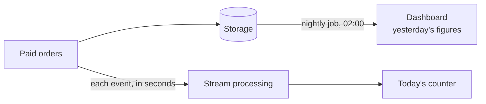
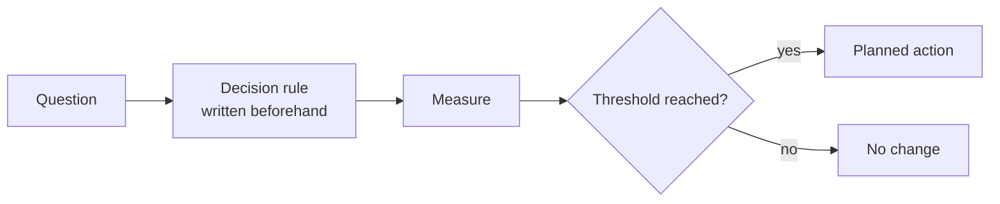
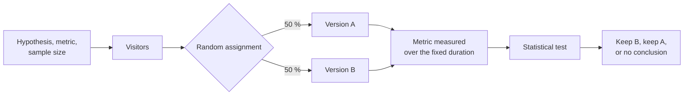
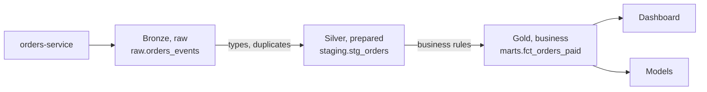
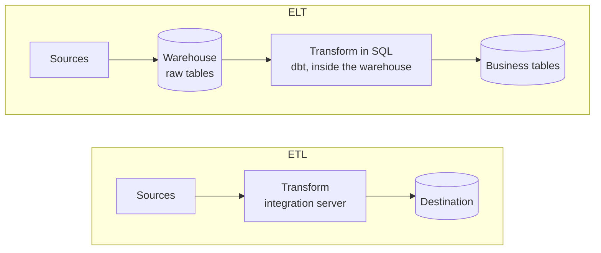
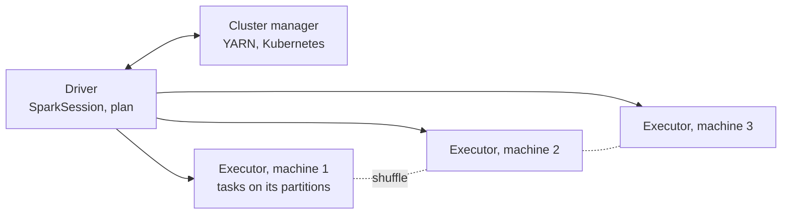
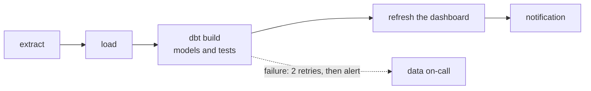
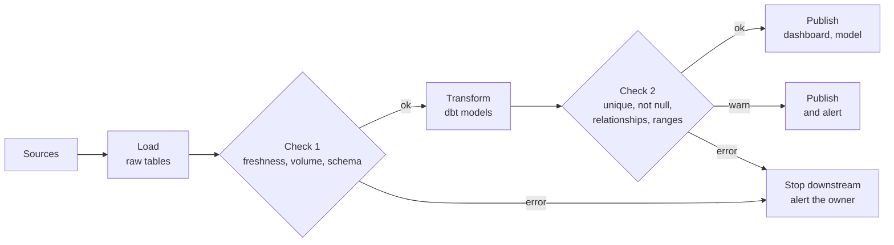
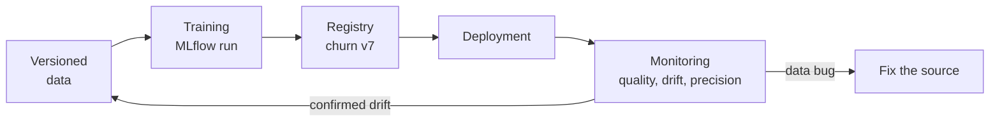
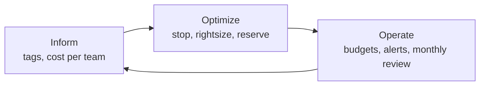

# Data and decisions

!!! warning "Disclaimer"
    These notes are personal cheat sheets, not a source of truth. They reflect my own understanding and choices: their content remains subjective, despite the quotes and references it contains. It may be incomplete, simplified, inaccurate or outdated. Always check the official documentation before applying it. This content is provided as is, without any warranty: you use it at your own risk.

!!! abstract "Scales"
    The colored badges under the headings say at which scale a notion applies:

    - <span class="pill pill-scope pill-scope-code">Code</span> the classes, functions and modules of one program;
    - <span class="pill pill-scope pill-scope-app">Application</span> one service or application and its internal split;
    - <span class="pill pill-scope pill-scope-system">System</span> several services talking to each other over the network;
    - <span class="pill pill-scope pill-scope-infra">Infrastructure</span> servers, network, zones and clusters, physical or virtual;
    - <span class="pill pill-scope pill-scope-enterprise">Enterprise</span> the whole information system and its organization.

    Details and ambiguous words: [map of scales](architecture.md#map-of-scales).

"You cannot improve what you do not measure." This page explains how to go from raw data to a decision: choosing what to measure, getting it in time, showing it clearly, experimenting to prove an effect, predicting, governing data, building the platform that carries it, and tracking what it all costs. The `my-shop` site and its figures are fictitious.

:material-swap-horizontal: The tools mentioned on this page: which ones replace each other, which ones combine? See [Complementary or competing](outils.md#complementary-or-competing).
{ .doc-ref }

## Terminology

**Data**: a recorded fact ("order 42 was paid at 10:03"). **Metric**: a number computed from data ("1,200 orders paid yesterday"). **KPI** (Key Performance Indicator): the handful of metrics a team chose to track because they tell whether it reaches its goal.

**Dashboard**: a page that shows metrics, updated automatically.

**Batch processing**: data is collected then processed in one block, for example every night. **Streaming**: each event is processed as soon as it arrives, within seconds.

```
batch       00:00 to 23:59  orders pile up
            02:00           the nightly job computes yesterday's figures
            09:00           the dashboard shows "yesterday: 1,200 orders"

streaming   10:03:12        order 42 is paid
            10:03:14        the dashboard counter goes to 431 for today
```



## Deciding with data

<span class="pill pill-status pill-status-ok" title="Still valid, checked November 2026">Current · 11/2026</span>

<a class="pill pill-dora" href="https://dora.dev/capabilities/monitoring-systems/">DORA · Monitoring systems to inform business decisions</a>

I open a dashboard hoping it will tell me what to do: it will not. A **data-driven decision** starts from a question, not from a dashboard. I write down **before** looking at the numbers what I will do depending on the result, or I may find afterwards a story that fits the numbers.

```
Question   do customers abandon checkout because of the 3-D Secure step?
Measure    abandonment rate at each checkout step, over 30 days
Decision   if more than 20% (example) of abandonments happen at the 3-D Secure step,
           we test one-click payment for saved cards
```



Traps:

- **vanity metric**: a number that always goes up and decides nothing ("total accounts created since 2015");
- **correlation is not causation**: customers who use the mobile app buy more, but maybe loyal customers are the ones who install it; only an experiment (see A/B testing) proves an effect;
- <span class="term" data-term="goodhart-law">Goodhart's law</span>: a measure that becomes a target stops being a good measure;
- looking at the numbers first, then finding a story that fits them.

## Time to insight

<span class="pill pill-status pill-status-ok" title="Still valid, checked November 2026">Current · 11/2026</span>

<span class="term" data-term="time-to-insight">Time to insight</span> is the delay between the moment something happens and the moment someone can decide based on that information.

```
10:00  a release breaks payment by foreign card
10:00  nightly batch: visible the next day at 09:00 in the report   time to insight: 23 h
10:05  streaming + alert on the payment error rate                   time to insight: 5 min
```

Shortening this delay is expensive (streaming infrastructure, on-call). Do it only where deciding fast changes the outcome: a broken payment loses sales every minute, while the month's revenue can wait until the next morning.

## Real-time analytics

<a class="pill pill-scope pill-scope-system" href="../architecture/#map-of-scales">Scale · System</a> <a class="pill pill-scope pill-scope-infra" href="../architecture/#map-of-scales">Scale · Infrastructure</a> <span class="pill pill-status pill-status-ok" title="Still valid, checked November 2026">Current · 11/2026</span>

<span class="term" data-term="real-time-analytics">Real-time analytics</span> computes metrics continuously on an event stream instead of waiting for a batch. Common tools: Kafka with Flink or Kafka Streams, BigQuery streaming ingestion, ClickHouse (see [Tech tools landscape](outils.md)).

| Need | Real time? |
|---|---|
| I must block fraud while the customer is paying, before the order goes out | yes: the decision is made within seconds |
| I want to see right away that a release broke a journey, like payment with a foreign card | yes, but an observability metric is often enough |
| the executive committee wants the month's revenue, which it looks at once a month | no: a nightly batch is cheaper and simpler |
| my data science team trains a product recommendation model | usually not: training uses history |

:material-book-open-variant: Reference docs: [Apache Kafka, documentation](https://kafka.apache.org/documentation/) (accessed November 2026); [Apache Flink, documentation](https://nightlies.apache.org/flink/flink-docs-stable/) (stable version, accessed November 2026)
{ .doc-ref }

## A/B testing

<a class="pill pill-scope pill-scope-app" href="../architecture/#map-of-scales">Scale · Application</a> <span class="pill pill-status pill-status-ok" title="Still valid, checked November 2026">Current · 11/2026</span>

<a class="pill pill-practice" href="../livraison/#progressive-deployment" title="level 4: it is steered by measurement">Practice · Progressive rollout · L4</a>
<a class="pill pill-dora" href="https://dora.dev/capabilities/team-experimentation/">DORA · Team experimentation</a> <a class="pill pill-dora" href="https://dora.dev/capabilities/customer-feedback/">DORA · Customer feedback</a>

An <span class="term" data-term="ab-test">A/B test</span> (controlled experiment) shows two versions to two randomly drawn groups of users, at the same time, and compares an indicator chosen beforehand. Randomness makes the two groups comparable: the difference comes from the version, not from the users.

!!! noob "As noob"
    It is how a drug trial works: who gets the new treatment is drawn at random, so that both groups look alike in every way (age, habits, season) except for what is being tested. If people chose for themselves, the most curious would pick the new thing and skew the comparison. The takeaway: **random assignment is what lets me say the difference comes from the version.**

```
version A (current button)       10,000 visitors   300 orders   3.00%
version B ("1-click" button)     10,000 visitors   345 orders   3.45%
gap: +0.45 point, that is +15% relative
statistical test (z on two proportions): p = 0.07 approximately
```

B looks 15% better, but the result is **not** <span class="term" data-term="statistical-significance">statistically significant</span> at the usual 5% threshold: with this volume, such a gap happens by chance about 7 times out of 100. More visitors are needed before concluding. (Example figures, redo the calculation with a tool.)

!!! noob "As noob"
    I toss a coin ten times: seven heads is nothing unusual, even with a perfectly fair coin. The p = 0.07 says the same thing: if the two versions were actually equivalent, a gap at least this large would show up about 7 times out of 100, by pure chance. The takeaway: **"not significant" does not mean "no effect", it means "not enough data to rule out chance".**

The **confidence interval** says the same thing as a picture: it is the range of gaps compatible with the observed data, here at 95%. Estimated gap: +0.45 point; interval: about -0.04 to +0.94 point. It contains 0, so "no difference" remains plausible. With twice as many visitors and the same rates (assumption), the interval narrows around the same point, from +0.10 to +0.80 point, and no longer contains 0: I can conclude. I read an A/B test result in this order: does the interval contain 0, then is its lower bound still worth the change. [Take with caution: intervals computed by hand with the normal approximation for two proportions.]

!!! noob "As noob"
    The confidence interval is the margin of a poll: "between 48 and 52%" rather than a single number that would suggest a precision I do not have. Here the range goes from a slight drop to a clear gain: I cannot yet tell which side I am on. The takeaway: **if the range contains zero, the gap may still be chance.**

<figure class="diagram"><svg viewBox="0 0 320 128" role="img" aria-label="95% confidence interval of the gap between B and A"><line class="set" x1="40" y1="95" x2="300" y2="95"/><line class="set" x1="105" y1="15" x2="105" y2="92" stroke-dasharray="3 2"/><rect class="hit" x="99.8" y="30" width="127.4" height="10"/><circle class="layer layer-3" cx="163.5" cy="35" r="3"/><rect class="hit" x="118" y="70" width="91" height="10"/><circle class="layer layer-3" cx="163.5" cy="75" r="3"/><text x="40" y="24" text-anchor="start">10,000 per group: from -0.04 to +0.94, contains 0</text><text x="40" y="64" text-anchor="start">20,000 per group (assumption): from +0.10 to +0.80</text><text x="40" y="107" text-anchor="middle">-0.5</text><text x="105" y="107" text-anchor="middle">0</text><text x="170" y="107" text-anchor="middle">+0.5</text><text x="235" y="107" text-anchor="middle">+1</text><text x="300" y="107" text-anchor="middle">+1.5</text><text x="170" y="122" text-anchor="middle">gap B minus A, in conversion points</text></svg><figcaption>Same estimated gap, two sample sizes (example figures)</figcaption></figure>



Rules:

- set **beforehand** the main indicator, the duration and the number of visitors needed (sample size calculation);
- do not stop as soon as the result "looks good" (peeking multiplies false positives);
- run for at least one full week, to cover quiet and busy days;
- beware of the novelty effect: a new button attracts at first, then the effect fades;
- test the setup before reading the result: each variant works, the measurement fires in both, the observed split matches the planned one ([Quality: testing a feature in an A/B test](qualite.md#testing-a-feature-in-an-ab-test)).

The **sample size calculation** says how many visitors each group needs to see a given gap, if it exists. It depends on the baseline rate, the smallest gap I want to detect, the significance threshold (5%) and the power (80%: the chance of seeing the gap if it is real).

!!! noob "As noob"
    To hear a whisper I have to listen longer than to hear a shout: the smaller the gap I am looking for, the more visitors I need to tell it apart from the noise. A power of 80% means that a real gap of that size would be caught 8 times out of 10, and missed twice. The takeaway: **I work out the number of visitors before starting the test, not after seeing the result.**

```
baseline rate          3% conversion (version A)
gap to detect          +0.5 point, that is 3.5%
threshold and power    5% (two-sided), 80%
result                 about 20,000 visitors per group, 40,000 in total
```

[Take with caution: number computed by hand with the approximate two-proportion formula, recompute it with a sample size calculator.] The example above, with 10,000 visitors per group, therefore had half the visitors needed to conclude on a gap of that size.

| A/B test or canary? | Canary | A/B test |
|---|---|---|
| goal | check that a version breaks nothing | measure whether a version does better |
| indicator | errors, latency | conversion, average basket, retention |
| duration | minutes to hours | one to several weeks |
| outcome | keep it or roll back | keep the winning version, or neither |

The three indicators of the table, one line each:

- **conversion rate** = orders / visitors; version A above: 300 / 10,000 = 3.00%;
- **average order value** = revenue / number of orders; for example €13,500 / 300 orders = €45;
- **30-day retention** = users of a cohort still active 30 days later / cohort size; for example 1,200 / 4,000 March sign-ups = 30%.

Both often rely on the same <span class="term" data-term="feature-flag">feature flags</span>: see [Progressive deployment](livraison.md#progressive-deployment). Source: Ron Kohavi, Diane Tang and Ya Xu, "Trustworthy Online Controlled Experiments" (2020).

:material-book-open-variant: Reference docs: [Ron Kohavi, Diane Tang and Ya Xu, "Trustworthy Online Controlled Experiments"](https://experimentguide.com/) (2020); [Evan Miller, Sample Size Calculator](https://www.evanmiller.org/ab-testing/sample-size.html) (publication date not given)
{ .doc-ref }

## Visualising data

<span class="pill pill-status pill-status-ok" title="Still valid, checked November 2026">Current · 11/2026</span>

<a class="pill pill-dora" href="https://dora.dev/capabilities/visual-management/">DORA · Visual management</a>

A good visualisation answers a question at a glance. Pick the chart from the question:

| Question | Chart |
|---|---|
| how does it change over time, for example orders day after day over three months? | line |
| which is the biggest, for example which countries bring in the most? | horizontal bars, sorted |
| what share of the total, for example how many payments by card and how many by bank transfer? | 100% stacked bars; a pie only with 2 or 3 parts |
| are two quantities related, for example page load time and cart abandonment rate? | scatter plot |
| where are the extreme values, for example the few requests much slower than the others? | histogram, box plot |
| a single number really matters, like today's order count | a big number, with its trend |

Traps:

- bars whose axis does not start at zero: a 2% gap looks huge;
- two vertical axes on the same chart: the crossing of the lines can be made to say anything;
- too many colours: each one must mean something;
- a 40-chart dashboard that nobody reads: start from the 3 to 5 decisions it must help make.

Sources: Edward Tufte, "The Visual Display of Quantitative Information" (1983); Cole Nussbaumer Knaflic, "Storytelling with Data" (2015).

:material-book-open-variant: Reference docs: [Edward Tufte, author's site](https://www.edwardtufte.com/) (accessed November 2026); [Storytelling with Data, Cole Nussbaumer Knaflic's site](https://www.storytellingwithdata.com/) (accessed November 2026)
{ .doc-ref }

## Data governance

<a class="pill pill-scope pill-scope-enterprise" href="../architecture/#map-of-scales">Scale · Enterprise</a> <span class="pill pill-status pill-status-ok" title="Still valid, checked November 2026">Current · 11/2026</span>

<a class="pill pill-dora" href="https://dora.dev/capabilities/healthy-data-ecosystems/">DORA · Healthy data ecosystems</a>

<span class="term" data-term="data-governance">Data governance</span> sets who is responsible for each piece of data, which quality rules it must follow, who can access it, and how long it is kept. Without it, two dashboards show two different "revenues" and nobody knows which to trust.

| Role | Responsibility | Example |
|---|---|---|
| data owner | decides rules and access | the product manager for orders |
| data steward | enforces quality day to day | the `orders-service` team |
| consumer | uses the data within the rules | the team that builds financial reports |

A <span class="term" data-term="data-contract">data contract</span> writes these rules down for a given dataset, and CI can check it:

```yaml
# Example: data contract (owner, schema, freshness, retention, access)
dataset: orders_paid
owner: team-orders
schema:
  order_id: { type: integer, required: true, unique: true }
  total_cents: { type: integer, required: true, minimum: 0 }
  customer_email: { type: string, pii: true }
freshness: "data less than 15 minutes old"
retention: "3 years, then anonymisation"
access: "read: finance, data; customer_email masked for everyone else"
```

What governance also covers:

- **quality**: completeness, uniqueness, freshness, allowed values;
- **<span class="term" data-term="data-lineage">lineage</span>**: where a piece of data comes from and which transformations it went through;
- the **catalogue**: the list of datasets, with their description and owner;
- **compliance**: personal data, retention period, the right to erasure under the <span class="term" data-term="gdpr">GDPR</span>.

Source: DAMA International, "DAMA-DMBOK: Data Management Body of Knowledge", 2nd edition (2017).

:material-book-open-variant: Reference docs: [DAMA International, DAMA-DMBOK](https://www.dama.org/cpages/body-of-knowledge) (2nd edition, 2017)
{ .doc-ref }

## Data science and predictive models

<a class="pill pill-scope pill-scope-app" href="../architecture/#map-of-scales">Scale · Application</a> <span class="pill pill-status pill-status-ok" title="Still valid, checked November 2026">Current · 11/2026</span>

**Data science** extracts knowledge from data with statistics and machine learning. A <span class="term" data-term="predictive-model">predictive model</span> learns from history to estimate what is likely to happen.

```
Question     which customers will cancel their subscription next month?
History      24 months of customers, with their usage and whether they cancelled
Training     on the first 18 months
Evaluation   on the last 6 months, which the model has never seen
Result       of the 500 customers flagged "at risk", 210 really cancelled (example)
Decision     the customer team calls these 500 customers first
```

Traps:

- **<span class="term" data-term="data-leakage">data leakage</span>**: during training the model sees information it will not have in real life (for example the cancellation date), and its results are too good to be true;
- **drift**: the world changes (new offer, new season) and the model is more and more wrong; monitor its results in production and retrain it;
- a model nobody uses: start from the decision it must support.

Drift shows on a monthly precision curve (among customers flagged "at risk", the share who really cancelled, known one month later):

```
January    42%   in production (210 out of 500)
February   41%
March      39%   new offer launched: usage changes
April      33%   below the 35% threshold set beforehand: retraining triggered
May        43%   model retrained on the last 18 months, new offer included
```

(Example figures and threshold.)

:material-book-open-variant: Reference docs: [scikit-learn, "Common pitfalls and recommended practices"](https://scikit-learn.org/stable/common_pitfalls.html) (stable version, accessed November 2026)
{ .doc-ref }

## Predictive AI and generative AI

| | Predictive AI (classic machine learning) | Generative AI (<span class="term" data-term="llm">LLMs</span>, image models) |
|---|---|---|
| what it produces | a number, a class, a probability | text, code, an image |
| example | "this customer has a 70% risk of cancelling" | "write the follow-up email for this customer" |
| data needed | a labelled history specific to the company | an already trained model, plus the request's context |
| how it is evaluated | accuracy on data never seen | evaluation sets, human review |

The two combine: the predictive model picks **who** to contact, the generative model helps write **what** to say. See [Agents, skills and context](ia-agents.md) and [AI at work](ia-entreprise.md).

## Data platform

<a class="pill pill-scope pill-scope-system" href="../architecture/#map-of-scales">Scale · System</a> <a class="pill pill-scope pill-scope-infra" href="../architecture/#map-of-scales">Scale · Infrastructure</a>

<a class="pill pill-dora" href="https://dora.dev/capabilities/healthy-data-ecosystems/">DORA · Healthy data ecosystems</a>

!!! info "Section written in November 2026"
    Data products merge, get renamed and add features every year. The names given are examples, and their capabilities are to check at the time of reading.

A **data platform** is the set of building blocks that carry a piece of data from the application that produces it to the person or model that uses it. The previous sections cover what I do with the numbers; this one covers the plumbing that produces them.

```
sources          integration          storage              transformation        use
orders-service ─┐                                                              ┌─ dashboards
payments-service├─ CDC, connectors ─> warehouse or lake ─> dbt, Spark ─────────┼─ data application
files, APIs    ─┘                                                              └─ models (MLOps)
                 └──────────── orchestration (Airflow) and quality tests at every step ──────────────┘
```

General rule: start with the simplest thing that answers the question. For `my-shop`, a managed warehouse, a connector tool, dbt and an orchestrator cover the essentials; Spark, the lakehouse and MLOps come in when a specific need calls for them.

*dbt: complements Airflow, Fivetran, Airbyte, BigQuery, Snowflake*
{ .tool-rel }


### Warehouse, lake or lakehouse

<span class="pill pill-status pill-status-ok" title="Still valid, checked November 2026">Current · 11/2026</span>

A <span class="term" data-term="data-warehouse">data warehouse</span> stores structured tables, optimised for SQL analysis (BigQuery, Snowflake, Redshift). A <span class="term" data-term="data-lake">data lake</span> stores raw files of any format on cheap object storage (S3 or GCS buckets, Parquet files, JSON, images). The <span class="term" data-term="lakehouse">lakehouse</span> adds to the lake what it lacked for analysis: transactions, a schema, version history, thanks to an <span class="term" data-term="open-table-format">open table format</span> (Delta Lake, Apache Iceberg, Apache Hudi).

*BigQuery: competes with Snowflake, Databricks, ClickHouse; complements PostgreSQL, dbt*<br>
*Snowflake: competes with BigQuery, Databricks, ClickHouse; complements dbt*
{ .tool-rel }


!!! noob "As noob"
    The warehouse is a library: books shelved and catalogued, easy to find, but everything has to be sorted before it is shelved. The lake is an attic: everything goes in, cheaply, unsorted, and finding something means digging. The lakehouse is that attic with labelled shelves and a log of what comes in and out. The takeaway: **I choose between sorting first (warehouse) and sorting when I search (lake); the lakehouse tries to have both.**

| | Warehouse | Lake | Lakehouse |
|---|---|---|---|
| what goes in | cleaned tables | everything, raw | everything, with transactional tables on top |
| language | SQL | code (Spark, Python) | SQL and code on the same files |
| strength | simple, fast, little to operate | cheap, keeps everything, accepts text and images | a single storage for analysis and machine learning |
| weakness | cost per volume computed, unstructured data poorly served | quickly turns into a "swamp" without a catalog or quality | more building blocks to understand and tune |
| examples | BigQuery, Snowflake | bucket + Parquet | Databricks, or Iceberg read by several engines |

**When**: a warehouse as soon as reports slow down the production database (see [Scaling a database](sql.md#scaling-a-database)); a lake when I need to keep a lot of raw or unstructured data (logs, documents, images for a model); a lakehouse when the data science team and the analytics team work on the same large volumes and I refuse to copy the data twice. **Not**: a lakehouse for a few dozen gigabytes of tables, which a managed warehouse serves effortlessly.

**Why**: separating analysis from production protects the application and gives analysts fast queries over the whole history. The cost: a copy of the data to keep up to date and govern. The boundaries are moving: BigQuery and Snowflake can read Iceberg tables, Databricks offers a SQL warehouse (to check depending on the offers).

*Databricks: competes with BigQuery, Snowflake; complements Spark, dbt*
{ .tool-rel }


**How**: data arrives in three layers, often named bronze, silver, gold (*medallion architecture*, a term popularised by Databricks) or raw, staging, business.
```
raw.orders_events        raw copy of the orders-service events, never modified
staging.stg_orders       one row per order, types fixed, duplicates removed
marts.fct_orders_paid    paid orders, ready for the revenue dashboard
```



:material-book-open-variant: Reference docs: [Databricks, "What is a medallion architecture?"](https://www.databricks.com/glossary/medallion-architecture) (accessed November 2026); [Michael Armbrust et al., "Lakehouse", CIDR](https://www.cidrdb.org/cidr2021/papers/cidr2021_paper17.pdf) (2021)
{ .doc-ref }

### Integrating data: ETL or ELT

<span class="pill pill-status pill-status-ok" title="Still valid, checked November 2026">Current · 11/2026</span>

<span class="term" data-term="etl">ETL</span> (*Extract, Transform, Load*) transforms the data **before** loading it into the destination. <span class="term" data-term="elt">ELT</span> loads it **raw**, then transforms it **inside** the warehouse, in SQL. ELT has dominated since managed warehouses made computing fast and cheap; ETL is still useful when I must filter or anonymise before the data arrives (personal data, huge volumes, a destination that cannot compute).

!!! noob "As noob"
    ETL is peeling the vegetables at the market before bringing them home. ELT is bringing everything back to the kitchen (the warehouse), which has good tools, and peeling there, keeping the raw vegetables in case the recipe changes. The takeaway: **ELT keeps the raw data and transforms inside the warehouse; ETL filters first, when some data must not even arrive.**



| Tool | Role | When to pick it |
|---|---|---|
| managed connectors (Fivetran, Airbyte) | Extract and Load from hundreds of sources (databases, SaaS, APIs) | ELT, standard sources, no wish to write connectors |
| <span class="term" data-term="cdc">CDC</span> (Debezium, Datastream) | reads the database log and copies every change continuously | fresh production data without loading the database; see [the write-then-publish trap](api-rest-async.md#the-write-then-publish-trap) |
| Apache NiFi | data flows drawn in a graphical interface, routing and transformation on the fly | many heterogeneous sources, a team that prefers configuring to coding |
| Snowflake Openflow | Snowflake's integration service, built on NiFi (announced in 2025, to check) | already on Snowflake, need flows managed in the same place |
| Google Cloud Data Fusion | Google Cloud's managed graphical ETL, built on the open source CDAP project (to check) | already on Google Cloud, a team not at ease with code |
| dbt | the T of ELT: versioned, tested and documented SQL models, run in the warehouse | any SQL transformation in a warehouse |

**When**: a graphical tool when flows are many, simple and maintained by people who don't code; code (dbt, Spark) as soon as transformations carry business rules I want to review in a merge request and test. **Not**: a graphical tool for complex business rules, hard to review and test outside the interface.

**Why**: writing a connector per source myself is expensive to maintain (pagination, API limits, schema changes). The gain of the tools: data arrives without code; the cost: a bill often based on volume, and a dependency on the tool's format.

**How**: a dbt model is a `SELECT` in a file; `ref()` declares the dependency, and dbt derives the execution order and the <span class="term" data-term="data-lineage">lineage</span> from it.
```sql
-- Example: dbt model, a SELECT that declares its dependency with ref()
select
    order_id,
    customer_id,
    total_cents / 100.0 as total_eur,
    paid_at
from {{ ref('stg_orders') }}
where status = 'paid'
```
```bash
dbt build --select fct_orders_paid
```
`dbt build` runs the model then its tests (next section).

:material-book-open-variant: Reference docs: [dbt, models documentation](https://docs.getdbt.com/docs/build/models) (accessed November 2026); [Debezium, documentation](https://debezium.io/documentation/) (accessed November 2026)
{ .doc-ref }

### Spark: computing across many machines

<span class="pill pill-status pill-status-ok" title="Still valid, checked November 2026">Current · 11/2026</span>


*Spark: complements Airflow, Databricks*
{ .tool-rel }

<span class="term" data-term="spark">Apache Spark</span> splits a computation on data too big for one machine and spreads it over a cluster, in SQL, Python (PySpark), Scala or Java. Databricks is the commercial platform founded by its creators; Dataproc (Google Cloud) and EMR (AWS) offer it as a managed service.



**When**: terabytes to transform, processing that SQL expresses poorly (text, iterative computations, data preparation for a model), a data lake without a SQL engine. **Not**: data that fits in the warehouse (SQL is simpler there), or on a laptop: pandas, Polars or DuckDB are faster for a few gigabytes, with no cluster to run.

**Why**: the gain is almost unlimited scale. The cost: a cluster to size, tuning (partitions, memory, shuffling data between machines) and a startup time that penalises small jobs.

**How**: daily revenue per country, over Parquet files in a lake.
```python
from pyspark.sql import SparkSession, functions as F

# Example: daily revenue per country with Spark, read and written as Parquet
spark = SparkSession.builder.appName("daily_revenue").getOrCreate()

orders = spark.read.parquet("gs://my-shop-lake/orders/")
daily = (
    orders.where(F.col("status") == "paid")
    .groupBy(F.to_date("paid_at").alias("day"), "country")
    .agg(F.sum("total_cents").alias("revenue_cents"))
)
daily.write.mode("overwrite").partitionBy("day").parquet("gs://my-shop-lake/daily_revenue/")
```

:material-book-open-variant: Reference docs: [Apache Spark, "Cluster Mode Overview"](https://spark.apache.org/docs/latest/cluster-overview.html) (latest version, accessed November 2026); [Apache Spark, "Spark SQL, DataFrames and Datasets Guide"](https://spark.apache.org/docs/latest/sql-programming-guide.html) (latest version, accessed November 2026)
{ .doc-ref }

### Orchestrating jobs

<span class="pill pill-status pill-status-ok" title="Still valid, checked November 2026">Current · 11/2026</span>

A <span class="term" data-term="data-orchestrator">data orchestrator</span> runs jobs in the right order, at the planned time, retries the ones that fail, keeps the history and lets me replay a past period. Apache Airflow is the most widespread; Dagster and Prefect are more recent alternatives. How Airflow works, with an example DAG and the comparison with Temporal, is in the [tools overview](outils.md).

*Airflow: competes with Dagster, Prefect; partly competes with Temporal, Argo Workflows; complements dbt, Spark*<br>
*Dagster: competes with Airflow, Prefect*<br>
*Prefect: competes with Airflow, Dagster*<br>
*Temporal: partly competes with Airflow, Argo Workflows*
{ .tool-rel }


**When**: several jobs that depend on each other (load, then transform, then test, then refresh the dashboard). **Not**: a single nightly job, which a scheduled task (cron, the cloud scheduler) runs just fine.

**Why**: without an orchestrator, dependencies are times of day ("loading finishes around 3 am, we transform at 4 am") that break the day loading takes longer. The cost: one more service to host and monitor.

**How**: one DAG per processing chain, one task per step (`extract`, `dbt build`, notification), limited automatic retries, and an alert when the final data is not fresh at the promised time.



:material-book-open-variant: Reference docs: [Apache Airflow, "DAGs"](https://airflow.apache.org/docs/apache-airflow/stable/core-concepts/dags.html) (stable version, accessed November 2026)
{ .doc-ref }

### Testing data quality

<span class="pill pill-status pill-status-ok" title="Still valid, checked November 2026">Current · 11/2026</span>

A <span class="term" data-term="data-quality-test">data quality test</span> checks the content, not the code: uniqueness, no empty values, allowed values, consistency between tables, freshness. It is the [data contract](#data-governance) put into practice.

**When**: at every step where data changes hands (after loading, after transforming, before publishing a dashboard or training a model). **Not**: testing everything everywhere; start with the columns a decision depends on.

**Why**: wrong data does not crash the pipeline, it just produces a wrong number, which someone notices weeks later. The gain: the error is stopped where it appears. The cost: tests to maintain, and alerts to triage when a source changes.



Each test has a severity: `error` stops what follows, `warn` lets it through and notifies (dbt's `severity` config). `dbt build` runs the tests right after each model and skips the models downstream of a failed test: the dashboard keeps the last correct number rather than showing a wrong one.

**How**, with dbt tests, declared next to the model:
```yaml
# Example: dbt tests declared next to the model (unique, not null, relationship, range)
models:
  - name: fct_orders_paid
    columns:
      - name: order_id
        data_tests:
          - unique
          - not_null
      - name: customer_id
        data_tests:
          - relationships:
              to: ref('dim_customers')
              field: customer_id
      - name: total_eur
        data_tests:
          - dbt_utils.accepted_range:
              min_value: 0
```
(The key is called `tests` before dbt 1.8, 2024, to check; `accepted_range` comes from the `dbt_utils` package.)

Great Expectations (open source, Python) does the same outside dbt, on a DataFrame or a table, and publishes a readable report:
```python
import great_expectations as gx

# Example: the same range check with Great Expectations, outside dbt
context = gx.get_context()
batch = context.data_sources.pandas_default.read_csv("orders_paid.csv")
result = batch.validate(gx.expectations.ExpectColumnValuesToBeBetween(column="total_eur", min_value=0))
print(result.success)
```
(API of version 1.x, which changed a lot from the 0.x versions, to check.)

| | dbt tests | Great Expectations |
|---|---|---|
| where | in the dbt project, on warehouse tables | anywhere in Python: Spark pipeline, file, DataFrame |
| written as | YAML, or a SQL query that returns the faulty rows | Python or configuration |
| when to pick it | the transformation is already in dbt | data outside the warehouse, checks before loading |

:material-book-open-variant: Reference docs: [dbt, "Add data tests to your DAG"](https://docs.getdbt.com/docs/build/data-tests) (accessed November 2026); [Great Expectations, documentation](https://docs.greatexpectations.io/) (version 1.x, accessed November 2026); [dbt, severity](https://docs.getdbt.com/reference/resource-configs/severity) (accessed November 2026)
{ .doc-ref }

### Data applications: Streamlit

<span class="pill pill-status pill-status-ok" title="Still valid, checked November 2026">Current · 11/2026</span>

A <span class="term" data-term="data-app">data application</span> is a small web application for interacting with data or a model: pick a filter, run a simulation, fix a value. Streamlit (open source, acquired by Snowflake in 2022) builds one from a plain Python script; Dash and Gradio play the same role.

**When**: an internal tool for a few dozen people, a prototype to show, exploring a model ("what if this customer had 3 more orders?"). **Not**: a public product, thousands of users, fine-grained per-user permissions: that is a real application. For a plain dashboard, the dashboarding tool is enough.

**Why**: the gain is time: someone who knows Python ships a usable tool in a day, without a front-end team. The cost: each interaction reruns the script, which limits performance, and the app must be hosted, authenticated and maintained like everything else.

**How**:
```python
import pandas as pd
import streamlit as st

# Example: Streamlit app, a country filter and a line chart
st.title("Revenue by country")
orders = pd.read_parquet("fct_orders_paid.parquet")
country = st.selectbox("Country", sorted(orders["country"].unique()))
daily = orders[orders["country"] == country].groupby("day")["total_eur"].sum()
st.line_chart(daily)
```
```bash
streamlit run revenue_app.py
```

:material-book-open-variant: Reference docs: [Streamlit, documentation](https://docs.streamlit.io/) (accessed November 2026)
{ .doc-ref }

### MLOps: from notebook to production

<span class="pill pill-status pill-status-ok" title="Still valid, checked November 2026">Current · 11/2026</span>

<span class="term" data-term="mlops">MLOps</span> applies to machine learning what DevOps did for code: versioning, reproducing, deploying and monitoring models. It extends the [Data science and predictive models](#data-science-and-predictive-models) section, where drift shows up on a curve.

**When**: a model that drives real decisions and must be retrained regularly, or several people training variants. **Not**: a one-off analysis in a notebook that will not be rerun.

**Why**: without tracking, nobody knows which dataset and parameters produced the model in production, or whether it is already wrong. The cost: tooling and the discipline of recording every training run.

**How**, in two parts.



**1. Track and version** with MLflow (open source, created by Databricks in 2018): each training run records its parameters, its metrics and the model produced; the <span class="term" data-term="model-registry">model registry</span> keeps the versions and says which one serves production.
```python
import mlflow
from sklearn.ensemble import RandomForestClassifier

# Example: a training run tracked by MLflow (parameters, metric, registered model)
with mlflow.start_run(run_name="churn-2026-11"):
    model = RandomForestClassifier(n_estimators=200, max_depth=8).fit(x_train, y_train)
    mlflow.log_params({"n_estimators": 200, "max_depth": 8, "train_months": 18})
    mlflow.log_metric("precision_at_500", 0.42)
    mlflow.sklearn.log_model(model, "model", registered_model_name="churn")
```
(Signature of `log_model` to check depending on the MLflow version, the path argument changed in 3.x.)

**2. Monitor in production**: observing a model goes further than observing an API (latency, errors), because a model can answer fast and be wrong.

| What I monitor | Question | Example signal |
|---|---|---|
| input feature quality | is the incoming data sound? | 30% of `last_login_days` empty since yesterday, versus 1% at training |
| <span class="term" data-term="data-drift">data drift</span> | has the population changed? | the distribution of `orders_last_90d` shifted after the new offer |
| concept drift | has the link between inputs and outcome changed? | at equal usage, customers churn less: the model overestimates the risk |
| <span class="term" data-term="training-serving-skew">training-serving skew</span> | is the feature computed the same way on both sides? | `basket_avg` in euros at training, in cents in production |
| actual performance | is the model right? | monthly precision, known when the real answers arrive |

A weekly drift report compares the distribution of each feature with the training one, often with the PSI (*Population Stability Index*):
```
week 45, churn model v7, reference: training set
feature              PSI    status
orders_last_90d      0.27   strong drift  (> 0.2)
last_login_days      0.04   stable
basket_avg           0.31   strong drift  : check the unit before retraining
share of empty values: last_login_days 30% (training: 1%)  quality alert
```
[Take with caution: the PSI thresholds 0.1 and 0.2 are a widespread rule of thumb, not a standard; example numbers.] Tools: Evidently (open source), or the monitoring built into platforms (Vertex AI Model Monitoring, SageMaker Model Monitor, Databricks Lakehouse Monitoring, to check). Drift does not always call for retraining: it first triggers an investigation, because the cause is often a data bug (here the unit of `basket_avg`).

:material-book-open-variant: Reference docs: [MLflow, documentation](https://mlflow.org/docs/latest/) (latest version, accessed November 2026); [Google Cloud, "MLOps: Continuous delivery and automation pipelines in machine learning"](https://cloud.google.com/architecture/mlops-continuous-delivery-and-automation-pipelines-in-machine-learning) (accessed November 2026)
{ .doc-ref }

### Which building block for which need

| Need | Building block | Examples | Start without it if... |
|---|---|---|---|
| my analysts want to query the whole order history in SQL, without slowing down the production database | warehouse | BigQuery, Snowflake | a read replica is still enough |
| I must keep raw or unstructured data, like logs, documents or images for a model | lake | bucket + Parquet | everything is already tabular |
| the data science team and the analytics team work on the same large volumes, and I refuse to copy the data twice | lakehouse | Databricks, Iceberg | modest volumes, a single team |
| I must copy data from orders-service or a SaaS tool into the warehouse | connectors, CDC | Fivetran, Airbyte, Debezium | a scheduled export is enough |
| I have many simple flows, maintained by people who prefer configuring to coding | graphical ETL | NiFi, Openflow, Data Fusion | the flows carry business rules to review |
| I want the revenue calculation written in SQL, reviewed in a merge request and tested like code | dbt | dbt Core, dbt Cloud | a few SQL views are enough |
| my data no longer fits on one machine, like terabytes of orders to transform | Spark | Databricks, Dataproc, EMR | DuckDB or the warehouse can handle the load |
| several jobs depend on each other (load, transform, test, refresh) and I must be able to replay a past day | orchestrator | Airflow, Dagster | a single scheduled job |
| I want wrong data, like a negative order total, never to reach the dashboard | quality tests | dbt tests, Great Expectations | never: at least on the columns that decide |
| a team wants a small internal tool to filter data or try a model, without a front-end team | data application | Streamlit | a dashboard is enough |
| a model drives real decisions, and I must know which version runs and whether it starts getting things wrong | MLOps | MLflow, Evidently | one-off analysis, no model in production |

## Costs and savings

<a class="pill pill-scope pill-scope-infra" href="../architecture/#map-of-scales">Scale · Infrastructure</a> <a class="pill pill-scope pill-scope-enterprise" href="../architecture/#map-of-scales">Scale · Enterprise</a> <span class="pill pill-status pill-status-ok" title="Still valid, checked November 2026">Current · 11/2026</span>

I announce "we saved money on the cloud", but the bill barely moved because the number of orders grew in the meantime. So a saving is proven like a performance gain: against a **measured baseline**, expressed per meaningful **unit**, like the cost per 1,000 orders.

```
before   €3,200 of cloud per month for 4 million orders   €0.80 per 1,000 orders
after    €2,900 of cloud per month for 5 million orders   €0.58 per 1,000 orders
the total bill barely dropped, but the unit cost fell by about 27% (example figures)
```

<span class="term" data-term="finops">FinOps</span> organises this in three phases: **inform** (know who spends what, thanks to resource labels), **optimise** (delete, resize, reserve), **operate** (track continuously, with budgets and alerts). Source: [FinOps Foundation, FinOps Framework](https://www.finops.org/framework/) (revised regularly, to check).



The three phases over one month, with the "after" bill of the example above (example figures):

```
inform      labels required on every resource:
            team=team-core  service=orders-service  env=prod

            October report per team
            team-core        €1,450   (orders-service €1,100, my-api €350)
            team-payments      €980
            unlabelled         €470   to assign before the next report
            total            €2,900

optimise    the 6 staging machines of orders-service run 24 hours a day;
            stopped at night and on weekends (60 hours up out of 168):
            €420 a month becomes €150, that is €270 saved per month

operate     team-core budget at €1,500 a month, alert at 80% (€1,200)
```

## Pitfalls to avoid

- **Numbers first, question later**: I open the dashboard and then find a story that fits the numbers, so I decide on a coincidence; I write the question and the decision rule before looking ([see Deciding with data](#deciding-with-data)).
- **Correlation taken for a cause**: I see that mobile app customers buy more and I push the app, when it may be loyal customers who install it; only a controlled experiment proves an effect ([see A/B testing](#ab-testing)).
- **A/B test stopped too early**: I stop the test as soon as version B "looks good", false positives multiply and I keep a version that does no better; I set the metric, the duration and the number of visitors beforehand, and let it run for at least one full week.
- **Real time everywhere**: I build streaming for a number looked at once a month, and pay for infrastructure and on-call for nothing; I keep real time for decisions where every minute counts, like a broken payment ([see Time to insight](#time-to-insight)).
- **Misleading chart**: I draw bars whose axis does not start at zero, or a dashboard of 40 charts, and a 2% gap looks huge or nobody reads anything; I start from the 3 to 5 decisions the dashboard must help make ([see Visualising data](#visualising-data)).
- **Data leakage in the model**: I let the model see during training a piece of information it will not have in real life, like the cancellation date, and its too-good results collapse in production; I evaluate on data it has never seen and remove that information ([see Data science](#data-science-and-predictive-models)).
- **No data quality test**: I rely on the pipeline to flag errors, but wrong data does not crash it, it produces a wrong number found weeks later; I test at every handover, starting with the columns a decision depends on ([see Testing data quality](#testing-data-quality)).
- **Savings with no unit**: I announce savings on the total bill, which barely moves because volume grew; I start from a measured baseline and bring the cost back to a unit, like the cost per 1,000 orders ([see Costs and savings](#costs-and-savings)).

## What interviews ask

The typical questions:

- "How do you make decisions from data without getting fooled?", "Correlation or causation, how do you tell them apart?" How I answer: I write the question and the decision rule before looking, and I recall that only a controlled experiment proves an effect ([Deciding with data](#deciding-with-data)).
- "How do you run an A/B test, and when can you conclude?", "What does p = 0.07 mean?" How I answer: I compute the sample size beforehand, I refuse to stop at the first good result, and I check whether the confidence interval contains 0 ([A/B testing](#ab-testing)).
- "A/B test or canary, what is the difference?" How I answer: I tell apart the canary, which checks within hours that a version breaks nothing, and the A/B test, which measures over weeks whether it does better ([A/B testing](#ab-testing), [Progressive deployment](livraison.md#progressive-deployment) and [Testing a canary deployment](qualite.md#testing-a-canary-deployment)).
- "Warehouse, lake or lakehouse?", "ETL or ELT?" How I answer: I start from the need (SQL on clean tables, raw or unstructured data, two teams on the same volumes) and say when ETL is still useful, to filter or anonymise before the data arrives ([Warehouse, lake or lakehouse](#warehouse-lake-or-lakehouse), [ETL or ELT](#integrating-data-etl-or-elt)).
- "How do you test a data pipeline?" How I answer: I place content tests at every step, with an `error` or `warn` severity, in dbt or with Great Expectations, so the dashboard keeps the last correct number ([Testing data quality](#testing-data-quality)).
- "How do you know a model in production is degrading?" How I answer: I describe monitoring input quality, drift and real precision, and an investigation before any retraining ([MLOps](#mlops-from-notebook-to-production)).

What makes a good answer: start from the decision to make and what a wrong number costs, before naming a tool.

## What to use in which situation

| Situation | I use |
|---|---|
| I must decide based on numbers, like whether to launch one-click payment | the question and the decision rule written before looking at the numbers |
| I want to know within minutes that a journey is broken, like payment with a foreign card after a release | streaming metric + alert (short time to insight) |
| leadership wants a monthly report, like the month's revenue | nightly batch |
| I want to prove that something new does better, like a "1-click" button meant to bring more orders | A/B test, duration and size set beforehand |
| I want to check that a new version breaks nothing before opening it to everyone | canary, not an A/B test |
| I want to show how a number changes, or who comes first | line chart; a ranking: sorted bars |
| two dashboards show two different "revenue" numbers, and nobody knows which one to trust | governance: one owner, one definition, a data contract |
| I want to anticipate a behaviour, like which customers will cancel next month | predictive model evaluated on unseen data |
| I want to produce text or code, like a reminder email to a customer | generative AI, with review |
| analysts' reports slow down the production database, and therefore the application | a data warehouse (BigQuery, Snowflake), fed by CDC or connectors |
| the data science team and the analytics team work on the same large volumes | a lakehouse (Databricks, Iceberg tables) |
| I want data transformations reviewed in a merge request and tested like code | dbt in the warehouse (ELT) |
| my jobs depend on each other, and the day loading runs late, the transformation runs on incomplete data | an orchestrator (Airflow) |
| a wrong number is found weeks later, after decisions were already made on it | data quality tests (dbt tests, Great Expectations) |
| a team quickly wants an internal tool on data or a model, without waiting for a front-end team | a Streamlit application |
| nobody knows which model version runs in production, or whether it is already getting things wrong | MLflow for tracking, monitoring of drift and feature quality |
| I must prove a cloud saving while traffic changed in the meantime | unit cost compared to a measured baseline |

## Sources

- Ron Kohavi, Diane Tang and Ya Xu, "Trustworthy Online Controlled Experiments" (2020)
- Edward Tufte, "The Visual Display of Quantitative Information" (1983)
- Cole Nussbaumer Knaflic, "Storytelling with Data" (2015)
- DAMA International, "DAMA-DMBOK", 2nd edition (2017)
- [FinOps Foundation, FinOps Framework (revised regularly)](https://www.finops.org/framework/)
- [DORA, "Monitoring systems to inform business decisions" (checked on 2026-10-29)](https://dora.dev/capabilities/monitoring-systems/)
- Michael Armbrust et al., "Lakehouse: A New Generation of Open Platforms that Unify Data Warehousing and Advanced Analytics", CIDR (2021)
- [dbt documentation, data tests (publication date not given, to check)](https://docs.getdbt.com/docs/build/data-tests)
- [Great Expectations documentation (publication date not given, to check)](https://docs.greatexpectations.io/)
- [Apache Spark documentation (publication date not given, to check)](https://spark.apache.org/docs/latest/)
- [Apache NiFi documentation (publication date not given, to check)](https://nifi.apache.org/documentation/)
- [Streamlit documentation (publication date not given, to check)](https://docs.streamlit.io/)
- [MLflow documentation (publication date not given, to check)](https://mlflow.org/docs/latest/)
- D. Sculley et al., "Hidden Technical Debt in Machine Learning Systems", NeurIPS (2015)
