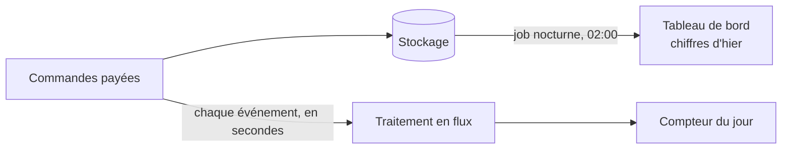
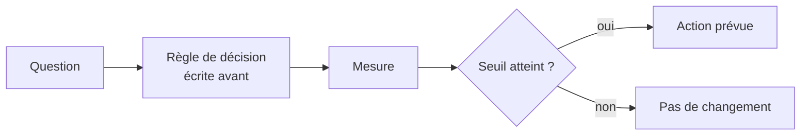
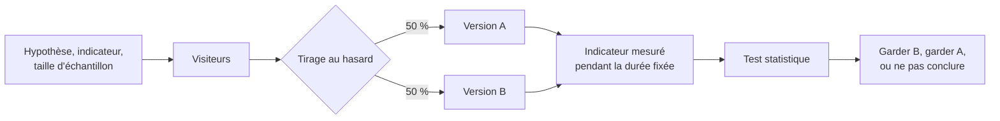
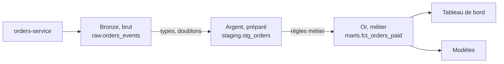
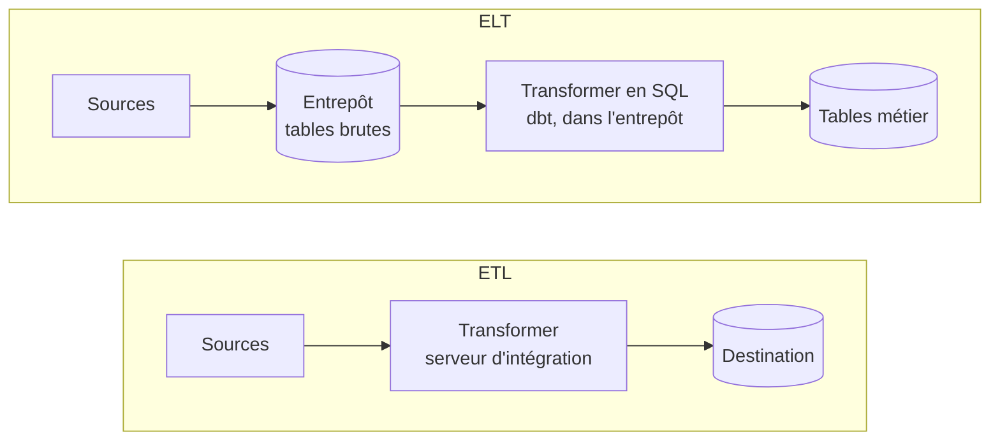
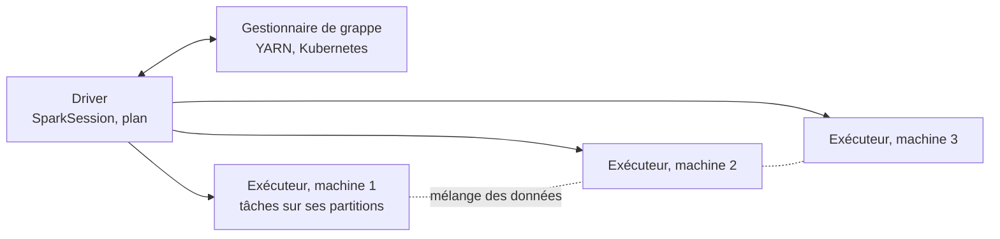
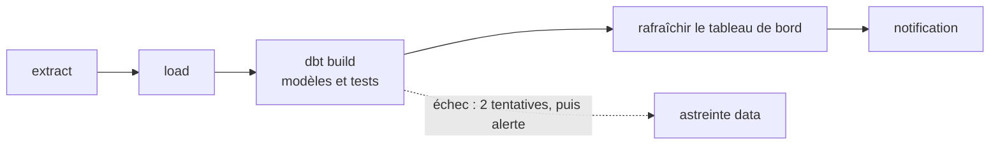
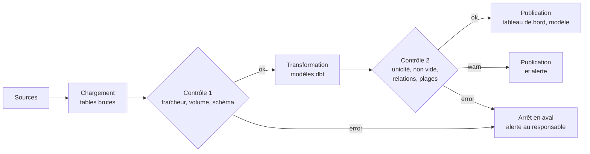
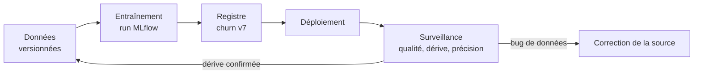
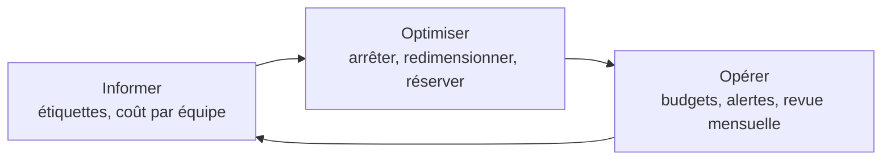

# Données et décision

!!! warning "Avertissement"
    Ces notes sont des pense-bêtes personnels, pas une source de vérité. Elles reflètent ma compréhension et mes choix : leur contenu reste subjectif, malgré les citations et les références qu'il contient. Il peut être incomplet, simplifié, inexact ou dépassé. Vérifiez toujours dans la documentation officielle avant de l'appliquer. Ce contenu est fourni tel quel, sans aucune garantie : son utilisation se fait sous votre seule responsabilité.

!!! abstract "Les échelles"
    Les pastilles de couleur sous les titres disent à quelle échelle une notion s'applique :

    - <span class="pill pill-scope pill-scope-code">Code</span> les classes, fonctions et modules d'un programme ;
    - <span class="pill pill-scope pill-scope-app">Application</span> un service ou une application et son découpage interne ;
    - <span class="pill pill-scope pill-scope-system">Système</span> plusieurs services qui communiquent par le réseau ;
    - <span class="pill pill-scope pill-scope-infra">Infrastructure</span> les serveurs, le réseau, les zones et les clusters, physiques ou virtuels ;
    - <span class="pill pill-scope pill-scope-enterprise">Entreprise</span> le système d'information entier et son organisation.

    Détail et mots ambigus : [carte des échelles](architecture.md#carte-des-echelles).

« On ne peut pas améliorer ce qu'on ne mesure pas. » Cette page explique comment passer d'une donnée brute à une décision : choisir ce qu'on mesure, l'avoir à temps, le montrer clairement, expérimenter pour prouver un effet, prédire, gouverner les données, construire la plateforme qui les transporte, et suivre ce que tout cela coûte. Le site `my-shop` et ses chiffres sont fictifs.

:material-swap-horizontal: Les outils cités dans cette page : lesquels se remplacent, lesquels se combinent ? Voir [Complémentaires ou concurrents](outils.md#complementaires-ou-concurrents).
{ .doc-ref }

## Vocabulaire

**Donnée** : un fait enregistré (« la commande 42 a été payée à 10:03 »). **Métrique** : un chiffre calculé à partir des données (« 1 200 commandes payées hier »). **KPI** (Key Performance Indicator) : la poignée de métriques qu'une équipe a choisi de suivre parce qu'elles disent si elle atteint son objectif.

**Tableau de bord** : une page qui affiche des métriques, mise à jour automatiquement.

**Traitement par lots (batch)** : les données sont collectées puis traitées d'un bloc, par exemple chaque nuit. **Flux (streaming)** : chaque événement est traité dès qu'il arrive, en quelques secondes.

```
batch       00:00 à 23:59  les commandes s'accumulent
            02:00          le job nocturne calcule les chiffres de la veille
            09:00          le tableau de bord montre « hier : 1 200 commandes »

streaming   10:03:12       la commande 42 est payée
            10:03:14       le compteur du tableau de bord passe à 431 pour aujourd'hui
```



## Décider avec les données

<span class="pill pill-status pill-status-ok" title="Toujours valable, vérifié en novembre 2026">Valable · 11/2026</span>

<a class="pill pill-dora" href="https://dora.dev/capabilities/monitoring-systems/">DORA · Monitoring systems to inform business decisions</a>

J'ouvre un tableau de bord en espérant qu'il me dise quoi faire : il ne le fera pas. Une décision **pilotée par les données** (data-driven decision making) part d'une question, pas d'un tableau de bord. J'écris **avant** de regarder les chiffres ce que je ferai selon le résultat, sinon je risque de trouver après coup une histoire qui colle aux chiffres.

```
Question   les clients abandonnent-ils le paiement à cause de l'étape 3-D Secure ?
Mesure     taux d'abandon à chaque étape du paiement, sur 30 jours
Décision   si plus de 20 % (exemple) des abandons ont lieu à l'étape 3-D Secure,
           on teste le paiement en un clic pour les cartes déjà enregistrées
```



Pièges :

- **métrique de vanité** : un chiffre qui monte toujours et ne décide de rien (« nombre total de comptes créés depuis 2015 ») ;
- **corrélation n'est pas causalité** : les clients qui utilisent l'application mobile achètent plus, mais ce sont peut-être les clients fidèles qui l'installent ; seule une expérience (voir A/B testing) prouve un effet ;
- la <span class="term" data-term="goodhart-law">loi de Goodhart</span> : une mesure qui devient un objectif cesse d'être une bonne mesure ;
- regarder les chiffres d'abord, puis trouver une histoire qui leur va.

## Time to insight

<span class="pill pill-status pill-status-ok" title="Toujours valable, vérifié en novembre 2026">Valable · 11/2026</span>

Le <span class="term" data-term="time-to-insight">time to insight</span> est le délai entre le moment où quelque chose se passe et le moment où quelqu'un peut décider à partir de cette information.

```
10:00  une mise en production casse le paiement par carte étrangère
10:00  batch nocturne : visible le lendemain à 09:00 dans le rapport   time to insight : 23 h
10:05  streaming + alerte sur le taux d'erreur du paiement             time to insight : 5 min
```

Raccourcir ce délai coûte cher (infrastructure de streaming, astreinte). On ne le fait que là où décider vite change le résultat : un paiement cassé fait perdre des ventes à chaque minute, alors que le chiffre d'affaires du mois peut attendre le lendemain matin.

## Analytique en temps réel

<a class="pill pill-scope pill-scope-system" href="../architecture/#carte-des-echelles">Échelle · Système</a> <a class="pill pill-scope pill-scope-infra" href="../architecture/#carte-des-echelles">Échelle · Infrastructure</a> <span class="pill pill-status pill-status-ok" title="Toujours valable, vérifié en novembre 2026">Valable · 11/2026</span>

L'<span class="term" data-term="real-time-analytics">analytique en temps réel</span> calcule des métriques en continu, sur un flux d'événements, au lieu d'attendre un traitement par lots. Outils courants : Kafka avec Flink ou Kafka Streams, l'ingestion en flux de BigQuery, ClickHouse (voir [Panorama des outils](outils.md)).

*BigQuery : concurrent de Snowflake, Databricks, ClickHouse ; complémentaire de PostgreSQL, dbt*
{ .tool-rel }


| Besoin | Temps réel ? |
|---|---|
| je dois bloquer une fraude pendant que le client paie, avant que la commande ne parte | oui : la décision se prend en quelques secondes |
| je veux voir tout de suite qu'une mise en production a cassé un parcours, comme le paiement par carte étrangère | oui, mais une métrique d'observabilité suffit souvent |
| le comité de direction veut le chiffre d'affaires du mois, qu'il regarde une fois par mois | non : un batch nocturne est moins cher et plus simple |
| mon équipe data science entraîne un modèle de recommandation de produits | non en général : on entraîne sur l'historique |

:material-book-open-variant: Doc de référence : [Apache Kafka, documentation](https://kafka.apache.org/documentation/) (consultée en novembre 2026) ; [Apache Flink, documentation](https://nightlies.apache.org/flink/flink-docs-stable/) (version stable, consultée en novembre 2026)
{ .doc-ref }

## A/B testing

<a class="pill pill-scope pill-scope-app" href="../architecture/#carte-des-echelles">Échelle · Application</a> <span class="pill pill-status pill-status-ok" title="Toujours valable, vérifié en novembre 2026">Valable · 11/2026</span>

<a class="pill pill-practice" href="../livraison/#deploiement-progressif" title="niveau 4 : elle est pilotée par la mesure">Pratique · Déploiement progressif · N4</a>
<a class="pill pill-dora" href="https://dora.dev/capabilities/team-experimentation/">DORA · Team experimentation</a> <a class="pill pill-dora" href="https://dora.dev/capabilities/customer-feedback/">DORA · Customer feedback</a>

Un <span class="term" data-term="ab-test">A/B test</span> (expérience contrôlée) montre deux versions à deux groupes d'utilisateurs tirés au hasard, en même temps, et compare un indicateur choisi à l'avance. Le hasard rend les deux groupes comparables : la différence vient de la version, pas des utilisateurs.

!!! noob "As noob"
    C'est le principe d'un essai de médicament : on tire au sort qui reçoit le nouveau traitement, pour que les deux groupes se ressemblent en tout (âge, habitudes, saison) sauf sur ce qu'on teste. Si on laissait les gens choisir, les plus curieux prendraient la nouveauté et fausseraient la comparaison. La phrase à retenir : **c'est le tirage au sort qui permet de dire que la différence vient de la version.**

```
version A (bouton actuel)        10 000 visiteurs   300 commandes   3,00 %
version B (bouton « en 1 clic ») 10 000 visiteurs   345 commandes   3,45 %
écart : +0,45 point, soit +15 % relatifs
test statistique (z sur deux proportions) : p = 0,07 environ
```

B semble meilleure de 15 %, mais le résultat n'est **pas** <span class="term" data-term="statistical-significance">statistiquement significatif</span> au seuil habituel de 5 % : avec ce volume, un écart pareil arrive par hasard environ 7 fois sur 100. Il faut plus de visiteurs avant de conclure. (Chiffres d'exemple, calcul à refaire avec un outil.)

!!! noob "As noob"
    Je lance une pièce dix fois : sept « pile » n'ont rien d'extraordinaire, même avec une pièce parfaitement équilibrée. Le p = 0,07 dit la même chose : si les deux versions étaient en réalité équivalentes, on verrait un écart au moins aussi grand environ 7 fois sur 100, par simple hasard. La phrase à retenir : **« pas significatif » ne veut pas dire « pas d'effet », mais « pas assez de données pour écarter le hasard ».**

L'**intervalle de confiance** dit la même chose en image : c'est la plage des écarts compatibles avec les données observées, ici à 95 %. Écart estimé : +0,45 point ; intervalle : environ -0,04 à +0,94 point. Il contient 0, donc « aucune différence » reste plausible. Avec deux fois plus de visiteurs et les mêmes taux (hypothèse), l'intervalle se resserre autour du même point, de +0,10 à +0,80 point, et ne contient plus 0 : on peut conclure. On lit un résultat d'A/B test dans cet ordre : l'intervalle contient-il 0, puis sa borne basse vaut-elle encore le changement. [À prendre avec précaution : intervalles calculés à la main avec l'approximation normale des deux proportions.]

!!! noob "As noob"
    L'intervalle de confiance, c'est la fourchette d'un sondage : « entre 48 et 52 % » plutôt qu'un seul chiffre qui ferait croire à une précision qu'on n'a pas. Ici, la fourchette va d'un léger recul à un net gain : on ne sait pas encore de quel côté on est. La phrase à retenir : **si la fourchette contient zéro, l'écart peut encore venir du hasard.**

<figure class="diagram"><svg viewBox="0 0 320 128" role="img" aria-label="Intervalle de confiance à 95 % de l'écart entre B et A"><line class="set" x1="40" y1="95" x2="300" y2="95"/><line class="set" x1="105" y1="15" x2="105" y2="92" stroke-dasharray="3 2"/><rect class="hit" x="99.8" y="30" width="127.4" height="10"/><circle class="layer layer-3" cx="163.5" cy="35" r="3"/><rect class="hit" x="118" y="70" width="91" height="10"/><circle class="layer layer-3" cx="163.5" cy="75" r="3"/><text x="40" y="24" text-anchor="start">10 000 par groupe : de -0,04 à +0,94, contient 0</text><text x="40" y="64" text-anchor="start">20 000 par groupe (hypothèse) : de +0,10 à +0,80</text><text x="40" y="107" text-anchor="middle">-0,5</text><text x="105" y="107" text-anchor="middle">0</text><text x="170" y="107" text-anchor="middle">+0,5</text><text x="235" y="107" text-anchor="middle">+1</text><text x="300" y="107" text-anchor="middle">+1,5</text><text x="170" y="122" text-anchor="middle">écart B moins A, en points de conversion</text></svg><figcaption>Même écart estimé, deux tailles d'échantillon (chiffres d'exemple)</figcaption></figure>



Règles :

- fixer **avant** l'indicateur principal, la durée et le nombre de visiteurs nécessaires (calcul de taille d'échantillon) ;
- ne pas s'arrêter dès que le résultat « a l'air bon » (le « peeking » multiplie les faux positifs) ;
- laisser tourner au moins une semaine complète, pour couvrir les jours creux et les jours pleins ;
- se méfier de l'effet de nouveauté : un nouveau bouton attire au début, puis l'effet retombe ;
- tester le dispositif avant de lire le résultat : chaque variante marche, la mesure part dans les deux, la répartition observée colle à la prévue ([Qualité : tester une fonctionnalité en A/B test](qualite.md#tester-une-fonctionnalite-en-ab-test)).

Le **calcul de taille d'échantillon** dit combien de visiteurs il faut par groupe pour voir un écart donné, s'il existe. Il dépend du taux de départ, de l'écart minimal qu'on veut détecter, du seuil de significativité (5 %) et de la puissance (80 % : la chance de voir l'écart s'il est réel).

!!! noob "As noob"
    Pour entendre un murmure, il faut écouter plus longtemps que pour entendre un cri : plus l'écart cherché est petit, plus il faut de visiteurs pour le distinguer du bruit. Une puissance de 80 % veut dire qu'un écart réel de cette taille serait repéré 8 fois sur 10, et raté 2 fois. La phrase à retenir : **on calcule le nombre de visiteurs avant de lancer le test, pas après avoir vu le résultat.**

```
taux de départ        3 % de conversion (version A)
écart à détecter      +0,5 point, soit 3,5 %
seuil et puissance    5 % (bilatéral), 80 %
résultat              environ 20 000 visiteurs par groupe, soit 40 000 au total
```

[À prendre avec précaution : nombre calculé à la main avec la formule approchée des deux proportions, à refaire avec un calculateur de taille d'échantillon.] L'exemple du dessus, à 10 000 visiteurs par groupe, en avait donc deux fois trop peu pour conclure sur un écart de cet ordre.

| A/B test ou canary ? | Canary | A/B test |
|---|---|---|
| but | vérifier qu'une version ne casse rien | mesurer si une version fait mieux |
| indicateur | erreurs, latence | conversion, panier moyen, rétention |
| durée | minutes à heures | une à plusieurs semaines |
| issue | on garde ou on revient en arrière | on garde la version gagnante, ou aucune |

Les trois indicateurs du tableau, en une ligne chacun :

- **taux de conversion** = commandes / visiteurs ; version A plus haut : 300 / 10 000 = 3,00 % ;
- **panier moyen** = chiffre d'affaires / nombre de commandes ; par exemple 13 500 € / 300 commandes = 45 € ;
- **rétention à 30 jours** = utilisateurs d'une cohorte encore actifs 30 jours après / taille de la cohorte ; par exemple 1 200 / 4 000 inscrits de mars = 30 %.

Les deux s'appuient souvent sur les mêmes <span class="term" data-term="feature-flag">feature flags</span> : voir [Déploiement progressif](livraison.md#deploiement-progressif). Source : Ron Kohavi, Diane Tang et Ya Xu, « Trustworthy Online Controlled Experiments » (2020).

:material-book-open-variant: Doc de référence : [Ron Kohavi, Diane Tang et Ya Xu, « Trustworthy Online Controlled Experiments »](https://experimentguide.com/) (2020) ; [Evan Miller, Sample Size Calculator](https://www.evanmiller.org/ab-testing/sample-size.html) (date de publication non indiquée)
{ .doc-ref }

## Visualiser les données

<span class="pill pill-status pill-status-ok" title="Toujours valable, vérifié en novembre 2026">Valable · 11/2026</span>

<a class="pill pill-dora" href="https://dora.dev/capabilities/visual-management/">DORA · Visual management</a>

Une bonne visualisation répond à une question en un coup d'œil. Choisir le graphique d'après la question :

| Question | Graphique |
|---|---|
| comment ça évolue dans le temps, par exemple les commandes jour après jour sur trois mois ? | courbe |
| qui est le plus grand, par exemple quels pays rapportent le plus ? | barres horizontales, triées |
| quelle part du total, par exemple combien de paiements par carte et combien par virement ? | barres empilées à 100 % ; un camembert seulement avec 2 ou 3 parts |
| deux grandeurs sont-elles liées, par exemple le temps de chargement d'une page et le taux d'abandon du panier ? | nuage de points |
| où sont les valeurs extrêmes, par exemple les quelques requêtes beaucoup plus lentes que les autres ? | histogramme, boîte à moustaches |
| un seul chiffre compte vraiment, comme le nombre de commandes du jour | un grand nombre, avec sa tendance |

Pièges :

- des barres dont l'axe ne part pas de zéro : un écart de 2 % paraît énorme ;
- deux axes verticaux sur le même graphique : on peut faire dire n'importe quoi au croisement des courbes ;
- trop de couleurs : chacune doit avoir un sens ;
- un tableau de bord de 40 graphiques que personne ne lit : partir des 3 à 5 décisions qu'il doit aider à prendre.

Sources : Edward Tufte, « The Visual Display of Quantitative Information » (1983) ; Cole Nussbaumer Knaflic, « Storytelling with Data » (2015).

:material-book-open-variant: Doc de référence : [Edward Tufte, site de l'auteur](https://www.edwardtufte.com/) (consulté en novembre 2026) ; [Storytelling with Data, site de Cole Nussbaumer Knaflic](https://www.storytellingwithdata.com/) (consulté en novembre 2026)
{ .doc-ref }

## Gouvernance des données

<a class="pill pill-scope pill-scope-enterprise" href="../architecture/#carte-des-echelles">Échelle · Entreprise</a> <span class="pill pill-status pill-status-ok" title="Toujours valable, vérifié en novembre 2026">Valable · 11/2026</span>

<a class="pill pill-dora" href="https://dora.dev/capabilities/healthy-data-ecosystems/">DORA · Healthy data ecosystems</a>

La <span class="term" data-term="data-governance">gouvernance des données</span> fixe qui est responsable de chaque donnée, quelles règles de qualité elle doit respecter, qui peut y accéder, et combien de temps on la garde. Sans elle, deux tableaux de bord affichent deux « chiffres d'affaires » différents et personne ne sait lequel croire.

| Rôle | Responsabilité | Exemple |
|---|---|---|
| propriétaire (data owner) | décide des règles et des accès | la responsable produit des commandes |
| intendant (data steward) | fait respecter la qualité au quotidien | l'équipe `orders-service` |
| consommateur | utilise la donnée selon les règles | l'équipe qui fait les rapports financiers |

Un <span class="term" data-term="data-contract">contrat de données</span> écrit ces règles pour un jeu de données précis, et la CI peut le vérifier :

```yaml
# Exemple : contrat de données (responsable, schéma, fraîcheur, rétention, accès)
dataset: orders_paid
owner: team-orders
schema:
  order_id: { type: integer, required: true, unique: true }
  total_cents: { type: integer, required: true, minimum: 0 }
  customer_email: { type: string, pii: true }
freshness: "données de moins de 15 minutes"
retention: "3 ans, puis anonymisation"
access: "lecture : finance, data ; customer_email masqué pour les autres"
```

Ce que la gouvernance couvre aussi :

- la **qualité** : complétude, unicité, fraîcheur, valeurs possibles ;
- le **<span class="term" data-term="data-lineage">lignage</span>** : d'où vient une donnée et par quelles transformations elle est passée ;
- le **catalogue** : la liste des jeux de données, avec leur description et leur propriétaire ;
- la **conformité** : données personnelles, durée de conservation, droit à l'effacement du <span class="term" data-term="gdpr">RGPD</span>.

Source : DAMA International, « DAMA-DMBOK: Data Management Body of Knowledge », 2e édition (2017).

:material-book-open-variant: Doc de référence : [DAMA International, DAMA-DMBOK](https://www.dama.org/cpages/body-of-knowledge) (2e édition, 2017)
{ .doc-ref }

## Data science et modèles prédictifs

<a class="pill pill-scope pill-scope-app" href="../architecture/#carte-des-echelles">Échelle · Application</a> <span class="pill pill-status pill-status-ok" title="Toujours valable, vérifié en novembre 2026">Valable · 11/2026</span>

La **data science** extrait des connaissances des données avec des statistiques et de l'apprentissage automatique (machine learning). Un <span class="term" data-term="predictive-model">modèle prédictif</span> apprend sur l'historique pour estimer ce qui va probablement se passer.

```
Question     quels clients vont résilier leur abonnement le mois prochain ?
Historique   24 mois de clients, avec leurs usages et s'ils ont résilié ou non
Entraînement sur les 18 premiers mois
Évaluation   sur les 6 derniers mois, que le modèle n'a jamais vus
Résultat     parmi les 500 clients jugés « à risque », 210 ont vraiment résilié (exemple)
Décision     l'équipe client appelle en priorité ces 500 clients
```

Pièges :

- la **<span class="term" data-term="data-leakage">fuite de données</span>** : le modèle voit pendant l'entraînement une information qu'il n'aura pas en vrai (par exemple la date de résiliation), et ses résultats sont trop beaux pour être vrais ;
- la **dérive** : le monde change (nouvelle offre, nouvelle saison) et le modèle se trompe de plus en plus ; il faut surveiller ses résultats en production et le réentraîner ;
- un modèle que personne n'utilise : partir de la décision qu'il doit aider.

La dérive se voit sur une courbe mensuelle de la précision (parmi les clients jugés « à risque », la part qui a vraiment résilié, connue un mois plus tard) :

```
janvier   42 %   mise en production (210 sur 500)
février   41 %
mars      39 %   nouvelle offre lancée : les usages changent
avril     33 %   sous le seuil de 35 % fixé à l'avance : réentraînement déclenché
mai       43 %   modèle réentraîné sur les 18 derniers mois, nouvelle offre comprise
```

(Chiffres et seuil d'exemple.)

:material-book-open-variant: Doc de référence : [scikit-learn, « Common pitfalls and recommended practices »](https://scikit-learn.org/stable/common_pitfalls.html) (version stable, consultée en novembre 2026)
{ .doc-ref }

## IA prédictive et IA générative

| | IA prédictive (machine learning classique) | IA générative (<span class="term" data-term="llm">LLM</span>, modèles d'images) |
|---|---|---|
| ce qu'elle produit | un chiffre, une classe, une probabilité | du texte, du code, une image |
| exemple | « ce client a 70 % de risque de résilier » | « rédige l'email de relance pour ce client » |
| données nécessaires | un historique étiqueté propre à l'entreprise | un modèle déjà entraîné, plus le contexte de la demande |
| comment on l'évalue | précision sur des données jamais vues | jeux d'évaluation, relecture humaine |

Les deux se combinent : le modèle prédictif choisit **qui** contacter, le modèle génératif aide à rédiger **quoi** lui dire. Voir [Agents, skills et contexte](ia-agents.md) et [IA en entreprise](ia-entreprise.md).

## Plateforme de données

<a class="pill pill-scope pill-scope-system" href="../architecture/#carte-des-echelles">Échelle · Système</a> <a class="pill pill-scope pill-scope-infra" href="../architecture/#carte-des-echelles">Échelle · Infrastructure</a>

<a class="pill pill-dora" href="https://dora.dev/capabilities/healthy-data-ecosystems/">DORA · Healthy data ecosystems</a>

!!! info "Section rédigée en novembre 2026"
    Les produits de données fusionnent, changent de nom et ajoutent des fonctions tous les ans. Les noms cités sont des exemples, et leurs capacités sont à vérifier au moment de la lecture.

Une **plateforme de données** est l'ensemble des briques qui amènent une donnée de l'application qui la produit jusqu'à la personne ou au modèle qui l'utilise. Les sections précédentes parlent de ce qu'on fait des chiffres ; celle-ci parle de la tuyauterie qui les fabrique.

```
sources          intégration          stockage             transformation        usage
orders-service ─┐                                                              ┌─ tableaux de bord
payments-service├─ CDC, connecteurs ─> entrepôt ou lac ─> dbt, Spark ─────────┼─ application de données
fichiers, API  ─┘                                                              └─ modèles (MLOps)
                 └──────────── orchestration (Airflow) et tests de qualité à chaque étape ───────────┘
```

Règle générale : commencer par le plus simple qui répond à la question. Pour `my-shop`, un entrepôt managé, un outil de connecteurs, dbt et un orchestrateur couvrent l'essentiel ; Spark, le lakehouse et le MLOps arrivent quand un besoin précis les demande.

*dbt : complémentaire de Airflow, Fivetran, Airbyte, BigQuery, Snowflake*
{ .tool-rel }


### Entrepôt, lac ou lakehouse

<span class="pill pill-status pill-status-ok" title="Toujours valable, vérifié en novembre 2026">Valable · 11/2026</span>

Un <span class="term" data-term="data-warehouse">entrepôt de données</span> stocke des tables structurées, optimisées pour l'analyse en SQL (BigQuery, Snowflake, Redshift). Un <span class="term" data-term="data-lake">lac de données</span> stocke des fichiers bruts de tous formats sur un stockage objet peu cher (buckets S3 ou GCS, fichiers Parquet, JSON, images). Le <span class="term" data-term="lakehouse">lakehouse</span> ajoute au lac ce qui manquait pour l'analyse : des transactions, un schéma, l'historique des versions, grâce à un <span class="term" data-term="open-table-format">format de table ouvert</span> (Delta Lake, Apache Iceberg, Apache Hudi).

*Snowflake : concurrent de BigQuery, Databricks, ClickHouse ; complémentaire de dbt*
{ .tool-rel }


!!! noob "As noob"
    L'entrepôt, c'est une bibliothèque : des livres rangés et catalogués, faciles à retrouver, mais il faut tout trier avant de ranger. Le lac, c'est un grenier : on y met tout, pour pas cher, sans trier, et retrouver quelque chose demande de fouiller. Le lakehouse, c'est ce grenier auquel on ajoute des étagères étiquetées et un registre des entrées et sorties. La phrase à retenir : **on choisit entre ranger avant (entrepôt) et ranger au moment de chercher (lac) ; le lakehouse essaie d'avoir les deux.**

| | Entrepôt | Lac | Lakehouse |
|---|---|---|---|
| ce qu'on y met | tables nettoyées | tout, brut | tout, avec des tables transactionnelles par-dessus |
| langage | SQL | code (Spark, Python) | SQL et code sur les mêmes fichiers |
| force | simple, rapide, peu d'exploitation | peu cher, garde tout, accepte texte et images | un seul stockage pour l'analyse et le machine learning |
| faiblesse | coût au volume calculé, données non structurées mal servies | devient vite un « marécage » sans catalogue ni qualité | plus de briques à comprendre et à régler |
| exemples | BigQuery, Snowflake | bucket + Parquet | Databricks, ou Iceberg lu par plusieurs moteurs |

**Quand** : un entrepôt dès que les rapports ralentissent la base de production (voir [Faire grandir une base de données](sql.md#faire-grandir-une-base-de-donnees)) ; un lac quand il faut garder beaucoup de données brutes ou non structurées (journaux, documents, images pour un modèle) ; un lakehouse quand l'équipe data science et l'équipe d'analyse travaillent sur les mêmes gros volumes et qu'on refuse de copier les données deux fois. **Pas** : un lakehouse pour quelques dizaines de gigaoctets de tables, qu'un entrepôt managé sert sans effort.

**Pourquoi** : séparer l'analyse de la production protège l'application et donne aux analystes des requêtes rapides sur tout l'historique. Le coût : une copie des données à tenir à jour et à gouverner. Les frontières bougent : BigQuery et Snowflake savent lire des tables Iceberg, Databricks propose un entrepôt SQL (à vérifier selon les offres).

*Databricks : concurrent de BigQuery, Snowflake ; complémentaire de Spark, dbt*
{ .tool-rel }


**Comment** : les données arrivent en trois couches, souvent nommées bronze, argent, or (*medallion architecture*, terme popularisé par Databricks) ou brut, préparé, métier.
```
raw.orders_events        copie brute des événements de orders-service, jamais modifiée
staging.stg_orders       une ligne par commande, types corrigés, doublons retirés
marts.fct_orders_paid    commandes payées, prêtes pour le tableau de bord du chiffre d'affaires
```



:material-book-open-variant: Doc de référence : [Databricks, « What is a medallion architecture? »](https://www.databricks.com/glossary/medallion-architecture) (consultée en novembre 2026) ; [Michael Armbrust et al., « Lakehouse », CIDR](https://www.cidrdb.org/cidr2021/papers/cidr2021_paper17.pdf) (2021)
{ .doc-ref }

### Intégrer les données : ETL ou ELT

<span class="pill pill-status pill-status-ok" title="Toujours valable, vérifié en novembre 2026">Valable · 11/2026</span>

L'<span class="term" data-term="etl">ETL</span> (*Extract, Transform, Load*) transforme les données **avant** de les charger dans la destination. L'<span class="term" data-term="elt">ELT</span> les charge **brutes**, puis les transforme **dans** l'entrepôt, en SQL. L'ELT domine depuis que les entrepôts managés calculent vite et pas cher ; l'ETL reste utile quand il faut filtrer ou anonymiser avant que la donnée n'arrive (données personnelles, volumes énormes, destination qui ne sait pas calculer).

!!! noob "As noob"
    L'ETL, c'est éplucher les légumes au marché avant de les rapporter. L'ELT, c'est tout rapporter dans la cuisine (l'entrepôt), qui a de bons outils, et éplucher là-bas, en gardant les légumes bruts au cas où on change de recette. La phrase à retenir : **l'ELT garde la donnée brute et transforme dans l'entrepôt ; l'ETL filtre avant, quand certaines données ne doivent même pas arriver.**



| Outil | Rôle | Quand le choisir |
|---|---|---|
| connecteurs managés (Fivetran, Airbyte) | Extract et Load depuis des centaines de sources (bases, SaaS, API) | ELT, sources standard, pas envie d'écrire des connecteurs |
| <span class="term" data-term="cdc">CDC</span> (Debezium, Datastream) | lit le journal de la base et copie chaque changement en continu | données de production fraîches sans charger la base ; voir [le piège de l'écriture puis de la publication](api-rest-async.md#le-piege-de-lecriture-puis-de-la-publication) |
| Apache NiFi | flux de données dessinés dans une interface graphique, routage et transformation au fil de l'eau | beaucoup de sources hétérogènes, équipe qui préfère configurer que coder |
| Snowflake Openflow | service d'intégration de Snowflake, construit sur NiFi (annoncé en 2025, à vérifier) | déjà sur Snowflake, besoin de flux gérés au même endroit |
| Google Cloud Data Fusion | ETL graphique managé de Google Cloud, construit sur le projet open source CDAP (à vérifier) | déjà sur Google Cloud, équipe peu à l'aise avec le code |
| dbt | le T de l'ELT : des modèles SQL versionnés, testés et documentés, exécutés dans l'entrepôt | toute transformation en SQL dans un entrepôt |

**Quand** : un outil graphique quand les flux sont nombreux, simples et maintenus par des personnes qui ne codent pas ; du code (dbt, Spark) dès que les transformations portent des règles métier qu'on veut relire en merge request et tester. **Pas** : un outil graphique pour des règles métier complexes, difficiles à relire et à tester hors de l'interface.

**Pourquoi** : écrire soi-même un connecteur par source coûte cher à maintenir (pagination, limites d'API, changements de schéma). Le gain des outils : la donnée arrive sans code ; le coût : une facture souvent au volume, et une dépendance au format de l'outil.

**Comment** : un modèle dbt est un `SELECT` dans un fichier ; `ref()` déclare la dépendance, dbt en déduit l'ordre d'exécution et le <span class="term" data-term="data-lineage">lignage</span>.
```sql
-- Exemple : modèle dbt, un SELECT qui déclare sa dépendance avec ref()
select
    order_id,
    customer_id,
    total_cents / 100.0 as total_eur,
    paid_at
from {{ ref('stg_orders') }}
where status = 'paid'
```
```bash
dbt build --select fct_orders_paid
```
`dbt build` exécute le modèle puis ses tests (section suivante).

:material-book-open-variant: Doc de référence : [dbt, documentation des modèles](https://docs.getdbt.com/docs/build/models) (consultée en novembre 2026) ; [Debezium, documentation](https://debezium.io/documentation/) (consultée en novembre 2026)
{ .doc-ref }

### Spark : calculer sur beaucoup de machines

<span class="pill pill-status pill-status-ok" title="Toujours valable, vérifié en novembre 2026">Valable · 11/2026</span>


*Spark : complémentaire de Airflow, Databricks*
{ .tool-rel }

<span class="term" data-term="spark">Apache Spark</span> découpe un calcul sur des données trop grosses pour une machine et le répartit sur un groupe de machines, en SQL, Python (PySpark), Scala ou Java. Databricks est la plateforme commerciale fondée par ses créateurs ; Dataproc (Google Cloud) et EMR (AWS) le proposent en service managé.



**Quand** : des téraoctets à transformer, des traitements que le SQL exprime mal (texte, calculs itératifs, préparation de données pour un modèle), un lac de données sans moteur SQL. **Pas** : des données qui tiennent dans l'entrepôt (le SQL y est plus simple), ou sur un portable : pandas, Polars ou DuckDB vont plus vite pour quelques gigaoctets, sans grappe à gérer.

**Pourquoi** : le gain, c'est l'échelle presque sans limite. Le coût : une grappe à dimensionner, des réglages (partitions, mémoire, mélange des données entre machines) et un temps de démarrage qui pénalise les petits traitements.

**Comment** : le chiffre d'affaires quotidien par pays, sur des fichiers Parquet d'un lac.
```python
from pyspark.sql import SparkSession, functions as F

# Exemple : chiffre d'affaires quotidien par pays avec Spark, lu et écrit en Parquet
spark = SparkSession.builder.appName("daily_revenue").getOrCreate()

orders = spark.read.parquet("gs://my-shop-lake/orders/")
daily = (
    orders.where(F.col("status") == "paid")
    .groupBy(F.to_date("paid_at").alias("day"), "country")
    .agg(F.sum("total_cents").alias("revenue_cents"))
)
daily.write.mode("overwrite").partitionBy("day").parquet("gs://my-shop-lake/daily_revenue/")
```

:material-book-open-variant: Doc de référence : [Apache Spark, « Cluster Mode Overview »](https://spark.apache.org/docs/latest/cluster-overview.html) (dernière version, consultée en novembre 2026) ; [Apache Spark, « Spark SQL, DataFrames and Datasets Guide »](https://spark.apache.org/docs/latest/sql-programming-guide.html) (dernière version, consultée en novembre 2026)
{ .doc-ref }

### Orchestrer les traitements

<span class="pill pill-status pill-status-ok" title="Toujours valable, vérifié en novembre 2026">Valable · 11/2026</span>

Un <span class="term" data-term="data-orchestrator">orchestrateur de données</span> lance les traitements dans le bon ordre, à l'heure prévue, relance ceux qui échouent, garde l'historique et permet de rejouer une période passée. Apache Airflow est le plus répandu ; Dagster et Prefect sont des alternatives plus récentes. Le fonctionnement d'Airflow, avec un exemple de DAG et la comparaison avec Temporal, est dans le [panorama des outils](outils.md).

*Airflow : concurrent de Dagster, Prefect ; concurrent en partie de Temporal, Argo Workflows ; complémentaire de dbt, Spark*<br>
*Dagster : concurrent de Airflow, Prefect*<br>
*Prefect : concurrent de Airflow, Dagster*<br>
*Temporal : concurrent en partie de Airflow, Argo Workflows*
{ .tool-rel }


**Quand** : plusieurs traitements qui dépendent les uns des autres (charger, puis transformer, puis tester, puis rafraîchir le tableau de bord). **Pas** : un seul job nocturne, qu'une tâche planifiée (cron, planificateur du cloud) lance très bien.

**Pourquoi** : sans orchestrateur, les dépendances sont des horaires (« le chargement finit vers 3 h, on transforme à 4 h ») qui cassent le jour où le chargement prend plus longtemps. Le coût : un service de plus à héberger et à surveiller.

**Comment** : un DAG par chaîne de traitement, une tâche par étape (`extract`, `dbt build`, notification), des tentatives automatiques limitées, et une alerte quand la donnée finale n'est pas fraîche à l'heure promise.



:material-book-open-variant: Doc de référence : [Apache Airflow, « DAGs »](https://airflow.apache.org/docs/apache-airflow/stable/core-concepts/dags.html) (version stable, consultée en novembre 2026)
{ .doc-ref }

### Tester la qualité des données

<span class="pill pill-status pill-status-ok" title="Toujours valable, vérifié en novembre 2026">Valable · 11/2026</span>

Un <span class="term" data-term="data-quality-test">test de qualité des données</span> vérifie le contenu, pas le code : unicité, absence de valeurs vides, valeurs autorisées, cohérence entre tables, fraîcheur. C'est la mise en pratique du [contrat de données](#gouvernance-des-donnees).

**Quand** : à chaque étape où une donnée change de mains (après le chargement, après la transformation, avant la publication d'un tableau de bord ou l'entraînement d'un modèle). **Pas** : tout tester partout ; commencer par les colonnes dont dépend une décision.

**Pourquoi** : une donnée fausse ne fait pas planter le pipeline, elle donne juste un mauvais chiffre, que quelqu'un remarque des semaines plus tard. Le gain : l'erreur est arrêtée à l'endroit où elle apparaît. Le coût : des tests à maintenir, et des alertes à trier quand une source change.



Chaque test a une gravité : `error` arrête la suite, `warn` laisse passer et prévient (configuration `severity` de dbt). `dbt build` lance les tests juste après chaque modèle et saute les modèles en aval d'un test en échec : le tableau de bord garde le dernier chiffre juste plutôt que d'afficher un chiffre faux.

**Comment**, avec les tests de dbt, déclarés à côté du modèle :
```yaml
# Exemple : tests dbt déclarés à côté du modèle (unicité, non nul, relation, plage)
models:
  - name: fct_orders_paid
    columns:
      - name: order_id
        data_tests:
          - unique
          - not_null
      - name: customer_id
        data_tests:
          - relationships:
              to: ref('dim_customers')
              field: customer_id
      - name: total_eur
        data_tests:
          - dbt_utils.accepted_range:
              min_value: 0
```
(La clé s'appelle `tests` avant dbt 1.8, 2024, à vérifier ; `accepted_range` vient du paquet `dbt_utils`.)

Great Expectations (open source, Python) fait la même chose hors de dbt, sur un DataFrame ou une table, et publie un rapport lisible :
```python
import great_expectations as gx

# Exemple : la même vérification de plage avec Great Expectations, hors de dbt
context = gx.get_context()
batch = context.data_sources.pandas_default.read_csv("orders_paid.csv")
result = batch.validate(gx.expectations.ExpectColumnValuesToBeBetween(column="total_eur", min_value=0))
print(result.success)
```
(API de la version 1.x, qui a beaucoup changé par rapport aux versions 0.x, à vérifier.)

| | Tests dbt | Great Expectations |
|---|---|---|
| où | dans le projet dbt, sur les tables de l'entrepôt | n'importe où en Python : pipeline Spark, fichier, DataFrame |
| écriture | YAML, ou une requête SQL qui renvoie les lignes fautives | Python ou configuration |
| quand le choisir | la transformation est déjà en dbt | données hors entrepôt, contrôles avant chargement |

:material-book-open-variant: Doc de référence : [dbt, « Add data tests to your DAG »](https://docs.getdbt.com/docs/build/data-tests) (consultée en novembre 2026) ; [Great Expectations, documentation](https://docs.greatexpectations.io/) (version 1.x, consultée en novembre 2026) ; [dbt, severity](https://docs.getdbt.com/reference/resource-configs/severity) (consultée en novembre 2026)
{ .doc-ref }

### Applications de données : Streamlit

<span class="pill pill-status pill-status-ok" title="Toujours valable, vérifié en novembre 2026">Valable · 11/2026</span>

Une <span class="term" data-term="data-app">application de données</span> est une petite application web qui permet d'interagir avec des données ou un modèle : choisir un filtre, lancer une simulation, corriger une valeur. Streamlit (open source, racheté par Snowflake en 2022) en fait une à partir d'un simple script Python ; Dash et Gradio jouent le même rôle.

**Quand** : un outil interne pour quelques dizaines de personnes, un prototype à montrer, l'exploration d'un modèle (« et si ce client avait 3 commandes de plus ? »). **Pas** : un produit public, des milliers d'utilisateurs, des droits fins par utilisateur : c'est alors une vraie application. Pour un simple tableau de bord, l'outil de tableaux de bord suffit.

**Pourquoi** : le gain, c'est le temps : une personne qui connaît Python livre un outil utilisable en une journée, sans équipe front. Le coût : chaque interaction relance le script, ce qui limite les performances, et l'application doit être hébergée, authentifiée et maintenue comme le reste.

**Comment** :
```python
import pandas as pd
import streamlit as st

# Exemple : application Streamlit, un filtre par pays et une courbe
st.title("Chiffre d'affaires par pays")
orders = pd.read_parquet("fct_orders_paid.parquet")
country = st.selectbox("Pays", sorted(orders["country"].unique()))
daily = orders[orders["country"] == country].groupby("day")["total_eur"].sum()
st.line_chart(daily)
```
```bash
streamlit run revenue_app.py
```

:material-book-open-variant: Doc de référence : [Streamlit, documentation](https://docs.streamlit.io/) (consultée en novembre 2026)
{ .doc-ref }

### MLOps : du notebook à la production

<span class="pill pill-status pill-status-ok" title="Toujours valable, vérifié en novembre 2026">Valable · 11/2026</span>

Le <span class="term" data-term="mlops">MLOps</span> applique au machine learning ce que le DevOps a fait pour le code : versionner, reproduire, déployer et surveiller les modèles. Il prolonge la section [Data science et modèles prédictifs](#data-science-et-modeles-predictifs), où la dérive apparaît sur une courbe.

**Quand** : un modèle qui sert des décisions réelles et doit être réentraîné régulièrement, ou plusieurs personnes qui entraînent des variantes. **Pas** : une analyse ponctuelle dans un notebook, qui ne sera pas rejouée.

**Pourquoi** : sans suivi, personne ne sait quel jeu de données et quels paramètres ont produit le modèle en production, ni s'il se trompe déjà. Le coût : de l'outillage et la discipline d'enregistrer chaque entraînement.

**Comment**, en deux parties.



**1. Suivre et versionner** avec MLflow (open source, créé par Databricks en 2018) : chaque entraînement enregistre ses paramètres, ses métriques et le modèle produit ; le <span class="term" data-term="model-registry">registre de modèles</span> garde les versions et indique laquelle sert en production.
```python
import mlflow
from sklearn.ensemble import RandomForestClassifier

# Exemple : un entraînement suivi par MLflow (paramètres, métrique, modèle enregistré)
with mlflow.start_run(run_name="churn-2026-11"):
    model = RandomForestClassifier(n_estimators=200, max_depth=8).fit(x_train, y_train)
    mlflow.log_params({"n_estimators": 200, "max_depth": 8, "train_months": 18})
    mlflow.log_metric("precision_at_500", 0.42)
    mlflow.sklearn.log_model(model, "model", registered_model_name="churn")
```
(Signature de `log_model` à vérifier selon la version de MLflow, l'argument du chemin a changé en 3.x.)

**2. Surveiller en production** : l'observabilité d'un modèle va plus loin que celle d'une API (latence, erreurs), car un modèle peut répondre vite et se tromper.

| Ce qu'on surveille | Question | Exemple de signal |
|---|---|---|
| qualité des variables d'entrée | les données reçues sont-elles saines ? | 30 % de `last_login_days` vides depuis hier, contre 1 % à l'entraînement |
| <span class="term" data-term="data-drift">dérive des données</span> | la population a-t-elle changé ? | la distribution de `orders_last_90d` s'est déplacée après la nouvelle offre |
| dérive du concept | le lien entre entrées et résultat a-t-il changé ? | à usage égal, les clients résilient moins : le modèle surestime le risque |
| <span class="term" data-term="training-serving-skew">écart entraînement / production</span> | la variable est-elle calculée pareil des deux côtés ? | `basket_avg` en euros à l'entraînement, en centimes en production |
| performance réelle | le modèle a-t-il raison ? | précision mensuelle, connue quand les vraies réponses arrivent |

Un rapport de dérive hebdomadaire compare la distribution de chaque variable à celle de l'entraînement, souvent avec le PSI (*Population Stability Index*) :
```
semaine 45, modèle churn v7, référence : jeu d'entraînement
variable             PSI    état
orders_last_90d      0.27   dérive forte  (> 0.2)
last_login_days      0.04   stable
basket_avg           0.31   dérive forte  : vérifier l'unité avant de réentraîner
part de valeurs vides : last_login_days 30 % (entraînement : 1 %)  alerte qualité
```
[À prendre avec précaution : les seuils 0,1 et 0,2 du PSI sont une règle d'usage répandue, pas une norme ; chiffres d'exemple.] Outils : Evidently (open source), ou la surveillance intégrée aux plateformes (Vertex AI Model Monitoring, SageMaker Model Monitor, Databricks Lakehouse Monitoring, à vérifier). Une dérive n'impose pas toujours un réentraînement : elle déclenche d'abord une enquête, car la cause est souvent un bug de données (ici l'unité de `basket_avg`).

:material-book-open-variant: Doc de référence : [MLflow, documentation](https://mlflow.org/docs/latest/) (dernière version, consultée en novembre 2026) ; [Google Cloud, « MLOps: Continuous delivery and automation pipelines in machine learning »](https://cloud.google.com/architecture/mlops-continuous-delivery-and-automation-pipelines-in-machine-learning) (consultée en novembre 2026)
{ .doc-ref }

### Quelle brique pour quel besoin

| Besoin | Brique | Exemples | Commencer sans si... |
|---|---|---|---|
| mes analystes veulent interroger tout l'historique des commandes en SQL, sans ralentir la base de production | entrepôt | BigQuery, Snowflake | une réplique en lecture suffit encore |
| je dois garder des données brutes ou non structurées, comme des journaux, des documents ou des images pour un modèle | lac | bucket + Parquet | tout est déjà tabulaire |
| l'équipe data science et l'équipe d'analyse travaillent sur les mêmes gros volumes, et je refuse de copier les données deux fois | lakehouse | Databricks, Iceberg | volumes modestes, une seule équipe |
| je dois copier les données de orders-service ou d'un outil SaaS vers l'entrepôt | connecteurs, CDC | Fivetran, Airbyte, Debezium | un export planifié suffit |
| j'ai beaucoup de flux simples, tenus par des personnes qui préfèrent configurer que coder | ETL graphique | NiFi, Openflow, Data Fusion | les flux portent des règles métier à relire |
| je veux que le calcul du chiffre d'affaires soit écrit en SQL, relu en merge request et testé comme du code | dbt | dbt Core, dbt Cloud | quelques vues SQL suffisent |
| mes données ne tiennent plus sur une machine, comme des téraoctets de commandes à transformer | Spark | Databricks, Dataproc, EMR | DuckDB ou l'entrepôt tiennent la charge |
| plusieurs traitements dépendent les uns des autres (charger, transformer, tester, rafraîchir) et je dois pouvoir rejouer une journée passée | orchestrateur | Airflow, Dagster | un seul job planifié |
| je veux qu'une donnée fausse, comme un total de commande négatif, n'arrive jamais jusqu'au tableau de bord | tests de qualité | tests dbt, Great Expectations | jamais : au moins sur les colonnes qui décident |
| une équipe veut un petit outil interne pour filtrer des données ou tester un modèle, sans équipe front | application de données | Streamlit | un tableau de bord suffit |
| un modèle sert des décisions réelles, et je dois savoir quelle version tourne et si elle commence à se tromper | MLOps | MLflow, Evidently | analyse ponctuelle, pas de modèle en production |

## Coûts et économies

<a class="pill pill-scope pill-scope-infra" href="../architecture/#carte-des-echelles">Échelle · Infrastructure</a> <a class="pill pill-scope pill-scope-enterprise" href="../architecture/#carte-des-echelles">Échelle · Entreprise</a> <span class="pill pill-status pill-status-ok" title="Toujours valable, vérifié en novembre 2026">Valable · 11/2026</span>

J'annonce « on a fait des économies sur le cloud », mais la facture a à peine bougé parce que le nombre de commandes a augmenté entre-temps. Une économie se prouve donc comme un gain de performance : par rapport à un **point de départ mesuré**, ramenée à une **unité** qui a du sens, comme le coût pour 1 000 commandes.

```
avant    3 200 € de cloud par mois pour 4 millions de commandes   0,80 € les 1 000 commandes
après    2 900 € de cloud par mois pour 5 millions de commandes   0,58 € les 1 000 commandes
la facture totale a peu baissé, mais le coût unitaire a baissé de 27 % (chiffres d'exemple)
```

Le <span class="term" data-term="finops">FinOps</span> organise cette démarche en trois phases : **informer** (savoir qui dépense quoi, grâce aux étiquettes sur les ressources), **optimiser** (supprimer, redimensionner, réserver), **opérer** (suivre en continu, avec des budgets et des alertes). Source : [FinOps Foundation, FinOps Framework](https://www.finops.org/framework/) (révisé régulièrement, à vérifier).



Les trois phases sur un mois, avec la facture « après » de l'exemple du dessus (chiffres d'exemple) :

```
informer    étiquettes obligatoires sur chaque ressource :
            team=team-core  service=orders-service  env=prod

            rapport d'octobre par équipe
            team-core        1 450 €   (orders-service 1 100 €, my-api 350 €)
            team-payments      980 €
            sans étiquette     470 €   à attribuer avant le prochain rapport
            total            2 900 €

optimiser   les 6 machines de recette d'orders-service tournent 24 h sur 24 ;
            arrêt la nuit et le week-end (60 h de marche sur 168) :
            420 € par mois deviennent 150 €, soit 270 € économisés par mois

opérer      budget team-core à 1 500 € par mois, alerte à 80 % (1 200 €)
```

## Pièges à éviter

- **Chiffres d'abord, question ensuite** : j'ouvre le tableau de bord puis je trouve une histoire qui colle aux chiffres, donc je décide sur une coïncidence ; j'écris la question et la règle de décision avant de regarder ([voir Décider avec les données](#decider-avec-les-donnees)).
- **Corrélation prise pour une cause** : je vois que les clients de l'application mobile achètent plus et je pousse l'application, alors que ce sont peut-être les clients fidèles qui l'installent ; seule une expérience contrôlée prouve un effet ([voir A/B testing](#ab-testing)).
- **A/B test arrêté trop tôt** : j'arrête le test dès que la version B « a l'air bonne », les faux positifs se multiplient et je garde une version qui ne fait pas mieux ; je fixe avant l'indicateur, la durée et le nombre de visiteurs, et je laisse tourner au moins une semaine complète.
- **Temps réel partout** : je monte du streaming pour un chiffre regardé une fois par mois, et je paie une infrastructure et une astreinte pour rien ; je réserve le temps réel aux décisions où chaque minute compte, comme un paiement cassé ([voir Time to insight](#time-to-insight)).
- **Graphique trompeur** : je trace des barres dont l'axe ne part pas de zéro, ou un tableau de bord de 40 graphiques, et un écart de 2 % paraît énorme ou personne ne lit rien ; je pars des 3 à 5 décisions que le tableau doit aider à prendre ([voir Visualiser les données](#visualiser-les-donnees)).
- **Fuite de données dans le modèle** : je laisse le modèle voir pendant l'entraînement une information qu'il n'aura pas en vrai, comme la date de résiliation, et ses résultats trop beaux s'effondrent en production ; j'évalue sur des données jamais vues et je retire ces informations ([voir Data science](#data-science-et-modeles-predictifs)).
- **Pas de test de qualité des données** : je compte sur le pipeline pour signaler les erreurs, mais une donnée fausse ne le fait pas planter, elle donne un mauvais chiffre découvert des semaines plus tard ; je teste à chaque passage de main, d'abord les colonnes dont dépend une décision ([voir Tester la qualité des données](#tester-la-qualite-des-donnees)).
- **Économie sans unité** : j'annonce une économie sur la facture totale, qui bouge à peine parce que le volume a augmenté ; je pars d'un point de départ mesuré et je ramène le coût à une unité, comme le coût pour 1 000 commandes ([voir Coûts et économies](#couts-et-economies)).

## Ce qu'on demande en entretien

Les questions typiques :

- « Comment décides-tu à partir de données sans te faire piéger ? », « Corrélation ou causalité, comment fais-tu la différence ? » Pour répondre : j'écris la question et la règle de décision avant de regarder, et je rappelle que seule une expérience contrôlée prouve un effet ([Décider avec les données](#decider-avec-les-donnees)).
- « Comment mènes-tu un A/B test, et quand peux-tu conclure ? », « Que veut dire p = 0,07 ? » Pour répondre : je calcule la taille d'échantillon avant, je refuse de m'arrêter au premier bon résultat, et je regarde si l'intervalle de confiance contient 0 ([A/B testing](#ab-testing)).
- « A/B test ou canary, quelle différence ? » Pour répondre : je distingue le canary, qui vérifie en quelques heures qu'une version ne casse rien, de l'A/B test, qui mesure en quelques semaines si elle fait mieux ([A/B testing](#ab-testing), [Déploiement progressif](livraison.md#deploiement-progressif) et [Tester un déploiement canary](qualite.md#tester-un-deploiement-canary)).
- « Entrepôt, lac ou lakehouse ? », « ETL ou ELT ? » Pour répondre : je pars du besoin (SQL sur des tables propres, données brutes ou non structurées, deux équipes sur les mêmes volumes) et je dis quand l'ETL reste utile, pour filtrer ou anonymiser avant l'arrivée ([Entrepôt, lac ou lakehouse](#entrepot-lac-ou-lakehouse), [ETL ou ELT](#integrer-les-donnees-etl-ou-elt)).
- « Comment testes-tu un pipeline de données ? » Pour répondre : je place des tests de contenu à chaque étape, avec une gravité `error` ou `warn`, en dbt ou avec Great Expectations, pour que le tableau de bord garde le dernier chiffre juste ([Tester la qualité des données](#tester-la-qualite-des-donnees)).
- « Comment sais-tu qu'un modèle en production se dégrade ? » Pour répondre : je décris la surveillance de la qualité des variables, de la dérive et de la précision réelle, et une enquête avant tout réentraînement ([MLOps](#mlops-du-notebook-a-la-production)).

Ce qui fait une bonne réponse : partir de la décision à prendre et de ce que coûte un chiffre faux, avant de citer un outil.

## Quoi utiliser dans quelle situation

| Situation | J'utilise |
|---|---|
| je dois décider à partir de chiffres, comme lancer ou non le paiement en un clic | la question et la règle de décision écrites avant de regarder les chiffres |
| je veux savoir en quelques minutes qu'un parcours est cassé, comme le paiement par carte étrangère après une mise en production | métrique en flux + alerte (time to insight court) |
| la direction veut un rapport mensuel, comme le chiffre d'affaires du mois | batch nocturne |
| je veux prouver qu'une nouveauté fait mieux, comme un bouton « en 1 clic » censé apporter plus de commandes | A/B test, durée et taille fixées à l'avance |
| je veux vérifier qu'une nouvelle version ne casse rien avant de l'ouvrir à tout le monde | canary, pas A/B test |
| je veux montrer comment un chiffre évolue, ou qui arrive en tête | courbe ; un classement : barres triées |
| deux tableaux de bord affichent deux « chiffres d'affaires » différents, et personne ne sait lequel croire | gouvernance : un propriétaire, une définition, un contrat de données |
| je veux anticiper un comportement, comme les clients qui vont résilier le mois prochain | modèle prédictif évalué sur des données jamais vues |
| je veux produire du texte ou du code, comme l'email de relance d'un client | IA générative, avec relecture |
| les rapports des analystes ralentissent la base de production, donc l'application | un entrepôt de données (BigQuery, Snowflake), alimenté par CDC ou connecteurs |
| l'équipe data science et l'équipe d'analyse travaillent sur les mêmes gros volumes | un lakehouse (Databricks, tables Iceberg) |
| je veux que les transformations de données soient relues en merge request et testées comme du code | dbt dans l'entrepôt (ELT) |
| mes traitements dépendent les uns des autres, et le jour où le chargement prend du retard, la transformation tourne sur des données incomplètes | un orchestrateur (Airflow) |
| un chiffre faux est découvert des semaines après, alors que des décisions ont déjà été prises dessus | des tests de qualité des données (tests dbt, Great Expectations) |
| une équipe veut vite un outil interne sur des données ou un modèle, sans attendre une équipe front | une application Streamlit |
| personne ne sait quelle version du modèle tourne en production, ni s'il se trompe déjà | MLflow pour le suivi, une surveillance de la dérive et de la qualité des variables |
| je dois prouver une économie cloud alors que le trafic a changé entre-temps | coût unitaire comparé à un point de départ mesuré |

## Sources

- Ron Kohavi, Diane Tang et Ya Xu, « Trustworthy Online Controlled Experiments » (2020)
- Edward Tufte, « The Visual Display of Quantitative Information » (1983)
- Cole Nussbaumer Knaflic, « Storytelling with Data » (2015)
- DAMA International, « DAMA-DMBOK », 2e édition (2017)
- [FinOps Foundation, FinOps Framework (révisé régulièrement)](https://www.finops.org/framework/)
- [DORA, « Monitoring systems to inform business decisions » (consultée le 29/10/2026)](https://dora.dev/capabilities/monitoring-systems/)
- Michael Armbrust et al., « Lakehouse: A New Generation of Open Platforms that Unify Data Warehousing and Advanced Analytics », CIDR (2021)
- [Documentation de dbt, tests de données (date de publication non indiquée, à vérifier)](https://docs.getdbt.com/docs/build/data-tests)
- [Documentation de Great Expectations (date de publication non indiquée, à vérifier)](https://docs.greatexpectations.io/)
- [Documentation d'Apache Spark (date de publication non indiquée, à vérifier)](https://spark.apache.org/docs/latest/)
- [Documentation d'Apache NiFi (date de publication non indiquée, à vérifier)](https://nifi.apache.org/documentation/)
- [Documentation de Streamlit (date de publication non indiquée, à vérifier)](https://docs.streamlit.io/)
- [Documentation de MLflow (date de publication non indiquée, à vérifier)](https://mlflow.org/docs/latest/)
- D. Sculley et al., « Hidden Technical Debt in Machine Learning Systems », NeurIPS (2015)
