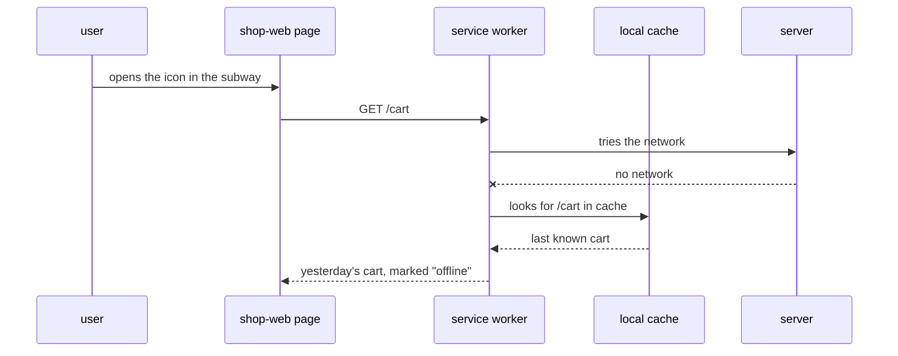
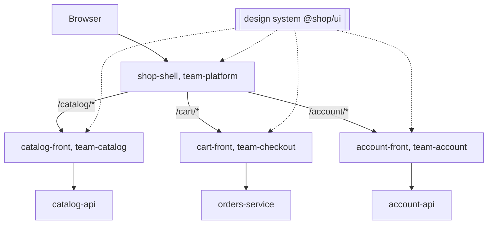

# Front end and web apps

!!! warning "Disclaimer"
    These notes are personal cheat sheets, not a source of truth. They reflect my own understanding and choices: their content remains subjective, despite the quotes and references it contains. It may be incomplete, simplified, inaccurate or outdated. Always check the official documentation before applying it. This content is provided as is, without any warranty: you use it at your own risk.

!!! audience "Who and what for"
    - **Roles**: front-end developer, full-stack developer, front-end tech lead, designer who maintains a design system, QA engineer testing web apps on desktop and mobile.
    - **Uses**: I understand why my React cart does not update after a click; I decide whether a PWA is enough for my iPhone customers or whether a native app is needed; I split a front end shared by three teams who wait for each other at every release; I choose the rendering of product pages so search engines find them; I decide whether to leave Webpack because the CI build takes 12 minutes.

!!! abstract "Scales"
    The colored badges under the headings say at which scale a notion applies:

    - <span class="pill pill-scope pill-scope-code">Code</span> the classes, functions and modules of one program;
    - <span class="pill pill-scope pill-scope-app">Application</span> one service or application and its internal split;
    - <span class="pill pill-scope pill-scope-system">System</span> several services talking to each other over the network;
    - <span class="pill pill-scope pill-scope-infra">Infrastructure</span> servers, network, zones and clusters, physical or virtual;
    - <span class="pill pill-scope pill-scope-enterprise">Enterprise</span> the whole information system and its organization.

    Details and ambiguous words: [map of scales](architecture.md#map-of-scales).

This page gathers what I need to know to build the part of the system the user sees: React and component-based interfaces, web apps on mobile (PWA and iPhone), micro front ends, the design system, rendering strategies and bundlers. It complements the page [Architecture and distributed systems](architecture.md), which covers how services, data and failures are handled on the server side. The "Decide" and "Know" badges under the headings are explained in [How to read this page](architecture.md#how-to-read-this-page). The `shop-web` store and its services are fictitious, and every number is an example unless stated otherwise.

## Terminology

**Front end**: everything that runs on the user's side, in their browser or phone: screens, navigation, forms, API calls. The **back end** is what runs on the team's servers, like `orders-service`.

**<span class="term" data-term="spa">SPA</span>** (single page application): a web app that loads a single HTML page, then changes the screen in JavaScript without reloading the page. Example: in `shop-web`, going from the catalog to the cart makes no full round trip to the server, only API calls.

**Bundle**: the JavaScript and CSS file or files the browser downloads, produced by a bundler from the source code. The heavier it is, the longer the page takes to become usable on a slow phone.

**Rendering**: producing the HTML the browser displays, in the browser or on a server (details in [Rendering strategies](#rendering-strategies)).

**<span class="term" data-term="cdn">CDN</span>** (content delivery network): a network of servers spread around the world that keep a copy of files and pages, to serve them close to the user. Example: the `shop-web` images served from a server in Paris for a customer in Paris.

**<span class="term" data-term="core-web-vitals">Core Web Vitals</span>**: three Google measures of the real experience of a page, taken from real users:

``` { .text .ex-ref title="Reference" }
LCP   time until the largest useful element is displayed     good: 2.5 s or less
INP   delay between a click and the visible reaction of the page   good: 200 ms or less
CLS   unexpected shifts of content during loading              good: 0.1 or less
```

**<span class="term" data-term="sli">SLI</span>** (service level indicator): the measured indicator that says whether the service is doing well from the user's point of view. Example: the LCP of product pages at the 75th percentile.

**<span class="term" data-term="slo">SLO</span>** (service level objective): the internal target the team sets on an SLI. Example: LCP under 2.5 s over a rolling 28 days.

**<span class="term" data-term="sla">SLA</span>** (service level agreement): the contractual promise made to a customer, with a penalty if it is not met, usually looser than the SLO. A consumer front end usually has none.

| I want... | I look at... |
|---|---|
| to know whether my store feels slow to my customers, and not only on my developer laptop | the Core Web Vitals of real users, at the 75th percentile |
| to understand why the page takes five seconds to react on a low end phone | the bundle weight per route and the cost of hydration |

## Front end

The **front end** is the part of the system the user sees: screens, navigation, forms, API calls from the browser. The architecture questions are the same as on the back end (split, share, ship without blocking each other), with two extra constraints: all the code ends up on the user's side, on a machine and a network I do not control, and the user sees **one** application, even when ten teams build it. Fictitious example for the whole section: a shop, `shop-web`, with a catalog, a cart and an account area.

### React and component-based interfaces

<a class="pill pill-scope pill-scope-code" href="../architecture/#map-of-scales">Scale · Code</a> <a class="pill pill-scope pill-scope-app" href="../architecture/#map-of-scales">Scale · Application</a> <span class="pill pill-status pill-status-ok" title="Still valid, checked in November 2026; major version 19 released in December 2024">Current · 11/2026</span> <a class="pill pill-nature pill-nature-know" href="../architecture/#how-to-read-this-page" title="A law or a phenomenon nobody chooses: knowing it prevents bad decisions">Know</a>

*React: competes with Vue, Angular, Svelte; complements Next.js, Vite*
{ .tool-rel }

I have a cart that shows the number of items in the header, the list of items and the total. With old-style JavaScript, every click on "add" must remember to update those three places of the page by hand; the day I forget one, the header says 2 items and the list shows 3. **<span class="term" data-term="react">React</span>** (a library created at Facebook, open-sourced in 2013, now maintained by Meta and the community) turns the problem around: I describe what the screen looks like **for a given state** ("here is the cart when it holds these items"), and React updates the page when the state changes.

The words to know:

- a **<span class="term" data-term="react-component">component</span>** is a JavaScript function that receives data and returns a piece of interface: `<CartBadge count={3} />`. A page is a tree of components;
- **props** are the data a component receives from its parent, read only;
- **state** is the data a component owns and can change, with `useState`; changing the state runs the component function again, which returns the new interface;
- **JSX** is the HTML-looking syntax inside JavaScript; a build tool translates it into function calls;
- **hooks** (`useState`, `useEffect`...) are the functions that give a component state or effects (calling an API, subscribing to an event).

``` { .text .ex-illus title="Illustration" }
1. the user clicks "add"                      setItems([...items, mug])
2. React runs the Cart() function again       it returns the new description: 3 items
3. React compares the old and the new one     only the badge, one line and the total changed
4. React changes only those three places in the browser page
```

!!! noob "As noob"
    With classic JavaScript, I am a painter retouching the canvas at every change: a number here, a line there, and sometimes I forget a corner. With React, I hand over a recipe ("for this cart, the screen looks like this") and an assistant compares the old canvas with the new one, then repaints only what changed. Limit of the picture: the assistant is not free, a page that redraws too often ends up sluggish. The one thing to remember: **I describe the screen for a given state, React handles going from one screen to the next.**

The two most frequent beginner mistakes, and their fix:

``` { .jsx .ex-bad title="Avoid" }
// Avoid: changing the existing array, React sees the same object and redraws nothing
function AddButton({ items, setItems, product }) {
  return <button onClick={() => { items.push(product); setItems(items); }}>Add</button>;
}
```

``` { .jsx .ex-good title="Recommended" }
// Good: create a new array, React sees the change and redraws
function AddButton({ items, setItems, product }) {
  return <button onClick={() => setItems([...items, product])}>Add</button>;
}
```

``` { .jsx .ex-bad title="Avoid" }
// Avoid: an effect without a dependency list runs the call again at every render, so in a loop
function OrderStatus({ orderId }) {
  const [status, setStatus] = useState(null);
  useEffect(() => {
    fetch(`/api/orders/${orderId}`).then((r) => r.json()).then((o) => setStatus(o.status));
  });
  return <p>{status}</p>;
}
```

``` { .jsx .ex-good title="Recommended" }
// Good: the effect only runs again when orderId changes, and cancels the call that became useless
function OrderStatus({ orderId }) {
  const [status, setStatus] = useState(null);
  useEffect(() => {
    const controller = new AbortController();
    fetch(`/api/orders/${orderId}`, { signal: controller.signal })
      .then((r) => r.json())
      .then((o) => setStatus(o.status))
      .catch(() => {});
    return () => controller.abort();
  }, [orderId]);
  return <p>{status}</p>;
}
```

In the first case, the user clicks and nothing moves on screen: `items` is still the same array, so React concludes nothing changed. In the second, each response changes the state, which triggers a render, which runs the effect again: the API receives hundreds of calls per second.

**Why it is an architecture topic.** React only provides the "interface" layer. Everything else is a team choice: routing, API calls, state shared between pages, server rendering. That is why it is often used with a [meta-framework](#rendering-strategies) like Next.js, and why the choice of framework (React, Vue, Angular, Svelte) commits the team for years: hiring, libraries, [design system](#design-system-and-component-driven-development).

**When to choose it.** A rich interface that changes often without reloading the page (a dashboard, an editor, a cart), a team that already knows React, a need for many libraries. When not to choose it: a mostly static site, like a blog or documentation, where a static site generator sends less JavaScript; a page with one form and two buttons, where a bit of HTML is enough.

| I want to... | I use... |
|---|---|
| show an interface that changes often without reloading the page, like a cart that updates while I browse | React, Vue or Svelte |
| have a product page found by search engines while staying interactive | React with a meta-framework doing server rendering, like Next.js |
| serve a documentation site that rarely changes | a static site generator, no interface framework |

:material-book-open-variant: Reference docs: [React, "Quick Start"](https://react.dev/learn) (version 19, accessed November 2026)
{ .doc-ref }

### Web apps on mobile, PWA and iPhone

<a class="pill pill-scope pill-scope-app" href="../architecture/#map-of-scales">Scale · Application</a> <span class="pill pill-status pill-status-ok" title="Still valid, checked in November 2026; Apple's rules change often">Current · 11/2026</span> <a class="pill pill-nature pill-nature-decide" href="../architecture/#how-to-read-this-page" title="A choice the team or the architects must make, then record in an ADR">Decide</a>

My team must make the `shop-web` store usable on phones. Three paths exist:

| Form | What it is | Where it is installed from | Example |
|---|---|---|---|
| mobile-friendly website | the same pages, adapting to the screen size | nowhere: I type the address in the browser | the product page read from a shared link |
| **<span class="term" data-term="pwa">PWA</span>** (progressive web app) | a web application that can be installed on the home screen, open without an address bar and work partly offline | from the browser, no store | `shop-web` added to the home screen, showing the last cart in the subway |
| native app | an application written for iOS (Swift) or Android (Kotlin), or with a cross-platform tool (React Native, Flutter) | from the App Store or the Play Store | an app that scans product barcodes with the camera continuously |

A **web app** is an application running in the browser (often a <span class="term" data-term="spa">SPA</span> in React). A PWA is a web app with three extra pieces: a **manifest** file (name, icon, color, display mode), a **<span class="term" data-term="service-worker">service worker</span>** (a script sitting between the application and the network, serving files from a cache when the network is missing) and mandatory HTTPS. The term comes from Alex Russell and Frances Berriman, in 2015.

!!! noob "As noob"
    A website is a shop I must travel back to every time. A PWA is the same shop leaving a small counter at my place: an icon on the home screen, and a stock of the last products I saw, even when the road (the network) is cut. A native app is a shop built inside my house: it has access to everything (camera, sensors), but I must go through the developer (the store) to build and renovate it. The one thing to remember: **a PWA is still a website, with an icon, a cache and a few extra permissions.**

**How it works on iPhone.** This is where the surprises come, because Apple sets its own rules:

!!! info "Apple's rules checked in November 2026"
    These points depend on iOS versions and Apple decisions that change often, especially in Europe: to check before using them for a decision.

- **one engine only**: on iPhone, Chrome, Firefox and Edge all use WebKit, Safari's engine, because the App Store rules require it (guideline 2.5.6). A Safari bug is therefore a bug in every iPhone browser. Since iOS 17.4 (March 2024), the European Union allows other engines, but few browsers ship one (to check);
- **no automatic install prompt**: on Android, Chrome offers "Install app". On iPhone, nothing shows up: the user must open the Share menu then "Add to Home Screen". So I must explain the gesture in the interface;
- **notifications**: web notifications (Web Push) work since iOS 16.4 (March 2023), **only** for a web app added to the home screen, and the permission request must follow a user gesture (a tap). In a plain Safari tab there are none;
- **erasable storage**: Safari may delete the data written by the site (service worker cache, IndexedDB, localStorage) after seven days without a visit. Web apps added to the home screen are not subject to this seven-day limit (WebKit, March 2020). So I never keep important data only in the browser: the real copy stays on the server;
- **separate storage**: the installed web app has its own cookies and storage, separate from Safari. A user logged in in Safari must log in again in the installed icon;
- **screen**: the notch and the bottom bar eat part of the screen (the "safe areas"), and `100vh` sometimes includes the area hidden by the address bar, which cuts buttons at the bottom of the screen. `100dvh` (dynamic height) fixes this case.

``` { .html .ex-bad title="Avoid" }
<!-- Avoid: no viewport, the page shows as a zoomed-out desktop version; 100vh cuts the "Pay" button under Safari's bar -->
<head>
  <title>shop-web</title>
  <style>.checkout { height: 100vh; }</style>
</head>
```

``` { .html .ex-good title="Recommended" }
<!-- Good: mobile viewport, manifest, iPhone home screen icon, dynamic height and safe-area margins -->
<head>
  <title>shop-web</title>
  <meta name="viewport" content="width=device-width, initial-scale=1, viewport-fit=cover">
  <link rel="manifest" href="/manifest.webmanifest">
  <link rel="apple-touch-icon" href="/icons/icon-180.png">
  <style>
    .checkout { height: 100dvh; padding-bottom: env(safe-area-inset-bottom); }
  </style>
</head>
```

The manifest, read by Safari and Chrome for installation:

``` { .json .ex-ref title="Reference" }
{
  "name": "Shop",
  "start_url": "/",
  "display": "standalone",
  "background_color": "#ffffff",
  "icons": [{ "src": "/icons/icon-512.png", "sizes": "512x512", "type": "image/png" }]
}
```

What the service worker does when the network drops:



``` { .javascript .ex-bad title="Avoid" }
// Avoid: cache everything forever, the user keeps the old version and the old prices
self.addEventListener("fetch", (event) => {
  event.respondWith(caches.match(event.request).then((cached) => cached || fetch(event.request)));
});
```

``` { .javascript .ex-good title="Recommended" }
// Good: network first for data, cache only as a fallback
self.addEventListener("fetch", (event) => {
  if (!event.request.url.includes("/api/")) return;
  event.respondWith(
    fetch(event.request)
      .then((response) => {
        const copy = response.clone();
        caches.open("api-v1").then((cache) => cache.put(event.request, copy));
        return response;
      })
      .catch(() => caches.match(event.request)),
  );
});
```

With the first version, a price fixed on the server never arrives: the service worker always answers with the copy from the first visit.

**Testing.** Playwright's WebKit is not Safari on iPhone: it shares the engine, not the operating system, the gestures or the install rules. I test installation, notifications and offline mode on a real iPhone (or a device farm), and the rest automatically.

**When to choose what.** A PWA is enough when my need fits what a browser can do: catalog, cart, forms, offline reading. I go native when I need features the iPhone browser does not give, or gives poorly (Bluetooth, NFC, long background tasks), a presence in the App Store, or strong performance (games, video).

| I want to... | I use... |
|---|---|
| let a customer read a product page from a shared link, without installing anything | a mobile-friendly website |
| let my loyal customers find the store on their home screen and see their last cart in the subway | a PWA |
| send notifications to iPhone users | a PWA installed on the home screen (iOS 16.4 or later), or a native app |
| scan barcodes continuously, talk to a Bluetooth device or appear in the App Store | a native or cross-platform app |

:material-book-open-variant: Reference docs: [web.dev, "Learn PWA"](https://web.dev/learn/pwa) (accessed November 2026); [WebKit, "Web Push for Web Apps on iOS and iPadOS"](https://webkit.org/blog/13878/web-push-for-web-apps-on-ios-and-ipados/) (2023)
{ .doc-ref }

### Micro front ends

<a class="pill pill-scope pill-scope-system" href="../architecture/#map-of-scales">Scale · System</a> <span class="pill pill-status pill-status-ok" title="Still valid, checked November 2026">Current · 11/2026</span> <a class="pill pill-nature pill-nature-decide" href="../architecture/#how-to-read-this-page" title="A choice the team or the architects must make, then record in an ADR">Decide</a>

A **<span class="term" data-term="micro-frontend">micro front end</span>** applies the microservices idea to the browser: the interface is split into pieces, each owned by one team, built, tested and deployed alone, then assembled so that the user sees a single application. The assembly is done by a **<span class="term" data-term="app-shell">host application</span>** (the *shell*), which carries the shared layout, the top level navigation and the session. The term appeared in the Thoughtworks Technology Radar of November 2016 (to check); the most cited reference is Cam Jackson's article "Micro Frontends", published on martinfowler.com in June 2019.

I split **by business domain**, in vertical slices, not by technical layer: the cart team owns the cart screen, its API (`orders-service`) and its data, end to end. It is the front end shape of a <span class="term" data-term="stream-aligned-team">stream-aligned team</span>. Splitting into "header", "buttons", "forms" does the opposite: it creates dependencies between every team.

**Why.** The starting problem is a monolithic front end shared by several teams: one repository, one 40 minute pipeline, one release a week; a team that breaks the build blocks everyone, and upgrading the framework is a big bang. Micro front ends bring:

- independent deployment: the cart team ships five times a day without waiting for the catalog;
- technical autonomy within a shared frame (test tools, upgrade pace);
- gradual migration of an old front end, one route at a time, instead of a full rewrite;
- a smaller codebase per team, easier to understand and test.

The cost is real, and it is the cost of a distributed system in the browser:

- heavier pages if dependencies are loaded twice;
- an inconsistent experience if nobody owns the shared design;
- more infrastructure: hosting each piece, a version manifest, handling one piece being down;
- harder integration testing: each piece works alone, the assembly can break;
- governance: who decides on shared dependencies, on the contract with the shell, on UX rules.

**When to apply it.** The signals that justify the cost:

| Signal | Example |
|---|---|
| three or more teams ship into the same front end and spend their time waiting for each other | one shared release a week, a queue of merge requests |
| the parts of the screen exchange little with each other, each with its own business | catalog, cart and account exchange little information |
| I must move off an old front end without stopping deliveries during the migration | new pages in React, old ones stay in the old framework during the migration |
| some parts change every day, others almost never | the cart changes every day, the account area once a month |

When not to apply it: a single team (or two that talk every day), a small application, a screen where everything interacts with everything (an editor, a tightly linked dashboard), a low end mobile audience with no budget to watch page weight, or the wish to "try several frameworks". The alternative is the **modular front end**: one application, split into packages in a <span class="term" data-term="monorepo">monorepo</span>, with module boundaries checked in CI, exactly like the [modular monolith](architecture.md#modular-monolith) on the back end. I move to micro front ends the day the shared deployment becomes the measured pain.

**How: the four ways to assemble.**

1. **At build time, through npm packages.** Each micro front end is published as a package, the shell declares it as a dependency, and everything is bundled together. Simple, typed, one well optimized bundle. But every change by one team forces a new publish and a redeploy of the shell: I lose independent deployment, which was the whole point. Cam Jackson advises against it for that reason.
2. **On the server or at the edge.** The server, or the <span class="term" data-term="cdn">CDN</span>, assembles the HTML page from fragments served by each team: Server Side Includes, **<span class="term" data-term="edge-side-includes">Edge Side Includes</span>** (ESI, a specification submitted to the W3C in 2001), or a small composition server. Good for search indexing and first display of mostly content pages; browser side interactivity has to be organized separately.
3. **At run time, in JavaScript.** The shell downloads the code of each micro front end when the user needs it:
    - **<span class="term" data-term="module-federation">Module Federation</span>**: introduced with Webpack 5 (October 2020). One build *exposes* modules, another *consumes* them as if they were local, and shared dependencies (React, the design system) are negotiated so they load only once. Also available natively in Rspack, and for Vite through a plugin (to check for the state of support);
    - **single-spa**: a framework agnostic orchestrator (first version around 2016, to check). Each registered application exposes `bootstrap`, `mount` and `unmount`, and single-spa mounts the one that matches the URL;
    - **<span class="term" data-term="web-component">Web Components</span>**: each team ships a custom HTML element (`<cart-summary>`), a browser standard usable from any framework, with CSS isolation through the <span class="term" data-term="shadow-dom">Shadow DOM</span>.
4. **Through an <span class="term" data-term="iframe">iframe</span>.** Full isolation (JavaScript, CSS, crashes), but navigation, the height of the area, accessibility, search indexing and session sharing become hard. Keep it for a third party tool or an old application embedded as is.

*npm: competes with yarn, pnpm*
{ .tool-rel }


| Mode | Independent deployment | Strengths | Weaknesses | Pick it when |
|---|---|---|---|---|
| npm packages at build time | no | simple, typed, one bundle | every change redeploys the shell | I mostly want to share code, not ship separately |
| server composition or ESI | yes | fast first display, good search indexing | interactivity handled separately, server infrastructure | content pages, public catalog |
| Module Federation | yes | shared dependencies, fine grained integration | coupled to bundler versions, harder debugging | a rich application, one framework, several teams |
| single-spa | yes | several frameworks side by side | one more layer to master | migrating from an old framework to a new one |
| Web Components | yes | standard, framework agnostic | server rendering and passing complex data are trickier | widgets reused in applications with different frameworks |
| iframe | yes | full isolation | UX, accessibility, sizing, search indexing | third party tool, old application embedded untouched |

**Example: one shell and three micro front ends.** Three teams, a shell owned by a platform team, a shared design system:

``` { .text .ex-illus title="Illustration" }
shop-shell/              team-platform: layout, top level routes, session, errors
├─ src/routes.ts         /catalog/* to catalog, /cart/* to cart, /account/* to account
├─ src/layout/           header, menu, footer
└─ rspack.config.js      remotes: catalog, cart, account
catalog-front/           team-catalog, deployed alone, calls catalog-api
cart-front/              team-checkout, deployed alone, calls orders-service
account-front/           team-account, deployed alone, calls account-api
shop-ui/                 @shop/ui package: design system, SemVer versioned
shop-mfe-contract/       @shop/mfe-contract package: contract between shell and micro front ends
```



The shell's Module Federation configuration (Webpack 5 or Rspack, same syntax; package names depend on the version, to check):

``` { .js .ex-ref title="Reference" }
const { ModuleFederationPlugin } = require("@module-federation/enhanced/rspack");

// Example: the shell declares its remotes and shares React as a singleton
module.exports = {
  plugins: [
    new ModuleFederationPlugin({
      name: "shell",
      remotes: {
        catalog: "catalog@https://static.example.com/catalog/remoteEntry.js",
        cart: "cart@https://static.example.com/cart/remoteEntry.js",
        account: "account@https://static.example.com/account/remoteEntry.js",
      },
      shared: {
        react: { singleton: true, requiredVersion: "^18.3.0" },
        "react-dom": { singleton: true, requiredVersion: "^18.3.0" },
        "@shop/ui": { singleton: true, requiredVersion: "^4.0.0" },
      },
    }),
  ],
};
```

And the cart's, which exposes its entry point:

``` { .js .ex-ref title="Reference" }
// Example: the cart exposes its mount entry point
new ModuleFederationPlugin({
  name: "cart",
  filename: "remoteEntry.js",
  exposes: { "./mount": "./src/mount.tsx" },
  shared: {
    react: { singleton: true, requiredVersion: "^18.3.0" },
    "react-dom": { singleton: true, requiredVersion: "^18.3.0" },
    "@shop/ui": { singleton: true, requiredVersion: "^4.0.0" },
  },
});
```

The `remotes` URLs often point to a manifest loaded at startup rather than being hardcoded: that way I change the version of a micro front end (or roll it back) without rebuilding the shell.

**The contract between the shell and a micro front end.** It is the public API of each micro front end, to be treated like an API contract: written in a versioned package, changed with care.

``` { .ts .ex-ref title="Reference" }
// Example: the props the shell passes to each micro frontend
export interface MicroFrontendProps {
  basePath: string;
  locale: string;
  getAccessToken: () => Promise<string>;
  navigate: (path: string) => void;
}

// Example: mounting into an element returns a way to unmount
export type Unmount = () => void;

export type Mount = (element: HTMLElement, props: MicroFrontendProps) => Unmount;
```

**Routing.** The shell owns the first URL segment (`/cart`), the micro front end owns the rest (`/cart/checkout/payment`). One navigation history for everyone; to go to another domain, a micro front end calls the shell's `navigate` or uses a plain link, never another team's router. Every URL must work on reload: the server returns the shell for every route, and the shell mounts the right piece.

**Shared state: the rules.**

1. No common global store (a Redux shared between teams): it brings the monolith back, more fragile.
2. The URL is the first shared state: product id, filters, page.
3. Business data is read again from its API: the back end stays the source of truth, each micro front end keeps its own local state.
4. To tell others about a fact, publish a browser event with a documented and versioned payload, like an event between services:

    ``` { .ts .ex-bad title="Avoid" }
    // Avoid: change the counter shown in the shell header directly
    document.querySelector("#header-cart-count")!.textContent = String(count + 1);
    ```

    ``` { .ts .ex-good title="Recommended" }
    // Good: a browser event with a documented payload to notify the others
    window.dispatchEvent(
      new CustomEvent("cart:item-added", { detail: { sku: "SKU-42", quantity: 1 } }),
    );
    ```

    The day team-platform renames `#header-cart-count` while redoing the header, the cart crashes on a `null` element at add time, while its build and tests, run on their own, stay green.

5. Cross-cutting services (session, token, language, <span class="term" data-term="feature-flag">feature flags</span>) come from the shell, through the contract props, never copied by each team.

**Versions of shared dependencies.** Share little: the framework, the design system, the authentication client. Each team keeps its own copy of everything else.

- The framework is a `singleton`: two copies of React in the same page break hooks ("Invalid hook call").
- Shared packages follow <span class="term" data-term="semantic-versioning">semantic versioning</span>; `requiredVersion: "^4.0.0"` accepts any 4.x.
- A major version of the framework or of the design system is planned across all teams: it is the only moment they synchronize, and a dashboard of versions per micro front end prepares it.
- A CI check fails when a micro front end leaves the allowed range, otherwise the shell silently loads two versions.

**Performance and consistency traps.**

| Trap | What the user sees | Remedy |
|---|---|---|
| duplicated dependencies | a slow page, especially on mobile | `shared` and `singleton`, a weight budget per micro front end checked in CI (example: 150 kB compressed) |
| cascading loads (shell, then `remoteEntry.js`, then the code, then the API) | a long blank screen | preload the entries of likely routes, a skeleton placeholder, <span class="term" data-term="lazy-loading">lazy loading</span> for the rest |
| the layout moves when a piece arrives | clicks landing in the wrong place | reserve the space, track the CLS of the <span class="term" data-term="core-web-vitals">Core Web Vitals</span> |
| CSS leaking from one team to another | the cart button changes color | CSS Modules or prefixes, Shadow DOM, global styles only in the shell |
| inconsistent UX | three styles of error messages, two different loaders | design system, design tokens, cross-team UX review |
| a micro front end that crashes | the whole page goes blank | one error boundary per micro front end in the shell, fallback message "the cart is temporarily unavailable" |
| focus lost on route change | a silent screen reader | the shell handles focus and announcements, see <span class="term" data-term="web-accessibility">web accessibility</span> |

**Testing.** Three levels, from cheapest to most expensive:

1. **each micro front end alone**: unit and component tests, and a standalone start with a fake shell, to develop without the other teams;
2. **the contract**: a <span class="term" data-term="contract-test">contract test</span> checks that the micro front end honors `Mount` (it mounts, it unmounts cleanly) and that its events have the promised shape. The shell, as consumer, can publish its expectations as for an API contract, see [Contract tests and API mocks](qualite.md#contract-tests-and-api-mocks);
3. **the assembled application**: a few <span class="term" data-term="e2e-test">end-to-end tests</span> on the critical journeys that cross several teams, in an environment where the shell loads the latest version of each piece, run after every deployment of any of them. Plus a <span class="term" data-term="smoke-test">smoke test</span> checking that each `remoteEntry.js` answers.

The cart's contract test (Vitest):

``` { .ts .ex-ref title="Reference" }
import { describe, expect, it, vi } from "vitest";
import { mount } from "../src/mount";

// Example: contract test, the cart mounts and unmounts cleanly
describe("cart-front honors the shell contract", () => {
  it("mounts in the given element and unmounts cleanly", async () => {
    const element = document.createElement("div");
    const unmount = mount(element, {
      basePath: "/cart",
      locale: "en-GB",
      getAccessToken: vi.fn().mockResolvedValue("fake-token"),
      navigate: vi.fn(),
    });

    await vi.waitFor(() => {
      expect(element.querySelector("[data-testid='cart-root']")).not.toBeNull();
    });

    unmount();
    expect(element.innerHTML).toBe("");
  });
});
```

The end-to-end test on the assembly (Playwright), crossing catalog, shell and cart:

``` { .ts .ex-ref title="Reference" }
import { expect, test } from "@playwright/test";

// Example: E2E test that goes through catalog, shell and cart
test("a product added from the catalog shows up in the cart", async ({ page }) => {
  await page.goto("/catalog/sku-42");
  await page.getByRole("button", { name: "Add to cart" }).click();
  await expect(page.getByTestId("cart-badge")).toHaveText("1");

  await page.getByRole("link", { name: "Cart" }).click();
  await expect(page).toHaveURL(/\/cart/);
  await expect(page.getByText("SKU-42")).toBeVisible();
});
```

Steps to get started:

1. split by business domain, aligned with the teams ([Conway's law](architecture.md#conways-law));
2. build a minimal shell: layout, top level routes, session, error boundaries;
3. write the contract (`Mount`, props, events) in a versioned package;
4. pick the assembly mode with the table above;
5. fix the short list of shared dependencies and their version ranges;
6. put weight budgets, contract tests and end-to-end tests on the assembly in CI;
7. migrate one route at a time, starting with the least risky.

:material-book-open-variant: Reference docs: [Cam Jackson, "Micro Frontends", martinfowler.com](https://martinfowler.com/articles/micro-frontends.html) (2019); [Michael Geers, micro-frontends.org](https://micro-frontends.org/) (accessed November 2026)
{ .doc-ref }

### Design system and component-driven development

<a class="pill pill-scope pill-scope-code" href="../architecture/#map-of-scales">Scale · Code</a> <span class="pill pill-status pill-status-ok" title="Still valid, checked November 2026">Current · 11/2026</span> <a class="pill pill-nature pill-nature-decide" href="../architecture/#how-to-read-this-page" title="A choice the team or the architects must make, then record in an ADR">Decide</a>

A **<span class="term" data-term="design-system">design system</span>** is a shared set of coded interface components (button, field, modal), of **<span class="term" data-term="design-token">design tokens</span>** (colors, spacing, typography as named variables) and of documented usage rules, maintained as a product, with an owner and versions. **<span class="term" data-term="component-driven-development">Component-driven development</span>** (term popularized by Tom Coleman around 2017, to check) builds the interface bottom up: each component is built and tested alone, in all its states, then assembled into pages. Brad Frost gave it a reading grid, Atomic Design (article in 2013, book in 2016): atoms, molecules, organisms, templates, pages. **<span class="term" data-term="storybook">Storybook</span>** (first version in 2016, to check) is the most widespread open source tool for this: it shows each component outside the application, in each of its states, called *stories*.

**Why.** Without a design system, the same button is coded six times with six different grays, accessibility is fixed (or not) application by application, and each screen is discussed from screenshots. With one:

- a fix (contrast, keyboard focus) benefits every application in a single release;
- screens are built faster, from bricks that are already tested;
- designers and developers talk about the same components, with the same names;
- with micro front ends, it is what keeps one experience in the user's eyes.

The cost: an owner (at least one person, often a team), version management and migrations on the consumer side, and the risk of becoming a bottleneck. Started too early, it freezes abstractions before I know what the screens need.

**When to apply it.** Several applications or teams share a visual identity; micro front ends; the same components are recoded in several repositories; an accessibility target to meet everywhere. When not to: a single small product, a prototype. There, an existing open source component library with a theme is enough; building my own design system only pays off across several products.

**How.**

1. Inventory what exists: a screenshot of every button, field and error message is enough to convince.
2. Start with the tokens: colors, spacing, radii, typography.
3. Build the base components, accessible from day one, each with one story per state (default, disabled, loading, error).
4. Publish as a versioned package (`@shop/ui`), with a changelog, and ship a migration script for each major version.
5. Test the stories: interaction tests, visual <span class="term" data-term="regression">regression</span> (one screenshot per story compared to the baseline), automated accessibility checks.
6. Govern: contributions open to every team, review by the owner, a clear rule on what goes into the design system and what stays local.

The tokens, as CSS variables:

``` { .css .ex-ref title="Reference" }
/* Example: the design system tokens, as CSS variables */
:root {
  --color-primary: #1f6feb;
  --color-danger: #cf222e;
  --space-2: 8px;
  --space-4: 16px;
  --radius-md: 6px;
}
```

A story in CSF 3 format (Component Story Format, Storybook 7 and later, 2023; package names change with the version, to check):

``` { .tsx .ex-ref title="Reference" }
import type { Meta, StoryObj } from "@storybook/react";
import { Button } from "./Button";

// Example: the component entry and its default values
const meta = {
  title: "Actions/Button",
  component: Button,
  args: { label: "Pay", variant: "primary" },
} satisfies Meta<typeof Button>;

export default meta;

type Story = StoryObj<typeof meta>;

// Example: each export is a button state, so a test case
export const Primary: Story = {};

export const Disabled: Story = {
  args: { disabled: true },
};

export const Loading: Story = {
  args: { loading: true, label: "Payment in progress" },
};
```

Each export is a state of the button, visible in Storybook, and each state becomes a test case (visual snapshot, accessibility) without writing a separate test.

| I want... | I use... |
|---|---|
| the same button blue and the same spacing in all my applications, without copying values everywhere | design tokens |
| to work on a button in all its states (disabled, loading) without starting the whole application | Storybook, one story per state |
| to know right away that a CSS change broke a screen, before a user sees it | visual regression on the stories |
| clean screens for a single product built by a small team, without building a design system | an existing open source library, with a theme |
| one look across several products or micro front ends built by different teams | a versioned design system, with an owner |

:material-book-open-variant: Reference docs: [Storybook, documentation](https://storybook.js.org/docs) (accessed November 2026); [Brad Frost, "Atomic Design"](https://atomicdesign.bradfrost.com/) (2016)
{ .doc-ref }

### Rendering strategies

<a class="pill pill-scope pill-scope-app" href="../architecture/#map-of-scales">Scale · Application</a> <span class="pill pill-status pill-status-ok" title="Still valid, checked November 2026">Current · 11/2026</span> <a class="pill pill-nature pill-nature-decide" href="../architecture/#how-to-read-this-page" title="A choice the team or the architects must make, then record in an ADR">Decide</a>

!!! info "Written in November 2026"
    Framework features move fast: check the documentation of the version in use.

**Rendering** is producing the HTML the browser displays. The question is: where and when is that HTML made?

- **<span class="term" data-term="csr">CSR</span>** (Client Side Rendering): the server sends an almost empty page and JavaScript; the browser builds everything. This is how a classic SPA works.
- **<span class="term" data-term="ssr">SSR</span>** (Server Side Rendering): the server makes the full HTML on every request, then JavaScript makes it interactive in the browser; that step is called **<span class="term" data-term="hydration">hydration</span>**.
- **<span class="term" data-term="ssg">SSG</span>** (Static Site Generation): the HTML is made once, at build time, then served as is by a CDN.
- **<span class="term" data-term="isr">ISR</span>** (Incremental Static Regeneration, introduced by Next.js 9.5 in 2020): like SSG, but each page is regenerated in the background after a delay or on demand, without rebuilding the whole site.

A **<span class="term" data-term="meta-framework">meta-framework</span>** brings these strategies, routing and server rendering on top of a UI library: Next.js (React, 2016), Nuxt (Vue, 2016), SvelteKit (Svelte), Remix then React Router 7 (React), Astro (2021, multi-framework, content oriented). Dates and names to check. They often let me choose the strategy **route by route**.

**Why it is an architecture choice.** It decides how fast the first display is, search indexing, server cost, data freshness and what can be cached. A bad choice is paid everywhere: an SPA for a public catalog loses search ranking; SSR for a page that never changes pays a server for nothing.

| Strategy | HTML made | When | When not | Traps |
|---|---|---|---|---|
| CSR | in the browser | internal tool behind a login, highly interactive application | public pages to index, slow phones | blank screen at startup, big bundle |
| SSR | on the server, on every request | personalized or very fresh content that must display fast | content identical for everyone (waste) | server cost, slow hydration, hydration errors (server HTML differs from client) |
| SSG | at build time | documentation, blog, legal pages, marketing | millions of pages, or data that changes often | build keeps getting longer, content frozen until the next build |
| ISR | at build time, then regenerated in the background | public catalog, product pages: many pages, moderate changes | personal data, or data that must be exact to the second | content one cycle behind, support varies by host |

**How.**

1. Sort pages by three questions: must it be indexed? is it personalized? how often does it change?
2. Pick the strategy route by route. For `shop-web`: legal pages in SSG, product pages in ISR (regenerated every 60 seconds), cart and account in CSR or SSR, never in a shared cache.
3. Measure on real users: the Core Web Vitals (LCP for the first useful display, INP for responsiveness, CLS for stability).
4. Watch the hydration cost: fast HTML but a page that only answers clicks after three seconds is still a bad experience.

A product page in ISR with Next.js (App Router, Next.js 15 syntax, to check against my version):

``` { .tsx .ex-ref title="Reference" }
// Example: the page is regenerated at most every 60 s (ISR)
export const revalidate = 60;

type Product = { sku: string; name: string; priceCents: number };

// Example: the page reads the product from the API at render time
export default async function ProductPage({ params }: { params: Promise<{ sku: string }> }) {
  const { sku } = await params;
  const response = await fetch(`https://catalog-api.example.com/products/${sku}`);
  const product: Product = await response.json();
  return <h1>{product.name}</h1>;
}
```

The trap that touches security: a personalized SSR page ("Hello Ada", her cart) cached by the CDN is served to the next user. Any response that depends on the session must be marked `Cache-Control: private, no-store`, and a test must check it.

:material-book-open-variant: Reference docs: [Jason Miller and Addy Osmani, "Rendering on the Web", web.dev](https://web.dev/articles/rendering-on-the-web) (2019)
{ .doc-ref }

### Bundlers

<a class="pill pill-scope pill-scope-code" href="../architecture/#map-of-scales">Scale · Code</a> <span class="pill pill-status pill-status-ok" title="Still valid, checked November 2026">Current · 11/2026</span> <a class="pill pill-nature pill-nature-decide" href="../architecture/#how-to-read-this-page" title="A choice the team or the architects must make, then record in an ADR">Decide</a>

!!! info "Written in November 2026"
    Build tools move fast, and speed comparisons mostly come from the vendors themselves. Dates and features to check in the documentation.

A **<span class="term" data-term="bundler">bundler</span>** takes the source code (TypeScript, JSX, CSS, imports between files) and produces the files the browser loads. It resolves imports, transpiles, groups, minifies, splits the code into chunks loaded on demand, and removes code that is never used (<span class="term" data-term="tree-shaking">tree shaking</span>). In development, it serves the application and swaps the changed module in place without reloading the page (<span class="term" data-term="hmr">HMR</span>, Hot Module Replacement).

| Tool | Origin | Good for | Limits |
|---|---|---|---|
| Webpack | Tobias Koppers, 2012, written in JavaScript | the widest ecosystem of loaders and plugins, the original Module Federation, existing projects | verbose configuration, slow on large projects |
| Vite | Evan You, 2020 | a new React, Vue or Svelte project: near instant dev startup (native ES modules), short configuration | historically two different paths in development (esbuild) and production (Rollup), being unified with Rolldown, written in Rust (to check); Module Federation through a plugin |
| Rspack | 2023, written in Rust, version 1.0 in 2024 (to check) | speeding up a large Webpack project without rewriting its configuration (compatible API), built-in Module Federation | not every Webpack plugin is compatible |
| esbuild | Evan Wallace, 2020, written in Go | transpiling and bundling very fast: libraries, scripts, serverless functions, internal brick of other tools | no built-in HMR, more limited code splitting (to check) |

The announced speed gains often range from "10 times faster" to much more [Take with caution: numbers published by the projects themselves, on their own benchmarks]. None of these tools checks TypeScript types: `tsc --noEmit` stays a separate CI step.

**When to switch.** Not because of fashion: when a pain can be measured. Signals (thresholds given as examples): a dev server that takes more than 30 seconds to start, a change that takes several seconds to show up, a CI build over 10 minutes. If the framework imposes its bundler (a meta-framework), keep that one.

**How to migrate.** Example of a large Webpack project moving to Rspack:

1. measure before: startup time, build time, weight of each output file;
2. swap the package and keep the configuration, replacing incompatible plugins one by one;
3. compare the output files (weight, splitting) with the bundle analysis tool;
4. run the end-to-end tests on the result before switching the CI.

| I want... | I use... |
|---|---|
| to start a new React, Vue or Svelte application with a development server that starts fast | Vite, or the bundler of the chosen meta-framework |
| to speed up a large existing Webpack project whose build is too slow, without rewriting its configuration | Rspack, configuration kept |
| to assemble micro front ends with Module Federation, like the shell and the cart of `shop-web` | Webpack 5 or Rspack |
| to build a library, a script or a serverless function quickly | esbuild (directly or through a tool that uses it) |

:material-book-open-variant: Reference docs: [webpack, "Concepts"](https://webpack.js.org/concepts/) (accessed November 2026); [Vite, "Why Vite"](https://vite.dev/guide/why) (accessed November 2026)
{ .doc-ref }

!!! maturity "Measuring maturity"
    | Level | What I see in the team |
    |---|---|
    | N1 | reusable components exist in a shared folder, and the rendering strategy is the one of the framework's starter template |
    | N2 | a versioned design system with Storybook, a rendering strategy chosen route by route and page weight budgets checked in CI |
    | N3 | CI blocks a merge request that exceeds the weight budget, breaks a visual snapshot or a micro front end contract, and a test fails when a personalized page is cached publicly |
    | N4 | the team tracks real users' Core Web Vitals and build time, and arbitrates rendering, splitting and bundler from these numbers |

    **I measure**: LCP and INP at the 75th percentile of real users, read in the field measurement tool; compressed JavaScript weight per route, read in the bundler report in CI.

## Measuring success

A front-end solution works when a number the user sees moves the right way without another one getting worse. Before changing anything, I record a baseline: LCP and INP at the 75th percentile of real users, JavaScript weight per route or build duration over the last four weeks, for example. After the change, I record the same measure, the same way, over a window of the same length, so I do not compare a week of sales with a quiet week. And I pick a guard metric that must not move: moving to micro front ends must not make pages heavier, changing bundler must not grow the bundle, an ISR page must not show a price older than the promised delay.

| Solution or situation | Success indicator (SLI) | Likely SLO | Likely SLA |
|---|---|---|---|
| rendering strategy for public pages ([Rendering strategies](#rendering-strategies)) | LCP at the 75th percentile of real users | under 2.5 s, the Core Web Vitals "good" threshold | n/a: no external contract |
| React cart interface ([React](#react-and-component-based-interfaces)) | INP at the 75th percentile of real users on cart pages | under 200 ms, the Core Web Vitals "good" threshold | n/a: no external contract |
| PWA on mobile ([Web apps on mobile, PWA and iPhone](#web-apps-on-mobile-pwa-and-iphone)) | share of offline launches that show the last cart instead of an error page | 99% over a rolling 30 days | n/a: no external contract |
| micro front ends ([Micro front ends](#micro-front-ends)) | share of micro front end releases done without redeploying the shell or another piece; as guard, compressed JavaScript weight per route | 95% over a quarter, weight stable within 10% | n/a: no external contract |
| design system ([Design system and component-driven development](#design-system-and-component-driven-development)) | share of screens built with the design system components; as guard, number of accessibility errors detected in CI | 90% of screens, 0 blocking accessibility error | n/a: no external contract |
| bundler change ([Bundlers](#bundlers)) | median CI build time and development server start time; as guard, weight of the produced files | build under 10 min, start under 5 s, weight stable within 5% | n/a: no external contract |

[Take with caution: example orders of magnitude, to set with the team and the business; the Core Web Vitals thresholds are the ones published by Google]

## Pitfalls to avoid

| Pitfall | What happens | Solution |
| --- | --- | --- |
| **Mutating React state in place**: I add an item with `items.push(product)` then pass the same array to `setItems`. | React sees the same object, redraws nothing, and the user clicks three times without seeing the cart change. | I always create a new object or a new array ([React](#react-and-component-based-interfaces)). |
| **An effect without a dependency list**: I call the API in a `useEffect` with no second argument. | Every response changes the state, which reruns the effect, and the API receives hundreds of calls per second. | I give the dependency list and cancel the call that is no longer needed ([React](#react-and-component-based-interfaces)). |
| **Caching the API forever in the service worker**: I serve every response from the cache as soon as it exists. | A price fixed on the server never arrives, and the customer pays the old displayed price. | I go network first for data and keep the cache only as a fallback ([Web apps on mobile](#web-apps-on-mobile-pwa-and-iphone)). |
| **Believing Playwright's WebKit is the iPhone**: I validate my PWA only in CI. | Installation, notifications and offline break on real iPhones, and I learn it from customer reviews. | I test these three points on a real device, the rest automatically ([Web apps on mobile](#web-apps-on-mobile-pwa-and-iphone)). |
| **Micro front ends for a single team**: I split the front end into pieces while one team builds it alone. | I pay for the infrastructure, the duplicated dependencies and the assembly tests without gaining independent deployment, since nobody was waiting for me. | I keep a modular front end in a monorepo until the shared deployment becomes the measured pain ([Micro front ends](#micro-front-ends)). |
| **Splitting the front end by technical layer**: I set up one team for the header, one for the buttons, one for the forms. | Every feature then needs all three teams, exactly what micro front ends were meant to avoid. | I split by business domain, catalog, cart, account, from the screen down to the data ([Micro front ends](#micro-front-ends)). |
| **Letting the CDN keep a personalized page**: my SSR page "Hello Ada" with her cart is cached publicly. | The next user sees Ada's name and cart, which is a data leak. | I mark every response that depends on the session `Cache-Control: private, no-store` and a test checks it ([Rendering strategies](#rendering-strategies)). |
| **Changing bundler because it is trendy**: I migrate to the tool everyone talks about without measuring anything. | I spend weeks replacing plugins for a gain nobody can quantify, sometimes a heavier bundle. | I measure before (start, build, weight), I migrate, then I compare the same numbers ([Bundlers](#bundlers)). |

## What interviews ask

The typical questions:

- "Can a PWA replace a native app on iPhone?", "Why does this React component not update?" How I answer: I quote the iOS limits (WebKit mandatory, manual install, notifications since iOS 16.4) and the state changed without a new object ([Web apps on mobile, PWA and iPhone](#web-apps-on-mobile-pwa-and-iphone), [React](#react-and-component-based-interfaces)).
- "When would you move to micro front ends?", "How do you avoid loading React three times?" How I answer: I start from the number of teams that wait for each other to ship, I split by domain, I compare the four ways to assemble, then I share React as a singleton with Module Federation ([Micro front ends](#micro-front-ends)).
- "CSR, SSR, SSG or ISR for an online store?" How I answer: I sort the pages with three questions (indexed, personalized, how often it changes), I choose route by route, and I quote the trap of the personalized page cached by the CDN ([Rendering strategies](#rendering-strategies)).
- "What is a design system for, and who maintains it?" How I answer: one fix benefits every application, with tokens, components tested per story and an owner who publishes versions ([Design system and component-driven development](#design-system-and-component-driven-development)).
- "Your front-end build is slow, what do you do?" How I answer: I measure first, I keep the meta-framework's bundler if it imposes one, otherwise Vite for a new project or Rspack for a large Webpack project, and I recall that type checking stays a separate step ([Bundlers](#bundlers)).
- "How do you know your new rendering strategy works?" How I answer: I record the Core Web Vitals of real users before and after, over a window of the same length, with a guard metric ([Measuring success](#measuring-success)).

What makes a good answer: it names the trade-off, what the choice brings, what it costs, and in which situation I would do the opposite. A framework or tool presented without its cost sounds like a learned answer.

## What to use in which situation

| Situation | I use |
|---|---|
| my cart shows the number of items in three places on the page, and they end up disagreeing after a few clicks | React (or Vue, Svelte), the screen described for a given state |
| I must make my store usable on iPhone, with a home screen icon and the last cart offline | PWA, tested on a real iPhone |
| several teams block each other on one front end: one shared release, a queue of merge requests | micro front ends split by domain, shell and versioned contract |
| I have a single front end, built by one or two teams that talk every day | modular front end in a monorepo, no micro front ends |
| my screens do not look alike from one application to the next: three styles of error messages, several greys | design system, design tokens, Storybook |
| my public pages, like product pages, must be found by search engines and display fast | SSG or ISR, SSR if the content is personalized |
| I am building an internal tool, used only after login, that search engines do not need to see | CSR (SPA) |
| my front end build is too slow, like a development server that takes more than 30 seconds to start | measure, then Vite (new project) or Rspack (large Webpack project) |

## Sources

- [Cam Jackson, "Micro Frontends", martinfowler.com (June 2019)](https://martinfowler.com/articles/micro-frontends.html)
- [Thoughtworks Technology Radar, "Micro frontends" (November 2016, to check)](https://www.thoughtworks.com/radar/techniques/micro-frontends)
- Michael Geers, "Micro Frontends in Action", Manning (2020)
- Luca Mezzalira, "Building Micro-Frontends", O'Reilly (first edition in 2021, to check)
- [webpack, "Module Federation" (publication date not stated)](https://webpack.js.org/concepts/module-federation/)
- [Module Federation, documentation (publication date not stated)](https://module-federation.io/)
- [single-spa, documentation (publication date not stated)](https://single-spa.js.org/)
- [W3C, "ESI Language Specification 1.0" (2001)](https://www.w3.org/TR/esi-lang/)
- [MDN, "Web Components" (publication date not stated)](https://developer.mozilla.org/en-US/docs/Web/API/Web_components)
- [Brad Frost, "Atomic Design" (2016)](https://atomicdesign.bradfrost.com/)
- [Component Driven, reference site (publication date not stated)](https://www.componentdriven.org/)
- [Storybook, "Component Story Format" (publication date not stated)](https://storybook.js.org/docs/api/csf)
- [Jason Miller and Addy Osmani, "Rendering on the Web", web.dev (2019)](https://web.dev/articles/rendering-on-the-web)
- [Next.js, "Incremental Static Regeneration" (publication date not stated)](https://nextjs.org/docs/app/guides/incremental-static-regeneration)
- [web.dev, "Web Vitals" (publication date not stated)](https://web.dev/articles/vitals)
- [webpack, documentation (publication date not stated)](https://webpack.js.org/)
- [Vite, "Why Vite" (publication date not stated)](https://vite.dev/guide/why)
- [Rspack, documentation (publication date not stated)](https://rspack.rs/)
- [esbuild, documentation (publication date not stated)](https://esbuild.github.io/)
- [React, "Quick Start" (version 19, accessed November 2026)](https://react.dev/learn)
- [web.dev, "Learn PWA" (accessed November 2026)](https://web.dev/learn/pwa)
- [WebKit, "Web Push for Web Apps on iOS and iPadOS" (2023)](https://webkit.org/blog/13878/web-push-for-web-apps-on-ios-and-ipados/)
