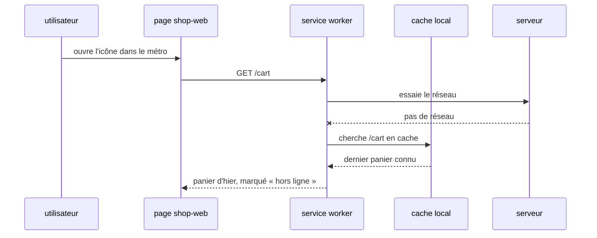
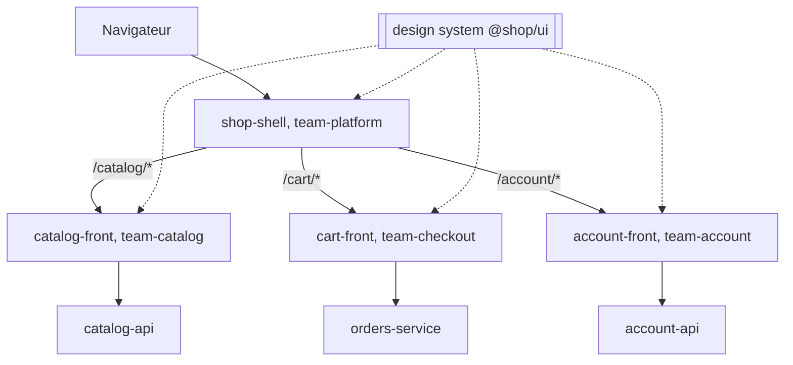

# Front-end et applications web

!!! warning "Avertissement"
    Ces notes sont des pense-bêtes personnels, pas une source de vérité. Elles reflètent ma compréhension et mes choix : leur contenu reste subjectif, malgré les citations et les références qu'il contient. Il peut être incomplet, simplifié, inexact ou dépassé. Vérifiez toujours dans la documentation officielle avant de l'appliquer. Ce contenu est fourni tel quel, sans aucune garantie : son utilisation se fait sous votre seule responsabilité.

!!! audience "Pour qui, pour quoi"
    - **Métiers** : développeur front-end, développeur full-stack, tech lead front, designer qui maintient un design system, QA qui teste des applications web sur ordinateur et sur mobile.
    - **Usages** : je comprends pourquoi mon panier React ne se met pas à jour après un clic ; je décide si une PWA suffit pour mes clients sur iPhone ou s'il faut une appli native ; je découpe un front partagé par trois équipes qui s'attendent à chaque mise en production ; je choisis le rendu des fiches produit pour qu'elles soient trouvées par les moteurs de recherche ; je décide s'il faut quitter Webpack parce que le build de CI prend 12 minutes.

!!! abstract "Les échelles"
    Les pastilles de couleur sous les titres disent à quelle échelle une notion s'applique :

    - <span class="pill pill-scope pill-scope-code">Code</span> les classes, fonctions et modules d'un programme ;
    - <span class="pill pill-scope pill-scope-app">Application</span> un service ou une application et son découpage interne ;
    - <span class="pill pill-scope pill-scope-system">Système</span> plusieurs services qui communiquent par le réseau ;
    - <span class="pill pill-scope pill-scope-infra">Infrastructure</span> les serveurs, le réseau, les zones et les clusters, physiques ou virtuels ;
    - <span class="pill pill-scope pill-scope-enterprise">Entreprise</span> le système d'information entier et son organisation.

    Détail et mots ambigus : [carte des échelles](architecture.md#carte-des-echelles).

Cette page rassemble ce qu'il faut savoir pour construire la partie du système que l'utilisateur voit : React et les interfaces à composants, l'application web sur mobile (PWA et iPhone), les micro front-ends, le design system, les stratégies de rendu et les bundlers. Elle complète la page [Architecture et systèmes distribués](architecture.md), qui traite du découpage des services, des données et des pannes côté serveur. Les pastilles « À décider » et « À connaître » sous les titres sont expliquées dans [Comment lire cette page](architecture.md#comment-lire-cette-page). La boutique `shop-web` et ses services sont fictifs, et tous les chiffres sont des exemples sauf mention contraire.

## Vocabulaire

**Front-end** : tout ce qui s'exécute chez l'utilisateur, dans son navigateur ou son téléphone : écrans, navigation, formulaires, appels aux API. Le **back-end** est ce qui tourne sur les serveurs de l'équipe, comme `orders-service`.

**<span class="term" data-term="spa">SPA</span>** (single page application) : une application web qui charge une seule page HTML, puis change l'écran en JavaScript sans recharger la page. Exemple : dans `shop-web`, passer du catalogue au panier ne fait aucun aller-retour complet avec le serveur, seulement des appels d'API.

**Bundle** : le ou les fichiers JavaScript et CSS que le navigateur télécharge, produits par un bundler à partir du code source. Plus il est lourd, plus la page met de temps à devenir utilisable sur un téléphone lent.

**Rendu** : la fabrication du HTML que le navigateur affiche, dans le navigateur ou sur un serveur (détail dans [Stratégies de rendu](#strategies-de-rendu)).

**<span class="term" data-term="cdn">CDN</span>** (content delivery network) : un réseau de serveurs répartis dans le monde qui gardent une copie des fichiers et des pages, pour les servir près de l'utilisateur. Exemple : les images de `shop-web` servies depuis un serveur à Paris pour un client parisien.

**<span class="term" data-term="core-web-vitals">Core Web Vitals</span>** : trois mesures de Google sur l'expérience réelle d'une page, prises chez les vrais utilisateurs :

``` { .text .ex-ref title="Référence" }
LCP   temps avant l'affichage du plus gros élément utile    bon : 2,5 s ou moins
INP   délai entre un clic et la réaction visible de la page   bon : 200 ms ou moins
CLS   déplacements inattendus du contenu pendant le chargement  bon : 0,1 ou moins
```

**<span class="term" data-term="sli">SLI</span>** (service level indicator) : l'indicateur mesuré qui dit si le service va bien du point de vue de l'utilisateur. Exemple : le LCP des fiches produit au 75e centile.

**<span class="term" data-term="slo">SLO</span>** (service level objective) : l'objectif interne que l'équipe se fixe sur un SLI. Exemple : LCP sous 2,5 s sur 28 jours glissants.

**<span class="term" data-term="sla">SLA</span>** (service level agreement) : la promesse contractuelle faite à un client, avec une pénalité si elle n'est pas tenue, en général plus lâche que le SLO. Un front grand public n'en a en général pas.

| Je veux... | Je regarde... |
|---|---|
| savoir si ma boutique paraît lente à mes clients, et pas seulement sur mon ordinateur de développeur | les Core Web Vitals des vrais utilisateurs, au 75e centile |
| comprendre pourquoi la page met cinq secondes à réagir sur un téléphone d'entrée de gamme | le poids du bundle par route et le coût de l'hydratation |

## Front-end

Le **front-end** est la partie du système que l'utilisateur voit : écrans, navigation, formulaires, appels aux API depuis le navigateur. Les questions d'architecture y sont les mêmes qu'au back-end (découper, partager, livrer sans se bloquer), avec deux contraintes en plus : tout le code finit chez l'utilisateur, sur une machine et un réseau qu'on ne maîtrise pas, et l'utilisateur voit **une seule** application, même si dix équipes la construisent. Exemple fictif de toute la section : une boutique `shop-web` avec un catalogue, un panier et un espace compte.

### React et les interfaces à composants

<a class="pill pill-scope pill-scope-code" href="../architecture/#carte-des-echelles">Échelle · Code</a> <a class="pill pill-scope pill-scope-app" href="../architecture/#carte-des-echelles">Échelle · Application</a> <span class="pill pill-status pill-status-ok" title="Toujours valable, vérifié en novembre 2026 ; version majeure 19 sortie en décembre 2024">Valable · 11/2026</span> <a class="pill pill-nature pill-nature-know" href="../architecture/#comment-lire-cette-page" title="Une loi ou un phénomène qu'on ne choisit pas : le connaître évite de mauvaises décisions">À connaître</a>

*React : concurrent de Vue, Angular, Svelte ; complémentaire de Next.js, Vite*
{ .tool-rel }

J'ai un panier qui affiche le nombre d'articles dans l'en-tête, la liste des articles et le total. Avec du JavaScript à l'ancienne, chaque clic sur « ajouter » doit penser à mettre à jour ces trois endroits de la page à la main ; le jour où j'en oublie un, l'en-tête dit 2 articles et la liste en montre 3. **<span class="term" data-term="react">React</span>** (bibliothèque créée chez Facebook, publiée en open source en 2013, aujourd'hui maintenue par Meta et la communauté) retourne le problème : je décris à quoi ressemble l'écran **pour un état donné** (« voici le panier quand il contient ces articles »), et React se charge de mettre la page à jour quand l'état change.

Les mots à connaître :

- un **<span class="term" data-term="react-component">composant</span>** est une fonction JavaScript qui reçoit des données et renvoie un morceau d'interface : `<CartBadge count={3} />`. Une page est un arbre de composants ;
- les **props** sont les données qu'un composant reçoit de son parent, en lecture seule ;
- l'**état** (state) est la donnée qu'un composant possède et peut changer, avec `useState` ; changer l'état relance la fonction du composant, qui renvoie la nouvelle interface ;
- le **JSX** est la syntaxe qui ressemble à du HTML dans le JavaScript ; un outil de build la traduit en appels de fonctions ;
- les **hooks** (`useState`, `useEffect`...) sont les fonctions qui donnent à un composant de l'état ou des effets (appeler une API, s'abonner à un événement).

``` { .text .ex-illus title="Illustration" }
1. l'utilisateur clique sur « ajouter »       setItems([...items, mug])
2. React relance la fonction Cart()           elle renvoie la nouvelle description : 3 articles
3. React compare l'ancienne et la nouvelle    seuls le badge, une ligne et le total ont changé
4. React modifie seulement ces trois endroits dans la page du navigateur
```

!!! noob "As noob"
    Avec du JavaScript classique, je suis un peintre qui retouche le tableau à chaque changement : ici un chiffre, là une ligne, et j'oublie parfois un coin. Avec React, je donne une recette (« pour ce panier, l'écran ressemble à ça ») et un assistant compare l'ancien tableau au nouveau puis ne repeint que ce qui a changé. Limite de l'image : l'assistant n'est pas gratuit, une page qui se redessine trop souvent finit par ramer. La phrase à retenir : **je décris l'écran pour un état donné, React s'occupe de passer d'un écran à l'autre.**

Les deux erreurs les plus fréquentes des débutants, et leur correction :

``` { .jsx .ex-bad title="À éviter" }
// À éviter : modifier le tableau existant, React voit le même objet et ne redessine rien
function AddButton({ items, setItems, product }) {
  return <button onClick={() => { items.push(product); setItems(items); }}>Ajouter</button>;
}
```

``` { .jsx .ex-good title="Recommandé" }
// Bien : créer un nouveau tableau, React voit le changement et redessine
function AddButton({ items, setItems, product }) {
  return <button onClick={() => setItems([...items, product])}>Ajouter</button>;
}
```

``` { .jsx .ex-bad title="À éviter" }
// À éviter : un effet sans liste de dépendances relance l'appel à chaque rendu, donc en boucle
function OrderStatus({ orderId }) {
  const [status, setStatus] = useState(null);
  useEffect(() => {
    fetch(`/api/orders/${orderId}`).then((r) => r.json()).then((o) => setStatus(o.status));
  });
  return <p>{status}</p>;
}
```

``` { .jsx .ex-good title="Recommandé" }
// Bien : l'effet ne se relance que si orderId change, et annule l'appel devenu inutile
function OrderStatus({ orderId }) {
  const [status, setStatus] = useState(null);
  useEffect(() => {
    const controller = new AbortController();
    fetch(`/api/orders/${orderId}`, { signal: controller.signal })
      .then((r) => r.json())
      .then((o) => setStatus(o.status))
      .catch(() => {});
    return () => controller.abort();
  }, [orderId]);
  return <p>{status}</p>;
}
```

Dans le premier cas, l'utilisateur clique et rien ne bouge à l'écran : `items` est toujours le même tableau, donc React conclut que rien n'a changé. Dans le deuxième, chaque réponse change l'état, qui relance le rendu, qui relance l'effet : l'API reçoit des centaines d'appels par seconde.

**Pourquoi c'est un sujet d'architecture.** React ne fournit que la couche « interface ». Tout le reste est un choix d'équipe : le routage, l'appel aux API, l'état partagé entre pages, le rendu côté serveur. C'est pour ça qu'on l'utilise souvent avec un [méta-framework](#strategies-de-rendu) comme Next.js, et que le choix du framework (React, Vue, Angular, Svelte) engage l'équipe pour des années : recrutement, bibliothèques, [design system](#design-system-et-developpement-par-composants).

**Quand le choisir.** Une interface riche qui change souvent sans recharger la page (un tableau de bord, un éditeur, un panier), une équipe qui connaît déjà React, un besoin de bibliothèques nombreuses. Quand ne pas le choisir : un site surtout statique, comme un blog ou une documentation, où un générateur de site statique envoie moins de JavaScript ; une page avec un formulaire et deux boutons, où un peu de HTML suffit.

| Je veux... | J'utilise... |
|---|---|
| afficher une interface qui change souvent sans recharger la page, comme un panier qui se met à jour pendant que je navigue | React, Vue ou Svelte |
| qu'une fiche produit soit trouvée par les moteurs de recherche tout en restant interactive | React avec un méta-framework qui fait le rendu serveur, comme Next.js |
| afficher un site de documentation qui change peu | un générateur de site statique, sans framework d'interface |

:material-book-open-variant: Doc de référence : [React, « Quick Start »](https://react.dev/learn) (version 19, consultée en novembre 2026)
{ .doc-ref }

### Application web sur mobile, PWA et iPhone

<a class="pill pill-scope pill-scope-app" href="../architecture/#carte-des-echelles">Échelle · Application</a> <span class="pill pill-status pill-status-ok" title="Toujours valable, vérifié en novembre 2026 ; les règles d'Apple changent souvent">Valable · 11/2026</span> <a class="pill pill-nature pill-nature-decide" href="../architecture/#comment-lire-cette-page" title="Un choix que l'équipe ou les architectes doivent faire, puis écrire dans un ADR">À décider</a>

Mon équipe doit rendre la boutique `shop-web` utilisable sur téléphone. Trois chemins existent :

| Forme | Ce que c'est | Où elle s'installe | Exemple |
|---|---|---|---|
| site web adapté au mobile | les mêmes pages, qui s'adaptent à la taille de l'écran | nulle part : je tape l'adresse dans le navigateur | la fiche produit lue depuis un lien partagé |
| **<span class="term" data-term="pwa">PWA</span>** (progressive web app) | une application web qui peut s'installer sur l'écran d'accueil, s'ouvrir sans barre d'adresse et marcher en partie hors ligne | depuis le navigateur, sans store | `shop-web` ajoutée à l'écran d'accueil, qui affiche le dernier panier dans le métro |
| application native | une application écrite pour iOS (Swift) ou Android (Kotlin), ou avec un outil multiplateforme (React Native, Flutter) | depuis l'App Store ou le Play Store | une appli qui lit le code-barres d'un produit avec la caméra en continu |

Une **web app** est une application qui tourne dans le navigateur (souvent une <span class="term" data-term="spa">SPA</span> en React). Une PWA, c'est une web app à qui on ajoute trois pièces : un fichier **manifeste** (nom, icône, couleur, mode d'affichage), un **<span class="term" data-term="service-worker">service worker</span>** (un script qui se place entre l'application et le réseau, pour servir des fichiers depuis un cache quand le réseau manque) et le HTTPS obligatoire. Le terme vient d'Alex Russell et Frances Berriman, en 2015.

!!! noob "As noob"
    Un site web, c'est un magasin où je dois retourner à chaque fois. Une PWA, c'est le même magasin qui me laisse un petit comptoir chez moi : une icône sur l'écran d'accueil, et une réserve des derniers produits vus, même quand la route (le réseau) est coupée. Une application native, c'est un magasin construit dans ma maison : il a accès à tout (caméra, capteurs), mais il faut passer par le promoteur (le store) pour le construire et le rénover. La phrase à retenir : **une PWA reste un site web, avec une icône, un cache et quelques droits en plus.**

**Comment ça marche sur iPhone.** C'est là que les surprises arrivent, parce qu'Apple impose ses règles :

!!! info "Règles d'Apple vérifiées en novembre 2026"
    Ces points dépendent des versions d'iOS et de décisions d'Apple qui changent souvent, en particulier en Europe : à vérifier avant de s'en servir pour une décision.

- **un seul moteur** : sur iPhone, Chrome, Firefox et Edge utilisent tous WebKit, le moteur de Safari, parce que les règles de l'App Store l'imposent (règle 2.5.6). Un bug de Safari est donc un bug de tous les navigateurs de l'iPhone. Depuis iOS 17.4 (mars 2024), l'Union européenne permet d'autres moteurs, mais peu de navigateurs en livrent un (à vérifier) ;
- **pas d'invitation automatique à installer** : sur Android, Chrome propose « Installer l'application ». Sur iPhone, rien ne s'affiche : l'utilisateur doit ouvrir le menu Partager puis « Sur l'écran d'accueil ». Je dois donc lui expliquer le geste dans l'interface ;
- **notifications** : les notifications web (Web Push) marchent depuis iOS 16.4 (mars 2023), **seulement** pour une web app ajoutée à l'écran d'accueil, et la demande d'autorisation doit suivre un geste de l'utilisateur (un clic). Dans un simple onglet Safari, il n'y en a pas ;
- **stockage effaçable** : Safari peut supprimer les données écrites par le site (cache du service worker, IndexedDB, localStorage) après sept jours sans visite. Les web apps ajoutées à l'écran d'accueil n'ont pas cette limite de sept jours (WebKit, mars 2020). Je ne garde donc jamais une donnée importante seulement dans le navigateur : la vraie copie reste sur le serveur ;
- **stockage séparé** : la web app installée a ses propres cookies et son propre stockage, séparés de Safari. Un utilisateur connecté dans Safari doit se reconnecter dans l'icône installée ;
- **écran** : l'encoche et la barre du bas mangent une partie de l'écran (les « safe areas »), et `100vh` inclut parfois la zone cachée par la barre d'adresse, d'où des boutons coupés en bas de l'écran. `100dvh` (hauteur dynamique) règle ce cas.

``` { .html .ex-bad title="À éviter" }
<!-- À éviter : pas de viewport, la page s'affiche en version ordinateur dézoomée ; 100vh coupe le bouton « Payer » sous la barre de Safari -->
<head>
  <title>shop-web</title>
  <style>.checkout { height: 100vh; }</style>
</head>
```

``` { .html .ex-good title="Recommandé" }
<!-- Bien : viewport mobile, manifeste, icône pour l'écran d'accueil iPhone, hauteur dynamique et marges de sécurité -->
<head>
  <title>shop-web</title>
  <meta name="viewport" content="width=device-width, initial-scale=1, viewport-fit=cover">
  <link rel="manifest" href="/manifest.webmanifest">
  <link rel="apple-touch-icon" href="/icons/icon-180.png">
  <style>
    .checkout { height: 100dvh; padding-bottom: env(safe-area-inset-bottom); }
  </style>
</head>
```

Le manifeste, que Safari et Chrome lisent pour l'installation :

``` { .json .ex-ref title="Référence" }
{
  "name": "Shop",
  "start_url": "/",
  "display": "standalone",
  "background_color": "#ffffff",
  "icons": [{ "src": "/icons/icon-512.png", "sizes": "512x512", "type": "image/png" }]
}
```

Ce que fait le service worker quand le réseau tombe :



``` { .javascript .ex-bad title="À éviter" }
// À éviter : tout mettre en cache pour toujours, l'utilisateur garde l'ancienne version et les anciens prix
self.addEventListener("fetch", (event) => {
  event.respondWith(caches.match(event.request).then((cached) => cached || fetch(event.request)));
});
```

``` { .javascript .ex-good title="Recommandé" }
// Bien : réseau d'abord pour les données, cache seulement en secours
self.addEventListener("fetch", (event) => {
  if (!event.request.url.includes("/api/")) return;
  event.respondWith(
    fetch(event.request)
      .then((response) => {
        const copy = response.clone();
        caches.open("api-v1").then((cache) => cache.put(event.request, copy));
        return response;
      })
      .catch(() => caches.match(event.request)),
  );
});
```

Avec la première version, un prix corrigé côté serveur n'arrive jamais : le service worker répond toujours avec la copie de la première visite.

**Pour tester.** Le WebKit de Playwright n'est pas Safari sur iPhone : il partage le moteur, pas le système, les gestes ni les règles d'installation. Je teste l'installation, les notifications et le hors-ligne sur un vrai iPhone (ou une ferme d'appareils), et le reste automatiquement.

**Quand choisir quoi.** Une PWA suffit quand mon besoin tient dans ce qu'un navigateur sait faire : catalogue, panier, formulaires, consultation hors ligne. Je passe au natif quand j'ai besoin de fonctions que le navigateur de l'iPhone ne donne pas ou mal (Bluetooth, NFC, tâches en arrière-plan longues), d'une présence dans l'App Store, ou de performances fortes (jeu, vidéo).

| Je veux... | J'utilise... |
|---|---|
| qu'un client lise une fiche produit depuis un lien partagé, sans rien installer | un site web adapté au mobile |
| que mes clients fidèles retrouvent la boutique sur leur écran d'accueil et voient leur dernier panier dans le métro | une PWA |
| envoyer des notifications à des utilisateurs d'iPhone | une PWA installée sur l'écran d'accueil (iOS 16.4 ou plus), ou une appli native |
| lire en continu des codes-barres, parler à un appareil Bluetooth ou apparaître dans l'App Store | une application native ou multiplateforme |

:material-book-open-variant: Doc de référence : [web.dev, « Learn PWA »](https://web.dev/learn/pwa) (consultée en novembre 2026) ; [WebKit, « Web Push for Web Apps on iOS and iPadOS »](https://webkit.org/blog/13878/web-push-for-web-apps-on-ios-and-ipados/) (2023)
{ .doc-ref }

### Micro front-ends

<a class="pill pill-scope pill-scope-system" href="../architecture/#carte-des-echelles">Échelle · Système</a> <span class="pill pill-status pill-status-ok" title="Toujours valable, vérifié en novembre 2026">Valable · 11/2026</span> <a class="pill pill-nature pill-nature-decide" href="../architecture/#comment-lire-cette-page" title="Un choix que l'équipe ou les architectes doivent faire, puis écrire dans un ADR">À décider</a>

Un **<span class="term" data-term="micro-frontend">micro front-end</span>** applique au navigateur l'idée des microservices : l'interface est découpée en morceaux, chacun possédé par une équipe, développé, testé et déployé seul, puis assemblé pour que l'utilisateur voie une seule application. L'assemblage est fait par une **<span class="term" data-term="app-shell">application hôte</span>** (le *shell*), qui porte la mise en page commune, la navigation de premier niveau et la session. Le terme apparaît dans le Thoughtworks Technology Radar de novembre 2016 (à vérifier) ; la référence la plus citée est l'article de Cam Jackson, « Micro Frontends », publié sur martinfowler.com en juin 2019.

On découpe **par domaine métier**, en tranches verticales, pas par couche technique : l'équipe panier possède l'écran panier, son API (`orders-service`) et ses données, de bout en bout. C'est la forme front-end d'une <span class="term" data-term="stream-aligned-team">équipe alignée sur un flux</span>. Découper en « en-tête », « boutons », « formulaires » recrée au contraire des dépendances entre toutes les équipes.

**Pourquoi.** Le problème de départ est un front monolithique partagé par plusieurs équipes : un seul dépôt, un seul pipeline de 40 minutes, une seule mise en production par semaine ; une équipe qui casse le build bloque toutes les autres, et monter de version le framework se fait en big bang. Les micro front-ends apportent :

- le déploiement indépendant : l'équipe panier livre cinq fois par jour sans attendre le catalogue ;
- l'autonomie technique dans un cadre commun (outils de test, rythme de mise à jour) ;
- la migration progressive d'un vieux front, une route à la fois, au lieu d'une réécriture totale ;
- une base de code plus petite par équipe, plus facile à comprendre et à tester.

Le coût est réel, et c'est celui d'un système distribué côté navigateur :

- des pages plus lourdes si les dépendances sont chargées en double ;
- une expérience incohérente si personne ne tient le design commun ;
- une infrastructure en plus : hébergement de chaque morceau, manifeste des versions, gestion des pannes d'un morceau ;
- des tests d'intégration plus difficiles : chaque morceau marche seul, l'assemblage peut casser ;
- une gouvernance : qui décide des dépendances partagées, du contrat avec le shell, des règles d'UX.

**Quand l'appliquer.** Les signaux qui justifient ce coût :

| Signal | Exemple |
|---|---|
| trois équipes ou plus livrent dans le même front et passent leur temps à s'attendre | une mise en production commune par semaine, une file d'attente de merge requests |
| les parties de l'écran échangent peu entre elles, chacune avec son propre métier | catalogue, panier et compte échangent peu d'informations entre eux |
| je dois sortir d'un vieux front sans arrêter les livraisons pendant la migration | les nouvelles pages en React, les anciennes restent dans l'ancien framework le temps de la migration |
| certaines parties changent tous les jours, d'autres presque jamais | le panier change tous les jours, l'espace compte une fois par mois |

Quand ne pas l'appliquer : une seule équipe (ou deux qui se parlent tous les jours), une petite application, un écran où tout interagit avec tout (un éditeur, un tableau de bord très lié), une cible mobile bas de gamme sans budget pour surveiller le poids des pages, ou l'envie de « tester plusieurs frameworks ». L'alternative est le **front modulaire** : une seule application, découpée en paquets dans un <span class="term" data-term="monorepo">monorepo</span>, avec des frontières entre modules vérifiées en CI, exactement comme le [monolithe modulaire](architecture.md#monolithe-modulaire) côté back-end. On passe aux micro front-ends le jour où le déploiement commun devient la douleur mesurée.

**Comment : les quatre façons d'assembler.**

1. **Au build, par paquets npm.** Chaque micro front-end est publié comme paquet, le shell le déclare en dépendance, et tout est empaqueté ensemble. Simple, typé, un seul bundle bien optimisé. Mais chaque changement d'une équipe oblige à republier puis redéployer le shell : on perd le déploiement indépendant, qui était la raison d'être. Cam Jackson le déconseille pour cette raison.
2. **Côté serveur ou en bordure.** Le serveur, ou le <span class="term" data-term="cdn">CDN</span>, assemble la page HTML à partir de fragments servis par chaque équipe : Server Side Includes, **<span class="term" data-term="edge-side-includes">Edge Side Includes</span>** (ESI, spécification soumise au W3C en 2001), ou un petit serveur de composition. Bon pour le référencement et le premier affichage de pages surtout faites de contenu ; l'interactivité côté navigateur reste à organiser à part.
3. **À l'exécution, en JavaScript.** Le shell télécharge le code de chaque micro front-end au moment où l'utilisateur en a besoin :
    - **<span class="term" data-term="module-federation">Module Federation</span>** : apparu avec Webpack 5 (octobre 2020). Un build *expose* des modules, un autre les *consomme* comme s'ils étaient locaux, et les dépendances communes (React, le design system) sont négociées pour n'être chargées qu'une fois. Aussi disponible nativement dans Rspack, et pour Vite via un plugin (à vérifier pour l'état du support) ;
    - **single-spa** : un orchestrateur indépendant du framework (première version vers 2016, à vérifier). Chaque application enregistrée expose `bootstrap`, `mount` et `unmount`, et single-spa monte celle qui correspond à l'URL ;
    - **<span class="term" data-term="web-component">Web Components</span>** : chaque équipe livre un élément HTML personnalisé (`<cart-summary>`), un standard du navigateur, utilisable depuis n'importe quel framework, avec une isolation du CSS par le <span class="term" data-term="shadow-dom">Shadow DOM</span>.
4. **Par <span class="term" data-term="iframe">iframe</span>.** Isolation totale (JavaScript, CSS, plantage), mais navigation, hauteur de la zone, accessibilité, référencement et partage de session deviennent difficiles. Réservé à un outil tiers ou à une vieille application intégrée telle quelle.

*npm : concurrent de yarn, pnpm*
{ .tool-rel }


| Mode | Déploiement indépendant | Points forts | Points faibles | À choisir quand |
|---|---|---|---|---|
| paquets npm au build | non | simple, typé, un seul bundle | chaque changement redéploie le shell | on veut surtout partager du code, pas livrer séparément |
| composition serveur ou ESI | oui | premier affichage rapide, bon référencement | interactivité à gérer à part, infrastructure serveur | pages de contenu, catalogue public |
| Module Federation | oui | dépendances partagées, intégration fine | couplage aux versions du bundler, débogage plus dur | une application riche, un seul framework, plusieurs équipes |
| single-spa | oui | plusieurs frameworks côte à côte | une couche de plus à maîtriser | migration d'un vieux framework vers un nouveau |
| Web Components | oui | standard, indépendant du framework | rendu serveur et passage de données complexes plus délicats | widgets réutilisés dans des applications aux frameworks différents |
| iframe | oui | isolation totale | UX, accessibilité, taille, référencement | outil tiers, vieille application à intégrer sans la toucher |

**Exemple : un shell et trois micro front-ends.** Trois équipes, un shell tenu par une équipe plateforme, un design system partagé :

``` { .text .ex-illus title="Illustration" }
shop-shell/              team-platform : mise en page, routes de 1er niveau, session, erreurs
├─ src/routes.ts         /catalog/* vers catalog, /cart/* vers cart, /account/* vers account
├─ src/layout/           en-tête, menu, pied de page
└─ rspack.config.js      remotes : catalog, cart, account
catalog-front/           team-catalog, déployé seul, appelle catalog-api
cart-front/              team-checkout, déployé seul, appelle orders-service
account-front/           team-account, déployé seul, appelle account-api
shop-ui/                 paquet @shop/ui : design system, versionné SemVer
shop-mfe-contract/       paquet @shop/mfe-contract : contrat entre shell et micro front-ends
```



La configuration Module Federation du shell (Webpack 5 ou Rspack, même syntaxe ; les noms de paquets dépendent de la version, à vérifier) :

``` { .js .ex-ref title="Référence" }
const { ModuleFederationPlugin } = require("@module-federation/enhanced/rspack");

// Exemple : le shell déclare ses remotes et partage React en singleton
module.exports = {
  plugins: [
    new ModuleFederationPlugin({
      name: "shell",
      remotes: {
        catalog: "catalog@https://static.example.com/catalog/remoteEntry.js",
        cart: "cart@https://static.example.com/cart/remoteEntry.js",
        account: "account@https://static.example.com/account/remoteEntry.js",
      },
      shared: {
        react: { singleton: true, requiredVersion: "^18.3.0" },
        "react-dom": { singleton: true, requiredVersion: "^18.3.0" },
        "@shop/ui": { singleton: true, requiredVersion: "^4.0.0" },
      },
    }),
  ],
};
```

Et celle du panier, qui expose son point d'entrée :

``` { .js .ex-ref title="Référence" }
// Exemple : le panier expose son point d'entrée mount
new ModuleFederationPlugin({
  name: "cart",
  filename: "remoteEntry.js",
  exposes: { "./mount": "./src/mount.tsx" },
  shared: {
    react: { singleton: true, requiredVersion: "^18.3.0" },
    "react-dom": { singleton: true, requiredVersion: "^18.3.0" },
    "@shop/ui": { singleton: true, requiredVersion: "^4.0.0" },
  },
});
```

Les URL des `remotes` pointent souvent vers un manifeste chargé au démarrage plutôt qu'en dur : on change ainsi la version d'un micro front-end (ou on revient en arrière) sans reconstruire le shell.

**Le contrat entre le shell et un micro front-end.** C'est l'API publique de chaque micro front-end, à traiter comme un contrat d'API : écrit dans un paquet versionné, changé avec prudence.

``` { .ts .ex-ref title="Référence" }
// Exemple : les props que le shell passe à chaque micro front-end
export interface MicroFrontendProps {
  basePath: string;
  locale: string;
  getAccessToken: () => Promise<string>;
  navigate: (path: string) => void;
}

// Exemple : monter dans un élément renvoie de quoi se démonter
export type Unmount = () => void;

export type Mount = (element: HTMLElement, props: MicroFrontendProps) => Unmount;
```

**Routage.** Le shell possède le premier segment de l'URL (`/cart`), le micro front-end possède la suite (`/cart/checkout/payment`). Un seul historique de navigation pour tout le monde ; pour aller dans un autre domaine, un micro front-end appelle `navigate` du shell ou pose un simple lien, jamais le routeur d'une autre équipe. Toute URL doit fonctionner au rechargement : le serveur renvoie le shell pour toutes les routes, et le shell monte le bon morceau.

**État partagé : les règles.**

1. Pas de store global commun (un Redux partagé entre équipes) : c'est le retour du monolithe, en plus fragile.
2. L'URL est le premier état partagé : identifiant du produit, filtres, page.
3. Les données métier se relisent depuis leur API : le back-end reste la source de vérité, chaque micro front-end garde son propre état local.
4. Pour prévenir les autres d'un fait, on publie un événement navigateur avec un contenu documenté et versionné, comme un événement entre services :

    ``` { .ts .ex-bad title="À éviter" }
    // À éviter : modifier directement le compteur affiché dans l'en-tête du shell
    document.querySelector("#header-cart-count")!.textContent = String(count + 1);
    ```

    ``` { .ts .ex-good title="Recommandé" }
    // Bien : un événement navigateur au contenu documenté pour prévenir les autres
    window.dispatchEvent(
      new CustomEvent("cart:item-added", { detail: { sku: "SKU-42", quantity: 1 } }),
    );
    ```

    Le jour où team-platform renomme `#header-cart-count` en refaisant l'en-tête, le panier plante sur un élément `null` au moment de l'ajout, alors que son build et ses tests, lancés seuls, restent verts.

5. Les services transverses (session, jeton, langue, <span class="term" data-term="feature-flag">feature flags</span>) viennent du shell, par les props du contrat, jamais recopiés par chaque équipe.

**Versions des dépendances partagées.** Partager peu : le framework, le design system, le client d'authentification. Le reste, chaque équipe garde le sien.

- Le framework est en `singleton` : deux copies de React dans la même page cassent les hooks (« Invalid hook call »).
- Les paquets partagés suivent la <span class="term" data-term="semantic-versioning">version sémantique</span> ; `requiredVersion: "^4.0.0"` accepte toute 4.x.
- Une version majeure du framework ou du design system se planifie entre toutes les équipes : c'est le seul moment où l'on se synchronise, et un tableau de bord des versions par micro front-end le prépare.
- Un contrôle en CI échoue si un micro front-end sort de la plage autorisée, sinon le shell charge silencieusement deux versions.

**Pièges de performance et de cohérence.**

| Piège | Ce que voit l'utilisateur | Parade |
|---|---|---|
| dépendances en double | une page lente, surtout sur mobile | `shared` et `singleton`, budget de poids par micro front-end vérifié en CI (exemple : 150 ko compressés) |
| chargements en cascade (shell, puis `remoteEntry.js`, puis le code, puis l'API) | un écran blanc qui dure | précharger les entrées des routes probables, squelette d'attente, <span class="term" data-term="lazy-loading">chargement paresseux</span> du reste |
| la mise en page bouge quand un morceau arrive | des clics au mauvais endroit | réserver la place, suivre le CLS des <span class="term" data-term="core-web-vitals">Core Web Vitals</span> |
| CSS qui fuit d'une équipe à l'autre | le bouton du panier change de couleur | CSS Modules ou préfixes, Shadow DOM, styles globaux seulement dans le shell |
| UX incohérente | trois styles de messages d'erreur, deux chargements différents | design system, design tokens, revue UX transverse |
| un micro front-end qui plante | toute la page blanche | une frontière d'erreur par micro front-end dans le shell, message de repli « le panier est momentanément indisponible » |
| focus perdu au changement de route | lecteur d'écran muet | le shell gère focus et annonces, voir <span class="term" data-term="web-accessibility">accessibilité numérique</span> |

**Tester.** Trois niveaux, du moins cher au plus cher :

1. **chaque micro front-end seul** : tests unitaires et de composants, et un démarrage autonome avec un faux shell, pour développer sans les autres équipes ;
2. **le contrat** : un <span class="term" data-term="contract-test">test de contrat</span> vérifie que le micro front-end respecte `Mount` (il se monte, se démonte proprement) et que ses événements ont la forme promise. Le shell, consommateur, peut publier ses attentes comme pour un contrat d'API, voir [Tests de contrat et mocks d'API](qualite.md#tests-de-contrat-et-mocks-dapi) ;
3. **l'application assemblée** : quelques <span class="term" data-term="e2e-test">tests de bout en bout</span> sur les parcours critiques qui traversent plusieurs équipes, dans un environnement où le shell charge la dernière version de chaque morceau, lancés après chaque déploiement de n'importe lequel d'entre eux. Plus un <span class="term" data-term="smoke-test">smoke test</span> qui vérifie que chaque `remoteEntry.js` répond.

Le test de contrat du panier (Vitest) :

``` { .ts .ex-ref title="Référence" }
import { describe, expect, it, vi } from "vitest";
import { mount } from "../src/mount";

// Exemple : test de contrat, le panier se monte et se démonte proprement
describe("cart-front respecte le contrat du shell", () => {
  it("se monte dans l'élément fourni et se démonte proprement", async () => {
    const element = document.createElement("div");
    const unmount = mount(element, {
      basePath: "/cart",
      locale: "fr-FR",
      getAccessToken: vi.fn().mockResolvedValue("fake-token"),
      navigate: vi.fn(),
    });

    await vi.waitFor(() => {
      expect(element.querySelector("[data-testid='cart-root']")).not.toBeNull();
    });

    unmount();
    expect(element.innerHTML).toBe("");
  });
});
```

Le test de bout en bout sur l'assemblage (Playwright), qui traverse catalogue, shell et panier :

``` { .ts .ex-ref title="Référence" }
import { expect, test } from "@playwright/test";

// Exemple : test E2E qui traverse catalogue, shell et panier
test("un produit ajouté depuis le catalogue apparaît dans le panier", async ({ page }) => {
  await page.goto("/catalog/sku-42");
  await page.getByRole("button", { name: "Ajouter au panier" }).click();
  await expect(page.getByTestId("cart-badge")).toHaveText("1");

  await page.getByRole("link", { name: "Panier" }).click();
  await expect(page).toHaveURL(/\/cart/);
  await expect(page.getByText("SKU-42")).toBeVisible();
});
```

Les étapes pour démarrer :

1. découper par domaine métier, aligné sur les équipes ([loi de Conway](architecture.md#loi-de-conway)) ;
2. construire un shell minimal : mise en page, routes de premier niveau, session, frontières d'erreur ;
3. écrire le contrat (`Mount`, props, événements) dans un paquet versionné ;
4. choisir le mode d'assemblage avec le tableau ci-dessus ;
5. fixer la courte liste des dépendances partagées et leurs plages de versions ;
6. mettre en CI les budgets de poids, les tests de contrat, et les tests de bout en bout sur l'assemblage ;
7. migrer une route à la fois, en commençant par la moins risquée.

:material-book-open-variant: Doc de référence : [Cam Jackson, « Micro Frontends », martinfowler.com](https://martinfowler.com/articles/micro-frontends.html) (2019) ; [Michael Geers, micro-frontends.org](https://micro-frontends.org/) (consultée en novembre 2026)
{ .doc-ref }

### Design system et développement par composants

<a class="pill pill-scope pill-scope-code" href="../architecture/#carte-des-echelles">Échelle · Code</a> <span class="pill pill-status pill-status-ok" title="Toujours valable, vérifié en novembre 2026">Valable · 11/2026</span> <a class="pill pill-nature pill-nature-decide" href="../architecture/#comment-lire-cette-page" title="Un choix que l'équipe ou les architectes doivent faire, puis écrire dans un ADR">À décider</a>

Un **<span class="term" data-term="design-system">design system</span>** est un ensemble partagé de composants d'interface codés (bouton, champ, modale), de **<span class="term" data-term="design-token">design tokens</span>** (couleurs, espacements, typographie sous forme de variables nommées) et de règles d'usage documentées, maintenu comme un produit, avec un propriétaire et des versions. Le **<span class="term" data-term="component-driven-development">développement piloté par les composants</span>** (component-driven development, terme popularisé par Tom Coleman vers 2017, à vérifier) construit l'interface de bas en haut : chaque composant est développé et testé seul, dans tous ses états, puis assemblé en pages. Brad Frost en a donné une grille de lecture, l'Atomic Design (article en 2013, livre en 2016) : atomes, molécules, organismes, gabarits, pages. **<span class="term" data-term="storybook">Storybook</span>** (première version en 2016, à vérifier) est l'outil open source le plus répandu pour cela : il affiche chaque composant hors de l'application, dans chacun de ses états, appelés *stories*.

**Pourquoi.** Sans design system, le même bouton est recodé six fois avec six gris différents, l'accessibilité est corrigée (ou pas) application par application, et chaque écran se discute à partir de captures. Avec lui :

- une correction (contraste, focus clavier) profite à toutes les applications en une seule version ;
- les écrans se construisent plus vite, à partir de briques déjà testées ;
- designers et développeurs parlent des mêmes composants, avec les mêmes noms ;
- avec des micro front-ends, c'est ce qui garde une seule expérience aux yeux de l'utilisateur.

Le coût : un propriétaire (au minimum une personne, souvent une équipe), une gestion de versions et des migrations chez les consommateurs, et le risque de devenir un goulot d'étranglement. Lancé trop tôt, il fige des abstractions avant de savoir ce dont les écrans ont besoin.

**Quand l'appliquer.** Plusieurs applications ou équipes partagent une identité visuelle ; des micro front-ends ; les mêmes composants sont recodés dans plusieurs dépôts ; un objectif d'accessibilité à tenir partout. Quand ne pas : un seul petit produit, un prototype. Là, une bibliothèque de composants open source existante, avec un thème, suffit ; construire son propre design system ne se justifie qu'à plusieurs produits.

**Comment.**

1. Faire l'inventaire de l'existant : une capture de tous les boutons, champs et messages d'erreur suffit à convaincre.
2. Commencer par les tokens : couleurs, espacements, rayons, typographie.
3. Construire les composants de base, accessibles dès le départ, chacun avec une story par état (normal, désactivé, en chargement, en erreur).
4. Publier comme paquet versionné (`@shop/ui`), avec un journal des changements, et fournir un script de migration pour chaque version majeure.
5. Tester les stories : tests d'interaction, <span class="term" data-term="regression">régression</span> visuelle (une capture par story comparée à la référence), contrôle d'accessibilité automatique.
6. Gouverner : contributions ouvertes à toutes les équipes, revue par le propriétaire, règle claire sur ce qui entre dans le design system et ce qui reste local.

Les tokens, en variables CSS :

``` { .css .ex-ref title="Référence" }
/* Exemple : les tokens du design system, en variables CSS */
:root {
  --color-primary: #1f6feb;
  --color-danger: #cf222e;
  --space-2: 8px;
  --space-4: 16px;
  --radius-md: 6px;
}
```

Une story au format CSF 3 (Component Story Format, Storybook 7 et suivants, 2023 ; les noms de paquets changent selon la version, à vérifier) :

``` { .tsx .ex-ref title="Référence" }
import type { Meta, StoryObj } from "@storybook/react";
import { Button } from "./Button";

// Exemple : la fiche du composant et ses valeurs par défaut
const meta = {
  title: "Actions/Button",
  component: Button,
  args: { label: "Payer", variant: "primary" },
} satisfies Meta<typeof Button>;

export default meta;

type Story = StoryObj<typeof meta>;

// Exemple : chaque export est un état du bouton, donc un cas de test
export const Primary: Story = {};

export const Disabled: Story = {
  args: { disabled: true },
};

export const Loading: Story = {
  args: { loading: true, label: "Paiement en cours" },
};
```

Chaque export est un état du bouton, visible dans Storybook, et chaque état devient un cas de test (capture visuelle, accessibilité) sans écrire de test à part.

| Je veux... | J'utilise... |
|---|---|
| le même bleu de bouton et les mêmes marges dans toutes mes applications, sans recopier les valeurs partout | design tokens |
| travailler sur un bouton dans tous ses états (désactivé, en chargement) sans lancer toute l'application | Storybook, une story par état |
| savoir tout de suite qu'un changement de CSS a cassé un écran, avant qu'un utilisateur le voie | régression visuelle sur les stories |
| des écrans propres pour un seul produit fait par une petite équipe, sans construire de design system | une bibliothèque open source existante, avec un thème |
| une seule apparence pour plusieurs produits ou micro front-ends faits par des équipes différentes | un design system versionné, avec un propriétaire |

:material-book-open-variant: Doc de référence : [Storybook, documentation](https://storybook.js.org/docs) (consultée en novembre 2026) ; [Brad Frost, « Atomic Design »](https://atomicdesign.bradfrost.com/) (2016)
{ .doc-ref }

### Stratégies de rendu

<a class="pill pill-scope pill-scope-app" href="../architecture/#carte-des-echelles">Échelle · Application</a> <span class="pill pill-status pill-status-ok" title="Toujours valable, vérifié en novembre 2026">Valable · 11/2026</span> <a class="pill pill-nature pill-nature-decide" href="../architecture/#comment-lire-cette-page" title="Un choix que l'équipe ou les architectes doivent faire, puis écrire dans un ADR">À décider</a>

!!! info "Écrit en novembre 2026"
    Les fonctionnalités des frameworks évoluent vite : vérifier dans la documentation de la version utilisée.

Le **rendu**, c'est la production du HTML que le navigateur affiche. La question est : où et quand ce HTML est-il fabriqué ?

- **<span class="term" data-term="csr">CSR</span>** (Client Side Rendering) : le serveur envoie une page presque vide et du JavaScript ; le navigateur construit tout. C'est le fonctionnement d'une SPA classique.
- **<span class="term" data-term="ssr">SSR</span>** (Server Side Rendering) : le serveur fabrique le HTML complet à chaque requête, puis le JavaScript le rend interactif dans le navigateur ; cette étape s'appelle l'**<span class="term" data-term="hydration">hydratation</span>**.
- **<span class="term" data-term="ssg">SSG</span>** (Static Site Generation) : le HTML est fabriqué une fois, au build, puis servi tel quel par un CDN.
- **<span class="term" data-term="isr">ISR</span>** (Incremental Static Regeneration, introduit par Next.js 9.5 en 2020) : comme le SSG, mais chaque page est régénérée en arrière-plan après un délai ou à la demande, sans reconstruire tout le site.

Un **<span class="term" data-term="meta-framework">méta-framework</span>** apporte ces stratégies, le routage et le rendu serveur au-dessus d'une bibliothèque d'interface : Next.js (React, 2016), Nuxt (Vue, 2016), SvelteKit (Svelte), Remix puis React Router 7 (React), Astro (2021, multi-framework, orienté contenu). Dates et noms à vérifier. Ils permettent souvent de choisir la stratégie **route par route**.

**Pourquoi c'est un choix d'architecture.** Il décide de la vitesse du premier affichage, du référencement par les moteurs de recherche, du coût des serveurs, de la fraîcheur des données et de ce qui peut être mis en cache. Un mauvais choix se paie partout : une SPA pour un catalogue public perd en référencement ; du SSR pour une page qui ne change jamais paie un serveur pour rien.

| Stratégie | HTML fabriqué | Quand | Quand ne pas | Pièges |
|---|---|---|---|---|
| CSR | dans le navigateur | outil interne derrière connexion, application très interactive | pages publiques à référencer, mobiles lents | écran blanc au démarrage, gros bundle |
| SSR | sur le serveur, à chaque requête | contenu personnalisé ou très frais qui doit s'afficher vite | contenu identique pour tous (gaspillage) | coût serveur, hydratation lente, erreurs d'hydratation (HTML serveur différent du client) |
| SSG | au build | documentation, blog, pages légales, marketing | des millions de pages, ou des données qui changent souvent | build de plus en plus long, contenu figé jusqu'au prochain build |
| ISR | au build, puis régénéré en arrière-plan | catalogue public, fiches produit : beaucoup de pages, changements modérés | données personnelles, ou qui doivent être exactes à la seconde | contenu en retard d'un cycle, support variable selon l'hébergeur |

**Comment.**

1. Classer les pages selon trois questions : faut-il la référencer ? est-elle personnalisée ? à quelle fréquence change-t-elle ?
2. Choisir la stratégie route par route. Pour `shop-web` : pages légales en SSG, fiches produit en ISR (régénérées toutes les 60 secondes), panier et compte en CSR ou SSR, jamais mis en cache partagé.
3. Mesurer sur de vrais utilisateurs : les Core Web Vitals (LCP pour le premier affichage utile, INP pour la réactivité, CLS pour la stabilité).
4. Surveiller le coût d'hydratation : un HTML rapide mais une page qui ne répond aux clics qu'après trois secondes reste une mauvaise expérience.

Une fiche produit en ISR avec Next.js (App Router, syntaxe de Next.js 15, à vérifier selon la version) :

``` { .tsx .ex-ref title="Référence" }
// Exemple : la page est régénérée au plus toutes les 60 s (ISR)
export const revalidate = 60;

type Product = { sku: string; name: string; priceCents: number };

// Exemple : la page lit le produit depuis l'API au rendu
export default async function ProductPage({ params }: { params: Promise<{ sku: string }> }) {
  const { sku } = await params;
  const response = await fetch(`https://catalog-api.example.com/products/${sku}`);
  const product: Product = await response.json();
  return <h1>{product.name}</h1>;
}
```

Le piège qui touche la sécurité : une page SSR personnalisée (« Bonjour Ada », son panier) mise en cache par le CDN est servie à l'utilisateur suivant. Toute réponse qui dépend de la session doit être marquée `Cache-Control: private, no-store`, et un test doit le vérifier.

:material-book-open-variant: Doc de référence : [Jason Miller et Addy Osmani, « Rendering on the Web », web.dev](https://web.dev/articles/rendering-on-the-web) (2019)
{ .doc-ref }

### Bundlers

<a class="pill pill-scope pill-scope-code" href="../architecture/#carte-des-echelles">Échelle · Code</a> <span class="pill pill-status pill-status-ok" title="Toujours valable, vérifié en novembre 2026">Valable · 11/2026</span> <a class="pill pill-nature pill-nature-decide" href="../architecture/#comment-lire-cette-page" title="Un choix que l'équipe ou les architectes doivent faire, puis écrire dans un ADR">À décider</a>

!!! info "Écrit en novembre 2026"
    Les outils de build évoluent vite, et les comparaisons de vitesse viennent surtout des éditeurs eux-mêmes. Dates et fonctionnalités à vérifier dans la documentation.

Un **<span class="term" data-term="bundler">bundler</span>** prend le code source (TypeScript, JSX, CSS, imports entre fichiers) et produit les fichiers que le navigateur charge. Il résout les imports, transpile, regroupe, minifie, découpe le code en morceaux chargés à la demande, et supprime le code jamais utilisé (le <span class="term" data-term="tree-shaking">tree shaking</span>). En développement, il sert l'application et remplace à chaud le module modifié sans recharger la page (<span class="term" data-term="hmr">HMR</span>, Hot Module Replacement).

| Outil | Origine | Bon pour | Limites |
|---|---|---|---|
| Webpack | Tobias Koppers, 2012, écrit en JavaScript | l'écosystème de loaders et plugins le plus riche, Module Federation d'origine, projets existants | configuration verbeuse, lent sur de gros projets |
| Vite | Evan You, 2020 | nouveau projet React, Vue ou Svelte : démarrage quasi instantané en développement (modules ES natifs), configuration courte | historiquement deux chemins différents en développement (esbuild) et en production (Rollup), en cours d'unification avec Rolldown, écrit en Rust (à vérifier) ; Module Federation par plugin |
| Rspack | 2023, écrit en Rust, version 1.0 en 2024 (à vérifier) | accélérer un gros projet Webpack sans réécrire sa configuration (API compatible), Module Federation intégré | tous les plugins Webpack ne sont pas compatibles |
| esbuild | Evan Wallace, 2020, écrit en Go | transpiler et regrouper très vite : bibliothèques, scripts, fonctions serverless, brique interne d'autres outils | pas de HMR intégré, découpage du code plus limité (à vérifier) |

Les gains de vitesse annoncés vont souvent de « 10 fois plus rapide » à bien plus [À prendre avec précaution : chiffres publiés par les projets eux-mêmes, sur leurs propres bancs d'essai]. Aucun de ces outils ne vérifie les types TypeScript : `tsc --noEmit` reste une étape à part dans la CI.

**Quand en changer.** Pas par mode : quand une douleur se mesure. Signaux (seuils donnés en exemple) : un serveur de développement qui démarre en plus de 30 secondes, une modification qui met plusieurs secondes à s'afficher, un build de CI de plus de 10 minutes. Si le framework impose son bundler (un méta-framework), on garde le sien.

**Comment migrer.** Exemple d'un gros projet Webpack vers Rspack :

1. mesurer avant : temps de démarrage, temps de build, poids de chaque fichier produit ;
2. remplacer le paquet et garder la configuration, en remplaçant les plugins incompatibles un par un ;
3. comparer les fichiers produits (poids, découpage) avec l'outil d'analyse du bundle ;
4. lancer les tests de bout en bout sur le résultat, avant de basculer la CI.

| Je veux... | J'utilise... |
|---|---|
| démarrer une nouvelle application React, Vue ou Svelte avec un serveur de développement qui démarre vite | Vite, ou le bundler du méta-framework choisi |
| accélérer un gros projet Webpack existant dont le build est trop lent, sans réécrire sa configuration | Rspack, configuration conservée |
| assembler des micro front-ends avec Module Federation, comme le shell et le panier de `shop-web` | Webpack 5 ou Rspack |
| construire vite une bibliothèque, un script ou une fonction serverless | esbuild (directement ou via un outil qui l'utilise) |

:material-book-open-variant: Doc de référence : [webpack, « Concepts »](https://webpack.js.org/concepts/) (consultée en novembre 2026) ; [Vite, « Why Vite »](https://vite.dev/guide/why) (consultée en novembre 2026)
{ .doc-ref }

!!! maturity "Mesurer la maturité"
    | Niveau | Ce que j'observe dans l'équipe |
    |---|---|
    | N1 | des composants réutilisables existent dans un dossier partagé, et la stratégie de rendu est celle du modèle de départ du framework |
    | N2 | un design system versionné avec Storybook, une stratégie de rendu choisie route par route et des budgets de poids de page vérifiés en CI |
    | N3 | la CI bloque une merge request qui dépasse le budget de poids, casse une capture visuelle ou le contrat d'un micro front-end, et un test échoue si une page personnalisée est mise en cache public |
    | N4 | l'équipe suit les Core Web Vitals des vrais utilisateurs et le temps de build, et arbitre rendu, découpage et bundler à partir de ces chiffres |

    **Je mesure** : le LCP et l'INP au 75e centile des vrais utilisateurs, lus dans l'outil de mesure terrain ; le poids JavaScript compressé par route, lu dans le rapport du bundler en CI.

## Mesurer le succès

Une solution front-end marche quand un chiffre vu par l'utilisateur bouge dans le bon sens sans qu'un autre se dégrade. Avant de changer quoi que ce soit, je relève une base : le LCP et l'INP au 75e centile des vrais utilisateurs, le poids JavaScript par route ou la durée du build des quatre dernières semaines, par exemple. Après le changement, je relève la même mesure, de la même façon, sur une fenêtre de même durée, pour ne pas comparer une semaine de soldes à une semaine creuse. Et je choisis une métrique de garde qui ne doit pas bouger : passer en micro front-ends ne doit pas alourdir les pages, changer de bundler ne doit pas faire grossir le bundle, une page en ISR ne doit pas afficher un prix plus vieux que le délai promis.

| Solution ou situation | Indicateur de succès (SLI) | SLO probable | SLA probable |
|---|---|---|---|
| stratégie de rendu des pages publiques ([Stratégies de rendu](#strategies-de-rendu)) | LCP au 75e centile des vrais utilisateurs | sous 2,5 s, le seuil « bon » des Core Web Vitals | sans objet : pas de contrat externe |
| interface React du panier ([React](#react-et-les-interfaces-a-composants)) | INP au 75e centile des vrais utilisateurs sur les pages panier | sous 200 ms, le seuil « bon » des Core Web Vitals | sans objet : pas de contrat externe |
| PWA sur mobile ([Application web sur mobile, PWA et iPhone](#application-web-sur-mobile-pwa-et-iphone)) | part des ouvertures sans réseau qui affichent le dernier panier au lieu d'une page d'erreur | 99 % sur 30 jours glissants | sans objet : pas de contrat externe |
| micro front-ends ([Micro front-ends](#micro-front-ends)) | part des mises en production d'un micro front-end faites sans redéployer le shell ni un autre morceau ; en garde, poids JavaScript compressé par route | 95 % sur un trimestre, poids stable à 10 % près | sans objet : pas de contrat externe |
| design system ([Design system et développement par composants](#design-system-et-developpement-par-composants)) | part des écrans construits avec les composants du design system ; en garde, nombre d'erreurs d'accessibilité détectées en CI | 90 % des écrans, 0 erreur d'accessibilité bloquante | sans objet : pas de contrat externe |
| changement de bundler ([Bundlers](#bundlers)) | durée médiane du build de CI et du démarrage du serveur de développement ; en garde, poids des fichiers produits | build sous 10 min, démarrage sous 5 s, poids stable à 5 % près | sans objet : pas de contrat externe |

[À prendre avec précaution : ordres de grandeur d'exemple, à fixer avec l'équipe et le métier ; les seuils des Core Web Vitals sont ceux publiés par Google]

## Pièges à éviter

| Piège | Ce qui se passe | Solution |
| --- | --- | --- |
| **Modifier l'état React en place** : j'ajoute un article avec `items.push(product)` puis je passe le même tableau à `setItems`. | React voit le même objet, ne redessine rien, et l'utilisateur clique trois fois sans voir son panier changer. | Je crée toujours un nouvel objet ou un nouveau tableau ([React](#react-et-les-interfaces-a-composants)). |
| **Un effet sans liste de dépendances** : j'appelle l'API dans un `useEffect` sans deuxième argument. | Chaque réponse change l'état, qui relance l'effet, et l'API reçoit des centaines d'appels par seconde. | Je donne la liste des dépendances et j'annule l'appel devenu inutile ([React](#react-et-les-interfaces-a-composants)). |
| **Mettre l'API en cache pour toujours dans le service worker** : je sers chaque réponse depuis le cache dès qu'elle existe. | Un prix corrigé côté serveur n'arrive jamais, et le client paie l'ancien prix affiché. | Je passe par le réseau d'abord pour les données et je ne garde le cache qu'en secours ([Application web sur mobile](#application-web-sur-mobile-pwa-et-iphone)). |
| **Croire que le WebKit de Playwright, c'est l'iPhone** : je valide ma PWA seulement en CI. | L'installation, les notifications et le hors-ligne cassent sur les vrais iPhone, et je l'apprends par les avis des clients. | Je teste ces trois points sur un vrai appareil, le reste automatiquement ([Application web sur mobile](#application-web-sur-mobile-pwa-et-iphone)). |
| **Des micro front-ends pour une seule équipe** : je découpe le front en morceaux alors qu'une équipe le fait seule. | Je paie l'infrastructure, les dépendances en double et les tests d'assemblage sans gagner de déploiement indépendant, puisque personne ne m'attendait. | Je garde un front modulaire dans un monorepo jusqu'à ce que le déploiement commun devienne la douleur mesurée ([Micro front-ends](#micro-front-ends)). |
| **Découper le front par couche technique** : je fais une équipe pour l'en-tête, une pour les boutons, une pour les formulaires. | Chaque fonctionnalité demande alors les trois équipes, exactement ce que les micro front-ends devaient éviter. | Je découpe par domaine métier, catalogue, panier, compte, de l'écran jusqu'aux données ([Micro front-ends](#micro-front-ends)). |
| **Laisser le CDN garder une page personnalisée** : ma page SSR « Bonjour Ada » avec son panier est mise en cache public. | L'utilisateur suivant voit le nom et le panier d'Ada, ce qui est une fuite de données. | Je marque toute réponse qui dépend de la session `Cache-Control: private, no-store` et un test le vérifie ([Stratégies de rendu](#strategies-de-rendu)). |
| **Changer de bundler par mode** : je migre vers l'outil dont tout le monde parle sans rien mesurer. | Je passe des semaines à remplacer des plugins pour un gain que personne ne peut chiffrer, parfois un bundle plus lourd. | Je mesure avant (démarrage, build, poids), je migre, puis je compare les mêmes chiffres ([Bundlers](#bundlers)). |

## Ce qu'on demande en entretien

Les questions typiques :

- « Une PWA peut-elle remplacer une appli native sur iPhone ? », « Pourquoi ce composant React ne se met pas à jour ? » Pour répondre : je cite les limites d'iOS (WebKit imposé, installation manuelle, notifications depuis iOS 16.4) et l'état modifié sans nouvel objet ([Application web sur mobile, PWA et iPhone](#application-web-sur-mobile-pwa-et-iphone), [React](#react-et-les-interfaces-a-composants)).
- « Quand passerais-tu à des micro front-ends ? », « Comment évites-tu de charger React trois fois ? » Pour répondre : je pars du nombre d'équipes qui s'attendent pour livrer, je découpe par domaine, je compare les quatre façons d'assembler, puis je partage React en singleton avec Module Federation ([Micro front-ends](#micro-front-ends)).
- « CSR, SSR, SSG ou ISR pour une boutique en ligne ? » Pour répondre : je classe les pages selon trois questions (référencée, personnalisée, fréquence de changement), je choisis route par route, et je cite le piège de la page personnalisée mise en cache par le CDN ([Stratégies de rendu](#strategies-de-rendu)).
- « À quoi sert un design system, et qui le maintient ? » Pour répondre : une seule correction profite à toutes les applications, avec des tokens, des composants testés par story et un propriétaire qui publie des versions ([Design system et développement par composants](#design-system-et-developpement-par-composants)).
- « Ton build front est lent, que fais-tu ? » Pour répondre : je mesure d'abord, je garde le bundler du méta-framework s'il en impose un, sinon Vite pour un nouveau projet ou Rspack pour un gros projet Webpack, et je rappelle que la vérification des types reste une étape à part ([Bundlers](#bundlers)).
- « Comment sais-tu que ta nouvelle stratégie de rendu marche ? » Pour répondre : je relève les Core Web Vitals des vrais utilisateurs avant et après, sur une fenêtre de même durée, avec une métrique de garde ([Mesurer le succès](#mesurer-le-succes)).

Ce qui fait une bonne réponse : elle nomme le compromis, ce que le choix apporte, ce qu'il coûte, et dans quelle situation je ferais l'inverse. Un framework ou un outil présenté sans son coût sonne comme une réponse apprise.

## Quoi utiliser dans quelle situation

| Situation | J'utilise |
|---|---|
| mon panier affiche le nombre d'articles à trois endroits de la page, et ils finissent par ne plus être d'accord après quelques clics | React (ou Vue, Svelte), l'écran décrit pour un état donné |
| je dois rendre ma boutique utilisable sur iPhone, avec une icône sur l'écran d'accueil et le dernier panier hors ligne | PWA, testée sur un vrai iPhone |
| plusieurs équipes se bloquent sur un même front : une seule mise en production commune, une file d'attente de merge requests | micro front-ends découpés par domaine, shell et contrat versionné |
| j'ai un seul front, fait par une ou deux équipes qui se parlent tous les jours | front modulaire dans un monorepo, pas de micro front-ends |
| mes écrans ne se ressemblent pas d'une application à l'autre : trois styles de messages d'erreur, plusieurs gris | design system, design tokens, Storybook |
| mes pages publiques, comme les fiches produit, doivent être trouvées par les moteurs de recherche et s'afficher vite | SSG ou ISR, SSR si le contenu est personnalisé |
| je fais un outil interne, utilisé seulement après connexion, que les moteurs de recherche n'ont pas à voir | CSR (SPA) |
| mon build front est trop lent, comme un serveur de développement qui met plus de 30 secondes à démarrer | mesurer, puis Vite (nouveau projet) ou Rspack (gros projet Webpack) |

## Sources

- [Cam Jackson, « Micro Frontends », martinfowler.com (juin 2019)](https://martinfowler.com/articles/micro-frontends.html)
- [Thoughtworks Technology Radar, « Micro frontends » (novembre 2016, à vérifier)](https://www.thoughtworks.com/radar/techniques/micro-frontends)
- Michael Geers, « Micro Frontends in Action », Manning (2020)
- Luca Mezzalira, « Building Micro-Frontends », O'Reilly (première édition en 2021, à vérifier)
- [webpack, « Module Federation » (date de publication non indiquée)](https://webpack.js.org/concepts/module-federation/)
- [Module Federation, documentation (date de publication non indiquée)](https://module-federation.io/)
- [single-spa, documentation (date de publication non indiquée)](https://single-spa.js.org/)
- [W3C, « ESI Language Specification 1.0 » (2001)](https://www.w3.org/TR/esi-lang/)
- [MDN, « Web Components » (date de publication non indiquée)](https://developer.mozilla.org/fr/docs/Web/API/Web_components)
- [Brad Frost, « Atomic Design » (2016)](https://atomicdesign.bradfrost.com/)
- [Component Driven, site de référence (date de publication non indiquée)](https://www.componentdriven.org/)
- [Storybook, « Component Story Format » (date de publication non indiquée)](https://storybook.js.org/docs/api/csf)
- [Jason Miller et Addy Osmani, « Rendering on the Web », web.dev (2019)](https://web.dev/articles/rendering-on-the-web)
- [Next.js, « Incremental Static Regeneration » (date de publication non indiquée)](https://nextjs.org/docs/app/guides/incremental-static-regeneration)
- [web.dev, « Web Vitals » (date de publication non indiquée)](https://web.dev/articles/vitals)
- [webpack, documentation (date de publication non indiquée)](https://webpack.js.org/)
- [Vite, « Why Vite » (date de publication non indiquée)](https://vite.dev/guide/why)
- [Rspack, documentation (date de publication non indiquée)](https://rspack.rs/)
- [esbuild, documentation (date de publication non indiquée)](https://esbuild.github.io/)
- [React, « Quick Start » (version 19, consultée en novembre 2026)](https://react.dev/learn)
- [web.dev, « Learn PWA » (consultée en novembre 2026)](https://web.dev/learn/pwa)
- [WebKit, « Web Push for Web Apps on iOS and iPadOS » (2023)](https://webkit.org/blog/13878/web-push-for-web-apps-on-ios-and-ipados/)
