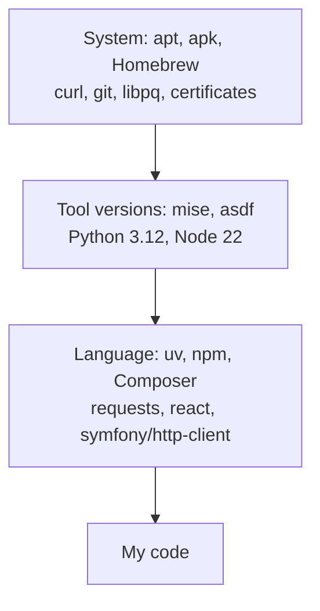
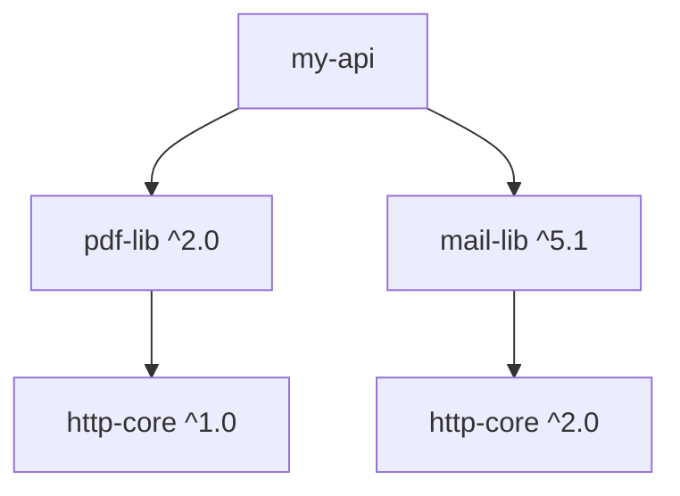
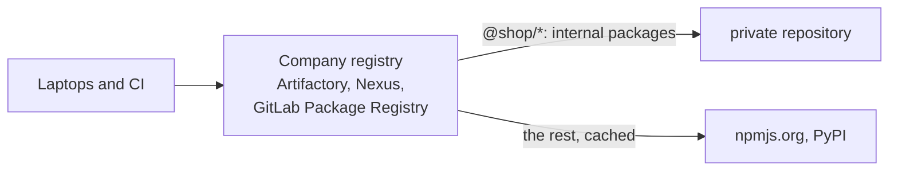

# Package managers

!!! warning "Disclaimer"
    These notes are personal cheat sheets, not a source of truth. They reflect my own understanding and choices: their content remains subjective, despite the quotes and references it contains. It may be incomplete, simplified, inaccurate or outdated. Always check the official documentation before applying it. This content is provided as is, without any warranty: you use it at your own risk.

!!! audience "Who and what for"
    - **Roles**: back-end developer, front-end developer, QA engineer, DevOps or platform engineer, security engineer
    - **Uses**: I understand why `npm install` and `npm ci` do not give the same result in CI; I choose between uv, Poetry and pip for a new Python project; I review a merge request that changes a 3,000-line lockfile; I protect dependency installation against a booby-trapped package; I speed up the install step of a pipeline

!!! abstract "Scales"
    The colored badges under the headings say at which scale a notion applies:

    - <span class="pill pill-scope pill-scope-code">Code</span> the classes, functions and modules of one program;
    - <span class="pill pill-scope pill-scope-app">Application</span> one service or application and its internal split;
    - <span class="pill pill-scope pill-scope-system">System</span> several services talking to each other over the network;
    - <span class="pill pill-scope pill-scope-infra">Infrastructure</span> servers, network, zones and clusters, physical or virtual;
    - <span class="pill pill-scope pill-scope-enterprise">Enterprise</span> the whole information system and its organization.

    Details and ambiguous words: [map of scales](architecture.md#map-of-scales).

This page gathers what all package managers have in common (manifest, lockfile, versions, resolution, registries, install security), then compares the tools by language. Other pages cover them from another angle, without repeating what is here:

| Angle | Where to read it |
|---|---|
| pin the project's Python or Node version with mise, and how uv, ruff and yarn fit together | [Developer tooling](outils.md#developer-tooling-mise-uv-ruff-yarn) |
| choose a library (license, maintenance, OpenSSF Scorecard) and scan its known vulnerabilities | [Choosing a dependency](securite.md#choosing-a-dependency), [Example: a dependency scan](securite.md#example-a-dependency-scan) |
| install dependencies in a Docker image without reinstalling everything on each build | [Multi-stage image](kubernetes.md#multi-stage-image-fast-to-rebuild-light-in-production) |
| get hundreds of dependency updates from Renovate accepted | [Large-scale migrations](devx.md#large-scale-migrations) |
| how an attacker compromises the supply chain (xz-utils, dependency confusion) | [Cybersecurity and ethical hacking](cybersecurite.md#supply-chain-attacks) |

:material-swap-horizontal: The tools mentioned on this page: which ones replace each other, which ones combine? See [Complementary or competing](outils.md#complementary-or-competing).
{ .doc-ref }

## Terminology

**Package**: reusable code published with a name and a version number. Example: `requests` 2.32.3 in Python, `react` 18.3.1 in JavaScript.

**<span class="term" data-term="package-registry">Registry</span>**: the server where packages are published and downloaded. Example: PyPI for Python, the npm registry for JavaScript, Packagist for PHP, Maven Central for Java, crates.io for Rust.

**Package manager**: the tool that reads the list of wanted packages, picks the versions, downloads them from the registry and installs them. Example: `npm`, `uv`, `composer`.

**<span class="term" data-term="package-manifest">Manifest</span>**: the hand-written file listing the direct dependencies and the accepted versions. Example: `package.json`, `pyproject.toml`, `composer.json`.

**<span class="term" data-term="lockfile">Lockfile</span>**: the generated file that pins the exact version of every installed package, dependencies of dependencies included. Example: `package-lock.json`, `uv.lock`, `composer.lock`.

**<span class="term" data-term="transitive-dependency">Transitive dependency</span>**: a dependency of my dependency. I did not choose it, but it ships to production with my code.

**<span class="term" data-term="semantic-versioning">Semantic versioning (SemVer)</span>**: the `MAJOR.MINOR.PATCH` convention. Major changes when compatibility breaks, minor when a feature is added, patch for a fix.

**<span class="term" data-term="version-range">Version range</span>**: the manifest rule saying which versions are accepted. Example: `^1.4.0` accepts 1.4.0 and any newer 1.x, not 2.0.0.

**<span class="term" data-term="virtual-environment">Virtual environment</span>**: an isolated folder holding the interpreter and packages of a single project, so two projects do not overwrite each other's versions. Example: the `.venv` folder in Python.

**<span class="term" data-term="sli">SLI</span>**: the indicator I measure. Example: the duration of the install step in CI.

**<span class="term" data-term="slo">SLO</span>**: the team's internal target on that SLI. Example: install takes less than 60 seconds in 95% of pipelines.

**<span class="term" data-term="sla">SLA</span>**: the promise made to a customer by contract, with a penalty, always looser than the SLO. Internal tooling often has none.

:material-book-open-variant: Reference docs: [Semantic Versioning 2.0.0](https://semver.org/) (version 2.0.0, 2013)
{ .doc-ref }

## The three families of managers

<a class="pill pill-scope pill-scope-code" href="../architecture/#map-of-scales">Scale · Code</a> <a class="pill pill-scope pill-scope-infra" href="../architecture/#map-of-scales">Scale · Infrastructure</a> <span class="pill pill-status pill-status-ok" title="Still valid, checked November 2026">Current · 11/2026</span>

"Package manager" names three kinds of tools that do different jobs. I often mix them up as a beginner: `brew install node`, `mise use node@22` and `npm install react` all install "something", but on three different floors.

| Family | What it installs | For whom | Examples |
|---|---|---|---|
| system package manager | programs and libraries for the whole machine | the machine, the Docker image | `apt` (Debian, Ubuntu), `dnf` (Fedora, RHEL), `apk` (Alpine), Homebrew (macOS), winget (Windows) |
| tool version manager | a precise version of a language or tool, per project | the project, on every laptop and in CI | mise, asdf, nvm, pyenv |
| language package manager | the libraries my code needs | the project | npm, pnpm, yarn, uv, pip, Poetry, Composer, Maven, Gradle, Cargo, Go modules |



!!! noob "As noob"
    In a kitchen, the system manager installs the appliances (oven, fridge), the version manager picks which oven model for each recipe, and the language manager buys the ingredients for one specific dish. **Three floors, three tools: I do not ask the oven to do the shopping.**

**When**: I ask myself the question as soon as a `README` says "install X". **Why**: installing Node with `apt` on one laptop and with `mise` on another gives two different versions, so bugs that exist only for one person. **How**: the system provides only what the language cannot install (C libraries, certificates), tool versions are pinned in `mise.toml`, libraries in the language manifest.

**Risks.** Installing a language library with the system manager (`apt install python3-requests`, `sudo pip install`) mixes it with the one the OS needs: a project update can break a system tool. Since PEP 668 (2021), several distributions refuse `pip install` outside a virtual environment with the `externally-managed-environment` error: I create a `.venv` instead of forcing it with `--break-system-packages`.

:material-book-open-variant: Reference docs: [PEP 668, Marking Python base environments as "externally managed"](https://peps.python.org/pep-0668/) (2021)
{ .doc-ref }

!!! maturity "Measuring maturity"
    | Level | What I see in the team |
    |---|---|
    | N1 | everyone installs languages and tools their own way, through the system, an installer or a version manager |
    | N2 | tool versions are pinned in a file of the repository (`mise.toml`, `.nvmrc`), and all libraries go through the language manager |
    | N3 | CI reads the same version file as the laptops, and a mismatch fails the pipeline |
    | N4 | the team tracks a newcomer's setup time and removes the manual steps that lengthen it |

    **I measure**: the number of manual `README` steps before the first passing test; the number of "works on my machine" tickets per quarter.

## Manifest and lockfile

<a class="pill pill-scope pill-scope-code" href="../architecture/#map-of-scales">Scale · Code</a> <a class="pill pill-scope pill-scope-app" href="../architecture/#map-of-scales">Scale · Application</a> <span class="pill pill-status pill-status-ok" title="Still valid, checked November 2026">Current · 11/2026</span>

I write in the manifest **what I accept**, the manager writes in the lockfile **what it picked**. Without a lockfile, two installs a week apart give different versions: a transitive dependency publishes a broken release on Tuesday, and Wednesday's pipeline fails although nobody touched the code.

```json
{
  "name": "orders-front",
  "dependencies": {
    "react": "^18.3.1",
    "date-fns": "~3.6.0"
  }
}
```

The matching lockfile pins the exact version, the download address and a hash of the file (`integrity`), excerpt from `package-lock.json`:

```json
"node_modules/date-fns": {
  "version": "3.6.0",
  "resolved": "https://registry.npmjs.org/date-fns/-/date-fns-3.6.0.tgz",
  "integrity": "sha512-fRHTG8g/Gif+kSh50gaGEdToemgfj74aRX3swtiouboip5JDLAyDE9F11nHMIcvOaXeOC6D7SpNhi7uFyB7Uww=="
}
```

The hash (illustrative value) lets the manager reject a file that was changed in the meantime on the registry or in transit.

The same pair exists everywhere:

| Language | Manifest | Lockfile | Install exactly the lockfile (CI) |
|---|---|---|---|
| JavaScript (npm) | `package.json` | `package-lock.json` | `npm ci` |
| JavaScript (pnpm) | `package.json` | `pnpm-lock.yaml` | `pnpm install --frozen-lockfile` |
| JavaScript (yarn 4) | `package.json` | `yarn.lock` | `yarn install --immutable` |
| Python (uv) | `pyproject.toml` | `uv.lock` | `uv sync --locked` |
| Python (Poetry) | `pyproject.toml` | `poetry.lock` | `poetry install` then `poetry check --lock` |
| Python (pip) | `requirements.in` | `requirements.txt` generated by `pip-compile` or `uv pip compile` | `pip install --require-hashes -r requirements.txt` |
| PHP | `composer.json` | `composer.lock` | `composer install` |
| Java (Gradle) | `build.gradle.kts` | `gradle.lockfile` (optional) | `--write-locks` then a normal build |
| Java (Maven) | `pom.xml` | no native lockfile: exact versions in `pom.xml` | `mvn dependency:tree` to check |
| Rust | `Cargo.toml` | `Cargo.lock` | `cargo build --locked` |
| Go | `go.mod` | `go.sum` (hashes) | `go mod download` then `go build` |

Options to check on the installed version: their names change from one major version to the next.

```yaml
# Avoid: npm install in CI can rewrite the lockfile and install another version than the one tested on the laptop
install:
  script:
    - npm install

# Good: npm ci installs exactly the lockfile, and fails if it no longer matches package.json
install:
  script:
    - npm ci
```

**When**: always for an application (service, website, CLI). For a published **library**, I also commit the lockfile for my CI, but projects that install it do not read it: only my manifest counts for them, so its ranges must stay wide. **Why**: the same versions on the laptop, in CI and in production, and a merge request that shows exactly which dependency moved. **How**: I commit the lockfile, CI installs in frozen mode, and only the manager changes it, never a hand edit.

**Risks.** A Git conflict in a lockfile resolved by hand produces an inconsistent file that installs anything: I take the target branch's version and rerun the install to regenerate it. A lockfile committed but never updated also freezes vulnerabilities: an update bot is needed (see [Updating dependencies](#updating-dependencies)).

:material-book-open-variant: Reference docs: [npm Docs, npm ci](https://docs.npmjs.com/cli/commands/npm-ci) (accessed November 2026); [uv, Locking and syncing](https://docs.astral.sh/uv/concepts/projects/sync/) (accessed November 2026)
{ .doc-ref }

!!! maturity "Measuring maturity"
    | Level | What I see in the team |
    |---|---|
    | N1 | some repositories have a lockfile, CI runs `npm install` or `pip install` without respecting it |
    | N2 | every application commits its lockfile and CI installs in frozen mode |
    | N3 | CI fails on its own when the lockfile no longer matches the manifest, and a lockfile conflict is settled by regeneration |
    | N4 | the team tracks the number of pipeline failures caused by a dependency that moved without a code change, and aims for zero |

    **I measure**: the number of red pipelines with no code or lockfile change, read in the CI history; the share of repositories that install in frozen mode.

## Versions and ranges

<a class="pill pill-scope pill-scope-code" href="../architecture/#map-of-scales">Scale · Code</a> <span class="pill pill-status pill-status-ok" title="Still valid, checked November 2026">Current · 11/2026</span>

Each ecosystem has its own syntax for "this version or a compatible one". The same symbols do not mean the same thing everywhere, hence surprises when I switch languages.

| I write | npm, Composer, Cargo | Python (PEP 440) | Accepts |
|---|---|---|---|
| exact version | `1.4.2` | `==1.4.2` | only 1.4.2 |
| SemVer compatible | `^1.4.2` | `>=1.4.2,<2` | 1.4.2 up to 1.x, not 2.0.0 |
| patches only | `~1.4.2` | `~=1.4.2` | 1.4.2 up to 1.4.x, not 1.5.0 |
| anything | `*` | (nothing) | any version, to avoid |

Known trap: before 1.0.0, `^0.4.2` only accepts 0.4.x, because SemVer considers that a 0.x can break everything at each minor. And `~=1.4` in Python (two numbers) accepts up to 1.x, not only 1.4.x.

!!! noob "As noob"
    The range is the instruction given to someone doing the shopping: "semi-skimmed milk, any brand" (`^`), "this brand, any size" (`~`), or "exactly this bottle" (`==`). The lockfile is the receipt: it says what was actually bought. **The instruction leaves room, the receipt leaves none.**

**When**: each time I add a dependency. **Why**: a range too wide lets in a major version that breaks the API; an exact version everywhere, in a library, keeps its users from getting fixes and creates conflicts. **How**: in an application, the manager's default range (`^`) is enough, since the lockfile pins the rest; in a library, the widest range my tests cover.

**Risks.** SemVer is a human promise, not a guarantee: a maintainer can break compatibility in a patch. [Hyrum's law](lois-et-principes.md#hyrums-law) says it another way: with enough users, every observable behavior ends up used by someone. My protection remains CI running the tests on each update.

:material-book-open-variant: Reference docs: [PEP 440, Version Identification and Dependency Specification](https://peps.python.org/pep-0440/) (2013); [node-semver, Ranges](https://github.com/npm/node-semver#ranges) (accessed November 2026)
{ .doc-ref }

## Resolution and conflicts

<a class="pill pill-scope pill-scope-code" href="../architecture/#map-of-scales">Scale · Code</a> <a class="pill pill-scope pill-scope-app" href="../architecture/#map-of-scales">Scale · Application</a> <span class="pill pill-status pill-status-ok" title="Still valid, checked November 2026">Current · 11/2026</span>

**Resolution** is the computation the manager does to find one version of each package that satisfies all ranges at once. The classic case is the **diamond**: two of my dependencies want the same third one, in incompatible versions.



Depending on the ecosystem, the answer changes:

| Ecosystem | What happens? | Consequence |
|---|---|---|
| npm, pnpm, yarn | both versions of `http-core` are installed, each under the dependency that asks for it | it works, but the package exists twice: bigger bundle, and two instances of a stateful library (React) step on each other |
| Python, PHP, Ruby | a single version per environment: the resolver fails | `ResolutionImpossible` (pip), `Your requirements could not be resolved` (Composer): I must change one of the two dependencies |
| Maven | the version nearest to the root of the tree wins, with no error | a call to a missing method crashes only at run time (`NoSuchMethodError`) |
| Gradle | the highest version wins | same risk if the higher version removed a method |
| Go | minimal version selection that satisfies everyone (MVS) | predictable, but a fix only arrives if someone asks for it |

Typical Python output, with uv:

```
$ uv add pdf-lib mail-lib
  × No solution found when resolving dependencies:
  ╰─ Because pdf-lib==2.3.0 depends on http-core>=1,<2 and mail-lib==5.1.0
      depends on http-core>=2, we can conclude that pdf-lib==2.3.0 and
      mail-lib==5.1.0 are incompatible.
```

Illustrative output, fictitious packages. To force a version of a transitive dependency (until a maintainer fixes it), each tool has a release valve: `overrides` in `package.json` (npm), `resolutions` (yarn), `pnpm.overrides`, `override-dependencies` (uv), `dependencyManagement` (Maven), `constraints` (Gradle).

```json
{
  "overrides": {
    "http-core": "2.1.4"
  }
}
```

This block forces `http-core` 2.1.4 everywhere, even under `pdf-lib` which never tested it: I add an issue or a link to the expected fix, and remove it as soon as the fix is published.

**Peer dependency**: a plugin that only works with a given version of its host, without installing it itself. Example: a React component declares `"peerDependencies": { "react": "^18" }`. If my project is on React 17, npm 7+ refuses the install (`ERESOLVE`): I upgrade React or pick another version of the component, rather than `--legacy-peer-deps` which hides the problem until run time.

**Risks.** A forgotten `override` freezes a version and keeps the next fix from arriving. I list mine in the merge request description and review them at each major update.

:material-book-open-variant: Reference docs: [npm Docs, package.json overrides](https://docs.npmjs.com/cli/configuring-npm/package-json#overrides) (accessed November 2026); [Russ Cox, Minimal Version Selection](https://research.swtch.com/vgo-mvs) (February 2018)
{ .doc-ref }

## Tools by language

<a class="pill pill-scope pill-scope-code" href="../architecture/#map-of-scales">Scale · Code</a> <span class="pill pill-status pill-status-ok" title="Still valid, checked November 2026">Current · 11/2026</span>

!!! info "Section written in November 2026"
    Package managers often ship major versions that change their options and performance. The comparisons below are orders of magnitude to check again.

### JavaScript and TypeScript: npm, pnpm, yarn, Bun
<span class="pill pill-status pill-status-ok" title="Still valid, checked November 2026">Current · 11/2026</span>

*npm: competes with pnpm, yarn, Bun*<br>
*pnpm: competes with npm, yarn, Bun*<br>
*yarn: competes with npm, pnpm, Bun*<br>
*Bun: competes with npm, pnpm, yarn; partly competes with Node.js*
{ .tool-rel }

| | npm | pnpm | yarn (4, "Berry") | Bun |
|---|---|---|---|---|
| shipped with | Node.js | to install (Corepack or mise) | to install (Corepack) | Bun (full runtime) |
| package layout | flat `node_modules` | shared global store, links in `node_modules` | `node_modules` or Plug'n'Play (no `node_modules`) | flat `node_modules` |
| disk for 10 projects sharing React | 10 copies | 1 copy, 10 links | depends on the mode | 10 copies (global cache) |
| access to an undeclared package | possible, by accident | refused | refused in Plug'n'Play | possible |
| workspaces (monorepo) | yes | yes, the most used | yes | yes |
| dependency install scripts | run by default | blocked by default since pnpm 10 (2025, to check) | run by default | blocked except an allowlist |

The "undeclared package" is a real trap: with npm, `import debug from "debug"` works in my code although `debug` is not in my `package.json`, because one of my dependencies installed it flat in `node_modules`. The day that dependency no longer needs it, my build breaks. pnpm refuses it from the start.

```
$ npm ls debug
orders-front@1.0.0
└─┬ express@4.21.1
  └── debug@2.6.9
```

Illustrative output: `debug` only comes through `express`, so my code should not import it directly.

**Corepack**, shipped with Node.js from 16.9 to 24, reads the `"packageManager": "pnpm@9.12.0"` field of `package.json` and installs the right version of pnpm or yarn. It is no longer included from Node.js 25 (to check): mise can pin the pnpm version instead.

**Risks.** Bun is fast, but its compatibility with the whole Node ecosystem is not complete: I test it on the full CI before adopting it. Switching managers (npm to pnpm) changes the installed tree: implicit imports break, which is good news, but to be planned.

:material-book-open-variant: Reference docs: [pnpm, Motivation](https://pnpm.io/motivation) (accessed November 2026); [Yarn, Plug'n'Play](https://yarnpkg.com/features/pnp) (accessed November 2026)
{ .doc-ref }

### Python: pip, uv, Poetry, PDM, conda
<span class="pill pill-status pill-status-ok" title="Still valid, checked November 2026">Current · 11/2026</span>

*pip: competes with uv, Poetry, PDM*<br>
*uv: competes with pip, Poetry, PDM; replaces pip-tools, pipx, pyenv, virtualenv*<br>
*conda: partly competes with uv, pip; complements pip*
{ .tool-rel }

| | pip | uv | Poetry | PDM | conda |
|---|---|---|---|---|---|
| installs packages | yes | yes | yes | yes | yes, non-Python too (CUDA, GDAL) |
| lockfile | no (through `pip-compile`) | `uv.lock` | `poetry.lock` | `pdm.lock` | `conda-lock` (separate) |
| creates the virtual environment | no (`python -m venv`) | yes | yes | yes | yes (conda environment) |
| installs Python itself | no | yes | no | no | yes |
| registry | PyPI | PyPI | PyPI | PyPI | conda-forge, Anaconda |
| speed | baseline | advertised as 10 to 100 times faster than pip | close to pip | close to pip | slow to resolve |

[Take with caution: uv speed advertised by the vendor, Astral ([uv README](https://github.com/astral-sh/uv), accessed November 2026)]

The manifest format is standard: `pyproject.toml` (PEP 621, 2020) is read by uv, PDM and Poetry 2. Since PEP 751 (2025), a common lockfile format, `pylock.toml`, also exists (adoption to check).

```toml
# Example: pyproject.toml read by uv, production and development dependencies kept apart
[project]
name = "orders-api"
version = "1.3.0"
requires-python = ">=3.12"
dependencies = [
    "fastapi>=0.115",
    "httpx>=0.27",
]

[dependency-groups]
dev = ["pytest>=8", "ruff>=0.7"]
```

```
$ uv add "sqlalchemy>=2"
$ uv sync --locked
$ uv run pytest
```

**Risks.** conda and pip in the same environment step on each other (each ignores what the other installed): I install everything I can with conda first, then pip, never the reverse. The name on PyPI is not always the imported name (`pip install beautifulsoup4`, then `import bs4`): a similar name published by a stranger can be a trap (see [Securing installation](#securing-installation)).

:material-book-open-variant: Reference docs: [Python Packaging User Guide](https://packaging.python.org/) (accessed November 2026); [PEP 751, A file format to record Python dependencies](https://peps.python.org/pep-0751/) (2025)
{ .doc-ref }

### PHP, Java and the others
<span class="pill pill-status pill-status-ok" title="Still valid, checked November 2026">Current · 11/2026</span>

*Composer: complements Packagist*<br>
*Maven: competes with Gradle*<br>
*Gradle: competes with Maven*
{ .tool-rel }

| Language | Tool | Registry | What to know |
|---|---|---|---|
| PHP | Composer | Packagist | `composer install` reads the lock, `composer update` rewrites it: in CI and production, never `update` |
| Java, Kotlin | Maven | Maven Central | build and dependencies in a single `pom.xml`; no range by default, exact versions; BOM to align a family of libraries |
| Java, Kotlin | Gradle | Maven Central | build written as code (Kotlin or Groovy), faster thanks to the build cache, locking to enable |
| Rust | Cargo | crates.io | build, tests, lockfile and publishing in a single tool, often cited as the model |
| Go | Go modules | proxy.golang.org | no central registry strictly speaking: a module is a repository URL; `go.sum` checked against a public hash database |
| .NET | NuGet | nuget.org | `packages.lock.json` to enable (`RestorePackagesWithLockFile`) |
| Ruby | Bundler | RubyGems | `Gemfile` and `Gemfile.lock`, the origin of the manifest and lockfile pair |

```bash
# Avoid: composer update in production installs versions that were never tested
composer update --no-dev

# Good: composer install respects composer.lock and refuses an out-of-sync lock
composer install --no-dev --prefer-dist --classmap-authoritative
```

:material-book-open-variant: Reference docs: [Composer, Basic usage](https://getcomposer.org/doc/01-basic-usage.md) (accessed November 2026); [Maven, Introduction to the Dependency Mechanism](https://maven.apache.org/guides/introduction/introduction-to-dependency-mechanism.html) (accessed November 2026)
{ .doc-ref }

!!! maturity "Measuring maturity"
    | Level | What I see in the team |
    |---|---|
    | N1 | each repository uses the manager chosen by whoever created it, sometimes two in the same repository |
    | N2 | one manager per language is chosen for the team, with its version pinned, and a single lockfile per repository |
    | N3 | CI refuses a second lockfile (a `yarn.lock` next to a `pnpm-lock.yaml`) and a manager version other than the pinned one |
    | N4 | the team compares install time and the size of `node_modules` or `.venv` before and after a tool change, and decides on those numbers |

    **I measure**: install time in CI per repository; the number of repositories with two lockfiles.

## Monorepo and workspaces

<a class="pill pill-scope pill-scope-app" href="../architecture/#map-of-scales">Scale · Application</a> <span class="pill pill-status pill-status-ok" title="Still valid, checked November 2026">Current · 11/2026</span>

In a <span class="term" data-term="monorepo">monorepo</span>, I have several packages in a single repository, for example a front end, an API and a shared component library. A **workspace** tells the manager: "these folders are my own packages, link them together instead of downloading them". A change to the library is visible immediately in the front end, without publishing a version.

```
shop/
├── pnpm-workspace.yaml      packages: ["apps/*", "packages/*"]
├── pnpm-lock.yaml           a single lockfile for the whole repository
├── apps/
│   ├── web/package.json     "@shop/ui": "workspace:*"
│   └── admin/package.json   "@shop/ui": "workspace:*"
└── packages/
    └── ui/package.json      "name": "@shop/ui"
```

```
$ pnpm --filter web add zod
$ pnpm --filter "...@shop/ui" test
```

The second command runs the tests of `@shop/ui` and of everything that depends on it, so `web` and `admin`: useful in CI to avoid testing everything on each merge request. Python has the same notion with uv workspaces (`[tool.uv.workspace]`), PHP with Composer `path` repositories.

**When**: several packages that often change together. Not for unrelated projects I would put in the same repository only out of habit. **Why**: a single merge request to change the library and its users, a single lockfile, a single version of each dependency. **How**: the manager's workspaces, then a build tool that knows what changed (Turborepo, Nx) when CI gets slow.

**Risks.** A single lockfile for the whole repository means a React update touches every application at once: I group those updates and test them on all affected packages. Without filtering, CI rebuilds everything on each merge request and becomes the whole team's queue.

:material-book-open-variant: Reference docs: [pnpm, Workspace](https://pnpm.io/workspaces) (accessed November 2026); [uv, Workspaces](https://docs.astral.sh/uv/concepts/projects/workspaces/) (accessed November 2026)
{ .doc-ref }

!!! maturity "Measuring maturity"
    | Level | What I see in the team |
    |---|---|
    | N1 | packages in the repository reference each other through relative paths or published versions, and each folder has its own lockfile |
    | N2 | a declared workspace, a single lockfile, internal packages linked with `workspace:*` |
    | N3 | CI tests only the touched packages and those that depend on them, computed by the tool |
    | N4 | the team tracks the median CI duration of a merge request and the number of packages rebuilt per merge request, and adjusts the split accordingly |

    **I measure**: the median merge request pipeline duration; the average number of packages tested per merge request.

## Private registries, mirrors and cache

<a class="pill pill-scope pill-scope-infra" href="../architecture/#map-of-scales">Scale · Infrastructure</a> <a class="pill pill-scope pill-scope-enterprise" href="../architecture/#map-of-scales">Scale · Enterprise</a> <span class="pill pill-status pill-status-ok" title="Still valid, checked November 2026">Current · 11/2026</span>

*Artifactory: competes with Nexus, GitLab Package Registry*<br>
*Nexus: competes with Artifactory*<br>
*Verdaccio: partly competes with Artifactory, Nexus*
{ .tool-rel }

My team publishes internal libraries (an in-house HTTP client, UI components) that must not be public. It also wants CI to keep running the day the public registry is slow or down. A **private registry** hosts the internal packages; a **mirror** (or proxy) keeps a copy of the public packages already downloaded.



```ini
# .npmrc
# Good: the @shop scope always goes to the internal registry, the rest goes through the company mirror
@shop:registry=https://registry.example.com/npm/internal/
registry=https://registry.example.com/npm/proxy/
```

For CI, a **cache** of the download folder (`~/.npm`, `~/.cache/uv`, `~/.composer/cache`), keyed on the lockfile hash, avoids downloading the same packages on every pipeline:

```yaml
# Example: GitLab CI cache of uv downloads, invalidated when uv.lock changes
test:
  variables:
    UV_CACHE_DIR: .uv-cache
  cache:
    key:
      files: [uv.lock]
    paths: [.uv-cache]
  script:
    - uv sync --locked
    - uv run pytest
```

**When**: as soon as an internal library exists, or CI depends on a public registry to ship. **Why**: protected internal packages, faster installs, and an outage of a public registry that no longer blocks releases. **How**: a company registry in front of everything, internal packages under a reserved scope (`@shop/`) or prefix, the configuration committed in the repository (`.npmrc`, `uv.toml`), the access token provided by CI, never committed.

**Risks.** Misconfigured, a private registry opens the door to **dependency confusion**: if the manager also looks for an internal name on the public registry, an attacker publishes the same name there with a higher version, and theirs gets installed (see [Securing installation](#securing-installation)). A CI cache keyed on something other than the lockfile serves stale packages.

:material-book-open-variant: Reference docs: [npm Docs, Scopes](https://docs.npmjs.com/cli/using-npm/scope) (accessed November 2026); [GitLab, Package Registry](https://docs.gitlab.com/user/packages/package_registry/) (accessed November 2026)
{ .doc-ref }

!!! maturity "Measuring maturity"
    | Level | What I see in the team |
    |---|---|
    | N1 | internal packages are copied from repository to repository or installed from a Git branch |
    | N2 | a private registry hosts internal packages under a reserved scope, and CI caches downloads |
    | N3 | all laptops and CI go through the company registry, which refuses internal names coming from outside |
    | N4 | the team tracks the cache hit rate and install time, and the share of pipelines blocked by a public registry outage |

    **I measure**: install time in CI before and after the cache; the number of pipelines failed because of a public registry, over a quarter.

## Securing installation

<a class="pill pill-scope pill-scope-code" href="../architecture/#map-of-scales">Scale · Code</a> <a class="pill pill-scope pill-scope-infra" href="../architecture/#map-of-scales">Scale · Infrastructure</a> <span class="pill pill-status pill-status-ok" title="Still valid, checked November 2026">Current · 11/2026</span>

<a class="pill pill-dora" href="https://dora.dev/capabilities/pervasive-security/">DORA · Pervasive security</a>

Installing a package means running someone else's code, sometimes **during installation**, on my laptop and in my CI, where my tokens and SSH keys live. This section gathers the manager settings that reduce this risk. Choosing a library and scanning known vulnerabilities are in [Security](securite.md#choosing-a-dependency); the big real attacks are told in [Cybersecurity and ethical hacking](cybersecurite.md#supply-chain-attacks).

| Threat | What happens | Setting that protects |
|---|---|---|
| <span class="term" data-term="typosquatting">typosquatting</span> | I install `reqeusts` instead of `requests`, published by an attacker | copy the name from the official docs, review every manifest addition in the merge request |
| malicious <span class="term" data-term="install-script">install script</span> | a `postinstall` reads `~/.npmrc` and `~/.aws` then sends them to a server | scripts blocked by default, allowlist of the packages that really need them |
| <span class="term" data-term="dependency-confusion">dependency confusion</span> | my internal package `shop-auth` also exists on the public registry, in version 99.0.0 | reserved scope or prefix, a single index per name, never `--extra-index-url` |
| stolen maintainer account | a real popular library publishes a booby-trapped version for a few hours | frozen lockfile, minimum delay before accepting a new version |
| file changed on the registry or in transit | the downloaded package is no longer the one that was locked | hashes in the lockfile, checked at install |

```bash
# Avoid: --extra-index-url makes pip look for shop-auth on PyPI too, and it takes the higher version of the two
pip install --extra-index-url https://pypi.example.com/simple shop-auth

# Good: a single index, the company registry, which mirrors PyPI and serves internal packages
pip install --index-url https://pypi.example.com/simple --require-hashes -r requirements.txt
```

```yaml
# pnpm-workspace.yaml
# Good: a version published less than a day ago is refused, and only esbuild may run an install script
minimumReleaseAge: 1440
onlyBuiltDependencies:
  - esbuild
```

`minimumReleaseAge` counts in minutes (a recent pnpm setting, to check on the installed version). With pnpm 10, dependency scripts are blocked by default, and `onlyBuiltDependencies` allows those that really need one, like `esbuild`, which downloads its binary at install time. With npm, `ignore-scripts=true` in `.npmrc` blocks all scripts; uv has `exclude-newer` to ignore versions published after a date, and Renovate has `minimumReleaseAge` on the update side.

**Provenance and SBOM.** **<span class="term" data-term="package-provenance">Provenance</span>** proves that a package was built by a given CI workflow, from a given commit, and not on someone's laptop: `npm publish --provenance` and PyPI attestations (PEP 740, 2024) publish it, signed with Sigstore. An **<span class="term" data-term="sbom">SBOM</span>** (Software Bill of Materials) is the list of everything my software contains, transitive dependencies included, in a standard format (CycloneDX, SPDX). It answers "am I affected by the vulnerability published this morning?" in one minute.

```
$ npm audit signatures
audited 412 packages in 2s
412 packages have verified registry signatures
38 packages have verified attestations
```

Illustrative output. The SBOM is generated from the lockfile or the image (`syft`, `cdxgen`, `trivy sbom`), then stored with the delivered artifact.

!!! noob "As noob"
    Installing a package is accepting a parcel delivered at home. The lockfile with its hashes checks that it is the parcel I ordered and that nobody opened it. Blocking install scripts means not letting the delivery person into the house "to assemble the furniture". Provenance is the factory's signed delivery note. **I check the parcel, I keep the delivery person outside, and I know where the furniture comes from.**

**When**: on all laptops and all CI, from day one; blocked scripts and the minimum delay cost almost nothing. **Why**: booby-trapped package attacks target developer and CI tokens, which then open production. **How**: single registry, frozen lockfile with hashes, scripts blocked with an allowlist, minimum delay, then provenance and SBOM for what I publish.

**Risks.** Blocking all scripts breaks packages that compile or download a binary at install time (`sharp`, `esbuild`, `bcrypt`): I add them one by one to the allowlist, with the reason in the merge request. A minimum delay also holds back urgent security fixes: I plan a documented manual exception. A verified signature proves where a package comes from, not that it is safe: a legitimate maintainer can publish malicious code.

:material-book-open-variant: Reference docs: [OpenSSF, Package Manager Best Practices](https://github.com/ossf/package-manager-best-practices) (accessed November 2026); [npm Docs, Generating provenance statements](https://docs.npmjs.com/generating-provenance-statements) (accessed November 2026)
{ .doc-ref }

!!! maturity "Measuring maturity"
    | Level | What I see in the team |
    |---|---|
    | N1 | dependencies install with default settings, scripts included, from several indexes |
    | N2 | frozen lockfile with hashes, a single registry, scripts blocked with an allowlist reviewed in merge requests |
    | N3 | CI refuses a new package published less than N days ago, a secondary index, or a dependency without a hash; an SBOM is produced for each release |
    | N4 | the team tracks the time to answer "are we affected?" after a public alert, and the number of packages on the allowlist |

    **I measure**: the time between a public alert on a package and the "affected or not" answer for all services, read in the SBOMs; the size of the script allowlist.

## Updating dependencies

<a class="pill pill-scope pill-scope-app" href="../architecture/#map-of-scales">Scale · Application</a> <span class="pill pill-status pill-status-ok" title="Still valid, checked November 2026">Current · 11/2026</span>

*Renovate: competes with Dependabot*
{ .tool-rel }

A frozen lockfile does not age on its own, it has to be moved forward. I first look at what is behind:

```
$ npm outdated
Package    Current  Wanted  Latest  Location
react       18.2.0  18.3.1  19.1.0  node_modules/react
date-fns     3.6.0   3.6.0   4.1.0  node_modules/date-fns

$ uv tree --outdated --depth 1
orders-api v1.3.0
├── fastapi v0.115.0 (latest: v0.121.0)
└── httpx v0.27.2
```

Illustrative outputs. `Wanted` respects the manifest range, `Latest` is the last published version: going from 18 to 19 requires changing the range, so a decision.

| Command | What it does |
|---|---|
| `npm update`, `pnpm update`, `uv lock --upgrade` | raises versions within the current ranges and rewrites the lockfile |
| `uv lock --upgrade-package httpx`, `composer update vendor/pkg` | raises a single package |
| `npm install react@19`, `uv add "fastapi>=0.121"` | changes the range, so a possible major version |

Day to day, I let a <span class="term" data-term="dependency-update-bot">dependency update bot</span> (Renovate or Dependabot) open the merge requests, one per package or per group, with the release notes. The configuration (automerge of tested patches, human review of majors) is detailed in [Large-scale migrations](devx.md#large-scale-migrations); the tool itself in [CI/CD and code quality](outils.md#cicd-and-code-quality-gitlab-ci-sonarqube-renovate).

**When**: continuously, in small updates, rather than one big one a year. **Why**: jumping three major versions at once turns half a day into a multi-week project. **How**: bot, CI testing each merge request, automerge of green patches, planned majors.

**Risks.** Automerging without good tests silently lets in regressions. Merging nothing drowns the team under dozens of merge requests it ends up ignoring: I group minor updates by family and set a fixed day for majors.

:material-book-open-variant: Reference docs: [Renovate, Docs](https://docs.renovatebot.com/) (accessed November 2026)
{ .doc-ref }

!!! maturity "Measuring maturity"
    | Level | What I see in the team |
    |---|---|
    | N1 | dependencies are updated when a problem forces it |
    | N2 | a bot opens update merge requests, tested by CI |
    | N3 | patches with green CI are merged without human intervention |
    | N4 | the team tracks the average age of its dependencies (libyears) and the number of majors behind, and plans accordingly |

    **I measure**: the number of dependencies at least one major version behind; the average delay between opening and merging a bot merge request.

## Measuring success

I know my dependency management works when installs are fast, identical everywhere, and I can answer a security alert quickly. Before changing a tool or a setting, I record a baseline over a month: for example the median install time in CI, the number of red pipelines without a code change and the number of dependencies one major behind. I take the same measures the next month. The guard metric is friction: if merge requests wait longer to merge because of the added checks, or developers work around the script allowlist, the setting is too strict.

| Solution | Success indicator (SLI) | Likely SLO | Likely SLA |
|---|---|---|---|
| frozen lockfile in CI | share of red pipelines without a code or lockfile change | under 1% per month | not applicable: no external contract |
| download cache in CI | duration of the install step | under 60 s in 95% of pipelines | not applicable: no external contract |
| company registry as a mirror | share of pipelines blocked by a public registry outage | 0 per quarter | not applicable: no external contract |
| update bot | dependencies one major version behind | fewer than 5 per service | not applicable: no external contract |
| SBOM for each release | time to know whether a service is affected by a public alert | under 1 h | the fix delay for critical vulnerabilities promised to enterprise customers, for example 30 days, to which this delay contributes |

[Take with caution: example values, to set with the team]

## Pitfalls to avoid

- **`npm install` or `composer update` in CI**: I install something other than what was tested, and a pipeline breaks on a Wednesday with no code change. I use `npm ci`, `composer install`, `uv sync --locked` ([see Manifest and lockfile](#manifest-and-lockfile)).
- **Resolving a lockfile conflict by hand**: I merge both versions line by line, and the file becomes inconsistent. I take the target branch's file and rerun the install to regenerate it.
- **Two managers in the same repository**: a `package-lock.json` and a `yarn.lock` diverge, and each laptop installs a different tree. I keep one, delete the other lockfile, and pin the manager in `packageManager` or `mise.toml`.
- **Importing an undeclared package**: my code uses `debug` because a dependency installed it flat; it disappears in an update and the build breaks. I declare everything I import, and pnpm reminds me ([see JavaScript](#javascript-and-typescript-npm-pnpm-yarn-bun)).
- **`--extra-index-url` for an internal package**: pip also looks for the name on PyPI and takes the higher version, an attacker's. A single index, the company registry ([see Securing installation](#securing-installation)).
- **`sudo pip install` or `--break-system-packages`**: I overwrite a library the OS needs. I work in a `.venv` ([see the three families](#the-three-families-of-managers)).
- **An `override` nobody remembers**: I force a version of a transitive dependency to unblock a merge request, and it stays frozen for two years. I write down why and when to remove it ([see Resolution and conflicts](#resolution-and-conflicts)).
- **`--legacy-peer-deps` by reflex**: the install passes, but a plugin runs with a host version it does not support, and the error shows up at run time. I fix the version conflict.

## What interviews ask

Typical questions:

- "What is a lockfile for? Should it be committed?" How to answer: the manifest says what I accept, the lockfile what was picked; yes for an application, yes also for a library's CI, knowing its users do not read it ([Manifest and lockfile](#manifest-and-lockfile)).
- "What is the difference between `npm install` and `npm ci`?" How to answer: `install` can rewrite the lockfile, `ci` installs it exactly and fails if it no longer matches ([Manifest and lockfile](#manifest-and-lockfile)).
- "What do `^` and `~` mean? And SemVer?" How to answer: major, minor, patch, then the ranges, with the 0.x trap ([Versions and ranges](#versions-and-ranges)).
- "Two dependencies want two incompatible versions of the same library: what happens?" How to answer: the diamond, the different answers of npm, pip and Maven, and `overrides` as a temporary valve ([Resolution and conflicts](#resolution-and-conflicts)).
- "Why pnpm rather than npm?", "Why uv?" How to answer: disk, speed, and for pnpm the refusal of undeclared imports; for uv, a single tool for Python, the environment and the lockfile ([Tools by language](#tools-by-language)).
- "How do you protect your CI against a booby-trapped package?", "What is dependency confusion?" How to answer: single registry, lockfile with hashes, blocked scripts, minimum delay, provenance and SBOM ([Securing installation](#securing-installation)).
- "How do you keep dependencies up to date without spending your life on it?" How to answer: bot, CI, automerge of green patches, planned majors, and the majors-behind indicator ([Updating dependencies](#updating-dependencies)).

What makes a good answer: linking each setting to the incident it prevents ("`npm ci`, because a pipeline must not break without a code change").

## What to use in which situation

| Situation | I use |
|---|---|
| I start a Python project and want a lockfile, a virtual environment and the right Python version without three tools | uv |
| my Python project needs non-Python libraries, like CUDA for a model or GDAL for maps | conda (or pixi), then pip or uv for the rest |
| I start a JavaScript project alone, with no particular constraint | npm, already shipped with Node |
| I have a JavaScript monorepo with several applications and libraries, and disk or install time matters | pnpm and its workspaces |
| I want my code to refuse importing a package I did not declare | pnpm, or yarn in Plug'n'Play |
| CI must install exactly what was tested on my laptop | `npm ci`, `pnpm install --frozen-lockfile`, `uv sync --locked`, `composer install` |
| my team publishes internal libraries, like an HTTP client shared between services | a private registry under a reserved scope (`@shop/`) |
| CI fails every time the public registry is slow | a company registry as a mirror, and a download cache in CI |
| I must know within an hour whether my services contain the library whose vulnerability was published this morning | an SBOM per release, generated from the lockfile or the image |
| two dependencies require incompatible versions of a third one, and the fix is not published yet | a temporary `override`, documented in the merge request |
| my project's dependencies age because nobody thinks of updating them | Renovate or Dependabot |

## Further reading

- [Semantic Versioning 2.0.0 (2013)](https://semver.org/)
- [PEP 621: project metadata in pyproject.toml (2020)](https://peps.python.org/pep-0621/)
- [PEP 668: externally managed environments (2021)](https://peps.python.org/pep-0668/)
- [PEP 751: Python lockfile format (2025)](https://peps.python.org/pep-0751/)
- [Russ Cox, Minimal Version Selection (February 2018)](https://research.swtch.com/vgo-mvs)
- [pnpm, Motivation (publication date not stated)](https://pnpm.io/motivation)
- [OpenSSF, Package Manager Best Practices (publication date not stated)](https://github.com/ossf/package-manager-best-practices)
- [Alex Birsan, Dependency Confusion (February 2021)](https://medium.com/@alex.birsan/dependency-confusion-4a5d60fec610)
- [CycloneDX, SBOM specification (publication date not stated)](https://cyclonedx.org/specification/overview/)
- [SLSA, build chain security levels (version 1.0, April 2023)](https://slsa.dev/spec/v1.0/)
