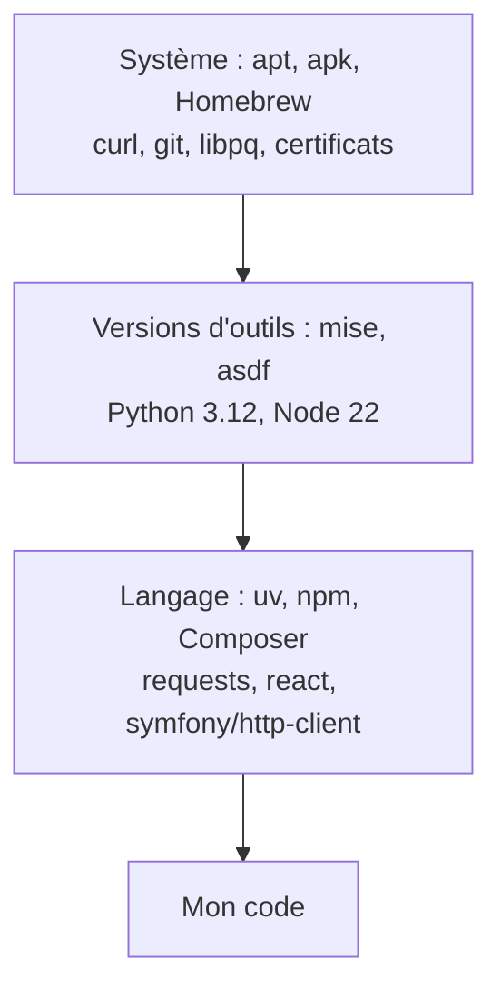
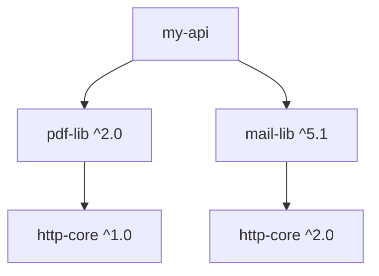
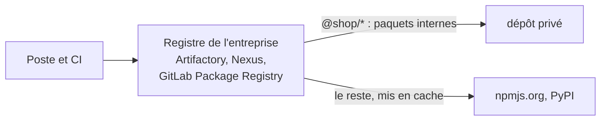

# Gestionnaires de paquets

!!! warning "Avertissement"
    Ces notes sont des pense-bêtes personnels, pas une source de vérité. Elles reflètent ma compréhension et mes choix : leur contenu reste subjectif, malgré les citations et les références qu'il contient. Il peut être incomplet, simplifié, inexact ou dépassé. Vérifiez toujours dans la documentation officielle avant de l'appliquer. Ce contenu est fourni tel quel, sans aucune garantie : son utilisation se fait sous votre seule responsabilité.

!!! audience "Pour qui, pour quoi"
    - **Métiers** : développeur back-end, développeur front-end, QA, ingénieur DevOps ou plateforme, ingénieur sécurité
    - **Usages** : je comprends pourquoi `npm install` et `npm ci` ne donnent pas le même résultat en CI ; je choisis entre uv, Poetry et pip pour un nouveau projet Python ; je relis une MR qui modifie un lockfile de 3 000 lignes ; je protège l'installation des dépendances contre un paquet piégé ; j'accélère l'étape d'installation d'un pipeline

!!! abstract "Les échelles"
    Les pastilles de couleur sous les titres disent à quelle échelle une notion s'applique :

    - <span class="pill pill-scope pill-scope-code">Code</span> les classes, fonctions et modules d'un programme ;
    - <span class="pill pill-scope pill-scope-app">Application</span> un service ou une application et son découpage interne ;
    - <span class="pill pill-scope pill-scope-system">Système</span> plusieurs services qui communiquent par le réseau ;
    - <span class="pill pill-scope pill-scope-infra">Infrastructure</span> les serveurs, le réseau, les zones et les clusters, physiques ou virtuels ;
    - <span class="pill pill-scope pill-scope-enterprise">Entreprise</span> le système d'information entier et son organisation.

    Détail et mots ambigus : [carte des échelles](architecture.md#carte-des-echelles).

Cette page réunit ce qui est commun à tous les gestionnaires de paquets (manifeste, lockfile, versions, résolution, registres, sécurité de l'installation), puis compare les outils par langage. D'autres pages en parlent sous un autre angle, sans répéter ce qui est ici :

| Angle | Où le lire |
|---|---|
| fixer la version de Python ou de Node du projet avec mise, et lier uv, ruff, yarn | [Outils de développement](outils.md#outils-de-developpement-mise-uv-ruff-yarn) |
| choisir une bibliothèque (licence, maintenance, OpenSSF Scorecard) et scanner ses failles connues | [Choisir une dépendance](securite.md#choisir-une-dependance), [Exemple : un scan de dépendances](securite.md#exemple-un-scan-de-dependances) |
| installer les dépendances dans une image Docker sans tout réinstaller à chaque build | [Image multi-étapes](kubernetes.md#image-multi-etapes-rapide-a-reconstruire-legere-en-production) |
| faire accepter des centaines de mises à jour de dépendances par Renovate | [Migrations à grande échelle](devx.md#migrations-a-grande-echelle) |
| comment un attaquant pirate la chaîne d'approvisionnement (xz-utils, confusion de dépendances) | [Cybersécurité et hacking éthique](cybersecurite.md#attaques-de-la-chaine-dapprovisionnement) |

:material-swap-horizontal: Les outils cités dans cette page : lesquels se remplacent, lesquels se combinent ? Voir [Complémentaires ou concurrents](outils.md#complementaires-ou-concurrents).
{ .doc-ref }

## Vocabulaire

**Paquet** : du code prêt à réutiliser, publié avec un nom et un numéro de version. Exemple : `requests` 2.32.3 en Python, `react` 18.3.1 en JavaScript.

**<span class="term" data-term="package-registry">Registre</span>** : le serveur où les paquets sont publiés et téléchargés. Exemple : PyPI pour Python, le registre npm pour JavaScript, Packagist pour PHP, Maven Central pour Java, crates.io pour Rust.

**Gestionnaire de paquets** : l'outil qui lit la liste des paquets voulus, choisit les versions, les télécharge depuis le registre et les installe. Exemple : `npm`, `uv`, `composer`.

**<span class="term" data-term="package-manifest">Manifeste</span>** : le fichier écrit à la main qui liste les dépendances directes et les versions acceptées. Exemple : `package.json`, `pyproject.toml`, `composer.json`.

**<span class="term" data-term="lockfile">Lockfile</span>** : le fichier généré qui fige la version exacte de chaque paquet installé, dépendances des dépendances comprises. Exemple : `package-lock.json`, `uv.lock`, `composer.lock`.

**<span class="term" data-term="transitive-dependency">Dépendance transitive</span>** : une dépendance de ma dépendance. Je ne l'ai pas choisie, mais elle part en production avec mon code.

**<span class="term" data-term="semantic-versioning">Versionnage sémantique (SemVer)</span>** : la convention `MAJEUR.MINEUR.CORRECTIF`. Le majeur change quand la compatibilité casse, le mineur quand une fonction s'ajoute, le correctif pour une correction.

**<span class="term" data-term="version-range">Plage de versions</span>** : la règle du manifeste qui dit quelles versions sont acceptées. Exemple : `^1.4.0` accepte 1.4.0 et toute 1.x plus récente, pas 2.0.0.

**<span class="term" data-term="virtual-environment">Environnement virtuel</span>** : un dossier isolé qui contient l'interpréteur et les paquets d'un seul projet, pour que deux projets n'écrasent pas leurs versions. Exemple : le dossier `.venv` en Python.

**<span class="term" data-term="sli">SLI</span>** : l'indicateur que je mesure. Exemple : la durée de l'étape d'installation en CI.

**<span class="term" data-term="slo">SLO</span>** : l'objectif interne de l'équipe sur ce SLI. Exemple : l'installation prend moins de 60 secondes dans 95 % des pipelines.

**<span class="term" data-term="sla">SLA</span>** : la promesse faite par contrat à un client, avec pénalité, en général plus lâche que le SLO. Pour un outillage interne, il n'y en a souvent pas.

:material-book-open-variant: Doc de référence : [Semantic Versioning 2.0.0](https://semver.org/) (version 2.0.0, 2013)
{ .doc-ref }

## Les trois familles de gestionnaires

<a class="pill pill-scope pill-scope-code" href="../architecture/#carte-des-echelles">Échelle · Code</a> <a class="pill pill-scope pill-scope-infra" href="../architecture/#carte-des-echelles">Échelle · Infrastructure</a> <span class="pill pill-status pill-status-ok" title="Toujours valable, vérifié en novembre 2026">Valable · 11/2026</span>

« Gestionnaire de paquets » désigne trois sortes d'outils qui ne font pas le même travail. Je les confonds souvent quand je débute : `brew install node`, `mise use node@22` et `npm install react` installent tous « quelque chose », mais à trois étages différents.

| Famille | Ce qu'elle installe | Pour qui | Exemples |
|---|---|---|---|
| gestionnaire de paquets du système | des programmes et bibliothèques pour toute la machine | la machine, l'image Docker | `apt` (Debian, Ubuntu), `dnf` (Fedora, RHEL), `apk` (Alpine), Homebrew (macOS), winget (Windows) |
| gestionnaire de versions d'outils | une version précise d'un langage ou d'un outil, par projet | le projet, sur chaque poste et en CI | mise, asdf, nvm, pyenv |
| gestionnaire de paquets du langage | les bibliothèques dont mon code a besoin | le projet | npm, pnpm, yarn, uv, pip, Poetry, Composer, Maven, Gradle, Cargo, Go modules |



!!! noob "As noob"
    Dans une cuisine, le gestionnaire du système installe les appareils (four, frigo), le gestionnaire de versions choisit quel modèle de four pour chaque recette, et le gestionnaire du langage fait les courses d'ingrédients pour un plat précis. **Trois étages, trois outils : je ne demande pas au four de faire les courses.**

**Quand** : je me pose la question dès qu'un `README` dit « installer X ». **Pourquoi** : installer Node par `apt` sur un poste et par `mise` sur un autre donne deux versions différentes, donc des bugs qui n'existent que chez l'un. **Comment** : le système fournit seulement ce que le langage ne sait pas installer (bibliothèques C, certificats), les versions d'outils sont fixées dans `mise.toml`, les bibliothèques dans le manifeste du langage.

**Risques.** Installer une bibliothèque du langage avec le gestionnaire du système (`apt install python3-requests`, `sudo pip install`) la mélange avec celle dont l'OS a besoin : une mise à jour du projet peut casser un outil du système. Depuis la PEP 668 (2021), plusieurs distributions refusent `pip install` hors d'un environnement virtuel avec l'erreur `externally-managed-environment` : je crée un `.venv` au lieu de forcer avec `--break-system-packages`.

:material-book-open-variant: Doc de référence : [PEP 668, Marking Python base environments as "externally managed"](https://peps.python.org/pep-0668/) (2021)
{ .doc-ref }

!!! maturity "Mesurer la maturité"
    | Niveau | Ce que j'observe dans l'équipe |
    |---|---|
    | N1 | chacun installe les langages et outils à sa façon, par le système, un installeur ou un gestionnaire de versions |
    | N2 | les versions des outils sont fixées dans un fichier du dépôt (`mise.toml`, `.nvmrc`), et les bibliothèques passent toutes par le gestionnaire du langage |
    | N3 | la CI lit le même fichier de versions que les postes, et un écart fait échouer le pipeline |
    | N4 | l'équipe suit le temps de mise en route d'un nouvel arrivant et retire les étapes manuelles qui le rallongent |

    **Je mesure** : le nombre d'étapes manuelles du `README` avant le premier test qui passe ; le nombre de tickets « ça marche chez moi » par trimestre.

## Manifeste et lockfile

<a class="pill pill-scope pill-scope-code" href="../architecture/#carte-des-echelles">Échelle · Code</a> <a class="pill pill-scope pill-scope-app" href="../architecture/#carte-des-echelles">Échelle · Application</a> <span class="pill pill-status pill-status-ok" title="Toujours valable, vérifié en novembre 2026">Valable · 11/2026</span>

J'écris dans le manifeste **ce que j'accepte**, le gestionnaire écrit dans le lockfile **ce qu'il a choisi**. Sans lockfile, deux installations à une semaine d'écart donnent des versions différentes : une dépendance transitive publie une version cassée le mardi, et le pipeline du mercredi échoue alors que personne n'a touché au code.

``` { .json .ex-ref title="Référence" }
{
  "name": "orders-front",
  "dependencies": {
    "react": "^18.3.1",
    "date-fns": "~3.6.0"
  }
}
```

Le lockfile correspondant fige la version exacte, l'adresse de téléchargement et une empreinte du fichier (`integrity`), extrait de `package-lock.json` :

``` { .json .ex-ref title="Référence" }
"node_modules/date-fns": {
  "version": "3.6.0",
  "resolved": "https://registry.npmjs.org/date-fns/-/date-fns-3.6.0.tgz",
  "integrity": "sha512-fRHTG8g/Gif+kSh50gaGEdToemgfj74aRX3swtiouboip5JDLAyDE9F11nHMIcvOaXeOC6D7SpNhi7uFyB7Uww=="
}
```

L'empreinte (valeur illustrative) permet au gestionnaire de refuser un fichier modifié entre-temps sur le registre ou en chemin.

Le même couple existe partout :

| Langage | Manifeste | Lockfile | Installer exactement le lockfile (CI) |
|---|---|---|---|
| JavaScript (npm) | `package.json` | `package-lock.json` | `npm ci` |
| JavaScript (pnpm) | `package.json` | `pnpm-lock.yaml` | `pnpm install --frozen-lockfile` |
| JavaScript (yarn 4) | `package.json` | `yarn.lock` | `yarn install --immutable` |
| Python (uv) | `pyproject.toml` | `uv.lock` | `uv sync --locked` |
| Python (Poetry) | `pyproject.toml` | `poetry.lock` | `poetry install` puis `poetry check --lock` |
| Python (pip) | `requirements.in` | `requirements.txt` généré par `pip-compile` ou `uv pip compile` | `pip install --require-hashes -r requirements.txt` |
| PHP | `composer.json` | `composer.lock` | `composer install` |
| Java (Gradle) | `build.gradle.kts` | `gradle.lockfile` (optionnel) | `--write-locks` puis build normal |
| Java (Maven) | `pom.xml` | pas de lockfile natif : versions exactes dans le `pom.xml` | `mvn dependency:tree` pour vérifier |
| Rust | `Cargo.toml` | `Cargo.lock` | `cargo build --locked` |
| Go | `go.mod` | `go.sum` (empreintes) | `go mod download` puis `go build` |

Options à vérifier sur la version installée : leur nom change d'une version majeure à l'autre.

``` { .yaml .ex-bad title="À éviter" }
# À éviter : npm install en CI peut réécrire le lockfile et installer une autre version que celle testée sur le poste
install:
  script:
    - npm install
```

``` { .yaml .ex-good title="Recommandé" }
# Bien : npm ci installe exactement le lockfile, et échoue s'il ne correspond plus au package.json
install:
  script:
    - npm ci
```

**Quand** : toujours pour une application (service, site, CLI). Pour une **bibliothèque** publiée, je commite aussi le lockfile pour ma CI, mais les projets qui l'installent ne le lisent pas : seul mon manifeste compte pour eux, donc ses plages doivent rester larges. **Pourquoi** : les mêmes versions sur le poste, en CI et en production, et une MR qui montre exactement quelle dépendance a bougé. **Comment** : je commite le lockfile, la CI installe en mode figé, et seul le gestionnaire le modifie, jamais une édition à la main.

**Risques.** Un conflit Git dans un lockfile résolu à la main produit un fichier incohérent qui installe n'importe quoi : je reprends la version de la branche cible et je relance l'installation pour le régénérer. Un lockfile commité mais jamais mis à jour fige aussi les failles : il faut un robot de mise à jour (voir [Mettre à jour les dépendances](#mettre-a-jour-les-dependances)).

:material-book-open-variant: Doc de référence : [npm Docs, npm ci](https://docs.npmjs.com/cli/commands/npm-ci) (consultée en novembre 2026) ; [uv, Locking and syncing](https://docs.astral.sh/uv/concepts/projects/sync/) (consultée en novembre 2026)
{ .doc-ref }

!!! maturity "Mesurer la maturité"
    | Niveau | Ce que j'observe dans l'équipe |
    |---|---|
    | N1 | un lockfile existe dans certains dépôts, la CI lance `npm install` ou `pip install` sans le respecter |
    | N2 | chaque application commite son lockfile et la CI installe en mode figé |
    | N3 | la CI échoue seule quand le lockfile ne correspond plus au manifeste, et un conflit de lockfile se règle par régénération |
    | N4 | l'équipe suit le nombre d'échecs de pipeline dus à une dépendance qui a bougé sans changement de code, et vise zéro |

    **Je mesure** : le nombre de pipelines rouges sans changement de code ni de lockfile, lu dans l'historique de la CI ; la part des dépôts qui installent en mode figé.

## Versions et plages

<a class="pill pill-scope pill-scope-code" href="../architecture/#carte-des-echelles">Échelle · Code</a> <span class="pill pill-status pill-status-ok" title="Toujours valable, vérifié en novembre 2026">Valable · 11/2026</span>

Chaque écosystème a sa syntaxe pour dire « cette version ou une compatible ». Les mêmes symboles n'ont pas le même sens partout, d'où des surprises quand je passe d'un langage à l'autre.

| J'écris | npm, Composer, Cargo | Python (PEP 440) | Accepte |
|---|---|---|---|
| version exacte | `1.4.2` | `==1.4.2` | seulement 1.4.2 |
| compatible au sens SemVer | `^1.4.2` | `>=1.4.2,<2` | 1.4.2 jusqu'à 1.x, pas 2.0.0 |
| seulement les correctifs | `~1.4.2` | `~=1.4.2` | 1.4.2 jusqu'à 1.4.x, pas 1.5.0 |
| tout | `*` | (rien) | n'importe quelle version, à éviter |

Piège connu : avant 1.0.0, `^0.4.2` n'accepte que 0.4.x, car SemVer considère qu'un 0.x peut tout casser à chaque mineur. Et `~=1.4` en Python (deux chiffres) accepte jusqu'à 1.x, pas seulement 1.4.x.

!!! noob "As noob"
    La plage, c'est la consigne donnée à quelqu'un qui fait les courses : « du lait demi-écrémé, n'importe quelle marque » (`^`), « cette marque, n'importe quel format » (`~`), ou « exactement cette bouteille » (`==`). Le lockfile, c'est le ticket de caisse : il dit ce qui a vraiment été acheté. **La consigne laisse de la marge, le ticket n'en laisse aucune.**

**Quand** : à chaque ajout de dépendance. **Pourquoi** : une plage trop large fait entrer une version majeure qui casse l'API ; une version exacte partout, dans une bibliothèque, empêche ceux qui l'utilisent de recevoir les correctifs et crée des conflits. **Comment** : dans une application, la plage par défaut du gestionnaire (`^`) suffit, car le lockfile fige le reste ; dans une bibliothèque, la plage la plus large que mes tests couvrent.

**Risques.** SemVer est une promesse humaine, pas une garantie : un mainteneur peut casser la compatibilité dans un correctif. La [loi de Hyrum](lois-et-principes.md#loi-de-hyrum) le dit autrement : avec assez d'utilisateurs, chaque comportement observable finit par être utilisé par quelqu'un. Ma protection reste la CI qui lance les tests sur chaque mise à jour.

:material-book-open-variant: Doc de référence : [PEP 440, Version Identification and Dependency Specification](https://peps.python.org/pep-0440/) (2013) ; [node-semver, Ranges](https://github.com/npm/node-semver#ranges) (consultée en novembre 2026)
{ .doc-ref }

## Résolution et conflits

<a class="pill pill-scope pill-scope-code" href="../architecture/#carte-des-echelles">Échelle · Code</a> <a class="pill pill-scope pill-scope-app" href="../architecture/#carte-des-echelles">Échelle · Application</a> <span class="pill pill-status pill-status-ok" title="Toujours valable, vérifié en novembre 2026">Valable · 11/2026</span>

La **résolution**, c'est le calcul que fait le gestionnaire pour trouver une version de chaque paquet qui satisfait toutes les plages à la fois. Le cas classique est le **diamant** : deux de mes dépendances veulent la même troisième, dans des versions incompatibles.



Selon l'écosystème, la réponse change :

| Écosystème | Que se passe-t-il ? | Conséquence |
|---|---|---|
| npm, pnpm, yarn | les deux versions de `http-core` sont installées, chacune sous la dépendance qui la demande | ça marche, mais le paquet existe en double : bundle plus gros, et deux instances d'une bibliothèque qui garde un état (React) se marchent dessus |
| Python, PHP, Ruby | une seule version par environnement : le résolveur échoue | `ResolutionImpossible` (pip), `Your requirements could not be resolved` (Composer) : je dois changer une des deux dépendances |
| Maven | la version la plus proche de la racine dans l'arbre gagne, sans erreur | un appel vers une méthode absente plante seulement à l'exécution (`NoSuchMethodError`) |
| Gradle | la version la plus haute gagne | même risque si la version haute a retiré une méthode |
| Go | sélection de la version minimale qui satisfait tout le monde (MVS) | prévisible, mais un correctif n'arrive que si quelqu'un le demande |

Sortie typique côté Python, avec uv :

``` { .text .ex-ref title="Référence" }
$ uv add pdf-lib mail-lib
  × No solution found when resolving dependencies:
  ╰─ Because pdf-lib==2.3.0 depends on http-core>=1,<2 and mail-lib==5.1.0
      depends on http-core>=2, we can conclude that pdf-lib==2.3.0 and
      mail-lib==5.1.0 are incompatible.
```

Sortie illustrative, paquets fictifs. Pour forcer une version d'une dépendance transitive (le temps qu'un mainteneur corrige), chaque outil a une soupape : `overrides` dans `package.json` (npm), `resolutions` (yarn), `pnpm.overrides`, `override-dependencies` (uv), `dependencyManagement` (Maven), `constraints` (Gradle).

``` { .json .ex-ref title="Référence" }
{
  "overrides": {
    "http-core": "2.1.4"
  }
}
```

Ce bloc force `http-core` 2.1.4 partout, même sous `pdf-lib` qui ne l'a pas testée : je l'accompagne d'une issue ou d'un lien vers le correctif attendu, et je le retire dès qu'il est publié.

**Dépendance pair (*peer dependency*)** : un plugin qui ne fonctionne qu'avec une version donnée de son hôte, sans l'installer lui-même. Exemple : un composant React déclare `"peerDependencies": { "react": "^18" }`. Si mon projet est en React 17, npm 7+ refuse l'installation (`ERESOLVE`) : je mets React à jour ou je choisis une autre version du composant, plutôt que `--legacy-peer-deps` qui masque le problème jusqu'à l'exécution.

**Risques.** Un `override` oublié fige une version et empêche la correction suivante d'arriver. Je liste les miens dans la description de la MR et je les relis à chaque mise à jour majeure.

:material-book-open-variant: Doc de référence : [npm Docs, package.json overrides](https://docs.npmjs.com/cli/configuring-npm/package-json#overrides) (consultée en novembre 2026) ; [Russ Cox, Minimal Version Selection](https://research.swtch.com/vgo-mvs) (février 2018)
{ .doc-ref }

## Les outils par langage

<a class="pill pill-scope pill-scope-code" href="../architecture/#carte-des-echelles">Échelle · Code</a> <span class="pill pill-status pill-status-ok" title="Toujours valable, vérifié en novembre 2026">Valable · 11/2026</span>

!!! info "Section rédigée en novembre 2026"
    Les gestionnaires de paquets sortent souvent des versions majeures qui changent leurs options et leurs performances. Les comparaisons ci-dessous sont des ordres de grandeur à revérifier.

### JavaScript et TypeScript : npm, pnpm, yarn, Bun
<span class="pill pill-status pill-status-ok" title="Toujours valable, vérifié en novembre 2026">Valable · 11/2026</span>

*npm : concurrent de pnpm, yarn, Bun*<br>
*pnpm : concurrent de npm, yarn, Bun*<br>
*yarn : concurrent de npm, pnpm, Bun*<br>
*Bun : concurrent de npm, pnpm, yarn ; concurrent en partie de Node.js*
{ .tool-rel }

| | npm | pnpm | yarn (4, « Berry ») | Bun |
|---|---|---|---|---|
| fourni avec | Node.js | à installer (Corepack ou mise) | à installer (Corepack) | Bun (environnement d'exécution complet) |
| rangement des paquets | `node_modules` aplati | magasin global partagé, liens dans `node_modules` | `node_modules` ou Plug'n'Play (sans `node_modules`) | `node_modules` aplati |
| disque sur 10 projets qui partagent React | 10 copies | 1 copie, 10 liens | selon le mode | 10 copies (cache global) |
| accès à un paquet non déclaré | possible, par accident | refusé | refusé en Plug'n'Play | possible |
| workspaces (monorepo) | oui | oui, les plus utilisés | oui | oui |
| scripts d'installation des dépendances | lancés par défaut | bloqués par défaut depuis pnpm 10 (2025, à vérifier) | lancés par défaut | bloqués sauf liste blanche |

Le « paquet non déclaré » est un piège réel : avec npm, `import debug from "debug"` marche dans mon code sans que `debug` soit dans mon `package.json`, parce qu'une de mes dépendances l'a installé à plat dans `node_modules`. Le jour où cette dépendance n'en a plus besoin, mon build casse. pnpm le refuse dès le début.

``` { .text .ex-ref title="Référence" }
$ npm ls debug
orders-front@1.0.0
└─┬ express@4.21.1
  └── debug@2.6.9
```

Sortie illustrative : `debug` n'arrive que par `express`, donc mon code ne devrait pas l'importer directement.

**Corepack**, livré avec Node.js de la version 16.9 à la 24, lit le champ `"packageManager": "pnpm@9.12.0"` du `package.json` et installe la bonne version de pnpm ou yarn. Il n'est plus inclus à partir de Node.js 25 (à vérifier) : mise peut fixer la version de pnpm à la place.

**Risques.** Bun va vite, mais sa compatibilité avec tout l'écosystème Node n'est pas totale : je le teste sur la CI complète avant de l'adopter. Changer de gestionnaire (npm vers pnpm) change l'arbre installé : des imports implicites cassent, ce qui est une bonne nouvelle, mais à planifier.

:material-book-open-variant: Doc de référence : [pnpm, Motivation](https://pnpm.io/motivation) (consultée en novembre 2026) ; [Yarn, Plug'n'Play](https://yarnpkg.com/features/pnp) (consultée en novembre 2026)
{ .doc-ref }

### Python : pip, uv, Poetry, PDM, conda
<span class="pill pill-status pill-status-ok" title="Toujours valable, vérifié en novembre 2026">Valable · 11/2026</span>

*pip : concurrent de uv, Poetry, PDM*<br>
*uv : concurrent de pip, Poetry, PDM ; remplace pip-tools, pipx, pyenv, virtualenv*<br>
*conda : concurrent en partie de uv, pip ; complémentaire de pip*
{ .tool-rel }

| | pip | uv | Poetry | PDM | conda |
|---|---|---|---|---|---|
| installe des paquets | oui | oui | oui | oui | oui, aussi non Python (CUDA, GDAL) |
| lockfile | non (via `pip-compile`) | `uv.lock` | `poetry.lock` | `pdm.lock` | `conda-lock` (séparé) |
| crée l'environnement virtuel | non (`python -m venv`) | oui | oui | oui | oui (environnement conda) |
| installe Python lui-même | non | oui | non | non | oui |
| registre | PyPI | PyPI | PyPI | PyPI | conda-forge, Anaconda |
| vitesse | référence | annoncé 10 à 100 fois plus rapide que pip | proche de pip | proche de pip | lente à résoudre |

[À prendre avec précaution : vitesse d'uv annoncée par l'éditeur, Astral ([README d'uv](https://github.com/astral-sh/uv), consulté en novembre 2026)]

Le format du manifeste est standard : `pyproject.toml` (PEP 621, 2020) est lu par uv, PDM et Poetry 2. Depuis la PEP 751 (2025), un format de lockfile commun, `pylock.toml`, existe aussi (adoption à vérifier).

``` { .toml .ex-ref title="Référence" }
# Exemple : pyproject.toml lu par uv, dépendances de production et de développement séparées
[project]
name = "orders-api"
version = "1.3.0"
requires-python = ">=3.12"
dependencies = [
    "fastapi>=0.115",
    "httpx>=0.27",
]

[dependency-groups]
dev = ["pytest>=8", "ruff>=0.7"]
```

``` { .text .ex-ref title="Référence" }
$ uv add "sqlalchemy>=2"
$ uv sync --locked
$ uv run pytest
```

**Risques.** conda et pip dans le même environnement se marchent dessus (chacun ignore ce que l'autre a installé) : j'installe d'abord tout ce que je peux avec conda, puis pip, et jamais l'inverse. Le nom sur PyPI n'est pas toujours le nom importé (`pip install beautifulsoup4`, puis `import bs4`) : un nom proche publié par un inconnu peut être un piège (voir [Sécuriser l'installation](#securiser-linstallation)).

:material-book-open-variant: Doc de référence : [Python Packaging User Guide](https://packaging.python.org/) (consultée en novembre 2026) ; [PEP 751, A file format to record Python dependencies](https://peps.python.org/pep-0751/) (2025)
{ .doc-ref }

### PHP, Java et les autres
<span class="pill pill-status pill-status-ok" title="Toujours valable, vérifié en novembre 2026">Valable · 11/2026</span>

*Composer : complémentaire de Packagist*<br>
*Maven : concurrent de Gradle*<br>
*Gradle : concurrent de Maven*
{ .tool-rel }

| Langage | Outil | Registre | Ce qu'il faut savoir |
|---|---|---|---|
| PHP | Composer | Packagist | `composer install` lit le lock, `composer update` le réécrit : en CI et en production, jamais `update` |
| Java, Kotlin | Maven | Maven Central | build et dépendances dans un seul `pom.xml` ; pas de plage par défaut, versions exactes ; BOM pour aligner une famille de bibliothèques |
| Java, Kotlin | Gradle | Maven Central | build écrit en code (Kotlin ou Groovy), plus rapide grâce au cache de build, verrouillage à activer |
| Rust | Cargo | crates.io | build, tests, lockfile et publication dans un seul outil, souvent cité en modèle |
| Go | Go modules | proxy.golang.org | pas de registre central à proprement parler : un module est une URL de dépôt ; `go.sum` vérifié contre une base publique d'empreintes |
| .NET | NuGet | nuget.org | `packages.lock.json` à activer (`RestorePackagesWithLockFile`) |
| Ruby | Bundler | RubyGems | `Gemfile` et `Gemfile.lock`, l'origine du couple manifeste et lockfile |

``` { .bash .ex-bad title="À éviter" }
# À éviter : composer update en production installe des versions jamais testées
composer update --no-dev
```

``` { .bash .ex-good title="Recommandé" }
# Bien : composer install respecte composer.lock et refuse un lock désynchronisé
composer install --no-dev --prefer-dist --classmap-authoritative
```

:material-book-open-variant: Doc de référence : [Composer, Basic usage](https://getcomposer.org/doc/01-basic-usage.md) (consultée en novembre 2026) ; [Maven, Introduction to the Dependency Mechanism](https://maven.apache.org/guides/introduction/introduction-to-dependency-mechanism.html) (consultée en novembre 2026)
{ .doc-ref }

!!! maturity "Mesurer la maturité"
    | Niveau | Ce que j'observe dans l'équipe |
    |---|---|
    | N1 | chaque dépôt utilise le gestionnaire choisi par la personne qui l'a créé, parfois deux dans le même dépôt |
    | N2 | un gestionnaire par langage est choisi pour l'équipe, avec sa version fixée, et un seul lockfile par dépôt |
    | N3 | la CI refuse un second lockfile (un `yarn.lock` à côté d'un `pnpm-lock.yaml`) et une version du gestionnaire différente de celle fixée |
    | N4 | l'équipe compare la durée d'installation et le poids de `node_modules` ou de `.venv` avant et après un changement d'outil, et décide sur ces chiffres |

    **Je mesure** : la durée d'installation en CI par dépôt ; le nombre de dépôts avec deux lockfiles.

## Monorepo et workspaces

<a class="pill pill-scope pill-scope-app" href="../architecture/#carte-des-echelles">Échelle · Application</a> <span class="pill pill-status pill-status-ok" title="Toujours valable, vérifié en novembre 2026">Valable · 11/2026</span>

Dans un <span class="term" data-term="monorepo">monorepo</span>, j'ai plusieurs paquets dans un seul dépôt, par exemple un front, une API et une bibliothèque de composants partagée. Un **workspace** dit au gestionnaire : « ces dossiers sont des paquets à moi, relie-les entre eux au lieu de les télécharger ». Une modification de la bibliothèque est visible tout de suite dans le front, sans publier de version.

``` { .text .ex-illus title="Illustration" }
shop/
├── pnpm-workspace.yaml      packages: ["apps/*", "packages/*"]
├── pnpm-lock.yaml           un seul lockfile pour tout le dépôt
├── apps/
│   ├── web/package.json     "@shop/ui": "workspace:*"
│   └── admin/package.json   "@shop/ui": "workspace:*"
└── packages/
    └── ui/package.json      "name": "@shop/ui"
```

``` { .text .ex-ref title="Référence" }
$ pnpm --filter web add zod
$ pnpm --filter "...@shop/ui" test
```

La seconde commande lance les tests de `@shop/ui` et de tout ce qui en dépend, donc `web` et `admin` : utile en CI pour ne pas tout tester à chaque MR. Python a la même notion avec les workspaces d'uv (`[tool.uv.workspace]`), PHP avec les dépôts `path` de Composer.

**Quand** : plusieurs paquets qui changent souvent ensemble. Pas pour des projets sans lien, que je rangerais dans le même dépôt seulement par habitude. **Pourquoi** : une seule MR pour changer la bibliothèque et ses utilisateurs, un seul lockfile, une seule version de chaque dépendance. **Comment** : workspaces du gestionnaire, puis un outil de build qui sait ce qui a changé (Turborepo, Nx) quand la CI devient lente.

**Risques.** Un seul lockfile pour tout le dépôt veut dire qu'une mise à jour de React touche toutes les applications d'un coup : je regroupe ces mises à jour et je les teste sur tous les paquets concernés. Sans filtrage, la CI reconstruit tout à chaque MR et devient la file d'attente de toute l'équipe.

:material-book-open-variant: Doc de référence : [pnpm, Workspace](https://pnpm.io/workspaces) (consultée en novembre 2026) ; [uv, Workspaces](https://docs.astral.sh/uv/concepts/projects/workspaces/) (consultée en novembre 2026)
{ .doc-ref }

### Monorepo ou plusieurs dépôts : comment trancher

<a class="pill pill-scope pill-scope-app" href="../architecture/#carte-des-echelles">Échelle · Application</a> <a class="pill pill-scope pill-scope-system" href="../architecture/#carte-des-echelles">Échelle · Système</a> <span class="pill pill-status pill-status-ok" title="Toujours valable, vérifié en novembre 2026">Valable · 11/2026</span>

*Turborepo : concurrent de Nx ; complémentaire de pnpm*<br>
*Nx : concurrent de Turborepo, concurrent en partie de Bazel ; complémentaire de pnpm*<br>
*Bazel : concurrent de Pants, concurrent en partie de Nx*<br>
*Pants : concurrent de Bazel*
{ .tool-rel }

Mon organisation a 40 dépôts JavaScript, dont une bibliothèque de composants utilisée par dix applications. Chaque correction de la bibliothèque demande de publier une version, puis d'ouvrir une MR dans chacune des dix applications : un bouton corrigé met une semaine à arriver en production. Une autre équipe a trois services Python qui ne partagent presque rien, et ne voit aucun de ces problèmes. La question « monorepo ou plusieurs dépôts » (un **polyrepo** : un dépôt par projet ou par service) ne se tranche donc pas sur le principe : je compare le coût de coordination entre dépôts au coût d'outillage d'un monorepo.

| Je veux... | Je choisis... |
|---|---|
| je veux que mes services, comme `orders-service` et `billing-service`, évoluent chacun à leur rythme, et une MR ne touche presque jamais les deux à la fois | plusieurs dépôts : simple, autonome, sans outillage spécial |
| ma bibliothèque de composants et les applications JavaScript qui l'utilisent changent ensemble, et chaque correction demande dix MR | un monorepo avec les workspaces de pnpm, puis Nx ou Turborepo quand la CI ralentit |
| j'ai plusieurs langages (Java, Python, Go), des centaines de développeurs et des builds de plus d'une heure | un monorepo avec Bazel ou Pants, et une équipe pour les maintenir |
| une partie du code ne doit être lue que par quelques personnes, comme un module de paiement soumis à un audit, ou un code sous une autre licence | des dépôts séparés, car les droits de lecture d'une forge se règlent par dépôt |

**Qui relit quoi.** Dans un monorepo, toutes les équipes écrivent dans le même dépôt, et il faut savoir qui doit relire une MR. Un fichier <span class="term" data-term="codeowners">CODEOWNERS</span> associe chaque dossier à une équipe propriétaire : la forge demande automatiquement sa relecture quand une MR touche ce dossier. Si une seule équipe possède tout, elle relit chaque MR du dépôt et devient la file d'attente de toute l'organisation.

``` { .text .ex-bad title="À éviter" }
# À éviter : une seule ligne pour tout le dépôt, team-core doit relire chaque MR, même celles du back-office
*    @team-core
```

``` { .text .ex-good title="Recommandé · .gitlab/CODEOWNERS" }
# Bien : chaque dossier a son équipe propriétaire, la dernière ligne qui correspond l'emporte
*                 @team-devx
/packages/ui/     @team-design-system
/apps/web/        @team-core
/apps/admin/      @team-ops
```

Une MR qui modifie `packages/ui/` demande donc la relecture de `@team-design-system`, et elle seule. Pour que cette relecture bloque la fusion, la branche protégée doit exiger l'approbation des propriétaires (réglage de GitLab, selon l'édition : à vérifier ; GitHub a la même règle de branche).

**Ne reconstruire que ce qui a changé.** Un outil de build de monorepo calcule le <span class="term" data-term="build-graph">graphe des projets</span> (qui dépend de qui), puis ne lance que les tâches des projets touchés et de ceux qui en dépendent. Il ajoute un <span class="term" data-term="remote-build-cache">cache de build distant</span> : le résultat de chaque tâche est rangé sous une empreinte de ses entrées (sources, lockfile, version des outils), et une machine qui retrouve la même empreinte télécharge le résultat au lieu de refaire le travail.

``` { .text .ex-illus title="Illustration" }
MR de ada, qui ne touche que apps/admin
  packages/ui   build  empreinte 7f3a déjà dans le cache distant : résultat téléchargé, 2 s
  apps/web      test   ne dépend pas de apps/admin : pas lancé
  apps/admin    build  empreinte nouvelle : exécuté, 40 s, résultat envoyé au cache
  apps/admin    test   exécuté, 90 s
durée : un peu plus de 2 min, au lieu de 14 min quand tout est reconstruit (chiffres d'exemple)
```

``` { .text .ex-ref title="Référence" }
$ turbo run test --filter="...[origin/main]"
```

Cette commande lance les tests des paquets modifiés depuis `main` et de tout ce qui en dépend (syntaxe à vérifier dans la documentation de la version utilisée). Nx fait la même chose avec `nx affected -t test`.

Ce cache n'est sûr que si le build est **hermétique** : un <span class="term" data-term="hermetic-build">build hermétique</span> ne dépend que de ses entrées déclarées, jamais de ce qui est installé sur la machine. Sinon, un résultat construit sur un poste avec Node 18 est réutilisé en CI, qui tourne en Node 22, et le bug n'apparaît qu'en production. Bazel et Pants imposent cette discipline : chaque dossier déclare ses sources, ses dépendances et ses outils dans un fichier `BUILD`, et le build refuse ce qui n'est pas déclaré. Nx et Turborepo sont plus souples : ils hachent les fichiers et les variables que je leur indique, à moi de ne rien oublier.

**Quand** : un monorepo dès que les changements qui traversent plusieurs projets sont fréquents ; Bazel ou Pants seulement avec plusieurs langages, de gros volumes et des personnes pour les maintenir. Pas de monorepo pour des projets sans lien, ni pour séparer des droits de lecture. **Pourquoi** : un changement transverse passe en une seule MR testée d'un coup, et chaque bibliothèque n'existe qu'en une version ; le prix est un outillage sérieux. **Comment** : je ne déplace pas 40 dépôts d'un coup. Je regroupe d'abord la bibliothèque et deux applications pilotes en gardant l'historique Git, j'écris le `CODEOWNERS` le premier jour, puis j'ajoute le filtrage et le cache distant quand la CI ralentit. Je mesure le délai entre une modification de la bibliothèque et son arrivée en production, et la durée de la CI, avant et après.

**Risques.** Bazel et Pants coûtent cher à tenir : des fichiers `BUILD` à écrire et à garder justes dans chaque dossier, une intégration aux éditeurs moins bonne, un serveur de cache à héberger, et souvent une petite équipe dédiée pour quelques centaines de développeurs (ordre de grandeur, à vérifier selon les retours publiés). Sans cette équipe, l'outil se dégrade et tout le monde le contourne. Un cache distant ouvert en écriture à tous les postes peut aussi recevoir un résultat faux, construit sur une machine mal réglée ou piégée, puis le servir à toute la CI : je laisse la CI seule écrire dans le cache, les postes ne font que lire. Enfin, un monorepo sans `CODEOWNERS` dilue la responsabilité : personne ne se sent propriétaire du dossier qui casse.

:material-book-open-variant: Doc de référence : [Bazel, Hermeticity](https://bazel.build/basics/hermeticity) (consultée en novembre 2026) ; [GitLab, Code Owners](https://docs.gitlab.com/user/project/codeowners/) (consultée en novembre 2026) ; [Rachel Potvin et Josh Levenberg, « Why Google Stores Billions of Lines of Code in a Single Repository »](https://research.google/pubs/why-google-stores-billions-of-lines-of-code-in-a-single-repository/) (Communications of the ACM, 2016)
{ .doc-ref }

!!! maturity "Mesurer la maturité"
    | Niveau | Ce que j'observe dans l'équipe |
    |---|---|
    | N1 | les paquets du dépôt se référencent par des chemins relatifs ou des versions publiées, et chaque dossier a son lockfile |
    | N2 | un workspace déclaré, un seul lockfile, les paquets internes liés par `workspace:*`, et un `CODEOWNERS` qui donne une équipe propriétaire à chaque dossier |
    | N3 | la CI ne teste que les paquets touchés et ceux qui en dépendent, calculés par l'outil, avec un cache distant que seule la CI alimente |
    | N4 | l'équipe suit la durée médiane de la CI d'une MR et le nombre de paquets reconstruits par MR, et règle le découpage d'après ces chiffres |

    **Je mesure** : la durée médiane du pipeline de MR ; le nombre moyen de paquets testés par MR.

## Registres privés, miroirs et cache

<a class="pill pill-scope pill-scope-infra" href="../architecture/#carte-des-echelles">Échelle · Infrastructure</a> <a class="pill pill-scope pill-scope-enterprise" href="../architecture/#carte-des-echelles">Échelle · Entreprise</a> <span class="pill pill-status pill-status-ok" title="Toujours valable, vérifié en novembre 2026">Valable · 11/2026</span>

*Artifactory : concurrent de Nexus, GitLab Package Registry*<br>
*Nexus : concurrent de Artifactory*<br>
*Verdaccio : concurrent en partie de Artifactory, Nexus*
{ .tool-rel }

Mon équipe publie des bibliothèques internes (un client HTTP maison, des composants d'interface) qui ne doivent pas être publiques. Elle veut aussi que la CI continue à tourner le jour où le registre public est lent ou en panne. Un **registre privé** héberge les paquets internes ; un **miroir** (ou proxy) garde une copie des paquets publics déjà téléchargés.



``` { .ini .ex-good title="Recommandé" }
# .npmrc
# Bien : la portée @shop va toujours au registre interne, le reste passe par le miroir de l'entreprise
@shop:registry=https://registry.example.com/npm/internal/
registry=https://registry.example.com/npm/proxy/
```

Pour la CI, un **cache** du dossier de téléchargement (`~/.npm`, `~/.cache/uv`, `~/.composer/cache`), indexé sur l'empreinte du lockfile, évite de retélécharger les mêmes paquets à chaque pipeline :

``` { .yaml .ex-ref title="Référence" }
# Exemple : cache GitLab CI des téléchargements d'uv, invalidé quand uv.lock change
test:
  variables:
    UV_CACHE_DIR: .uv-cache
  cache:
    key:
      files: [uv.lock]
    paths: [.uv-cache]
  script:
    - uv sync --locked
    - uv run pytest
```

**Quand** : dès qu'une bibliothèque interne existe, ou que la CI dépend d'un registre public pour livrer. **Pourquoi** : des paquets internes protégés, des installations plus rapides, et la panne d'un registre public qui ne bloque plus les livraisons. **Comment** : un registre d'entreprise devant tout, les paquets internes sous une portée (`@shop/`) ou un préfixe réservés, la configuration commitée dans le dépôt (`.npmrc`, `uv.toml`), le jeton d'accès fourni par la CI, jamais commité.

**Risques.** Mal configuré, un registre privé ouvre la porte à la **confusion de dépendances** : si le gestionnaire cherche un nom interne aussi sur le registre public, un attaquant y publie le même nom avec une version plus haute, et c'est la sienne qui s'installe (voir [Sécuriser l'installation](#securiser-linstallation)). Un cache CI indexé sur autre chose que le lockfile sert des paquets périmés.

:material-book-open-variant: Doc de référence : [npm Docs, Scopes](https://docs.npmjs.com/cli/using-npm/scope) (consultée en novembre 2026) ; [GitLab, Package Registry](https://docs.gitlab.com/user/packages/package_registry/) (consultée en novembre 2026)
{ .doc-ref }

!!! maturity "Mesurer la maturité"
    | Niveau | Ce que j'observe dans l'équipe |
    |---|---|
    | N1 | les paquets internes sont copiés de dépôt en dépôt ou installés depuis une branche Git |
    | N2 | un registre privé héberge les paquets internes, sous une portée réservée, et la CI met en cache les téléchargements |
    | N3 | tous les postes et la CI passent par le registre de l'entreprise, qui refuse les noms internes venus de l'extérieur |
    | N4 | l'équipe suit le taux de hit du cache et la durée d'installation, et la part des pipelines bloqués par une panne d'un registre public |

    **Je mesure** : la durée d'installation en CI avant et après le cache ; le nombre de pipelines en échec à cause d'un registre public, sur un trimestre.

## Sécuriser l'installation

<a class="pill pill-scope pill-scope-code" href="../architecture/#carte-des-echelles">Échelle · Code</a> <a class="pill pill-scope pill-scope-infra" href="../architecture/#carte-des-echelles">Échelle · Infrastructure</a> <span class="pill pill-status pill-status-ok" title="Toujours valable, vérifié en novembre 2026">Valable · 11/2026</span>

<a class="pill pill-dora" href="https://dora.dev/capabilities/pervasive-security/">DORA · Pervasive security</a>

Installer un paquet, c'est exécuter le code de quelqu'un d'autre, parfois **pendant l'installation**, sur mon poste et dans ma CI, là où vivent mes jetons et mes clés SSH. Cette section regroupe les réglages du gestionnaire qui réduisent ce risque. Le choix d'une bibliothèque et le scan des failles connues sont dans [Sécurité](securite.md#choisir-une-dependance) ; les grandes attaques réelles sont racontées dans [Cybersécurité et hacking éthique](cybersecurite.md#attaques-de-la-chaine-dapprovisionnement).

| Menace | Ce qui se passe | Réglage qui protège |
|---|---|---|
| <span class="term" data-term="typosquatting">typosquatting</span> | j'installe `reqeusts` au lieu de `requests`, publié par un attaquant | copier le nom depuis la doc officielle, relire chaque ajout au manifeste en MR |
| <span class="term" data-term="install-script">script d'installation</span> malveillant | un `postinstall` lit `~/.npmrc` et `~/.aws` puis les envoie sur un serveur | scripts bloqués par défaut, liste blanche des paquets qui en ont vraiment besoin |
| <span class="term" data-term="dependency-confusion">confusion de dépendances</span> | mon paquet interne `shop-auth` existe aussi sur le registre public, en version 99.0.0 | portée ou préfixe réservé, un seul index par nom, jamais `--extra-index-url` |
| compte de mainteneur volé | une vraie bibliothèque populaire publie une version piégée pendant quelques heures | lockfile figé, délai minimum avant d'accepter une nouvelle version |
| fichier modifié sur le registre ou en chemin | le paquet téléchargé n'est plus celui qui a été verrouillé | empreintes dans le lockfile, vérifiées à l'installation |

``` { .bash .ex-bad title="À éviter" }
# À éviter : --extra-index-url fait chercher shop-auth sur PyPI aussi, et pip prend la version la plus haute des deux
pip install --extra-index-url https://pypi.example.com/simple shop-auth
```

``` { .bash .ex-good title="Recommandé" }
# Bien : un seul index, le registre de l'entreprise, qui sert PyPI en miroir et les paquets internes
pip install --index-url https://pypi.example.com/simple --require-hashes -r requirements.txt
```

``` { .yaml .ex-good title="Recommandé" }
# pnpm-workspace.yaml
# Bien : une version publiée depuis moins d'un jour est refusée, et seul esbuild peut lancer un script d'installation
minimumReleaseAge: 1440
onlyBuiltDependencies:
  - esbuild
```

`minimumReleaseAge` se compte en minutes (réglage récent de pnpm, à vérifier sur la version installée). Avec pnpm 10, les scripts des dépendances sont bloqués par défaut, et `onlyBuiltDependencies` autorise ceux qui en ont vraiment besoin, comme `esbuild` qui télécharge son binaire à l'installation. Avec npm, `ignore-scripts=true` dans `.npmrc` bloque tous les scripts ; uv a `exclude-newer` pour ignorer les versions publiées après une date, et Renovate `minimumReleaseAge` côté mises à jour.

**Provenance et SBOM.** La **<span class="term" data-term="package-provenance">provenance</span>** prouve qu'un paquet a été construit par tel workflow CI, à partir de tel commit, et non sur le poste de quelqu'un : `npm publish --provenance` et les attestations de PyPI (PEP 740, 2024) la publient, signée avec Sigstore. Un **<span class="term" data-term="sbom">SBOM</span>** (*Software Bill of Materials*) est la liste de tout ce que contient mon logiciel, dépendances transitives comprises, dans un format standard (CycloneDX, SPDX). Il répond en une minute à « suis-je touché par la faille publiée ce matin ? ».

``` { .text .ex-ref title="Référence" }
$ npm audit signatures
audited 412 packages in 2s
412 packages have verified registry signatures
38 packages have verified attestations
```

Sortie illustrative. Le SBOM se génère depuis le lockfile ou l'image (`syft`, `cdxgen`, `trivy sbom`), puis se range avec l'artefact livré.

!!! noob "As noob"
    Installer un paquet, c'est accepter un colis livré chez moi. Le lockfile avec ses empreintes vérifie que c'est bien le colis commandé et qu'il n'a pas été ouvert. Bloquer les scripts d'installation, c'est refuser que le livreur entre dans la maison pour « monter le meuble ». La provenance, c'est le bordereau signé de l'usine. **Je vérifie le colis, je laisse le livreur dehors, et je sais d'où vient le meuble.**

**Quand** : sur tous les postes et toutes les CI, dès le premier jour ; les scripts bloqués et le délai minimum coûtent presque rien. **Pourquoi** : les attaques par paquets piégés visent les jetons des développeurs et de la CI, qui ouvrent ensuite la production. **Comment** : registre unique, lockfile figé avec empreintes, scripts bloqués avec liste blanche, délai minimum, puis provenance et SBOM pour ce que je publie.

**Risques.** Bloquer tous les scripts casse les paquets qui compilent ou téléchargent un binaire à l'installation (`sharp`, `esbuild`, `bcrypt`) : je les ajoute un par un à la liste blanche, avec la raison dans la MR. Un délai minimum retarde aussi les correctifs de sécurité urgents : je prévois une exception manuelle documentée. Une signature vérifiée prouve d'où vient un paquet, pas qu'il est sain : un mainteneur légitime peut publier du code malveillant.

:material-book-open-variant: Doc de référence : [OpenSSF, Package Manager Best Practices](https://github.com/ossf/package-manager-best-practices) (consultée en novembre 2026) ; [npm Docs, Generating provenance statements](https://docs.npmjs.com/generating-provenance-statements) (consultée en novembre 2026)
{ .doc-ref }

!!! maturity "Mesurer la maturité"
    | Niveau | Ce que j'observe dans l'équipe |
    |---|---|
    | N1 | les dépendances s'installent avec les réglages par défaut, scripts compris, depuis plusieurs index |
    | N2 | lockfile figé avec empreintes, un seul registre, scripts bloqués avec une liste blanche relue en MR |
    | N3 | la CI refuse un nouveau paquet publié depuis moins de N jours, un index secondaire, ou une dépendance sans empreinte ; un SBOM est produit à chaque livraison |
    | N4 | l'équipe suit le délai pour répondre à « sommes-nous touchés ? » après une alerte publique, et le nombre de paquets de la liste blanche |

    **Je mesure** : le temps entre une alerte publique sur un paquet et la réponse « touché ou pas » pour tous les services, lu dans les SBOM ; la taille de la liste blanche des scripts.

## Mettre à jour les dépendances

<a class="pill pill-scope pill-scope-app" href="../architecture/#carte-des-echelles">Échelle · Application</a> <span class="pill pill-status pill-status-ok" title="Toujours valable, vérifié en novembre 2026">Valable · 11/2026</span>

*Renovate : concurrent de Dependabot*
{ .tool-rel }

Un lockfile figé ne vieillit pas tout seul, il faut le faire avancer. Je regarde d'abord ce qui est en retard :

``` { .text .ex-ref title="Référence" }
$ npm outdated
Package    Current  Wanted  Latest  Location
react       18.2.0  18.3.1  19.1.0  node_modules/react
date-fns     3.6.0   3.6.0   4.1.0  node_modules/date-fns

$ uv tree --outdated --depth 1
orders-api v1.3.0
├── fastapi v0.115.0 (latest: v0.121.0)
└── httpx v0.27.2
```

Sorties illustratives. `Wanted` respecte la plage du manifeste, `Latest` est la dernière version publiée : passer de 18 à 19 demande de changer la plage, donc une décision.

| Commande | Ce qu'elle fait |
|---|---|
| `npm update`, `pnpm update`, `uv lock --upgrade` | monte les versions dans les plages actuelles et réécrit le lockfile |
| `uv lock --upgrade-package httpx`, `composer update vendor/pkg` | monte un seul paquet |
| `npm install react@19`, `uv add "fastapi>=0.121"` | change la plage, donc une version majeure possible |

Au quotidien, je laisse un <span class="term" data-term="dependency-update-bot">robot de mise à jour</span> (Renovate ou Dependabot) ouvrir les MR, une par paquet ou par groupe, avec les notes de version. La configuration (fusion automatique des correctifs testés, revue humaine des majeures) est détaillée dans [Migrations à grande échelle](devx.md#migrations-a-grande-echelle) ; l'outil lui-même dans [CI/CD et qualité du code](outils.md#cicd-et-qualite-du-code-gitlab-ci-sonarqube-renovate).

**Quand** : en continu, par petites mises à jour, plutôt qu'une grosse fois par an. **Pourquoi** : sauter trois versions majeures d'un coup transforme une demi-journée en projet de plusieurs semaines. **Comment** : robot, CI qui teste chaque MR, fusion automatique des correctifs verts, majeures planifiées.

**Risques.** Fusionner automatiquement sans bons tests fait entrer des régressions en silence. Ne rien fusionner noie l'équipe sous des dizaines de MR qu'elle finit par ignorer : je regroupe les mises à jour mineures par famille et je fixe un jour fixe pour les majeures.

:material-book-open-variant: Doc de référence : [Renovate, Docs](https://docs.renovatebot.com/) (consultée en novembre 2026)
{ .doc-ref }

!!! maturity "Mesurer la maturité"
    | Niveau | Ce que j'observe dans l'équipe |
    |---|---|
    | N1 | les dépendances sont mises à jour quand un problème force à le faire |
    | N2 | un robot ouvre les MR de mise à jour, testées par la CI |
    | N3 | les correctifs dont la CI est verte sont fusionnés sans intervention humaine |
    | N4 | l'équipe suit l'âge moyen de ses dépendances (*libyears*) et le nombre de majeures en retard, et planifie d'après ces chiffres |

    **Je mesure** : le nombre de dépendances en retard d'au moins une version majeure ; le délai moyen entre l'ouverture et la fusion d'une MR du robot.

## Mesurer le succès

Je sais que ma gestion des dépendances marche quand les installations sont rapides, identiques partout et que je sais répondre vite à une alerte de sécurité. Avant de changer d'outil ou de réglage, je note une base sur un mois : par exemple la durée médiane de l'installation en CI, le nombre de pipelines rouges sans changement de code et le nombre de dépendances en retard d'une majeure. Je reprends les mêmes mesures le mois suivant. La métrique garde-fou est la friction : si les MR attendent plus longtemps leur fusion à cause des contrôles ajoutés, ou si les développeurs contournent la liste blanche des scripts, le réglage est trop strict.

| Solution | Indicateur de succès (SLI) | SLO probable | SLA probable |
|---|---|---|---|
| lockfile figé en CI | part des pipelines rouges sans changement de code ni de lockfile | moins de 1 % par mois | sans objet : pas de contrat externe |
| cache des téléchargements en CI | durée de l'étape d'installation | moins de 60 s dans 95 % des pipelines | sans objet : pas de contrat externe |
| registre d'entreprise en miroir | part des pipelines bloqués par une panne d'un registre public | 0 par trimestre | sans objet : pas de contrat externe |
| robot de mise à jour | dépendances en retard d'une version majeure | moins de 5 par service | sans objet : pas de contrat externe |
| SBOM à chaque livraison | délai pour savoir si un service est touché par une alerte publique | moins de 1 h | délai de correction des failles critiques promis aux clients entreprise, par exemple 30 jours, auquel ce délai contribue |

[À prendre avec précaution : valeurs d'exemple, à fixer avec l'équipe]

## Pièges à éviter

| Piège | Ce qui se passe | Solution |
| --- | --- | --- |
| **`npm install` ou `composer update` en CI** : je lance ces commandes dans le pipeline et j'installe autre chose que ce qui a été testé. | Un pipeline casse un mercredi sans changement de code. | J'utilise `npm ci`, `composer install`, `uv sync --locked` ([Manifeste et lockfile](#manifeste-et-lockfile)). |
| **Résoudre un conflit de lockfile à la main** : je fusionne les deux versions ligne par ligne. | Le fichier devient incohérent. | Je prends celui de la branche cible et je relance l'installation pour le régénérer. |
| **Deux gestionnaires dans le même dépôt** : je laisse un `package-lock.json` et un `yarn.lock` cohabiter. | Les deux lockfiles divergent, et chaque poste installe un arbre différent. | J'en garde un, je supprime l'autre lockfile, je fixe le gestionnaire dans `packageManager` ou `mise.toml`. |
| **Importer un paquet non déclaré** : mon code utilise `debug` parce qu'une dépendance l'a installé à plat. | Il disparaît à une mise à jour et le build casse. | Je déclare tout ce que j'importe, et pnpm me le rappelle ([JavaScript](#javascript-et-typescript-npm-pnpm-yarn-bun)). |
| **`--extra-index-url` pour un paquet interne** : j'ajoute un second index avec `--extra-index-url` pour installer un paquet de l'entreprise. | pip cherche le nom aussi sur PyPI et prend la version la plus haute, celle d'un attaquant. | J'utilise un seul index, le registre de l'entreprise ([Sécuriser l'installation](#securiser-linstallation)). |
| **`sudo pip install` ou `--break-system-packages`** : j'installe un paquet directement dans le Python du système. | J'écrase une bibliothèque dont l'OS a besoin. | Je travaille dans un `.venv` ([les trois familles](#les-trois-familles-de-gestionnaires)). |
| **Un `override` qu'on oublie** : je force une version d'une dépendance transitive pour débloquer une MR. | Elle reste figée deux ans. | Je note pourquoi et quand la retirer ([Résolution et conflits](#resolution-et-conflits)). |
| **`--legacy-peer-deps` par réflexe** : j'ajoute ce drapeau dès qu'un conflit de versions bloque l'installation. | L'installation passe, mais un plugin tourne avec une version de son hôte qu'il ne supporte pas, et l'erreur arrive à l'exécution. | Je règle le conflit de versions. |

## Ce qu'on demande en entretien

Les questions typiques :

- « À quoi sert un lockfile ? Faut-il le commiter ? » Pour répondre : le manifeste dit ce que j'accepte, le lockfile ce qui a été choisi ; oui pour une application, oui aussi pour la CI d'une bibliothèque, en sachant que ses utilisateurs ne le lisent pas ([Manifeste et lockfile](#manifeste-et-lockfile)).
- « Quelle différence entre `npm install` et `npm ci` ? » Pour répondre : `install` peut réécrire le lockfile, `ci` l'installe exactement et échoue s'il ne correspond plus ([Manifeste et lockfile](#manifeste-et-lockfile)).
- « Que veulent dire `^` et `~` ? Et SemVer ? » Pour répondre : majeur, mineur, correctif, puis les plages, avec le piège des versions 0.x ([Versions et plages](#versions-et-plages)).
- « Deux dépendances veulent deux versions incompatibles de la même bibliothèque : que se passe-t-il ? » Pour répondre : le diamant, la réponse différente de npm, de pip et de Maven, et les `overrides` comme soupape temporaire ([Résolution et conflits](#resolution-et-conflits)).
- « Pourquoi pnpm plutôt que npm ? », « Pourquoi uv ? » Pour répondre : disque, vitesse, et pour pnpm le refus des imports non déclarés ; pour uv, un seul outil pour Python, l'environnement et le lockfile ([Les outils par langage](#les-outils-par-langage)).
- « Monorepo ou plusieurs dépôts ? Avec quel outil de build ? » Pour répondre : je pars du coût de coordination entre dépôts (une correction de bibliothèque qui demande dix MR), je donne le tableau de choix, puis l'outillage indispensable : `CODEOWNERS`, CI limitée aux projets touchés, cache distant alimenté par la CI seule, et Bazel ou Pants seulement avec une équipe pour les tenir ([Monorepo ou plusieurs dépôts](#monorepo-ou-plusieurs-depots-comment-trancher)).
- « Comment protèges-tu ta CI contre un paquet piégé ? », « Qu'est-ce que la confusion de dépendances ? » Pour répondre : registre unique, lockfile avec empreintes, scripts bloqués, délai minimum, provenance et SBOM ([Sécuriser l'installation](#securiser-linstallation)).
- « Comment gardes-tu les dépendances à jour sans y passer ta vie ? » Pour répondre : robot, CI, fusion automatique des correctifs verts, majeures planifiées, et l'indicateur des majeures en retard ([Mettre à jour les dépendances](#mettre-a-jour-les-dependances)).

Ce qui fait une bonne réponse : relier chaque réglage à l'incident qu'il évite (« `npm ci`, parce qu'un pipeline ne doit pas casser sans changement de code »).

Les questions par métier, avec des réponses plus détaillées et des exercices corrigés : [Staff Engineer](../entretiens/staff-engineer/questions.md), [DevX Engineer](../entretiens/devx-engineer/questions.md), [Software Engineer](../entretiens/software-engineer/questions.md).

## Quoi utiliser dans quelle situation

| Situation | J'utilise |
|---|---|
| je démarre un projet Python et je veux un lockfile, un environnement virtuel et la bonne version de Python sans trois outils | uv |
| mon projet Python a besoin de bibliothèques non Python, comme CUDA pour un modèle ou GDAL pour des cartes | conda (ou pixi), puis pip ou uv pour le reste |
| je démarre un projet JavaScript seul, sans contrainte particulière | npm, déjà livré avec Node |
| j'ai un monorepo JavaScript avec plusieurs applications et bibliothèques, et le disque ou le temps d'installation pèse | pnpm et ses workspaces |
| je veux que mon code refuse d'importer un paquet que je n'ai pas déclaré | pnpm, ou yarn en Plug'n'Play |
| la CI doit installer exactement ce qui a été testé sur mon poste | `npm ci`, `pnpm install --frozen-lockfile`, `uv sync --locked`, `composer install` |
| mon équipe publie des bibliothèques internes, comme un client HTTP partagé entre services | un registre privé sous une portée réservée (`@shop/`) |
| la CI tombe chaque fois que le registre public est lent | un registre d'entreprise en miroir, et un cache des téléchargements en CI |
| je dois savoir en une heure si mes services contiennent la bibliothèque dont la faille est publiée ce matin | un SBOM par livraison, généré depuis le lockfile ou l'image |
| deux dépendances exigent des versions incompatibles d'une troisième, et le correctif n'est pas encore publié | un `override` temporaire, documenté dans la MR |
| les dépendances de mon projet vieillissent parce que personne ne pense à les mettre à jour | Renovate ou Dependabot |

## Pour aller plus loin

- [Semantic Versioning 2.0.0 (2013)](https://semver.org/)
- [PEP 621 : métadonnées de projet dans pyproject.toml (2020)](https://peps.python.org/pep-0621/)
- [PEP 668 : environnements gérés par le système (2021)](https://peps.python.org/pep-0668/)
- [PEP 751 : format de lockfile Python (2025)](https://peps.python.org/pep-0751/)
- [Russ Cox, Minimal Version Selection (février 2018)](https://research.swtch.com/vgo-mvs)
- [pnpm, Motivation (date de publication non indiquée)](https://pnpm.io/motivation)
- [OpenSSF, Package Manager Best Practices (date de publication non indiquée)](https://github.com/ossf/package-manager-best-practices)
- [Alex Birsan, Dependency Confusion (février 2021)](https://medium.com/@alex.birsan/dependency-confusion-4a5d60fec610)
- [CycloneDX, spécification SBOM (date de publication non indiquée)](https://cyclonedx.org/specification/overview/)
- [SLSA, niveaux de sécurité de la chaîne de build (version 1.0, avril 2023)](https://slsa.dev/spec/v1.0/)
