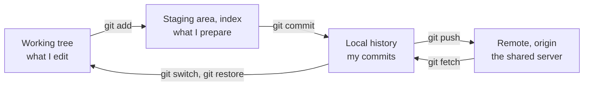
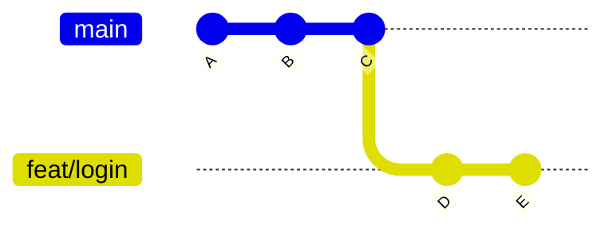
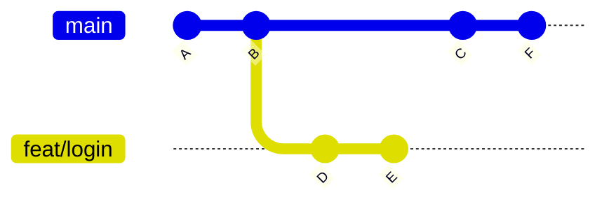
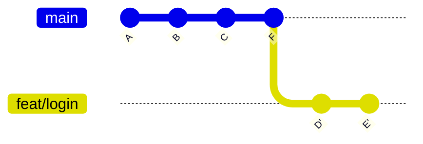
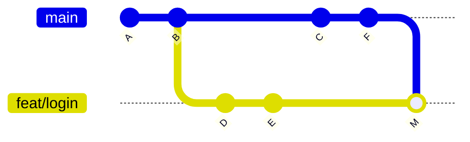
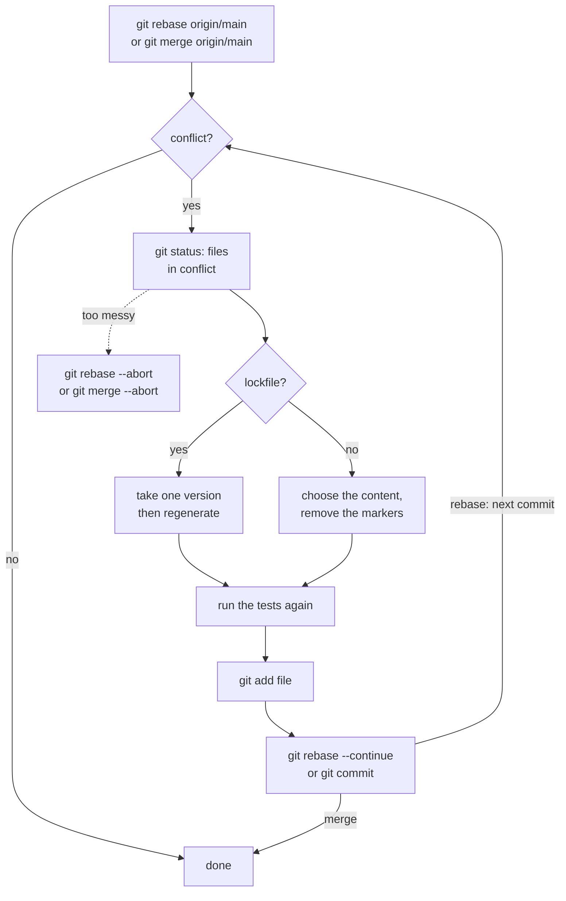
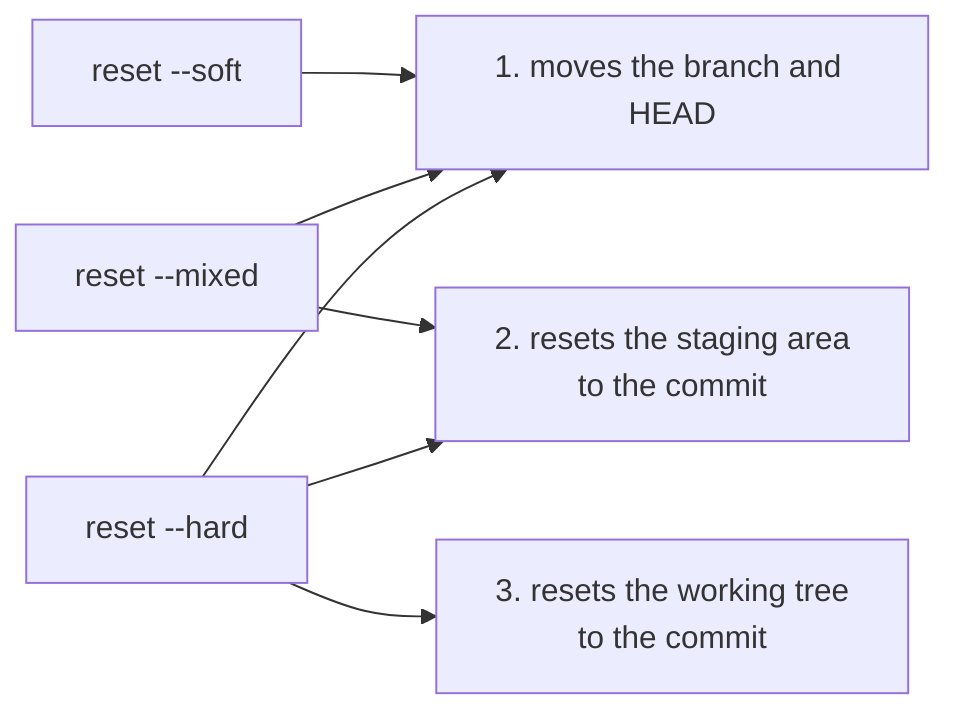
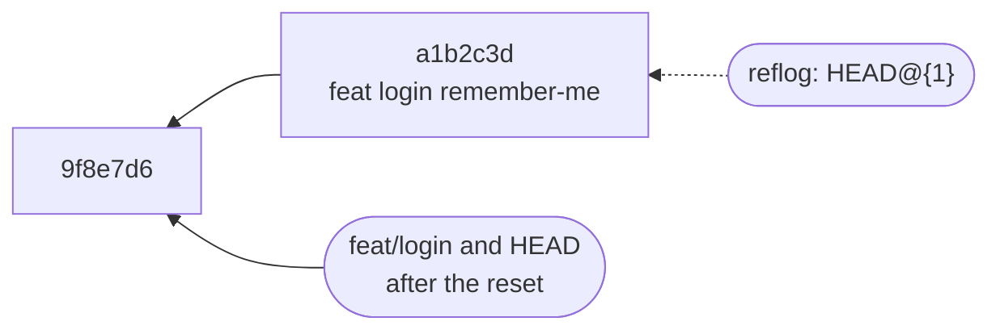
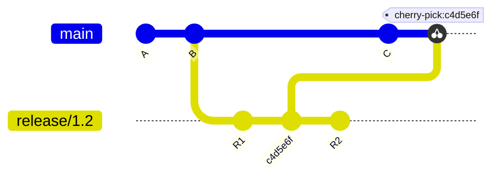
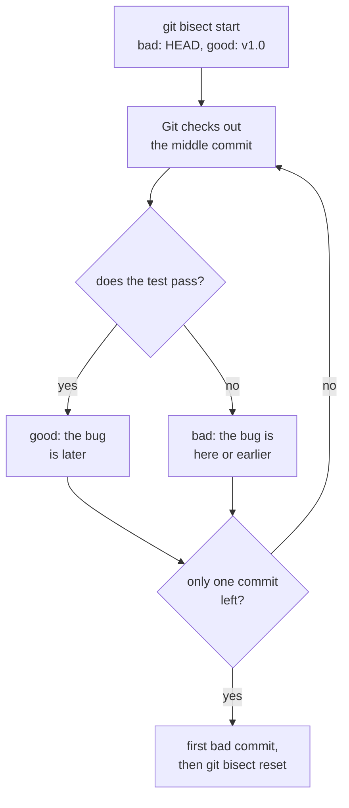

# Git

!!! warning "Disclaimer"
    These notes are personal cheat sheets, not a source of truth. They reflect my own understanding and choices: their content remains subjective, despite the quotes and references it contains. It may be incomplete, simplified, inaccurate or outdated. Always check the official documentation before applying it. This content is provided as is, without any warranty: you use it at your own risk.

!!! abstract "Scales"
    The colored badges under the headings say at which scale a notion applies:

    - <span class="pill pill-scope pill-scope-code">Code</span> the classes, functions and modules of one program;
    - <span class="pill pill-scope pill-scope-app">Application</span> one service or application and its internal split;
    - <span class="pill pill-scope pill-scope-system">System</span> several services talking to each other over the network;
    - <span class="pill pill-scope pill-scope-infra">Infrastructure</span> servers, network, zones and clusters, physical or virtual;
    - <span class="pill pill-scope pill-scope-enterprise">Enterprise</span> the whole information system and its organization.

    Details and ambiguous words: [map of scales](architecture.md#map-of-scales).

<span class="term" data-term="git">Git</span> keeps the history of every modification of a project and lets several people work on the same code without overwriting each other's work. Day to day, I use it to save my work, share it, get the team's work and go back when I make a mistake. This page starts with the terminology (the three areas, commit, branch, remote), then gives, situation by situation, the command to type: starting a piece of work, resolving a conflict, fixing a bad commit, finding a lost commit. The repositories, branches and people mentioned are examples.

## Terminology

### The 3 areas
A modified file goes through 3 places before it is shared.

!!! noob "As noob"
    Picture mailing a parcel: the working tree is my desk where I write, the staging area is the box where I put what I want to send, the commit seals and labels the box (it stays at home), the push mails it. The one thing to remember: **only what is in the box (after `git add`) goes into the next commit.**



```
$ git status
On branch feat/login
Changes to be committed:          (staging area: goes into the next commit)
        modified:   src/login.py
Changes not staged for commit:    (working tree: will not go in)
        modified:   src/utils.py
Untracked files:                  (never tracked by git)
        notes.txt
```

:material-book-open-variant: Reference docs: [Pro Git, 1.3 What is Git?](https://git-scm.com/book/en/v2/Getting-Started-What-is-Git%3F) (2nd edition, 2014); [git add](https://git-scm.com/docs/git-add) (accessed November 2026)
{ .doc-ref }

### Commit
A snapshot of the whole project at a given moment, with a message, an author and an identifier (<span class="term" data-term="git-sha">SHA</span>).

```
$ git log --oneline
a1b2c3d feat(login): add remember-me checkbox
9f8e7d6 fix(api): handle empty payload
```

:material-book-open-variant: Reference docs: [Pro Git, 2.2 Recording Changes to the Repository](https://git-scm.com/book/en/v2/Git-Basics-Recording-Changes-to-the-Repository) (2nd edition, 2014); [git commit](https://git-scm.com/docs/git-commit) (accessed November 2026)
{ .doc-ref }

### Branch
A label that points to a <span class="term" data-term="git-commit">commit</span> and moves forward when I commit on it. It is used to isolate a piece of work.

!!! noob "As noob"
    A branch is not a copy of the project: it is a bookmark placed on a commit, which moves forward on its own when I commit. Creating one costs almost nothing and copies no file. The one thing to remember: **a branch is a pointer, not a folder.**



:material-book-open-variant: Reference docs: [Pro Git, 3.1 Branches in a Nutshell](https://git-scm.com/book/en/v2/Git-Branching-Branches-in-a-Nutshell) (2nd edition, 2014)
{ .doc-ref }

### HEAD
"Where I am right now". Usually, <span class="term" data-term="git-head">HEAD</span> points to the current <span class="term" data-term="git-branch">branch</span>.

:material-book-open-variant: Reference docs: [gitglossary, HEAD](https://git-scm.com/docs/gitglossary) (accessed November 2026)
{ .doc-ref }

### Remote, origin
The <span class="term" data-term="git-remote">remote repository</span> (GitHub, GitLab). `origin` is the default name of the remote I cloned from. `origin/main` is the local copy of what I know about `main` on the server, as of my last `fetch`.

!!! noob "As noob"
    `origin/main` is a photo of the notice board taken the last time I walked past it: if someone pinned a new sheet since, my photo does not show it. The one thing to remember: **`origin/main` only moves when I talk to the server (`fetch`, `pull`, `push`).**

:material-book-open-variant: Reference docs: [Pro Git, 2.5 Working with Remotes](https://git-scm.com/book/en/v2/Git-Basics-Working-with-Remotes) (2nd edition, 2014)
{ .doc-ref }

### Tag
A fixed label on a commit, usually for a version.

```
$ git tag v1.2.0
$ git push origin v1.2.0
```

:material-book-open-variant: Reference docs: [Pro Git, 2.6 Tagging](https://git-scm.com/book/en/v2/Git-Basics-Tagging) (2nd edition, 2014); [git tag](https://git-scm.com/docs/git-tag) (accessed November 2026)
{ .doc-ref }

### Repository (repo) and clone
A **<span class="term" data-term="git-repository">repository</span>** is the project with its whole <span class="term" data-term="git-history">history</span>. **<span class="term" data-term="git-clone">Cloning</span>** means downloading a full copy of it to my machine.
```
$ git clone https://github.com/moi/my-repo.git
```

:material-book-open-variant: Reference docs: [git clone](https://git-scm.com/docs/git-clone) (accessed November 2026); [Pro Git, 2.1 Getting a Git Repository](https://git-scm.com/book/en/v2/Git-Basics-Getting-a-Git-Repository) (2nd edition, 2014)
{ .doc-ref }

### SHA
The unique identifier of a commit, a string of 40 characters. People often use just the first 7.
```
a1b2c3d4e5f6a7b8c9d0e1f2a3b4c5d6e7f8a9b0   full
a1b2c3d                                     short
```

:material-book-open-variant: Reference docs: [Pro Git, 7.1 Revision Selection](https://git-scm.com/book/en/v2/Git-Tools-Revision-Selection) (2nd edition, 2014)
{ .doc-ref }

### Diff and hunk
A **<span class="term" data-term="git-diff">diff</span>** shows the differences between two versions: `-` for removed lines, `+` for added lines. A **<span class="term" data-term="git-hunk">hunk</span>** is a block of neighboring changes within that diff.
```
@@ -12,3 +12,3 @@          (start of a hunk: line 12)
-timeout = 30
+timeout = 60
```

:material-book-open-variant: Reference docs: [git diff](https://git-scm.com/docs/git-diff) (accessed November 2026)
{ .doc-ref }

### HEAD~1, `..` and `...`
- `HEAD~1`: the commit right before the one I am on. `HEAD~3`: three commits before.
- `git log main..origin/main`: the commits that are on `origin/main` but not on `main`.
- `git diff origin/main...HEAD`: what my branch changed since it left main, not counting what landed on main since then.

:material-book-open-variant: Reference docs: [gitrevisions](https://git-scm.com/docs/gitrevisions) (accessed November 2026)
{ .doc-ref }

### MR and PR
A **<span class="term" data-term="merge-request">merge request</span>** (GitLab) or **pull request** (GitHub): the request to <span class="term" data-term="merge-code">merge</span> my branch into main, with the diff, the <span class="term" data-term="code-review">review</span> and the <span class="term" data-term="ci-pipeline">CI pipeline</span>. Both words mean the same thing.

:material-book-open-variant: Reference docs: [GitLab, Merge requests](https://docs.gitlab.com/user/project/merge_requests/) (accessed November 2026); [GitHub, About pull requests](https://docs.github.com/en/pull-requests/collaborating-with-pull-requests/proposing-changes-to-your-work-with-pull-requests/about-pull-requests) (accessed November 2026)
{ .doc-ref }

### Lockfile
A file that pins the exact version of each <span class="term" data-term="dependency-software">dependency</span>, so everyone installs the same ones (`yarn.lock`, `uv.lock`, `poetry.lock`). It is generated by the tool, not written by hand.

## By situation

<a class="pill pill-scope pill-scope-code" href="../architecture/#map-of-scales">Scale · Code</a>

<a class="pill pill-practice" href="../livraison/#trunk-based-development" title="level 1: the practice is in place, even by hand">Practice · Trunk-based development · L1</a>
<a class="pill pill-dora" href="https://dora.dev/capabilities/version-control/">DORA · Version control</a> <a class="pill pill-dora" href="https://dora.dev/capabilities/trunk-based-development/">DORA · Trunk-based development</a>


### I am starting new work

<span class="pill pill-status pill-status-ok" title="Still valid, checked November 2026">Current · 11/2026</span>

I always start from an up-to-date `main`, in the <span class="term" data-term="git-repository">repo</span> folder.

```
$ git fetch
$ git switch -c feat/login origin/main
```
`git fetch` downloads what is new on the server (including `origin/main`) without touching my files or my branches (details [below](#i-want-to-get-what-is-on-the-server)). `switch -c` creates the <span class="term" data-term="git-branch">branch</span> and moves onto it. Starting from `origin/main` rather than `main` avoids starting from a stale local `main`.

:material-book-open-variant: Reference docs: [git switch](https://git-scm.com/docs/git-switch) (accessed November 2026)
{ .doc-ref }

### I want to save my work

<span class="pill pill-status pill-status-ok" title="Still valid, checked November 2026">Current · 11/2026</span>

```
$ git add src/login.py
$ git commit -m "feat(login): add remember-me checkbox"
```

I only want to <span class="term" data-term="git-commit">commit</span> part of the changes in a file:
```
$ git add -p src/login.py
Stage this hunk [y,n,q,a,d,s,e,?]? y
```

:material-book-open-variant: Reference docs: [Pro Git, 7.2 Interactive Staging](https://git-scm.com/book/en/v2/Git-Tools-Interactive-Staging) (2nd edition, 2014); [git commit](https://git-scm.com/docs/git-commit) (accessed November 2026)
{ .doc-ref }

### I am writing a good commit message (conventional commits, 2019 specification 1.0)

<span class="pill pill-status pill-status-ok" title="Still valid, checked November 2026">Current · 11/2026</span>

```
type(scope): short description

feat(login): add remember-me checkbox
fix(api): return 400 on empty payload
docs(readme): explain local setup
refactor(db): extract connection pool
test(login): cover expired session
chore(deps): bump pytest to 8.3
```

| Type | When |
|---|---|
| `feat` | I add something the user sees or can use, like a "remember me" checkbox on the login page |
| `fix` | I fix a bug, like an API that crashed on an empty payload |
| `refactor` | I reorganize the code without changing what it does, like moving the connection pool into its own function |
| `test` | I only add or change tests, like covering the expired session case |
| `docs` | I only touch the documentation, like explaining the local setup in the README |
| `chore` | I change tooling, dependencies or config, like bumping pytest to 8.3 |

Some release tools (cocogitto, semantic-release) compute the version from these types: `feat` gives a <span class="term" data-term="semantic-versioning">minor version</span>, `fix` a patch version, `chore` often nothing at all.

:material-book-open-variant: Reference docs: [Conventional Commits](https://www.conventionalcommits.org/en/v1.0.0/) (version 1.0.0, 2019)
{ .doc-ref }

### I want to get what is on the server

<span class="pill pill-status pill-status-ok" title="Still valid, checked November 2026">Current · 11/2026</span>

| Command      | What it does                                             | When                                  |
|--------------|----------------------------------------------------------|---------------------------------------|
| `git fetch`  | downloads, touches nothing local                         | any time, safely: I want to see what others pushed before deciding what to do with it |
| `git pull`   | `fetch` then <span class="term" data-term="merge-code">merges</span> into my current branch               | I am on `main`, with no local work in progress, and just want to get up to date |

```
$ git fetch
$ git log --oneline main..origin/main
c4d5e6f fix(api): handle timeout
```
Here I see what others have <span class="term" data-term="git-push">pushed</span> before integrating it.

:material-book-open-variant: Reference docs: [git fetch](https://git-scm.com/docs/git-fetch) (accessed November 2026); [git pull](https://git-scm.com/docs/git-pull) (accessed November 2026)
{ .doc-ref }

### My branch is behind main: merge or rebase?

<span class="pill pill-status pill-status-ok" title="Still valid, checked November 2026">Current · 11/2026</span>

Before:



**<span class="term" data-term="git-rebase">Rebase</span>**: replays my commits on top of `main`. <span class="term" data-term="linear-history">Linear history</span>.

!!! noob "As noob"
    Rebasing is taking my notes and copying them again at the end of a notebook that moved on without me: same content, but new pages (hence the new SHAs `D'` and `E'`). The one thing to remember: **rebase rewrites my commits, so I keep it for commits nobody else is using.**

```
$ git fetch
$ git rebase origin/main
```



**Merge**: creates a <span class="term" data-term="merge-commit">merge commit</span>. Faithful history but with forks.
```
$ git merge origin/main
```



| Situation | I use |
|---|---|
| I am alone on my branch, like `feat/login` that nobody else has fetched, not reviewed yet or reviewed only by me | rebase |
| other people have committed on the same branch: rewriting its commits would break their local copy | merge |
| my team wants the history of `main` in a straight line, without forks, to read it commit after commit | rebase |

After rebasing a branch that was already pushed, I have to <span class="term" data-term="force-push">force the push</span> (see below).

:material-book-open-variant: Reference docs: [Pro Git, 3.2 Basic Branching and Merging](https://git-scm.com/book/en/v2/Git-Branching-Basic-Branching-and-Merging) (2nd edition, 2014); [Pro Git, 3.6 Rebasing](https://git-scm.com/book/en/v2/Git-Branching-Rebasing) (2nd edition, 2014)
{ .doc-ref }

### I have a conflict

<span class="pill pill-status pill-status-ok" title="Still valid, checked November 2026">Current · 11/2026</span>

Example: on `main`, someone changed `timeout = 30` to `45`. On my branch, my commit `a1b2c3d` changed it to `60`.

During a **rebase**, the top side (`HEAD`, "ours") is `origin/main`, the branch I am replaying onto, and the bottom side is **my** commit:
```
$ git rebase origin/main
CONFLICT (content): Merge conflict in src/login.py
error: could not apply a1b2c3d... feat(login): raise timeout to 60

<<<<<<< HEAD
timeout = 45
=======
timeout = 60
>>>>>>> a1b2c3d (feat(login): raise timeout to 60)
```
During a **merge**, it is the opposite: the top side is **my** branch, the bottom side is `origin/main`:
```
$ git merge origin/main
CONFLICT (content): Merge conflict in src/login.py

<<<<<<< HEAD
timeout = 60
=======
timeout = 45
>>>>>>> origin/main
```

| Operation | Top (`HEAD`, "ours")     | Bottom ("theirs")  |
|-----------|--------------------------|--------------------|
| rebase    | `origin/main`            | my commit          |
| merge     | my branch                | `origin/main`      |

Trap: during a rebase, `git checkout --ours src/login.py` takes the `main` version, not mine.

I keep the right version and remove the <span class="term" data-term="conflict-marker">markers</span>. Resolved file (here I keep 60 after talking with whoever wrote 45):
```
timeout = 60
```
Then:
```
$ git add src/login.py
$ git rebase --continue        (or git commit for a merge)
```
Cancel everything and go back to before the rebase: `git rebase --abort` (`git merge --abort` for a merge).

Special cases:
- **<span class="term" data-term="merge-conflict">conflict</span> in a <span class="term" data-term="lockfile">lockfile</span>** (`yarn.lock`, `uv.lock`, `poetry.lock`): do not merge by hand. Take one of the two versions, then regenerate (`yarn install`, `uv lock`).
- **conflict on a version number**: keep the newest one.

*uv: competes with pip, Poetry, pdm; complements mise*<br>
*yarn: competes with npm, pnpm*
{ .tool-rel }


The full flow, repeated for every commit replayed during a rebase:



:material-book-open-variant: Reference docs: [git merge](https://git-scm.com/docs/git-merge) (accessed November 2026); [git rebase](https://git-scm.com/docs/git-rebase) (accessed November 2026)
{ .doc-ref }

### I need to push after a rebase

<span class="pill pill-status pill-status-ok" title="Still valid, checked November 2026">Current · 11/2026</span>

```
$ git push --force-with-lease
```
`--force-with-lease` refuses to overwrite if someone else pushed in the meantime. Plain `--force` overwrites without checking: avoid it.

!!! noob "As noob"
    `--force` replaces the shared sheet with mine without looking. `--force-with-lease` first checks it is still the one I saw at my last `fetch`, and refuses otherwise (a `fetch` run in between without looking at what it brought defeats this protection). The one thing to remember: **after a rebase, `--force-with-lease`, never `--force`.**

:material-book-open-variant: Reference docs: [git push](https://git-scm.com/docs/git-push) (accessed November 2026)
{ .doc-ref }

### I made a mistake: which command?

<span class="pill pill-status pill-status-ok" title="Still valid, checked November 2026">Current · 11/2026</span>

| Situation | Command |
|---|---|
| I changed a file without committing, and want to go back to its last committed version, like after a failed try in `src/login.py` | `git restore src/login.py` |
| I ran `git add` on a file by mistake and want to take it out of the <span class="term" data-term="staging-area">staging area</span>, without losing my change | `git restore --staged src/login.py` |
| I just committed with a typo in the message, or forgot a file | `git commit --amend` |
| my last commit is not pushed yet, and I want to undo it while keeping my changes to commit them differently | `git reset --soft HEAD~1` |
| my last commit is not pushed yet, and I want to throw everything away, the commit and its changes | `git reset --hard HEAD~1` |
| the commit is already pushed and others have fetched it, like a commit merged into `main` that introduces a bug | `git revert a1b2c3d` |

Key difference:
- `reset` <span class="term" data-term="history-rewrite">rewrites history</span>, as if the commit had never existed. Only for what is not shared yet.
- `revert` creates a new commit that does the opposite. History stays intact, so it is safe on `main`.

!!! noob "As noob"
    `reset` tears the page out of the notebook: handy if nobody has read it, dangerous if others already copied it. `revert` writes a new page saying "I cancel what page 12 says". The one thing to remember: **anything already pushed and shared is undone with `revert`.**

```
revert
main  A ── B ── C ── C'      (C' cancels C, everyone keeps C in the history)

reset --hard HEAD~1
main  A ── B                 (C is gone from the branch)
```

The three `reset` modes only differ in what they do with the changes of the removed commit:

| Command                        | History          | Staging area                     | Working tree (my files)     |
|--------------------------------|------------------|----------------------------------|-----------------------------|
| `git reset --soft HEAD~1`      | commit removed   | changes kept, ready to commit    | untouched                   |
| `git reset HEAD~1` (`--mixed`, default) | commit removed | emptied                     | changes kept, to `add` again |
| `git reset --hard HEAD~1`      | commit removed   | emptied                          | changes lost                |

Each mode goes one step further than the previous one (Pro Git's breakdown, "Reset Demystified"):



Only `--hard` destroys uncommitted work. The removed commit can still be recovered through the `reflog` (next section).

:material-book-open-variant: Reference docs: [Pro Git, 7.7 Reset Demystified](https://git-scm.com/book/en/v2/Git-Tools-Reset-Demystified) (2nd edition, 2014); [git revert](https://git-scm.com/docs/git-revert) (accessed November 2026)
{ .doc-ref }

### I lost a commit (after a reset or a botched rebase)

<span class="pill pill-status pill-status-ok" title="Still valid, checked November 2026">Current · 11/2026</span>

`reflog` keeps track of every place HEAD has been, for about 90 days.

!!! noob "As noob"
    The reflog is my local copy's logbook: it records every place I have been, even those no branch shows any more. It stays on my machine and only covers what was committed. The one thing to remember: **a "lost" commit can almost always be found in `git reflog`.**

```
$ git reflog
9f8e7d6 HEAD@{0}: reset: moving to HEAD~1
a1b2c3d HEAD@{1}: commit: feat(login): add remember-me checkbox

$ git reset --hard a1b2c3d
```

The commit is not erased: no branch points to it anymore, but the reflog still remembers it.


Safe variant: I create a branch on it instead of moving the current branch, `git branch rescue/remember-me a1b2c3d`, then look at what it contains at my own pace.

:material-book-open-variant: Reference docs: [git reflog](https://git-scm.com/docs/git-reflog) (accessed November 2026)
{ .doc-ref }

### I need to switch branches but my work is not ready

<span class="pill pill-status pill-status-ok" title="Still valid, checked November 2026">Current · 11/2026</span>

```
$ git stash
$ git switch main
...
$ git switch feat/login
$ git stash pop
```
With a name, useful if I stack several:
```
$ git stash push -m "wip login form"
$ git stash list
stash@{0}: On feat/login: wip login form
```

:material-book-open-variant: Reference docs: [Pro Git, 7.3 Stashing and Cleaning](https://git-scm.com/book/en/v2/Git-Tools-Stashing-and-Cleaning) (2nd edition, 2014); [git stash](https://git-scm.com/docs/git-stash) (accessed November 2026)
{ .doc-ref }

### I want a single commit from another branch

<span class="pill pill-status pill-status-ok" title="Still valid, checked November 2026">Current · 11/2026</span>

```
$ git cherry-pick c4d5e6f
```
Example: a fix is on `release/1.2` and I also want it on `main`, without the rest of the branch.



The commit copied onto `main` gets a new SHA: it is a copy, not a move. `R1` and `R2` stay on `release/1.2`.

:material-book-open-variant: Reference docs: [git cherry-pick](https://git-scm.com/docs/git-cherry-pick) (accessed November 2026)
{ .doc-ref }

### I want to clean up my commits before review

<span class="pill pill-status pill-status-ok" title="Still valid, checked November 2026">Current · 11/2026</span>

```
before                              after
fix typo                            feat(login): add remember-me checkbox
wip
feat(login): add remember-me
```
```
$ git reset --soft origin/main
$ git commit -m "feat(login): add remember-me checkbox"
$ git push --force-with-lease
```
`reset --soft` moves the branch back to its starting point while keeping all the changes in the staging area. A single clean commit is then enough.

:material-book-open-variant: Reference docs: [Pro Git, 7.6 Rewriting History](https://git-scm.com/book/en/v2/Git-Tools-Rewriting-History) (2nd edition, 2014)
{ .doc-ref }

### I am looking for who wrote a line, or when a bug appeared

<span class="pill pill-status pill-status-ok" title="Still valid, checked November 2026">Current · 11/2026</span>

| I want to know... | Command |
|---|---|
| who changed each line of a file, and when, to go and ask them why `timeout` is 60 | `git blame src/login.py` |
| everything that happened to a single file, without the noise of the others | `git log --oneline -- src/login.py` |
| which commit added or removed a precise piece of text, like the line `timeout = 60`, in whatever file | `git log -S "timeout = 60" --oneline` |
| what my branch changes compared to main, without counting what arrived on main since | `git diff origin/main...HEAD` |
| which commit broke a test that used to pass, for example in `v1.0` | `git bisect` |

`git blame` shows, for each line, the commit, author and date of its last change:
```
$ git blame src/login.py
a1b2c3d4 (ada   2026-03-02 10:14:05 +0100 12) def login(user):
e7f8a9b0 (grace 2026-04-15 16:40:21 +0200 13)     timeout = 60
a1b2c3d4 (ada   2026-03-02 10:14:05 +0100 14)     return open_session(user, timeout)
```
`git log -S` lists the commits that added or removed that exact text, in any file:
```
$ git log -S "timeout = 60" --oneline
e7f8a9b fix(login): raise timeout to 60
```

`bisect` example: the test passed in `v1.0`, it fails now.
```
$ git bisect start
$ git bisect bad
$ git bisect good v1.0
$ git bisect run pytest tests/test_login.py
a1b2c3d is the first bad commit
$ git bisect reset
```
<span class="term" data-term="git">Git</span> splits the history in two at each step and runs the test, until it finds the culprit.

!!! noob "As noob"
    It is the "higher or lower" guessing game: instead of testing commits one by one, I test the middle one and rule out half of what is left each time. The one thing to remember: **all I need is one good commit, one bad commit and a test that tells them apart.**


Each round halves the range: 1,000 commits take about ten tests (2 to the power of 10 = 1,024). With `git bisect run`, Git runs the loop alone based on the script's exit code: 0 means good, 125 means "skip this commit" (it does not build), 1 to 127 except 125 means bad.

:material-book-open-variant: Reference docs: [Pro Git, 7.10 Debugging with Git](https://git-scm.com/book/en/v2/Git-Tools-Debugging-with-Git) (2nd edition, 2014); [git bisect](https://git-scm.com/docs/git-bisect) (accessed November 2026)
{ .doc-ref }

### I need to work on two branches at the same time

<span class="pill pill-status pill-status-ok" title="Still valid, checked November 2026">Current · 11/2026</span>

The normal case: I work on one branch at a time, and `git switch` takes me from one to the other.

`git worktree` is only for when I really need both at the same time, each in its own folder: for example two sessions running at the same time on the same repo, one on my branch, the other on a hotfix.
```
$ git worktree add ../my-repo-hotfix hotfix/crash
$ git worktree remove ../my-repo-hotfix
```

:material-book-open-variant: Reference docs: [git worktree](https://git-scm.com/docs/git-worktree) (accessed November 2026)
{ .doc-ref }

### I want to ignore a file

<span class="pill pill-status pill-status-ok" title="Still valid, checked November 2026">Current · 11/2026</span>

```
$ cat .gitignore
.env
__pycache__/
node_modules/
```
If the file is already tracked, `.gitignore` is not enough:
```
$ git rm --cached .env
```
If I committed and pushed a <span class="term" data-term="secret">secret</span>, like a password in `.env`: I change it right away. Deleting it in a new commit does not erase it from the history, so anyone with access to the repo can still read it.

:material-book-open-variant: Reference docs: [gitignore](https://git-scm.com/docs/gitignore) (accessed November 2026)
{ .doc-ref }

## Pitfalls to avoid

- **Starting from a stale local `main`**: I create my branch from my local `main` without a `fetch`, so I start from an outdated base and collect avoidable conflicts at MR time. I run `git fetch` then `git switch -c feat/login origin/main` ([see I am starting new work](#i-am-starting-new-work)).
- **Rebasing a shared branch**: I rebase a branch others have committed on, so my commits get new SHAs and their local copy no longer matches. I keep rebase for a branch that is mine alone, and merge otherwise ([see My branch is behind main](#my-branch-is-behind-main-merge-or-rebase)).
- **Pushing with `--force`**: after a rebase, I push with `--force`, so I silently overwrite what a colleague pushed in the meantime. I use `--force-with-lease`, which refuses in that case ([see I need to push after a rebase](#i-need-to-push-after-a-rebase)).
- **Picking the wrong side during a rebase**: I run `git checkout --ours` thinking I keep my version, so I keep the `main` one and my change disappears. I reread the top and bottom table before choosing: during a rebase, "ours" is `origin/main` ([see I have a conflict](#i-have-a-conflict)).
- **Merging a lockfile by hand**: I resolve a conflict in `uv.lock` or `yarn.lock` line by line, so the file no longer matches any consistent resolution of the dependencies. I take one of the two versions then regenerate (`uv lock`, `yarn install`).
- **Running `reset` on a shared commit**: I remove with `git reset` a commit already pushed to `main`, so the others' history no longer matches mine. What is already shared is undone with `git revert` ([see I made a mistake](#i-made-a-mistake-which-command)).
- **Believing a commit is lost**: after a `reset --hard` or a botched rebase, I redo the work by hand while it still exists. I find it with `git reflog` and put a branch on it ([see I lost a commit](#i-lost-a-commit-after-a-reset-or-a-botched-rebase)).
- **Removing a secret with a new commit**: I pushed a password in `.env` and only delete it, so it stays readable in the history by anyone with access to the repo. I change the secret right away ([see I want to ignore a file](#i-want-to-ignore-a-file)).

## What interviews ask

The typical questions:

- "Merge or rebase, which do you use and why?", "When is a force push acceptable?" How I answer: I rebase my branch when I am alone on it, I merge on a shared branch, then I push with `--force-with-lease` after a rebase ([My branch is behind main](#my-branch-is-behind-main-merge-or-rebase), [I need to push after a rebase](#i-need-to-push-after-a-rebase)).
- "Which branching strategy do you recommend?", "What is a good commit message?" How I answer: I recommend short branches started from `main` and merged within one or two days, and messages in the conventional commits format, with a type that says the nature of the change and a short description of what changes ([I am writing a good commit message](#i-am-writing-a-good-commit-message-conventional-commits-2019-specification-10)), and [Trunk-based development](livraison.md#trunk-based-development).
- "What is the difference between `reset` and `revert`?", "How do you undo a commit already merged into main?" How I answer: I recall that `reset` rewrites history and stays local, and that `revert` adds an inverse commit, safe on `main` ([I made a mistake](#i-made-a-mistake-which-command)).
- "How do you resolve a conflict?", "And a conflict in a lockfile?" How I answer: I read the markers, recall the meaning of "ours" and "theirs" depending on merge or rebase, and regenerate the lockfile rather than merge it ([I have a conflict](#i-have-a-conflict)).
- "A test passed a month ago and fails now: how do you find the guilty commit?" How I answer: I run `git bisect run` with the test, then `git blame` and `git log -S` to understand the change ([I am looking for who wrote a line](#i-am-looking-for-who-wrote-a-line-or-when-a-bug-appeared)).
- "I ran `reset --hard` by mistake: is my work lost?" How I answer: I go through the reflog, which keeps commits for about 90 days, but nothing that was never committed ([I lost a commit](#i-lost-a-commit-after-a-reset-or-a-botched-rebase)).
- "A password was pushed to the repo: what do you do?" How I answer: I change the secret first, because it stays in the history; `.gitignore` and `git rm --cached` only prevent what comes next ([I want to ignore a file](#i-want-to-ignore-a-file)).

What makes a good answer: it says what the command does to the history, and so whom it can hurt: everything that rewrites (rebase, reset, force push) is safe on a branch that is mine alone, and dangerous as soon as it is shared.

## Quick cheat sheet

<a class="pill pill-scope pill-scope-code" href="../architecture/#map-of-scales">Scale · Code</a>

| I want to...                                | Command                                   |
|---------------------------------------------|-------------------------------------------|
| see the status                              | `git status`                              |
| start some work                             | `git switch -c feat/x origin/main`        |
| save                                        | `git add` then `git commit`               |
| look at the server without touching anything | `git fetch`                              |
| catch up with main                          | `git rebase origin/main`                  |
| <span class="term" data-term="git-push">push</span> after a <span class="term" data-term="git-rebase">rebase</span>                         | `git push --force-with-lease`             |
| <span class="term" data-term="git-stash">set aside</span>                                   | `git stash` / `git stash pop`             |
| cancel a shared <span class="term" data-term="git-commit">commit</span>                      | `git revert <sha>`                        |
| find a lost commit                          | `git reflog`                              |
| take a single commit from elsewhere         | `git cherry-pick <sha>`                   |
| find the commit that broke things           | `git bisect`                              |
