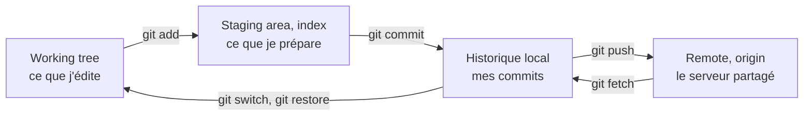
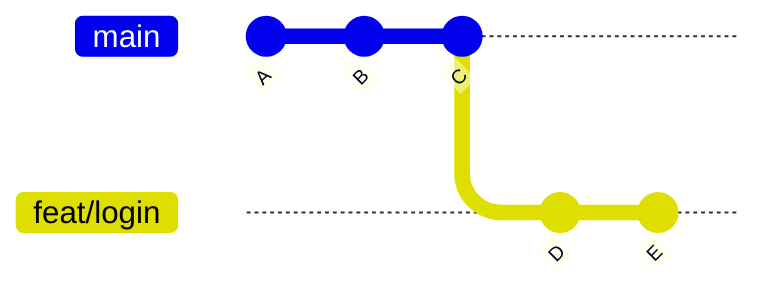
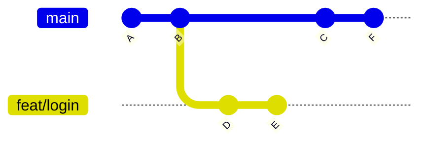
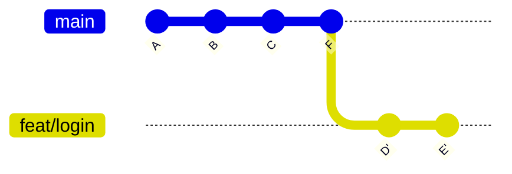
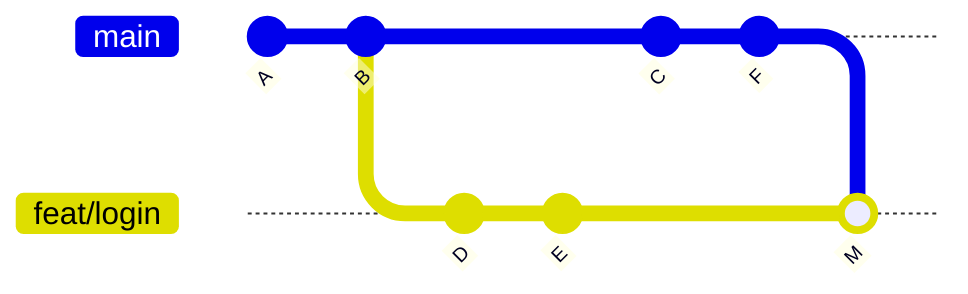
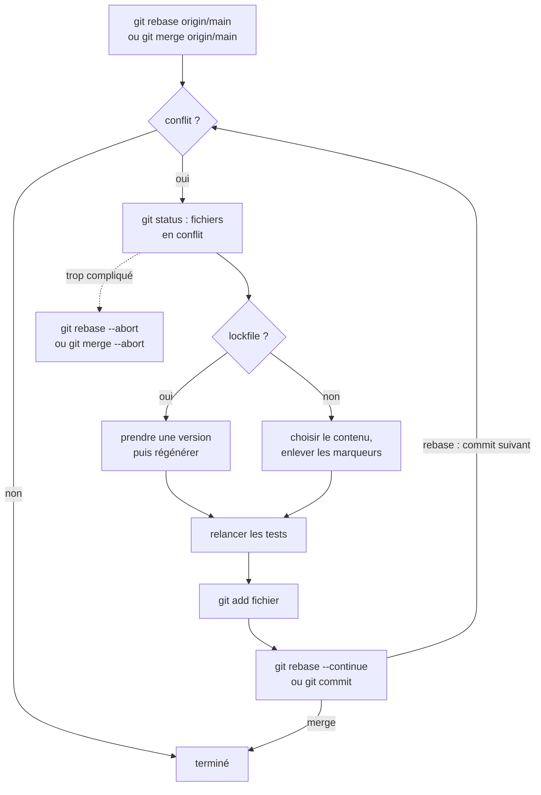
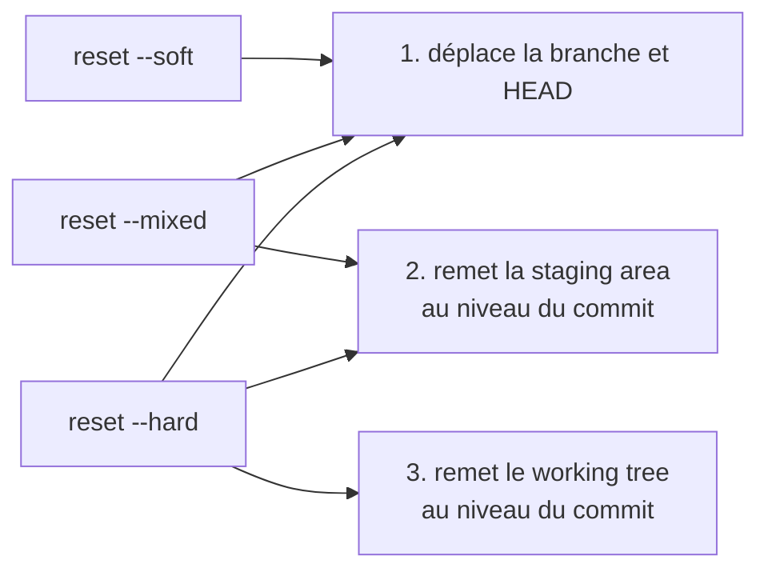
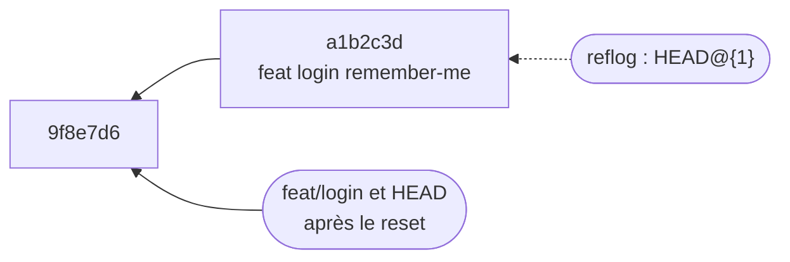
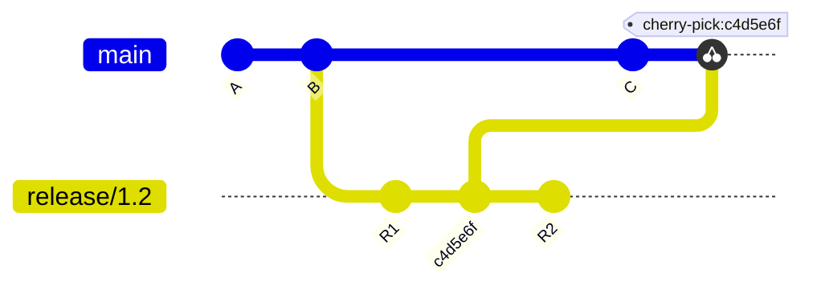
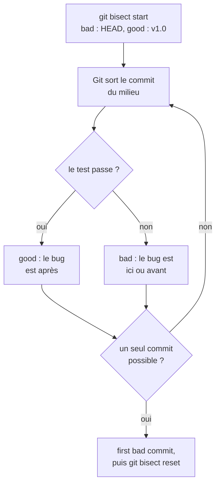

# Git

!!! warning "Avertissement"
    Ces notes sont des pense-bêtes personnels, pas une source de vérité. Elles reflètent ma compréhension et mes choix : leur contenu reste subjectif, malgré les citations et les références qu'il contient. Il peut être incomplet, simplifié, inexact ou dépassé. Vérifiez toujours dans la documentation officielle avant de l'appliquer. Ce contenu est fourni tel quel, sans aucune garantie : son utilisation se fait sous votre seule responsabilité.

!!! abstract "Les échelles"
    Les pastilles de couleur sous les titres disent à quelle échelle une notion s'applique :

    - <span class="pill pill-scope pill-scope-code">Code</span> les classes, fonctions et modules d'un programme ;
    - <span class="pill pill-scope pill-scope-app">Application</span> un service ou une application et son découpage interne ;
    - <span class="pill pill-scope pill-scope-system">Système</span> plusieurs services qui communiquent par le réseau ;
    - <span class="pill pill-scope pill-scope-infra">Infrastructure</span> les serveurs, le réseau, les zones et les clusters, physiques ou virtuels ;
    - <span class="pill pill-scope pill-scope-enterprise">Entreprise</span> le système d'information entier et son organisation.

    Détail et mots ambigus : [carte des échelles](architecture.md#carte-des-echelles).

<span class="term" data-term="git">Git</span> garde l'historique de chaque modification d'un projet et permet à plusieurs personnes de travailler sur le même code sans écraser le travail des autres. Au quotidien, je m'en sers pour enregistrer mon travail, le partager, récupérer celui de l'équipe et revenir en arrière quand je me trompe. Cette page commence par le vocabulaire (les trois zones, commit, branche, dépôt distant), puis donne, situation par situation, la commande à taper : démarrer un travail, résoudre un conflit, corriger un commit raté, retrouver un commit perdu. Les dépôts, branches et personnes cités sont des exemples.

## Vocabulaire

### Les 3 zones
Un fichier modifié passe par 3 endroits avant d'être partagé.

!!! noob "As noob"
    Imaginons un envoi postal : le working tree est mon bureau où j'écris, la staging area est le carton où je range ce que je veux envoyer, le commit ferme et étiquette le carton (il reste chez moi), le push le poste. La phrase à retenir : **seul ce qui est dans le carton (après `git add`) part au prochain commit.**



```
$ git status
On branch feat/login
Changes to be committed:          (staging area : partira au prochain commit)
        modified:   src/login.py
Changes not staged for commit:    (working tree : ne partira pas)
        modified:   src/utils.py
Untracked files:                  (jamais suivi par git)
        notes.txt
```

:material-book-open-variant: Doc de référence : [Pro Git, 1.3 What is Git?](https://git-scm.com/book/en/v2/Getting-Started-What-is-Git%3F) (2e édition, 2014) ; [git add](https://git-scm.com/docs/git-add) (consultée en novembre 2026)
{ .doc-ref }

### Commit
Une photo de l'ensemble du projet à un instant donné, avec un message, un auteur et un identifiant (<span class="term" data-term="git-sha">SHA</span>).

```
$ git log --oneline
a1b2c3d feat(login): add remember-me checkbox
9f8e7d6 fix(api): handle empty payload
```

:material-book-open-variant: Doc de référence : [Pro Git, 2.2 Recording Changes to the Repository](https://git-scm.com/book/en/v2/Git-Basics-Recording-Changes-to-the-Repository) (2e édition, 2014) ; [git commit](https://git-scm.com/docs/git-commit) (consultée en novembre 2026)
{ .doc-ref }

### Branche
Une étiquette qui pointe sur un <span class="term" data-term="git-commit">commit</span> et avance quand je commite dessus. Elle sert à isoler un travail.

!!! noob "As noob"
    Une branche n'est pas une copie du projet : c'est un marque-page posé sur un commit, qui avance tout seul quand je commite. En créer une ne coûte presque rien et ne copie aucun fichier. La phrase à retenir : **une branche est un pointeur, pas un dossier.**



:material-book-open-variant: Doc de référence : [Pro Git, 3.1 Branches in a Nutshell](https://git-scm.com/book/en/v2/Git-Branching-Branches-in-a-Nutshell) (2e édition, 2014)
{ .doc-ref }

### HEAD
« Où je suis maintenant ». En général, <span class="term" data-term="git-head">HEAD</span> pointe sur la <span class="term" data-term="git-branch">branche</span> courante.

:material-book-open-variant: Doc de référence : [gitglossary, HEAD](https://git-scm.com/docs/gitglossary) (consultée en novembre 2026)
{ .doc-ref }

### Remote, origin
Le <span class="term" data-term="git-remote">dépôt distant</span> (GitHub, GitLab). `origin` est le nom par défaut du remote d'où j'ai cloné. `origin/main` est la copie locale de ce que je sais de `main` sur le serveur, à la date de mon dernier `fetch`.

!!! noob "As noob"
    `origin/main`, c'est une photo du tableau d'affichage prise la dernière fois que je suis passé devant : si quelqu'un a ajouté une feuille depuis, ma photo ne la montre pas. La phrase à retenir : **`origin/main` ne bouge que quand je parle au serveur (`fetch`, `pull`, `push`).**

:material-book-open-variant: Doc de référence : [Pro Git, 2.5 Working with Remotes](https://git-scm.com/book/en/v2/Git-Basics-Working-with-Remotes) (2e édition, 2014)
{ .doc-ref }

### Tag
Une étiquette fixe sur un commit, en général pour une version.

```
$ git tag v1.2.0
$ git push origin v1.2.0
```

:material-book-open-variant: Doc de référence : [Pro Git, 2.6 Tagging](https://git-scm.com/book/en/v2/Git-Basics-Tagging) (2e édition, 2014) ; [git tag](https://git-scm.com/docs/git-tag) (consultée en novembre 2026)
{ .doc-ref }

### Dépôt (repo) et clone
Un **<span class="term" data-term="git-repository">dépôt</span>** est le projet avec tout son <span class="term" data-term="git-history">historique</span>. **<span class="term" data-term="git-clone">Cloner</span>**, c'est en télécharger une copie complète sur ma machine.
```
$ git clone https://github.com/moi/mon-repo.git
```

:material-book-open-variant: Doc de référence : [git clone](https://git-scm.com/docs/git-clone) (consultée en novembre 2026) ; [Pro Git, 2.1 Getting a Git Repository](https://git-scm.com/book/en/v2/Git-Basics-Getting-a-Git-Repository) (2e édition, 2014)
{ .doc-ref }

### SHA
L'identifiant unique d'un commit, une suite de 40 caractères. On en utilise souvent les 7 premiers.
```
a1b2c3d4e5f6a7b8c9d0e1f2a3b4c5d6e7f8a9b0   complet
a1b2c3d                                     abrégé
```

:material-book-open-variant: Doc de référence : [Pro Git, 7.1 Revision Selection](https://git-scm.com/book/en/v2/Git-Tools-Revision-Selection) (2e édition, 2014)
{ .doc-ref }

### Diff et hunk
Un **<span class="term" data-term="git-diff">diff</span>** montre les différences entre deux versions : `-` pour les lignes retirées, `+` pour les lignes ajoutées. Un **<span class="term" data-term="git-hunk">hunk</span>** est un bloc de modifications voisines dans ce diff.
```
@@ -12,3 +12,3 @@          (début d'un hunk : ligne 12)
-timeout = 30
+timeout = 60
```

:material-book-open-variant: Doc de référence : [git diff](https://git-scm.com/docs/git-diff) (consultée en novembre 2026)
{ .doc-ref }

### HEAD~1, `..` et `...`
- `HEAD~1` : le commit juste avant celui où je suis. `HEAD~3` : trois commits avant.
- `git log main..origin/main` : les commits qui sont sur `origin/main` mais pas sur `main`.
- `git diff origin/main...HEAD` : ce que ma branche a changé depuis qu'elle est partie de main, sans compter ce qui est arrivé sur main depuis.

:material-book-open-variant: Doc de référence : [gitrevisions](https://git-scm.com/docs/gitrevisions) (consultée en novembre 2026)
{ .doc-ref }

### MR et PR
Une **<span class="term" data-term="merge-request">merge request</span>** (GitLab) ou **pull request** (GitHub) : la demande de <span class="term" data-term="merge-code">fusionner</span> ma branche dans main, avec le diff, la <span class="term" data-term="code-review">revue</span> et le <span class="term" data-term="ci-pipeline">pipeline de CI</span>. Les deux mots désignent la même chose.

:material-book-open-variant: Doc de référence : [GitLab, Merge requests](https://docs.gitlab.com/user/project/merge_requests/) (consultée en novembre 2026) ; [GitHub, About pull requests](https://docs.github.com/en/pull-requests/collaborating-with-pull-requests/proposing-changes-to-your-work-with-pull-requests/about-pull-requests) (consultée en novembre 2026)
{ .doc-ref }

### Lockfile
Un fichier qui fixe la version exacte de chaque <span class="term" data-term="dependency-software">dépendance</span>, pour que tout le monde installe les mêmes (`yarn.lock`, `uv.lock`, `poetry.lock`). Il est généré par l'outil, pas écrit à la main.

## Par situation

<a class="pill pill-scope pill-scope-code" href="../architecture/#carte-des-echelles">Échelle · Code</a>

<a class="pill pill-practice" href="../livraison/#trunk-based-development" title="niveau 1 : la pratique est en place, même à la main">Pratique · Trunk-based development · N1</a>
<a class="pill pill-dora" href="https://dora.dev/capabilities/version-control/">DORA · Version control</a> <a class="pill pill-dora" href="https://dora.dev/capabilities/trunk-based-development/">DORA · Trunk-based development</a>


### Je commence un nouveau travail

<span class="pill pill-status pill-status-ok" title="Toujours valable, vérifié en novembre 2026">Valable · 11/2026</span>

Je pars toujours d'un `main` à jour, dans le dossier du <span class="term" data-term="git-repository">repo</span>.

```
$ git fetch
$ git switch -c feat/login origin/main
```
`git fetch` télécharge les nouveautés du serveur (dont `origin/main`) sans toucher à mes fichiers ni à mes branches (détail [plus bas](#je-veux-recuperer-ce-quil-y-a-sur-le-serveur)). `switch -c` crée la <span class="term" data-term="git-branch">branche</span> et s'y place. Partir de `origin/main` plutôt que de `main` évite de partir d'un `main` local périmé.

:material-book-open-variant: Doc de référence : [git switch](https://git-scm.com/docs/git-switch) (consultée en novembre 2026)
{ .doc-ref }

### Je veux sauvegarder mon travail

<span class="pill pill-status pill-status-ok" title="Toujours valable, vérifié en novembre 2026">Valable · 11/2026</span>

```
$ git add src/login.py
$ git commit -m "feat(login): add remember-me checkbox"
```

Je ne veux <span class="term" data-term="git-commit">commiter</span> qu'une partie des modifications d'un fichier :
```
$ git add -p src/login.py
Stage this hunk [y,n,q,a,d,s,e,?]? y
```

:material-book-open-variant: Doc de référence : [Pro Git, 7.2 Interactive Staging](https://git-scm.com/book/en/v2/Git-Tools-Interactive-Staging) (2e édition, 2014) ; [git commit](https://git-scm.com/docs/git-commit) (consultée en novembre 2026)
{ .doc-ref }

### J'écris un bon message de commit (conventional commits, spécification 1.0 de 2019)

<span class="pill pill-status pill-status-ok" title="Toujours valable, vérifié en novembre 2026">Valable · 11/2026</span>

```
type(scope): description courte

feat(login): add remember-me checkbox
fix(api): return 400 on empty payload
docs(readme): explain local setup
refactor(db): extract connection pool
test(login): cover expired session
chore(deps): bump pytest to 8.3
```

| Type | Quand |
|---|---|
| `feat` | j'ajoute quelque chose que l'utilisateur voit ou peut utiliser, comme une case « se souvenir de moi » sur la page de connexion |
| `fix` | je corrige un bug, comme une API qui plantait sur un payload vide |
| `refactor` | je réorganise le code sans changer ce qu'il fait, comme sortir le pool de connexions dans sa propre fonction |
| `test` | j'ajoute ou modifie seulement des tests, comme couvrir le cas d'une session expirée |
| `docs` | je touche seulement la documentation, comme expliquer l'installation locale dans le README |
| `chore` | je change l'outillage, les dépendances ou la config, comme monter pytest en 8.3 |

Certains outils de release (cocogitto, semantic-release) calculent la version à partir de ces types : `feat` donne une <span class="term" data-term="semantic-versioning">version mineure</span>, `fix` une version patch, `chore` souvent rien du tout.

:material-book-open-variant: Doc de référence : [Conventional Commits](https://www.conventionalcommits.org/en/v1.0.0/) (version 1.0.0, 2019)
{ .doc-ref }

### Je veux récupérer ce qu'il y a sur le serveur

<span class="pill pill-status pill-status-ok" title="Toujours valable, vérifié en novembre 2026">Valable · 11/2026</span>

| Commande     | Ce qu'elle fait                                          | Quand                                 |
|--------------|----------------------------------------------------------|---------------------------------------|
| `git fetch`  | télécharge, ne touche à rien de local                    | à tout moment, sans risque : je veux voir ce que les autres ont poussé avant de décider quoi en faire |
| `git pull`   | `fetch` puis <span class="term" data-term="merge-code">fusionne</span> dans ma branche courante           | je suis sur `main`, sans travail local en cours, et je veux juste me mettre à jour |

```
$ git fetch
$ git log --oneline main..origin/main
c4d5e6f fix(api): handle timeout
```
Ici je vois ce que les autres ont <span class="term" data-term="git-push">poussé</span> avant de l'intégrer.

:material-book-open-variant: Doc de référence : [git fetch](https://git-scm.com/docs/git-fetch) (consultée en novembre 2026) ; [git pull](https://git-scm.com/docs/git-pull) (consultée en novembre 2026)
{ .doc-ref }

### Ma branche est en retard sur main : merge ou rebase ?

<span class="pill pill-status pill-status-ok" title="Toujours valable, vérifié en novembre 2026">Valable · 11/2026</span>

Avant :



**<span class="term" data-term="git-rebase">Rebase</span>** : rejoue mes commits par-dessus `main`. <span class="term" data-term="linear-history">Historique linéaire</span>.

!!! noob "As noob"
    Rebaser, c'est reprendre mes notes et les recopier à la fin d'un cahier qui a avancé sans moi : le contenu est le même, mais ce sont de nouvelles pages (d'où les nouveaux SHA `D'` et `E'`). La phrase à retenir : **rebase réécrit mes commits, donc je le réserve aux commits que personne d'autre n'utilise.**

```
$ git fetch
$ git rebase origin/main
```



**Merge** : crée un <span class="term" data-term="merge-commit">commit de fusion</span>. Historique fidèle mais avec des bifurcations.
```
$ git merge origin/main
```



| Situation | J'utilise |
|---|---|
| je suis seul sur ma branche, comme `feat/login` que personne d'autre n'a récupérée, pas encore relue ou relue par moi seul | rebase |
| d'autres personnes ont commité sur la même branche : réécrire ses commits casserait leur copie locale | merge |
| mon équipe veut un historique de `main` en ligne droite, sans bifurcations, pour le lire commit après commit | rebase |

Après un rebase d'une branche déjà poussée, je dois <span class="term" data-term="force-push">forcer le push</span> (voir plus bas).

:material-book-open-variant: Doc de référence : [Pro Git, 3.2 Basic Branching and Merging](https://git-scm.com/book/en/v2/Git-Branching-Basic-Branching-and-Merging) (2e édition, 2014) ; [Pro Git, 3.6 Rebasing](https://git-scm.com/book/en/v2/Git-Branching-Rebasing) (2e édition, 2014)
{ .doc-ref }

### J'ai un conflit

<span class="pill pill-status pill-status-ok" title="Toujours valable, vérifié en novembre 2026">Valable · 11/2026</span>

Exemple : sur `main`, quelqu'un a passé `timeout = 30` à `45`. Sur ma branche, mon commit `a1b2c3d` l'a passé à `60`.

Pendant un **rebase**, le haut (`HEAD`, « ours ») est `origin/main`, la branche sur laquelle je rejoue, et le bas est **mon** commit :
```
$ git rebase origin/main
CONFLICT (content): Merge conflict in src/login.py
error: could not apply a1b2c3d... feat(login): raise timeout to 60

<<<<<<< HEAD
timeout = 45
=======
timeout = 60
>>>>>>> a1b2c3d (feat(login): raise timeout to 60)
```
Pendant un **merge**, c'est l'inverse : le haut est **ma** branche, le bas est `origin/main` :
```
$ git merge origin/main
CONFLICT (content): Merge conflict in src/login.py

<<<<<<< HEAD
timeout = 60
=======
timeout = 45
>>>>>>> origin/main
```

| Opération | Haut (`HEAD`, « ours »)  | Bas (« theirs »)   |
|-----------|--------------------------|--------------------|
| rebase    | `origin/main`            | mon commit         |
| merge     | ma branche               | `origin/main`      |

Piège : pendant un rebase, `git checkout --ours src/login.py` prend la version de `main`, pas la mienne.

Je garde la bonne version, j'enlève les <span class="term" data-term="conflict-marker">marqueurs</span>. Fichier résolu (ici je garde 60 après en avoir parlé avec l'auteur du 45) :
```
timeout = 60
```
Puis :
```
$ git add src/login.py
$ git rebase --continue        (ou git commit pour un merge)
```
Tout annuler et revenir avant le rebase : `git rebase --abort` (`git merge --abort` pour un merge).

Cas particuliers :
- **<span class="term" data-term="merge-conflict">conflit</span> dans un <span class="term" data-term="lockfile">lockfile</span>** (`yarn.lock`, `uv.lock`, `poetry.lock`) : ne pas fusionner à la main. Prendre une des deux versions puis régénérer (`yarn install`, `uv lock`).
- **conflit sur un numéro de version** : garder le plus récent.

*uv : concurrent de pip, Poetry, pdm ; complémentaire de mise*<br>
*yarn : concurrent de npm, pnpm*
{ .tool-rel }


Le déroulé complet, qui se répète pour chaque commit rejoué pendant un rebase :



:material-book-open-variant: Doc de référence : [git merge](https://git-scm.com/docs/git-merge) (consultée en novembre 2026) ; [git rebase](https://git-scm.com/docs/git-rebase) (consultée en novembre 2026)
{ .doc-ref }

### Je dois pousser après un rebase

<span class="pill pill-status pill-status-ok" title="Toujours valable, vérifié en novembre 2026">Valable · 11/2026</span>

```
$ git push --force-with-lease
```
`--force-with-lease` refuse d'écraser si quelqu'un d'autre a poussé entre-temps. `--force` tout court écrase sans vérifier : à éviter.

!!! noob "As noob"
    `--force` remplace la feuille partagée par la mienne sans regarder. `--force-with-lease` vérifie d'abord qu'elle est toujours celle que j'ai vue à mon dernier `fetch`, sinon il refuse (un `fetch` lancé entre-temps sans regarder ce qu'il a ramené lui fait perdre cette protection). La phrase à retenir : **après un rebase, `--force-with-lease`, jamais `--force`.**

:material-book-open-variant: Doc de référence : [git push](https://git-scm.com/docs/git-push) (consultée en novembre 2026)
{ .doc-ref }

### Je me suis trompé : quelle commande ?

<span class="pill pill-status pill-status-ok" title="Toujours valable, vérifié en novembre 2026">Valable · 11/2026</span>

| Situation | Commande |
|---|---|
| j'ai modifié un fichier sans commiter, et je veux revenir à sa dernière version commitée, comme après un essai raté dans `src/login.py` | `git restore src/login.py` |
| j'ai fait `git add` sur un fichier par erreur et je veux le sortir de la <span class="term" data-term="staging-area">staging area</span>, sans perdre ma modif | `git restore --staged src/login.py` |
| je viens de commiter avec une faute dans le message, ou en oubliant un fichier | `git commit --amend` |
| mon dernier commit n'est pas encore poussé, et je veux le défaire en gardant mes modifs pour les recommiter autrement | `git reset --soft HEAD~1` |
| mon dernier commit n'est pas encore poussé, et je veux tout jeter, le commit et ses modifs | `git reset --hard HEAD~1` |
| le commit est déjà poussé et d'autres l'ont récupéré, comme un commit fusionné sur `main` qui introduit un bug | `git revert a1b2c3d` |

Différence clé :
- `reset` <span class="term" data-term="history-rewrite">réécrit l'historique</span>, comme si le commit n'avait jamais existé. Réservé à ce qui n'est pas encore partagé.
- `revert` crée un nouveau commit qui fait l'inverse. L'historique reste intact, donc sans danger sur `main`.

!!! noob "As noob"
    `reset`, c'est arracher la page du cahier : pratique si personne ne l'a lue, dangereux si d'autres l'ont déjà recopiée. `revert`, c'est écrire une nouvelle page qui dit « j'annule ce qui est écrit page 12 ». La phrase à retenir : **ce qui est déjà poussé et partagé se défait avec `revert`.**

```
revert
main  A ── B ── C ── C'      (C' annule C, tout le monde garde C dans l'historique)

reset --hard HEAD~1
main  A ── B                 (C a disparu de la branche)
```

Les trois `reset` ne diffèrent que par ce qu'ils font des modifications du commit retiré :

| Commande                       | Historique       | Staging area                     | Working tree (mes fichiers) |
|--------------------------------|------------------|----------------------------------|-----------------------------|
| `git reset --soft HEAD~1`      | commit retiré    | modifs gardées, prêtes à commiter | intact                      |
| `git reset HEAD~1` (`--mixed`, défaut) | commit retiré | vidée                        | modifs gardées, à re-`add`  |
| `git reset --hard HEAD~1`      | commit retiré    | vidée                            | modifs perdues              |

Chaque mode va une étape plus loin que le précédent (le découpage de Pro Git, « Reset Demystified ») :



Seul `--hard` détruit du travail non commité. Le commit retiré reste récupérable par le `reflog` (section suivante).

:material-book-open-variant: Doc de référence : [Pro Git, 7.7 Reset Demystified](https://git-scm.com/book/en/v2/Git-Tools-Reset-Demystified) (2e édition, 2014) ; [git revert](https://git-scm.com/docs/git-revert) (consultée en novembre 2026)
{ .doc-ref }

### J'ai perdu un commit (après un reset ou un rebase raté)

<span class="pill pill-status pill-status-ok" title="Toujours valable, vérifié en novembre 2026">Valable · 11/2026</span>

`reflog` garde la trace de tous les endroits où HEAD est passé, environ 90 jours.

!!! noob "As noob"
    Le reflog est le journal de bord de ma copie locale : il note chaque endroit où je suis passé, même ceux qu'aucune branche ne montre plus. Il reste sur ma machine et ne garde que ce qui a été commité. La phrase à retenir : **un commit « perdu » se retrouve presque toujours dans `git reflog`.**

```
$ git reflog
9f8e7d6 HEAD@{0}: reset: moving to HEAD~1
a1b2c3d HEAD@{1}: commit: feat(login): add remember-me checkbox

$ git reset --hard a1b2c3d
```

Le commit n'est pas effacé : plus aucune branche ne pointe dessus, mais le reflog s'en souvient encore.


Variante sans risque : je crée une branche dessus au lieu de déplacer la branche courante, `git branch rescue/remember-me a1b2c3d`, puis je regarde tranquillement ce qu'elle contient.

:material-book-open-variant: Doc de référence : [git reflog](https://git-scm.com/docs/git-reflog) (consultée en novembre 2026)
{ .doc-ref }

### Je dois changer de branche mais mon travail n'est pas prêt

<span class="pill pill-status pill-status-ok" title="Toujours valable, vérifié en novembre 2026">Valable · 11/2026</span>

```
$ git stash
$ git switch main
...
$ git switch feat/login
$ git stash pop
```
Avec un nom, utile si j'en empile plusieurs :
```
$ git stash push -m "wip login form"
$ git stash list
stash@{0}: On feat/login: wip login form
```

:material-book-open-variant: Doc de référence : [Pro Git, 7.3 Stashing and Cleaning](https://git-scm.com/book/en/v2/Git-Tools-Stashing-and-Cleaning) (2e édition, 2014) ; [git stash](https://git-scm.com/docs/git-stash) (consultée en novembre 2026)
{ .doc-ref }

### Je veux un seul commit d'une autre branche

<span class="pill pill-status pill-status-ok" title="Toujours valable, vérifié en novembre 2026">Valable · 11/2026</span>

```
$ git cherry-pick c4d5e6f
```
Exemple : un fix est sur `release/1.2` et je le veux aussi sur `main`, sans le reste de la branche.



Le commit recopié sur `main` reçoit un nouveau SHA : c'est une copie, pas un déplacement. `R1` et `R2` restent sur `release/1.2`.

:material-book-open-variant: Doc de référence : [git cherry-pick](https://git-scm.com/docs/git-cherry-pick) (consultée en novembre 2026)
{ .doc-ref }

### Je veux nettoyer mes commits avant la review

<span class="pill pill-status pill-status-ok" title="Toujours valable, vérifié en novembre 2026">Valable · 11/2026</span>

```
avant                               après
fix typo                            feat(login): add remember-me checkbox
wip
feat(login): add remember-me
```
```
$ git reset --soft origin/main
$ git commit -m "feat(login): add remember-me checkbox"
$ git push --force-with-lease
```
`reset --soft` ramène la branche au point de départ en gardant toutes les modifs dans la staging area. Un seul commit propre suffit ensuite.

:material-book-open-variant: Doc de référence : [Pro Git, 7.6 Rewriting History](https://git-scm.com/book/en/v2/Git-Tools-Rewriting-History) (2e édition, 2014)
{ .doc-ref }

### Je cherche qui a écrit une ligne, ou quand un bug est apparu

<span class="pill pill-status pill-status-ok" title="Toujours valable, vérifié en novembre 2026">Valable · 11/2026</span>

| Je veux savoir... | Commande |
|---|---|
| qui a modifié chaque ligne d'un fichier, et quand, pour aller lui demander pourquoi `timeout` vaut 60 | `git blame src/login.py` |
| tout ce qui est arrivé à un seul fichier, sans le bruit des autres | `git log --oneline -- src/login.py` |
| quel commit a ajouté ou retiré un texte précis, comme la ligne `timeout = 60`, quel que soit le fichier | `git log -S "timeout = 60" --oneline` |
| ce que ma branche change par rapport à main, sans compter ce qui est arrivé sur main depuis | `git diff origin/main...HEAD` |
| quel commit a cassé un test qui passait avant, par exemple en `v1.0` | `git bisect` |

`git blame` affiche, pour chaque ligne, le commit, l'auteur et la date de sa dernière modification :
```
$ git blame src/login.py
a1b2c3d4 (ada   2026-03-02 10:14:05 +0100 12) def login(user):
e7f8a9b0 (grace 2026-04-15 16:40:21 +0200 13)     timeout = 60
a1b2c3d4 (ada   2026-03-02 10:14:05 +0100 14)     return open_session(user, timeout)
```
`git log -S` liste les commits qui ont ajouté ou retiré ce texte exact, dans n'importe quel fichier :
```
$ git log -S "timeout = 60" --oneline
e7f8a9b fix(login): raise timeout to 60
```

Exemple de `bisect` : le test passait en `v1.0`, il échoue maintenant.
```
$ git bisect start
$ git bisect bad
$ git bisect good v1.0
$ git bisect run pytest tests/test_login.py
a1b2c3d is the first bad commit
$ git bisect reset
```
<span class="term" data-term="git">Git</span> coupe l'historique en deux à chaque étape et lance le test, jusqu'à trouver le coupable.

!!! noob "As noob"
    C'est le jeu du « plus grand, plus petit » : au lieu de tester les commits un par un, je teste celui du milieu et j'élimine la moitié restante à chaque coup. La phrase à retenir : **il suffit d'un commit bon, d'un commit mauvais et d'un test qui dit lequel est lequel.**


Chaque tour divise l'intervalle par deux : 1 000 commits demandent une dizaine de tests (2 puissance 10 = 1 024). Avec `git bisect run`, Git fait la boucle seul selon le code de sortie du script : 0 veut dire good, 125 veut dire « commit à sauter » (il ne compile pas), 1 à 127 sauf 125 veut dire bad.

:material-book-open-variant: Doc de référence : [Pro Git, 7.10 Debugging with Git](https://git-scm.com/book/en/v2/Git-Tools-Debugging-with-Git) (2e édition, 2014) ; [git bisect](https://git-scm.com/docs/git-bisect) (consultée en novembre 2026)
{ .doc-ref }

### Je dois travailler sur deux branches en même temps

<span class="pill pill-status pill-status-ok" title="Toujours valable, vérifié en novembre 2026">Valable · 11/2026</span>

Le cas normal : je travaille sur une branche à la fois, et `git switch` me fait passer de l'une à l'autre.

`git worktree` sert seulement quand j'ai vraiment besoin des deux en même temps, chacune dans son propre dossier : par exemple deux sessions qui tournent en même temps sur le même repo, l'une sur ma branche, l'autre sur un hotfix.
```
$ git worktree add ../mon-repo-hotfix hotfix/crash
$ git worktree remove ../mon-repo-hotfix
```

:material-book-open-variant: Doc de référence : [git worktree](https://git-scm.com/docs/git-worktree) (consultée en novembre 2026)
{ .doc-ref }

### Je veux ignorer un fichier

<span class="pill pill-status pill-status-ok" title="Toujours valable, vérifié en novembre 2026">Valable · 11/2026</span>

```
$ cat .gitignore
.env
__pycache__/
node_modules/
```
Si le fichier est déjà suivi, `.gitignore` ne suffit pas :
```
$ git rm --cached .env
```
Si j'ai commité et poussé un <span class="term" data-term="secret">secret</span>, comme un mot de passe dans `.env` : je le change tout de suite. Le supprimer dans un nouveau commit ne l'efface pas de l'historique, donc toute personne qui a accès au repo peut encore le lire.

:material-book-open-variant: Doc de référence : [gitignore](https://git-scm.com/docs/gitignore) (consultée en novembre 2026)
{ .doc-ref }

## Pièges à éviter

- **Partir d'un `main` local périmé** : je crée ma branche depuis mon `main` local sans `fetch`, donc je pars d'une base en retard et je récolte des conflits évitables au moment de la MR. Je lance `git fetch` puis `git switch -c feat/login origin/main` ([voir Je commence un nouveau travail](#je-commence-un-nouveau-travail)).
- **Rebaser une branche partagée** : je rebase une branche sur laquelle d'autres ont commité, donc mes commits reçoivent de nouveaux SHA et leur copie locale ne correspond plus. Je réserve le rebase à ma branche seule, et je fais un merge sinon ([voir Ma branche est en retard sur main](#ma-branche-est-en-retard-sur-main-merge-ou-rebase)).
- **Pousser avec `--force`** : après un rebase, je pousse avec `--force`, donc j'écrase sans le voir ce qu'un collègue a poussé entre-temps. J'utilise `--force-with-lease`, qui refuse dans ce cas ([voir Je dois pousser après un rebase](#je-dois-pousser-apres-un-rebase)).
- **Se tromper de côté pendant un rebase** : je lance `git checkout --ours` en croyant garder ma version, donc je garde celle de `main` et mon changement disparaît. Je relis le tableau haut et bas avant de choisir : pendant un rebase, « ours » est `origin/main` ([voir J'ai un conflit](#jai-un-conflit)).
- **Fusionner un lockfile à la main** : je résous un conflit dans `uv.lock` ou `yarn.lock` ligne par ligne, donc le fichier ne correspond plus à aucune résolution cohérente des dépendances. Je prends une des deux versions puis je régénère (`uv lock`, `yarn install`).
- **Faire un `reset` sur un commit partagé** : je retire avec `git reset` un commit déjà poussé sur `main`, donc l'historique des autres ne correspond plus au mien. Ce qui est déjà partagé se défait avec `git revert` ([voir Je me suis trompé](#je-me-suis-trompe-quelle-commande)).
- **Croire un commit perdu** : après un `reset --hard` ou un rebase raté, je refais le travail à la main alors qu'il existe encore. Je le retrouve avec `git reflog` et je pose une branche dessus ([voir J'ai perdu un commit](#jai-perdu-un-commit-apres-un-reset-ou-un-rebase-rate)).
- **Supprimer un secret par un nouveau commit** : j'ai poussé un mot de passe dans `.env` et je me contente de le retirer, donc il reste lisible dans l'historique par toute personne qui a accès au repo. Je change le secret tout de suite ([voir Je veux ignorer un fichier](#je-veux-ignorer-un-fichier)).

## Ce qu'on demande en entretien

Les questions typiques :

- « Merge ou rebase, lequel utilises-tu et pourquoi ? », « Quand un force push est-il acceptable ? » Pour répondre : je rebase ma branche quand je suis seul dessus, je merge sur une branche partagée, puis je pousse avec `--force-with-lease` après un rebase ([Ma branche est en retard sur main](#ma-branche-est-en-retard-sur-main-merge-ou-rebase), [Je dois pousser après un rebase](#je-dois-pousser-apres-un-rebase)).
- « Quelle stratégie de branches recommandes-tu ? », « Qu'est-ce qu'un bon message de commit ? » Pour répondre : je recommande des branches courtes parties de `main` et fusionnées en un ou deux jours, et des messages au format conventional commits, avec un type qui dit la nature du changement et une description courte de ce qui change ([J'écris un bon message de commit](#jecris-un-bon-message-de-commit-conventional-commits-specification-10-de-2019)), et [Trunk-based development](livraison.md#trunk-based-development).
- « Quelle différence entre `reset` et `revert` ? », « Comment annules-tu un commit déjà fusionné sur main ? » Pour répondre : je rappelle que `reset` réécrit l'historique et reste local, et que `revert` ajoute un commit inverse, sans danger sur `main` ([Je me suis trompé](#je-me-suis-trompe-quelle-commande)).
- « Comment résous-tu un conflit ? », « Et un conflit dans un lockfile ? » Pour répondre : je lis les marqueurs, je rappelle le sens de « ours » et « theirs » selon merge ou rebase, et je régénère le lockfile plutôt que de le fusionner ([J'ai un conflit](#jai-un-conflit)).
- « Un test passait il y a un mois et échoue maintenant : comment trouves-tu le commit coupable ? » Pour répondre : je lance `git bisect run` avec le test, puis `git blame` et `git log -S` pour comprendre le changement ([Je cherche qui a écrit une ligne](#je-cherche-qui-a-ecrit-une-ligne-ou-quand-un-bug-est-apparu)).
- « J'ai fait un `reset --hard` par erreur : mon travail est-il perdu ? » Pour répondre : je passe par le reflog, qui garde les commits environ 90 jours, mais rien de ce qui n'a pas été commité ([J'ai perdu un commit](#jai-perdu-un-commit-apres-un-reset-ou-un-rebase-rate)).
- « Un mot de passe a été poussé dans le repo : que fais-tu ? » Pour répondre : je change le secret d'abord, parce qu'il reste dans l'historique ; `.gitignore` et `git rm --cached` évitent seulement la suite ([Je veux ignorer un fichier](#je-veux-ignorer-un-fichier)).

Ce qui fait une bonne réponse : elle dit ce que la commande fait à l'historique, et donc à qui elle peut nuire : tout ce qui réécrit (rebase, reset, force push) est sans danger sur ma branche seule, et dangereux dès qu'elle est partagée.

## Aide-mémoire rapide

<a class="pill pill-scope pill-scope-code" href="../architecture/#carte-des-echelles">Échelle · Code</a>

| Je veux...                                  | Commande                                  |
|---------------------------------------------|-------------------------------------------|
| voir l'état                                 | `git status`                              |
| commencer un travail                        | `git switch -c feat/x origin/main`        |
| sauvegarder                                 | `git add` puis `git commit`               |
| regarder le serveur sans rien toucher       | `git fetch`                               |
| me mettre à jour sur main                   | `git rebase origin/main`                  |
| <span class="term" data-term="git-push">pousser</span> après <span class="term" data-term="git-rebase">rebase</span>                        | `git push --force-with-lease`             |
| <span class="term" data-term="git-stash">mettre de côté</span>                              | `git stash` / `git stash pop`             |
| annuler un <span class="term" data-term="git-commit">commit</span> partagé                   | `git revert <sha>`                        |
| retrouver un commit perdu                   | `git reflog`                              |
| prendre un seul commit ailleurs             | `git cherry-pick <sha>`                   |
| trouver le commit qui a cassé               | `git bisect`                              |
