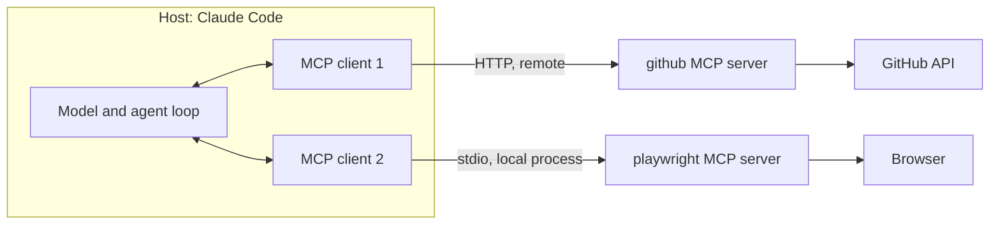
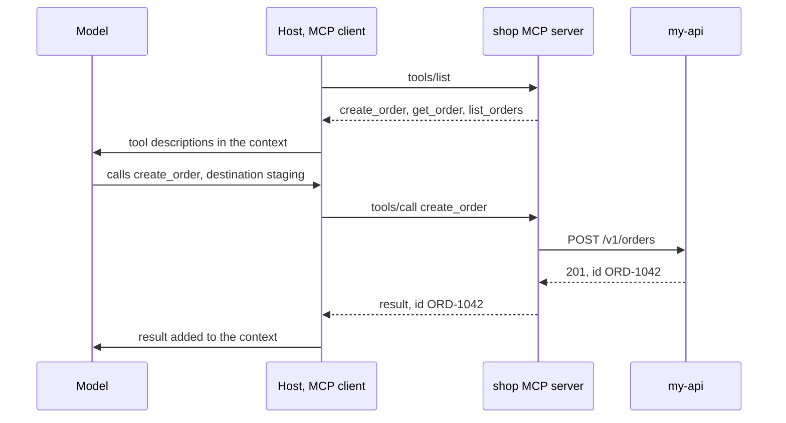
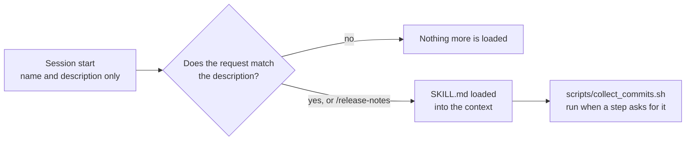
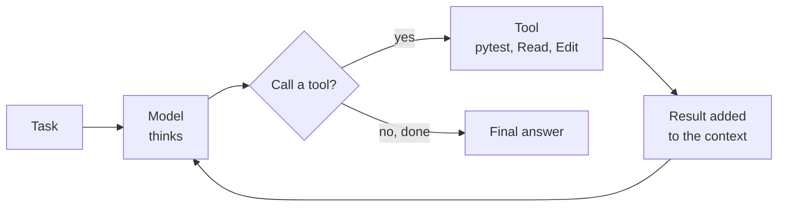
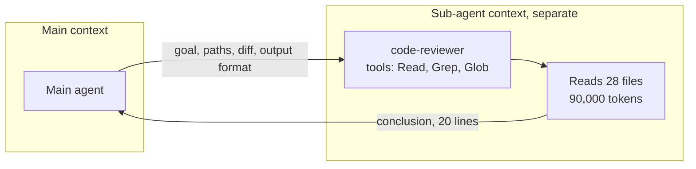
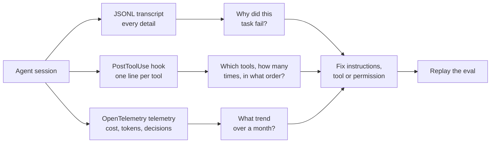
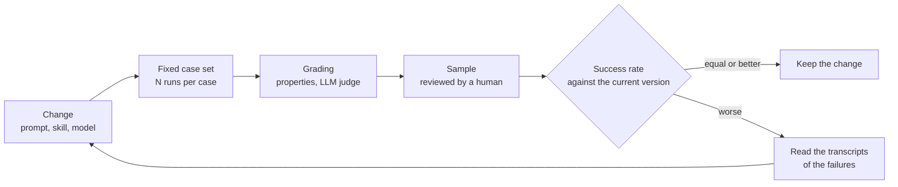
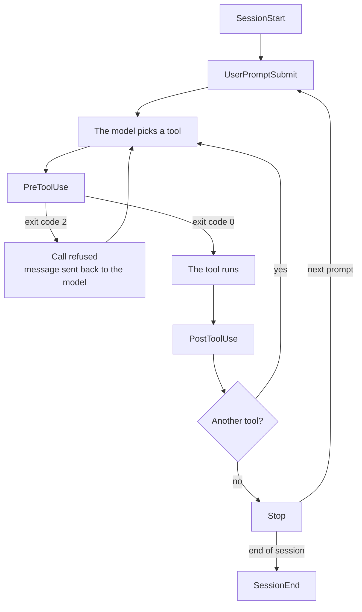
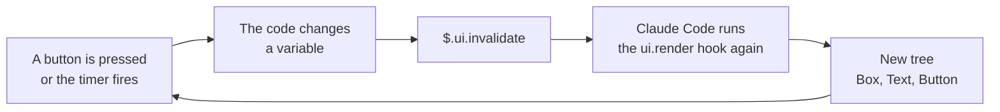

# Agents: tools, MCP, skills and hooks

!!! warning "Disclaimer"
    These notes are personal cheat sheets, not a source of truth. They reflect my own understanding and choices: their content remains subjective, despite the quotes and references it contains. It may be incomplete, simplified, inaccurate or outdated. Always check the official documentation before applying it. This content is provided as is, without any warranty: you use it at your own risk.

!!! audience "Who and what for"
    - **Roles**: back-end or front-end developer, QA engineer, tech lead, platform engineer, SRE.
    - **Uses**: I design an MCP server and the descriptions of its tools, like a `create_order` limited to dev and staging; I set the permissions of an agent that reads tickets, so it can neither read `.env` nor force push; I write a team skill or a read-only reviewer sub-agent; I review a merge request that adds a hook or a CI job running a headless agent; I prepare an interview on MCP, skills and hooks.

!!! abstract "Scales"
    The colored badges under the headings say at which scale a notion applies:

    - <span class="pill pill-scope pill-scope-code">Code</span> the classes, functions and modules of one program;
    - <span class="pill pill-scope pill-scope-app">Application</span> one service or application and its internal split;
    - <span class="pill pill-scope pill-scope-system">System</span> several services talking to each other over the network;
    - <span class="pill pill-scope pill-scope-infra">Infrastructure</span> servers, network, zones and clusters, physical or virtual;
    - <span class="pill pill-scope pill-scope-enterprise">Enterprise</span> the whole information system and its organization.

    Details and ambiguous words: [map of scales](architecture.md#map-of-scales).

A <span class="term" data-term="ai-agent">coding agent</span> can only do what its tools allow: without tools, it can only talk; with too many tools and too many rights, it can push code or read a secret by mistake. This page explains how to add capabilities to it and how to keep them in check: tools and permissions, MCP servers, skills and slash commands, agents, sub-agents and agent types, hooks, plugins, mods, plan mode, multi-agent workflows, non-interactive mode and recurring tasks. The basic terminology (LLM, token, context window), the difference between an LLM, an agent, a sub-agent and a skill, durable context, context engineering, searching code and current tools are on the [AI: agents, skills and context](ia-agents.md) page.

The examples mostly use Claude Code, but the ideas apply to most coding agents. File, skill and plugin names are examples.

*Claude Code: competes with Cursor, Copilot*
{ .tool-rel }

:material-swap-horizontal: The tools mentioned on this page: which ones replace each other, which ones combine? See [Complementary or competing](outils.md#complementary-or-competing).
{ .doc-ref }

## Terminology

The words this page uses everywhere, in one sentence each; each one has its detailed section below. LLM, token and context window are defined in the [Terminology of the AI: agents, skills and context page](ia-agents.md#terminology).

**Tool**: an action the model can trigger, like reading a file or running `pytest -q`; without tools, it can only talk ([details](#tool)).

**Permission**: a rule that allows a tool without confirmation, or forbids it, like `Bash(git status)` allowed and `Read(.env)` denied ([details](#permissions)).

**<span class="term" data-term="mcp">MCP</span> (Model Context Protocol)**: a standard to plug external tools into the agent. An MCP server exposes tools, like `create_order` on the orders API ([details](#mcp-model-context-protocol)).

**<span class="term" data-term="agent-skill">Skill</span>**: a reusable recipe, a folder with a `SKILL.md` and optional scripts, that the agent loads when my request matches its description, like `release-notes` ([details](#skill)).

**<span class="term" data-term="sub-agent">Sub-agent</span>**: an agent launched by the main agent for a subtask, with its own context, that returns only its conclusion, like a read-only reviewer ([details](#sub-agent)).

**Hook**: a command the tool runs automatically at a precise moment, like formatting after every file change; the tool runs it every time, the model does not decide ([details](#hook)).

**<span class="term" data-term="agent-plugin">Plugin</span> and marketplace**: a plugin installs skills, agents, hooks and MCP servers in one go; a marketplace is the catalog the team installs them from ([details](#plugin-and-marketplace)).

**<span class="term" data-term="claude-mod">Mod</span>**: a plugin that adds my own interface inside Claude Code, like a pane listing my pull requests with a button to rebase ([details](#mod)).

**<span class="term" data-term="headless-mode">Non-interactive mode</span> (headless)**: the agent run with nobody in front of the screen, with `claude -p "..."`, for example in a CI job that reviews every MR ([details](#non-interactive-mode-headless)).

**JSON and jq**: JSON is a text data format (`{"file_path": "src/app.py"}`). `jq` is a command-line tool that extracts a value from JSON.
```
$ echo '{"tool_input": {"file_path": "src/app.py"}}' | jq -r '.tool_input.file_path'
src/app.py
```

**Standard input and exit code**: a script receives data on its standard input (what is sent to it with `|`) and ends with an exit code: `0` means success, anything else means failure. A <span class="term" data-term="hook">hook</span> uses it to say "allowed" or "denied".

**Frontmatter**: the header between two `---` lines at the start of a Markdown file, which gives information about the file (`name`, `description`, `tools`).

**<span class="term" data-term="sli">SLI</span>** (Service Level Indicator): the number I measure to know whether something works, for example the share of MCP tool calls that succeed.

**<span class="term" data-term="slo">SLO</span>** (Service Level Objective): the internal target I set on that number, for example "99.5% of calls succeed over the month".

**<span class="term" data-term="sla">SLA</span>** (Service Level Agreement): the contractual promise made to a customer, with a penalty if it is not kept, usually looser than the SLO. Internal use of agents has none; an MCP server or a review bot sold to customers can have one.

:material-book-open-variant: Reference docs: [Anthropic, Glossary](https://docs.claude.com/en/docs/about-claude/glossary) (accessed November 2026)
{ .doc-ref }

## Giving capabilities

<a class="pill pill-scope pill-scope-app" href="../architecture/#map-of-scales">Scale · Application</a>

### Tool
<span class="pill pill-status pill-status-ok" title="Still valid, checked November 2026">Current · 11/2026</span>

An action the model can trigger: read a file, run a command, search the web. Without tools, it can only talk.

```
me     : "how many tests are failing?"
model  : calls the Bash tool with "pytest -q"
tool   : "3 failed, 120 passed"
model  : "3 tests are failing: ..."
```

**Risks.** A tool acts on the real system: a `Bash` call or a write MCP tool can delete a file, push code or call production if the model gets an argument wrong; I keep confirmation for anything that changes a shared state (see [Permissions](#permissions)). Without tools, the agent can only guess: it announces "3 tests fail" without running them, so I give it at least the means to read and test.

### Permissions
<span class="pill pill-status pill-status-ok" title="Still valid, checked November 2026">Current · 11/2026</span>

The agent can ask for my confirmation before using a tool. If I click "yes" a hundred times a day for a `git status`, I end up approving without reading. Permissions fix that: I allow once and for all what is risk-free, and keep confirmation for the rest.

!!! noob "As noob"
    Permissions are the key ring I leave to the person looking after my house: the key to the door and the garden, not the one to the safe, and to take the car, they call me first. I do not need to keep saying "do not touch the safe": without the key, they cannot open it. The takeaway: **a denied permission really blocks, a written instruction can be forgotten.**

Avoid: allowing everything in the shell "so I am no longer bothered". `Bash(*)` lets `git push --force` through without confirmation, and `cat .env` reads the file the `Read(.env)` rule was supposed to protect, because that rule targets the Read tool, not a shell command (behaviour to check for the version used).

```json
{
  "permissions": {
    "allow": ["Bash(*)"],
    "deny": ["Read(.env)"]
  }
}
```

The version that only allows reading and tests:

```json
{
  "permissions": {
    "allow": [
      "Bash(git status)",
      "Bash(git diff *)",
      "Bash(mise run test *)",
      "Bash(pytest *)"
    ],
    "deny": [
      "Bash(git push --force *)",
      "Read(.env)"
    ]
  }
}
```

Rule: allow reading and tests, keep confirmation for anything that changes shared state (push, deployment, writing to Jira).

*Jira: complements Confluence, Slack*
{ .tool-rel }


### MCP (Model Context Protocol)
<span class="pill pill-status pill-status-ok" title="Still valid, checked November 2026">Current · 11/2026</span>

A standard for plugging external tools into the agent. An **<span class="term" data-term="mcp-server">MCP server</span>** exposes tools, the agent calls them.

!!! noob "As noob"
    MCP is the USB port of AI agents: a common plug, so that the same tool (access to tickets, to a database, to a browser) connects to any compatible agent without a custom adapter. The takeaway: **an MCP server gives the agent hands, and each hand is a tool I allow or not.**

```json
{
  "mcpServers": {
    "github": {
      "type": "http",
      "url": "https://api.githubcopilot.com/mcp/"
    },
    "playwright": {
      "command": "npx",
      "args": ["@playwright/mcp@latest"]
    }
  }
}
```



Concrete uses:

| MCP server               | What I ask                                                                |
|--------------------------|---------------------------------------------------------------------------|
| Jira                     | "read ticket PROJ-123 and its comments, then suggest a plan"             |
| GitHub / GitLab          | "fetch the unresolved comments on MR !42 and fix them"                   |
| Playwright (browser)     | "open the login page locally, click Log in, tell me why the button does not respond" |
| <span class="term" data-term="observability">observability</span> (traces, logs) | "which my-api routes have the most errors in the last 24 h?"          |
| multi-repo code search   | "who calls `refresh_token` across all the team's repos?"                 |
| database (read-only)     | "how many orders are stuck in PENDING status?"                           |

Pitfall: if an MCP server is disconnected, the agent may silently fall back to a worse method. Good practice: ask it to check the connection at the start and to stop if it is missing.

:material-book-open-variant: Reference docs: [Model Context Protocol, specification](https://modelcontextprotocol.io/specification/2025-06-18) (revision 2025-06-18); [Claude Code, "Connect Claude Code to tools via MCP"](https://code.claude.com/docs/en/mcp) (accessed November 2026)
{ .doc-ref }

#### What an MCP server exposes: tools

An MCP server is a list of **tools**. Each tool has a name, a description written for the AI, and parameters. The AI reads the descriptions, picks the right tool and fills in its parameters. The server runs the call and returns the result.

Avoid: a catch-all tool, with a vague description and free-form parameters. The model guesses the values of `action` ("create", "new", "add"), nothing stops it from sending `env: "production"`, and a `400` error with no explanation makes it retry at random.

```json
{
  "name": "orders",
  "description": "Handles orders.",
  "inputSchema": {
    "type": "object",
    "properties": {
      "action": { "type": "string" },
      "env": { "type": "string" },
      "data": { "type": "string" }
    }
  }
}
```

Here is a well-described tool, as the AI sees it:

```json
{
  "name": "create_order",
  "description": "Create test orders in the dev or staging environment. Returns one order id per order. Use get_order to follow them.",
  "inputSchema": {
    "type": "object",
    "properties": {
      "destination": { "type": "string", "enum": ["dev", "staging"] },
      "count": { "type": "integer", "minimum": 1, "maximum": 10 }
    },
    "required": ["destination"]
  }
}
```



Behind a tool there is usually an API <span class="term" data-term="endpoint">endpoint</span>. The tool is a thin layer on top of it, designed for an AI instead of a program:

| my-api endpoint (in the <span class="term" data-term="openapi">OpenAPI</span>)    | MCP tool that calls it                    |
|-------------------------------------|-------------------------------------------|
| `POST /v1/orders`                   | `create_order`                            |
| `GET /v1/orders/{id}`               | `get_order`                               |
| `GET /v1/orders?status=...`         | `list_orders`                             |
| `POST /v1/orders/{id}/refund`       | none: the AI cannot issue refunds         |

|                          | <span class="term" data-term="rest-api">REST</span> endpoint                         | MCP tool                                                       |
|--------------------------|---------------------------------------|----------------------------------------------------------------|
| made for                 | code                                  | an AI                                                          |
| described by             | the OpenAPI                           | a name, a natural-language description, a parameter schema     |
| who decides to call it   | the developer, when writing the code  | the AI, by reading the description                             |
| response                 | the full object                       | often a summary, and bounded lists (10 items at most)          |

Consequence: comparing a service's OpenAPI with the tools of its MCP server shows what an AI cannot do yet. "The service has 49 endpoints, the MCP only uses 8" means a person in the UI can do much more than an AI agent. To close the gap, I add tools to the MCP server, without touching the service.

:material-book-open-variant: Reference docs: [Model Context Protocol, "Tools"](https://modelcontextprotocol.io/specification/2025-06-18/server/tools) (revision 2025-06-18)
{ .doc-ref }

#### The full name of an MCP tool

In Claude Code, an MCP tool is named `mcp__<server>__<tool>`, for example `mcp__shop__create_order`. That is the name found in permissions and in logs.

```json
{
  "permissions": {
    "allow": ["mcp__shop__get_order", "mcp__shop__list_orders"]
  }
}
```

Here the AI reads orders without confirmation, but must ask before creating one.

### Skill
<span class="pill pill-status pill-status-ok" title="Still valid, checked November 2026">Current · 11/2026</span>

Every Friday, I explain the same steps to the agent again to write the release notes. A skill spares me that: it is a reusable recipe, a folder with a `SKILL.md` that explains how to do a specific task, plus optional scripts. The agent only loads the description at first, and the rest only when the task matches.

Avoid: a vague description and fuzzy steps. The agent never triggers it, since "helper for releases" looks like no sentence I actually say, and when I run it by hand, it improvises, sometimes publishing without showing me the result.

```markdown
---
name: release-notes
description: Helper for releases.
---
Do the release notes properly.
```

The version that triggers and gets followed step by step:

```
.claude/skills/release-notes/
├─ SKILL.md
└─ scripts/collect_commits.sh
```

```markdown
---
name: release-notes
description: Write release notes from the commits since the last tag. Use for "release notes", "what changed since v1.2".
---
1. Run scripts/collect_commits.sh to list the commits since the last tag.
2. Group them by type (feat, fix). Ignore chore and test.
3. Write one sentence per change, from the user's point of view.
4. Show me the result, do not publish anything.
```



I call it with `/release-notes`, or the agent triggers it on its own when I say "do the release notes".

Other examples of useful skills:

| Skill                 | What it does                                                                    |
|-----------------------|---------------------------------------------------------------------------------|
| `/review-mr 42`       | fetches the <span class="term" data-term="merge-request">MR</span> <span class="term" data-term="diff">diff</span>, runs a reviewer agent, posts the remarks as comments       |
| `/new-e2e-test`       | asks 3 questions, creates the Playwright test file following the repo's conventions, runs it |
| `/rebase`             | backs up the branch, <span class="term" data-term="git-rebase">rebases</span> on main, regenerates conflicting lockfiles instead of merging them |
| `/weekly-metrics`     | queries the observability tool, produces the weekly report as a table          |
| `/made-ticket PROJ-1` | chains other skills: <span class="term" data-term="git-branch">branch</span>, plan, code, review, <span class="term" data-term="git-commit">commit</span>, MR                     |

What makes a good skill:
- a **description** with the phrases I would say naturally ("Use for ..."), it is what triggers the skill;
- **numbered steps** and **exact commands**;
- a **check step** at the start ("check that the Jira MCP responds, otherwise stop");
- written **guardrails**: "do not publish anything", "only edit the selector files".

#### Skills and tools: how they combine

It is not one or the other. A tool **does** an action, a skill **says what to do and in which order**. A skill calls tools.

```
skill "prepare the E2E test data"
1. check whether the test order exists  : tool get_order
2. otherwise, create it                 : tool create_order
3. wait until it is ready               : tool get_order, in a loop
4. write its id into the test fixture   : tool Write (built-in)
```

|                  | Tool                                          | Skill                                           |
|------------------|-----------------------------------------------|-------------------------------------------------|
| it is            | an action                                     | a how-to                                        |
| written in       | code, on the server or agent side             | text (`SKILL.md`), plus optional scripts        |
| run by           | the MCP server or the agent                   | the agent, which follows the steps              |
| without the other| the tools are there, the AI improvises the sequence | the skill cannot do anything on the external system |

Consequence: every new tool makes new skills possible. As long as the MCP has no `create_customer` tool, no skill can create the customer a test order needs: it has to ask a human.

:material-book-open-variant: Reference docs: [Claude Code, "Agent Skills"](https://code.claude.com/docs/en/skills) (accessed November 2026); [Anthropic, "Equipping agents for the real world with Agent Skills"](https://www.anthropic.com/engineering/equipping-agents-for-the-real-world-with-agent-skills) (October 2025)
{ .doc-ref }

### Slash command
<span class="pill pill-status pill-status-ok" title="Still valid, checked November 2026">Current · 11/2026</span>

A shortcut typed in the chat. Some are built in, others come from skills.

| Command         | Use                                                           |
|-----------------|---------------------------------------------------------------|
| `/clear`        | start again from an empty conversation                        |
| `/compact`      | summarize the conversation to free up context                 |
| `/init`         | generate a first CLAUDE.md from the repo                      |
| `/mcp`          | see and connect MCP servers                                   |
| `/code-review`  | review the current diff to find bugs                          |
| `/release-notes`| a personal or team skill                                      |

**Risks.** `/clear` wipes the whole context at once: run by reflex in the middle of a task, it makes me lose the plan and the decisions taken, and I have to explain everything again; I first have the task's state written to a file. `/compact` summarizes, so it forgets details: after a compaction, the agent may no longer remember that Ines had forbidden touching the database schema; I put lasting constraints in the instructions file rather than in the conversation. A command that comes from an installed skill runs someone else's instructions: I read the skill before installing it.

:material-book-open-variant: Reference docs: [Claude Code, "Slash commands"](https://code.claude.com/docs/en/slash-commands) (accessed November 2026)
{ .doc-ref }

### Agent
<span class="pill pill-status pill-status-ok" title="Still valid, checked November 2026">Current · 11/2026</span>

A model that works in a loop: it thinks, calls a tool, reads the result, starts again, until the task is done. Claude Code is an agent.

!!! noob "As noob"
    A chatbot answers once and stops, like an information desk. An agent is more like an intern given a task: it tries, looks at the result, fixes, tries again, until it is done or stuck. The takeaway: **an agent is a model plus a loop of tools; its quality depends on what it can check by itself.**

```
task: "make the test_login test pass"
1. runs pytest               : failure, KeyError 'exp'
2. reads src/auth.py         : sees the bug
3. edits src/auth.py
4. runs pytest again         : success
5. replies "fixed, the cause was ..."
```



The quality of an agent depends mostly on its **verification loop**: if it can run the tests, it corrects itself; if it cannot, it guesses.

**Risks.** An agent with no stop criterion goes in circles: it reruns the same failing command and burns tokens up to the limit; I set a number of attempts or turns. An agent that cannot check anything concludes "it should work" and is confidently wrong. It acts with the rights I give it: a misreading of the context becomes a real change, hence minimal permissions and a review of the diff as for an MR written by a human.

:material-book-open-variant: Reference docs: [Anthropic, "Building effective agents"](https://www.anthropic.com/engineering/building-effective-agents) (December 2024)
{ .doc-ref }

### Sub-agent
<span class="pill pill-status pill-status-ok" title="Still valid, checked November 2026">Current · 11/2026</span>

An agent launched by the main agent for a subtask, with **its own context**. It does the work and only returns the conclusion. The main context stays clean.

!!! noob "As noob"
    A sub-agent is like sending a colleague to dig through the archives for me: they read thirty binders and come back with one page of notes. My desk (my context) stays clear, but I only see their summary, not what they skimmed. The takeaway: **delegate the reading, and double-check their "I found nothing".**

```markdown
---
name: code-reviewer
description: Reviews a diff for bugs and security issues. Read-only.
tools: Read, Grep, Glob
model: opus
---
You receive a diff. For each problem: file, line, concrete scenario that breaks.
You do not modify anything.
```

A more tightly scoped example, an agent that repairs E2E tests:

```markdown
---
name: e2e-test-healer
description: Heals failing Playwright tests. Only edits selector files.
tools: Read, Edit, Bash, mcp__playwright__browser_snapshot, mcp__playwright__browser_click
model: sonnet
---
You ONLY edit the selector files, never the specs or the fixtures.
3 attempts maximum per test. On the 3rd failure, restore the original value
and report the test as still failing.
```

Avoid: the same agent with no tool list, no scope and no budget. It inherits every tool, and "until they pass" allows it to change the assertions or delete the test, or to loop for hours on a test broken by a real bug.

```markdown
---
name: e2e-test-healer
description: Fixes tests.
---
Fix the E2E tests until they pass.
```



What makes a sub-agent reliable:
- **tools limited** to the strict minimum (a reviewer does not need Edit);
- **written scope**: which files it is allowed to touch;
- **budget**: number of attempts, and what it does when it fails;
- an imposed **output format**, so the main agent can use it.

When to use it:
- a search that will read many files, when I only want the answer;
- several independent tasks to run in parallel;
- a fresh look, for example a review not influenced by the conversation.

Pitfall: a sub-agent does not always inherit all the context or all the tools (an MCP may be missing). I give it the file paths and the diff in its prompt, and check its negative conclusions myself ("found nothing" may mean "did not search in the right place").

:material-book-open-variant: Reference docs: [Claude Code, "Subagents"](https://code.claude.com/docs/en/sub-agents) (accessed November 2026)
{ .doc-ref }

### Agent types and determinism
<span class="pill pill-status pill-status-ok" title="Still valid, checked November 2026">Current · 11/2026</span>

Not everything called an "agent" gives the model the same freedom. The question that separates them: **who decides the next step, the code or the model?** Anthropic draws this line in "Building effective agents" (December 2024).

- **Workflow**: the code sets the steps in advance, the model fills in each one. The path is always the same, even if the text produced at each step varies.
- **Agent**: the model itself picks the next tool and when to stop. The path changes from one run to the next.

!!! noob "As noob"
    A workflow is a train: the stations are set in advance, only what is in the carriages changes from one trip to the next. An agent is a taxi: the driver picks the route based on what they see, and the ride changes from one trip to the next. The takeaway: **the more I let the model choose the route, the more flexible it is, and the less predictable.**

**Deterministic**: the same input always gives the same output. A script, a test or a hook is deterministic. An <span class="term" data-term="llm">LLM</span> is not.

#### From most predictable to most autonomous

| Pattern                                       | Who decides what comes next                | Concrete example                                                                                  | Predictability |
|-----------------------------------------------|--------------------------------------------|---------------------------------------------------------------------------------------------------|----------------|
| single call                                   | nobody, one call                           | "summarise this Jira ticket"                                                                      | very high      |
| prompt chaining                               | the code                                   | write the release notes, a script checks every MR is cited, then translate                        | high           |
| routing                                       | the code, after the model classifies       | a ticket is classified "bug", "question" or "request", then goes to the matching prompt           | high           |
| parallelization                               | the code                                   | 4 reviews of a diff at the same time (bugs, security, perf, readability), or 3 votes on a question | high          |
| orchestrator-workers                          | the model splits, the code runs            | an agent reads a ticket, decides which files to change, starts one sub-agent per file             | medium         |
| evaluator-optimizer                           | a loop, until a criterion is met           | one agent writes a test, another judges it, repeat at most 3 times                                | medium         |
| autonomous agent                              | the model, at every step                   | Claude Code making a test pass: it picks what to read, what to run, when to stop                  | low            |

The article's advice: start with the simplest pattern that works, and add autonomy only when the gain can be measured. More autonomy means more <span class="term" data-term="token-llm">tokens</span>, more waiting and less predictability. The [multi-agent workflow](#multi-agent-workflow) described below is a workflow: the script sets the steps, the agents fill in each one.

#### Well-known agent loops

- **ReAct** (Yao et al., 2022): reason, act, observe the result, repeat. This is the loop described in [Agent](#agent).
- **Plan-and-execute**: the model first writes a full plan, then carries it out step by step. [Plan mode](#plan-mode) is a version of it where a human approves the plan first.
- **Reflexion** (Shinn et al., 2023): after a failure, the agent writes down what went wrong and tries again with that note. [Memory](ia-agents.md#memory) applies the same idea from one session to the next.

```
plan-and-execute: "add a phone field to the users API"
  plan     : 1. SQL migration  2. User model  3. OpenAPI schema  4. tests
  step 1   : writes migrations/012_add_phone.sql
  step 2..4: run in order, the plan is only revisited on failure
```

```
Reflexion: "make test_refund pass"
  try 1    : pytest fails, AssertionError: 0 != 500
  note     : "I rounded before subtracting the fees, it must be the reverse"
  try 2    : rerun with the note in context, pytest passes
```

#### Determinism: where to put it

An LLM can give two different answers to the same question, for two reasons:

- **sampling**: at each word, the model has a list of possible next words, each with its probability, and it draws one at random. The **temperature** is the setting that says how willing it is to pick less likely words: high, its answers vary more from one run to the next; at 0, it always picks the most likely word.

    Example: I ask ten times "name this function" on the same code. At temperature 0, I get `parse_order` every time (in principle, see the next point). At a higher temperature, I get `parse_order` once, `read_order` another time, `order_from_json` another.

    What it changes for me: temperature 0 makes answers more repeatable, but not guaranteed identical, and it does not make them more correct. If the most likely word is wrong, the model gives the same mistake every time.

- **the server**: even when I set the temperature to 0, the answer can change from one run to the next. Thinking Machines ("Defeating Nondeterminism in LLM Inference", September 2025) shows that the computation varies with the number of requests the server handles at the same time: a tiny difference in the computation can put another word on top, and the whole rest of the answer changes. Over 1,000 runs of the same prompt at temperature 0, they got 80 different answers. [Take with caution: the author's own numbers, on a single open-source model (Qwen3-8B), not on commercial APIs.]

!!! noob "As noob"
    For each word, the model draws something like a ball from a bag where likely words have many balls and unlikely words very few. The temperature sets the gap: high, the less likely words come out more often; at 0, it always takes the word with the most balls. Limit: even at 0, a tiny difference in the computation on the server side can put another word on top, and the whole rest changes. The takeaway: **temperature 0 means more repeatable, not more correct, and not guaranteed identical.**

Consequence: I cannot count on the model to do something "for sure". Practical rule: **deterministic wherever possible, the model only where it adds something** (understanding, writing, choosing).

| Need                                        | Deterministic mechanism                         | Example                                                        |
|---------------------------------------------|-------------------------------------------------|----------------------------------------------------------------|
| an action must happen every time, without relying on the model's memory | [hook](#hook) | format every modified file with ruff |
| an action must never happen, even if the model suggests it | [permissions](#permissions) or `PreToolUse` hook | refuse `git push --force` |
| steps must always follow each other in the same order | script or workflow | <span class="term" data-term="linter">lint</span>, then tests, then a summary written by the model |
| a program must read the output, for example to post each remark as an MR comment | enforced format (JSON schema, structured outputs) | `{"file": "src/auth.py", "line": 42, "severity": "high"}` |
| I want to know whether the work is right, not just that the agent believes it is | verification loop | the agent reruns pytest instead of saying "it should work" |

A **<span class="term" data-term="structured-output">structured output</span>**: I pass a JSON schema to the API, and the model's answer is constrained to that schema. It is always valid JSON, with the expected fields, and `severity` can only take one of the three values. The content (the right line, the right severity) still has to be checked.

Avoid posting the model's answer as is: one sentence before the JSON makes `json.loads` crash, and a made-up line produces a comment on a line the MR does not change, or a refusal from the forge's API.

```python
# Avoid: answer read without a schema and posted without checking it matches the diff
review = json.loads(response.text)
for item in review:
    post_mr_comment(item["file"], item["line"], item["message"])


# Good: the shape is validated by the schema, the content is checked against the diff before posting
review = ReviewList.model_validate_json(response.text)
changed = changed_lines(diff)
for item in review.items:
    if (item.file, item.line) in changed:
        post_mr_comment(item.file, item.line, item.message)
```

!!! noob "As noob"
    A structured output is a form with boxes instead of a free-form letter: every expected box must be filled in, and the "severity" box only offers three choices. The form guarantees that a program will be able to read it, not that what is written in it is true. The takeaway: **the schema guarantees the shape, not the content.**

```json
{
  "type": "object",
  "properties": {
    "file": {"type": "string"},
    "line": {"type": "integer"},
    "severity": {"enum": ["low", "medium", "high"]}
  },
  "required": ["file", "line", "severity"]
}
```

#### Observing what an agent did

Before judging an agent, I need to see what it did: which files it read, which commands it ran, where it went in circles. Three sources, from the most detailed to the most aggregated:

- **the transcript**: Claude Code records each session as JSON Lines in `~/.claude/projects/<project>/<session>.jsonl` (messages, tool calls, results). It is the source to reread to understand one specific failure, and `claude --resume` reopens the session;
- **a hook**: a `PostToolUse` [hook](#hook) can write one line per tool call into a local log, shorter and easier to filter than the transcript;
- **telemetry**: Claude Code's OpenTelemetry metrics and events (cost, tokens, tools accepted or rejected) go to a collector, to follow trends over hundreds of sessions (see [Claude Code's built-in telemetry](ia-entreprise.md#claude-codes-built-in-telemetry)).

!!! noob "As noob"
    The transcript is an aircraft's black box: it is reread after an incident to know what really happened, step by step. A hook's log is the flight log, shorter; telemetry is the statistics of the whole fleet over a month. The takeaway: **before fixing an agent, I look at what it did, not what it says it did.**

*OpenTelemetry: complements Datadog, Prometheus, Tempo, Loki*
{ .tool-rel }


Example: log every tool call, then count the most called tools.

```json
{
  "hooks": {
    "PostToolUse": [
      {
        "matcher": "*",
        "hooks": [
          {
            "type": "command",
            "command": "jq -c '{t: .tool_name, i: .tool_input}' >> ~/agent-tools.log"
          }
        ]
      }
    ]
  }
}
```

```bash
jq -r .t ~/agent-tools.log | sort | uniq -c | sort -rn
```

A `Read` called 40 times for a small task signals a poor context (see [Measuring context quality](ia-agents.md#measuring-context-quality)); a `Bash` that reruns the same failing command signals a badly given verification loop.



:material-book-open-variant: Reference docs: [Claude Code, Monitoring](https://code.claude.com/docs/en/monitoring-usage) (accessed November 2026); [Claude Code, Hooks reference](https://code.claude.com/docs/en/hooks) (accessed November 2026)
{ .doc-ref }

#### Testing an agent-based system

For QA, the shift is clear: I do not compare the output with an exact expected value.

- **Check properties**, not a text: "the JSON is valid", "every MR of the sprint is cited", "no file outside `src/` is modified".
- **Run several times**: a single green run proves nothing. I measure a success rate, for example 9 out of 10.
- **Evals**: a fixed set of cases, replayed on every change of prompt, skill or model, like a <span class="term" data-term="regression">regression</span> suite.
- **<span class="term" data-term="llm-as-judge">LLM as a judge</span> (LLM-as-a-judge)**: a second model scores the answer against a written grid. Useful to judge a text, but itself non-deterministic: a human checks its scores on a sample.

```
eval: "make test_login pass", 10 runs
  pytest passes                        9/10
  no test file modified                9/10
  failure: the agent changed the test instead of the code
```

Example of a grid given to the judge to score an MR summary, and its answer:

```
Score each criterion from 1 to 5, answer in JSON.
1. accuracy: nothing is made up compared with the diff
2. completeness: every modified file is mentioned
3. usefulness: the reviewer knows what to test
4. conciseness: 10 lines at most
```

```json
{"accuracy": 5, "completeness": 3, "usefulness": 4, "conciseness": 5,
 "justification": "migrations/012_add_phone.sql is not mentioned"}
```

The eval loop, on every change:



:material-book-open-variant: Reference docs: [Anthropic, "Demystifying evals for AI agents"](https://www.anthropic.com/engineering/demystifying-evals-for-ai-agents) (January 2026); [Claude Docs, "Define success criteria and build evaluations"](https://docs.claude.com/en/docs/test-and-evaluate/develop-tests) (accessed November 2026)
{ .doc-ref }

#### Sources
- [Anthropic, "Building effective agents" (December 2024)](https://www.anthropic.com/engineering/building-effective-agents)
- [Yao et al., "ReAct: Synergizing Reasoning and Acting in Language Models" (October 2022)](https://arxiv.org/abs/2210.03629)
- [Shinn et al., "Reflexion: Language Agents with Verbal Reinforcement Learning" (March 2023)](https://arxiv.org/abs/2303.11366)
- [Thinking Machines, "Defeating Nondeterminism in LLM Inference" (September 2025)](https://thinkingmachines.ai/blog/defeating-nondeterminism-in-llm-inference/)

### Hook
<span class="pill pill-status pill-status-ok" title="Still valid, checked November 2026">Current · 11/2026</span>

I wrote in CLAUDE.md "format every file with Prettier", and now and then the agent forgets. A hook fixes that: it is a command the tool runs **automatically** at a specific moment, for example after every file change. The model does not decide, the tool runs it every time.

!!! noob "As noob"
    An instruction in CLAUDE.md is a sticky note saying "turn off the light when leaving": most of the time I remember, sometimes I do not. A hook is the sensor that turns off the light by itself as soon as the room is empty, every time. Limit: it does exactly what its script says, with no judgment. The takeaway: **what must happen every time goes in a hook, not in an instruction.**

| Moment           | Concrete example                                                   |
|------------------|--------------------------------------------------------------------|
| `SessionStart`   | load the up-to-date team rules from a docs repo                    |
| `PreToolUse`     | reject a `git commit` whose message is not conventional            |
| `PostToolUse`    | format with Prettier every file the agent has just edited          |
| `Stop`           | run the linter when the agent has finished its answer              |
| `Notification`   | send a macOS notification when the agent is waiting for an answer     |
| `SessionEnd`     | append to a local file the number of skills used in the session    |



Example 1: format every modified file.

```json
{
  "hooks": {
    "PostToolUse": [
      {
        "matcher": "Edit|Write",
        "hooks": [
          {
            "type": "command",
            "command": "jq -r '.tool_input.file_path' | xargs npx prettier --write"
          }
        ]
      }
    ]
  }
}
```

`"matcher": "Edit|Write"` filters on the tool name: the hook only runs after a call to `Edit` or `Write`, not after `Bash` or `Read`. The value is a regular expression, `|` means "or".

Example 2: block a badly formed commit. The hook receives the tool call as JSON on its standard input. If it exits with code 2, the call is denied and its message is sent back to the model, which fixes it.

Avoid exiting with code 1 and writing the message to standard output: for Claude Code, code 1 is a non-blocking error, so the commit goes through anyway and the model never sees the message (codes to check in the hooks docs).

```bash
#!/bin/bash
# Avoid: exit code 1 and message on stdout, the commit is not blocked
CMD=$(jq -r '.tool_input.command // empty')
if echo "$CMD" | grep -q 'git commit' && ! echo "$CMD" | grep -qE -- '-m "(feat|fix)'; then
  echo "non-conventional commit"
  exit 1
fi
```

The version that really blocks:

```bash
#!/bin/bash
# Example: hook that rejects a non conventional commit (exit code 2)
CMD=$(jq -r '.tool_input.command // empty')
echo "$CMD" | grep -q 'git commit' || exit 0
MSG=$(echo "$CMD" | sed -nE 's/.*-m "([^"]*)".*/\1/p')
if ! echo "$MSG" | grep -qE '^(feat|fix|docs|refactor|test|chore)(\(.+\))?: .+'; then
  echo "Non-conventional commit message: type(scope): description" >&2
  exit 2
fi
```

When to use it: something that must happen **every time, with no chance of forgetting**. An instruction in CLAUDE.md can be forgotten, a hook cannot.

**Risks.** A hook is a shell script that runs with my rights at every event: a hook from an unknown repo or plugin runs whatever it wants, so I read every hook before enabling it. A slow hook slows every tool call, and a buggy hook can block every action (code 2 by mistake); I keep it short and test it on its own with a sample JSON. A wrong exit code makes it silently useless, like the code 1 shown above.

:material-book-open-variant: Reference docs: [Claude Code, Hooks reference](https://code.claude.com/docs/en/hooks) (accessed November 2026); [Claude Code, "Get started with Claude Code hooks"](https://code.claude.com/docs/en/hooks-guide) (accessed November 2026)
{ .doc-ref }

### Plugin and marketplace
<span class="pill pill-status pill-status-ok" title="Still valid, checked November 2026">Current · 11/2026</span>

My team wrote skills, agents and a hook, and everyone copies them by hand into their repo, so the versions end up diverging. A plugin fixes that: it bundles skills, agents, hooks and MCP servers to install them in one go. A marketplace is a catalog of plugins, often a git repo shared by a company or a team.

!!! noob "As noob"
    A plugin is a toolcase prepared once and lent to the whole team, instead of everyone copying their own box and adapting it their way. The marketplace is the cupboard where the cases are stored, with their version number. The takeaway: **I install the same shared version, instead of copies that drift apart.**

```
team-marketplace/
└─ plugins/
   ├─ dev-tools/
   │  ├─ skills/review-mr/  skills/create-mr/  skills/rebase/
   │  ├─ agents/code-reviewer.md
   │  └─ hooks/hooks.json            (validates commit messages)
   └─ qa-tools/
      ├─ skills/new-e2e-test/  skills/weekly-metrics/
      ├─ agents/e2e-test-healer.md
      └─ hooks/hooks.json            (loads the QA rules at startup)
```

```
/plugin marketplace add git@git.example.com:team/team-marketplace.git
/plugin install dev-tools@team-marketplace
/plugin install qa-tools@team-marketplace --scope project
```

| Scope     | Effect                                                        |
|-----------|---------------------------------------------------------------|
| `user`    | for me, in all my projects                                    |
| `project` | for the whole team, written to the repo's `.claude/settings.json` |
| `local`   | for me, in this repo only, not versioned                      |

When to use it: share the same tooling with a whole team, and update it in a single place.

**Risks.** A plugin installs at once hooks, MCP servers and agents that run with my rights: an uncontrolled marketplace can make the whole team run code, so I only add marketplaces whose maintainers I know. A broken update hits everyone at the same time; I try it first in the `local` scope before moving it to `project`. Without a plugin, copies diverge and everyone fixes the same skill bug on their own.

:material-book-open-variant: Reference docs: [Claude Code, "Plugins"](https://code.claude.com/docs/en/plugins) (accessed November 2026); [Claude Code, "Plugin marketplaces"](https://code.claude.com/docs/en/plugin-marketplaces) (accessed November 2026)
{ .doc-ref }

### Mod
<span class="pill pill-status pill-status-ok" title="Still valid, checked November 2026">Current · 11/2026</span>

!!! info "Section written in November 2026"
    Mods arrived with Claude Code v2.1.287. The event names, methods and limits quoted are the ones documented at that date: check them again before relying on them.

Every morning I go through my pull requests by hand: which one has a conflict, which one waits for my review, then I type "rebase PR #42" to Claude. A <span class="term" data-term="claude-mod">mod</span> fixes that: it is a plugin that adds **my own interface** to Claude Code, for example a pane beside the conversation that lists my PRs, with one button per row that sends Claude the right instruction. I do not need to write it myself: I describe what I want, and Claude writes the mod.

Technically, a mod is a plugin that holds JavaScript or TypeScript code. Claude Code calls its functions on each event (a tool call, a submitted prompt, a part of the screen to draw), and the function can watch the event, change it or answer it in Claude Code's place. The docs call these functions hooks, not to be confused with [settings hooks](#hook), which are shell commands started from `settings.json`.

!!! noob "As noob"
    Skills, settings hooks and MCP servers are like giving an employee instructions or tools. A mod is like refitting their desk: I add a dashboard on the wall, with buttons, and I can change what they see on screen. Limit: this refit runs with my own rights, with no sandbox. The takeaway: **a mod changes the tool itself, not just what the agent knows or can do.**

What a mod can do that the other extensions cannot:

| Capability                     | Concrete example                                                              |
|--------------------------------|-------------------------------------------------------------------------------|
| draw a pane                    | a sidebar with tabs, buttons and text fields                                  |
| draw a band                    | the current git branch shown above the prompt                                 |
| redraw the existing interface  | the number of tool calls added beside the spinner                            |
| step into a tool call          | hold an `rm -rf` and ask for confirmation with a button                       |
| add an instant command         | `/prs` that opens a pane at once, with no Claude turn                         |
| start a turn on its own        | a timer sees the CI break and sends "fix the CI of PR #42" to Claude          |

#### Ask Claude for a mod

1. I describe the mod in an interactive session: "make me a mod: a pane beside the chat that lists my open PRs (CI state, conflicts), refreshed every 5 minutes; clicking a PR sends Claude the right instruction: fix the CI, rebase, or review before merging".
2. Claude loads its built-in `plugin-authoring` skill (I can also run `/plugin-authoring` myself) and writes the mod in `~/.claude/dev-mods/<session-id>/my-prs/`.
3. On the first file, Claude Code asks me to turn on hot reloading for the session. I accept: the mod loads at the end of the turn, then reloads at the end of each turn that changes it.
4. I try it, then tell Claude what is wrong ("show the CI state in color"). I refine it by talking, without restarting the session.
5. To keep it: the session folder is deleted after `cleanupPeriodDays`, so I copy the mod elsewhere (`~/mods/my-prs`) and load it with `claude --plugin-dir ~/mods/my-prs`, or I publish it in a [marketplace](#plugin-and-marketplace) for my team.

`/plugin` shows the mods the session loaded (line `1 mod active · my-prs`), and that is where I turn one off.

#### What Claude writes

```
my-prs/
├─ .claude-plugin/plugin.json     (the plugin manifest)
└─ hooks/
   ├─ hooks.json                  ({ "modules": ["./register.js"] })
   └─ register.js                 (the mod's code)
```

```javascript
// Example: constants and state shared by every hook of the module
const PANE = 'my-prs'
const FIVE_MINUTES = 5 * 60 * 1000
let prs = []

// Example: reads my open PRs with the gh CLI, then asks for a redraw
async function refresh($) {
  try {
    const r = await $.process.run(['gh', 'pr', 'list', '--author', '@me', '--json', 'number,title,mergeable'])
    prs = JSON.parse(r.stdout)
  } catch (err) {
    $.ui.log('gh failed: ' + err.message)
  }
  $.ui.invalidate('ui.render')
}

export function register(on) {
  // Example: on start, adds /prs, loads the list and starts the timer
  on('session.start', async ($, e, next) => {
    await $.command.register({ name: 'prs', description: 'Open the pane of my PRs' })
    refresh($)
    $.clock.every(FIVE_MINUTES, () => refresh($))
    return next(e)
  })

  // Example: /prs opens the pane, without writing anything in the conversation
  on('command.run', { command: 'prs' }, async ($) => {
    await $.ui.open({ id: PANE, title: 'My PRs', focus: true, closeOnEscape: true })
    return {}
  })

  // Example: one row per PR, the button sends the instruction to Claude
  on('ui.render', { component: 'Pane' }, async ($, e, next) => {
    if (e.requestId !== PANE) return next(e)
    const { Box, Text, Button } = $.ui.resolve(e)
    const rows = prs.map((pr) => {
      const conflict = pr.mergeable === 'CONFLICTING'
      const ask = conflict ? 'rebase PR #' + pr.number : 'review PR #' + pr.number + ' before merging'
      return Box({
        flexDirection: 'row',
        columnGap: 2,
        children: [
          Button({ key: 'pr-' + pr.number, label: conflict ? 'Rebase' : 'Review', onPress: () => $.prompt.submit({ text: ask, asUser: true }) }),
          Text({ children: ['#' + pr.number + ' ' + pr.title] }),
        ],
      })
    })
    return Box({ flexDirection: 'column', children: rows.length ? rows : [Text({ children: ['No open PR'] })] })
  })
}
```

The mod reaches the disk, commands and the network only through the `$` API (`$.process`, `$.fs`, `$.http`, `$.store` to keep a value between two sessions). That is what lets `claude plugin validate ./my-prs` list what a mod does before I install it. A pane always follows the same cycle:



#### Mod, settings hook, skill or MCP

| I want...                                                                  | I use              |
|----------------------------------------------------------------------------|--------------------|
| to see my PRs, my tickets or the CI state in a pane, with buttons          | mod                |
| a `/prs` command that answers at once, even while Claude is working        | mod                |
| to block a badly formed commit with a shell script I already have          | settings hook      |
| to stop pasting the same release instructions into the chat               | skill              |
| Claude to read my tickets in an external tool                              | MCP server         |

When to use it: when I want to **see** or **trigger** something in the interface, or rewrite an event. If a settings hook, a skill or an MCP server already does the job, I stick with it: it is simpler and less risky.

!!! warning "A mod runs with my rights"
    A mod reads and writes my files, starts programs, calls the network, reads my environment variables, sees every prompt and can approve a tool call without asking me. It is not in the sandbox. I only install mods whose author I know, and I run `claude plugin validate` on other people's. The ones Claude writes for me stay on my machine.

Where it works: the terminal (v2.1.287 or later, `claude --version`), the Code tab of Claude Desktop and the VS Code extension. In `claude -p` and the Agent SDK, hooks run but nothing is drawn.

:material-book-open-variant: Reference docs: [Claude Code, "Mods overview"](https://code.claude.com/docs/en/plugins/mods/overview) (accessed November 2026); ["Create a mod"](https://code.claude.com/docs/en/plugins/mods/create) (accessed November 2026); ["Draw in the interface with a mod"](https://code.claude.com/docs/en/plugins/mods/interface) (accessed November 2026); ["Use the mods API"](https://code.claude.com/docs/en/plugins/mods/api) (accessed November 2026); [Anthropic's sample mods, claude-code-playground](https://github.com/anthropics/claude-code-playground/tree/main/claude-code/mods) (accessed November 2026)
{ .doc-ref }

### Plan mode
<span class="pill pill-status pill-status-ok" title="Still valid, checked November 2026">Current · 11/2026</span>

**The idea in one sentence**: before touching the code, the agent tells me what it intends to do, and does nothing until I say yes.

**Without plan mode**, I ask for a task and the agent starts changing files right away. If it went in the wrong direction, I find out afterwards, facing a 300-line diff to undo.

**With plan mode**, the agent is only allowed to **read**: it opens files and searches the code, but it can neither edit a file nor run a command that changes anything. At the end, it shows me a written plan. I correct it if needed, then approve it, and only then does it start making changes.

!!! noob "As noob"
    Plan mode is a contractor's quote: they come over, open the cupboards, take measurements, but knock down no wall before I have signed. Crossing out a line of the quote takes two minutes, rebuilding a wall knocked down by mistake takes a day. The takeaway: **fixing a plan costs far less than undoing a diff.**

Concrete example: I want to add a "phone" field to the sign-up form.

```
1. I turn on plan mode, then ask:
   "add an optional phone field to the sign-up form"

2. the agent reads the code (without changing anything) and replies with a plan:
   Files to change:
   - frontend/SignupForm.tsx       add the field and its validation
   - api/schemas/user.py           add phone, optional
   - migrations/                   new column users.phone, nullable
   - tests/test_signup.py          one test with a phone, one without
   Open question: should the number use the international format (+33...)?

3. I answer: "yes, international format, and no migration:
   the column already exists in the profiles table"

4. the agent updates its plan, I approve, it writes the code.
```

At step 3, I avoided a useless migration in 10 seconds. Without plan mode, I would have found it while reviewing the diff.

**How to turn it on in Claude Code**: press `Shift+Tab` until "plan mode on" appears under the input box. The same shortcut cycles through the modes (normal, auto-accept edits, plan).

| Situation                                                    | Plan mode?                          |
|--------------------------------------------------------------|-------------------------------------|
| my task touches several files or layers, like a field to add from the form all the way to the database | yes |
| I do not know this code well, for example a module written by another team | yes: the plan also explains the code to me |
| there are several ways to do it and I want to choose myself | yes |
| it is a one-line fix, and I already know where it is | no, it just slows things down |
| I am just asking a question, like "what does this function do?" | pointless, the agent changes nothing anyway |

**Risks.** Approving a plan without reading it gives a false sense of control: the mistake still happens, just later. A plan written from a partial reading of the code can be confidently wrong, like the needless migration in the example; I check the files it cites. On a small fix, plan mode adds a round trip for nothing.

:material-book-open-variant: Reference docs: [Claude Code, "Common workflows"](https://code.claude.com/docs/en/common-workflows) (accessed November 2026)
{ .doc-ref }

### Multi-agent workflow
<span class="pill pill-status pill-status-ok" title="Still valid, checked November 2026">Current · 11/2026</span>

A script that orchestrates several agents: for example 4 agents each review a diff from one angle, then a 5th checks each remark. Powerful, but expensive in tokens.

!!! noob "As noob"
    It is a review committee: four specialists read the same contract, each with their own checklist (legal, finance, security, style), then a fifth sorts their remarks and discards the false alarms. It is more reliable than a single reviewer, but five times the cost. The takeaway: **several specialised eyes, then a sort, and only when the stakes pay the bill.**

```
review ┬─ bugs agent        ─┐
       ├─ security agent    ─┼─ verifier agent ─ confirmed remarks
       ├─ perf agent        ─┤
       └─ readability agent ─┘
```

When to use it: when quality is worth the cost, for example a review before a sensitive production release, or an analysis over 50 MRs. Not for a small fix.

:material-book-open-variant: Reference docs: [Anthropic, "How we built our multi-agent research system"](https://www.anthropic.com/engineering/multi-agent-research-system) (June 2025)
{ .doc-ref }

### Non-interactive mode (headless)
<span class="pill pill-status pill-status-ok" title="Still valid, checked November 2026">Current · 11/2026</span>

I want a task to run with nobody in front of the screen, like an automatic review of every MR in <span class="term" data-term="ci">CI</span>. Non-interactive mode does that: the agent starts with `claude -p "..."`, does its task and writes the result.

!!! noob "As noob"
    Non-interactive mode is a washing machine started at night: I pick the program before going to bed, it runs on its own, and nobody is there to stop it if it goes wrong. So everything is decided at the start. The takeaway: **with nobody there to approve, the permissions are what protects, so I keep them minimal.**

Avoid the job that skips every confirmation, with a production token and no turn limit: an instruction hidden in the diff can make it push code or call production, and an agent going round in circles burns tokens until the job's maximum duration.

```yaml
# Avoid: no permission checked, production token, no turn limit
review-bot:
  stage: review
  variables:
    PROD_API_TOKEN: $PROD_API_TOKEN
  script:
    - claude -p "Review this MR and fix what you find" --dangerously-skip-permissions
```

The read-only version, with listed tools and a bounded number of turns (options to check for the version used):

```yaml
# Example: CI job that runs the agent headless on every MR
review-bot:
  stage: review
  script:
    - claude -p "Review the diff of this MR and list the likely bugs with file:line" --allowedTools "Read,Grep,Glob" --max-turns 20 --output-format json > review.json
  rules:
    - if: $CI_PIPELINE_SOURCE == "merge_request_event"
```

Concrete uses: automatic reviewer on every MR, daily summary of test failures, triage of new tickets.

Pitfalls: no browser to log in, so MCPs that require a login must get a token through a masked CI variable; and always minimal permissions, since nobody approves the actions.

:material-book-open-variant: Reference docs: [Claude Code, "Headless mode"](https://code.claude.com/docs/en/headless) (accessed November 2026)
{ .doc-ref }

### Recurring tasks
<span class="pill pill-status pill-status-ok" title="Still valid, checked November 2026">Current · 11/2026</span>

I am waiting for a pipeline to finish and come back to check every ten minutes. A recurring task does it for me: it runs at a regular interval, in the session or in the cloud.

```
/loop 10m check the pipeline of MR !42 and tell me if it fails
/schedule every Monday at 9am: generate the weekly test report
```

When to use it: watching something slow (CI, deployment), or a repetitive report. Not for waiting on a task the agent itself started: it is notified when it finishes.

**Risks.** A forgotten loop keeps running and burns the quota for nothing; I give it a stop condition ("stop when the pipeline is green") and I reread the list of scheduled tasks from time to time. A scheduled task runs without me: it needs the same minimal permissions as a job in [non-interactive mode](#non-interactive-mode-headless).

!!! maturity "Measuring maturity"
    | Level | What I see in the team |
    |---|---|
    | N1 | the agent runs with default settings: everyone clicks "yes" on every command or has allowed everything, and MCP servers are plugged in by hand, case by case |
    | N2 | the repo's permissions are versioned (reading and tests allowed, push and secrets denied), the useful MCP servers are listed per project, and skills, agents and hooks are shared through a team plugin |
    | N3 | prohibitions are enforced by the tool, not by an instruction: a `PreToolUse` hook that rejects a malformed commit, permissions that block `.env` and `git push --force`, a non-interactive CI job with a short tool list and a bounded number of turns |
    | N4 | the team tracks, through telemetry or a hook, refused tool calls, used skills and cost per task, and adjusts permissions, tools and plugins based on those numbers |

    **I measure**: the number of confirmations asked per session and the number of calls refused by permissions or a hook, read in the agent's telemetry; the team plugin version installed by each person, checked at the retro.

## Measuring success

I know a capability added to the agent works when it is really used and lets nothing dangerous through, not when I have installed many MCP servers or skills. Before adding one (MCP server, skill, hook, permissions, non-interactive job), I record a baseline over two to four weeks: for example the number of confirmations asked per session, or the time spent reviewing each MR by hand. I take the same measure over the same duration after the change. The guard metric is the number of forbidden actions executed (force push, reading a secret): if the agent becomes more autonomous but that number is no longer zero, the gain is fake.

| Solution or situation | Success indicator (SLI) | Likely SLO | Likely SLA |
|---|---|---|---|
| permissions and hooks that block dangerous actions | number of forbidden actions executed (force push, reading a secret) | zero over the month: a single secret leak costs more than all the gains | n/a: no external contract |
| automatic review of every MR in non-interactive mode | delay between MR opening and the bot's comment, and share of remarks the author finds useful | comment in under 10 minutes for 95% of MRs, at least 6 useful remarks out of 10 | n/a internally; if the bot is sold to customers: comment in under an hour for 95% of MRs over the month, with a credit otherwise |
| MCP server plugged into an external tool | share of tool calls that succeed, and response time | 99.5% of calls succeed, response in under 2 s for 95% of them | n/a internally; for an MCP server sold to customers: 99% of calls succeed over the month, with a penalty otherwise |
| team skill distributed by a plugin | share of matching requests where the skill triggers on its own, on a sample of reviewed sessions | 8 requests out of 10 trigger the right skill without typing the command | n/a: no external contract |
| read-only reviewer sub-agent | share of its remarks confirmed when I review the diff | at least 7 remarks out of 10 confirmed, otherwise I tighten its prompt and output format | n/a: no external contract |

[Take with caution: example orders of magnitude, to set with the business]

!!! noob "As noob"
    The SLO is the goal I set for myself, like "my review bot comments on every MR in under 10 minutes"; the SLA is the promise signed with a paying customer, with a credit if I do not keep it, like "in under an hour". I always aim higher internally than what I promise, to keep a margin before the penalty. The takeaway: **the SLO is my internal target, the SLA is the looser commitment I sign with a customer.**

## Pitfalls to avoid

- **An instruction where a hook is needed**: I write "format every file" in CLAUDE.md and rely on it, so now and then the agent forgets and a file goes out unformatted. What must happen every time goes in a hook, what must never happen goes in the permissions ([see Hook](#hook)).
- **Allowing everything in the shell**: I allow `Bash(*)` so I am no longer bothered, so `git push --force` goes through without confirmation and `cat .env` reads the file the `Read(.env)` rule was supposed to protect. I allow reading and tests command by command, and I keep confirmation for anything that changes shared state ([see Permissions](#permissions)).
- **A catch-all MCP tool**: I expose an `orders` tool with a free `action` parameter and an `env` field with no list of values, so the model guesses the values and nothing stops it from sending `env: "production"`. I write one tool per action, with a description written for the AI and a schema that bounds the values ([see What an MCP server exposes](#what-an-mcp-server-exposes-tools)).
- **A skill with a vague description**: I write `description: Helper for releases.`, so the agent never triggers it, and when I run it by hand it improvises. I put in the description the sentences I would naturally say, then numbered steps with a guardrail like "publish nothing" ([see Skill](#skill)).
- **A hook that blocks nothing**: my commit hook exits with code 1 and writes to standard output, so the commit goes through anyway and the model never sees the message. To block, I exit with code 2 and write the reason to standard error (codes to check in the hooks docs), then I test the hook on its own with a sample JSON ([see Hook](#hook)).
- **A non-interactive job with every right**: I run the agent in CI with a production token, no tool list and no turn limit, so a hidden instruction in a diff can make it push code, and an agent going in circles burns tokens up to the job timeout. I give a short tool list, a token with no rights on production and a bounded number of turns ([see Non-interactive mode](#non-interactive-mode-headless)).
- **An unknown marketplace**: I add a marketplace found online and install its plugins for the whole team, so its hooks and MCP servers run with our rights on every machine. I only add marketplaces whose maintainers I know, and I try each update in `local` scope before moving it to `project` ([see Plugin and marketplace](#plugin-and-marketplace)).

## What interviews ask

The typical questions:

- "What is MCP?", "What is the difference between a tool and a skill?" How I answer: I say that the tool performs an action, and that the skill says what to do and in which order ([MCP](#mcp-model-context-protocol), [Skills and tools](#skills-and-tools-how-they-combine)).
- "How do you test an LLM-based system when its answers vary?", "Does temperature 0 make the model deterministic?" How I answer: I talk about checked properties, pass rates over several runs and evals ([Testing an agent-based system](#testing-an-agent-based-system), [Determinism: where to put it](#determinism-where-to-put-it)).
- "What is the difference between an instruction written in CLAUDE.md, a permission and a hook?" How I answer: the model can forget the instruction, the permission denies a tool whatever the model decides, the hook runs every time without the model choosing; I give the example of formatting and force push ([Permissions](#permissions), [Hook](#hook)).
- "When do you launch a sub-agent, and what do you check afterwards?" How I answer: for a search that reads many files or a fresh look, with limited tools, a scope, a budget and an output format; then I double-check its negative conclusions ([Sub-agent](#sub-agent)).
- "How do you run an agent in CI safely?" How I answer: nobody approves, so permissions are the protection; a short tool list, a token with no rights on production, a bounded number of turns, and output reviewed like an MR ([Non-interactive mode](#non-interactive-mode-headless)).

What makes a good answer: name the mechanism, give a concrete example, then say **what the model does not guarantee and which deterministic mechanism covers it** (test, hook, permission). That is what separates an enthusiastic user's answer from an engineer's.

## What to use in which situation

| Situation                                                                 | I use              |
|---------------------------------------------------------------------------|--------------------|
| "stop asking me for permission for `git diff`"                            | permissions        |
| "every Friday I do the release notes in 5 steps"                          | <span class="term" data-term="agent-skill">skill</span>              |
| "every modified file must be formatted, no exceptions"                    | <span class="term" data-term="hook">hook</span>               |
| "a badly formed commit must never get through"                            | PreToolUse hook    |
| "the agent must read my Jira tickets"                                     | <span class="term" data-term="mcp-server">MCP server</span>         |
| "review this diff from 4 angles then check each remark"                   | multi-agent workflow |
| "always the same steps, in the same order"                                | script or workflow, not an agent |
| "big refactor, I want to see the plan first"                              | <span class="term" data-term="plan-mode">plan mode</span>          |
| "an automatic reviewer on every MR"                                       | <span class="term" data-term="headless-mode">headless</span> in CI     |
| "tell me if the pipeline breaks"                                          | `/loop`            |
| "know which team skills are used, without monitoring anyone"            | `SessionEnd` hook, aggregated counters |
| "the whole team must have the same skills and hooks"                      | <span class="term" data-term="agent-plugin">plugin</span> + marketplace |
| "I want to see my PRs in a pane and rebase in one click"                 | <span class="term" data-term="claude-mod">mod</span> |
| "search everywhere this API is called, just give me the list"             | <span class="term" data-term="sub-agent">sub-agent</span>          |

Simple rule to decide:
- **must never happen**: permissions
- **must happen for sure**: hook
- **always the same steps**: script or workflow
- **recipe on demand**: skill
- **external system**: MCP
- **see or trigger in the interface**: mod
- **work to isolate**: sub-agent

What is always true in a repo (CLAUDE.md) and what the agent learns along the way (memory) are in [What to use in which situation](ia-agents.md#what-to-use-in-which-situation), on the AI: agents, skills and context page.

## Sources

- [Model Context Protocol, specification (revision 2025-06-18)](https://modelcontextprotocol.io/specification/2025-06-18)
- [Claude Code, "Connect Claude Code to tools via MCP" (accessed November 2026)](https://code.claude.com/docs/en/mcp)
- [Model Context Protocol, "Tools" (revision 2025-06-18)](https://modelcontextprotocol.io/specification/2025-06-18/server/tools)
- [Claude Code, "Agent Skills" (accessed November 2026)](https://code.claude.com/docs/en/skills)
- [Anthropic, "Equipping agents for the real world with Agent Skills" (October 2025)](https://www.anthropic.com/engineering/equipping-agents-for-the-real-world-with-agent-skills)
- [Claude Code, "Slash commands" (accessed November 2026)](https://code.claude.com/docs/en/slash-commands)
- [Anthropic, "Building effective agents" (December 2024)](https://www.anthropic.com/engineering/building-effective-agents)
- [Claude Code, "Subagents" (accessed November 2026)](https://code.claude.com/docs/en/sub-agents)
- [Claude Code, Monitoring (accessed November 2026)](https://code.claude.com/docs/en/monitoring-usage)
- [Claude Code, Hooks reference (accessed November 2026)](https://code.claude.com/docs/en/hooks)
- [Anthropic, "Demystifying evals for AI agents" (January 2026)](https://www.anthropic.com/engineering/demystifying-evals-for-ai-agents)
- [Claude Docs, "Define success criteria and build evaluations" (accessed November 2026)](https://docs.claude.com/en/docs/test-and-evaluate/develop-tests)
- [Claude Code, "Get started with Claude Code hooks" (accessed November 2026)](https://code.claude.com/docs/en/hooks-guide)
- [Claude Code, "Plugins" (accessed November 2026)](https://code.claude.com/docs/en/plugins)
- [Claude Code, "Plugin marketplaces" (accessed November 2026)](https://code.claude.com/docs/en/plugin-marketplaces)
- [Claude Code, "Mods overview" (accessed November 2026)](https://code.claude.com/docs/en/plugins/mods/overview)
- [Claude Code, "Create a mod" (accessed November 2026)](https://code.claude.com/docs/en/plugins/mods/create)
- [Claude Code, "Draw in the interface with a mod" (accessed November 2026)](https://code.claude.com/docs/en/plugins/mods/interface)
- [Claude Code, "Use the mods API" (accessed November 2026)](https://code.claude.com/docs/en/plugins/mods/api)
- [Anthropic's sample mods, claude-code-playground (accessed November 2026)](https://github.com/anthropics/claude-code-playground/tree/main/claude-code/mods)
- [Claude Code, "Common workflows" (accessed November 2026)](https://code.claude.com/docs/en/common-workflows)
- [Anthropic, "How we built our multi-agent research system" (June 2025)](https://www.anthropic.com/engineering/multi-agent-research-system)
- [Claude Code, "Headless mode" (accessed November 2026)](https://code.claude.com/docs/en/headless)
