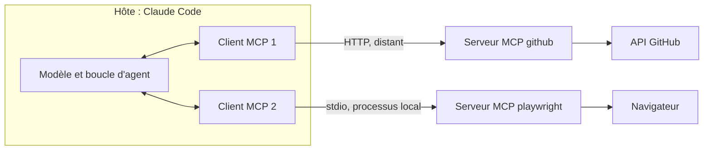
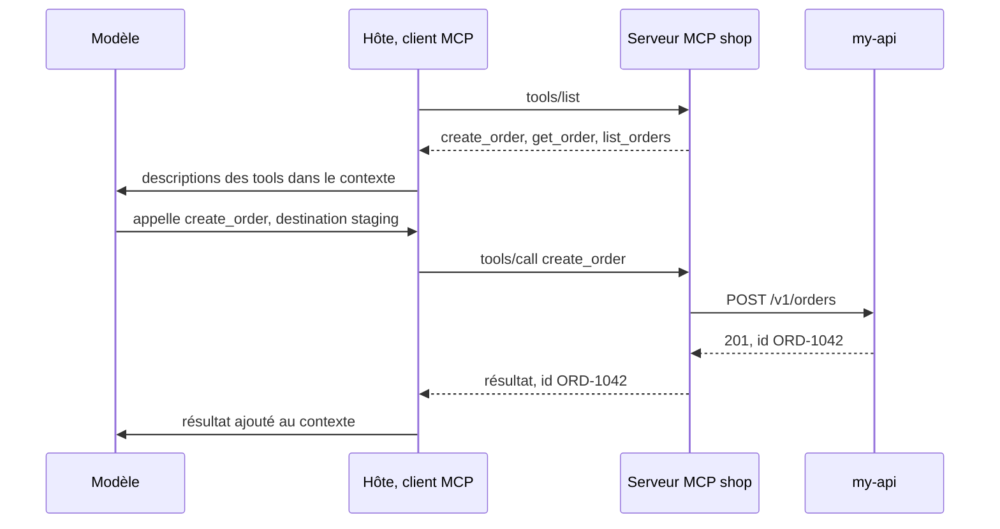
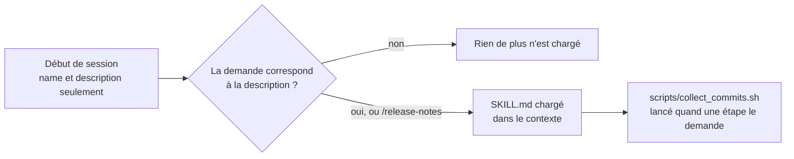
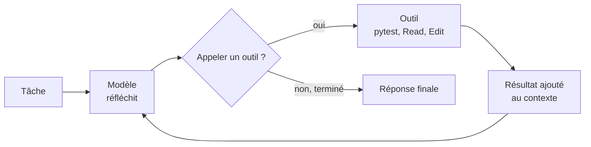
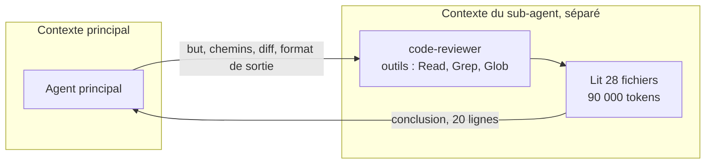
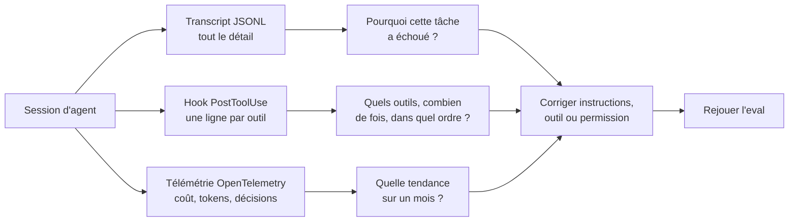
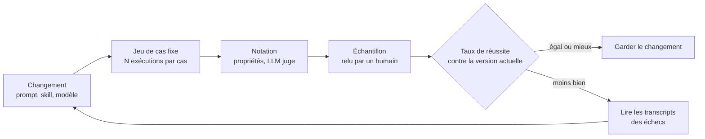
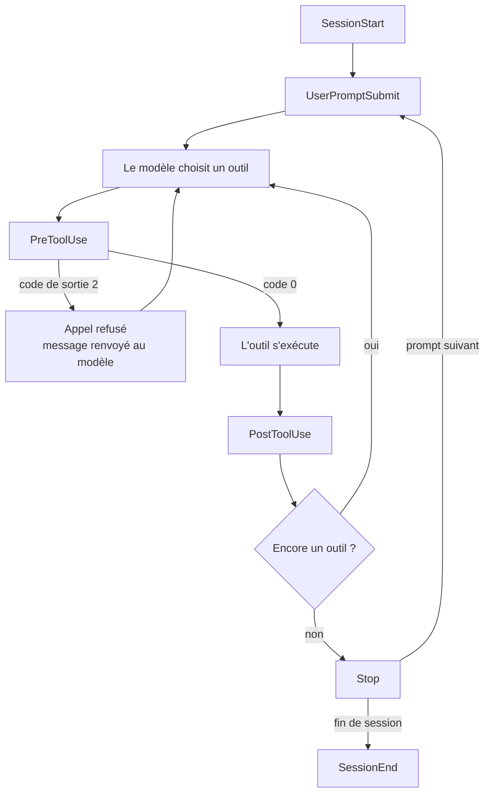
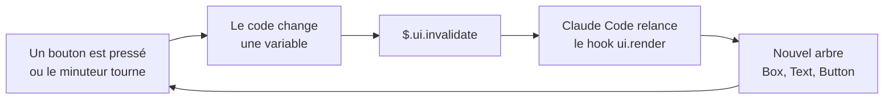

# Agents : outils, MCP, skills et hooks

!!! warning "Avertissement"
    Ces notes sont des pense-bêtes personnels, pas une source de vérité. Elles reflètent ma compréhension et mes choix : leur contenu reste subjectif, malgré les citations et les références qu'il contient. Il peut être incomplet, simplifié, inexact ou dépassé. Vérifiez toujours dans la documentation officielle avant de l'appliquer. Ce contenu est fourni tel quel, sans aucune garantie : son utilisation se fait sous votre seule responsabilité.

!!! audience "Pour qui, pour quoi"
    - **Métiers** : développeur back-end ou front-end, QA, tech lead, ingénieur plateforme, SRE.
    - **Usages** : je conçois un serveur MCP et la description de ses tools, comme un `create_order` limité à dev et staging ; je règle les permissions d'un agent qui lit des tickets, pour qu'il ne puisse ni lire `.env` ni pousser en force ; j'écris une skill d'équipe ou un sub-agent reviewer en lecture seule ; je relis une MR qui ajoute un hook ou un job de CI qui lance un agent sans interface ; je prépare un entretien sur MCP, les skills et les hooks.

!!! abstract "Les échelles"
    Les pastilles de couleur sous les titres disent à quelle échelle une notion s'applique :

    - <span class="pill pill-scope pill-scope-code">Code</span> les classes, fonctions et modules d'un programme ;
    - <span class="pill pill-scope pill-scope-app">Application</span> un service ou une application et son découpage interne ;
    - <span class="pill pill-scope pill-scope-system">Système</span> plusieurs services qui communiquent par le réseau ;
    - <span class="pill pill-scope pill-scope-infra">Infrastructure</span> les serveurs, le réseau, les zones et les clusters, physiques ou virtuels ;
    - <span class="pill pill-scope pill-scope-enterprise">Entreprise</span> le système d'information entier et son organisation.

    Détail et mots ambigus : [carte des échelles](architecture.md#carte-des-echelles).

Un <span class="term" data-term="ai-agent">agent de code</span> ne sait faire que ce que ses outils lui permettent : sans outil, il ne peut que parler ; avec trop d'outils et trop de droits, il peut pousser du code ou lire un secret par erreur. Cette page explique comment lui ajouter des capacités et comment les encadrer : les tools et les permissions, les serveurs MCP, les skills et les slash commands, les agents, les sub-agents et les types d'agents, les hooks, les plugins, les mods, le plan mode, les workflows multi-agents, le mode non interactif et les tâches récurrentes. Le vocabulaire de base (LLM, token, fenêtre de contexte), la différence entre LLM, agent, sub-agent et skill, le contexte durable, le context engineering, la recherche dans du code et les outils du moment sont dans la page [IA : agents, skills et contexte](ia-agents.md).

Les exemples prennent surtout Claude Code, mais les idées valent pour la plupart des agents de code. Les noms de fichiers, de skills et de plugins sont des exemples.

*Claude Code : concurrent de Cursor, Copilot*
{ .tool-rel }

:material-swap-horizontal: Les outils cités dans cette page : lesquels se remplacent, lesquels se combinent ? Voir [Complémentaires ou concurrents](outils.md#complementaires-ou-concurrents).
{ .doc-ref }

## Vocabulaire

Les mots que cette page utilise partout, en une phrase chacun ; chacun a sa section détaillée plus bas. LLM, token et fenêtre de contexte sont définis dans le [Vocabulaire de la page IA : agents, skills et contexte](ia-agents.md#vocabulaire).

**Tool (outil)** : une action que le modèle peut déclencher, comme lire un fichier ou lancer `pytest -q` ; sans outil, il ne peut que parler ([détail](#tool-outil)).

**Permission** : une règle qui autorise un outil sans confirmation, ou qui l'interdit, comme `Bash(git status)` autorisé et `Read(.env)` refusé ([détail](#permissions)).

**<span class="term" data-term="mcp">MCP</span> (Model Context Protocol)** : un standard pour brancher des outils externes sur l'agent. Un serveur MCP expose des tools, comme `create_order` sur l'API des commandes ([détail](#mcp-model-context-protocol)).

**<span class="term" data-term="agent-skill">Skill</span>** : une recette réutilisable, un dossier avec un `SKILL.md` et d'éventuels scripts, que l'agent charge quand ma demande correspond à sa description, comme `release-notes` ([détail](#skill)).

**<span class="term" data-term="sub-agent">Sub-agent</span>** : un agent lancé par l'agent principal pour une sous-tâche, avec son propre contexte, qui ne renvoie que sa conclusion, comme un reviewer en lecture seule ([détail](#sub-agent)).

**Hook** : une commande que l'outil lance automatiquement à un moment précis, comme un formatage après chaque modification de fichier ; c'est l'outil qui l'exécute à chaque fois, pas le modèle qui décide ([détail](#hook)).

**<span class="term" data-term="agent-plugin">Plugin</span> et marketplace** : un plugin installe d'un coup des skills, des agents, des hooks et des serveurs MCP ; une marketplace est le catalogue d'où l'équipe les installe ([détail](#plugin-et-marketplace)).

**<span class="term" data-term="claude-mod">Mod</span>** : un plugin qui ajoute ma propre interface dans Claude Code, comme un panneau qui liste mes pull requests avec un bouton pour rebaser ([détail](#mod)).

**<span class="term" data-term="headless-mode">Mode non interactif</span> (headless)** : l'agent lancé sans personne devant l'écran, avec `claude -p "..."`, par exemple dans un job de CI qui relit chaque MR ([détail](#mode-non-interactif-headless)).

**JSON et jq** : JSON est un format texte de données (`{"file_path": "src/app.py"}`). `jq` est un outil en ligne de commande qui extrait une valeur d'un JSON.
```
$ echo '{"tool_input": {"file_path": "src/app.py"}}' | jq -r '.tool_input.file_path'
src/app.py
```

**Entrée standard et code de sortie** : un script reçoit des données sur son entrée standard (ce qu'on lui envoie avec `|`) et finit avec un code de sortie : `0` veut dire succès, autre chose veut dire échec. Un <span class="term" data-term="hook">hook</span> s'en sert pour dire « autorisé » ou « refusé ».

**Frontmatter** : l'en-tête entre deux lignes `---` au début d'un fichier Markdown, qui donne des informations sur le fichier (`name`, `description`, `tools`).

**<span class="term" data-term="sli">SLI</span>** (Service Level Indicator, indicateur de niveau de service) : le chiffre que je mesure pour savoir si quelque chose marche, par exemple la part des appels de tool MCP qui réussissent.

**<span class="term" data-term="slo">SLO</span>** (Service Level Objective, objectif de niveau de service) : la cible interne que je me fixe sur ce chiffre, par exemple « 99,5 % des appels réussis sur le mois ».

**<span class="term" data-term="sla">SLA</span>** (Service Level Agreement, accord de niveau de service) : la promesse contractuelle faite à un client, avec une pénalité si elle n'est pas tenue, toujours plus lâche que le SLO. Un usage interne d'agents n'en a pas ; un serveur MCP ou un bot de relecture vendu à des clients peut en avoir un.

:material-book-open-variant: Doc de référence : [Anthropic, Glossary](https://docs.claude.com/en/docs/about-claude/glossary) (consultée en novembre 2026)
{ .doc-ref }

## Donner des capacités

<a class="pill pill-scope pill-scope-app" href="../architecture/#carte-des-echelles">Échelle · Application</a>

### Tool (outil)
<span class="pill pill-status pill-status-ok" title="Toujours valable, vérifié en novembre 2026">Valable · 11/2026</span>

Une action que le modèle peut déclencher : lire un fichier, lancer une commande, chercher sur le web. Sans outil, il ne peut que parler.

```
moi    : « combien de tests échouent ? »
modèle : appelle l'outil Bash avec « pytest -q »
outil  : « 3 failed, 120 passed »
modèle : « 3 tests échouent : ... »
```

**Risques.** Un outil agit sur le vrai système : un appel `Bash` ou un tool MCP en écriture peut supprimer un fichier, pousser du code ou appeler la production si le modèle se trompe d'argument ; je garde la confirmation pour tout ce qui change un état partagé (voir [Permissions](#permissions)). Sans outil, l'agent ne peut que deviner : il annonce « 3 tests échouent » sans les avoir lancés, donc je lui donne au moins de quoi lire et tester.

### Permissions
<span class="pill pill-status pill-status-ok" title="Toujours valable, vérifié en novembre 2026">Valable · 11/2026</span>

L'agent peut me demander confirmation avant d'utiliser un outil. Si je clique « oui » cent fois par jour pour un `git status`, je finis par valider sans lire. Les permissions règlent ça : j'autorise une fois pour toutes ce qui est sans risque, et je garde la confirmation pour le reste.

!!! noob "As noob"
    Les permissions, c'est le trousseau que je laisse à la personne qui garde ma maison : la clé de la porte et du jardin, pas celle du coffre, et pour prendre la voiture, elle m'appelle d'abord. Je n'ai pas besoin de lui répéter « ne touche pas au coffre » : sans la clé, elle ne peut pas l'ouvrir. La phrase à retenir : **une permission refusée bloque vraiment, une consigne écrite peut être oubliée.**

À éviter : tout autoriser dans le shell « pour ne plus être dérangé ». `Bash(*)` laisse passer `git push --force` sans confirmation, et `cat .env` lit le fichier que la règle `Read(.env)` croyait protéger, car cette règle vise l'outil Read, pas une commande shell (comportement à vérifier selon la version).

```json
{
  "permissions": {
    "allow": ["Bash(*)"],
    "deny": ["Read(.env)"]
  }
}
```

La version qui autorise seulement la lecture et les tests :

```json
{
  "permissions": {
    "allow": [
      "Bash(git status)",
      "Bash(git diff *)",
      "Bash(mise run test *)",
      "Bash(pytest *)"
    ],
    "deny": [
      "Bash(git push --force *)",
      "Read(.env)"
    ]
  }
}
```

Règle : autoriser la lecture et les tests, garder la confirmation pour tout ce qui change un état partagé (push, déploiement, écriture dans Jira).

*Jira : complémentaire de Confluence, Slack*
{ .tool-rel }


### MCP (Model Context Protocol)
<span class="pill pill-status pill-status-ok" title="Toujours valable, vérifié en novembre 2026">Valable · 11/2026</span>

Un standard pour brancher des outils externes sur l'agent. Un **<span class="term" data-term="mcp-server">serveur MCP</span>** expose des outils, l'agent les appelle.

!!! noob "As noob"
    MCP, c'est la prise USB des agents IA : un branchement commun, pour qu'un même outil (accès aux tickets, à une base, à un navigateur) se branche sur n'importe quel agent compatible sans adaptateur fait sur mesure. La phrase à retenir : **un serveur MCP donne des mains à l'agent, et chaque main est un outil qu'on autorise ou non.**

```json
{
  "mcpServers": {
    "github": {
      "type": "http",
      "url": "https://api.githubcopilot.com/mcp/"
    },
    "playwright": {
      "command": "npx",
      "args": ["@playwright/mcp@latest"]
    }
  }
}
```



Utilisations concrètes :

| Serveur MCP              | Ce que je demande                                                         |
|--------------------------|---------------------------------------------------------------------------|
| Jira                     | « lis le ticket PROJ-123 et ses commentaires, puis propose un plan »     |
| GitHub / GitLab          | « récupère les commentaires non résolus de la MR !42 et corrige-les »    |
| Playwright (navigateur)  | « ouvre la page de login en local, clique sur Connexion, dis-moi pourquoi le bouton ne réagit pas » |
| <span class="term" data-term="observability">observabilité</span> (traces, logs) | « quelles routes de my-api ont le plus d'erreurs depuis 24 h ? »      |
| recherche de code multi-repos | « qui appelle `refresh_token` dans tous les repos de l'équipe ? »   |
| base de données (lecture)| « combien de commandes sont bloquées au statut PENDING ? »               |

Piège : si un serveur MCP est déconnecté, l'agent peut se rabattre en silence sur un moyen moins bon. Bonne pratique : lui demander de vérifier la connexion au début et de s'arrêter si elle manque.

:material-book-open-variant: Doc de référence : [Model Context Protocol, spécification](https://modelcontextprotocol.io/specification/2025-06-18) (révision 2025-06-18) ; [Claude Code, « Connect Claude Code to tools via MCP »](https://code.claude.com/docs/en/mcp) (consultée en novembre 2026)
{ .doc-ref }

#### Ce qu'un serveur MCP expose : des tools

Un serveur MCP, c'est une liste de **tools**. Chaque tool a un nom, une description écrite pour l'IA et des paramètres. L'IA lit les descriptions, choisit le bon tool et remplit ses paramètres. Le serveur exécute l'appel et renvoie le résultat.

À éviter : un tool fourre-tout, à la description vague et aux paramètres libres. Le modèle devine les valeurs de `action` (« create », « new », « add »), rien ne l'empêche d'envoyer `env: "production"`, et une erreur `400` sans explication le fait réessayer au hasard.

```json
{
  "name": "orders",
  "description": "Handles orders.",
  "inputSchema": {
    "type": "object",
    "properties": {
      "action": { "type": "string" },
      "env": { "type": "string" },
      "data": { "type": "string" }
    }
  }
}
```

Voici un tool bien décrit, tel que l'IA le voit :

```json
{
  "name": "create_order",
  "description": "Create test orders in the dev or staging environment. Returns one order id per order. Use get_order to follow them.",
  "inputSchema": {
    "type": "object",
    "properties": {
      "destination": { "type": "string", "enum": ["dev", "staging"] },
      "count": { "type": "integer", "minimum": 1, "maximum": 10 }
    },
    "required": ["destination"]
  }
}
```



Derrière un tool, il y a le plus souvent un <span class="term" data-term="endpoint">endpoint</span> d'API. Le tool est une fine couche par-dessus, pensée pour une IA au lieu d'un programme :

| Endpoint de my-api (dans l'<span class="term" data-term="openapi">OpenAPI</span>) | Tool MCP qui l'appelle                    |
|-------------------------------------|-------------------------------------------|
| `POST /v1/orders`                   | `create_order`                            |
| `GET /v1/orders/{id}`               | `get_order`                               |
| `GET /v1/orders?status=...`         | `list_orders`                             |
| `POST /v1/orders/{id}/refund`       | aucun : l'IA ne peut pas rembourser       |

|                          | Endpoint <span class="term" data-term="rest-api">REST</span>                         | Tool MCP                                                       |
|--------------------------|---------------------------------------|----------------------------------------------------------------|
| fait pour                | du code                               | une IA                                                         |
| décrit par               | l'OpenAPI                             | un nom, une description en langage naturel, un schéma de paramètres |
| qui décide de l'appeler  | le développeur, en écrivant le code   | l'IA, en lisant la description                                 |
| réponse                  | l'objet complet                       | souvent un résumé, et des listes bornées (10 éléments maximum) |

Conséquence : comparer l'OpenAPI d'un service avec les tools de son serveur MCP montre ce qu'une IA ne peut pas encore faire. « Le service a 49 endpoints, le MCP n'en utilise que 8 » veut dire qu'une personne dans l'interface peut faire bien plus qu'un agent IA. Pour combler l'écart, on ajoute des tools au serveur MCP, sans toucher au service.

:material-book-open-variant: Doc de référence : [Model Context Protocol, « Tools »](https://modelcontextprotocol.io/specification/2025-06-18/server/tools) (révision 2025-06-18)
{ .doc-ref }

#### Le nom complet d'un tool MCP

Dans Claude Code, un tool MCP s'appelle `mcp__<serveur>__<tool>`, par exemple `mcp__shop__create_order`. C'est ce nom qu'on retrouve dans les permissions et dans les logs.

```json
{
  "permissions": {
    "allow": ["mcp__shop__get_order", "mcp__shop__list_orders"]
  }
}
```

Ici, l'IA lit les commandes sans confirmation, mais doit demander avant d'en créer une.

### Skill
<span class="pill pill-status pill-status-ok" title="Toujours valable, vérifié en novembre 2026">Valable · 11/2026</span>

Chaque vendredi, je réexplique à l'agent les mêmes étapes pour écrire les release notes. Une skill m'évite ça : c'est une recette réutilisable, un dossier avec un `SKILL.md` qui explique comment faire une tâche précise, plus d'éventuels scripts. L'agent ne charge que la description au départ, et le reste seulement quand la tâche correspond.

À éviter : une description vague et des étapes floues. L'agent ne la déclenche jamais, puisque « helper for releases » ne ressemble à aucune phrase que je dis, et quand je la lance à la main, il improvise, publie parfois sans me montrer le résultat.

```markdown
---
name: release-notes
description: Helper for releases.
---
Fais les release notes proprement.
```

La version qui se déclenche et se suit pas à pas :

```
.claude/skills/release-notes/
├─ SKILL.md
└─ scripts/collect_commits.sh
```

```markdown
---
name: release-notes
description: Write release notes from the commits since the last tag. Use for "release notes", "what changed since v1.2".
---
1. Lance scripts/collect_commits.sh pour lister les commits depuis le dernier tag.
2. Groupe-les par type (feat, fix). Ignore chore et test.
3. Écris une phrase par changement, du point de vue de l'utilisateur.
4. Montre-moi le résultat, ne publie rien.
```



Je l'appelle avec `/release-notes`, ou l'agent la déclenche tout seul quand je dis « fais les release notes ».

D'autres exemples de skills utiles :

| Skill                 | Ce qu'elle fait                                                                 |
|-----------------------|---------------------------------------------------------------------------------|
| `/review-mr 42`       | récupère le <span class="term" data-term="diff">diff</span> de la <span class="term" data-term="merge-request">MR</span>, lance un agent reviewer, poste les remarques en commentaires |
| `/new-e2e-test`       | pose 3 questions, crée le fichier de test Playwright selon les conventions du repo, le lance |
| `/rebase`             | sauvegarde la branche, <span class="term" data-term="git-rebase">rebase</span> sur main, régénère les lockfiles en conflit au lieu de les fusionner |
| `/weekly-metrics`     | interroge l'outil d'observabilité, produit le rapport de la semaine en tableau |
| `/made-ticket PROJ-1` | enchaîne d'autres skills : <span class="term" data-term="git-branch">branche</span>, plan, code, review, <span class="term" data-term="git-commit">commit</span>, MR              |

Ce qui fait une bonne skill :
- une **description** avec les phrases que je dirais naturellement (« Use for ... »), c'est elle qui déclenche la skill ;
- des **étapes numérotées** et des **commandes exactes** ;
- une **étape de vérification** au début (« vérifie que le MCP Jira répond, sinon arrête-toi ») ;
- des **garde-fous** écrits : « ne publie rien », « ne modifie que les fichiers de sélecteurs ».

#### Skill et tools : comment ils se combinent

Ce n'est pas l'un ou l'autre. Le tool **fait** une action, la skill **dit quoi faire et dans quel ordre**. Une skill appelle des tools.

```
skill « prépare les données du test E2E »
1. vérifie si la commande de test existe  : tool get_order
2. sinon, crée-la                         : tool create_order
3. attends qu'elle soit prête             : tool get_order, en boucle
4. écris son id dans la fixture du test   : tool Write (intégré)
```

|               | Tool                                          | Skill                                           |
|---------------|-----------------------------------------------|-------------------------------------------------|
| c'est         | une action                                    | un mode d'emploi                                |
| écrit en      | code, côté serveur ou agent                   | texte (`SKILL.md`), plus des scripts éventuels  |
| exécuté par   | le serveur MCP ou l'agent                     | l'agent, qui suit les étapes                    |
| sans l'autre  | les tools sont là, l'IA improvise l'enchaînement | la skill ne peut rien faire sur le système externe |

Conséquence : chaque nouveau tool rend possibles de nouvelles skills. Tant que le MCP n'a pas de tool `create_customer`, aucune skill ne peut créer le client dont une commande de test a besoin : elle doit le demander à l'humain.

:material-book-open-variant: Doc de référence : [Claude Code, « Agent Skills »](https://code.claude.com/docs/en/skills) (consultée en novembre 2026) ; [Anthropic, « Equipping agents for the real world with Agent Skills »](https://www.anthropic.com/engineering/equipping-agents-for-the-real-world-with-agent-skills) (octobre 2025)
{ .doc-ref }

### Slash command
<span class="pill pill-status pill-status-ok" title="Toujours valable, vérifié en novembre 2026">Valable · 11/2026</span>

Un raccourci tapé dans le chat. Certaines sont intégrées, d'autres viennent de skills.

| Commande        | Usage                                                         |
|-----------------|---------------------------------------------------------------|
| `/clear`        | repartir d'une conversation vide                              |
| `/compact`      | résumer la conversation pour libérer du contexte              |
| `/init`         | générer un premier CLAUDE.md à partir du repo                 |
| `/mcp`          | voir et connecter les serveurs MCP                            |
| `/code-review`  | relire le diff courant pour trouver des bugs                  |
| `/release-notes`| une skill perso ou d'équipe                                   |

**Risques.** `/clear` efface tout le contexte d'un coup : lancé par réflexe au milieu d'une tâche, il me fait perdre le plan et les décisions prises, et je dois tout réexpliquer ; je fais d'abord écrire l'état de la tâche dans un fichier. `/compact` résume, donc oublie des détails : après un compactage, l'agent peut ne plus se souvenir qu'Inès avait interdit de toucher au schéma de la base ; je mets les contraintes durables dans le fichier d'instructions plutôt que dans la conversation. Une commande qui vient d'une skill installée exécute les instructions de quelqu'un d'autre : je lis la skill avant de l'installer.

:material-book-open-variant: Doc de référence : [Claude Code, « Slash commands »](https://code.claude.com/docs/en/slash-commands) (consultée en novembre 2026)
{ .doc-ref }

### Agent
<span class="pill pill-status pill-status-ok" title="Toujours valable, vérifié en novembre 2026">Valable · 11/2026</span>

Un modèle qui travaille en boucle : il réfléchit, appelle un outil, lit le résultat, recommence, jusqu'à finir la tâche. Claude Code est un agent.

!!! noob "As noob"
    Un chatbot répond une fois et s'arrête, comme un guichet de renseignements. Un agent ressemble à un stagiaire à qui on confie une tâche : il essaie, regarde le résultat, corrige, réessaie, jusqu'à ce que ce soit fini ou qu'il bloque. La phrase à retenir : **un agent, c'est un modèle plus une boucle d'outils ; sa qualité dépend de ce qu'il peut vérifier tout seul.**

```
tâche : « fais passer le test test_login »
1. lance pytest              : échec, KeyError 'exp'
2. lit src/auth.py           : voit le bug
3. modifie src/auth.py
4. relance pytest            : succès
5. répond « corrigé, la cause était ... »
```



La qualité d'un agent dépend surtout de sa **boucle de vérification** : s'il peut lancer les tests, il se corrige tout seul ; s'il ne peut pas, il devine.

**Risques.** Un agent sans critère d'arrêt tourne en rond : il relance la même commande en échec et consomme des tokens jusqu'à la limite ; je fixe un nombre d'essais ou de tours. Un agent qui ne peut rien vérifier conclut « ça devrait marcher » et se trompe avec assurance. Il agit avec les droits que je lui donne : une mauvaise lecture du contexte devient une vraie modification, d'où des permissions minimales et une relecture du diff comme pour une MR écrite par un humain.

:material-book-open-variant: Doc de référence : [Anthropic, « Building effective agents »](https://www.anthropic.com/engineering/building-effective-agents) (décembre 2024)
{ .doc-ref }

### Sub-agent
<span class="pill pill-status pill-status-ok" title="Toujours valable, vérifié en novembre 2026">Valable · 11/2026</span>

Un agent lancé par l'agent principal pour une sous-tâche, avec **son propre contexte**. Il fait le travail et ne renvoie que la conclusion. Le contexte principal reste propre.

!!! noob "As noob"
    Un sub-agent, c'est envoyer un collègue fouiller les archives à ma place : il lit trente classeurs et revient avec une page de notes. Mon bureau (mon contexte) reste dégagé, mais je ne vois que son résumé, pas ce qu'il a survolé. La phrase à retenir : **on délègue la lecture, et on revérifie ses « je n'ai rien trouvé ».**

```markdown
---
name: code-reviewer
description: Reviews a diff for bugs and security issues. Read-only.
tools: Read, Grep, Glob
model: opus
---
Tu reçois un diff. Pour chaque problème : fichier, ligne, scénario concret qui casse.
Tu ne modifies rien.
```

Un exemple plus encadré, un agent qui répare des tests E2E :

```markdown
---
name: e2e-test-healer
description: Heals failing Playwright tests. Only edits selector files.
tools: Read, Edit, Bash, mcp__playwright__browser_snapshot, mcp__playwright__browser_click
model: sonnet
---
Tu ne modifies QUE les fichiers de sélecteurs, jamais les specs ni les fixtures.
3 tentatives maximum par test. Au 3e échec, remets la valeur d'origine
et signale le test comme toujours en échec.
```

À éviter : le même agent sans liste d'outils, sans périmètre ni budget. Il hérite de tous les outils, et « jusqu'à ce qu'ils passent » l'autorise à modifier les assertions ou à supprimer le test, ou à boucler des heures sur un test cassé par un vrai bug.

```markdown
---
name: e2e-test-healer
description: Fixes tests.
---
Répare les tests E2E jusqu'à ce qu'ils passent.
```



Ce qui rend un sub-agent fiable :
- **outils limités** au strict nécessaire (un reviewer n'a pas besoin d'Edit) ;
- **périmètre écrit** : quels fichiers il a le droit de toucher ;
- **budget** : nombre d'essais, et ce qu'il fait quand il échoue ;
- **format de sortie** imposé, pour que l'agent principal puisse l'exploiter.

Quand l'utiliser :
- une recherche qui va lire beaucoup de fichiers, alors que je ne veux que la réponse ;
- plusieurs tâches indépendantes à lancer en parallèle ;
- un regard neuf, par exemple une review sans être influencé par la conversation.

Piège : un sub-agent n'hérite pas toujours de tout le contexte ni de tous les outils (un MCP peut manquer). Lui donner les chemins de fichiers et le diff dans son prompt, et vérifier soi-même ses conclusions négatives (« rien trouvé » peut vouloir dire « pas cherché au bon endroit »).

:material-book-open-variant: Doc de référence : [Claude Code, « Subagents »](https://code.claude.com/docs/en/sub-agents) (consultée en novembre 2026)
{ .doc-ref }

### Types d'agents et déterminisme
<span class="pill pill-status pill-status-ok" title="Toujours valable, vérifié en novembre 2026">Valable · 11/2026</span>

Tout ce qu'on appelle « agent » ne laisse pas la même liberté au modèle. La question qui les distingue : **qui décide de l'étape suivante, le code ou le modèle ?** Anthropic pose cette distinction dans « Building effective agents » (décembre 2024).

- **Workflow** : le code fixe les étapes à l'avance, le modèle remplit chacune. Le chemin est toujours le même, même si le texte produit à chaque étape varie.
- **Agent** : le modèle choisit lui-même l'outil suivant et le moment de s'arrêter. Le chemin change d'une exécution à l'autre.

!!! noob "As noob"
    Un workflow, c'est un train : les gares sont fixées d'avance, seul le contenu des wagons change d'un voyage à l'autre. Un agent, c'est un taxi : le chauffeur choisit l'itinéraire selon ce qu'il voit, et le trajet change d'une course à l'autre. La phrase à retenir : **plus je laisse le modèle choisir la route, plus c'est souple, et moins c'est prévisible.**

**Déterministe** : la même entrée donne toujours la même sortie. Un script, un test ou un hook est déterministe. Un <span class="term" data-term="llm">LLM</span> ne l'est pas.

#### Du plus prévisible au plus autonome

| Motif                                         | Qui décide de la suite                     | Exemple concret                                                                                   | Prévisibilité |
|-----------------------------------------------|--------------------------------------------|---------------------------------------------------------------------------------------------------|---------------|
| appel unique                                  | personne, un seul appel                    | « résume ce ticket Jira »                                                                         | très haute    |
| enchaînement de prompts (prompt chaining)     | le code                                    | rédiger les release notes, un script vérifie que chaque MR est citée, puis traduire               | haute         |
| aiguillage (routing)                          | le code, après un classement par le modèle | un ticket est classé « bug », « question » ou « demande », puis part vers le prompt prévu         | haute         |
| parallélisation                               | le code                                    | 4 relectures d'un diff en même temps (bugs, sécurité, perf, lisibilité), ou 3 votes sur une question | haute      |
| orchestrateur et exécutants (orchestrator-workers) | le modèle découpe, le code exécute    | un agent lit un ticket, décide quels fichiers changer, lance un sub-agent par fichier              | moyenne       |
| générateur et évaluateur (evaluator-optimizer) | une boucle, jusqu'à un critère            | un agent écrit un test, un autre le juge, on recommence 3 fois au plus                            | moyenne       |
| agent autonome                                | le modèle, à chaque étape                  | Claude Code qui fait passer un test : il choisit quoi lire, quoi lancer, quand s'arrêter          | basse         |

Le conseil de l'article : commencer par le motif le plus simple qui marche, et n'ajouter de l'autonomie que si le gain se mesure. Plus d'autonomie veut dire plus de <span class="term" data-term="token-llm">tokens</span>, plus d'attente et moins de prévisibilité. Le [workflow multi-agents](#workflow-multi-agents) décrit plus bas est un workflow : le script fixe les étapes, les agents remplissent chacune.

#### Les boucles d'agent connues

- **ReAct** (Yao et al., 2022) : raisonner, agir, observer le résultat, recommencer. C'est la boucle décrite dans [Agent](#agent).
- **Planifier puis exécuter (plan-and-execute)** : le modèle écrit d'abord un plan complet, puis l'exécute étape par étape. Le [plan mode](#plan-mode) en est une version où un humain valide le plan avant.
- **Reflexion** (Shinn et al., 2023) : après un échec, l'agent écrit ce qui n'a pas marché et réessaie avec cette note. La [mémoire](ia-agents.md#memoire) applique la même idée d'une session à l'autre.

```
plan-and-execute : « ajoute un champ phone à l'API users »
  plan     : 1. migration SQL  2. modèle User  3. schéma OpenAPI  4. tests
  étape 1  : écrit migrations/012_add_phone.sql
  étape 2..4 : exécutées dans l'ordre, sans revoir le plan sauf en cas d'échec
```

```
Reflexion : « fais passer test_refund »
  essai 1  : pytest échoue, AssertionError: 0 != 500
  note     : « j'ai arrondi avant de soustraire les frais, il faut l'inverse »
  essai 2  : relu avec la note en contexte, pytest passe
```

#### Le déterminisme : où le mettre

Un LLM peut donner deux réponses différentes à la même question, pour deux raisons :

- **l'échantillonnage** : à chaque mot, le modèle a une liste de suites possibles, chacune avec sa probabilité, et il en tire une au hasard. La **température** est le réglage qui dit à quel point il ose prendre des mots moins probables : haute, ses réponses varient davantage d'une fois à l'autre ; à 0, il prend toujours le mot le plus probable.

    Exemple : je demande dix fois « nomme cette fonction » sur le même code. À température 0, j'obtiens `parse_order` à chaque fois (en principe, voir le point suivant). À une température plus haute, j'obtiens tantôt `parse_order`, tantôt `read_order`, tantôt `order_from_json`.

    Ce que ça change pour moi : la température 0 rend les réponses plus répétables, mais pas garanties identiques, et elle ne les rend pas plus justes. Si le mot le plus probable est faux, le modèle redonne la même erreur à chaque fois.

- **le serveur** : même quand je règle la température à 0, la réponse peut changer d'une fois à l'autre. Thinking Machines (« Defeating Nondeterminism in LLM Inference », septembre 2025) montre que le calcul varie selon le nombre de requêtes que le serveur traite en même temps : un écart de calcul minuscule peut faire passer un autre mot en tête, et toute la suite de la réponse change. Sur 1 000 exécutions du même prompt à température 0, ils obtiennent 80 réponses différentes. [À prendre avec précaution : chiffres de l'auteur, sur un seul modèle open source (Qwen3-8B), pas sur les API commerciales.]

!!! noob "As noob"
    À chaque mot, le modèle tire comme une boule dans un sac où les mots probables ont beaucoup de boules et les mots improbables très peu. La température règle l'écart : haute, les mots moins probables sortent plus souvent ; à 0, il prend toujours le mot qui a le plus de boules. Limite : même à 0, un écart de calcul minuscule côté serveur peut faire passer un autre mot en tête, et toute la suite change. La phrase à retenir : **température 0 veut dire plus répétable, ni plus juste, ni garanti identique.**

Conséquence : je ne peux pas compter sur le modèle pour faire quelque chose « à coup sûr ». Règle pratique : **déterministe partout où c'est possible, le modèle seulement là où il apporte quelque chose** (comprendre, rédiger, choisir).

| Besoin                                      | Mécanisme déterministe                          | Exemple                                                        |
|---------------------------------------------|-------------------------------------------------|----------------------------------------------------------------|
| une action doit arriver à chaque fois, sans compter sur la mémoire du modèle | [hook](#hook) | formater chaque fichier modifié avec ruff |
| une action ne doit jamais arriver, même si le modèle la propose | [permissions](#permissions) ou hook `PreToolUse` | refuser `git push --force` |
| des étapes doivent toujours se suivre dans le même ordre | script ou workflow | <span class="term" data-term="linter">lint</span>, puis tests, puis résumé rédigé par le modèle |
| un programme doit lire la sortie, par exemple pour poster chaque remarque en commentaire de MR | format imposé (JSON schema, structured outputs) | `{"file": "src/auth.py", "line": 42, "severity": "high"}` |
| je veux savoir si le travail est juste, pas seulement que l'agent le croit | boucle de vérification | l'agent relance pytest au lieu de dire « ça devrait marcher » |

Une **<span class="term" data-term="structured-output">sortie structurée</span>** (*structured output*) : on passe un schéma JSON à l'API, et la réponse du modèle est contrainte à ce schéma. Elle est toujours du JSON valide, avec les champs prévus, et `severity` ne peut valoir qu'une des trois valeurs. Le contenu (la bonne ligne, la bonne gravité) reste à vérifier.

À éviter, poster la réponse du modèle telle quelle : une phrase avant le JSON fait planter `json.loads`, et une ligne inventée produit un commentaire sur une ligne que la MR ne modifie pas, ou un refus de l'API de la forge.

```python
# À éviter : réponse lue sans schéma et postée sans vérifier qu'elle correspond au diff
review = json.loads(response.text)
for item in review:
    post_mr_comment(item["file"], item["line"], item["message"])


# Bien : la forme est validée par le schéma, le contenu est confronté au diff avant de poster
review = ReviewList.model_validate_json(response.text)
changed = changed_lines(diff)
for item in review.items:
    if (item.file, item.line) in changed:
        post_mr_comment(item.file, item.line, item.message)
```

!!! noob "As noob"
    Une sortie structurée, c'est un formulaire à cases au lieu d'une lettre libre : chaque case prévue doit être remplie, et la case « gravité » ne propose que trois choix. Le formulaire garantit qu'un programme saura le lire, pas que ce qui est écrit dedans est vrai. La phrase à retenir : **le schéma garantit la forme, pas le contenu.**

```json
{
  "type": "object",
  "properties": {
    "file": {"type": "string"},
    "line": {"type": "integer"},
    "severity": {"enum": ["low", "medium", "high"]}
  },
  "required": ["file", "line", "severity"]
}
```

#### Observer ce qu'un agent a fait

Avant de juger un agent, il faut voir ce qu'il a fait : quels fichiers il a lus, quelles commandes il a lancées, où il a tourné en rond. Trois sources, de la plus détaillée à la plus agrégée :

- **le transcript** : Claude Code enregistre chaque session en JSON Lines dans `~/.claude/projects/<projet>/<session>.jsonl` (messages, appels d'outils, résultats). C'est la source à relire pour comprendre un échec précis, et `claude --resume` rouvre la session ;
- **un hook** : un [hook](#hook) `PostToolUse` peut écrire une ligne par appel d'outil dans un journal local, plus court et plus facile à filtrer que le transcript ;
- **la télémétrie** : les métriques et événements OpenTelemetry de Claude Code (coût, tokens, outils acceptés ou refusés) partent vers un collecteur, pour suivre des tendances sur des centaines de sessions (voir [La télémétrie intégrée à Claude Code](ia-entreprise.md#la-telemetrie-integree-a-claude-code)).

!!! noob "As noob"
    Le transcript, c'est la boîte noire d'un avion : on la relit après un incident pour savoir ce qui s'est vraiment passé, étape par étape. Le journal d'un hook, c'est le carnet de vol, plus court ; la télémétrie, ce sont les statistiques de toute la flotte sur un mois. La phrase à retenir : **avant de corriger un agent, je regarde ce qu'il a fait, pas ce qu'il dit avoir fait.**

*OpenTelemetry : complémentaire de Datadog, Prometheus, Tempo, Loki*
{ .tool-rel }


Exemple : journaliser chaque appel d'outil, puis compter les outils les plus appelés.

```json
{
  "hooks": {
    "PostToolUse": [
      {
        "matcher": "*",
        "hooks": [
          {
            "type": "command",
            "command": "jq -c '{t: .tool_name, i: .tool_input}' >> ~/agent-tools.log"
          }
        ]
      }
    ]
  }
}
```

```bash
jq -r .t ~/agent-tools.log | sort | uniq -c | sort -rn
```

Un `Read` appelé 40 fois pour une petite tâche signale un contexte pauvre (voir [Mesurer la qualité du contexte](ia-agents.md#mesurer-la-qualite-du-contexte)) ; un `Bash` qui relance la même commande en échec signale une boucle de vérification mal donnée.



:material-book-open-variant: Doc de référence : [Claude Code, Monitoring](https://code.claude.com/docs/en/monitoring-usage) (consultée en novembre 2026) ; [Claude Code, Hooks reference](https://code.claude.com/docs/en/hooks) (consultée en novembre 2026)
{ .doc-ref }

#### Tester un système à base d'agents

Pour un QA, le changement est net : on ne compare pas la sortie à une valeur attendue exacte.

- **Vérifier des propriétés**, pas un texte : « le JSON est valide », « chaque MR du sprint est citée », « aucun fichier hors de `src/` n'est modifié ».
- **Lancer plusieurs fois** : un seul passage vert ne prouve rien. On mesure un taux de réussite, par exemple 9 sur 10.
- **Evals** : un jeu de cas fixes, rejoué à chaque changement de prompt, de skill ou de modèle, comme une suite de <span class="term" data-term="regression">non-régression</span>.
- **<span class="term" data-term="llm-as-judge">LLM juge</span> (LLM-as-a-judge)** : un second modèle note la réponse selon une grille écrite. Utile pour juger un texte, mais lui-même non déterministe : un humain vérifie ses notes sur un échantillon.

```
eval : « fais passer test_login », 10 exécutions
  pytest passe                         9/10
  aucun fichier de tests modifié       9/10
  échec : l'agent a modifié le test au lieu du code
```

Exemple de grille donnée au juge pour noter un résumé de MR, et sa réponse :

```
Note de 1 à 5 chaque critère, réponds en JSON.
1. exactitude : rien n'est inventé par rapport au diff
2. complétude : chaque fichier modifié est mentionné
3. utilité : le relecteur sait quoi tester
4. concision : 10 lignes au plus
```

```json
{"exactitude": 5, "completude": 3, "utilite": 4, "concision": 5,
 "justification": "migrations/012_add_phone.sql n'est pas mentionné"}
```

La boucle d'eval, à chaque changement :



:material-book-open-variant: Doc de référence : [Anthropic, « Demystifying evals for AI agents »](https://www.anthropic.com/engineering/demystifying-evals-for-ai-agents) (janvier 2026) ; [Claude Docs, « Define success criteria and build evaluations »](https://docs.claude.com/en/docs/test-and-evaluate/develop-tests) (consultée en novembre 2026)
{ .doc-ref }

#### Sources
- [Anthropic, « Building effective agents » (décembre 2024)](https://www.anthropic.com/engineering/building-effective-agents)
- [Yao et al., « ReAct: Synergizing Reasoning and Acting in Language Models » (octobre 2022)](https://arxiv.org/abs/2210.03629)
- [Shinn et al., « Reflexion: Language Agents with Verbal Reinforcement Learning » (mars 2023)](https://arxiv.org/abs/2303.11366)
- [Thinking Machines, « Defeating Nondeterminism in LLM Inference » (septembre 2025)](https://thinkingmachines.ai/blog/defeating-nondeterminism-in-llm-inference/)

### Hook
<span class="pill pill-status pill-status-ok" title="Toujours valable, vérifié en novembre 2026">Valable · 11/2026</span>

J'ai écrit dans CLAUDE.md « formate chaque fichier avec Prettier », et de temps en temps l'agent oublie. Un hook règle ça : c'est une commande que l'outil lance **automatiquement** à un moment précis, par exemple après chaque modification de fichier. Ce n'est pas le modèle qui décide, c'est l'outil qui l'exécute à chaque fois.

!!! noob "As noob"
    Une consigne dans CLAUDE.md, c'est un post-it « éteins la lumière en partant » : la plupart du temps j'y pense, parfois non. Un hook, c'est le détecteur qui éteint la lumière tout seul dès que la pièce se vide, à chaque fois. Limite : il fait exactement ce que dit son script, sans jugement. La phrase à retenir : **ce qui doit arriver à chaque fois va dans un hook, pas dans une consigne.**

| Moment           | Exemple concret                                                    |
|------------------|--------------------------------------------------------------------|
| `SessionStart`   | charger les règles d'équipe à jour depuis un repo de doc           |
| `PreToolUse`     | refuser un `git commit` dont le message n'est pas conventionnel    |
| `PostToolUse`    | formater avec Prettier chaque fichier que l'agent vient d'éditer     |
| `Stop`           | lancer le lint quand l'agent a fini sa réponse                     |
| `Notification`   | envoyer une notification macOS quand l'agent attend une réponse     |
| `SessionEnd`     | ajouter à un fichier local le nombre de skills utilisées dans la session |



Exemple 1 : formater chaque fichier modifié.

```json
{
  "hooks": {
    "PostToolUse": [
      {
        "matcher": "Edit|Write",
        "hooks": [
          {
            "type": "command",
            "command": "jq -r '.tool_input.file_path' | xargs npx prettier --write"
          }
        ]
      }
    ]
  }
}
```

`"matcher": "Edit|Write"` filtre sur le nom de l'outil : le hook ne part qu'après un appel à `Edit` ou à `Write`, pas après `Bash` ou `Read`. La valeur est une expression régulière, `|` veut dire « ou ».

Exemple 2 : bloquer un commit mal formé. Le hook reçoit l'appel d'outil en JSON sur son entrée standard. S'il sort avec le code 2, l'appel est refusé et son message est renvoyé au modèle, qui corrige.

À éviter, sortir avec le code 1 et écrire le message sur la sortie standard : pour Claude Code, le code 1 est une erreur non bloquante, donc le commit part quand même et le modèle ne voit pas le message (codes à vérifier dans la doc des hooks).

```bash
#!/bin/bash
# À éviter : code de sortie 1 et message sur stdout, le commit n'est pas bloqué
CMD=$(jq -r '.tool_input.command // empty')
if echo "$CMD" | grep -q 'git commit' && ! echo "$CMD" | grep -qE -- '-m "(feat|fix)'; then
  echo "commit non conventionnel"
  exit 1
fi
```

La version qui bloque vraiment :

```bash
#!/bin/bash
# Exemple : hook qui refuse un commit non conventionnel (code de sortie 2)
CMD=$(jq -r '.tool_input.command // empty')
echo "$CMD" | grep -q 'git commit' || exit 0
MSG=$(echo "$CMD" | sed -nE 's/.*-m "([^"]*)".*/\1/p')
if ! echo "$MSG" | grep -qE '^(feat|fix|docs|refactor|test|chore)(\(.+\))?: .+'; then
  echo "Message de commit non conventionnel : type(scope): description" >&2
  exit 2
fi
```

Quand l'utiliser : quelque chose qui doit arriver **à chaque fois, sans oubli possible**. Une consigne dans CLAUDE.md peut être oubliée, un hook non.

**Risques.** Un hook est un script shell qui tourne avec mes droits à chaque événement : un hook venu d'un repo ou d'un plugin inconnu exécute ce qu'il veut, donc je lis chaque hook avant de l'activer. Un hook lent ralentit chaque appel d'outil, et un hook bogué peut bloquer toutes les actions (code 2 à tort) ; je le garde court et je le teste à part avec un JSON d'exemple. Un mauvais code de sortie le rend inutile sans bruit, comme le code 1 vu plus haut.

:material-book-open-variant: Doc de référence : [Claude Code, Hooks reference](https://code.claude.com/docs/en/hooks) (consultée en novembre 2026) ; [Claude Code, « Get started with Claude Code hooks »](https://code.claude.com/docs/en/hooks-guide) (consultée en novembre 2026)
{ .doc-ref }

### Plugin et marketplace
<span class="pill pill-status pill-status-ok" title="Toujours valable, vérifié en novembre 2026">Valable · 11/2026</span>

Mon équipe a écrit des skills, des agents et un hook, et chacun les recopie à la main dans son repo, donc les versions finissent par diverger. Un plugin règle ça : il regroupe des skills, des agents, des hooks et des serveurs MCP pour les installer d'un coup. Une marketplace est un catalogue de plugins, souvent un repo git partagé par une entreprise ou une équipe.

!!! noob "As noob"
    Un plugin, c'est une valise d'outils préparée une fois et prêtée à toute l'équipe, au lieu que chacun recopie sa propre boîte et l'adapte à sa façon. La marketplace, c'est l'armoire où l'on range les valises, avec leur numéro de version. La phrase à retenir : **on installe la même version partagée, au lieu de copies qui divergent.**

```
team-marketplace/
└─ plugins/
   ├─ dev-tools/
   │  ├─ skills/review-mr/  skills/create-mr/  skills/rebase/
   │  ├─ agents/code-reviewer.md
   │  └─ hooks/hooks.json            (valide les messages de commit)
   └─ qa-tools/
      ├─ skills/new-e2e-test/  skills/weekly-metrics/
      ├─ agents/e2e-test-healer.md
      └─ hooks/hooks.json            (charge les règles QA au démarrage)
```

```
/plugin marketplace add git@git.example.com:team/team-marketplace.git
/plugin install dev-tools@team-marketplace
/plugin install qa-tools@team-marketplace --scope project
```

| Scope     | Effet                                                         |
|-----------|---------------------------------------------------------------|
| `user`    | pour moi, dans tous mes projets                               |
| `project` | pour toute l'équipe, écrit dans `.claude/settings.json` du repo |
| `local`   | pour moi, dans ce repo seulement, non versionné               |

Quand l'utiliser : partager le même outillage avec toute une équipe, et le mettre à jour à un seul endroit.

**Risques.** Un plugin installe d'un coup des hooks, des serveurs MCP et des agents qui tournent avec mes droits : une marketplace non maîtrisée peut faire exécuter du code à toute l'équipe, donc je n'ajoute que des marketplaces dont je connais les mainteneurs. Une mise à jour cassée touche tout le monde en même temps ; je l'essaie d'abord en scope `local` avant de la passer en `project`. Sans plugin, les copies divergent et chacun corrige le même bug de skill de son côté.

:material-book-open-variant: Doc de référence : [Claude Code, « Plugins »](https://code.claude.com/docs/en/plugins) (consultée en novembre 2026) ; [Claude Code, « Plugin marketplaces »](https://code.claude.com/docs/en/plugin-marketplaces) (consultée en novembre 2026)
{ .doc-ref }

### Mod
<span class="pill pill-status pill-status-ok" title="Toujours valable, vérifié en novembre 2026">Valable · 11/2026</span>

!!! info "Section écrite en novembre 2026"
    Les mods sont arrivés avec Claude Code v2.1.287. Les noms d'événements, de méthodes et les limites cités sont ceux documentés à cette date : à revérifier avant de s'y fier.

Chaque matin, je fais le tour de mes pull requests à la main : laquelle a un conflit, laquelle attend ma relecture, puis je tape à Claude « rebase la PR #42 ». Un <span class="term" data-term="claude-mod">mod</span> règle ça : c'est un plugin qui ajoute **ma propre interface** dans Claude Code, par exemple un panneau à côté de la conversation qui liste mes PR, avec un bouton par ligne qui envoie la bonne consigne à Claude. Je n'ai pas besoin de l'écrire moi-même : je décris ce que je veux, et Claude écrit le mod.

Techniquement, un mod est un plugin qui contient du code JavaScript ou TypeScript. Claude Code appelle ses fonctions à chaque événement (un appel d'outil, un prompt envoyé, une zone de l'écran à dessiner), et la fonction peut observer l'événement, le modifier ou y répondre à la place de Claude Code. La doc appelle ces fonctions des hooks, à ne pas confondre avec les [hooks de settings](#hook), qui sont des commandes shell lancées depuis `settings.json`.

!!! noob "As noob"
    Les skills, les hooks de settings et les serveurs MCP, c'est comme donner des consignes ou des outils à un employé. Un mod, c'est réaménager son bureau : je lui ajoute un tableau de bord au mur, avec des boutons, et je peux changer ce qu'il voit à l'écran. Limite : ce réaménagement tourne avec mes droits à moi, sans bac à sable. La phrase à retenir : **un mod change l'outil lui-même, pas seulement ce que l'agent sait ou peut faire.**

Ce qu'un mod peut faire, et que les autres extensions ne peuvent pas :

| Capacité                         | Exemple concret                                                                 |
|----------------------------------|---------------------------------------------------------------------------------|
| dessiner un panneau              | une barre latérale avec des onglets, des boutons et des champs de saisie         |
| dessiner un bandeau              | la branche git courante affichée au-dessus du prompt                            |
| redessiner l'interface existante | le nombre d'appels d'outils ajouté à côté du spinner                            |
| intercepter un appel d'outil     | retenir un `rm -rf` et demander confirmation avec un bouton                     |
| ajouter une commande instantanée | `/prs` qui ouvre un panneau tout de suite, sans tour de Claude                  |
| lancer un tour tout seul         | un minuteur voit la CI casser et envoie « corrige la CI de la PR #42 » à Claude |

#### Demander un mod à Claude

1. Je décris le mod dans une session interactive : « fais-moi un mod : un panneau à côté du chat qui liste mes PR ouvertes (état de la CI, conflits), rafraîchi toutes les 5 minutes ; un clic sur une PR envoie à Claude la bonne consigne : corriger la CI, rebaser ou relire avant fusion ».
2. Claude charge sa skill intégrée `plugin-authoring` (je peux aussi lancer `/plugin-authoring` moi-même) et écrit le mod dans `~/.claude/dev-mods/<id-de-session>/my-prs/`.
3. Au premier fichier, Claude Code me demande d'activer le rechargement à chaud pour la session. J'accepte : le mod se charge à la fin du tour, puis se recharge à chaque tour qui le modifie.
4. Je l'essaie, puis je dis à Claude ce qui ne va pas (« ajoute l'état de la CI en couleur »). Je l'affine en parlant, sans relancer la session.
5. Pour le garder : le dossier de session est supprimé au bout de `cleanupPeriodDays`, donc je copie le mod ailleurs (`~/mods/my-prs`) et je le charge avec `claude --plugin-dir ~/mods/my-prs`, ou je le publie dans une [marketplace](#plugin-et-marketplace) pour mon équipe.

`/plugin` montre les mods chargés dans la session (ligne `1 mod active · my-prs`), et c'est là que j'en désactive un.

#### Ce que Claude écrit

```
my-prs/
├─ .claude-plugin/plugin.json     (le manifeste du plugin)
└─ hooks/
   ├─ hooks.json                  ({ "modules": ["./register.js"] })
   └─ register.js                 (le code du mod)
```

```javascript
// Exemple : constantes et état partagés par tous les hooks du module
const PANE = 'my-prs'
const FIVE_MINUTES = 5 * 60 * 1000
let prs = []

// Exemple : lit mes PR ouvertes avec la CLI gh, puis demande à redessiner
async function refresh($) {
  try {
    const r = await $.process.run(['gh', 'pr', 'list', '--author', '@me', '--json', 'number,title,mergeable'])
    prs = JSON.parse(r.stdout)
  } catch (err) {
    $.ui.log('gh a échoué : ' + err.message)
  }
  $.ui.invalidate('ui.render')
}

export function register(on) {
  // Exemple : au démarrage, ajoute /prs, charge la liste et lance le minuteur
  on('session.start', async ($, e, next) => {
    await $.command.register({ name: 'prs', description: 'Ouvrir le panneau de mes PR' })
    refresh($)
    $.clock.every(FIVE_MINUTES, () => refresh($))
    return next(e)
  })

  // Exemple : /prs ouvre le panneau, sans rien écrire dans la conversation
  on('command.run', { command: 'prs' }, async ($) => {
    await $.ui.open({ id: PANE, title: 'Mes PR', focus: true, closeOnEscape: true })
    return {}
  })

  // Exemple : une ligne par PR, le bouton envoie la consigne à Claude
  on('ui.render', { component: 'Pane' }, async ($, e, next) => {
    if (e.requestId !== PANE) return next(e)
    const { Box, Text, Button } = $.ui.resolve(e)
    const rows = prs.map((pr) => {
      const conflict = pr.mergeable === 'CONFLICTING'
      const ask = conflict ? 'rebase la PR #' + pr.number : 'relis la PR #' + pr.number + ' avant fusion'
      return Box({
        flexDirection: 'row',
        columnGap: 2,
        children: [
          Button({ key: 'pr-' + pr.number, label: conflict ? 'Rebaser' : 'Relire', onPress: () => $.prompt.submit({ text: ask, asUser: true }) }),
          Text({ children: ['#' + pr.number + ' ' + pr.title] }),
        ],
      })
    })
    return Box({ flexDirection: 'column', children: rows.length ? rows : [Text({ children: ['Aucune PR ouverte'] })] })
  })
}
```

Le mod n'accède au disque, aux commandes et au réseau qu'à travers l'API `$` (`$.process`, `$.fs`, `$.http`, `$.store` pour garder une valeur entre deux sessions). C'est ce qui permet à `claude plugin validate ./my-prs` de lister ce qu'un mod fait avant de l'installer. Un panneau suit toujours le même cycle :



#### Mod, hook de settings, skill ou MCP

| Je veux...                                                                 | J'utilise          |
|----------------------------------------------------------------------------|--------------------|
| voir mes PR, mes tickets ou l'état de la CI dans un panneau, avec des boutons | mod                |
| une commande `/prs` qui répond tout de suite, même pendant que Claude travaille | mod                |
| bloquer un commit mal formé avec un script shell que j'ai déjà             | hook de settings   |
| arrêter de recoller les mêmes consignes de release dans le chat            | skill              |
| que Claude lise mes tickets dans un outil externe                          | serveur MCP        |

Quand l'utiliser : quand je veux **voir** ou **déclencher** quelque chose dans l'interface, ou réécrire un événement. Si un hook de settings, une skill ou un serveur MCP fait déjà le travail, je m'en contente : c'est plus simple et moins risqué.

!!! warning "Un mod tourne avec mes droits"
    Un mod lit et écrit mes fichiers, lance des programmes, appelle le réseau, lit mes variables d'environnement, voit chaque prompt et peut approuver un appel d'outil sans me demander. Il n'est pas dans le bac à sable. Je n'installe que des mods dont je connais l'auteur, et je lance `claude plugin validate` sur ceux des autres. Ceux que Claude écrit pour moi restent sur ma machine.

Où ça marche : le terminal (v2.1.287 ou plus, `claude --version`), l'onglet Code de Claude Desktop et l'extension VS Code. Dans `claude -p` et l'Agent SDK, les hooks tournent mais rien ne s'affiche.

:material-book-open-variant: Doc de référence : [Claude Code, « Mods overview »](https://code.claude.com/docs/en/plugins/mods/overview) (consultée en novembre 2026) ; [« Create a mod »](https://code.claude.com/docs/en/plugins/mods/create) (consultée en novembre 2026) ; [« Draw in the interface with a mod »](https://code.claude.com/docs/en/plugins/mods/interface) (consultée en novembre 2026) ; [« Use the mods API »](https://code.claude.com/docs/en/plugins/mods/api) (consultée en novembre 2026) ; [exemples de mods d'Anthropic, claude-code-playground](https://github.com/anthropics/claude-code-playground/tree/main/claude-code/mods) (consulté en novembre 2026)
{ .doc-ref }

### Plan mode
<span class="pill pill-status pill-status-ok" title="Toujours valable, vérifié en novembre 2026">Valable · 11/2026</span>

**L'idée en une phrase** : avant de toucher au code, l'agent me dit ce qu'il compte faire, et il ne fait rien tant que je n'ai pas dit oui.

**Sans plan mode**, je demande une tâche et l'agent commence tout de suite à modifier des fichiers. S'il est parti dans la mauvaise direction, je m'en rends compte après coup, devant un diff de 300 lignes à défaire.

**Avec plan mode**, l'agent a seulement le droit de **lire** : il ouvre des fichiers, cherche dans le code, mais il ne peut ni modifier un fichier ni lancer une commande qui change quelque chose. À la fin, il me présente un plan écrit. Je le corrige si besoin, puis je le valide, et c'est seulement là qu'il passe aux modifications.

!!! noob "As noob"
    Le plan mode, c'est le devis d'un artisan : il vient voir, ouvre les placards, prend des mesures, mais n'abat aucun mur avant que j'aie signé. Rayer une ligne du devis prend deux minutes, reconstruire un mur abattu par erreur prend une journée. La phrase à retenir : **corriger un plan coûte bien moins cher que défaire un diff.**

Exemple concret : je veux ajouter un champ « téléphone » au formulaire d'inscription.

```
1. j'active le plan mode, puis je demande :
   « ajoute un champ téléphone, facultatif, au formulaire d'inscription »

2. l'agent lit le code (sans rien modifier) et répond par un plan :
   Fichiers à modifier :
   - frontend/SignupForm.tsx       ajouter le champ et sa validation
   - api/schemas/user.py           ajouter phone, facultatif
   - migrations/                   nouvelle colonne users.phone, nullable
   - tests/test_signup.py          un test avec téléphone, un test sans
   Point à trancher : faut-il un format international (+33...) ?

3. je réponds : « oui, format international, et pas de migration :
   la colonne existe déjà dans la table profiles »

4. l'agent corrige son plan, je valide, il code.
```

À l'étape 3, j'ai évité une migration inutile en 10 secondes. Sans plan mode, je l'aurais découverte en relisant le diff.

**Comment l'activer dans Claude Code** : appuyer sur `Shift+Tab` jusqu'à voir « plan mode on » sous la zone de saisie. Le même raccourci fait défiler les modes (normal, acceptation automatique des modifications, plan).

| Situation                                                    | Plan mode ?                         |
|--------------------------------------------------------------|-------------------------------------|
| ma tâche touche plusieurs fichiers ou plusieurs couches, comme un champ à ajouter du formulaire jusqu'à la base | oui |
| je ne connais pas bien ce code, par exemple un module écrit par une autre équipe | oui : le plan m'explique aussi le code |
| il y a plusieurs façons de faire et je veux choisir moi-même | oui |
| c'est une correction d'une ligne, et je sais déjà où elle se trouve | non, c'est plus lent pour rien |
| je pose juste une question, comme « que fait cette fonction ? » | inutile, l'agent ne modifie rien de toute façon |

**Risques.** Valider un plan sans le lire donne un faux sentiment de contrôle : l'erreur arrive quand même, simplement plus tard. Un plan écrit d'après une lecture partielle du code peut être faux avec assurance, comme la migration inutile de l'exemple ; je vérifie les fichiers qu'il cite. Sur une petite correction, le plan mode ajoute un aller-retour pour rien.

:material-book-open-variant: Doc de référence : [Claude Code, « Common workflows »](https://code.claude.com/docs/en/common-workflows) (consultée en novembre 2026)
{ .doc-ref }

### Workflow multi-agents
<span class="pill pill-status pill-status-ok" title="Toujours valable, vérifié en novembre 2026">Valable · 11/2026</span>

Un script qui orchestre plusieurs agents : par exemple 4 agents relisent un diff chacun sous un angle, puis un 5e vérifie chaque remarque. Puissant, mais coûteux en tokens.

!!! noob "As noob"
    C'est un comité de relecture : quatre spécialistes lisent le même contrat, chacun avec sa grille (juridique, finance, sécurité, style), puis un cinquième trie leurs remarques et écarte les fausses alertes. C'est plus fiable qu'un seul relecteur, mais cinq fois plus cher. La phrase à retenir : **plusieurs regards spécialisés, puis un tri, et seulement quand l'enjeu paie la facture.**

```
review ┬─ agent bugs        ─┐
       ├─ agent sécurité    ─┼─ agent vérificateur ─ remarques confirmées
       ├─ agent perf        ─┤
       └─ agent lisibilité  ─┘
```

Quand l'utiliser : quand la qualité vaut le coût, par exemple une review avant une mise en production sensible, ou une analyse sur 50 MR. Pas pour une petite correction.

:material-book-open-variant: Doc de référence : [Anthropic, « How we built our multi-agent research system »](https://www.anthropic.com/engineering/multi-agent-research-system) (juin 2025)
{ .doc-ref }

### Mode non interactif (headless)
<span class="pill pill-status pill-status-ok" title="Toujours valable, vérifié en novembre 2026">Valable · 11/2026</span>

Je veux qu'une tâche tourne sans personne devant l'écran, comme une relecture automatique de chaque MR en <span class="term" data-term="ci">CI</span>. Le mode non interactif fait ça : l'agent se lance avec `claude -p "..."`, fait sa tâche et écrit le résultat.

!!! noob "As noob"
    Le mode non interactif, c'est un lave-linge lancé la nuit : je choisis le programme avant d'aller me coucher, il tourne seul, et personne n'est là pour l'arrêter s'il part de travers. Tout se décide donc au départ. La phrase à retenir : **sans personne pour valider, ce sont les permissions qui protègent, alors je les garde minimales.**

À éviter, le job qui saute toutes les confirmations avec un jeton de production et sans limite de tours : une consigne cachée dans le diff peut faire pousser du code ou appeler la production, et un agent qui tourne en rond consomme des tokens jusqu'au délai maximal du job.

```yaml
# À éviter : aucune permission vérifiée, jeton de production, aucune limite de tours
review-bot:
  stage: review
  variables:
    PROD_API_TOKEN: $PROD_API_TOKEN
  script:
    - claude -p "Relis cette MR et corrige ce que tu trouves" --dangerously-skip-permissions
```

La version en lecture seule, avec des outils listés et un nombre de tours borné (options à vérifier selon la version) :

```yaml
# Exemple : job de CI qui lance l'agent sans interface sur chaque MR
review-bot:
  stage: review
  script:
    - claude -p "Relis le diff de cette MR et liste les bugs probables avec fichier:ligne" --allowedTools "Read,Grep,Glob" --max-turns 20 --output-format json > review.json
  rules:
    - if: $CI_PIPELINE_SOURCE == "merge_request_event"
```

Utilisations concrètes : relecteur automatique sur chaque MR, résumé quotidien des échecs de tests, tri des nouveaux tickets.

Pièges : pas de navigateur pour se connecter, donc les MCP qui demandent un login doivent recevoir un jeton par variable CI masquée ; et toujours des permissions minimales, puisque personne ne valide les actions.

:material-book-open-variant: Doc de référence : [Claude Code, « Headless mode »](https://code.claude.com/docs/en/headless) (consultée en novembre 2026)
{ .doc-ref }

### Tâches récurrentes
<span class="pill pill-status pill-status-ok" title="Toujours valable, vérifié en novembre 2026">Valable · 11/2026</span>

J'attends la fin d'un pipeline et je reviens vérifier toutes les dix minutes. Une tâche récurrente le fait à ma place : elle tourne à intervalle régulier, dans la session ou dans le cloud.

```
/loop 10m vérifie le pipeline de la MR !42 et préviens-moi s'il échoue
/schedule tous les lundis à 9h : génère le rapport des tests de la semaine
```

Quand l'utiliser : surveiller quelque chose de lent (CI, déploiement), ou un rapport répétitif. Pas pour attendre une tâche que l'agent a lui-même lancée : il est prévenu quand elle se termine.

**Risques.** Une boucle oubliée continue de tourner et consomme le quota pour rien ; je lui donne une condition d'arrêt (« arrête-toi quand le pipeline est vert ») et je relis de temps en temps la liste des tâches planifiées. Une tâche planifiée tourne sans moi : elle a besoin des mêmes permissions minimales qu'un job en [mode non interactif](#mode-non-interactif-headless).

!!! maturity "Mesurer la maturité"
    | Niveau | Ce que j'observe dans l'équipe |
    |---|---|
    | N1 | l'agent tourne avec les réglages par défaut : chacun clique « oui » à chaque commande ou a tout autorisé, et les serveurs MCP sont branchés à la main, au cas par cas |
    | N2 | les permissions du repo sont versionnées (lecture et tests autorisés, push et secrets refusés), les serveurs MCP utiles sont listés par projet, et skills, agents et hooks sont partagés par un plugin d'équipe |
    | N3 | les interdits sont appliqués par l'outil, pas par une consigne : hook `PreToolUse` qui refuse un commit mal formé, permissions qui bloquent `.env` et `git push --force`, job de CI non interactif avec une liste d'outils courte et un nombre de tours borné |
    | N4 | l'équipe suit, par la télémétrie ou un hook, les appels d'outils refusés, les skills utilisées et le coût par tâche, et ajuste permissions, outils et plugins d'après ces chiffres |

    **Je mesure** : le nombre de confirmations demandées par session et le nombre d'appels refusés par les permissions ou un hook, lus dans la télémétrie de l'agent ; la version du plugin d'équipe installée par chacun, relevée en rétro.

## Mesurer le succès

Je sais qu'une capacité ajoutée à l'agent marche quand elle sert vraiment et qu'elle ne laisse rien passer de dangereux, pas quand j'ai installé beaucoup de serveurs MCP ou de skills. Avant d'en ajouter une (serveur MCP, skill, hook, permissions, job non interactif), je note une base sur deux à quatre semaines : par exemple le nombre de confirmations demandées par session, ou le temps passé à relire chaque MR à la main. Je reprends la même mesure sur la même durée après le changement. La métrique garde-fou est le nombre d'actions interdites exécutées (push forcé, lecture d'un secret) : si l'agent devient plus autonome mais que ce nombre n'est plus à zéro, le gain est faux.

| Solution ou situation | Indicateur de succès (SLI) | SLO probable | SLA probable |
|---|---|---|---|
| permissions et hooks qui bloquent les actions dangereuses | nombre d'actions interdites exécutées (push forcé, lecture d'un secret) | zéro sur le mois : une seule fuite de secret coûte plus que tous les gains | sans objet : pas de contrat externe |
| relecture automatique de chaque MR en mode non interactif | délai entre l'ouverture de la MR et le commentaire du bot, et part des remarques jugées utiles par l'auteur | commentaire en moins de 10 minutes pour 95 % des MR, au moins 6 remarques utiles sur 10 | sans objet en interne ; si le bot est vendu à des clients : commentaire en moins d'une heure pour 95 % des MR sur le mois, avec un avoir sinon |
| serveur MCP branché sur un outil externe | part des appels de tool qui réussissent, et temps de réponse | 99,5 % des appels réussis, réponse en moins de 2 s pour 95 % d'entre eux | sans objet en interne ; pour un serveur MCP vendu à des clients : 99 % des appels réussis sur le mois, avec une pénalité sinon |
| skill d'équipe distribuée par un plugin | part des demandes concernées où la skill se déclenche toute seule, sur un échantillon de sessions relues | 8 demandes sur 10 déclenchent la bonne skill sans taper la commande | sans objet : pas de contrat externe |
| sub-agent reviewer en lecture seule | part de ses remarques confirmées quand je relis le diff | au moins 7 remarques sur 10 confirmées, sinon je resserre son prompt et son format de sortie | sans objet : pas de contrat externe |

[À prendre avec précaution : ordres de grandeur d'exemple, à fixer avec le métier]

!!! noob "As noob"
    Le SLO, c'est l'objectif que je me fixe moi-même, comme « mon bot de relecture commente chaque MR en moins de 10 minutes » ; le SLA, c'est la promesse signée avec un client qui paie, avec un avoir si je ne la tiens pas, comme « en moins d'une heure ». Je vise toujours plus exigeant en interne que ce que je promets, pour garder de la marge avant la pénalité. La phrase à retenir : **le SLO est ma cible interne, le SLA est l'engagement plus lâche que je signe avec un client.**

## Pièges à éviter

- **Une consigne là où il faut un hook** : j'écris « formate chaque fichier » dans CLAUDE.md et je compte dessus, donc de temps en temps l'agent oublie et un fichier part non formaté. Ce qui doit arriver à chaque fois va dans un hook, ce qui ne doit jamais arriver va dans les permissions ([voir Hook](#hook)).
- **Tout autoriser dans le shell** : j'autorise `Bash(*)` pour ne plus être dérangé, donc `git push --force` passe sans confirmation et `cat .env` lit le fichier que la règle `Read(.env)` croyait protéger. J'autorise la lecture et les tests commande par commande, et je garde la confirmation pour tout ce qui change un état partagé ([voir Permissions](#permissions)).
- **Un tool MCP fourre-tout** : j'expose un tool `orders` avec un paramètre `action` libre et un champ `env` sans liste de valeurs, donc le modèle devine les valeurs et rien ne l'empêche d'envoyer `env: "production"`. J'écris un tool par action, avec une description pensée pour l'IA et un schéma qui borne les valeurs ([voir Ce qu'un serveur MCP expose](#ce-quun-serveur-mcp-expose-des-tools)).
- **Une skill à la description vague** : j'écris `description: Helper for releases.`, donc l'agent ne la déclenche jamais, et quand je la lance à la main il improvise. Je mets dans la description les phrases que je dirais naturellement, puis des étapes numérotées avec un garde-fou comme « ne publie rien » ([voir Skill](#skill)).
- **Un hook qui ne bloque rien** : mon hook de commit sort avec le code 1 et écrit sur la sortie standard, donc le commit part quand même et le modèle ne voit pas le message. Pour bloquer, je sors avec le code 2 et j'écris la raison sur la sortie d'erreur (codes à vérifier dans la doc des hooks), puis je teste le hook à part avec un JSON d'exemple ([voir Hook](#hook)).
- **Un job non interactif avec tous les droits** : je lance l'agent en CI avec un jeton de production, sans liste d'outils ni limite de tours, donc une consigne cachée dans un diff peut lui faire pousser du code, et un agent qui tourne en rond consomme des tokens jusqu'au délai maximal du job. Je donne une liste d'outils courte, un jeton sans droit sur la production et un nombre de tours borné ([voir Mode non interactif](#mode-non-interactif-headless)).
- **Une marketplace inconnue** : j'ajoute une marketplace trouvée en ligne et j'installe ses plugins pour toute l'équipe, donc ses hooks et ses serveurs MCP tournent avec nos droits sur chaque poste. Je n'ajoute que des marketplaces dont je connais les mainteneurs, et j'essaie chaque mise à jour en scope `local` avant de la passer en `project` ([voir Plugin et marketplace](#plugin-et-marketplace)).

## Ce qu'on demande en entretien

Les questions typiques :

- « Qu'est-ce que MCP ? », « Quelle différence entre un tool et une skill ? » Pour répondre : je dis que le tool fait une action, et que la skill dit quoi faire et dans quel ordre ([MCP](#mcp-model-context-protocol), [Skill et tools](#skill-et-tools-comment-ils-se-combinent)).
- « Comment tester un système à base de LLM, alors que ses réponses varient ? », « La température 0 rend-elle le modèle déterministe ? » Pour répondre : je parle de propriétés vérifiées, de taux de réussite sur plusieurs passages et d'evals ([Tester un système à base d'agents](#tester-un-systeme-a-base-dagents), [Le déterminisme : où le mettre](#le-determinisme-ou-le-mettre)).
- « Quelle différence entre une consigne écrite dans CLAUDE.md, une permission et un hook ? » Pour répondre : la consigne peut être oubliée par le modèle, la permission refuse un outil quoi que le modèle décide, le hook s'exécute à chaque fois sans que le modèle choisisse ; je donne l'exemple du formatage et du push forcé ([Permissions](#permissions), [Hook](#hook)).
- « Quand lances-tu un sub-agent, et que vérifies-tu ensuite ? » Pour répondre : pour une recherche qui lit beaucoup de fichiers ou un regard neuf, avec des outils limités, un périmètre, un budget et un format de sortie ; puis je revérifie ses conclusions négatives ([Sub-agent](#sub-agent)).
- « Comment fais-tu tourner un agent en CI sans risque ? » Pour répondre : personne ne valide, donc les permissions protègent ; liste d'outils courte, jeton sans droit sur la production, nombre de tours borné, et sortie relue comme une MR ([Mode non interactif](#mode-non-interactif-headless)).

Ce qui fait une bonne réponse : nommer le mécanisme, donner un exemple concret, puis dire **ce que le modèle ne garantit pas et quel mécanisme déterministe le couvre** (test, hook, permission). C'est ce qui distingue une réponse d'utilisateur enthousiaste d'une réponse d'ingénieur.

## Quoi utiliser dans quelle situation

| Situation                                                                 | J'utilise          |
|---------------------------------------------------------------------------|--------------------|
| « arrête de me demander la permission pour `git diff` »                   | permissions        |
| « chaque vendredi je fais les release notes en 5 étapes »                 | <span class="term" data-term="agent-skill">skill</span>              |
| « chaque fichier modifié doit être formaté, sans exception »              | <span class="term" data-term="hook">hook</span>               |
| « un commit mal formé ne doit jamais passer »                             | hook PreToolUse    |
| « l'agent doit lire mes tickets Jira »                                    | <span class="term" data-term="mcp-server">serveur MCP</span>        |
| « relis ce diff sous 4 angles puis vérifie chaque remarque »              | workflow multi-agents |
| « toujours les mêmes étapes, dans le même ordre »                         | script ou workflow, pas un agent |
| « gros refacto, je veux voir le plan avant »                              | <span class="term" data-term="plan-mode">plan mode</span>          |
| « un relecteur automatique sur chaque MR »                                | <span class="term" data-term="headless-mode">headless</span> en CI     |
| « préviens-moi si le pipeline casse »                                     | `/loop`            |
| « savoir quelles skills de l'équipe servent, sans surveiller personne » | hook `SessionEnd`, compteurs agrégés |
| « toute l'équipe doit avoir les mêmes skills et hooks »                   | <span class="term" data-term="agent-plugin">plugin</span> + marketplace |
| « je veux voir mes PR dans un panneau et rebaser d'un clic »             | <span class="term" data-term="claude-mod">mod</span> |
| « cherche partout où on appelle cette API, donne-moi juste la liste »     | <span class="term" data-term="sub-agent">sub-agent</span>          |

Règle simple pour trancher :
- **ne doit jamais arriver** : permissions
- **doit arriver à coup sûr** : hook
- **toujours les mêmes étapes** : script ou workflow
- **recette à la demande** : skill
- **système externe** : MCP
- **voir ou déclencher dans l'interface** : mod
- **travail à isoler** : sub-agent

Ce qui est toujours vrai dans un repo (CLAUDE.md) et ce que l'agent apprend en route (mémoire) est dans [Quoi utiliser dans quelle situation](ia-agents.md#quoi-utiliser-dans-quelle-situation), sur la page IA : agents, skills et contexte.

## Sources

- [Model Context Protocol, spécification (révision 2025-06-18)](https://modelcontextprotocol.io/specification/2025-06-18)
- [Claude Code, « Connect Claude Code to tools via MCP » (consultée en novembre 2026)](https://code.claude.com/docs/en/mcp)
- [Model Context Protocol, « Tools » (révision 2025-06-18)](https://modelcontextprotocol.io/specification/2025-06-18/server/tools)
- [Claude Code, « Agent Skills » (consultée en novembre 2026)](https://code.claude.com/docs/en/skills)
- [Anthropic, « Equipping agents for the real world with Agent Skills » (octobre 2025)](https://www.anthropic.com/engineering/equipping-agents-for-the-real-world-with-agent-skills)
- [Claude Code, « Slash commands » (consultée en novembre 2026)](https://code.claude.com/docs/en/slash-commands)
- [Anthropic, « Building effective agents » (décembre 2024)](https://www.anthropic.com/engineering/building-effective-agents)
- [Claude Code, « Subagents » (consultée en novembre 2026)](https://code.claude.com/docs/en/sub-agents)
- [Claude Code, Monitoring (consultée en novembre 2026)](https://code.claude.com/docs/en/monitoring-usage)
- [Claude Code, Hooks reference (consultée en novembre 2026)](https://code.claude.com/docs/en/hooks)
- [Anthropic, « Demystifying evals for AI agents » (janvier 2026)](https://www.anthropic.com/engineering/demystifying-evals-for-ai-agents)
- [Claude Docs, « Define success criteria and build evaluations » (consultée en novembre 2026)](https://docs.claude.com/en/docs/test-and-evaluate/develop-tests)
- [Claude Code, « Get started with Claude Code hooks » (consultée en novembre 2026)](https://code.claude.com/docs/en/hooks-guide)
- [Claude Code, « Plugins » (consultée en novembre 2026)](https://code.claude.com/docs/en/plugins)
- [Claude Code, « Plugin marketplaces » (consultée en novembre 2026)](https://code.claude.com/docs/en/plugin-marketplaces)
- [Claude Code, « Mods overview » (consultée en novembre 2026)](https://code.claude.com/docs/en/plugins/mods/overview)
- [Claude Code, « Create a mod » (consultée en novembre 2026)](https://code.claude.com/docs/en/plugins/mods/create)
- [Claude Code, « Draw in the interface with a mod » (consultée en novembre 2026)](https://code.claude.com/docs/en/plugins/mods/interface)
- [Claude Code, « Use the mods API » (consultée en novembre 2026)](https://code.claude.com/docs/en/plugins/mods/api)
- [exemples de mods d'Anthropic, claude-code-playground (consulté en novembre 2026)](https://github.com/anthropics/claude-code-playground/tree/main/claude-code/mods)
- [Claude Code, « Common workflows » (consultée en novembre 2026)](https://code.claude.com/docs/en/common-workflows)
- [Anthropic, « How we built our multi-agent research system » (juin 2025)](https://www.anthropic.com/engineering/multi-agent-research-system)
- [Claude Code, « Headless mode » (consultée en novembre 2026)](https://code.claude.com/docs/en/headless)
