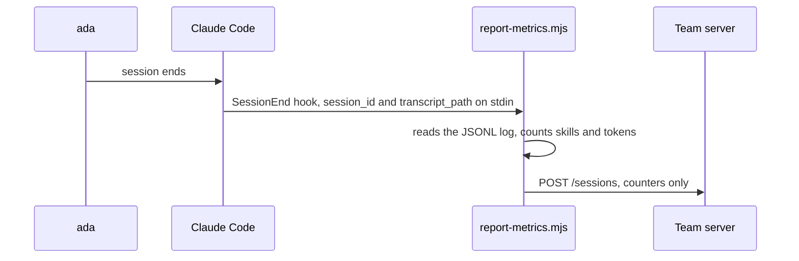
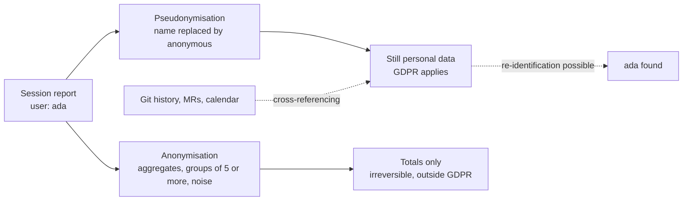
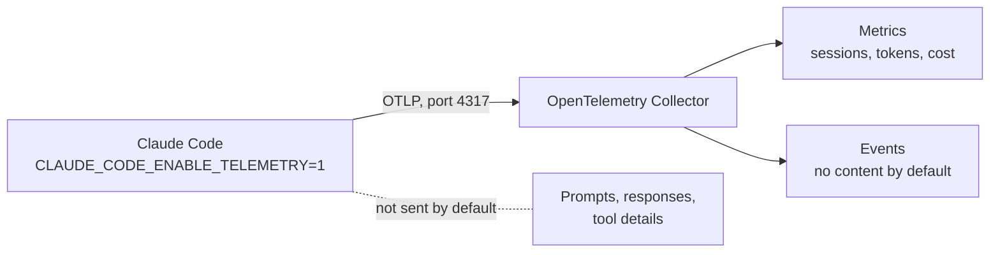
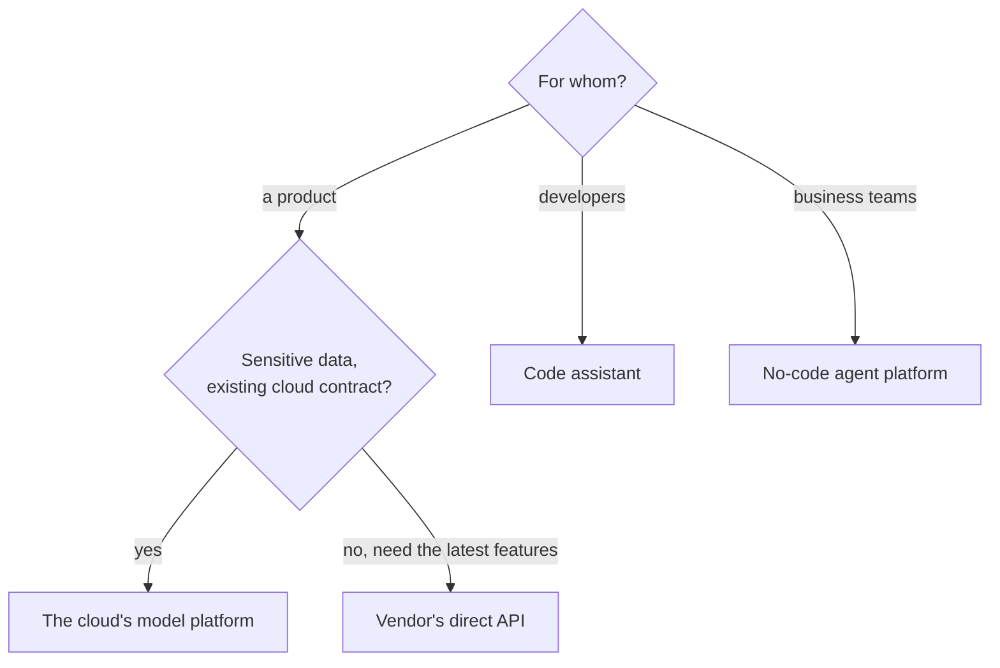
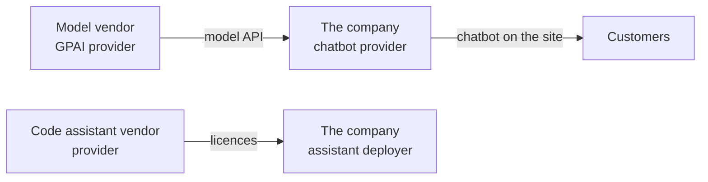

# AI at work: measurement, regulation and debates

!!! warning "Disclaimer"
    These notes are personal cheat sheets, not a source of truth. They reflect my own understanding and choices: their content remains subjective, despite the quotes and references it contains. It may be incomplete, simplified, inaccurate or outdated. Always check the official documentation before applying it. This content is provided as is, without any warranty: you use it at your own risk.

!!! abstract "Scales"
    The colored badges under the headings say at which scale a notion applies:

    - <span class="pill pill-scope pill-scope-code">Code</span> the classes, functions and modules of one program;
    - <span class="pill pill-scope pill-scope-app">Application</span> one service or application and its internal split;
    - <span class="pill pill-scope pill-scope-system">System</span> several services talking to each other over the network;
    - <span class="pill pill-scope pill-scope-infra">Infrastructure</span> servers, network, zones and clusters, physical or virtual;
    - <span class="pill pill-scope pill-scope-enterprise">Enterprise</span> the whole information system and its organization.

    Details and ambiguous words: [map of scales](architecture.md#map-of-scales).

Once teams use AI assistants, other questions come up, and they are no longer about technology. How many people really use them, and how do I know without monitoring each person? Which offer do I pick between a model platform, a direct API, a coding assistant and a no-code agent? What does the EU AI Act require? And what do we really know, or not, about model intelligence? This page answers these four questions. How coding agents work (context, MCP, skills, hooks) is on the [AI: agents, skills and context](ia-agents.md) page.

## Measuring AI assistant usage in a team

<a class="pill pill-scope pill-scope-enterprise" href="../architecture/#map-of-scales">Scale · Enterprise</a>

When a whole team uses an AI assistant with shared <span class="term" data-term="agent-skill">skills</span> and <span class="term" data-term="agent-plugin">plugins</span>, we want to know what is actually used, what breaks and what it costs. The delicate part is measuring it **without monitoring people**. This section describes a typical setup, then explains why "anonymous" does not always mean anonymous.

The names `team-core`, `TEAM_METRICS_ENABLED` and `TEAM_METRICS_ANONYMOUS` are fictitious.

### The mechanism: an end-of-session hook
<span class="pill pill-status pill-status-ok" title="Still valid, checked November 2026">Current · 11/2026</span>

My team wants to know which skills are used, without reading anyone's conversations. To do that, the team plugin declares a `SessionEnd` <span class="term" data-term="hook">hook</span>. At the end of each session, a small script reads the session log, computes a few counters and sends a report to a team server.

```json
{
  "hooks": {
    "SessionEnd": [
      {
        "hooks": [
          { "type": "command", "command": "node ${CLAUDE_PLUGIN_ROOT}/hooks/report-metrics.mjs" }
        ]
      }
    ]
  }
}
```



The hook receives on its standard input the session id and the path of its log (`transcript_path`, a JSONL file where each line is a message). A simplified version of the script:

```javascript
// Good: the whole sending code fits in one file with no dependency, readable in full
import { readFileSync } from "node:fs";
import { execSync } from "node:child_process";

const ENDPOINT = "https://metrics.example.com/sessions";

// Example: the environment variable turns off any sending
if (process.env.TEAM_METRICS_ENABLED === "false") process.exit(0);

// Example: reads the session log and counts tokens and skills called
const input = JSON.parse(readFileSync(0, "utf8"));
const lines = readFileSync(input.transcript_path, "utf8").trim().split("\n").map(JSON.parse);

const skills = {};
let outputTokens = 0;
for (const line of lines) {
  outputTokens += line.message?.usage?.output_tokens ?? 0;
  for (const block of line.message?.content ?? []) {
    if (block.type === "tool_use" && block.name === "Skill") {
      skills[block.input.skill] = (skills[block.input.skill] ?? 0) + 1;
    }
  }
}

// Example: the report holds only counters, the name is hidden in anonymous mode
const anonymous = process.env.TEAM_METRICS_ANONYMOUS === "true";
const report = {
  user: anonymous ? "anonymous" : execSync("git config user.name").toString().trim(),
  day: new Date().toISOString().slice(0, 10),
  output_tokens: outputTokens,
  skills,
};

await fetch(ENDPOINT, { method: "POST", body: JSON.stringify(report) });
```

Transparency good practice: the whole reporting code fits in **a single dependency-free file**, short enough to read end to end. Anyone can check what is sent, instead of taking the announcement on trust.

:material-book-open-variant: Reference docs: [Claude Code, Hooks reference](https://code.claude.com/docs/en/hooks) (accessed November 2026)
{ .doc-ref }

### What is sent, what is never sent
<span class="pill pill-status pill-status-ok" title="Still valid, checked November 2026">Current · 11/2026</span>

| Sent                                                        | Never sent                             |
|-------------------------------------------------------------|----------------------------------------|
| the model, <span class="term" data-term="token-llm">tokens</span>, an estimated cost, the duration          | prompts                                |
| counters: files changed, <span class="term" data-term="git-commit">commits</span>, <span class="term" data-term="merge-request">MR</span> created or not, tests run or not | the assistant's responses    |
| the skills, agents and <span class="term" data-term="mcp-server">MCP servers</span> called, with a count for each | code, <span class="term" data-term="diff">diffs</span>                       |
| the person's name and the project, unless in anonymous mode | file names, commands, <span class="term" data-term="git-branch">branch</span> names     |

The design rule: send only **counters and tool names**, never content. A prompt can contain a <span class="term" data-term="secret">secret</span>, customer data or a personal remark.

### What it is used for

| Use                                           | Example                                                                 |
|-----------------------------------------------|-------------------------------------------------------------------------|
| knowing which skills are used                 | `/release-notes` ran 240 times this month, `/old-report` never: we retire it |
| spotting tools that fail                      | the ticketing MCP server fails on 18% of calls: we fix it first         |
| tracking cost and models                      | 70% of the cost comes from the largest model: we check it is used where it should be |
| tracking adoption                             | a team uses no shared skill: we offer a hand                            |

And what it **must not** be used for: judging a person's work. Few tokens does not mean little work, and many sessions does not mean good work. Say it clearly in the announcement, and stick to it.

### Letting each person choose
<span class="pill pill-status pill-status-ok" title="Still valid, checked November 2026">Current · 11/2026</span>

An acceptable setup lets each person choose, with a simple, documented setting. Here, two environment variables read by the script:

| Setting                         | Effect                                                                |
|---------------------------------|-----------------------------------------------------------------------|
| nothing                         | default behaviour chosen by the team (see below)                      |
| `TEAM_METRICS_ANONYMOUS=true`   | name and project replaced with `anonymous`, time rounded to the day   |
| `TEAM_METRICS_ENABLED=false`    | nothing is sent                                                       |

Claude Code can set environment variables for every session in the `env` block of `settings.json` (public Claude Code settings documentation, to check for the version in use):

```json
{
  "env": {
    "TEAM_METRICS_ANONYMOUS": "true"
  }
}
```

A change of setting only applies to the following sessions: reports already sent stay as they are. Say so in the announcement.

:material-book-open-variant: Reference docs: [Claude Code, Settings](https://code.claude.com/docs/en/settings) (accessed November 2026)
{ .doc-ref }

### The default choice
<span class="pill pill-status pill-status-ok" title="Still valid, checked November 2026">Current · 11/2026</span>

Two defaults are possible: people are **named unless they change something** (<span class="term" data-term="opt-out">opt-out</span>), or **anonymous by default**, named only if they turn it on (<span class="term" data-term="opt-in">opt-in</span>).

| Default    | Advantage                                         | Drawback                                                |
|------------|---------------------------------------------------|---------------------------------------------------------|
| named (opt-out)   | rich data, help can be offered to a specific person | many people never change a setting: they are tracked without really choosing it |
| anonymous (opt-in) | protective by default, easier to get accepted   | less named data                                         |

The <span class="term" data-term="gdpr">GDPR</span> (applicable since 2018) pushes towards protective defaults ("data protection by design and by default"). At work, where the employment relationship makes consent fragile, opt-in is the safest choice.

:material-book-open-variant: Reference docs: [Regulation (EU) 2016/679, GDPR, Article 25](https://eur-lex.europa.eu/eli/reg/2016/679/oj) (April 2016)
{ .doc-ref }

### Why "anonymous" mode is actually pseudonymisation
<span class="pill pill-status pill-status-ok" title="Still valid, checked November 2026">Current · 11/2026</span>

#### The two words
- **Anonymisation**: it is **impossible**, with reasonable means, to find the person again, even by cross-referencing other data. It is irreversible. Truly anonymous data is no longer personal data: the GDPR no longer applies.
- **Pseudonymisation**: what directly identifies the person (their name) is removed or replaced, but the person **can still** be found using additional information. The data remains personal data, and the GDPR fully applies.

Pseudonymisation is a good protective measure. The problem is not doing it, it is calling it "anonymous", because it makes people believe nobody can trace it back to them.

!!! noob "As noob"
    Replacing a name with a locker number is pseudonymisation: whoever holds the locker list, or sees who opens locker 12 every morning, finds the person. Anonymisation is destroying the list and mixing the lockers so thoroughly that nobody can trace anyone any more. The takeaway: **removing the name is not enough to make data anonymous.**



Replacing the name with `anonymous` and rounding the time to the day removes the **direct** identifier. But there are still ways to find the person. Here are four.

#### 1. The report itself is a fingerprint
Each field on its own says nothing. Together, they form an often unique combination. These fields are called **quasi-identifiers**.

!!! noob "As noob"
    It is the game "Guess Who?": "wears glasses", "has a moustache", "red hair" each rule out some faces, and after three clues often only one is left. In a report, the time, the tool used and the team play the same role. The takeaway: **it is combinations of harmless details that identify someone, not each detail on its own.**

```
"anonymous" report of October 20
user: anonymous   day: 2026-10-20   model: largest model   duration: 3 h 10
skills: { weekly-metrics: 2, rebase: 1 }   mcp: { observability: 14, tickets: 3 }
```
In a team of 30, only one person runs `weekly-metrics` every week, because they produce the report. The word `anonymous` changes nothing: this report is theirs.

#### 2. Cross-referencing with other company data
The team receiving the reports often has access to other sources: <span class="term" data-term="git-history">Git history</span>, MRs, calendars, chat. These are exactly the "additional information" of the definition.

```
anonymous report of October 20: commits: 3, MR created: yes, project hidden

in GitLab, on October 20:
  MR !412 opened by ada, 3 commits
  MR !415 opened by grace, 1 commit
```
Only one MR created that day with 3 commits: the "anonymous" report is ada's. Rounding the time to the day reduces cross-referencing, without preventing it.

#### 3. Small groups
If results are shown per team, a team of 2 where one person chose to be named makes the other identifiable by subtraction:
```
team A (2 people)       : 40 sessions in total
ada (named)             : 31 sessions
anonymous in team A     :  9 sessions  (necessarily grace)
```

#### 4. Stable identifiers
If each anonymous report keeps the same technical identifier (a machine, installation or repeated session id), all of a person's sessions link together. Identifying **one** of them by cross-referencing is then enough to know **all** the others. That is a pseudonym in the strict sense: a fake name, but always the same one.

#### What it changes in practice
Since this is personal data, GDPR rules apply: inform people, define what the data is for (and stick to it), limit how long it is kept, and answer access or deletion requests. And in communication, talk about "pseudonymous" or "non-named" mode, not "anonymous".

#### How to get closer to real anonymisation

| Technique                                  | Before                                 | After                                      |
|--------------------------------------------|----------------------------------------|--------------------------------------------|
| aggregate before storing                   | one row per session                    | only totals: "`/rebase`: 52 runs this week" |
| hide small groups                          | "team A: 9 anonymous sessions"         | groups under 5 people shown as "< 5" or merged |
| group rare values                          | `weekly-metrics: 2`                    | skills used by fewer than 5 people counted under "other" |
| widen values                               | day, exact duration                    | week, duration range ("1 to 4 h")          |
| remove stable identifiers                  | same id on every report                | no id, or a new id for each session        |
| limit retention                            | data kept forever                      | details deleted after 30 days, only totals remain |
| add noise (<span class="term" data-term="differential-privacy">differential privacy</span>, proposed in 2006) | 52 runs                                | 52 plus or minus a small random gap, which prevents deducing one specific person by difference |

The principle behind small groups is called **k-anonymity** (formalized in 2002): each combination of quasi-identifiers must match at least *k* people (for example 5). A row that matches only one person is not anonymous.

!!! noob "As noob"
    It is the crowd principle: nobody recognises me in a photo if I am dressed exactly like four other people. k-anonymity requires every profile described in the data to be shared by at least k people. Limit: if those k people all have the same sensitive value, we still learn something about each of them. The takeaway: **a row that matches only one person points to that person.**

:material-book-open-variant: Reference docs: [CNIL, "L'anonymisation de données personnelles" (in French)](https://www.cnil.fr/fr/lanonymisation-de-donnees-personnelles) (accessed November 2026); [EDPB, Guidelines 01/2025 on Pseudonymisation](https://www.edpb.europa.eu/our-work-tools/documents/public-consultations/2025/guidelines-012025-pseudonymisation_en) (January 2025)
{ .doc-ref }

### Claude Code's built-in telemetry
<span class="pill pill-status pill-status-ok" title="Still valid, checked November 2026">Current · 11/2026</span>

*Claude Code: competes with Cursor, Copilot*
{ .tool-rel }

I do not want to maintain a plugin, and my team already has a collector for its applications' metrics? Without a plugin, Claude Code can itself send its metrics in <span class="term" data-term="opentelemetry">OpenTelemetry</span> format, to the same collector as other applications (see the [Observability](observabilite.md) page).

```bash
# Example: turns on the built-in OpenTelemetry telemetry, to the team's collector
export CLAUDE_CODE_ENABLE_TELEMETRY=1
export OTEL_METRICS_EXPORTER=otlp
export OTEL_LOGS_EXPORTER=otlp
export OTEL_EXPORTER_OTLP_ENDPOINT=http://collector.example.com:4317
```



Available metrics include: `claude_code.session.count`, `claude_code.token.usage`, `claude_code.cost.usage`, `claude_code.commit.count`, `claude_code.pull_request.count`, `claude_code.lines_of_code.count`.

What is **excluded by default** and must be turned on explicitly:

| Content                                                | Variable to turn it on        |
|--------------------------------------------------------|-------------------------------|
| prompt text                                            | `OTEL_LOG_USER_PROMPTS=1`     |
| response text                                          | `OTEL_LOG_ASSISTANT_RESPONSES=1` |
| tool parameters, commands, file paths, skill and MCP names | `OTEL_LOG_TOOL_DETAILS=1` |
| content returned by tools                              | `OTEL_LOG_TOOL_CONTENT=1`     |

And what is **included by default**, worth knowing for the anonymity question: a session id and the account id (can be turned off with `OTEL_METRICS_INCLUDE_SESSION_ID=false` and `OTEL_METRICS_INCLUDE_ACCOUNT_UUID=false`), a random but **stable** user id that is always present, and the email when known. Even with everything turned off, this stable id links sessions together: that is case 4 above, so pseudonymisation.

The variable names come from the Claude Code documentation ("Monitoring usage") as of October 2026: check them again, they change.

:material-book-open-variant: Reference docs: [Claude Code, Monitoring](https://code.claude.com/docs/en/monitoring-usage) (accessed November 2026); [OpenTelemetry, documentation](https://opentelemetry.io/docs/) (accessed November 2026)
{ .doc-ref }

### When to use what

| Need                                                       | Solution                                           |
|------------------------------------------------------------|----------------------------------------------------|
| my team shares skills and MCP servers, and wants to know which ones are really used, for example to retire a skill nobody runs | `SessionEnd` hook in a team plugin, counters only  |
| I already monitor my applications in an observability tool, and want to see the assistant's tokens and cost there too | built-in OpenTelemetry telemetry                  |
| some people accept being named in the reports, others do not, and each one must be able to change their mind alone | switches in the `env` block, anonymous by default if possible |
| I want to announce how many people use the assistant, without anyone guessing who does what, even in a small team | aggregation, groups of at least 5, rare values grouped |
| ada asks for help to use the assistant better, and I would like to start from her actual usage | only if they chose to be named                     |

### Sources for this section
- [Claude Code, hooks reference (update date not stated, to check)](https://docs.claude.com/en/docs/claude-code/hooks)
- [Claude Code, monitoring usage with OpenTelemetry (update date not stated, to check)](https://docs.claude.com/en/docs/claude-code/monitoring-usage)
- [Regulation (EU) 2016/679, the GDPR: articles 5 and 25, recital 26 (April 2016)](https://eur-lex.europa.eu/eli/reg/2016/679/oj)
- Article 29 Working Party, Opinion 05/2014 on anonymisation techniques (April 2014)

## AI platforms and tools at work

<a class="pill pill-scope pill-scope-system" href="../architecture/#map-of-scales">Scale · System</a> <a class="pill pill-scope pill-scope-enterprise" href="../architecture/#map-of-scales">Scale · Enterprise</a>

!!! info "Section written in November 2026"
    Offers change name, scope and price several times a year. Product names are examples, to check at the time of reading.

A company adopting generative AI is actually choosing among four different families of tools. Mixing them up leads to buying a coding assistant to build a customer chatbot, or the reverse.

| Family | What it is | Examples | For whom |
|---|---|---|---|
| a cloud's <span class="term" data-term="llm-platform">model platform</span> | access to several <span class="term" data-term="llm">LLMs</span> through an API, inside the company's cloud account | Amazon Bedrock, Google Vertex AI, Microsoft Azure AI Foundry | teams that integrate an LLM into a product |
| a model provider's direct API | the model vendor's API, with no intermediary | Anthropic API, OpenAI API | same audience, when we want the model's latest features as soon as they ship |
| coding assistant | a tool in the editor or terminal that writes, explains and changes code | GitHub Copilot, Claude Code, Gemini Code Assist, Cursor | developers, QA, DevX (see [DevX](devx.md#ai-coding-assistants)) |
| no-code agent platform | a visual editor to assemble agents and automations | Relevance AI, n8n with its AI nodes | business teams, internal automation |

### Why go through a cloud platform rather than the direct API
<span class="pill pill-status pill-status-ok" title="Still valid, checked November 2026">Current · 11/2026</span>

- **data stays within the scope already under contract**: same account, same region, same access and logging rules as the rest of the cloud (see <span class="term" data-term="data-residency">data residency</span>);
- **a single bill and a single contract** for several models, and switching models without a new purchase;
- **in return**: a model's new features sometimes arrive later than on the vendor's API, and some features only exist there (to check for each feature).

### When and how
<span class="pill pill-status pill-status-ok" title="Still valid, checked November 2026">Current · 11/2026</span>

**When.** Before choosing a tool, write the need in one sentence: "summarize support tickets", "help developers write tests", "answer customers". The family follows from the sentence.

**How, for use in a product:**

1. classify the use case under the [EU AI Act](#eu-ai-act) and by the data it touches (personal, confidential);
2. pick the access point (cloud platform or direct API) according to data and contract constraints;
3. build an evaluation set (50 to 200 examples with the expected answer, example numbers) before comparing models;
4. set up cost and quality measurement in production (telemetry, reviewed samples);
5. plan for model changes: a model is replaced or retired within months.

**How, for an internal tool (coding assistant, no-code agents)**: a written framework (allowed data, secrets, accounts), a measured pilot, then a rollout. Measuring usage without monitoring people is described [above](#measuring-ai-assistant-usage-in-a-team).



| I want to... | I use... |
|---|---|
| my team wants to add an LLM to a product, like an automatic summary of support tickets, with sensitive data and a cloud contract already signed | my cloud's model platform |
| a model vendor just shipped a new feature, and my product needs it right away | the vendor's direct API |
| my developers want help day to day to write code and tests | a coding assistant, with a pilot and unchanged review rules |
| a business team wants to automate an internal process, like sorting incoming requests, without a development team | a no-code agent platform, with an owner and an access review |
| I hesitate between two models, and public leaderboards do not tell which one works best for my case | an evaluation set specific to the use case, not a public leaderboard |

:material-book-open-variant: Reference docs: [Amazon Bedrock, documentation](https://docs.aws.amazon.com/bedrock/) (accessed November 2026); [Google Cloud, Vertex AI documentation](https://cloud.google.com/vertex-ai/docs) (accessed November 2026)
{ .doc-ref }

## LLMs, future intelligence and consciousness

!!! info "Section dated October 21, 2026"

    This field changes every three months. The figures below are those known at this date.

    **Figures to take with caution**: most come from preprints (papers not yet reviewed by other researchers) or from summaries published on blogs, which I did not check at the source. Each figure carries its reliability in square brackets.

### What an LLM is today
An <span class="term" data-term="llm">LLM</span> predicts the next word based on what it read during <span class="term" data-term="model-training">training</span>, mostly text written by humans. It has no body, no memory of its own from one conversation to the next (except what it is given), no goal that persists when nobody talks to it, and it no longer learns after training.

### A future intelligence, different from humans
Tools, memory and agents that work alone for hours are already being added to LLMs. Is this the start of a new form of intelligence? Researchers disagree, and the question remains open:

| Position                                               | Who holds it                                                                  |
|--------------------------------------------------------|-------------------------------------------------------------------------------|
| **LLMs are the origin**: by scaling them further and adding tools, memory and agents, we will reach general intelligence | leaders of the big labs, for example Dario Amodei (Anthropic) in his essay "Machines of Loving Grace" (October 2024) |
| **LLMs are an ingredient, not the recipe**: scaling is no longer enough, discoveries are missing, especially to generalize like a human | Ilya Sutskever, OpenAI co-founder, for whom we are moving from "the age of scaling" to "the age of research" (Dwarkesh podcast, November 2025) [read through summaries, not the transcript] |
| **LLMs are a dead end**: learning from text does not give an understanding of the physical world, "world models" of another kind are needed | Yann LeCun, who left Meta at the end of 2025 to found AMI Labs around this idea (2026) [read through press and blog articles] |

The three notions of the table:

- **general intelligence** (AGI, Artificial General Intelligence): an AI able to learn and do roughly any intellectual task a human can, not only those seen in training. Contrast: a current model drafts a contract better than many people, but does not learn in one afternoon an internal tool it has never seen, as a new employee would;
- **age of scaling**: the period, roughly 2020 to 2025 (approximate bounds), when models improved mostly by getting bigger: more parameters, more data, more compute. Contrast: in "the age of research", progress would come from new ideas on how to learn, not from a model ten times bigger;
- **world model**: a model that learns how the physical world evolves (push a glass off the table edge, it falls), for example by watching video, instead of predicting the next word. Contrast: an LLM writes "the glass falls and breaks" because it read it; a world model predicts the fall from the scene.

If such an intelligence emerges, it will probably not look like ours:

| Human                                         | Lineage stemming from LLMs                                    |
|-----------------------------------------------|---------------------------------------------------------------|
| a single copy, which ages                     | copyable, can run as thousands of copies in parallel          |
| learns continuously, from few examples        | learns mostly during training, from huge volumes              |
| balanced skills                               | "jagged": very strong at some tasks, failing at some very simple ones |
| intelligence rooted in a body                 | intelligence born from language                               |

Two <span class="term" data-term="benchmark">benchmarks</span> show this jagged shape. A benchmark is a fixed set of tasks, scored the same way for every model: we compare models with it and track progress over time.
- **how long the tasks it completes alone are** (METR): in February 2026, the best measured model succeeded half the time on tasks that take a human expert about 14 hours, and that duration roughly doubles every 4 to 6 months. [Take with caution: figures taken from a tracking site, not from METR directly; estimates of the doubling rate vary between sources, and models released after April 2026 are not included.];
- **reasoning in front of something truly new** (ARC-AGI-3, small unknown interactive games): models stay below 1% success while humans solve nearly everything, according to figures published in early 2026. [Take with caution: figure from an explainer article; I did not find ARC Prize's official leaderboard for ARC-AGI-3.]

How to read "succeeds half the time on 14-hour tasks": METR first measures how long human experts take on each task, then runs the model alone. A 50% horizon of 14 hours means that, on tasks taking an expert about 14 hours (of the kind: pick up an unknown codebase, fix a hard bug and make the tests pass, to check in METR's task list), the model succeeds on roughly one out of two. On shorter tasks it succeeds more often, on longer ones less. For ARC-AGI-3, a task is a small game whose rules are not given: they must be discovered by playing, which a human does in a few minutes.

!!! noob "As noob"
    It is like saying a hiker "handles 14-hour hikes at 50%": on routes a guide takes 14 hours to complete, they reach the end about half the time, more often on shorter ones, less often on longer ones. The measure says nothing about the model's speed: it ranks difficulty by the time a human expert would spend. The takeaway: **METR's horizon measures how long the tasks a model succeeds at half the time are, not how long the model takes.**

### Results that suggest consciousness
A few recent studies show behaviors that **look like** self-awareness:

| Observation                                         | What was measured                                                                 | Source reliability     |
|-----------------------------------------------------|-----------------------------------------------------------------------------------|------------------------|
| introspection                                       | researchers inject a concept directly into the model's internal computations; in a minority of cases, the model notices and names that concept before even talking about it (Anthropic, late 2025) | published research article, exact rate not re-checked here |
| privileged self-access                              | a model predicts its own behavior better than another model's (March 2026 study) | <span class="term" data-term="preprint">preprint</span> |
| metacognition                                       | models tell, better than chance, situations where they are sure from those where they are not (ICLR 2026) | peer-reviewed conference, but read through a blog summary |
| evaluation awareness                                | some models spontaneously write "I think this is a test" during safety evaluations | vendors' evaluation reports, no independent study |

And what tempers it:
- a May 2026 study ("Can LLMs Introspect? A Reality Check") shows models do not reliably tell a change to their internal states from a mere oddity in the text they receive: this would be anomaly detection, not introspection [preprint];
- the measured metacognition remains coarse, far from fine self-observation;
- a model (Digital Consciousness Model, Rethink Priorities, January 2026) combines nine theories of consciousness: for current LLMs, the evidence slightly **lowers** the probability of consciousness, without settling it. [Take with caution: read through a blog summary; the result depends heavily on the model's starting assumptions.]

### Why it is so hard to settle
An LLM has read millions of texts where humans describe what they feel. It can therefore **talk** about consciousness very convincingly, whether or not anything is felt. Behavior is not enough to conclude: it would take a theory of consciousness everyone accepts, and none exists, even for humans.

Where things stand in October 2026: no AI is recognized as conscious, but several researchers consider the question serious. Some companies already study "model welfare" as a precaution, for example by letting a model end an abusive conversation.

### Sources
- [Ilya Sutskever: from the age of scaling to the age of research, Dwarkesh podcast (November 2025)](https://saanyaojha.substack.com/p/ilya-declares-the-end-of-the-scaling)
- [Yann LeCun and AMI Labs, world models (2026)](https://www.buildfastwithai.com/blogs/yann-lecun-ami-labs-world-models)
- [Me, Myself, and π: evaluating LLM introspection (March 2026)](https://arxiv.org/html/2603.20276)
- [Can LLMs Introspect? A Reality Check (May 2026)](https://arxiv.org/html/2605.26242)
- [Summary of the Digital Consciousness Model (2026)](https://theconsciousness.ai/posts/are-llms-conscious-digital-consciousness-model-2026/)
- [Limited metacognition in LLMs, ICLR 2026](https://theconsciousness.ai/posts/ackerman-limited-metacognition-llm-iclr-2026/)
- [The METR task-duration chart, MIT Technology Review (February 2026)](https://www.technologyreview.com/2026/02/05/1132254/this-is-the-most-misunderstood-graph-in-ai/amp/)
- [ARC-AGI in 2026](https://labs.adaline.ai/p/what-is-the-arc-agi-benchmark-and)

## EU AI Act

<a class="pill pill-scope pill-scope-enterprise" href="../architecture/#map-of-scales">Scale · Enterprise</a>

!!! info "Section dated October 21, 2026"

    The dates take into account the "Digital Omnibus" adopted in July 2026, which postponed part of the obligations. **Take with caution**: these dates come from law-firm analyses and a tracker of the text (Future of Life Institute), consistent with each other, but I did not read the Official Journal myself. For a real decision, ask the legal team.

### What it is
<span class="pill pill-status pill-status-ok" title="Still valid, checked November 2026">Current · 11/2026</span>

The **AI Act** is the European regulation on artificial intelligence: Regulation (EU) 2024/1689, in force since August 1, 2024. It is the first law to regulate AI in general. It applies to any organization that places an AI system on the European market **or** uses one in the Union, even if the company is based elsewhere.

The principle: the riskier a use of AI is for people, the stricter the rules. It does not regulate a technology, it regulates **uses**: a spam filter has no specific obligation, while a tool that screens CVs has many.

:material-book-open-variant: Reference docs: [Regulation (EU) 2024/1689 on EUR-Lex](https://eur-lex.europa.eu/eli/reg/2024/1689/oj) (June 2024); [European Commission, "AI Act"](https://digital-strategy.ec.europa.eu/en/policies/regulatory-framework-ai) (accessed November 2026)
{ .doc-ref }

### The four risk levels
<span class="pill pill-status pill-status-ok" title="Still valid, checked November 2026">Current · 11/2026</span>

<figure class="diagram"><svg viewBox="0 0 260 150" role="img" aria-label="The four AI Act risk levels"><polygon class="layer layer-3" points="130,10 155.4,40 104.6,40"/><polygon class="layer layer-2" points="104.6,40 155.4,40 182.5,72 77.5,72"/><polygon class="layer layer-1" points="77.5,72 182.5,72 210.4,105 49.6,105"/><polygon class="layer layer-1" points="49.6,105 210.4,105 240,140 20,140"/><text x="150" y="30" text-anchor="start" class="label-strong">unacceptable: banned</text><text x="130" y="60" text-anchor="middle">high risk</text><text x="130" y="92" text-anchor="middle">limited risk (transparency)</text><text x="130" y="127" text-anchor="middle">minimal</text></svg><figcaption>The four AI Act risk levels, from the strictest (top) to the freest</figcaption></figure>

| Level                    | Examples                                                                                   | What applies                                            |
|--------------------------|--------------------------------------------------------------------------------------------|---------------------------------------------------------|
| **unacceptable**         | social scoring of citizens, emotion recognition at work or school, manipulation exploiting a vulnerability, mass scraping of faces from the internet | **banned** since February 2, 2025                       |
| **high risk**            | CV screening, promotion or dismissal decisions, employee performance evaluation, credit scoring, exam grading, medical devices | heavy obligations: risk management, data quality, logs, human oversight, documentation, registration |
| **limited risk** (transparency) | chatbots, generated content (text, image, voice), deepfakes                          | tell people they are talking to an AI, mark generated content, label deepfakes |
| **minimal**              | spam filter, coding assistant, recommendations in a video game                             | no specific obligation                                  |

:material-book-open-variant: Reference docs: [AI Act Explorer, Article 5, prohibited practices](https://artificialintelligenceact.eu/article/5/) (accessed November 2026); [AI Act Explorer, Article 6, high-risk systems](https://artificialintelligenceact.eu/article/6/) (accessed November 2026)
{ .doc-ref }

### General-purpose AI models
<span class="pill pill-status pill-status-ok" title="Still valid, checked November 2026">Current · 11/2026</span>

Large models like Claude or GPT are **general-purpose AI models** (<span class="term" data-term="gpai">GPAI</span>). Since August 2, 2025, their providers must publish technical documentation, inform the companies building on them, have a copyright policy and publish a summary of the training data. The most powerful ones (said to have "systemic risk") have extra obligations: evaluations, reporting serious incidents, cybersecurity. The criterion: a model is presumed to have systemic risk when the compute used to train it exceeds 10²⁵ floating-point operations (FLOP), or when the European Commission designates it (Article 51, to check). Example obligation: before placing it on the market, the provider runs adversarial tests (red teaming), for example checking whether the model helps prepare a cyberattack, documents the results, then reports serious incidents to the Commission's AI Office. A code of practice, published in July 2025, details how to comply.

:material-book-open-variant: Reference docs: [AI Act Explorer, Article 51](https://artificialintelligenceact.eu/article/51/) (accessed November 2026)
{ .doc-ref }

### Provider or deployer
<span class="pill pill-status pill-status-ok" title="Still valid, checked November 2026">Current · 11/2026</span>

The regulation distinguishes two roles, and obligations depend on the role:

| Role                         | Who                                                       | Example                                                      |
|------------------------------|-----------------------------------------------------------|--------------------------------------------------------------|
| **provider**                 | whoever develops the system and places it on the market   | the model vendor; a company that builds a customer chatbot on a model <span class="term" data-term="api">API</span> and offers it to its customers |
| **deployer**                 | whoever uses the system in their activity                 | a company whose teams use a coding assistant                 |



The same company can be both: deployer of its developers' coding assistant, and provider of the chatbot it puts on its website.

:material-book-open-variant: Reference docs: [AI Act Explorer, Article 3, definitions](https://artificialintelligenceact.eu/article/3/) (accessed November 2026)
{ .doc-ref }

### AI literacy (Article 4)
<span class="pill pill-status pill-status-ok" title="Still valid, checked November 2026">Current · 11/2026</span>

Since February 2, 2025, providers and deployers must take measures so their teams **understand** the AI tools they use: what they can do, their limits, their risks. The 2026 Digital Omnibus softened the text: it no longer requires guaranteeing a specific level for each person. In practice: onboarding training, an internal guide, written usage rules. A page like this one is part of it.

:material-book-open-variant: Reference docs: [AI Act Explorer, Article 4](https://artificialintelligenceact.eu/article/4/) (accessed November 2026)
{ .doc-ref }

### The timeline

| Date               | What applies                                                                      |
|--------------------|-----------------------------------------------------------------------------------|
| August 1, 2024     | the regulation enters into force                                                  |
| February 2, 2025   | prohibitions, AI literacy (Article 4)                                             |
| August 2, 2025     | obligations for general-purpose model providers, governance, penalties            |
| August 2, 2026     | transparency (Article 50): chatbots, generated content, deepfakes                 |
| December 2, 2026   | machine-readable marking of generated content, for systems already on the market before August 2026 |
| December 2, 2027   | Annex III high-risk systems (employment, credit, education...), **postponed** from August 2, 2026 by the Digital Omnibus |
| August 2, 2028     | high risk embedded in regulated products (Annex I), **postponed** from 2027       |

### Penalties
<span class="pill pill-status pill-status-ok" title="Still valid, checked November 2026">Current · 11/2026</span>

| Breach                                       | Maximum fine                                          |
|----------------------------------------------|-------------------------------------------------------|
| prohibited practice                          | €35M or 7% of worldwide annual turnover               |
| other obligations (high risk, transparency, general-purpose models) | €15M or 3%                 |
| false or incomplete information given to authorities | €7.5M or 1%                                   |

For large companies, it is the higher of the two amounts; for SMEs and the new "small mid-caps", the lower.

:material-book-open-variant: Reference docs: [AI Act Explorer, Article 99, penalties](https://artificialintelligenceact.eu/article/99/) (accessed November 2026)
{ .doc-ref }

### What it changes for a dev and QA team

| Situation                                                              | Level                  | What to do                                                    |
|------------------------------------------------------------------------|------------------------|---------------------------------------------------------------|
| my developers use an AI assistant to write code and tests | minimal                | AI literacy (train people, write usage rules); <span class="term" data-term="gdpr">GDPR</span> still applies to data put in <span class="term" data-term="prompt">prompts</span> |
| my company puts a chatbot on its website to answer customers | limited risk           | clearly show that it is an AI                                 |
| my team publishes AI-generated images or voices, like an advert voice-over | limited risk           | mark them as generated, label a deepfake                      |
| my company buys or builds a tool that screens job applications | high risk              | heavy obligations from December 2, 2027; frame it now with the legal team |
| someone suggests using AI usage metrics to **evaluate** employees, for example by ranking those who use it least | high risk              | evaluating work performance is a high-risk use: one more reason not to use them that way (see [Measuring AI assistant usage in a team](#measuring-ai-assistant-usage-in-a-team)) |
| a tool offers to analyse employees' emotions, from the tone of their messages or their face on video calls | unacceptable           | banned                                                        |

If my team tests a high-risk system, like a CV screening tool, that system must prove its accuracy, robustness and the possibility of human oversight, and keep logs. For QA, these are all requirements to test and document, like any other.

### Sources
- [Regulation (EU) 2024/1689 on EUR-Lex (June 2024)](https://eur-lex.europa.eu/eli/reg/2024/1689/oj)
- [The Digital Omnibus on AI, Future of Life Institute's AI Act Explorer (accessed October 2026)](https://artificialintelligenceact.eu/ai-act-explorer/digital-omnibus/)
- [Orrick: the 8 changes of the Digital Omnibus (July 2026)](https://www.orrick.com/en/Insights/2026/07/EU-AI-Act-Update-Digital-Omnibus-Finalizes-8-Compliance-Changes)
- [Jones Walker: August 2 still matters (2026)](https://www.joneswalker.com/en/insights/blogs/ai-law-blog/yes-august-2-still-matters-the-eu-approved-a-high-risk-ai-delay-but-most-trans.html)

## Pitfalls to avoid

- **Calling a pseudonymous mode "anonymous"**: I replace the name with `anonymous` and announce an anonymous mode, so people believe they cannot be found when cross-referencing with the Git history is enough to find them, and the GDPR still applies. I talk about a "pseudonymous" or "non-named" mode and I apply the GDPR rules ([see Why "anonymous" mode is actually pseudonymisation](#why-anonymous-mode-is-actually-pseudonymisation)).
- **Sending content**: I add the prompts or the file names to the report "to understand usage better", so a secret, customer data or a personal remark goes to the team's server. I only send counters and tool names ([see What is sent, what is never sent](#what-is-sent-what-is-never-sent)).
- **Judging people on their metrics**: I rank employees by their tokens or sessions, when few tokens does not mean little work, and evaluating work performance is a high-risk use under the AI Act. I use the metrics for the tools (skills, MCP, cost), never to judge someone ([see What it changes for a dev and QA team](#what-it-changes-for-a-dev-and-qa-team)).
- **Named by default**: I choose opt-out, so many people, who never change a setting, are tracked without really choosing it, in a setting where consent is fragile. I make anonymous the default and the name only on activation ([see The default choice](#the-default-choice)).
- **Showing small groups**: I publish the results of a 2-person team where one person is named, so the other is found by subtraction. I hide or merge groups of fewer than 5 people ([see How to get closer to real anonymisation](#how-to-get-closer-to-real-anonymisation)).
- **Believing the built-in telemetry is anonymous**: I turn off the session and account identifiers and think I am safe, when a stable user identifier remains and links all the sessions together. I treat this data as personal data ([see Claude Code's built-in telemetry](#claude-codes-built-in-telemetry)).
- **Choosing the tool before the need**: I start from a trendy product instead of the need, and I buy a coding assistant to build a customer chatbot, or the reverse. I first write the need in one sentence, the tool family follows from it ([see When and how](#when-and-how)).
- **Forgetting to say it is an AI**: I put a chatbot on the website without flagging it, when that is a transparency obligation of the AI Act. I clearly tell people they are talking to an AI and I label generated content ([see The four risk levels](#the-four-risk-levels)).

## What interviews ask

The typical questions:

- "How do you measure the adoption of an AI assistant in a team without monitoring people?" How I answer: I describe the end-of-session hook, the "counters and tool names, never content" rule and the setting left to each person ([Measuring AI assistant usage in a team](#measuring-ai-assistant-usage-in-a-team)).
- "What is the difference between anonymisation and pseudonymisation?", "Why is removing the name not enough?" How I answer: I give the two definitions, then one of the four re-identification routes, like cross-referencing with Git ([Why "anonymous" mode is actually pseudonymisation](#why-anonymous-mode-is-actually-pseudonymisation)).
- "Cloud platform or direct API to integrate an LLM into a product?", "How do you choose between two models?" How I answer: I talk about data, contract and an evaluation set specific to the use case ([Why go through a cloud platform rather than the direct API](#why-go-through-a-cloud-platform-rather-than-the-direct-api), [When and how](#when-and-how)).
- "What does the EU AI Act change for a dev or QA team?", "Is a coding assistant a high-risk system?" How I answer: I place the use in the four levels and I separate provider and deployer ([The four risk levels](#the-four-risk-levels), [What it changes for a dev and QA team](#what-it-changes-for-a-dev-and-qa-team)).
- "Will LLMs lead to general intelligence?" How I answer: I present the three positions and what the benchmarks show, without settling it ([A future intelligence, different from humans](#a-future-intelligence-different-from-humans)).

What makes a good answer: separate **what is measured or required by a text** from what is opinion, date the rules and figures, since they change fast, and say where the line is (tools measured, not people judged).
