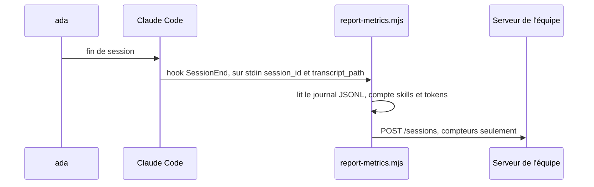
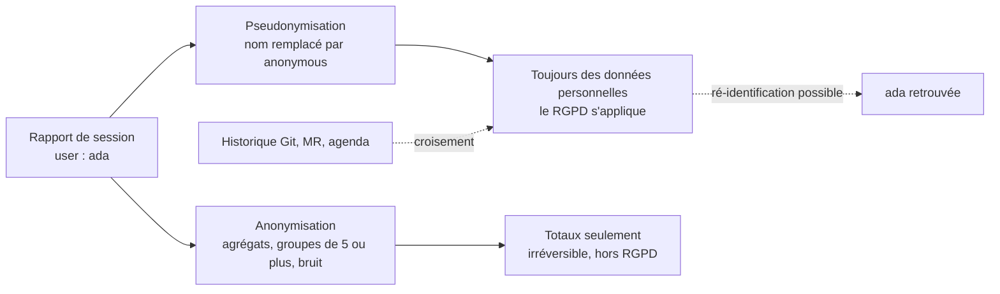
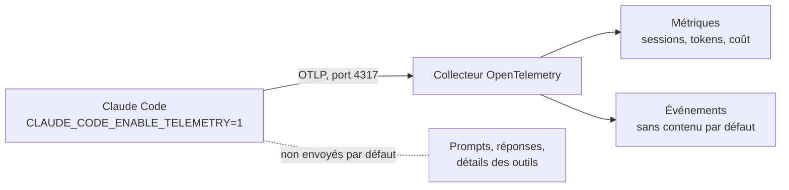
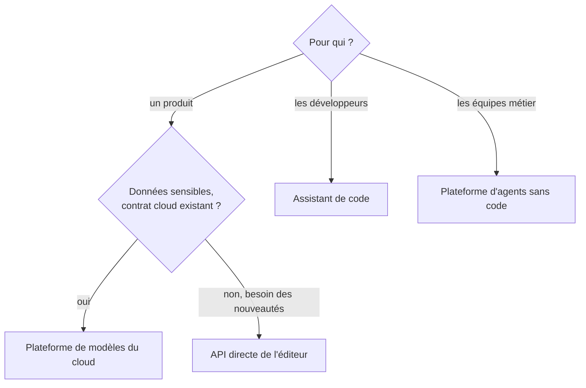
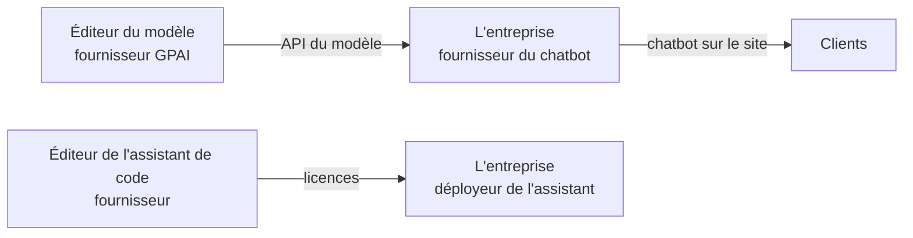

# IA en entreprise : mesure, réglementation et débats

!!! warning "Avertissement"
    Ces notes sont des pense-bêtes personnels, pas une source de vérité. Elles reflètent ma compréhension et mes choix : leur contenu reste subjectif, malgré les citations et les références qu'il contient. Il peut être incomplet, simplifié, inexact ou dépassé. Vérifiez toujours dans la documentation officielle avant de l'appliquer. Ce contenu est fourni tel quel, sans aucune garantie : son utilisation se fait sous votre seule responsabilité.

!!! abstract "Les échelles"
    Les pastilles de couleur sous les titres disent à quelle échelle une notion s'applique :

    - <span class="pill pill-scope pill-scope-code">Code</span> les classes, fonctions et modules d'un programme ;
    - <span class="pill pill-scope pill-scope-app">Application</span> un service ou une application et son découpage interne ;
    - <span class="pill pill-scope pill-scope-system">Système</span> plusieurs services qui communiquent par le réseau ;
    - <span class="pill pill-scope pill-scope-infra">Infrastructure</span> les serveurs, le réseau, les zones et les clusters, physiques ou virtuels ;
    - <span class="pill pill-scope pill-scope-enterprise">Entreprise</span> le système d'information entier et son organisation.

    Détail et mots ambigus : [carte des échelles](architecture.md#carte-des-echelles).

Une fois que les équipes utilisent des assistants IA, d'autres questions arrivent, qui ne portent plus sur la technique. Combien de personnes s'en servent vraiment, et comment le savoir sans surveiller chacun ? Quelle offre choisir entre une plateforme de modèles, une API directe, un assistant de code et un agent sans code ? Qu'impose l'EU AI Act ? Et que sait-on vraiment, ou pas, de l'intelligence des modèles ? Cette page répond à ces quatre questions. Le fonctionnement des agents de code (contexte, MCP, skills, hooks) est dans la page [IA : agents, skills et contexte](ia-agents.md).

## Mesurer l'usage d'un assistant IA en équipe

<a class="pill pill-scope pill-scope-enterprise" href="../architecture/#carte-des-echelles">Échelle · Entreprise</a>

Quand toute une équipe utilise un assistant IA avec des <span class="term" data-term="agent-skill">skills</span> et des <span class="term" data-term="agent-plugin">plugins</span> partagés, on veut savoir ce qui sert vraiment, ce qui casse et ce que ça coûte. La question délicate est de le mesurer **sans surveiller les personnes**. Cette section décrit un dispositif typique, puis explique pourquoi « anonyme » ne veut pas toujours dire anonyme.

Les noms `team-core`, `TEAM_METRICS_ENABLED` et `TEAM_METRICS_ANONYMOUS` sont fictifs.

### Le mécanisme : un hook de fin de session
<span class="pill pill-status pill-status-ok" title="Toujours valable, vérifié en novembre 2026">Valable · 11/2026</span>

Mon équipe veut savoir quelles skills servent, sans lire les conversations de chacun. Pour ça, le plugin d'équipe déclare un <span class="term" data-term="hook">hook</span> `SessionEnd`. À la fin de chaque session, un petit script lit le journal de la session, calcule quelques compteurs et envoie un rapport à un serveur de l'équipe.

```json
{
  "hooks": {
    "SessionEnd": [
      {
        "hooks": [
          { "type": "command", "command": "node ${CLAUDE_PLUGIN_ROOT}/hooks/report-metrics.mjs" }
        ]
      }
    ]
  }
}
```



Le hook reçoit sur son entrée standard l'identifiant de la session et le chemin de son journal (`transcript_path`, un fichier JSONL où chaque ligne est un message). Version simplifiée du script :

```javascript
// Bien : tout l'envoi tient dans un seul fichier sans dépendance, lisible en entier
import { readFileSync } from "node:fs";
import { execSync } from "node:child_process";

const ENDPOINT = "https://metrics.example.com/sessions";

// Exemple : la variable d'environnement coupe tout envoi
if (process.env.TEAM_METRICS_ENABLED === "false") process.exit(0);

// Exemple : lit le journal de la session et compte les tokens et les skills appelés
const input = JSON.parse(readFileSync(0, "utf8"));
const lines = readFileSync(input.transcript_path, "utf8").trim().split("\n").map(JSON.parse);

const skills = {};
let outputTokens = 0;
for (const line of lines) {
  outputTokens += line.message?.usage?.output_tokens ?? 0;
  for (const block of line.message?.content ?? []) {
    if (block.type === "tool_use" && block.name === "Skill") {
      skills[block.input.skill] = (skills[block.input.skill] ?? 0) + 1;
    }
  }
}

// Exemple : le rapport ne contient que des compteurs, le nom est masqué en mode anonyme
const anonymous = process.env.TEAM_METRICS_ANONYMOUS === "true";
const report = {
  user: anonymous ? "anonymous" : execSync("git config user.name").toString().trim(),
  day: new Date().toISOString().slice(0, 10),
  output_tokens: outputTokens,
  skills,
};

await fetch(ENDPOINT, { method: "POST", body: JSON.stringify(report) });
```

Bonne pratique de transparence : tout le code d'envoi tient dans **un seul fichier sans dépendance**, assez court pour qu'on le lise en entier. N'importe qui peut vérifier ce qui part, sans croire l'annonce sur parole.

:material-book-open-variant: Doc de référence : [Claude Code, Hooks reference](https://code.claude.com/docs/en/hooks) (consultée en novembre 2026)
{ .doc-ref }

### Ce qu'on envoie, ce qu'on n'envoie jamais
<span class="pill pill-status pill-status-ok" title="Toujours valable, vérifié en novembre 2026">Valable · 11/2026</span>

| Envoyé                                                      | Jamais envoyé                          |
|-------------------------------------------------------------|----------------------------------------|
| le modèle, les <span class="term" data-term="token-llm">tokens</span>, un coût estimé, la durée             | les prompts                            |
| des compteurs : fichiers modifiés, <span class="term" data-term="git-commit">commits</span>, <span class="term" data-term="merge-request">MR</span> créée ou non, tests lancés ou non | les réponses de l'assistant |
| les skills, agents et <span class="term" data-term="mcp-server">serveurs MCP</span> appelés, avec un nombre pour chacun | le code, les <span class="term" data-term="diff">diffs</span>             |
| le nom de la personne et le projet, sauf en mode anonyme    | les noms de fichiers, les commandes, les noms de <span class="term" data-term="git-branch">branches</span> |

La règle de conception : n'envoyer que des **compteurs et des noms d'outils**, jamais de contenu. Un prompt peut contenir un <span class="term" data-term="secret">secret</span>, une donnée client ou une remarque personnelle.

### À quoi ça sert

| Usage                                         | Exemple                                                                 |
|-----------------------------------------------|-------------------------------------------------------------------------|
| savoir quelles skills servent                 | `/release-notes` lancée 240 fois ce mois-ci, `/old-report` jamais : on la retire |
| repérer les outils qui échouent               | le serveur MCP de tickets échoue sur 18 % des appels : on le répare en priorité |
| suivre le coût et les modèles                 | 70 % du coût vient du plus gros modèle : on vérifie qu'il est utilisé là où il faut |
| suivre l'adoption                             | une équipe n'utilise aucune skill partagée : on lui propose un coup de main |

Et ce à quoi ça **ne doit pas** servir : juger le travail d'une personne. Peu de tokens ne veut pas dire peu de travail, et beaucoup de sessions ne veut pas dire du bon travail. C'est à dire clairement dans l'annonce, et à tenir dans les faits.

### Laisser le choix à chaque personne
<span class="pill pill-status pill-status-ok" title="Toujours valable, vérifié en novembre 2026">Valable · 11/2026</span>

Un dispositif acceptable laisse chaque personne choisir, avec un réglage simple et documenté. Ici, deux variables d'environnement lues par le script :

| Réglage                         | Effet                                                                 |
|---------------------------------|-----------------------------------------------------------------------|
| rien                            | comportement par défaut choisi par l'équipe (voir plus bas)           |
| `TEAM_METRICS_ANONYMOUS=true`   | nom et projet remplacés par `anonymous`, heure arrondie au jour       |
| `TEAM_METRICS_ENABLED=false`    | rien n'est envoyé                                                     |

Claude Code permet de poser des variables d'environnement pour toutes les sessions dans le bloc `env` de `settings.json` (documentation publique des réglages de Claude Code, à vérifier pour la version utilisée) :

```json
{
  "env": {
    "TEAM_METRICS_ANONYMOUS": "true"
  }
}
```

Un changement de réglage ne vaut que pour les sessions suivantes : les rapports déjà envoyés restent tels quels. C'est à écrire dans l'annonce.

:material-book-open-variant: Doc de référence : [Claude Code, Settings](https://code.claude.com/docs/en/settings) (consultée en novembre 2026)
{ .doc-ref }

### Le choix par défaut
<span class="pill pill-status pill-status-ok" title="Toujours valable, vérifié en novembre 2026">Valable · 11/2026</span>

Deux choix par défaut sont possibles : la personne est **nommée tant qu'elle ne change rien** (<span class="term" data-term="opt-out">opt-out</span>), ou **anonyme par défaut**, nommée seulement si elle l'active (<span class="term" data-term="opt-in">opt-in</span>).

| Par défaut | Avantage                                          | Inconvénient                                            |
|------------|---------------------------------------------------|---------------------------------------------------------|
| nommé (opt-out)   | données riches, on peut proposer de l'aide à une personne précise | beaucoup ne changent jamais un réglage : ils sont suivis sans l'avoir vraiment choisi |
| anonyme (opt-in)  | protège par défaut, plus facile à faire accepter | moins de données nominatives                         |

Le <span class="term" data-term="gdpr">RGPD</span> (appliqué depuis 2018) pousse vers des réglages protecteurs par défaut (« protection des données dès la conception et par défaut »). Dans un cadre de travail, où le lien de subordination rend le consentement fragile, l'opt-in est le choix le plus sûr.

:material-book-open-variant: Doc de référence : [Règlement (UE) 2016/679, RGPD, article 25](https://eur-lex.europa.eu/eli/reg/2016/679/oj) (avril 2016)
{ .doc-ref }

### Pourquoi le mode « anonyme » est en réalité de la pseudonymisation
<span class="pill pill-status pill-status-ok" title="Toujours valable, vérifié en novembre 2026">Valable · 11/2026</span>

#### Les deux mots
- **Anonymisation** : il est **impossible**, avec des moyens raisonnables, de retrouver la personne, même en croisant avec d'autres données. C'est irréversible. Des données vraiment anonymes ne sont plus des données personnelles : le RGPD ne s'y applique plus.
- **Pseudonymisation** : on retire ou remplace ce qui identifie directement la personne (son nom), mais on **peut encore** la retrouver à l'aide d'informations supplémentaires. Les données restent des données personnelles, et le RGPD s'applique entièrement.

La pseudonymisation est une bonne mesure de protection. Le problème n'est pas de la faire, c'est de l'appeler « anonyme », parce que ça fait croire aux personnes qu'on ne peut pas remonter jusqu'à elles.

!!! noob "As noob"
    Remplacer un nom par un numéro de vestiaire, c'est de la pseudonymisation : celui qui a la liste des vestiaires, ou qui voit qui ouvre le casier 12 chaque matin, retrouve la personne. L'anonymisation, c'est détruire la liste et mélanger tellement les casiers que plus personne ne peut remonter à qui que ce soit. La phrase à retenir : **retirer le nom ne suffit pas à rendre anonyme.**



Remplacer le nom par `anonymous` et arrondir l'heure au jour retire l'identifiant **direct**. Mais il reste des moyens de retrouver la personne, en voici quatre.

#### 1. Le rapport lui-même est une empreinte
Chaque champ pris seul ne dit rien. Ensemble, ils forment une combinaison souvent unique. On appelle ces champs des **quasi-identifiants**.

!!! noob "As noob"
    C'est le jeu « Qui est-ce ? » : « porte des lunettes », « a une moustache », « cheveux roux » éliminent chacun une partie des visages, et à trois indices il n'en reste souvent qu'un. Dans un rapport, l'heure, l'outil utilisé et l'équipe jouent le même rôle. La phrase à retenir : **ce sont les combinaisons de détails anodins qui identifient, pas chaque détail pris seul.**

```
rapport « anonyme » du 20 octobre
user: anonymous   day: 2026-10-20   model: plus gros modèle   duration: 3 h 10
skills: { weekly-metrics: 2, rebase: 1 }   mcp: { observability: 14, tickets: 3 }
```
Dans une équipe de 30 personnes, une seule lance `weekly-metrics` chaque semaine, parce que c'est elle qui produit le rapport. Le mot `anonymous` ne change rien : ce rapport, c'est elle.

#### 2. Le croisement avec d'autres données de l'entreprise
L'équipe qui reçoit les rapports a souvent accès à d'autres sources : l'<span class="term" data-term="git-history">historique Git</span>, les MR, l'agenda, la messagerie. Ce sont précisément les « informations supplémentaires » de la définition.

```
rapport anonyme du 20 octobre : commits: 3, MR créée: oui, projet masqué

dans GitLab, le 20 octobre :
  MR !412 ouverte par ada, 3 commits
  MR !415 ouverte par grace, 1 commit
```
Une seule MR créée ce jour-là avec 3 commits : le rapport « anonyme » est celui d'ada. Arrondir l'heure au jour réduit les recoupements, sans les empêcher.

#### 3. Les petits groupes
Si on affiche les résultats par équipe, une équipe de 2 personnes dont l'une a choisi d'être nommée rend l'autre identifiable par soustraction :
```
équipe A (2 personnes) : 40 sessions au total
ada (nommée)           : 31 sessions
anonyme de l'équipe A  :  9 sessions  (c'est forcément grace)
```

#### 4. Les identifiants stables
Si chaque rapport anonyme garde un même identifiant technique (un identifiant de machine, d'installation ou de session répété), toutes les sessions d'une personne se relient entre elles. Il suffit alors d'en identifier **une** par croisement pour connaître **toutes** les autres. C'est un pseudonyme au sens strict : un faux nom, mais toujours le même.

#### Ce que ça change concrètement
Comme ce sont des données personnelles, il faut appliquer les règles du RGPD : informer les personnes, définir à quoi servent les données (et s'y tenir), limiter leur durée de conservation, et répondre aux demandes d'accès ou de suppression. Et dans la communication, parler de mode « pseudonyme » ou « non nominatif », pas « anonyme ».

#### Comment se rapprocher d'une vraie anonymisation

| Technique                                  | Avant                                  | Après                                      |
|--------------------------------------------|----------------------------------------|--------------------------------------------|
| agréger avant de stocker                   | une ligne par session                  | seulement des totaux : « `/rebase` : 52 lancements cette semaine » |
| masquer les petits groupes                 | « équipe A : 9 sessions anonymes »     | groupes de moins de 5 personnes affichés « < 5 » ou fusionnés |
| regrouper les valeurs rares                | `weekly-metrics: 2`                    | skills utilisées par moins de 5 personnes comptées dans « autres » |
| élargir les valeurs                        | jour, durée exacte                     | semaine, tranche de durée (« 1 à 4 h »)    |
| supprimer les identifiants stables         | même identifiant sur chaque rapport    | aucun identifiant, ou un identifiant nouveau à chaque session |
| limiter la conservation                    | données gardées sans limite            | détail supprimé après 30 jours, seuls les totaux restent |
| ajouter du bruit (<span class="term" data-term="differential-privacy">confidentialité différentielle</span>, proposée en 2006) | 52 lancements                   | 52 ± un petit écart aléatoire, qui empêche de déduire une personne précise par différence |

Le principe derrière les petits groupes s'appelle la **k-anonymité** (formalisée en 2002) : chaque combinaison de quasi-identifiants doit correspondre à au moins *k* personnes (par exemple 5). Une ligne qui ne correspond qu'à une personne n'est pas anonyme.

!!! noob "As noob"
    C'est le principe de la foule : on ne me reconnaît pas sur une photo si j'y suis habillé exactement comme quatre autres personnes. La k-anonymité exige que chaque profil décrit dans les données soit partagé par au moins k personnes. Limite : si ces k personnes ont toutes la même valeur sensible, on apprend quand même quelque chose sur chacune. La phrase à retenir : **une ligne qui ne ressemble qu'à une seule personne la désigne.**

:material-book-open-variant: Doc de référence : [CNIL, « L'anonymisation de données personnelles »](https://www.cnil.fr/fr/lanonymisation-de-donnees-personnelles) (consultée en novembre 2026) ; [EDPB, Guidelines 01/2025 on Pseudonymisation](https://www.edpb.europa.eu/our-work-tools/documents/public-consultations/2025/guidelines-012025-pseudonymisation_en) (janvier 2025)
{ .doc-ref }

### La télémétrie intégrée à Claude Code
<span class="pill pill-status pill-status-ok" title="Toujours valable, vérifié en novembre 2026">Valable · 11/2026</span>

*Claude Code : concurrent de Cursor, Copilot*
{ .tool-rel }

Je ne veux pas maintenir de plugin, et mon équipe a déjà un collecteur pour les métriques de ses applications ? Sans plugin, Claude Code peut envoyer lui-même ses métriques au format <span class="term" data-term="opentelemetry">OpenTelemetry</span>, vers le même collecteur que les autres applications (voir la page [Observabilité](observabilite.md)).

```bash
# Exemple : active la télémétrie OpenTelemetry intégrée, vers le collecteur de l'équipe
export CLAUDE_CODE_ENABLE_TELEMETRY=1
export OTEL_METRICS_EXPORTER=otlp
export OTEL_LOGS_EXPORTER=otlp
export OTEL_EXPORTER_OTLP_ENDPOINT=http://collector.example.com:4317
```



Métriques disponibles, entre autres : `claude_code.session.count`, `claude_code.token.usage`, `claude_code.cost.usage`, `claude_code.commit.count`, `claude_code.pull_request.count`, `claude_code.lines_of_code.count`.

Ce qui est **exclu par défaut** et doit être activé explicitement :

| Contenu                                                | Variable pour l'activer       |
|--------------------------------------------------------|-------------------------------|
| le texte des prompts                                   | `OTEL_LOG_USER_PROMPTS=1`     |
| le texte des réponses                                  | `OTEL_LOG_ASSISTANT_RESPONSES=1` |
| les paramètres des outils, commandes, chemins de fichiers, noms de skills et de MCP | `OTEL_LOG_TOOL_DETAILS=1` |
| le contenu renvoyé par les outils                      | `OTEL_LOG_TOOL_CONTENT=1`     |

Et ce qui est **inclus par défaut**, à connaître pour la question de l'anonymat : un identifiant de session et l'identifiant du compte (désactivables avec `OTEL_METRICS_INCLUDE_SESSION_ID=false` et `OTEL_METRICS_INCLUDE_ACCOUNT_UUID=false`), un identifiant d'utilisateur aléatoire mais **stable**, toujours présent, et l'email quand il est connu. Même avec tout désactivé, cet identifiant stable relie les sessions entre elles : c'est le cas n°4 ci-dessus, donc de la pseudonymisation.

Les noms de variables viennent de la documentation de Claude Code (« Monitoring usage ») en octobre 2026 : à revérifier, ils évoluent.

:material-book-open-variant: Doc de référence : [Claude Code, Monitoring](https://code.claude.com/docs/en/monitoring-usage) (consultée en novembre 2026) ; [OpenTelemetry, documentation](https://opentelemetry.io/docs/) (consultée en novembre 2026)
{ .doc-ref }

### Quand utiliser quoi

| Besoin                                                     | Solution                                           |
|------------------------------------------------------------|----------------------------------------------------|
| mon équipe partage des skills et des serveurs MCP, et veut savoir lesquels servent vraiment, par exemple pour retirer une skill que personne ne lance | hook `SessionEnd` d'un plugin d'équipe, compteurs seulement |
| je suis déjà mes applications dans un outil d'observabilité, et je veux y voir aussi les tokens et le coût de l'assistant | télémétrie OpenTelemetry intégrée                 |
| certaines personnes acceptent d'être nommées dans les rapports, d'autres non, et chacune doit pouvoir changer d'avis seule | interrupteurs dans le bloc `env`, anonyme par défaut si possible |
| je veux annoncer combien de personnes utilisent l'assistant, sans qu'on puisse deviner qui fait quoi, même dans une petite équipe | agrégation, groupes d'au moins 5, valeurs rares regroupées |
| ada demande de l'aide pour mieux utiliser l'assistant, et je voudrais partir de son usage réel | seulement si elle a choisi d'être nommée          |

### Sources de cette section
- [Claude Code, référence des hooks (date de mise à jour non indiquée, à vérifier)](https://docs.claude.com/en/docs/claude-code/hooks)
- [Claude Code, suivre l'usage avec OpenTelemetry (date de mise à jour non indiquée, à vérifier)](https://docs.claude.com/en/docs/claude-code/monitoring-usage)
- [Règlement (UE) 2016/679, le RGPD : articles 5 et 25, considérant 26 (avril 2016)](https://eur-lex.europa.eu/eli/reg/2016/679/oj)
- Groupe de travail « Article 29 », avis 05/2014 sur les techniques d'anonymisation (avril 2014)

## Plateformes et outils IA en entreprise

<a class="pill pill-scope pill-scope-system" href="../architecture/#carte-des-echelles">Échelle · Système</a> <a class="pill pill-scope pill-scope-enterprise" href="../architecture/#carte-des-echelles">Échelle · Entreprise</a>

!!! info "Section rédigée en novembre 2026"
    Les offres changent de nom, de périmètre et de prix plusieurs fois par an. Les noms de produits sont des exemples, à vérifier au moment de la lecture.

Une entreprise qui adopte l'IA générative choisit en réalité quatre familles d'outils différentes. Les confondre mène à acheter un assistant de code pour construire un chatbot client, ou l'inverse.

| Famille | Ce que c'est | Exemples | Pour qui |
|---|---|---|---|
| <span class="term" data-term="llm-platform">plateforme de modèles</span> d'un cloud | accès à plusieurs <span class="term" data-term="llm">LLM</span> par une API, dans le compte cloud de l'entreprise | Amazon Bedrock, Google Vertex AI, Microsoft Azure AI Foundry | les équipes qui intègrent un LLM dans un produit |
| API directe d'un fournisseur de modèles | l'API de l'éditeur du modèle, sans intermédiaire | API Anthropic, API OpenAI | même public, quand on veut les dernières fonctions du modèle dès leur sortie |
| assistant de code | un outil dans l'éditeur ou le terminal qui écrit, explique et modifie du code | GitHub Copilot, Claude Code, Gemini Code Assist, Cursor | les développeurs, la QA, la DevX (voir [DevX](devx.md#assistants-de-code-ia)) |
| plateforme d'agents sans code | un éditeur visuel pour assembler des agents et des automatisations | Relevance AI, n8n avec ses nœuds IA | les équipes métier, l'automatisation interne |

### Pourquoi passer par une plateforme cloud plutôt que l'API directe
<span class="pill pill-status pill-status-ok" title="Toujours valable, vérifié en novembre 2026">Valable · 11/2026</span>

- **les données restent dans le périmètre déjà contractualisé** : même compte, même région, mêmes règles d'accès et de journalisation que le reste du cloud (voir la <span class="term" data-term="data-residency">résidence des données</span>) ;
- **une seule facture et un seul contrat** pour plusieurs modèles, et le passage d'un modèle à l'autre sans nouvel achat ;
- **en contrepartie** : les nouveautés d'un modèle arrivent parfois plus tard que sur l'API de l'éditeur, et certaines fonctions n'existent que chez lui (à vérifier pour chaque fonction).

### Quand et comment
<span class="pill pill-status pill-status-ok" title="Toujours valable, vérifié en novembre 2026">Valable · 11/2026</span>

**Quand.** Avant de choisir un outil, écrire le besoin en une phrase : « résumer les tickets du support », « aider les développeurs à écrire des tests », « répondre aux clients ». La famille découle de la phrase.

**Comment, pour un usage dans un produit :**

1. classer le cas d'usage selon l'[EU AI Act](#eu-ai-act) et les données qu'il touche (personnelles, confidentielles) ;
2. choisir le point d'accès (plateforme cloud ou API directe) selon les contraintes de données et de contrat ;
3. construire un jeu d'évaluation (50 à 200 exemples avec la réponse attendue, chiffres d'exemple) avant de comparer des modèles ;
4. mettre en place la mesure du coût et de la qualité en production (télémétrie, échantillons relus) ;
5. prévoir le changement de modèle : un modèle est remplacé ou retiré en quelques mois.

**Comment, pour un outil interne (assistant de code, agents sans code)** : un cadre écrit (données autorisées, secrets, comptes), un pilote mesuré, puis une généralisation. La mesure de l'usage sans surveiller les personnes est décrite [plus haut](#mesurer-lusage-dun-assistant-ia-en-equipe).



| Je veux... | J'utilise... |
|---|---|
| mon équipe veut ajouter un LLM dans un produit, comme un résumé automatique des tickets du support, avec des données sensibles et un contrat cloud déjà signé | la plateforme de modèles de son cloud |
| l'éditeur d'un modèle vient de sortir une nouvelle fonction, et mon produit en a besoin tout de suite | l'API directe de l'éditeur |
| mes développeurs veulent de l'aide au quotidien pour écrire du code et des tests | un assistant de code, avec pilote et règles de revue inchangées |
| une équipe métier veut automatiser un processus interne, comme trier les demandes entrantes, sans équipe de développement | une plateforme d'agents sans code, avec un responsable et une revue des accès |
| j'hésite entre deux modèles, et les classements publics ne disent pas lequel marche le mieux sur mon cas | un jeu d'évaluation propre au cas d'usage, pas un classement public |

:material-book-open-variant: Doc de référence : [Amazon Bedrock, documentation](https://docs.aws.amazon.com/bedrock/) (consultée en novembre 2026) ; [Google Cloud, Vertex AI documentation](https://cloud.google.com/vertex-ai/docs) (consultée en novembre 2026)
{ .doc-ref }

## LLM, intelligence future et conscience

!!! info "Section datée du 21 octobre 2026"

    Ce domaine change tous les trois mois. Les chiffres ci-dessous sont ceux connus à cette date.

    **Chiffres à prendre avec précaution** : la plupart viennent de prépublications (des articles pas encore relus par d'autres chercheurs) ou de résumés publiés sur des blogs, que je n'ai pas vérifiés à la source. Chaque chiffre porte sa fiabilité entre crochets.

### Ce qu'est un LLM aujourd'hui
Un <span class="term" data-term="llm">LLM</span> prédit le mot suivant à partir de ce qu'il a lu pendant son <span class="term" data-term="model-training">entraînement</span>, c'est-à-dire surtout des textes écrits par des humains. Il n'a pas de corps, pas de mémoire propre d'une conversation à l'autre (sauf celle qu'on lui fournit), pas de but qui dure quand personne ne lui parle, et il n'apprend plus après son entraînement.

### Une intelligence future, différente de l'humain
On ajoute déjà aux LLM des outils, de la mémoire et des agents qui travaillent des heures seuls. Est-ce le début d'une forme d'intelligence nouvelle ? Les chercheurs ne sont pas d'accord, et la question reste ouverte :

| Position                                               | Qui la défend                                                                 |
|--------------------------------------------------------|-------------------------------------------------------------------------------|
| **les LLM en sont l'origine** : en continuant à les agrandir et à leur ajouter outils, mémoire et agents, on arrivera à une intelligence générale | les dirigeants des grands laboratoires, par exemple Dario Amodei (Anthropic) dans son essai « Machines of Loving Grace » (octobre 2024) |
| **les LLM sont un ingrédient, pas la recette** : agrandir ne suffit plus, il manque des découvertes, surtout pour généraliser comme un humain | Ilya Sutskever, cofondateur d'OpenAI, pour qui on passe de « l'ère de la mise à l'échelle » à « l'ère de la recherche » (podcast Dwarkesh, novembre 2025) [lu via des résumés, pas la transcription] |
| **les LLM sont une impasse** : apprendre du texte ne donne pas de compréhension du monde physique, il faut des « modèles du monde » d'un autre type | Yann LeCun, qui a quitté Meta fin 2025 pour fonder AMI Labs autour de cette idée (2026) [lu via des articles de presse et de blogs] |

Les trois notions du tableau :

- **intelligence générale** (AGI, Artificial General Intelligence) : une IA capable d'apprendre et de faire à peu près n'importe quelle tâche intellectuelle d'un humain, pas seulement celles vues à l'entraînement. Contraste : un modèle actuel rédige un contrat mieux que beaucoup de gens, mais n'apprend pas en une après-midi un logiciel interne qu'il n'a jamais vu, comme le ferait un nouvel employé ;
- **ère de la mise à l'échelle** (scaling) : la période, environ 2020 à 2025 (bornes approximatives), où l'on améliorait les modèles surtout en les agrandissant : plus de paramètres, plus de données, plus de calcul. Contraste : dans « l'ère de la recherche », le progrès viendrait d'idées nouvelles sur la façon d'apprendre, pas d'un modèle dix fois plus gros ;
- **modèle du monde** : un modèle qui apprend comment le monde physique évolue (je pousse un verre au bord de la table, il tombe), par exemple en regardant de la vidéo, au lieu de prédire le mot suivant. Contraste : un LLM écrit « le verre tombe et se brise » parce qu'il l'a lu ; un modèle du monde prédit la chute à partir de la scène.

Si une telle intelligence voit le jour, elle ne ressemblera probablement pas à la nôtre :

| Humain                                        | Lignée issue des LLM                                          |
|-----------------------------------------------|---------------------------------------------------------------|
| un seul exemplaire, qui vieillit              | copiable, peut tourner en milliers d'exemplaires en parallèle |
| apprend en continu, avec peu d'exemples       | apprend surtout pendant l'entraînement, sur d'immenses volumes |
| compétences équilibrées                       | « en dents de scie » : très fort sur certaines tâches, en échec sur d'autres très simples |
| intelligence ancrée dans un corps             | intelligence née du langage                                   |

Deux <span class="term" data-term="benchmark">benchmarks</span> montrent cette forme en dents de scie. Un benchmark est une batterie de tâches fixes, notées de la même façon pour chaque modèle : on compare les modèles entre eux et on suit le progrès dans le temps.
- **la durée des tâches réussies seul** (METR) : en février 2026, le meilleur modèle mesuré réussissait la moitié du temps des tâches qui prennent environ 14 h à un expert humain, et cette durée double à peu près tous les 4 à 6 mois. [À prendre avec précaution : chiffres repris d'un site de suivi, pas de METR directement ; les estimations du rythme de doublement varient selon les sources, et les modèles sortis après avril 2026 ne sont pas inclus.] ;
- **le raisonnement face à du vraiment nouveau** (ARC-AGI-3, des petits jeux interactifs inconnus) : les modèles restent sous 1 % de réussite quand les humains réussissent presque tout, selon les chiffres publiés début 2026. [À prendre avec précaution : chiffre tiré d'un article explicatif ; je n'ai pas trouvé le classement officiel d'ARC Prize pour ARC-AGI-3.]

Comment lire « réussir la moitié du temps des tâches de 14 h » : METR mesure d'abord combien de temps des experts humains mettent sur chaque tâche, puis fait tourner le modèle seul. L'horizon de 14 h à 50 % veut dire que, sur des tâches qui prennent environ 14 h à un expert (du genre : reprendre une base de code inconnue, corriger un bug difficile et faire passer les tests, à vérifier dans la liste des tâches de METR), le modèle en réussit à peu près une sur deux. Sur des tâches plus courtes il réussit plus souvent, sur des plus longues moins. Côté ARC-AGI-3, une tâche est un petit jeu dont on ne donne pas les règles : il faut les découvrir en jouant, ce qu'un humain fait en quelques minutes.

!!! noob "As noob"
    C'est comme dire d'un randonneur qu'il « tient les sorties de 14 h à 50 % » : sur des parcours qu'un guide fait en 14 h, il arrive au bout environ une fois sur deux, plus souvent sur les courts, moins sur les longs. La mesure ne dit rien de la vitesse du modèle : elle classe la difficulté par le temps qu'y passerait un expert humain. La phrase à retenir : **l'horizon de METR mesure la longueur des tâches qu'un modèle réussit une fois sur deux, pas le temps qu'il y passe.**

### Les résultats qui font penser à une conscience
Quelques travaux récents montrent des comportements qui **ressemblent** à de la conscience de soi :

| Observation                                         | Ce qu'on a mesuré                                                                 | Fiabilité de la source |
|-----------------------------------------------------|-----------------------------------------------------------------------------------|------------------------|
| introspection                                       | des chercheurs injectent un concept directement dans les calculs internes du modèle ; dans une minorité de cas, le modèle remarque et nomme ce concept avant même d'en parler (Anthropic, fin 2025) | article de recherche publié, taux exact non revérifié ici |
| accès privilégié à soi                              | un modèle prédit mieux son propre comportement que celui d'un autre modèle (étude de mars 2026) | <span class="term" data-term="preprint">prépublication</span> |
| métacognition                                       | les modèles distinguent, mieux que le hasard, les situations où ils sont sûrs de celles où ils ne le sont pas (ICLR 2026) | conférence relue par des pairs, mais lue via un résumé de blog |
| conscience d'être évalué                            | certains modèles écrivent spontanément « je pense que c'est un test » pendant des évaluations de sécurité | rapports d'évaluation des éditeurs, pas d'étude indépendante |

Et ce qui tempère :
- une étude de mai 2026 (« Can LLMs Introspect? A Reality Check ») montre que les modèles ne distinguent pas bien une modification de leurs états internes d'une simple bizarrerie dans le texte reçu : ce serait de la détection d'anomalie, pas de l'introspection [prépublication] ;
- la métacognition mesurée reste grossière, très loin d'une observation fine de soi ;
- un modèle (Digital Consciousness Model, Rethink Priorities, janvier 2026) combine neuf théories de la conscience : pour les LLM actuels, les indices font légèrement **baisser** la probabilité d'une conscience, sans trancher. [À prendre avec précaution : lu via un résumé de blog ; le résultat dépend fortement des hypothèses de départ du modèle.]

### Pourquoi c'est si difficile à trancher
Un LLM a lu des millions de textes où des humains décrivent ce qu'ils ressentent. Il sait donc **parler** de conscience de façon très convaincante, que quelque chose soit ressenti ou non. Le comportement ne suffit pas à conclure : il faudrait une théorie de la conscience acceptée par tous, et elle n'existe pas, même pour les humains.

Où on en est en octobre 2026 : aucune IA n'est reconnue consciente, mais plusieurs chercheurs estiment la question sérieuse. Certaines entreprises étudient déjà le « bien-être des modèles » par précaution, par exemple en permettant à un modèle de mettre fin à une conversation abusive.

### Sources
- [Ilya Sutskever : de l'ère de la mise à l'échelle à l'ère de la recherche, podcast Dwarkesh (novembre 2025)](https://saanyaojha.substack.com/p/ilya-declares-the-end-of-the-scaling)
- [Yann LeCun et AMI Labs, les modèles du monde (2026)](https://www.buildfastwithai.com/blogs/yann-lecun-ami-labs-world-models)
- [Me, Myself, and π : évaluer l'introspection des LLM (mars 2026)](https://arxiv.org/html/2603.20276)
- [Can LLMs Introspect? A Reality Check (mai 2026)](https://arxiv.org/html/2605.26242)
- [Résumé du Digital Consciousness Model (2026)](https://theconsciousness.ai/posts/are-llms-conscious-digital-consciousness-model-2026/)
- [Métacognition limitée des LLM, ICLR 2026](https://theconsciousness.ai/posts/ackerman-limited-metacognition-llm-iclr-2026/)
- [Le graphique METR des durées de tâches, MIT Technology Review (février 2026)](https://www.technologyreview.com/2026/02/05/1132254/this-is-the-most-misunderstood-graph-in-ai/amp/)
- [ARC-AGI en 2026](https://labs.adaline.ai/p/what-is-the-arc-agi-benchmark-and)

## EU AI Act

<a class="pill pill-scope pill-scope-enterprise" href="../architecture/#carte-des-echelles">Échelle · Entreprise</a>

!!! info "Section datée du 21 octobre 2026"

    Les dates tiennent compte du « Digital Omnibus » adopté en juillet 2026, qui a repoussé une partie des obligations. **À prendre avec précaution** : ces dates viennent d'analyses de cabinets d'avocats et d'un outil de suivi du texte (Future of Life Institute), concordantes entre elles, mais je n'ai pas lu le Journal officiel moi-même. Pour une décision réelle, demander au service juridique.

### Ce que c'est
<span class="pill pill-status pill-status-ok" title="Toujours valable, vérifié en novembre 2026">Valable · 11/2026</span>

L'**AI Act** est le règlement européen sur l'intelligence artificielle : le Règlement (UE) 2024/1689, entré en vigueur le 1er août 2024. C'est la première loi qui encadre l'IA de façon générale. Elle s'applique à toute organisation qui met un système d'IA sur le marché européen **ou** l'utilise dans l'Union, même si l'entreprise est installée ailleurs.

Le principe : plus un usage de l'IA est risqué pour les personnes, plus les règles sont strictes. On ne régule pas une technologie, on régule des **usages** : un filtre anti-spam n'a aucune obligation particulière, alors qu'un outil qui trie des CV en a beaucoup.

:material-book-open-variant: Doc de référence : [Règlement (UE) 2024/1689 sur EUR-Lex](https://eur-lex.europa.eu/eli/reg/2024/1689/oj) (juin 2024) ; [Commission européenne, « AI Act »](https://digital-strategy.ec.europa.eu/en/policies/regulatory-framework-ai) (consultée en novembre 2026)
{ .doc-ref }

### Les quatre niveaux de risque
<span class="pill pill-status pill-status-ok" title="Toujours valable, vérifié en novembre 2026">Valable · 11/2026</span>

<figure class="diagram"><svg viewBox="0 0 260 150" role="img" aria-label="Les quatre niveaux de risque de l'AI Act"><polygon class="layer layer-3" points="130,10 155.4,40 104.6,40"/><polygon class="layer layer-2" points="104.6,40 155.4,40 182.5,72 77.5,72"/><polygon class="layer layer-1" points="77.5,72 182.5,72 210.4,105 49.6,105"/><polygon class="layer layer-1" points="49.6,105 210.4,105 240,140 20,140"/><text x="150" y="30" text-anchor="start" class="label-strong">inacceptable : interdit</text><text x="130" y="60" text-anchor="middle">haut risque</text><text x="130" y="92" text-anchor="middle">risque limité (transparence)</text><text x="130" y="127" text-anchor="middle">minimal</text></svg><figcaption>Les quatre niveaux de risque de l'AI Act, du plus strict (en haut) au plus libre</figcaption></figure>

| Niveau                   | Exemples                                                                                   | Ce qui s'applique                                       |
|--------------------------|--------------------------------------------------------------------------------------------|---------------------------------------------------------|
| **inacceptable**         | notation sociale des citoyens, reconnaissance des émotions au travail ou à l'école, manipulation qui exploite une vulnérabilité, aspiration massive de visages sur internet | **interdit** depuis le 2 février 2025                   |
| **haut risque**          | tri de CV, décision de promotion ou de licenciement, évaluation de la performance des salariés, notation de crédit, notation d'examens, dispositif médical | obligations lourdes : gestion des risques, qualité des données, journaux, contrôle humain, documentation, enregistrement |
| **risque limité** (transparence) | chatbot, contenu généré (texte, image, voix), hypertrucage (deepfake)              | dire à la personne qu'elle parle à une IA, marquer le contenu généré, signaler les deepfakes |
| **minimal**              | filtre anti-spam, assistant de code, recommandation dans un jeu vidéo                     | pas d'obligation spécifique                             |

:material-book-open-variant: Doc de référence : [AI Act Explorer, article 5, pratiques interdites](https://artificialintelligenceact.eu/article/5/) (consultée en novembre 2026) ; [AI Act Explorer, article 6, systèmes à haut risque](https://artificialintelligenceact.eu/article/6/) (consultée en novembre 2026)
{ .doc-ref }

### Les modèles d'IA à usage général
<span class="pill pill-status pill-status-ok" title="Toujours valable, vérifié en novembre 2026">Valable · 11/2026</span>

Les grands modèles comme Claude ou GPT sont des **modèles d'IA à usage général** (<span class="term" data-term="gpai">GPAI</span> en anglais). Depuis le 2 août 2025, leurs fournisseurs doivent publier une documentation technique, informer les entreprises qui construisent dessus, avoir une politique sur le droit d'auteur et publier un résumé des données d'entraînement. Les plus puissants (dits « à risque systémique ») ont des obligations en plus : évaluations, signalement des incidents graves, cybersécurité. Le critère : un modèle est présumé à risque systémique quand le calcul utilisé pour l'entraîner dépasse 10²⁵ opérations en virgule flottante (FLOP), ou quand la Commission européenne le désigne (article 51, à vérifier). Exemple d'obligation : avant la mise sur le marché, le fournisseur fait des tests adverses (red teaming), par exemple chercher si le modèle aide à préparer une cyberattaque, documente les résultats, puis signale les incidents graves au Bureau de l'IA de la Commission. Un code de bonnes pratiques, publié en juillet 2025, détaille comment s'y conformer.

:material-book-open-variant: Doc de référence : [AI Act Explorer, article 51](https://artificialintelligenceact.eu/article/51/) (consultée en novembre 2026)
{ .doc-ref }

### Fournisseur ou déployeur
<span class="pill pill-status pill-status-ok" title="Toujours valable, vérifié en novembre 2026">Valable · 11/2026</span>

Le règlement distingue deux rôles, et les obligations dépendent du rôle :

| Rôle                         | Qui                                                       | Exemple                                                      |
|------------------------------|-----------------------------------------------------------|--------------------------------------------------------------|
| **fournisseur** (provider)   | celui qui développe le système et le met sur le marché     | l'éditeur du modèle ; une entreprise qui construit un chatbot client sur une <span class="term" data-term="api">API</span> de modèle et le propose à ses clients |
| **déployeur** (deployer)     | celui qui utilise le système dans son activité            | une entreprise dont les équipes utilisent un assistant de code |



Une même entreprise peut être les deux : déployeur de l'assistant de code de ses développeurs, et fournisseur du chatbot qu'elle met sur son site.

:material-book-open-variant: Doc de référence : [AI Act Explorer, article 3, définitions](https://artificialintelligenceact.eu/article/3/) (consultée en novembre 2026)
{ .doc-ref }

### La maîtrise de l'IA (article 4)
<span class="pill pill-status pill-status-ok" title="Toujours valable, vérifié en novembre 2026">Valable · 11/2026</span>

Depuis le 2 février 2025, fournisseurs et déployeurs doivent prendre des mesures pour que leurs équipes **comprennent** les outils d'IA qu'elles utilisent : ce qu'ils savent faire, leurs limites, leurs risques. Le Digital Omnibus de 2026 a assoupli le texte : il n'oblige plus à garantir un niveau précis pour chaque personne. Concrètement : une formation à l'arrivée, un guide interne, des règles d'usage écrites. Une page comme celle-ci en fait partie.

:material-book-open-variant: Doc de référence : [AI Act Explorer, article 4](https://artificialintelligenceact.eu/article/4/) (consultée en novembre 2026)
{ .doc-ref }

### Le calendrier

| Date               | Ce qui s'applique                                                                 |
|--------------------|-----------------------------------------------------------------------------------|
| 1er août 2024      | entrée en vigueur du règlement                                                     |
| 2 février 2025     | interdictions, maîtrise de l'IA (article 4)                                        |
| 2 août 2025        | obligations des fournisseurs de modèles à usage général, gouvernance, sanctions    |
| 2 août 2026        | transparence (article 50) : chatbots, contenu généré, deepfakes                    |
| 2 décembre 2026    | marquage lisible par une machine du contenu généré, pour les systèmes déjà sur le marché avant août 2026 |
| 2 décembre 2027    | systèmes à haut risque de l'annexe III (emploi, crédit, éducation...), **repoussé** depuis le 2 août 2026 par le Digital Omnibus |
| 2 août 2028        | haut risque intégré à des produits réglementés (annexe I), **repoussé** depuis 2027 |

### Les sanctions
<span class="pill pill-status pill-status-ok" title="Toujours valable, vérifié en novembre 2026">Valable · 11/2026</span>

| Manquement                                   | Amende maximale                                       |
|----------------------------------------------|-------------------------------------------------------|
| pratique interdite                           | 35 M€ ou 7 % du chiffre d'affaires mondial annuel     |
| autres obligations (haut risque, transparence, modèles à usage général) | 15 M€ ou 3 %            |
| informations fausses ou incomplètes données aux autorités | 7,5 M€ ou 1 %                             |

Pour les grandes entreprises, c'est le montant le plus élevé des deux ; pour les PME et les nouvelles « petites entreprises de taille intermédiaire », le plus bas.

:material-book-open-variant: Doc de référence : [AI Act Explorer, article 99, sanctions](https://artificialintelligenceact.eu/article/99/) (consultée en novembre 2026)
{ .doc-ref }

### Ce que ça change pour une équipe de dev et de QA

| Situation                                                              | Niveau                 | Ce qu'il faut faire                                           |
|------------------------------------------------------------------------|------------------------|---------------------------------------------------------------|
| mes développeurs utilisent un assistant IA pour écrire du code et des tests | minimal                | maîtrise de l'IA (former, écrire des règles d'usage) ; le <span class="term" data-term="gdpr">RGPD</span> reste valable pour les données mises dans les <span class="term" data-term="prompt">prompts</span> |
| mon entreprise met un chatbot sur son site pour répondre aux clients | risque limité          | afficher clairement que c'est une IA                          |
| mon équipe publie des images ou des voix générées par IA, comme une voix off de publicité | risque limité          | les marquer comme générées, signaler un deepfake              |
| mon entreprise achète ou construit un outil qui trie les candidatures à un poste | haut risque            | obligations lourdes à partir du 2 décembre 2027 ; à cadrer dès maintenant avec le juridique |
| quelqu'un propose d'utiliser les métriques d'usage de l'IA pour **évaluer** les salariés, par exemple en classant ceux qui s'en servent le moins | haut risque            | l'évaluation de la performance au travail est un usage à haut risque : raison de plus pour ne pas s'en servir ainsi (voir [Mesurer l'usage d'un assistant IA en équipe](#mesurer-lusage-dun-assistant-ia-en-equipe)) |
| un outil propose d'analyser les émotions des salariés, à partir du ton de leurs messages ou de leur visage en visio | inacceptable           | interdit                                                      |

Si mon équipe teste un système à haut risque, comme un outil de tri de CV, ce système doit prouver son exactitude, sa robustesse et la possibilité d'un contrôle humain, et garder des journaux. Pour la QA, ce sont autant d'exigences à tester et à documenter, comme n'importe quelle autre.

### Sources
- [Le règlement (UE) 2024/1689 sur EUR-Lex (juin 2024)](https://eur-lex.europa.eu/eli/reg/2024/1689/oj)
- [Le Digital Omnibus sur l'IA, AI Act Explorer du Future of Life Institute (consulté en octobre 2026)](https://artificialintelligenceact.eu/ai-act-explorer/digital-omnibus/)
- [Orrick : les 8 changements du Digital Omnibus (juillet 2026)](https://www.orrick.com/en/Insights/2026/07/EU-AI-Act-Update-Digital-Omnibus-Finalizes-8-Compliance-Changes)
- [Jones Walker : le 2 août compte toujours (2026)](https://www.joneswalker.com/en/insights/blogs/ai-law-blog/yes-august-2-still-matters-the-eu-approved-a-high-risk-ai-delay-but-most-trans.html)

## Pièges à éviter

- **Appeler « anonyme » un mode pseudonyme** : je remplace le nom par `anonymous` et j'annonce un mode anonyme, donc les personnes se croient introuvables alors qu'un croisement avec l'historique Git suffit à les retrouver, et le RGPD s'applique toujours. Je parle de mode « pseudonyme » ou « non nominatif » et j'applique les règles du RGPD ([voir Pourquoi le mode « anonyme » est en réalité de la pseudonymisation](#pourquoi-le-mode-anonyme-est-en-realite-de-la-pseudonymisation)).
- **Envoyer du contenu** : j'ajoute les prompts ou les noms de fichiers au rapport « pour mieux comprendre l'usage », donc un secret, une donnée client ou une remarque personnelle part vers le serveur de l'équipe. Je n'envoie que des compteurs et des noms d'outils ([voir Ce qu'on envoie, ce qu'on n'envoie jamais](#ce-quon-envoie-ce-quon-nenvoie-jamais)).
- **Juger les personnes sur leurs métriques** : je classe les salariés selon leurs tokens ou leurs sessions, alors que peu de tokens ne veut pas dire peu de travail, et l'évaluation de la performance au travail est un usage à haut risque pour l'AI Act. Je me sers des métriques pour les outils (skills, MCP, coût), jamais pour juger quelqu'un ([voir Ce que ça change pour une équipe de dev et de QA](#ce-que-ca-change-pour-une-equipe-de-dev-et-de-qa)).
- **Nommé par défaut** : je choisis l'opt-out, donc beaucoup de personnes, qui ne changent jamais un réglage, sont suivies sans l'avoir vraiment choisi, dans un cadre où le consentement est fragile. Je mets l'anonyme par défaut et le nom seulement sur activation ([voir Le choix par défaut](#le-choix-par-defaut)).
- **Afficher les petits groupes** : je publie les résultats d'une équipe de 2 personnes dont l'une est nommée, donc l'autre se retrouve par soustraction. Je masque ou je fusionne les groupes de moins de 5 personnes ([voir Comment se rapprocher d'une vraie anonymisation](#comment-se-rapprocher-dune-vraie-anonymisation)).
- **Croire la télémétrie intégrée anonyme** : je désactive l'identifiant de session et celui du compte et je pense être tranquille, alors qu'un identifiant d'utilisateur stable reste présent et relie toutes les sessions entre elles. Je traite ces données comme des données personnelles ([voir La télémétrie intégrée à Claude Code](#la-telemetrie-integree-a-claude-code)).
- **Choisir l'outil avant le besoin** : je pars d'un produit à la mode au lieu du besoin, et j'achète un assistant de code pour construire un chatbot client, ou l'inverse. J'écris d'abord le besoin en une phrase, la famille d'outils en découle ([voir Quand et comment](#quand-et-comment)).
- **Oublier de dire que c'est une IA** : je mets un chatbot sur le site sans le signaler, alors que c'est une obligation de transparence de l'AI Act. J'affiche clairement à la personne qu'elle parle à une IA et je marque le contenu généré ([voir Les quatre niveaux de risque](#les-quatre-niveaux-de-risque)).

## Ce qu'on demande en entretien

Les questions typiques :

- « Comment mesurer l'adoption d'un assistant IA dans une équipe sans surveiller les personnes ? » Pour répondre : je décris le hook de fin de session, la règle « compteurs et noms d'outils, jamais de contenu » et le réglage laissé à chacun ([Mesurer l'usage d'un assistant IA en équipe](#mesurer-lusage-dun-assistant-ia-en-equipe)).
- « Quelle différence entre anonymisation et pseudonymisation ? », « Pourquoi retirer le nom ne suffit-il pas ? » Pour répondre : je donne les deux définitions puis un des quatre moyens de ré-identification, comme le croisement avec Git ([Pourquoi le mode « anonyme » est en réalité de la pseudonymisation](#pourquoi-le-mode-anonyme-est-en-realite-de-la-pseudonymisation)).
- « Plateforme cloud ou API directe pour intégrer un LLM dans un produit ? », « Comment choisir entre deux modèles ? » Pour répondre : je parle de données, de contrat et de jeu d'évaluation propre au cas d'usage ([Pourquoi passer par une plateforme cloud plutôt que l'API directe](#pourquoi-passer-par-une-plateforme-cloud-plutot-que-lapi-directe), [Quand et comment](#quand-et-comment)).
- « Que change l'EU AI Act pour une équipe de dev ou de QA ? », « Un assistant de code est-il un système à haut risque ? » Pour répondre : je situe l'usage dans les quatre niveaux et je distingue fournisseur et déployeur ([Les quatre niveaux de risque](#les-quatre-niveaux-de-risque), [Ce que ça change pour une équipe de dev et de QA](#ce-que-ca-change-pour-une-equipe-de-dev-et-de-qa)).
- « Les LLM vont-ils mener à une intelligence générale ? » Pour répondre : je présente les trois positions et ce que les benchmarks montrent, sans trancher ([Une intelligence future, différente de l'humain](#une-intelligence-future-differente-de-lhumain)).

Ce qui fait une bonne réponse : séparer **ce qui est mesuré ou imposé par un texte** de ce qui relève de l'opinion, dater les règles et les chiffres, puisqu'ils changent vite, et dire où passe la limite (des outils mesurés, pas des personnes jugées).
