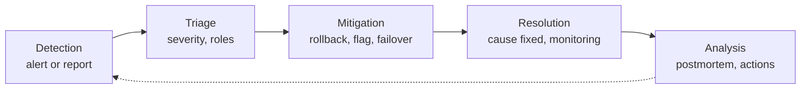
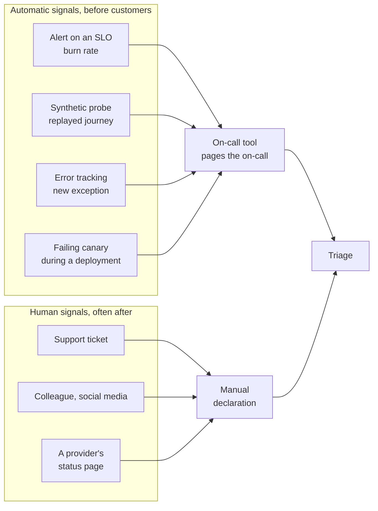
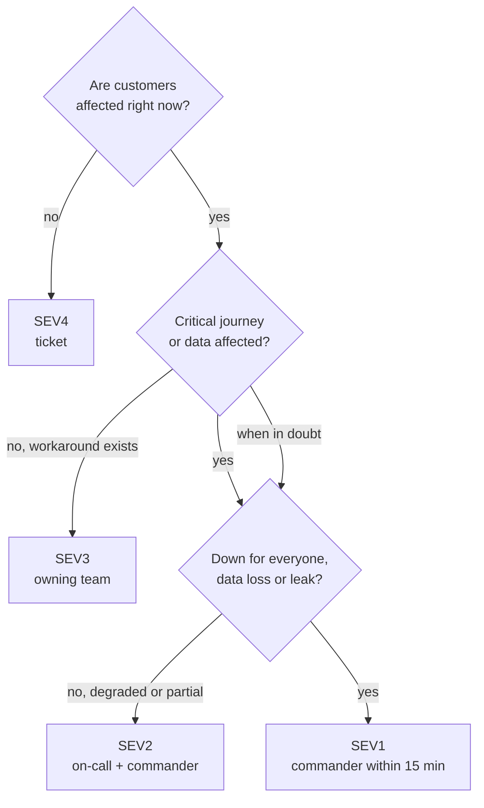
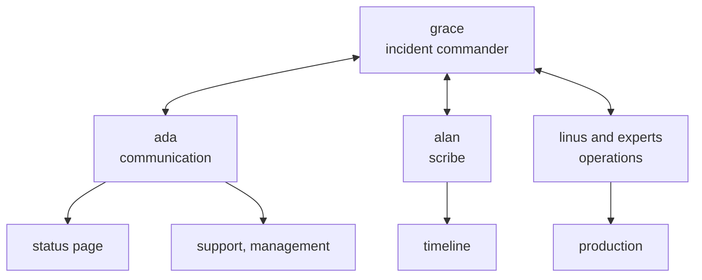
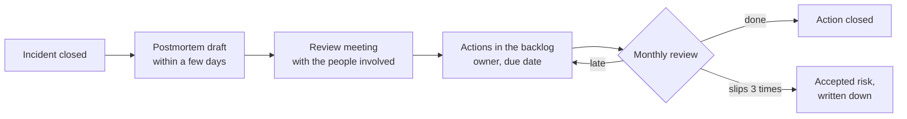
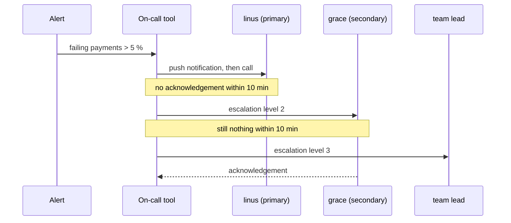
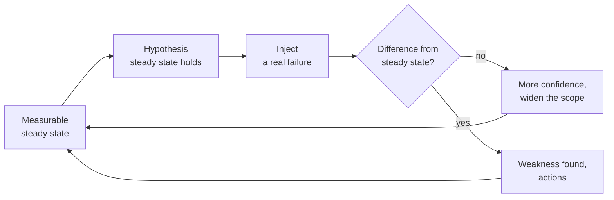

# Incidents and incident analysis

!!! warning "Disclaimer"
    These notes are personal cheat sheets, not a source of truth. They reflect my own understanding and choices: their content remains subjective, despite the quotes and references it contains. It may be incomplete, simplified, inaccurate or outdated. Always check the official documentation before applying it. This content is provided as is, without any warranty: you use it at your own risk.

!!! audience "Who and what for"
    - **Roles**: SRE, back-end developer, on-call engineer, tech lead, engineering manager, QA engineer...
    - **Uses**: I prepare an interview where I am asked to tell the story of an incident I handled; I join an on-call rotation and want to know what to do when an alert fires at 3 a.m.; I write the postmortem of a payment outage without naming a culprit; I design my team's severity grid and runbooks; I organize a first game day in pre-production.

!!! abstract "Scales"
    The colored badges under the headings say at which scale a notion applies:

    - <span class="pill pill-scope pill-scope-code">Code</span> the classes, functions and modules of one program;
    - <span class="pill pill-scope pill-scope-app">Application</span> one service or application and its internal split;
    - <span class="pill pill-scope pill-scope-system">System</span> several services talking to each other over the network;
    - <span class="pill pill-scope pill-scope-infra">Infrastructure</span> servers, network, zones and clusters, physical or virtual;
    - <span class="pill pill-scope pill-scope-enterprise">Enterprise</span> the whole information system and its organization.

    Details and ambiguous words: [map of scales](architecture.md#map-of-scales).

Customers have not been able to pay on my site for ten minutes: that is an incident. An <span class="term" data-term="incident">incident</span> is the moment a real service stops doing what it should. This page covers two things: how to get through it (detect, coordinate, communicate, restore) and how to get something out of it (analyse, follow up on actions, learn from one incident to the next). It ends with the health of the <span class="term" data-term="on-call">on-call</span> rotation and the exercises that prepare for the next one.

The French word "incidentologie" has no exact English equivalent. English speakers say *incident management* (handling the incident while it happens), *incident analysis* (studying it afterwards) or *learning from incidents* (the movement that treats incidents as a source of learning).

<span class="term" data-term="alert-monitoring">Alerts</span>, <span class="term" data-term="slo">SLOs</span> and the <span class="term" data-term="error-budget">error budget</span> are explained on the [Observability](observabilite.md#objectives-and-alerts) page: this page builds on them without defining them again. The `orders-service`, `payments-service` and `my-api` services, the people ada, grace, alan and linus, and all the figures are examples.

:material-swap-horizontal: The tools mentioned on this page: which ones replace each other, which ones combine? See [Complementary or competing](outils.md#complementary-or-competing).
{ .doc-ref }

## Terminology

**Incident**: an interruption or degradation of a service used by real users, which calls for a quick response. A known bug with no ongoing impact is not an incident: it is a ticket.

**Severity**: the <span class="term" data-term="incident-severity">seriousness level</span> of an incident (SEV1, SEV2...), decided by criteria written in advance. It says who gets called and how often we communicate. Not to be confused with bug severity, which judges a defect, not an ongoing situation.

**On-call**: the person on duty must be able to answer an alert at any hour, for a given period, often a week.

**Mitigation**: the quick action that reduces the impact before the cause is understood: <span class="term" data-term="rollback">going back to the previous version</span>, turning a feature off with a <span class="term" data-term="feature-flag">feature flag</span>, failing over to another zone.

**MTTD, MTTA, MTTR**: three average durations measured over a series of incidents.

```
14:00  the problem actually starts
14:12  an alert fires                     MTTD: 12 min (Mean Time To Detect)
14:15  the on-call person takes it        MTTA: 3 min  (Mean Time To Acknowledge)
14:40  the service is restored            MTTR: 40 min (Mean Time To Restore)
```

<span class="term" data-term="mttd">MTTD</span> counts from the real start, <span class="term" data-term="mtta">MTTA</span> from the alert. The R in <span class="term" data-term="mttr">MTTR</span> has several readings depending on the source (restore, recover, repair, resolve): always write down which one is measured.

**Postmortem**: the <span class="term" data-term="postmortem">document written after an incident</span>, which tells what happened, why it was possible, and what we change. Also written "post-mortem", or called an "incident review".

**Contributing factor**: a <span class="term" data-term="contributing-factor">condition</span> that made the incident possible or worse, without being its only cause. Example: "no alert on message age" did not cause the outage, but made it last 30 minutes longer.

**Near miss**: an <span class="term" data-term="near-miss">event</span> that could have caused an incident but had no impact, by luck or thanks to someone. Example: a migration that would have locked the orders table, stopped in pre-production because ada noticed how long it took.

**<span class="term" data-term="sli">SLI</span>**: the measured indicator that says whether the service delivers what it promises. Example: the share of payments accepted in under 2 s.

**<span class="term" data-term="slo">SLO</span>**: the internal target set on that SLI. Example: 99.5% of payments in under 2 s over a rolling 30 days; an incident consumes this budget.

**<span class="term" data-term="sla">SLA</span>**: the contractual promise to a customer, with a penalty if it is missed, usually looser than the SLO. Example: 99% availability per month, otherwise a 10% discount on the invoice. Details in [Observability](observabilite.md).

:material-book-open-variant: Reference docs: [Atlassian, Common incident management metrics](https://www.atlassian.com/incident-management/kpis/common-metrics) (accessed November 2026)
{ .doc-ref }

## The lifecycle of an incident

<a class="pill pill-scope pill-scope-system" href="../architecture/#map-of-scales">Scale · System</a> <a class="pill pill-scope pill-scope-infra" href="../architecture/#map-of-scales">Scale · Infrastructure</a> <span class="pill pill-status pill-status-ok" title="Still valid, checked November 2026">Current · 11/2026</span>

<a class="pill pill-practice" href="../observabilite/" title="level 2: it is automated">Practice · Observability · L2</a>
<a class="pill pill-dora" href="https://dora.dev/capabilities/proactive-failure-notification/">DORA · Proactive failure notification</a>

An incident goes through five stages. The core rule: **mitigate before fixing**. I restore the service first with the safest move, and understand afterwards. If payments fail right after a deployment, I first go back to the previous version, and look for the reason once customers are out of trouble.

!!! noob "As noob"
    It is the plumber facing a leak: first they shut off the water, then they look for which pipe gave way. The one thing to remember: **restore the service first, understand the cause afterwards.**



| Stage | Question | Expected output |
|---|---|---|
| Detection | is something wrong? | an alert, ideally before customers notice |
| Triage | how bad is it, who should come? | a severity, a person who coordinates, a channel |
| Mitigation | how do we stop the damage now? | customer impact stopped, even without knowing the cause |
| Resolution | is the service back to normal? | indicators back, cause fixed or durably worked around |
| Analysis | what made it possible? | a postmortem and a few tracked actions |

I can learn there is a problem from an alert, from a support ticket or from a colleague who warns me. The goal is for automatic signals to fire before customers complain; the share of incidents "detected by customers" is tracked in the [incident review](#learning-from-incidents-at-scale).



Example timeline, on a Tuesday:

```
14:02  orders-service v2.14 deployed (new shipping fee calculation rule)
14:06  payment error rate goes from 0.2 % to 9 %
14:09  alert "5 % of payments failing for 3 min", linus (on-call) takes it
14:11  linus opens the #inc-payments channel, classifies SEV2, grace coordinates
14:14  grace decides to roll back to v2.13 without waiting for the cause
14:19  rollback done, error rate at 0.3 %
14:20  ada posts "service restored, monitoring in progress" on the status page
14:50  no relapse, incident closed; 312 failed payments (example) to retry
D+3    postmortem reviewed with the team, 3 actions opened
```

Here, MTTD: 7 minutes, MTTA: 0, restoration: 17 minutes. The failed payments still have to be handled after the impact ends: resolution includes repairing the affected data, not only bringing the service back.

Rolling back is not always possible. If v2.14 contained a migration that drops a column, v2.13 no longer works. Hence the rule of keeping migrations compatible with two versions (see [Expand / contract](sql.md#expand-contract): renaming a column in five deployments, each one reversible).

:material-book-open-variant: Reference docs: [Google SRE Workbook, Incident Response](https://sre.google/workbook/incident-response/) (2018); [PagerDuty Incident Response](https://response.pagerduty.com/) (accessed November 2026)
{ .doc-ref }

!!! maturity "Measuring maturity"
    | Level | What I see in the team |
    |---|---|
    | N1 | someone reacts when a customer or a colleague reports the outage, and everyone improvises the steps |
    | N2 | automatic signals (SLO alert, synthetic probe, canary) detect most incidents, and the five steps are written down |
    | N3 | a failed canary or smoke test triggers the rollback on its own, before any human action |
    | N4 | the team tracks the share of incidents detected before customers and the time to mitigation, and works on the slowest step |

    **I measure**: the share of incidents detected by an automatic signal rather than by a customer, read in the incident tool; the median time from detection to mitigation.

## Severity levels

<span class="pill pill-status pill-status-ok" title="Still valid, checked November 2026">Current · 11/2026</span>

A severity grid makes two people classify the same incident the same way, at 3 a.m., without debate. It is written with product and support, with observable criteria, not with "this is bad".

!!! noob "As noob"
    It is triage in the emergency room: the nurse sorts each patient with fixed criteria (are they breathing, are they bleeding?), not with a gut feeling, and that sorting decides who is seen and how fast. The one thing to remember: **severity is read from a grid written in advance, not from the emotion of the moment.**

| Level | Criterion (example) | Who comes | Communication | Postmortem |
|---|---|---|---|---|
| SEV1 | critical journey down for everyone, data loss or leak | on-call, incident commander within 15 min, management informed | every 30 min | mandatory |
| SEV2 | critical journey degraded, or down for some customers | on-call and incident commander | every hour | mandatory |
| SEV3 | secondary feature affected, workaround available | owning team, business hours | team channel | optional |
| SEV4 | no customer impact (near miss) | ticket | none | grouped review |

The grid read as a decision tree (criteria from the example):



Three rules that avoid debates:

- **when in doubt, classify higher**: lowering a severity costs a few minutes, underestimating costs the communication cadence;
- **severity can change** during the incident, and each change is written in the timeline;
- **severity measures impact, not effort**: a one-line fix can close a SEV1.

The number of levels varies between organizations (three to five, sometimes numbered the other way round). What matters is that each level triggers different actions; two levels that trigger the same thing can be merged.

:material-book-open-variant: Reference docs: [PagerDuty, Severity Levels](https://response.pagerduty.com/before/severity_levels/) (accessed November 2026); [Atlassian, Incident severity levels](https://www.atlassian.com/incident-management/kpis/severity-levels) (accessed November 2026)
{ .doc-ref }

!!! maturity "Measuring maturity"
    | Level | What I see in the team |
    |---|---|
    | N1 | severity is decided by gut feeling by the person who takes the alert |
    | N2 | a written grid with observable criteria exists, and every incident gets a level |
    | N3 | the level triggers the right actions on its own: who is called, how often we communicate, whether a postmortem is mandatory |
    | N4 | the team reviews classifications afterwards, counts reclassifications, and merges or clarifies the levels that cause debates |

    **I measure**: the share of incidents whose severity changed during or after the incident, read in the timeline; the time from detection to a severity being assigned.

## Roles during the incident

<span class="pill pill-status pill-status-ok" title="Still valid, checked November 2026">Current · 11/2026</span>

The roles come from the **Incident Command System** (ICS), created in the 1970s by California firefighters to coordinate several agencies on large wildfires. Operations teams adopted it, for example in the "Managing Incidents" chapter of the book "Site Reliability Engineering" (Google, 2016).

!!! noob "As noob"
    It is a kitchen in the middle of the rush: the head chef does not cook, they call out orders and share the work, and a single waiter talks to the guests. The one thing to remember: **whoever coordinates does not hunt the fault, and those hunting it do not talk to the outside.**

| Role | Does | Does not |
|---|---|---|
| <span class="term" data-term="incident-commander">Incident commander</span> | decides, prioritizes, hands out work, declares the end | debug personally |
| Communication | updates the status page, answers support and management | interrupt the experts |
| <span class="term" data-term="incident-scribe">Scribe</span> | writes down facts and decisions with the time | interpret or judge |
| Experts (operations) | investigate and apply the decided actions | start a change without announcing it |

Who talks to whom during the example incident: everything goes through the incident commander, and experts never talk to the outside directly.



On a small incident, one person holds several roles. As soon as more than two or three people are involved, at least separate coordination from investigation: someone with their hands in the logs no longer sees the whole picture.

The incident commander is not necessarily the most expert or the most senior. It is the person who was designated, and they can hand over explicitly ("grace, can you take over coordination?"), which is written in the timeline.

:material-book-open-variant: Reference docs: [Google SRE book, Managing Incidents](https://sre.google/sre-book/managing-incidents/) (2016); [PagerDuty, Incident Commander training](https://response.pagerduty.com/training/incident_commander/) (accessed November 2026)
{ .doc-ref }

!!! maturity "Measuring maturity"
    | Level | What I see in the team |
    |---|---|
    | N1 | the most experienced person does everything, from debugging to messages for management |
    | N2 | an incident commander is named for every serious incident, and the roles are described |
    | N3 | roles are assigned at declaration, by the tool or by habit, and the incident commander does not debug without being reminded |
    | N4 | the team tracks who holds the roles, rotates coordination to train more people, and adjusts from postmortems |

    **I measure**: the share of SEV1 and SEV2 incidents with an incident commander named within the first 10 minutes, read in the timeline; the number of people who have already coordinated an incident this year.

## Communicating

<span class="pill pill-status pill-status-ok" title="Still valid, checked November 2026">Current · 11/2026</span>

During an incident, support, customers and management want to know where things stand. Without news, they write straight to the people who are investigating, who then spend their time answering instead of searching. So silence costs more than bad news. A <span class="term" data-term="status-page">status page</span> and a fixed cadence solve both problems: everyone knows where to read the information, and when the next update comes.

!!! noob "As noob"
    It is the pilot announcing "we are going through some turbulence, next update in twenty minutes": nothing is fixed, but passengers stop calling the crew. The one thing to remember: **an update at a fixed time, even with nothing new, saves the people fixing things a hundred questions.**

Simple rules:

- **an announced cadence**, kept even when there is nothing new ("still in progress, next update at 15:00");
- **facts, not hypotheses**: what users experience, what we are doing, the next update;
- **one channel per incident**, and one person who talks to the outside;
- **the user's vocabulary**: "card payments are failing", not "the payments pod is in CrashLoopBackOff".

Avoid: a message written by the person debugging, in their own vocabulary. Support does not know what to tell customers, whether there is a workaround or when the next update comes, so they start writing in the incident channel again.

```
payments-service in CrashLoopBackOff, we think it is v2.14 or maybe the database,
looking into it. Please do not disturb us.
```

Good: a message template that states the impact, the action, the workaround and the next update:

```
[SEV2] Card payments failing: in progress
Impact     : about 9 % of card payments have been failing since 14:06.
             Other payment methods work.
Action     : rollback to the previous version in progress.
Workaround : retry in a few minutes, or pay by bank transfer.
Next update: 14:45 at the latest.
```

The closing message says what was affected, for how long, whether data needs repairing, and when the postmortem summary will be shared.

:material-book-open-variant: Reference docs: [Atlassian, Incident communication](https://www.atlassian.com/incident-management/incident-communication) (accessed November 2026)
{ .doc-ref }

### Tooling for incident management

<span class="pill pill-status pill-status-ok" title="Still valid, checked November 2026">Current · 11/2026</span>

!!! info "Section written in November 2026"
    Incident management tools change fast (acquisitions, AI features added every year). The names given are examples, their features are to check at the time of reading.

An incident management tool (incident.io, PagerDuty, Opsgenie, FireHydrant, Rootly) automates the administrative part of everything above, so that people can focus on the diagnosis. PagerDuty and Opsgenie grew out of on-call (receive the alert, page the right person, handle the <span class="term" data-term="escalation-policy">escalation</span>) and added coordination; incident.io started from coordination in the chat tool (Slack, Teams) and added on-call. Atlassian announced the end of sale of Opsgenie in favor of Jira Service Management and Compass (2025 announcement, to check).

*PagerDuty: competes with Opsgenie; complements Alertmanager*<br>
*Opsgenie: competes with PagerDuty; complements Alertmanager*<br>
*Jira: complements Confluence, Slack*
{ .tool-rel }


| What the tool automates | Without a tool | With a tool |
|---|---|---|
| channel | someone creates `#inc-payments` and invites people by hand | one command (`/inc declare`) creates the channel, invites the on-call person and the owning team |
| roles | "who is coordinating?" in the thread | the <span class="term" data-term="incident-commander">incident commander</span> and the communication lead are assigned and shown at the top of the channel |
| timeline | the scribe copies the time of every message | flagged messages, severity changes and alerts form the timeline |
| status page | someone logs into another tool to publish | updated from the channel, with a reminder at the agreed cadence |
| postmortem draft | facts are reconstructed two days later | a document prefilled with the timeline, the people and the durations |
| follow-up | actions get lost in the channel | actions create tickets, the incident is closed once they are tracked |

**When**: several incidents a month, several teams working together, a public status page, or on-call to organize over several rotations. **Not yet**: a single team with one incident a quarter; a message template, a channel created by hand and a postmortem template are enough, and teach the process before automating it.

**Why**: during an incident, every administrative step is done by someone who should be thinking, and a timeline rebuilt after the fact is always incomplete. The gain: a process followed even at 3 am by someone going through it for the first time, and data (durations, severities, patterns) for [learning at scale](#learning-from-incidents-at-scale). The cost: a license often per user, and the risk of automating a process nobody has understood yet.

**How**: write the process first (severity grid, roles, cadence), then configure it in the tool, then try it during a [game day](#practicing-game-days-and-chaos-engineering) before the first real incident.

!!! maturity "Measuring maturity"
    | Level | What I see in the team |
    |---|---|
    | N1 | updates go out when someone thinks of it, in the vocabulary of the person debugging |
    | N2 | a message template, a status page and one channel per incident exist, and the cadence is announced |
    | N3 | the tool creates the channel, assigns roles, reminds the cadence and prepares the timeline with no manual step |
    | N4 | the team tracks cadences kept and questions received by experts during the incident, and tunes its templates and tool |

    **I measure**: the share of updates published at the announced time, read on the status page; the number of direct messages experts received during the incident, noted in the postmortem.

## Runbooks and playbooks

<a class="pill pill-scope pill-scope-system" href="../architecture/#map-of-scales">Scale · System</a> <a class="pill pill-scope pill-scope-infra" href="../architecture/#map-of-scales">Scale · Infrastructure</a> <span class="pill pill-status pill-status-ok" title="Still valid, checked November 2026">Current · 11/2026</span>

An alert wakes the on-call person at 3 a.m., on a service they barely know: they need to know what to do without working everything out from scratch. A <span class="term" data-term="runbook">runbook</span> is a written, step-by-step procedure for a known alert or failure. A <span class="term" data-term="playbook">playbook</span> is broader: it describes how to handle a family of situations (a data leak, a supplier outage), with the roles and the decisions to make. The two words overlap depending on the team.

!!! noob "As noob"
    The runbook is the quick-reference card taped to the machine ("if the red light blinks, do 1, 2, 3"); the playbook is the building's emergency plan, saying who does what for a whole family of situations. The one thing to remember: **a runbook is followed at 3 a.m. without thinking, a playbook organizes a response.**

Avoid: the runbook written from memory by the only person who knows the service. At 3 a.m., "restart if needed" says neither when nor how, and "empty it" loses real payments.

```markdown
# Runbook payments

If it is slow, check the logs and restart if needed.
If the queue is stuck, empty it.
Ask ada if it does not come back.
```

Good: the same runbook, linked from the alert, with thresholds, copyable commands and what not to do:

```markdown
# Runbook: "payments-events" queue growing

Alert : oldest message > 5 min (link to the dashboard)
Impact: payment confirmations arrive late

1. Check the consumers: `kubectl get pods -l app=payments-consumer`
2. If pods are restarting in a loop: read the logs, then roll back the last deployment
3. If pods are healthy but slow: scale to 6 replicas
   `kubectl scale deploy/payments-consumer --replicas=6`
4. If the queue goes over 50,000 messages: tell the incident commander (SEV2)
5. Do not purge the queue: the messages are real payments

Owner: team-payments; last reviewed: 2026-09-14
```

What makes a runbook useful:

- **a link from the alert**: the person who was woken up should not have to search for it;
- **copyable commands** and what I should see if they work;
- **what not to do**, often more valuable than the rest;
- **a review date**: a wrong runbook is worse than no runbook.

When a runbook step is applied identically every time, it is a candidate for automation. If an alert cannot have a runbook ("nothing to do"), it may not deserve to be an alert (see [Alert on symptoms](observabilite.md#alert-on-symptoms-not-on-causes)).

!!! maturity "Measuring maturity"
    | Level | What I see in the team |
    |---|---|
    | N1 | a few runbooks exist, written from memory, with no link from the alerts |
    | N2 | every paging alert has a linked runbook, with copyable commands and a review date |
    | N3 | steps applied identically every time are automated (restart, scaling), and a paging alert cannot be created without a runbook |
    | N4 | the team tracks the age of runbooks and the ones that failed during incidents, and reviews those first |

    **I measure**: the share of paging alerts with a runbook link, read in the alert rules; the share of runbooks reviewed in the last six months.

## Finding the cause: debugging methodically

<a class="pill pill-scope pill-scope-code" href="../architecture/#map-of-scales">Scale · Code</a> <a class="pill pill-scope pill-scope-app" href="../architecture/#map-of-scales">Scale · Application</a> <span class="pill pill-status pill-status-ok" title="Still valid, checked November 2026">Current · 11/2026</span>

The service is restored, now it must be understood. For two weeks, about 1% of PDF invoices have come out with an empty total; it cannot be reproduced locally, and some thirty MRs were merged over the period. Changing lines at random and hoping it works can take days. An almost scientific method finds the cause in a few hours, and makes it verifiable.

**When**: after mitigation, when the cause is not obvious; or for a bug that keeps coming back without anyone knowing why. Not during customer impact: then I mitigate first ([see The lifecycle of an incident](#the-lifecycle-of-an-incident)). **Why**: a predictable time to resolution, and a free regression test, born from the reproduction. The cost: time spent reproducing before touching the code, which feels long at the time. **How**:

1. **Reproduce**: as long as I cannot trigger the bug, I will not know whether it is fixed. Ideally, the reproduction becomes an automated test that fails.
2. **Read the whole error**, the stack trace down to the bottom, instead of stopping at the first line.
3. **One hypothesis, one experiment**: a possible explanation, and an experiment that can refute it, changing only one thing at a time.
4. **Cut in half**: which commit introduced the bug, with `git bisect`, which runs a binary search through the history; which minimal data triggers it, by removing half of the input at each try. **Delta debugging** (Andreas Zeller, late 1990s, exact date to check) automates this reduction of the input down to the smallest case that still fails.
5. **Fix the cause, not the symptom**, keep the test, and write down what I learned in the MR.

When I am stuck, I explain the code line by line, out loud, to a colleague or an object: this is **rubber duck debugging** (Andrew Hunt and David Thomas, "The Pragmatic Programmer", 1999). Having to put everything into words often reveals the assumption I took for granted.

!!! noob "As noob"
    It is looking for the dead bulb in a string of 32 fairy lights: instead of testing them one by one, I cut the string in two, see which half stays dark, and start again. Five tries are enough. The takeaway: **cutting the problem in half at each try finds the cause in a few steps, even among hundreds of suspects.**

For the invoices, I start from the data, not the code: I fetch a few faulty invoices and look for what they have in common (currency, country, number of lines). They are all in Swiss francs. I write the test that fails with an order in CHF, then let `git bisect` look for the faulty commit among the thirty: about five steps (2 to the power of 5 = 32).

```
$ git bisect start
$ git bisect bad HEAD
$ git bisect good v2.13.0
$ git bisect run uv run pytest tests/test_invoice.py -k chf
...
a41c9e2 is the first bad commit
    Replace amount formatting with format_money()
```

The commit replaced the amount formatting with a function that does not know the CHF currency and returns an empty string instead of an error.

```python
# Avoid: an unknown currency gives an empty string, and the invoice goes out with an empty total
def format_money(amount, currency):
    symbol = SYMBOLS.get(currency)
    if symbol is None:
        return ""
    return f"{amount:.2f} {symbol}"


# Good: an unknown currency fails loudly, and CHF is added to the table
def format_money(amount, currency):
    try:
        symbol = SYMBOLS[currency]
    except KeyError:
        raise ValueError(f"unsupported currency: {currency}") from None
    return f"{amount:.2f} {symbol}"
```

I fix it, keep the CHF test, and regenerate the affected invoices: resolution includes the affected data.

| I want... | I use... |
|---|---|
| to know whether my fix really works, while the bug only shows up "sometimes" | a reproduction, ideally a failing test |
| to find which of the thirty commits merged since the last healthy version introduced the bug | `git bisect run` with that test |
| to shrink a 5,000-line file that crashes the import down to the smallest extract that still crashes | cutting the input in half, or delta debugging |
| to get unstuck when I have been rereading the same code for an hour without seeing anything | explaining it out loud, line by line |

:material-book-open-variant: Reference docs: [Git, git-bisect](https://git-scm.com/docs/git-bisect) (accessed November 2026); [Andreas Zeller, The Debugging Book, "Reducing Failure-Inducing Inputs"](https://www.debuggingbook.org/html/DeltaDebugger.html) (accessed November 2026)
{ .doc-ref }

!!! maturity "Measuring maturity"
    | Level | What I see in the team |
    |---|---|
    | N1 | everyone searches their own way, often changing code at random |
    | N2 | the team reproduces with a test first, and `git bisect` is a reflex |
    | N3 | every bug fix comes with the test that reproduces it, and review refuses a fix without a test |
    | N4 | the team tracks the time from report to cause found, and the bugs that come back, and focuses its effort there |

    **I measure**: the share of fix MRs that add a regression test, read in the MR tool; the number of bugs reopened in the quarter.

## The blameless postmortem

<span class="pill pill-status pill-status-ok" title="Still valid, checked November 2026">Current · 11/2026</span>

<a class="pill pill-dora" href="https://dora.dev/capabilities/learning-culture/">DORA · Learning culture</a>

A <span class="term" data-term="blameless">blameless</span> postmortem looks for what in the system made the error possible, not for who made it. The idea was popularized by John Allspaw, "Blameless PostMortems and a Just Culture" (Etsy engineering blog, 2012), then by the "Postmortem Culture: Learning from Failure" chapter of the book "Site Reliability Engineering" (Google, 2016). The reason is practical: if people risk sanctions, they hide the details, and the details are what allow a fix.

!!! noob "As noob"
    After an aviation incident, the investigation does not try to punish the pilot, but to understand why the cockpit made the mistake possible; otherwise pilots hide their mistakes and nobody learns. Limit: blameless does not mean nobody is accountable, every action still has an owner. The one thing to remember: **when nobody is punished, people tell what really happened.**

Two ideas guide the analysis:

- **several factors, not one root cause**: a <span class="term" data-term="root-cause-analysis">root cause analysis</span> that stops at "linus deployed a bug" changes nothing. There are almost always several aligned <span class="term" data-term="contributing-factor">contributing factors</span> (James Reason's "Swiss cheese" model, "Human Error", 1990, pictures these layers of defense that each have a hole);
- **what made sense at the time**: the person acted on the information they had. Ask "what made you think it was safe?" rather than "why didn't you check?" (Sidney Dekker, "The Field Guide to Understanding Human Error", 2006).

The Swiss cheese drawn for an example incident (payments with an expired card fail silently): four layers of defense, each with a hole, and the holes aligned.

```
               hole
code review  ══════ ════════════   the review reads the diff, not the changed config file
tests        ══════ ════════════   no test with an expired card
canary       ══════ ════════════   5% of traffic for 10 min: too few expired cards
alert        ══════ ════════════   threshold at 10% failures, the incident peaks at 9%
                   |
                   v
            incident in production
```

Plugging a single hole is enough to stop this bug; the postmortem looks for one action per layer, not one culprit per layer.

!!! noob "As noob"
    It is a stack of Swiss cheese slices: each slice stops most problems, but each has holes, and the incident gets through only on the day the holes of every slice line up. Limit: in a real system, the holes move and depend on each other. The one thing to remember: **an incident goes through several leaky defenses at once, so it almost never has a single cause.**

Avoid: contributing factors that name a person. linus learns that staying quiet is safer next time, and the action "be more careful" changes nothing in the system: the next 3-decimal amount will pass review, tests and deployment again without being stopped.

```markdown
Contributing factors
  1. linus deployed without checking the amount format.
  2. The code review was sloppy.

Actions
  | Action                          | Owner |
  | linus must be more careful      | linus |
```

Good: the filled-in blameless template, for the timeline of the section [The lifecycle of an incident](#the-lifecycle-of-an-incident):

```markdown
# Postmortem: card payments failing, 2026-10-13 (SEV2)

Summary (5 lines max)
  From 14:06 to 14:19, about 9 % of card payments failed after the
  deployment of orders-service v2.14. 312 payments to retry, no data loss.
  Restored by rollback. Detected by an alert, before any customer report.

Roles: grace (coordination), ada (communication), alan (scribe), linus (on-call)

Timeline: see the #inc-payments channel (timestamped by alan)

Contributing factors
  1. The new fee rule sends an amount with 3 decimals; payments-service
     only accepts 2. No contract test between the two services.
  2. The deployment went to 100 % at once: no canary on orders-service.
  3. The 312 failed payments had no automatic retry.

What went well: alert in 3 min, rollback in 5 min, status page kept up to date.
Where we got lucky: deployment during business hours, low traffic.

Actions
  | Action                                          | Type      | Owner         | Due   |
  | orders/payments contract test on the amount     | prevent   | team-orders   | D+15  |
  | 5 % canary for 10 min on orders-service         | mitigate  | team-core     | D+30  |
  | automatic retry of failed payments              | repair    | team-payments | D+30  |
```

Good practices:

- **written within a few days**, while memories are fresh; reviewed in a meeting with the people involved;
- **a summary at the top**, readable in 30 seconds by someone who was not there;
- **few actions**, each with an owner, a due date and a completion criterion;
- **"human error" is never a conclusion**: it is the starting point of the next question.

:material-book-open-variant: Reference docs: [Google SRE book, Postmortem Culture](https://sre.google/sre-book/postmortem-culture/) (2016); [Google SRE Workbook, Postmortem Culture](https://sre.google/workbook/postmortem-culture/) (2018)
{ .doc-ref }

!!! maturity "Measuring maturity"
    | Level | What I see in the team |
    |---|---|
    | N1 | a postmortem is written after the biggest incidents, when someone takes it on |
    | N2 | a blameless template is used for every SEV1 and SEV2, reviewed in a meeting within the week |
    | N3 | the postmortem is part of the ritual: it is scheduled as soon as the incident ends without anyone asking, and "human error" is never a conclusion |
    | N4 | the team tracks the share of postmortems reviewed on time and the effect of their actions on later incidents |

    **I measure**: the share of SEV1 and SEV2 incidents with a postmortem reviewed within five working days, read in the incident tool; the number of contributing factors per postmortem, a single one often being the sign of an analysis stopped too early.

## Following up on actions

<span class="pill pill-status pill-status-ok" title="Still valid, checked November 2026">Current · 11/2026</span>

My team writes a good postmortem with three actions, then everyone goes back to their tickets, and six months later the same outage comes back. A postmortem whose actions stay open only served to write a document. Actions are real work: they go into the owning team's backlog, not into the document.

!!! noob "As noob"
    It is the list of New Year's resolutions: written sincerely, forgotten by February, and rewritten word for word the next year. An action only exists if it has a name, a date and someone who checks. The one thing to remember: **a postmortem action that is not in the backlog does not exist.**

| Action type | Goal | Example |
|---|---|---|
| detect | see it earlier | alert on message age |
| mitigate | reduce the impact next time | <span class="term" data-term="canary-deployment">canary</span>, <span class="term" data-term="kill-switch">kill switch</span>, runbook |
| prevent | stop it from happening again | <span class="term" data-term="contract-test">contract test</span>, validation in CI |
| repair | fix the damage of this incident | retry of the failed payments |

The path of an action, from the incident to its closure:



Light tracking is often enough: a fifteen-minute monthly review of overdue actions, presented by the teams themselves, and a simple indicator, the share of actions closed on time. An action that slips three times is an implicit decision not to do it: write it down as an accepted risk rather than letting it drag on.

**Risks.** Too many actions per postmortem drown the backlog, and none gets done: I keep two or three, the most useful ones. An action review that turns into hunting latecomers pushes teams to close empty actions, like "raise team awareness": I ask for a checkable completion criterion for every action.

!!! maturity "Measuring maturity"
    | Level | What I see in the team |
    |---|---|
    | N1 | actions stay in the postmortem document |
    | N2 | every action becomes a backlog ticket, with an owner and a due date |
    | N3 | a monthly review of overdue items happens without anyone asking, and an action that slips three times is written down as an accepted risk |
    | N4 | the team tracks the share of actions closed on time and recurring incidents, and checks that the former bring the latter down |

    **I measure**: the share of postmortem actions closed by their due date, read in the backlog; the number of incidents whose cause already had an open action.

## Learning from incidents at scale

<span class="pill pill-status pill-status-ok" title="Still valid, checked November 2026">Current · 11/2026</span>

A postmortem looks at one incident. Useful learning often comes from reading **several** incidents together: a pattern that keeps coming back is a system problem, not bad luck. For example, three outages out of five reported by customers are not three strokes of bad luck, they are a gap in detection.

!!! noob "As noob"
    It is the doctor who does not treat each cough on its own, but notices that three patients from the same building have been coughing since the same week: the problem may be the ventilation, not three colds. The one thing to remember: **a pattern that comes back from one incident to the next points to a weakness of the system, not bad luck.**

```
5 incidents over 6 months, read together (example)

incident                         detected by          pattern
1. bulk import by one customer   customers, 25 min    shared resource with no limit
2. bad config everywhere         alert, 4 min         change applied to everyone at once
3. tax API unavailable           customers, 35 min    non-critical dependency on the critical path
4. expired certificate           customers, 20 min    unmonitored deadline
5. migration that locks          alert, 3 min         change applied to everyone at once

finding: 3 out of 5 detected by customers; 2 out of 5 share the same pattern
```

Practices that help:

- **a quarterly review** of incidents by theme (detection, deployment, dependencies), not by team;
- **collect <span class="term" data-term="near-miss">near misses</span>**: they show the same weaknesses without the cost of an outage, and people talk about them more willingly;
- **also look at what works**: why most deployments go fine, which adaptations by people prevent outages every week;
- **turn a pattern into an architecture decision**, written in an <span class="term" data-term="adr">ADR</span> and checked automatically.

This movement is called **Learning from Incidents** (community started by Nora Jones in 2019, to check). It draws on safety research, in particular Richard Cook, "How Complex Systems Fail" (1998): a complex system always runs in a partially degraded mode, and people are what keep it running.

**Risks.** A quarterly review that produces findings without decisions becomes a ritual nobody prepares any more: every pattern kept ends with a written decision and an owner. Collecting near misses means never blaming the people who report them: one reproach, and the source dries up. Sorting incidents by team rather than by theme turns the review into a team ranking, and each team downplays its incidents.

:material-book-open-variant: Reference docs: [Learning from Incidents in Software](https://www.learningfromincidents.io/) (accessed November 2026); [Richard Cook, "How Complex Systems Fail"](https://how.complexsystems.fail/) (1998)
{ .doc-ref }

!!! maturity "Measuring maturity"
    | Level | What I see in the team |
    |---|---|
    | N1 | each incident is read alone, and nobody looks at what they have in common |
    | N2 | a quarterly review of incidents by theme takes place, and near misses are collected |
    | N3 | the review is anchored in rituals: it happens without anyone asking, and every pattern kept becomes a written decision (ADR, automatic rule) |
    | N4 | the team tracks how often each pattern occurs from one quarter to the next, and checks that its decisions brought it down |

    **I measure**: the number of near misses reported per quarter (a rise is often a good sign), read in the incident tool; the share of incidents whose pattern was already known.

## Metrics and their limits

<span class="pill pill-status pill-status-ok" title="Still valid, checked November 2026">Current · 11/2026</span>

My management wants a number to know whether incidents are getting better, and the average duration looks like the simplest one to follow. Yet it is a poor guide, for the reasons in the table.

| Metric | What it tells | Limit |
|---|---|---|
| MTTD | are incidents seen quickly? | only counts the incidents that were detected |
| MTTA | does on-call respond? | easy to inflate by acknowledging without acting |
| MTTR | do incidents last long? | average crushed by a few long incidents |
| number of incidents | the general trend | goes down if fewer are declared, not if fewer happen |
| recurring incidents | do the actions work? | requires linking incidents together |
| actions closed on time | is follow-up real? | does not say whether the action was the right one |

The trouble with MTTR: incident durations do not follow a bell curve. Most are short, a few are very long, and the average mostly moves at random from one quarter to the next.

!!! noob "As noob"
    It is the average income in a café when a billionaire walks in: the average shoots up while nobody else changed. A single very long incident does the same to the MTTR. The one thing to remember: **for incident durations, the median and the list say more than the average.**

```
8 incidents this quarter (example), in minutes: 6, 9, 12, 15, 18, 22, 30, 410
mean: 65 min    median: 16.5 min
without the 410 min incident: mean 16 min
```

The VOID Report (Courtney Nash, Verica, 2021 then 2022, to check), built from thousands of public incidents, concludes that these durations are too spread out for an average MTTR to be a good indicator. Štěpán Davidovič, "Incident Metrics in SRE" (Google and O'Reilly, 2021, to check), reaches a similar conclusion through simulation. [Take with caution: both conclusions are summarized here without first-hand verification.]

What works better: look at the list of incidents rather than the average, track the median and the worst case, and set no numeric target on a duration. A target on MTTR pushes people to close incidents too early or to misclassify them (<span class="term" data-term="goodhart-law">Goodhart's law</span>). On the DORA side, the recovery metric covers failed deployments, not all incidents (*failed deployment recovery time* since the 2023 report, to check; see [Delivery](livraison.md#measuring-delivery-dora)).

:material-book-open-variant: Reference docs: [The VOID](https://www.thevoid.community/) (accessed November 2026); [Štěpán Davidovič, "Incident Metrics in SRE"](https://sre.google/resources/practices-and-processes/incident-metrics-in-sre/) (2021)
{ .doc-ref }

!!! maturity "Measuring maturity"
    | Level | What I see in the team |
    |---|---|
    | N1 | management tracks an average MTTR in a spreadsheet, with no written definition |
    | N2 | MTTD, MTTA and durations are computed automatically from the incident tool, with a written definition of each duration |
    | N3 | the figures are presented at every review without anyone asking, as a median and a list, with no numeric target on a duration |
    | N4 | the team picks its improvement work from these measures read together (detection, recurrence, closed actions), and checks their effect |

    **I measure**: whether a written definition of each tracked duration exists, read in the team documentation; the median and worst case of incident durations per quarter.

## Sustainable on-call

<span class="pill pill-status pill-status-ok" title="Still valid, checked November 2026">Current · 11/2026</span>

An on-call rotation that wears people out ends up losing its experienced people, and tired people make more mistakes during incidents. <span class="term" data-term="alert-fatigue">Alert fatigue</span> is the first sign: too many alerts, many with no action, until the real ones get ignored.

!!! noob "As noob"
    It is the boy who cried wolf: after ten false alarms nobody gets up, even on the day the wolf is really there. The one thing to remember: **every alert with no action makes the next one less heard.**

Guidelines (to adapt):

| Topic | Guideline |
|---|---|
| rotation size | enough people not to be on duty more than one week in four or five (example) |
| load | Google's SRE book (2016) aims for at most two incidents per 12-hour shift (to check) |
| alerts | every alert that wakes someone up must require human action; otherwise delete it or turn it into a ticket |
| <span class="term" data-term="escalation-policy">escalation</span> | if on-call does not respond within 10 min (example), the alert goes to a second person |
| compensation | bonus, time off or both, depending on the country's labor law (to check locally) |
| handover | a 15-minute meeting at the end of the week: alerts received, ongoing actions, noise to fix |

!!! noob "As noob"
    It is the call chain of a hospital night shift: if the junior doctor does not pick up, the switchboard calls the senior doctor, then the head of department, without anyone having to decide whom to wake up. The one thing to remember: **an alert must never depend on a single person, who may be asleep, out of signal or sick.**

A typical escalation policy, played out over time (example delays):



Health indicators to track as closely as MTTR: number of alerts per shift, out-of-hours pages per person, share of alerts with no action. If the on-call person spends the week fighting fires, they do no project work: that is planned, not a failure.

**Risks.** An escalation that is too fast, like 2 minutes, wakes three people for an alert the first one would have taken: I set a realistic delay to wake up and log in. A rotation that is too small always exhausts the same people, who end up leaving with their knowledge: I count the nights each person was woken and widen the rotation before someone burns out. On-call with no compensation or time off relies on goodwill, which always wears out in the end.

:material-book-open-variant: Reference docs: [Google SRE book, Being On-Call](https://sre.google/sre-book/being-on-call/) (2016); [Google SRE Workbook, On-Call](https://sre.google/workbook/on-call/) (2018)
{ .doc-ref }

!!! maturity "Measuring maturity"
    | Level | What I see in the team |
    |---|---|
    | N1 | the same person is reachable all the time, with no written rotation |
    | N2 | a tooled rotation exists, with automatic escalation and a weekly handover |
    | N3 | escalation moves on its own to the next person when the first does not answer, and an alert with no action is deleted or turned into a ticket at handover |
    | N4 | the team tracks alerts per shift and nights woken per person, and tunes rotation, thresholds and alerts from these figures |

    **I measure**: the number of out-of-hours alerts per person and per shift, read in the on-call tool; the share of alerts that required no human action.

## Practicing: game days and chaos engineering

<a class="pill pill-scope pill-scope-system" href="../architecture/#map-of-scales">Scale · System</a> <a class="pill pill-scope pill-scope-infra" href="../architecture/#map-of-scales">Scale · Infrastructure</a> <span class="pill pill-status pill-status-ok" title="Still valid, checked November 2026">Current · 11/2026</span>

Finding out during a SEV1 that the runbook points to a deleted dashboard, or that the alert does not fire, is too late: customers are already suffering the outage. These gaps are found by practicing.

**<span class="term" data-term="game-day">Game day</span>**: a planned exercise where the team causes a failure, in a chosen environment, and handles it like a real incident. The practice is often credited to Jesse Robbins at Amazon in the mid-2000s (to check).

**<span class="term" data-term="chaos-engineering">Chaos engineering</span>**: experimenting on a system to build confidence in its ability to withstand failures. Netflix popularized it with Chaos Monkey (announced in 2011, to check), which shut down servers at random. The "Principles of Chaos Engineering" (principlesofchaos.org, 2015, to check) sum it up in four steps: define a measurable steady state, form a hypothesis, inject a real-world event, look for a difference.

!!! noob "As noob"
    It is a fire drill: I ring the alarm on a quiet day, to find out the emergency exit is blocked before the real fire. Chaos engineering goes further and really cuts off a piece of the system to check that the rest holds. The one thing to remember: **I cause the failure on purpose, in small doses and under control, so I do not discover it for real.**



Avoid: a "test" run in production with no hypothesis and no stop criterion. Nobody knows what it was meant to prove, the outage lasts until someone thinks of ending it, and real customers suffer it for nothing.

```
Game day, production, Friday 17:00 (example)
Hypothesis : none, we will see.
Injection  : payments-service scaled to 0 replicas, no planned duration.
Stop       : no criterion; replicas come back "when it is enough".
Observed   : 40 min of failed payments for real customers, nothing written down.
```

Good: the same exercise in pre-production, with a written hypothesis, a duration and actions:

```
Game day, pre-production, Thursday 10:00 (example)
Hypothesis : if payments-service goes down, orders-service queues the payments
             and the "payments pending" alert fires within 5 min.
Injection  : payments-service scaled to 0 replicas for 15 min.
Observed   : queue OK; the alert fired at 11 min (threshold set wrong);
             the runbook pointed to a deleted dashboard.
Actions    : threshold fixed, runbook updated, replay in a month.
```

Start small: a tabletop exercise (walk through a scenario out loud, breaking nothing), then a failure in pre-production, then, once the team is confident, a limited experiment in production with a stop criterion.

A tabletop exercise fits on one page: the facilitator announces events one at a time, the team says what it does, and I note the decisions that hesitate (example, 45 min, nothing is broken):

| Minute | The facilitator announces | Expected decision |
|---|---|---|
| 0 | "the 'payment failures > 5%' alert fires" | on-call acknowledges and opens the incident channel |
| 5 | "9% failures since the orders-service v2.14 deployment" | SEV2, an incident commander is named |
| 10 | "the rollback fails: the migration is not reversible" | another mitigation: switch off the new flow's feature flag |
| 20 | "support reports 40 customer tickets" | the communications person updates the status page |
| 30 | "the failure rate is back to 0.2%" | end of incident declared, postmortem scheduled |

Every missed decision (nobody knew who publishes the status page) becomes an action, as after a real incident.

:material-book-open-variant: Reference docs: [Principles of Chaos Engineering](https://principlesofchaos.org/) (2015, to check); [Netflix, Chaos Monkey](https://netflix.github.io/chaosmonkey/) (accessed November 2026)
{ .doc-ref }

### The pre-mortem: imagining failure before starting

<span class="pill pill-status pill-status-ok" title="Still valid, checked November 2026">Current · 11/2026</span>

A game day prepares for an operations incident; the **<span class="term" data-term="pre-mortem">pre-mortem</span>** (Gary Klein, "Performing a Project Premortem", Harvard Business Review, 2007) prepares a risky project, like migrating `orders-service` to a new database. Before starting, the team meets, imagines the project has already failed, and everyone writes down why. It is the postmortem done in advance, while there is still time to act.

!!! noob "As noob"
    Before setting off on a hike, I tell myself: "we came back soaked, lost and late, what happened?". The answers come on their own: no offline map, no weather check. The takeaway: **imagining failure as already happened brings out the doubts nobody dares voice about a project already decided.**

**When**: before a long, expensive or hard-to-cancel project (migration, rewrite, change of provider). Not for a short, reversible task: the workshop would cost more than the mistake. **Why**: in a kick-off meeting, nobody dares contradict the project, especially when a senior person recommended it; presenting failure as a given lets everyone voice their doubts. The cost: 45 minutes and countermeasures to fund. **How**:

1. Instruction: "it is six months from now, the project has failed". Everyone writes alone, for 10 minutes, every possible reason.
2. Round table: one reason per person per round, until exhausted, with no debate.
3. For the most likely or most serious causes, the team decides a countermeasure and an owner, and writes the project's stop criteria.

| Imagined cause | Likelihood | Countermeasure decided | Owner |
|---|---|---|---|
| the migrated data does not match the old database | high | automatic comparison of both databases every night | ada |
| no way back after the switch-over | medium | dual writes for 2 weeks, rollback possible | grace |
| performance collapses at the December peak | medium | load test at 3 times the peak before the switch-over | team-core |
| the migration drags on and the team is pulled elsewhere | high | monthly milestones, stop if 2 milestones are missed | product owner |

If the project goes wrong anyway, the stop criteria are already written: we stop without looking for someone to blame.

| Situation | Choice |
|---|---|
| I am starting a six-month migration, hard to cancel, and everyone seems to agree in the meeting | a 45-minute pre-mortem before starting |
| I want to check that the alert and the runbook work when payments-service goes down | a game day |
| the incident happened, and I want to understand what made it possible | a blameless postmortem |

:material-book-open-variant: Reference docs: [Gary Klein, "Performing a Project Premortem", Harvard Business Review](https://hbr.org/2007/09/performing-a-project-premortem) (September 2007)
{ .doc-ref }

!!! maturity "Measuring maturity"
    | Level | What I see in the team |
    |---|---|
    | N1 | an exercise happens now and then, on the initiative of one motivated person |
    | N2 | tabletop exercises and pre-production game days are scheduled with a written hypothesis, and a pre-mortem comes before big projects |
    | N3 | limited chaos experiments run in production, with a stop criterion that halts the experiment on its own |
    | N4 | the team picks its scenarios from recent incidents, and checks at the next game day that the actions closed the gaps |

    **I measure**: the number of game days per quarter and the share of their actions closed, read in the backlog; the share of long projects preceded by a pre-mortem.

## Measuring success

I know my incident management is improving when incidents are seen earlier, mitigated faster and come back less, not when the average MTTR drops from one quarter to the next. I take a baseline over the previous quarter: share of incidents detected by a customer, median time to mitigation, recurring incidents. I measure the same thing over the next quarter, and I watch a guard metric: the number of incidents must not drop because fewer are declared, so I also track near misses. SLOs come from [Observability](observabilite.md#objectives-and-alerts); an <span class="term" data-term="sla">SLA</span> is the contractual promise made to a customer, with a penalty, usually looser than the SLO. The table gives example values.

| Solution or situation | Success indicator (SLI) | Likely SLO | Likely SLA |
|---|---|---|---|
| mitigate before fixing | time from detection to mitigation of a SEV1 | median under 30 min | restored within 4 h, with a penalty beyond that, written in the support contract |
| detect before customers | share of incidents detected by an automatic signal | at least 80% over a quarter | n/a: no external contract |
| severity and roles | time from alert to a named incident commander, for a SEV1 | under 15 min in 95% of cases | response within 30 min, written in the support contract |
| communicating | time to the first update on the status page, for a SEV1 | under 20 min | under 1 h, written in the support contract |
| postmortem and action follow-up | share of actions closed by their due date | at least 80% per quarter | n/a: no external contract |
| learning at scale | share of incidents whose pattern was already known | under 20%, falling every quarter | n/a: no external contract |
| sustainable on-call | out-of-hours alerts per person and per shift | at most 2 per 12-hour shift, the SRE book benchmark (to check) | n/a: no external contract |
| game days and pre-mortems | share of game day actions closed before the next one | at least 80% | n/a: no external contract |

[Take with caution: example orders of magnitude, to set with the business]

!!! noob "As noob"
    A pizzeria promises "delivered in 45 minutes or your money back": that is the SLA, a promise to the customer with a penalty. In the kitchen, the team aims for 30 minutes: that is the SLO, its internal target. The stopwatch on each delivery is the SLI. If deliveries drift towards 35 minutes, the team reacts long before refunding anyone. The takeaway: **the SLO raises the alarm internally, the SLA costs money, so I keep the SLO stricter.**

## Pitfalls to avoid

- **Looking for the cause before mitigating**: payments fail right after a deployment, and I dig through the logs to understand. Meanwhile, customers keep suffering the outage. I first roll back to the previous version or turn off the feature flag, and investigate afterwards ([see The lifecycle](#the-lifecycle-of-an-incident)).
- **Classifying too low out of caution**: I hesitate between SEV2 and SEV3 and pick the lower one. The right people are not paged and the communication cadence is missing. When in doubt, I classify higher: going back down costs a few minutes ([see Severity levels](#severity-levels)).
- **Coordinating while debugging**: I am the incident commander and I have my hands in the logs. I lose the big picture, and several people each try their own fix without telling the others. As soon as more than two or three people are involved, I separate coordination from investigation ([see Roles](#roles-during-the-incident)).
- **Silence while there is nothing new**: I give no news because nothing has moved. Support and management write directly to the people investigating, who spend their time answering. I announce a cadence and keep it, even to say "still in progress" ([see Communicating](#communicating)).
- **A runbook never reviewed**: my runbook points to a deleted dashboard. The person woken up at 3 a.m. follows a wrong procedure, which is worse than no runbook. I date each review, link the runbook from the alert and try it in a game day ([see Runbooks and playbooks](#runbooks-and-playbooks)).
- **"Human error" as a conclusion**: my postmortem stops at "linus deployed a bug". Nothing changes in the system, and next time people keep details to themselves out of fear. I look for several contributing factors and one action per layer of defence ([see The postmortem](#the-blameless-postmortem)).
- **Actions left in the document**: the postmortem lists three actions, then everyone goes back to their tickets. Six months later, the same outage comes back. I put the actions in the backlog, with an owner, a due date and a monthly review of late ones ([see Following up on actions](#following-up-on-actions)).
- **A numeric target on MTTR**: I promise management to lower the average incident duration. A single long incident crushes the average, and the target pushes people to close too early or misclassify. I follow the list of incidents, the median and the worst case ([see Metrics and their limits](#metrics-and-their-limits)).

## What interviews ask

The typical questions:

- "Tell me about an incident you handled. What did you do first?" How I answer: I walk through the timeline and show that I mitigated before looking for the cause ([The lifecycle of an incident](#the-lifecycle-of-an-incident)).
- "How do you decide the severity of an incident?", "Who does what during an incident?" How I answer: I talk about observable criteria written in advance and an incident commander who coordinates without debugging ([Severity levels](#severity-levels), [Roles during the incident](#roles-during-the-incident)).
- "What is a blameless postmortem?", "How do you make sure the actions get done?" How I answer: I talk about contributing factors rather than one root cause, and actions tracked in the backlog ([The blameless postmortem](#the-blameless-postmortem), [Following up on actions](#following-up-on-actions)).
- "Is MTTR a good indicator?" How I answer: I show that one long incident crushes the average, and suggest the median, the worst case and recurring incidents ([Metrics and their limits](#metrics-and-their-limits)).
- "How do you make on-call sustainable?", "What do you do with an alert that fires for nothing?" How I answer: I talk about alerts that always require an action, rotation size and handover ([Sustainable on-call](#sustainable-on-call)).
- "Have you ever run a game day or done chaos engineering?" How I answer: I describe a tabletop exercise then an outage in pre-production, with hypothesis, observation and actions ([Practicing](#practicing-game-days-and-chaos-engineering)).
- "How do you debug a bug you cannot reproduce?", "How do you reduce a project's risks before launching it?" How I answer: reproduction through a test, one hypothesis at a time, `git bisect` and input reduction; then the pre-mortem, failure imagined as already happened ([Debugging methodically](#finding-the-cause-debugging-methodically), [The pre-mortem](#the-pre-mortem-imagining-failure-before-starting)).
- "How do you know your incident management is improving?" How to answer: I compare from one quarter to the next detection before customers, time to mitigation and recurring incidents, with near misses as a guard metric, and I tell the internal SLO apart from the contractual SLA ([Measuring success](#measuring-success)).

What makes a good answer: a lived (or realistic) story told in the order detection, mitigation, resolution, analysis, ending with what the team changed afterwards. I talk about the system that allowed the error, never about a culprit.

## What to use in which situation

| I want... | I use... |
|---|---|
| two on-call people to classify the same incident the same way, even at 3 a.m., without arguing about "is it serious or not" | a severity grid with observable criteria |
| to stop the damage right away, while I do not yet know why payments have been failing since the last deployment | a mitigation: rollback, feature flag, failover |
| to avoid five people each trying their own fix in production at the same time, without telling each other | an incident commander and a single channel |
| management and support to know where the incident stands without writing every five minutes to the people investigating | one person on communication, a status page, a fixed cadence |
| to stop losing time, over several incidents a month, creating channels, noting times and rebuilding a timeline that is always incomplete | an incident management tool (incident.io, PagerDuty): channel, roles, timeline, postmortem draft |
| the person woken at 3 a.m. by an alert to know what to do, without improvising or hunting for the docs | a runbook linked from the alert |
| to understand what really happened, even if the person who deployed the bug fears a sanction and may keep details quiet | a blameless postmortem |
| the same outage not to come back in six months because the postmortem actions stayed in a document | actions in the backlog, a monthly review of overdue ones |
| to see what several incidents have in common, like three outages out of five reported by customers | a quarterly review of incidents by pattern, near misses |
| to know whether things improve from one quarter to the next, without a single very long incident skewing the number | the incident list, the median, recurring incidents; not an MTTR target |
| on-call people not to burn out between useless night alerts and on-call weeks that come around too often | actionable alerts, a large enough rotation, compensation, handover |
| to check that a fix really holds, for example that the alert does fire when payments-service goes down, before the next real incident | a game day or a chaos engineering experiment |
| to find which of the thirty commits merged since the last healthy version introduced a bug I can reproduce | a failing test and `git bisect run` |
| to get the team to voice its doubts before a six-month migration everyone seems to approve in the meeting | a pre-mortem |
| to be warned of an outage before customers report it to support | alerts on symptoms and SLOs ([Observability](observabilite.md#objectives-and-alerts)) |

## Sources

- [John Allspaw, "Blameless PostMortems and a Just Culture", Etsy engineering blog (2012)](https://www.etsy.com/codeascraft/blameless-postmortems/)
- [Betsy Beyer et al., "Site Reliability Engineering", chapters "Managing Incidents" and "Postmortem Culture" (Google, 2016)](https://sre.google/sre-book/postmortem-culture/)
- [Betsy Beyer et al., "The Site Reliability Workbook", chapter "Incident Response" (Google, 2018)](https://sre.google/workbook/incident-response/)
- [PagerDuty Incident Response Documentation (publication date not stated, to check)](https://response.pagerduty.com/)
- [incident.io documentation (publication date not stated, to check)](https://docs.incident.io/)
- [Atlassian, Opsgenie end of sale (2025 announcement, to check)](https://www.atlassian.com/software/opsgenie/migration)
- [The VOID Report, Courtney Nash (Verica, 2021)](https://www.thevoid.community/)
- Štěpán Davidovič, "Incident Metrics in SRE" (O'Reilly, 2021)
- [Learning from Incidents in Software (community, 2019, to check)](https://www.learningfromincidents.io/)
- [Richard Cook, "How Complex Systems Fail" (1998)](https://how.complexsystems.fail/)
- Sidney Dekker, "The Field Guide to Understanding Human Error" (2006)
- James Reason, "Human Error" (1990)
- Andrew Hunt and David Thomas, "The Pragmatic Programmer" (1999)
- [Gary Klein, "Performing a Project Premortem", Harvard Business Review (2007)](https://hbr.org/2007/09/performing-a-project-premortem)
- [Andreas Zeller, "The Debugging Book", chapter "Reducing Failure-Inducing Inputs" (accessed November 2026)](https://www.debuggingbook.org/html/DeltaDebugger.html)
- [Principles of Chaos Engineering (2015, to check)](https://principlesofchaos.org/)
- [FEMA, Incident Command System Resources (publication date not stated)](https://www.fema.gov/emergency-managers/nims/components)
