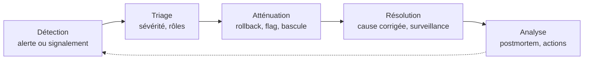
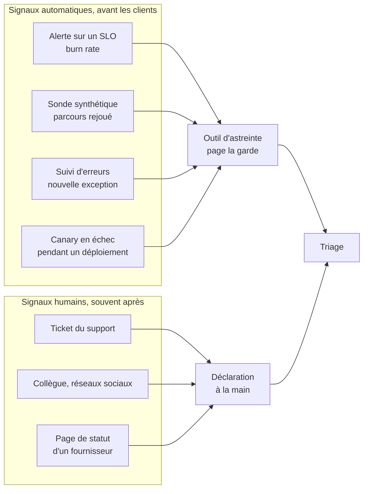
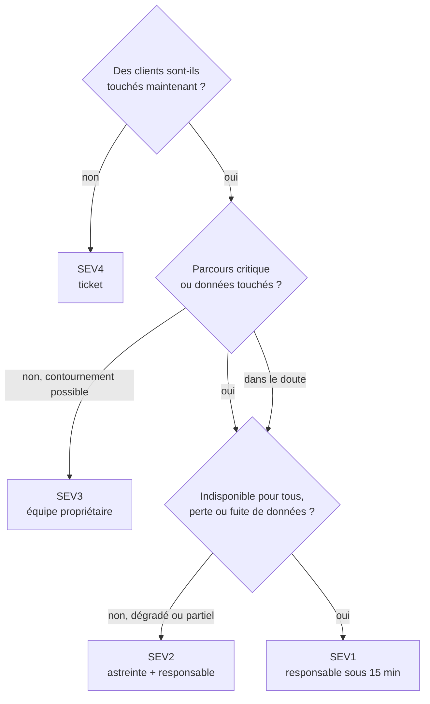
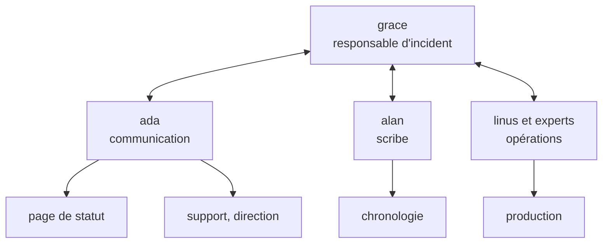
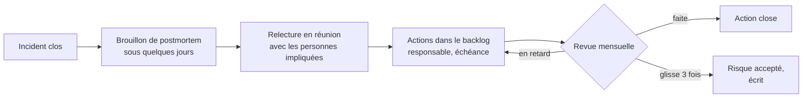
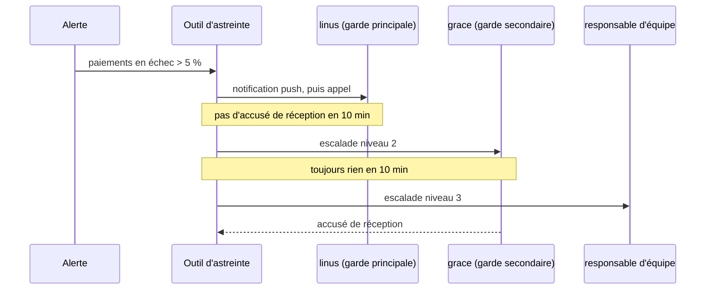
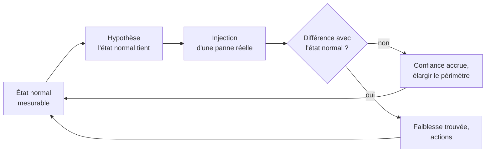

# Incidents et incidentologie

!!! warning "Avertissement"
    Ces notes sont des pense-bêtes personnels, pas une source de vérité. Elles reflètent ma compréhension et mes choix : leur contenu reste subjectif, malgré les citations et les références qu'il contient. Il peut être incomplet, simplifié, inexact ou dépassé. Vérifiez toujours dans la documentation officielle avant de l'appliquer. Ce contenu est fourni tel quel, sans aucune garantie : son utilisation se fait sous votre seule responsabilité.

!!! audience "Pour qui, pour quoi"
    - **Métiers** : SRE, développeur back-end, personne d'astreinte, tech lead, engineering manager, QA...
    - **Usages** : je prépare un entretien où l'on me demande de raconter un incident que j'ai géré ; je rejoins une rotation d'astreinte et je veux savoir quoi faire quand une alerte sonne à 3 h du matin ; je rédige le postmortem d'une panne de paiement sans désigner de coupable ; je conçois la grille de sévérité et les runbooks de mon équipe ; j'organise un premier game day en préproduction.

!!! abstract "Les échelles"
    Les pastilles de couleur sous les titres disent à quelle échelle une notion s'applique :

    - <span class="pill pill-scope pill-scope-code">Code</span> les classes, fonctions et modules d'un programme ;
    - <span class="pill pill-scope pill-scope-app">Application</span> un service ou une application et son découpage interne ;
    - <span class="pill pill-scope pill-scope-system">Système</span> plusieurs services qui communiquent par le réseau ;
    - <span class="pill pill-scope pill-scope-infra">Infrastructure</span> les serveurs, le réseau, les zones et les clusters, physiques ou virtuels ;
    - <span class="pill pill-scope pill-scope-enterprise">Entreprise</span> le système d'information entier et son organisation.

    Détail et mots ambigus : [carte des échelles](architecture.md#carte-des-echelles).

Les clients ne peuvent plus payer sur mon site depuis dix minutes : c'est un incident. Un <span class="term" data-term="incident">incident</span>, c'est le moment où un service réel ne rend plus le service attendu. Cette page couvre deux choses : comment le traverser (détecter, coordonner, communiquer, rétablir) et comment en tirer quelque chose (analyser, suivre les actions, apprendre d'un incident à l'autre). Elle finit par la santé de l'<span class="term" data-term="on-call">astreinte</span> et par les exercices qui préparent au prochain.

Le mot « incidentologie » est surtout employé en français. En anglais, on parle d'*incident management* (la gestion pendant l'incident), d'*incident analysis* (l'analyse après coup) ou de *learning from incidents* (le courant qui traite les incidents comme une source d'apprentissage).

Les <span class="term" data-term="alert-monitoring">alertes</span>, les <span class="term" data-term="slo">SLO</span> et le <span class="term" data-term="error-budget">budget d'erreur</span> sont expliqués dans la page [Observabilité](observabilite.md#objectifs-et-alertes) : cette page s'appuie dessus sans les redéfinir. Les services `orders-service`, `payments-service` et `my-api`, les personnes ada, grace, alan et linus, et tous les chiffres sont des exemples.

:material-swap-horizontal: Les outils cités dans cette page : lesquels se remplacent, lesquels se combinent ? Voir [Complémentaires ou concurrents](outils.md#complementaires-ou-concurrents).
{ .doc-ref }

## Vocabulaire

**Incident** : interruption ou dégradation d'un service utilisé par de vrais utilisateurs, qui demande une réponse rapide. Un bug connu, sans impact en cours, n'est pas un incident : c'est un ticket.

**Sévérité** : le <span class="term" data-term="incident-severity">niveau de gravité</span> d'un incident (SEV1, SEV2...), décidé par des critères écrits à l'avance. Elle dit qui est appelé et à quelle cadence on communique. À ne pas confondre avec la gravité d'un bug, qui juge un défaut, pas une situation en cours.

**Astreinte** (*on-call*) : la personne de garde doit pouvoir répondre à une alerte à toute heure, pendant une période donnée, souvent une semaine.

**Atténuation** (*mitigation*) : l'action rapide qui réduit l'impact avant de comprendre la cause : <span class="term" data-term="rollback">retour à la version précédente</span>, coupure d'une fonctionnalité par <span class="term" data-term="feature-flag">feature flag</span>, bascule vers une autre zone.

**MTTD, MTTA, MTTR** : trois durées moyennes mesurées sur une série d'incidents.

``` { .text .ex-illus title="Illustration" }
14:00  début réel du problème
14:12  une alerte sonne                 MTTD : 12 min (Mean Time To Detect, détecter)
14:15  l'astreinte prend l'alerte       MTTA : 3 min  (Mean Time To Acknowledge, accuser réception)
14:40  le service est rétabli           MTTR : 40 min (Mean Time To Restore, rétablir)
```

Le <span class="term" data-term="mttd">MTTD</span> se compte depuis le début réel, le <span class="term" data-term="mtta">MTTA</span> depuis l'alerte. Le R de <span class="term" data-term="mttr">MTTR</span> a plusieurs lectures selon les sources (restore, recover, repair, resolve) : toujours écrire laquelle on mesure.

**Postmortem** : le <span class="term" data-term="postmortem">document écrit après un incident</span>, qui raconte ce qui s'est passé, pourquoi c'était possible, et ce qu'on change. On écrit aussi « post-mortem » ou on parle de « revue d'incident ».

**Facteur contributif** : une <span class="term" data-term="contributing-factor">condition</span> qui a rendu l'incident possible ou plus grave, sans en être la seule cause. Exemple : « pas d'alerte sur l'âge des messages » n'a pas causé la panne, mais l'a fait durer 30 minutes de plus.

**Quasi-incident** (*near miss*) : un <span class="term" data-term="near-miss">événement</span> qui aurait pu provoquer un incident, sans impact, par chance ou grâce à quelqu'un. Exemple : une migration qui aurait verrouillé la table des commandes, arrêtée en préproduction parce qu'ada a remarqué sa durée.

**<span class="term" data-term="sli">SLI</span>** : l'indicateur mesuré qui dit si le service rend ce qu'il promet. Exemple : la part des paiements acceptés en moins de 2 s.

**<span class="term" data-term="slo">SLO</span>** : l'objectif interne fixé sur ce SLI. Exemple : 99,5 % des paiements en moins de 2 s sur 30 jours glissants ; un incident consomme ce budget.

**<span class="term" data-term="sla">SLA</span>** : la promesse faite par contrat à un client, avec une pénalité si elle n'est pas tenue, en général plus lâche que le SLO. Exemple : 99 % de disponibilité par mois, sinon 10 % de remise sur la facture. Le détail est dans [Observabilité](observabilite.md).

:material-book-open-variant: Doc de référence : [Atlassian, Common incident management metrics](https://www.atlassian.com/incident-management/kpis/common-metrics) (consultée en novembre 2026)
{ .doc-ref }

## Le cycle de vie d'un incident

<a class="pill pill-scope pill-scope-system" href="../architecture/#carte-des-echelles">Échelle · Système</a> <a class="pill pill-scope pill-scope-infra" href="../architecture/#carte-des-echelles">Échelle · Infrastructure</a> <span class="pill pill-status pill-status-ok" title="Toujours valable, vérifié en novembre 2026">Valable · 11/2026</span>

<a class="pill pill-practice" href="../observabilite/" title="niveau 2 : elle est automatisée">Pratique · Observabilité · N2</a>
<a class="pill pill-dora" href="https://dora.dev/capabilities/proactive-failure-notification/">DORA · Proactive failure notification</a>

Un incident passe par cinq étapes. La règle centrale : **atténuer avant de corriger**. On rétablit d'abord le service par le geste le plus sûr, on comprend ensuite. Si les paiements échouent juste après un déploiement, je reviens d'abord à la version précédente, et je cherche pourquoi une fois les clients tirés d'affaire.

!!! noob "As noob"
    C'est le plombier face à une fuite : il coupe d'abord l'arrivée d'eau, et cherche ensuite quel tuyau a cédé. La phrase à retenir : **on rétablit le service d'abord, on comprend la cause ensuite.**



| Étape | Question | Sortie attendue |
|---|---|---|
| Détection | est-ce que quelque chose ne va pas ? | une alerte, idéalement avant les clients |
| Triage | est-ce grave, qui doit venir ? | une sévérité, une personne qui coordonne, un canal |
| Atténuation | comment arrêter les dégâts maintenant ? | l'impact client stoppé, même sans connaître la cause |
| Résolution | le service est-il revenu à la normale ? | indicateurs revenus, cause corrigée ou contournée durablement |
| Analyse | qu'est-ce qui l'a rendu possible ? | un postmortem et quelques actions suivies |

Je peux apprendre qu'il y a un problème par une alerte, par un ticket du support ou par un collègue qui me prévient. Le but est que les signaux automatiques sonnent avant que les clients se plaignent ; la part des incidents « détectés par les clients » se suit dans la [revue des incidents](#apprendre-des-incidents-a-lechelle).



Exemple de chronologie, un mardi :

``` { .text .ex-illus title="Illustration" }
14:02  déploiement d'orders-service v2.14 (nouvelle règle de calcul des frais de port)
14:06  le taux d'erreur du paiement passe de 0,2 % à 9 %
14:09  alerte « 5 % des paiements en erreur depuis 3 min », linus (astreinte) la prend
14:11  linus ouvre le canal #inc-paiements, classe en SEV2, grace coordonne
14:14  grace décide le retour à v2.13 sans attendre la cause
14:19  rollback terminé, taux d'erreur à 0,3 %
14:20  ada publie « service rétabli, surveillance en cours » sur la page de statut
14:50  aucune rechute, incident clos ; 312 paiements en échec (exemple) à relancer
J+3    postmortem relu en équipe, 3 actions ouvertes
```

Ici, MTTD : 7 minutes, MTTA : 0, rétablissement : 17 minutes. Les paiements en échec restent à traiter après la fin de l'impact : la résolution inclut le rattrapage des données touchées, pas seulement le retour du service.

Le retour arrière n'est pas toujours possible. Si v2.14 contenait une migration qui supprime une colonne, v2.13 ne fonctionne plus. D'où la règle de garder les migrations compatibles avec deux versions (voir [Expand / contract](sql.md#expand-contract) : renommer une colonne en cinq déploiements, chacun réversible).

:material-book-open-variant: Doc de référence : [Google SRE Workbook, Incident Response](https://sre.google/workbook/incident-response/) (2018) ; [PagerDuty Incident Response](https://response.pagerduty.com/) (consultée en novembre 2026)
{ .doc-ref }

!!! maturity "Mesurer la maturité"
    | Niveau | Ce que j'observe dans l'équipe |
    |---|---|
    | N1 | quelqu'un réagit quand un client ou un collègue signale la panne, et chacun improvise ses étapes |
    | N2 | des signaux automatiques (alerte de SLO, sonde synthétique, canary) détectent la plupart des incidents, et les cinq étapes sont écrites |
    | N3 | un canary ou un smoke test en échec déclenche seul le retour arrière, avant toute intervention humaine |
    | N4 | l'équipe suit la part des incidents détectés avant les clients et le délai jusqu'à l'atténuation, et travaille sur l'étape la plus lente |

    **Je mesure** : la part des incidents détectés par un signal automatique plutôt que par un client, lue dans l'outil d'incident ; le délai médian entre la détection et l'atténuation.

## Niveaux de sévérité

<span class="pill pill-status pill-status-ok" title="Toujours valable, vérifié en novembre 2026">Valable · 11/2026</span>

La grille de sévérité sert à ce que deux personnes classent le même incident de la même façon, à 3 h du matin, sans débat. Elle s'écrit avec le produit et le support, avec des critères observables, pas avec « c'est grave ».

!!! noob "As noob"
    C'est le tri aux urgences : l'infirmière classe chaque patient avec des critères fixes (respire-t-il, saigne-t-il ?), pas avec son ressenti, et ce classement décide qui est vu et à quelle vitesse. La phrase à retenir : **la sévérité se lit sur une grille écrite à l'avance, pas dans l'émotion du moment.**

| Niveau | Critère (exemple) | Qui vient | Communication | Postmortem |
|---|---|---|---|---|
| SEV1 | parcours critique indisponible pour tous, perte ou fuite de données | astreinte, responsable d'incident sous 15 min, direction prévenue | toutes les 30 min | obligatoire |
| SEV2 | parcours critique dégradé, ou indisponible pour une partie des clients | astreinte et responsable d'incident | toutes les heures | obligatoire |
| SEV3 | fonction secondaire touchée, contournement possible | équipe propriétaire, heures ouvrées | canal de l'équipe | facultatif |
| SEV4 | aucun impact client (quasi-incident) | ticket | aucune | revue groupée |

La grille lue comme un arbre de décision (critères de l'exemple) :



Trois règles qui évitent les débats :

- **dans le doute, classer plus haut** : redescendre une sévérité coûte quelques minutes, sous-estimer coûte la cadence de communication ;
- **la sévérité peut changer** pendant l'incident, et chaque changement est noté dans la chronologie ;
- **la sévérité mesure l'impact, pas l'effort** : un correctif d'une ligne peut clore un SEV1.

Le nombre de niveaux varie selon les organisations (trois à cinq, parfois numérotés à l'envers). Ce qui compte est que chaque niveau déclenche des actions différentes ; deux niveaux qui déclenchent la même chose peuvent fusionner.

:material-book-open-variant: Doc de référence : [PagerDuty, Severity Levels](https://response.pagerduty.com/before/severity_levels/) (consultée en novembre 2026) ; [Atlassian, Incident severity levels](https://www.atlassian.com/incident-management/kpis/severity-levels) (consultée en novembre 2026)
{ .doc-ref }

!!! maturity "Mesurer la maturité"
    | Niveau | Ce que j'observe dans l'équipe |
    |---|---|
    | N1 | la sévérité est décidée au ressenti par la personne qui prend l'alerte |
    | N2 | une grille écrite avec des critères observables existe, et chaque incident reçoit un niveau |
    | N3 | le niveau déclenche seul les bonnes actions : qui est appelé, à quelle cadence on communique, si un postmortem est obligatoire |
    | N4 | l'équipe relit les classements après coup, compte les reclassements, et fusionne ou précise les niveaux qui créent des débats |

    **Je mesure** : la part des incidents dont la sévérité a changé pendant ou après l'incident, lue dans la chronologie ; le délai entre la détection et l'attribution d'une sévérité.

## Les rôles pendant l'incident

<span class="pill pill-status pill-status-ok" title="Toujours valable, vérifié en novembre 2026">Valable · 11/2026</span>

Les rôles viennent de l'**Incident Command System** (ICS), créé dans les années 1970 par les pompiers de Californie pour coordonner plusieurs services sur les grands feux de forêt. Les équipes d'exploitation l'ont repris, par exemple dans le chapitre « Managing Incidents » du livre « Site Reliability Engineering » (Google, 2016).

!!! noob "As noob"
    C'est une cuisine en plein coup de feu : le chef ne cuisine pas, il annonce les commandes et répartit le travail, et un seul serveur parle aux clients. La phrase à retenir : **celui qui coordonne ne cherche pas la panne, et ceux qui la cherchent ne parlent pas à l'extérieur.**

| Rôle | Fait | Ne fait pas |
|---|---|---|
| <span class="term" data-term="incident-commander">Responsable d'incident</span> (*incident commander*) | décide, priorise, distribue le travail, déclare la fin | déboguer lui-même |
| Communication | met à jour la page de statut, répond au support et à la direction | interrompre les experts |
| <span class="term" data-term="incident-scribe">Scribe</span> | note les faits et les décisions avec l'heure | interpréter ou juger |
| Experts (opérations) | enquêtent et appliquent les actions décidées | lancer un changement sans l'annoncer |

Qui parle à qui pendant l'incident de l'exemple : tout passe par le responsable d'incident, et les experts ne parlent jamais directement à l'extérieur.



Sur un petit incident, une seule personne tient plusieurs rôles. Dès que plus de deux ou trois personnes interviennent, séparer au moins la coordination de l'enquête : quelqu'un qui a les mains dans les logs ne voit plus l'ensemble.

Le responsable d'incident n'est pas forcément le plus expert ni le plus gradé. C'est celui qui a été désigné, et il peut passer la main explicitement (« grace, tu reprends la coordination ? »), ce qui est noté dans la chronologie.

:material-book-open-variant: Doc de référence : [Google SRE book, Managing Incidents](https://sre.google/sre-book/managing-incidents/) (2016) ; [PagerDuty, Incident Commander training](https://response.pagerduty.com/training/incident_commander/) (consultée en novembre 2026)
{ .doc-ref }

!!! maturity "Mesurer la maturité"
    | Niveau | Ce que j'observe dans l'équipe |
    |---|---|
    | N1 | la personne la plus expérimentée fait tout, du débogage aux messages à la direction |
    | N2 | un responsable d'incident est nommé pour chaque incident sérieux, et les rôles sont décrits |
    | N3 | les rôles sont assignés dès la déclaration, par l'outil ou par habitude, et le responsable d'incident ne débogue pas sans qu'on le lui rappelle |
    | N4 | l'équipe suit qui tient les rôles, fait tourner la coordination pour former plus de monde, et ajuste d'après les postmortems |

    **Je mesure** : la part des SEV1 et SEV2 avec un responsable d'incident nommé dans les 10 premières minutes, lue dans la chronologie ; le nombre de personnes qui ont déjà coordonné un incident dans l'année.

## Communiquer

<span class="pill pill-status pill-status-ok" title="Toujours valable, vérifié en novembre 2026">Valable · 11/2026</span>

Pendant un incident, le support, les clients et la direction veulent savoir où on en est. Sans nouvelles, ils écrivent directement aux personnes qui enquêtent, et celles-ci passent leur temps à répondre au lieu de chercher. Le silence coûte donc plus cher qu'une mauvaise nouvelle. Une <span class="term" data-term="status-page">page de statut</span> et une cadence fixe règlent les deux problèmes : chacun sait où lire l'information, et quand viendra la suivante.

!!! noob "As noob"
    C'est le pilote qui annonce « nous traversons une zone de turbulences, prochaine information dans vingt minutes » : rien n'est réglé, mais les passagers arrêtent d'appeler l'équipage. La phrase à retenir : **une nouvelle à heure fixe, même sans rien de neuf, évite cent questions aux personnes qui réparent.**

Règles simples :

- **une cadence annoncée**, tenue même quand il n'y a rien de neuf (« toujours en cours, prochain point à 15:00 ») ;
- **des faits, pas des hypothèses** : ce que vivent les utilisateurs, ce qu'on fait, le prochain point ;
- **un seul canal par incident**, et une seule personne qui parle à l'extérieur ;
- **le vocabulaire de l'utilisateur** : « les paiements par carte échouent », pas « le pod payments est en CrashLoopBackOff ».

À éviter : un message écrit par la personne qui débogue, dans son vocabulaire à elle. Le support ne sait pas quoi répondre aux clients, ignore s'il existe un contournement et quand viendra la suite, donc il se remet à écrire dans le canal d'incident.

``` { .text .ex-bad title="À éviter" }
payments-service en CrashLoopBackOff, on pense que c'est la v2.14 ou peut-être la base,
on regarde. Merci de ne pas nous déranger.
```

Bien : un modèle de message qui dit l'impact, l'action, le contournement et le prochain point :

``` { .text .ex-good title="Recommandé" }
[SEV2] Paiements par carte en échec : en cours
Impact     : environ 9 % des paiements par carte échouent depuis 14:06.
             Les autres moyens de paiement fonctionnent.
Action     : retour à la version précédente en cours.
Contournement : réessayer dans quelques minutes, ou payer par virement.
Prochain point : 14:45 au plus tard.
```

Le message de fin dit ce qui a été touché, pendant combien de temps, si des données sont à reprendre, et quand le résumé du postmortem sera partagé.

:material-book-open-variant: Doc de référence : [Atlassian, Incident communication](https://www.atlassian.com/incident-management/incident-communication) (consultée en novembre 2026)
{ .doc-ref }

### Outiller la gestion d'incident

<span class="pill pill-status pill-status-ok" title="Toujours valable, vérifié en novembre 2026">Valable · 11/2026</span>

!!! info "Section rédigée en novembre 2026"
    Les outils de gestion d'incident évoluent vite (rachats, fonctions d'IA ajoutées chaque année). Les noms cités sont des exemples, leurs fonctions sont à vérifier au moment de la lecture.

Un outil de gestion d'incident (incident.io, PagerDuty, Opsgenie, FireHydrant, Rootly) automatise la partie administrative de tout ce qui précède, pour que les personnes se concentrent sur le diagnostic. PagerDuty et Opsgenie sont nés de l'astreinte (recevoir l'alerte, appeler la bonne personne, gérer l'<span class="term" data-term="escalation-policy">escalade</span>) et ont ajouté la coordination ; incident.io est parti de la coordination dans la messagerie (Slack, Teams) et a ajouté l'astreinte. Atlassian a annoncé la fin de vente d'Opsgenie au profit de Jira Service Management et Compass (annonce de 2025, à vérifier).

*PagerDuty : concurrent de Opsgenie ; complémentaire de Alertmanager*<br>
*Opsgenie : concurrent de PagerDuty ; complémentaire de Alertmanager*<br>
*Jira : complémentaire de Confluence, Slack*
{ .tool-rel }


| Ce que l'outil automatise | Sans outil | Avec outil |
|---|---|---|
| canal | quelqu'un crée `#inc-paiements` et invite les gens à la main | une commande (`/inc declare`) crée le canal, invite l'astreinte et l'équipe propriétaire |
| rôles | « qui coordonne ? » dans le fil | le <span class="term" data-term="incident-commander">responsable d'incident</span> et la communication sont assignés et affichés en haut du canal |
| chronologie | le scribe recopie l'heure de chaque message | les messages marqués, les changements de sévérité et les alertes forment la chronologie |
| page de statut | quelqu'un se connecte à un autre outil pour publier | mise à jour depuis le canal, avec un rappel à la cadence fixée |
| brouillon de postmortem | on reconstitue les faits deux jours après | un document prérempli avec la chronologie, les personnes et les durées |
| suivi | les actions se perdent dans le canal | les actions créent des tickets, l'incident est clos quand elles sont suivies |

**Quand** : plusieurs incidents par mois, plusieurs équipes qui interviennent ensemble, une page de statut publique, ou une astreinte à organiser sur plusieurs rotations. **Pas encore** : une seule équipe avec un incident par trimestre ; un modèle de message, un canal créé à la main et un document de postmortem type suffisent, et apprennent le processus avant de l'automatiser.

**Pourquoi** : pendant un incident, chaque geste administratif est fait par quelqu'un qui devrait réfléchir, et la chronologie reconstituée après coup est toujours incomplète. Le gain : un processus suivi même à 3 h du matin par quelqu'un qui le vit pour la première fois, et des données (durées, sévérités, motifs) pour l'[analyse à l'échelle](#apprendre-des-incidents-a-lechelle). Le coût : une licence souvent par utilisateur, et le risque d'automatiser un processus que personne n'a encore compris.

**Comment** : écrire d'abord le processus (grille de sévérité, rôles, cadence), puis le configurer dans l'outil, puis l'essayer pendant un [game day](#sentrainer-game-days-et-chaos-engineering) avant le premier vrai incident.

!!! maturity "Mesurer la maturité"
    | Niveau | Ce que j'observe dans l'équipe |
    |---|---|
    | N1 | les nouvelles partent quand quelqu'un y pense, dans le vocabulaire de la personne qui débogue |
    | N2 | un modèle de message, une page de statut et un canal par incident existent, et la cadence est annoncée |
    | N3 | l'outil crée le canal, assigne les rôles, rappelle la cadence et prépare la chronologie sans geste manuel |
    | N4 | l'équipe suit les cadences tenues et les questions reçues par les experts pendant l'incident, et ajuste ses modèles et son outil |

    **Je mesure** : la part des mises à jour publiées à l'heure annoncée, lue sur la page de statut ; le nombre de messages directs reçus par les experts pendant l'incident, relevé en postmortem.

## Runbooks et playbooks

<a class="pill pill-scope pill-scope-system" href="../architecture/#carte-des-echelles">Échelle · Système</a> <a class="pill pill-scope pill-scope-infra" href="../architecture/#carte-des-echelles">Échelle · Infrastructure</a> <span class="pill pill-status pill-status-ok" title="Toujours valable, vérifié en novembre 2026">Valable · 11/2026</span>

Une alerte réveille la personne d'astreinte à 3 h du matin, sur un service qu'elle connaît mal : elle a besoin de savoir quoi faire sans tout reconstituer. Un <span class="term" data-term="runbook">runbook</span> est une procédure écrite, étape par étape, pour une alerte ou une panne connue. Un <span class="term" data-term="playbook">playbook</span> est plus large : il décrit la conduite face à une famille de situations (une fuite de données, la panne d'un fournisseur), avec les rôles et les décisions à prendre. Les deux mots se recouvrent selon les équipes.

!!! noob "As noob"
    Le runbook, c'est la fiche réflexe collée sur la machine (« si le voyant rouge clignote, faire 1, 2, 3 ») ; le playbook, c'est le plan d'urgence du bâtiment, qui dit qui fait quoi pour toute une famille de situations. La phrase à retenir : **un runbook se suit à 3 h du matin sans réfléchir, un playbook organise une réponse.**

À éviter : le runbook écrit de mémoire par la seule personne qui connaît le service. À 3 h du matin, « redémarrer si besoin » ne dit ni quand ni comment, et « la vider » fait perdre des paiements réels.

``` { .markdown .ex-bad title="À éviter" }
# Runbook payments

Si ça rame, regarder les logs et redémarrer si besoin.
Si la file bloque, la vider.
Voir avec ada si ça ne repart pas.
```

Bien : le même runbook, relié à l'alerte, avec des seuils, des commandes copiables et ce qu'il ne faut pas faire :

``` { .markdown .ex-good title="Recommandé" }
# Runbook : file « payments-events » qui grossit

Alerte : message le plus ancien > 5 min (lien vers le tableau de bord)
Impact : les confirmations de paiement arrivent en retard

1. Vérifier les consommateurs : `kubectl get pods -l app=payments-consumer`
2. Si des pods redémarrent en boucle : voir les logs, puis rollback du dernier déploiement
3. Si les pods sont sains mais lents : passer à 6 réplicas
   `kubectl scale deploy/payments-consumer --replicas=6`
4. Si la file dépasse 50 000 messages : prévenir le responsable d'incident (SEV2)
5. Ne pas purger la file : les messages sont des paiements réels

Propriétaire : team-payments ; dernière relecture : 2026-09-14
```

Ce qui rend un runbook utile :

- **un lien depuis l'alerte** : la personne réveillée ne doit pas le chercher ;
- **des commandes copiables** et ce qu'on doit voir si elles marchent ;
- **ce qu'il ne faut pas faire**, souvent plus précieux que le reste ;
- **une date de relecture** : un runbook faux est pire qu'aucun runbook.

Quand une étape de runbook est appliquée à l'identique à chaque fois, c'est un candidat à l'automatisation. Si une alerte n'a pas de runbook possible (« rien à faire »), ce n'est peut-être pas une alerte (voir [Alerter sur les symptômes](observabilite.md#alerter-sur-les-symptomes-pas-sur-les-causes)).

!!! maturity "Mesurer la maturité"
    | Niveau | Ce que j'observe dans l'équipe |
    |---|---|
    | N1 | quelques runbooks existent, écrits de mémoire, sans lien avec les alertes |
    | N2 | chaque alerte qui page a un runbook relié, avec des commandes copiables et une date de relecture |
    | N3 | les étapes appliquées à l'identique à chaque fois sont automatisées (redémarrage, mise à l'échelle), et une alerte qui page ne peut pas être créée sans runbook |
    | N4 | l'équipe suit l'âge des runbooks et ceux qui ont échoué en incident, et relit ceux-là en priorité |

    **Je mesure** : la part des alertes qui pagent avec un lien de runbook, lue dans les règles d'alerte ; la part des runbooks relus dans les six derniers mois.

## Trouver la cause : déboguer méthodiquement

<a class="pill pill-scope pill-scope-code" href="../architecture/#carte-des-echelles">Échelle · Code</a> <a class="pill pill-scope pill-scope-app" href="../architecture/#carte-des-echelles">Échelle · Application</a> <span class="pill pill-status pill-status-ok" title="Toujours valable, vérifié en novembre 2026">Valable · 11/2026</span>

Le service est rétabli, il reste à comprendre. Depuis deux semaines, environ 1 % des factures PDF sortent avec un total vide ; impossible de reproduire en local, et une trentaine de MR ont été fusionnées sur la période. Changer des lignes au hasard en espérant que ça passe peut durer des jours. Une méthode presque scientifique trouve la cause en quelques heures, et la rend vérifiable.

**Quand** : après l'atténuation, quand la cause n'est pas évidente ; ou pour un bug qui revient sans qu'on sache pourquoi. Pas pendant l'impact client : là, on atténue d'abord ([voir Le cycle de vie](#le-cycle-de-vie-dun-incident)). **Pourquoi** : un temps de résolution prévisible, et un test de non-régression gratuit, issu de la reproduction. Le coût : du temps passé à reproduire avant de toucher au code, qui paraît long sur le moment. **Comment** :

1. **Reproduire** : tant que je ne sais pas provoquer le bug, je ne saurai pas s'il est corrigé. Idéalement, la reproduction devient un test automatique qui échoue.
2. **Lire l'erreur en entier**, la trace jusqu'en bas, au lieu de s'arrêter à la première ligne.
3. **Une hypothèse, une expérience** : une explication possible, et une expérience qui peut la réfuter, en ne changeant qu'une seule chose à la fois.
4. **Couper en deux** : quel commit a introduit le bug, avec `git bisect` qui fait une recherche dichotomique dans l'historique ; quelle donnée minimale le déclenche, en retirant la moitié de l'entrée à chaque essai. Le **delta debugging** (Andreas Zeller, fin des années 1990, date exacte à vérifier) automatise cette réduction de l'entrée jusqu'au plus petit cas qui échoue encore.
5. **Corriger la cause, pas le symptôme**, garder le test, et noter ce que j'ai appris dans la MR.

Quand je bloque, j'explique le code ligne par ligne, à voix haute, à un collègue ou à un objet : c'est le **rubber duck debugging** (le débogage avec un canard en plastique, Andrew Hunt et David Thomas, « The Pragmatic Programmer », 1999). Devoir tout formuler fait souvent apparaître l'hypothèse que j'avais prise pour acquise.

!!! noob "As noob"
    C'est la recherche d'une ampoule grillée dans une guirlande de 32 ampoules : au lieu de les tester une par une, je coupe la guirlande en deux, je regarde quelle moitié reste éteinte, et je recommence. Cinq essais suffisent. La phrase à retenir : **couper le problème en deux à chaque essai trouve la cause en quelques étapes, même parmi des centaines de suspects.**

Pour les factures, je commence par les données, pas par le code : je récupère quelques factures fautives et je cherche ce qu'elles ont en commun (devise, pays, nombre de lignes). Elles sont toutes en francs suisses. J'écris le test qui échoue avec une commande en CHF, puis je laisse `git bisect` chercher le commit fautif parmi les trente : environ cinq étapes (2 puissance 5 = 32).

``` { .text .ex-ref title="Référence" }
$ git bisect start
$ git bisect bad HEAD
$ git bisect good v2.13.0
$ git bisect run uv run pytest tests/test_invoice.py -k chf
...
a41c9e2 is the first bad commit
    Remplace le formatage des montants par format_money()
```

Le commit a remplacé le formatage des montants par une fonction qui ne connaît pas la devise CHF et renvoie une chaîne vide au lieu d'une erreur.

``` { .python .ex-bad title="À éviter" }
# À éviter : une devise inconnue donne une chaîne vide, et la facture part avec un total vide
def format_money(amount, currency):
    symbol = SYMBOLS.get(currency)
    if symbol is None:
        return ""
    return f"{amount:.2f} {symbol}"
```

``` { .python .ex-good title="Recommandé" }
# Bien : une devise inconnue échoue bruyamment, et CHF est ajoutée à la table
def format_money(amount, currency):
    try:
        symbol = SYMBOLS[currency]
    except KeyError:
        raise ValueError(f"devise non prise en charge : {currency}") from None
    return f"{amount:.2f} {symbol}"
```

Je corrige, je garde le test CHF, et je régénère les factures concernées : la résolution inclut les données touchées.

| Je veux... | J'utilise... |
|---|---|
| savoir si mon correctif marche vraiment, alors que le bug n'apparaît « que parfois » | une reproduction, idéalement un test qui échoue |
| trouver lequel des trente commits fusionnés depuis la dernière version saine a introduit le bug | `git bisect run` avec ce test |
| réduire un fichier de 5 000 lignes qui fait planter l'import au plus petit extrait qui plante encore | couper l'entrée en deux, ou le delta debugging |
| sortir d'un blocage où je relis le même code depuis une heure sans rien voir | l'expliquer à voix haute, ligne par ligne |

:material-book-open-variant: Doc de référence : [Git, git-bisect](https://git-scm.com/docs/git-bisect) (consultée en novembre 2026) ; [Andreas Zeller, The Debugging Book, « Reducing Failure-Inducing Inputs »](https://www.debuggingbook.org/html/DeltaDebugger.html) (consultée en novembre 2026)
{ .doc-ref }

!!! maturity "Mesurer la maturité"
    | Niveau | Ce que j'observe dans l'équipe |
    |---|---|
    | N1 | chacun cherche à sa façon, souvent en changeant du code au hasard |
    | N2 | l'équipe reproduit d'abord par un test, et `git bisect` fait partie des réflexes |
    | N3 | chaque correction de bug arrive avec le test qui le reproduit, et la revue refuse une correction sans test |
    | N4 | l'équipe suit le temps entre le signalement et la cause trouvée, et les bugs qui reviennent, et cible ses efforts dessus |

    **Je mesure** : la part des MR de correction qui ajoutent un test de non-régression, lue dans l'outil de MR ; le nombre de bugs rouverts dans le trimestre.

## Le postmortem sans recherche de coupable

<span class="pill pill-status pill-status-ok" title="Toujours valable, vérifié en novembre 2026">Valable · 11/2026</span>

<a class="pill pill-dora" href="https://dora.dev/capabilities/learning-culture/">DORA · Learning culture</a>

Un postmortem <span class="term" data-term="blameless">sans recherche de coupable</span> (*blameless*) cherche ce qui, dans le système, a rendu l'erreur possible, pas qui l'a commise. L'idée a été popularisée par John Allspaw, « Blameless PostMortems and a Just Culture » (blog d'ingénierie d'Etsy, 2012), puis par le chapitre « Postmortem Culture: Learning from Failure » du livre « Site Reliability Engineering » (Google, 2016). La raison est pratique : si les gens risquent une sanction, ils cachent les détails, et ce sont les détails qui permettent de corriger.

!!! noob "As noob"
    Après un incident d'avion, l'enquête ne cherche pas à punir le pilote, mais à comprendre pourquoi le cockpit a rendu l'erreur possible ; sinon, les pilotes cachent leurs erreurs et plus personne n'apprend. Limite : sans coupable ne veut pas dire sans responsable, chaque action a bien un propriétaire. La phrase à retenir : **quand personne n'est puni, les gens racontent ce qui s'est vraiment passé.**

Deux idées guident l'analyse :

- **plusieurs facteurs, pas une cause racine** : une <span class="term" data-term="root-cause-analysis">analyse de cause racine</span> qui s'arrête à « linus a déployé un bug » ne change rien. Il y a presque toujours plusieurs <span class="term" data-term="contributing-factor">facteurs contributifs</span> alignés (le modèle du « fromage suisse » de James Reason, « Human Error », 1990, illustre ces couches de défense qui ont chacune un trou) ;
- **ce qui paraissait logique sur le moment** : la personne a agi avec les informations qu'elle avait. Demander « qu'est-ce qui t'a fait penser que c'était sûr ? » plutôt que « pourquoi tu n'as pas vérifié ? » (Sidney Dekker, « The Field Guide to Understanding Human Error », 2006).

Le fromage suisse dessiné pour un incident d'exemple (les paiements par carte expirée échouent en silence) : quatre couches de défense, chacune avec un trou, et les trous alignés.

``` { .text .ex-illus title="Illustration" }
                 trou
revue de code  ══════ ════════════   la revue lit le diff, pas le fichier de config modifié
tests          ══════ ════════════   aucun test avec une carte expirée
canary         ══════ ════════════   5 % du trafic pendant 10 min : trop peu de cartes expirées
alerte         ══════ ════════════   seuil à 10 % d'échecs, l'incident plafonne à 9 %
                     |
                     v
              incident en production
```

Boucher un seul trou suffit à arrêter ce bug-là ; le postmortem cherche une action par couche, pas un coupable par couche.

!!! noob "As noob"
    C'est une pile de tranches d'emmental : chaque tranche arrête la plupart des problèmes, mais chacune a des trous, et l'incident passe seulement le jour où les trous de toutes les tranches s'alignent. Limite : dans un vrai système, les trous bougent et dépendent les uns des autres. La phrase à retenir : **un incident traverse plusieurs défenses percées à la fois, donc il n'a presque jamais une seule cause.**

À éviter : des facteurs contributifs qui nomment une personne. linus retient qu'il vaut mieux se taire la prochaine fois, et l'action « faire attention » ne change rien au système : le prochain montant à 3 décimales repassera la revue, les tests et le déploiement sans être arrêté.

``` { .markdown .ex-bad title="À éviter" }
Facteurs contributifs
  1. linus a déployé sans vérifier le format du montant.
  2. La revue de code a été bâclée.

Actions
  | Action                           | Responsable |
  | linus doit faire plus attention  | linus       |
```

Bien : le modèle rempli sans coupable, pour la chronologie de la section [Le cycle de vie d'un incident](#le-cycle-de-vie-dun-incident) :

``` { .markdown .ex-good title="Recommandé" }
# Postmortem : paiements par carte en échec, 2026-10-13 (SEV2)

Résumé (5 lignes max)
  De 14:06 à 14:19, environ 9 % des paiements par carte ont échoué après le
  déploiement d'orders-service v2.14. 312 paiements à relancer, aucune perte de données.
  Rétabli par rollback. Détecté par alerte, avant tout signalement client.

Rôles : grace (coordination), ada (communication), alan (scribe), linus (astreinte)

Chronologie : voir le canal #inc-paiements (horodatée par alan)

Facteurs contributifs
  1. La nouvelle règle de frais envoie un montant à 3 décimales ; payments-service
     n'en accepte que 2. Aucun test de contrat entre les deux services.
  2. Le déploiement est parti à 100 % d'un coup : pas de canary sur orders-service.
  3. Les 312 paiements en échec n'avaient pas de relance automatique.

Ce qui a bien marché : alerte en 3 min, rollback en 5 min, page de statut à jour.
Où on a eu de la chance : déploiement en heures ouvrées, trafic faible.

Actions
  | Action                                         | Type      | Responsable   | Échéance |
  | test de contrat orders/payments sur le montant  | prévenir  | team-orders   | J+15     |
  | canary 5 % pendant 10 min sur orders-service    | atténuer  | team-core     | J+30     |
  | relance automatique des paiements en échec      | réparer   | team-payments | J+30     |
```

Bonnes pratiques :

- **écrit sous quelques jours**, quand les souvenirs sont frais ; relu en réunion avec les personnes impliquées ;
- **un résumé en tête**, lisible en 30 secondes par quelqu'un qui n'était pas là ;
- **peu d'actions**, chacune avec un responsable, une échéance et un critère de fin ;
- **« erreur humaine » n'est jamais une conclusion** : c'est le point de départ de la question suivante.

:material-book-open-variant: Doc de référence : [Google SRE book, Postmortem Culture](https://sre.google/sre-book/postmortem-culture/) (2016) ; [Google SRE Workbook, Postmortem Culture](https://sre.google/workbook/postmortem-culture/) (2018)
{ .doc-ref }

!!! maturity "Mesurer la maturité"
    | Niveau | Ce que j'observe dans l'équipe |
    |---|---|
    | N1 | un postmortem est écrit après les plus gros incidents, quand quelqu'un s'en charge |
    | N2 | un modèle sans coupable sert pour chaque SEV1 et SEV2, relu en réunion dans la semaine |
    | N3 | le postmortem fait partie du rituel : il est planifié dès la fin de l'incident sans qu'on le demande, et « erreur humaine » n'y est jamais une conclusion |
    | N4 | l'équipe suit la part des postmortems relus à temps et l'effet de leurs actions sur les incidents suivants |

    **Je mesure** : la part des SEV1 et SEV2 avec un postmortem relu sous cinq jours ouvrés, lue dans l'outil d'incident ; le nombre de facteurs contributifs par postmortem, un seul étant souvent le signe d'une analyse arrêtée trop tôt.

## Suivre les actions

<span class="pill pill-status pill-status-ok" title="Toujours valable, vérifié en novembre 2026">Valable · 11/2026</span>

Mon équipe écrit un bon postmortem avec trois actions, puis chacun retourne à ses tickets, et six mois plus tard la même panne revient. Un postmortem dont les actions restent ouvertes n'a servi qu'à écrire. Les actions sont du vrai travail : elles vont dans le backlog de l'équipe responsable, pas dans le document.

!!! noob "As noob"
    C'est la liste de bonnes résolutions du 1er janvier : écrite avec sincérité, oubliée en février, et réécrite à l'identique l'année suivante. Une action n'existe que si elle a un nom, une date et quelqu'un qui vérifie. La phrase à retenir : **une action de postmortem qui n'est pas dans le backlog n'existe pas.**

| Type d'action | But | Exemple |
|---|---|---|
| détecter | voir plus tôt | alerte sur l'âge des messages |
| atténuer | réduire l'impact la prochaine fois | <span class="term" data-term="canary-deployment">canary</span>, <span class="term" data-term="kill-switch">kill switch</span>, runbook |
| prévenir | empêcher que ça se reproduise | <span class="term" data-term="contract-test">test de contrat</span>, validation en CI |
| réparer | rattraper les dégâts de cet incident | relance des paiements en échec |

Le chemin d'une action, de l'incident à sa clôture :



Un suivi léger suffit souvent : une revue mensuelle de quinze minutes des actions en retard, présentée par les équipes elles-mêmes, et un indicateur simple, la part d'actions closes à l'échéance. Une action qui glisse trois fois est une décision implicite de ne pas la faire : l'écrire comme un risque accepté plutôt que la laisser traîner.

**Risques.** Trop d'actions par postmortem noient le backlog, et aucune n'est faite : j'en garde deux ou trois, les plus utiles. Une revue des actions qui tourne à la chasse aux retardataires pousse les équipes à fermer des actions vides, comme « sensibiliser l'équipe » : je demande pour chaque action un critère de fin vérifiable.

!!! maturity "Mesurer la maturité"
    | Niveau | Ce que j'observe dans l'équipe |
    |---|---|
    | N1 | les actions restent dans le document du postmortem |
    | N2 | chaque action devient un ticket du backlog, avec un responsable et une échéance |
    | N3 | une revue mensuelle des retards a lieu sans qu'on la réclame, et une action qui glisse trois fois est écrite comme risque accepté |
    | N4 | l'équipe suit la part d'actions closes à l'échéance et les incidents récurrents, et vérifie que les premières font baisser les seconds |

    **Je mesure** : la part des actions de postmortem closes à l'échéance, lue dans le backlog ; le nombre d'incidents dont la cause avait déjà une action ouverte.

## Apprendre des incidents à l'échelle

<span class="pill pill-status pill-status-ok" title="Toujours valable, vérifié en novembre 2026">Valable · 11/2026</span>

Un postmortem regarde un incident. L'apprentissage utile vient souvent de la lecture de **plusieurs** incidents ensemble : un motif qui revient est un problème de système, pas de malchance. Par exemple, trois pannes sur cinq signalées par les clients, ce n'est pas trois coups de malchance, c'est un trou dans la détection.

!!! noob "As noob"
    C'est le médecin qui ne traite pas chaque toux à part, mais remarque que trois patients du même immeuble toussent depuis la même semaine : le problème est peut-être la ventilation, pas trois rhumes. La phrase à retenir : **un motif qui revient d'un incident à l'autre désigne une faiblesse du système, pas de la malchance.**

``` { .text .ex-illus title="Illustration" }
5 incidents sur 6 mois, relus ensemble (exemple)

incident                         détecté par        motif
1. import massif d'un client     clients, 25 min    ressource partagée sans limite
2. config erronée partout        alerte, 4 min      changement appliqué à tous d'un coup
3. API de taxes indisponible     clients, 35 min    dépendance non critique sur le parcours critique
4. certificat expiré             clients, 20 min    échéance non surveillée
5. migration qui verrouille      alerte, 3 min      changement appliqué à tous d'un coup

constat : 3 sur 5 détectés par les clients ; 2 sur 5 du même motif
```

Pratiques qui aident :

- **une revue trimestrielle** des incidents par thème (détection, déploiement, dépendances), pas par équipe ;
- **recueillir les <span class="term" data-term="near-miss">quasi-incidents</span>** : ils montrent les mêmes faiblesses sans le coût d'une panne, et les gens en parlent plus volontiers ;
- **regarder aussi ce qui marche** : pourquoi la plupart des déploiements se passent bien, quelles adaptations des personnes évitent des pannes chaque semaine ;
- **transformer un motif en décision d'architecture**, écrite dans un <span class="term" data-term="adr">ADR</span> et vérifiée automatiquement.

Ce courant s'appelle **Learning from Incidents** (communauté lancée par Nora Jones en 2019, à vérifier). Il s'appuie sur la recherche en sécurité des systèmes, notamment Richard Cook, « How Complex Systems Fail » (1998) : un système complexe fonctionne toujours en mode partiellement dégradé, et ce sont les personnes qui le maintiennent en marche.

**Risques.** Une revue trimestrielle qui produit des constats sans décision devient un rituel que plus personne ne prépare : chaque motif retenu finit par une décision écrite et un porteur. Recueillir les quasi-incidents suppose qu'on ne reproche rien à ceux qui les déclarent : un seul reproche, et la source se tarit. Classer les incidents par équipe plutôt que par thème transforme la revue en classement des équipes, et chacune minimise ses incidents.

:material-book-open-variant: Doc de référence : [Learning from Incidents in Software](https://www.learningfromincidents.io/) (consultée en novembre 2026) ; [Richard Cook, « How Complex Systems Fail »](https://how.complexsystems.fail/) (1998)
{ .doc-ref }

!!! maturity "Mesurer la maturité"
    | Niveau | Ce que j'observe dans l'équipe |
    |---|---|
    | N1 | chaque incident est lu seul, et personne ne regarde ce qu'ils ont en commun |
    | N2 | une revue trimestrielle des incidents par thème a lieu, et les quasi-incidents sont recueillis |
    | N3 | la revue est ancrée dans les rituels : elle a lieu sans qu'on la réclame, et chaque motif retenu devient une décision écrite (ADR, règle automatique) |
    | N4 | l'équipe suit la fréquence de chaque motif d'un trimestre à l'autre, et vérifie que ses décisions l'ont fait baisser |

    **Je mesure** : le nombre de quasi-incidents déclarés par trimestre (une hausse est souvent bon signe), lu dans l'outil d'incident ; la part des incidents dont le motif était déjà connu.

## Mesures et leurs limites

<span class="pill pill-status pill-status-ok" title="Toujours valable, vérifié en novembre 2026">Valable · 11/2026</span>

Ma direction veut un chiffre pour savoir si les incidents vont mieux, et la durée moyenne semble le plus simple à suivre. C'est pourtant un mauvais guide, pour les raisons du tableau.

| Mesure | Ce qu'elle dit | Limite |
|---|---|---|
| MTTD | les incidents sont-ils vus vite ? | ne compte que les incidents détectés |
| MTTA | l'astreinte répond-elle ? | facile à gonfler en accusant réception sans agir |
| MTTR | les incidents durent-ils ? | moyenne écrasée par quelques longs incidents |
| nombre d'incidents | la tendance générale | baisse si on déclare moins, pas si on casse moins |
| incidents récurrents | les actions marchent-elles ? | demande de relier les incidents entre eux |
| actions closes à l'échéance | le suivi est-il réel ? | ne dit pas si l'action était la bonne |

Le problème du MTTR : les durées d'incident ne suivent pas une courbe en cloche. La plupart sont courtes, quelques-unes très longues, et la moyenne bouge surtout au hasard d'un trimestre à l'autre.

!!! noob "As noob"
    C'est le salaire moyen d'un café quand un milliardaire y entre : la moyenne s'envole alors que personne d'autre n'a changé. Un seul incident très long fait la même chose au MTTR. La phrase à retenir : **sur des durées d'incident, la médiane et la liste disent plus que la moyenne.**

``` { .text .ex-illus title="Illustration" }
8 incidents du trimestre (exemple), en minutes : 6, 9, 12, 15, 18, 22, 30, 410
moyenne : 65 min    médiane : 16,5 min
sans l'incident de 410 min : moyenne 16 min
```

The VOID Report (Courtney Nash, Verica, 2021 puis 2022, à vérifier), construit à partir de milliers d'incidents publics, conclut que ces durées sont trop dispersées pour qu'un MTTR moyen soit un bon indicateur. Štěpán Davidovič, « Incident Metrics in SRE » (Google et O'Reilly, 2021, à vérifier), arrive à une conclusion proche par simulation. [À prendre avec précaution : ces deux conclusions sont résumées ici sans avoir été vérifiées de première main.]

Ce qui marche mieux : regarder la liste des incidents plutôt que la moyenne, suivre la médiane et le pire cas, et ne pas fixer d'objectif chiffré sur une durée. Un objectif sur le MTTR pousse à clore les incidents trop tôt ou à mal les classer (<span class="term" data-term="goodhart-law">loi de Goodhart</span>). Côté DORA, la métrique de rétablissement porte sur les déploiements ratés, pas sur tous les incidents (*failed deployment recovery time* depuis le rapport 2023, à vérifier ; voir [Livraison](livraison.md#mesurer-la-livraison-dora)).

:material-book-open-variant: Doc de référence : [The VOID](https://www.thevoid.community/) (consultée en novembre 2026) ; [Štěpán Davidovič, « Incident Metrics in SRE »](https://sre.google/resources/practices-and-processes/incident-metrics-in-sre/) (2021)
{ .doc-ref }

!!! maturity "Mesurer la maturité"
    | Niveau | Ce que j'observe dans l'équipe |
    |---|---|
    | N1 | la direction suit un MTTR moyen dans un tableur, sans définition écrite |
    | N2 | MTTD, MTTA et durées sont calculés automatiquement depuis l'outil d'incident, avec une définition écrite de chaque durée |
    | N3 | les chiffres sont présentés à chaque revue sans qu'on les demande, en médiane et en liste, sans objectif chiffré sur une durée |
    | N4 | l'équipe choisit ses chantiers d'après ces mesures lues ensemble (détection, récurrence, actions closes), et vérifie leur effet |

    **Je mesure** : l'existence d'une définition écrite de chaque durée suivie, lue dans la documentation de l'équipe ; la médiane et le pire cas des durées d'incident par trimestre.

## Une astreinte soutenable

<span class="pill pill-status pill-status-ok" title="Toujours valable, vérifié en novembre 2026">Valable · 11/2026</span>

Une astreinte qui épuise les gens finit par perdre ses personnes expérimentées, et des personnes fatiguées font plus d'erreurs pendant les incidents. La <span class="term" data-term="alert-fatigue">fatigue d'alerte</span> en est le premier signe : trop d'alertes, dont beaucoup sans action, et les vraies finissent ignorées.

!!! noob "As noob"
    C'est le garçon qui criait au loup : après dix fausses alertes, plus personne ne se lève, même le jour où le loup est vraiment là. La phrase à retenir : **chaque alerte sans action rend la suivante moins écoutée.**

Repères (à adapter) :

| Sujet | Repère |
|---|---|
| taille de la rotation | assez de personnes pour ne pas être de garde plus d'une semaine sur quatre ou cinq (exemple) |
| charge | le livre SRE de Google (2016) vise au plus deux incidents par garde de 12 heures (à vérifier) |
| alertes | chaque alerte qui réveille doit demander une action humaine ; sinon on la supprime ou on la passe en ticket |
| <span class="term" data-term="escalation-policy">escalade</span> | si l'astreinte ne répond pas en 10 min (exemple), l'alerte passe à une deuxième personne |
| compensation | prime, récupération ou les deux, selon le droit du travail du pays (à vérifier localement) |
| passation | un point de 15 minutes en fin de semaine : alertes reçues, actions en cours, bruits à corriger |

!!! noob "As noob"
    C'est la chaîne d'appel d'une garde de nuit à l'hôpital : si l'interne ne décroche pas, le standard appelle le médecin senior, puis le chef de service, sans que personne ait à décider qui réveiller. La phrase à retenir : **une alerte ne doit jamais dépendre d'une seule personne, qui peut dormir, être sans réseau ou malade.**

Une politique d'escalade typique, déroulée dans le temps (délais d'exemple) :



Indicateurs de santé à suivre autant que le MTTR : nombre d'alertes par garde, appels hors heures ouvrées par personne, part des alertes sans action. Si la personne d'astreinte passe sa semaine à éteindre des feux, elle ne fait pas de travail de projet : c'est prévu, pas un échec.

**Risques.** Une escalade trop rapide, comme 2 minutes, réveille trois personnes pour une alerte que la première aurait prise : je règle un délai réaliste pour se réveiller et se connecter. Une rotation trop petite épuise toujours les mêmes personnes, qui finissent par partir avec leur savoir : je compte les nuits réveillées par personne et j'élargis la rotation avant que quelqu'un craque. Une astreinte sans compensation ni récupération repose sur la bonne volonté, qui finit toujours par s'user.

:material-book-open-variant: Doc de référence : [Google SRE book, Being On-Call](https://sre.google/sre-book/being-on-call/) (2016) ; [Google SRE Workbook, On-Call](https://sre.google/workbook/on-call/) (2018)
{ .doc-ref }

!!! maturity "Mesurer la maturité"
    | Niveau | Ce que j'observe dans l'équipe |
    |---|---|
    | N1 | la même personne est joignable tout le temps, sans rotation écrite |
    | N2 | une rotation outillée existe, avec escalade automatique et passation chaque semaine |
    | N3 | l'escalade passe seule à la personne suivante quand la première ne répond pas, et une alerte sans action est supprimée ou passée en ticket à la passation |
    | N4 | l'équipe suit les alertes par garde et les nuits réveillées par personne, et ajuste rotation, seuils et alertes d'après ces chiffres |

    **Je mesure** : le nombre d'alertes hors heures ouvrées par personne et par garde, lu dans l'outil d'astreinte ; la part des alertes qui n'ont demandé aucune action humaine.

## S'entraîner : game days et chaos engineering

<a class="pill pill-scope pill-scope-system" href="../architecture/#carte-des-echelles">Échelle · Système</a> <a class="pill pill-scope pill-scope-infra" href="../architecture/#carte-des-echelles">Échelle · Infrastructure</a> <span class="pill pill-status pill-status-ok" title="Toujours valable, vérifié en novembre 2026">Valable · 11/2026</span>

Découvrir pendant un SEV1 que le runbook pointe vers un tableau de bord supprimé, ou que l'alerte ne sonne pas, c'est trop tard : les clients subissent déjà la panne. Ces trous-là se découvrent en s'entraînant.

**<span class="term" data-term="game-day">Game day</span>** : un exercice planifié où l'équipe provoque une panne, dans un environnement choisi, et la traite comme un vrai incident. La pratique est souvent attribuée à Jesse Robbins chez Amazon au milieu des années 2000 (à vérifier).

**<span class="term" data-term="chaos-engineering">Chaos engineering</span>** : expérimenter sur un système pour gagner confiance dans sa capacité à résister aux pannes. Netflix l'a popularisé avec Chaos Monkey (annoncé en 2011, à vérifier), qui arrêtait des serveurs au hasard. Les « Principles of Chaos Engineering » (principlesofchaos.org, 2015, à vérifier) le résument en quatre étapes : définir l'état normal mesurable, faire une hypothèse, injecter un événement réel, chercher une différence.

!!! noob "As noob"
    C'est l'exercice d'évacuation incendie : on déclenche l'alarme un jour calme, pour découvrir que la porte de secours est bloquée avant le vrai feu. Le chaos engineering va plus loin et coupe vraiment un morceau du système pour vérifier que le reste tient. La phrase à retenir : **on provoque la panne exprès, à petite dose et sous contrôle, pour ne pas la découvrir en vrai.**



À éviter : un « test » lancé en production sans hypothèse ni critère d'arrêt. Personne ne sait ce qu'on cherchait à prouver, la panne dure jusqu'à ce que quelqu'un pense à l'arrêter, et de vrais clients la subissent pour rien.

``` { .text .ex-bad title="À éviter" }
Game day, production, vendredi 17:00 (exemple)
Hypothèse   : aucune, on verra bien.
Injection   : payments-service passé à 0 réplica, sans durée prévue.
Arrêt       : aucun critère ; on remet les réplicas « quand ça suffit ».
Observé     : 40 min de paiements en échec pour de vrais clients, rien d'écrit.
```

Bien : le même exercice en préproduction, avec une hypothèse écrite, une durée et des actions :

``` { .text .ex-good title="Recommandé" }
Game day, préproduction, jeudi 10:00 (exemple)
Hypothèse   : si payments-service tombe, orders-service met les paiements en
              file et l'alerte « paiements en attente » sonne en moins de 5 min.
Injection   : payments-service passé à 0 réplica pendant 15 min.
Observé     : file OK ; l'alerte a sonné à 11 min (seuil mal réglé) ;
              le runbook pointait vers un tableau de bord supprimé.
Actions     : seuil corrigé, runbook mis à jour, rejouer dans un mois.
```

Commencer petit : un exercice sur table (on déroule un scénario à l'oral, sans rien casser), puis une panne en préproduction, puis, quand l'équipe a confiance, une expérience limitée en production avec un critère d'arrêt.

Un exercice sur table tient en une page : l'animateur annonce les événements un par un, l'équipe dit ce qu'elle fait, et on note les décisions qui hésitent (exemple, 45 min, rien n'est cassé) :

| Minute | L'animateur annonce | Décision attendue |
|---|---|---|
| 0 | « l'alerte "paiements en échec > 5 %" sonne » | l'astreinte accuse réception et ouvre le canal d'incident |
| 5 | « 9 % d'échecs depuis le déploiement d'orders-service v2.14 » | SEV2, un responsable d'incident est nommé |
| 10 | « le rollback échoue : la migration n'est pas réversible » | autre atténuation : éteindre le feature flag du nouveau parcours |
| 20 | « le support signale 40 tickets clients » | la personne à la communication met à jour la page de statut |
| 30 | « le taux d'échec revient à 0,2 % » | fin d'incident déclarée, postmortem planifié |

Chaque décision qui a manqué (personne ne savait qui publie la page de statut) devient une action, comme après un vrai incident.

:material-book-open-variant: Doc de référence : [Principles of Chaos Engineering](https://principlesofchaos.org/) (2015, à vérifier) ; [Netflix, Chaos Monkey](https://netflix.github.io/chaosmonkey/) (consultée en novembre 2026)
{ .doc-ref }

### Le pre-mortem : imaginer l'échec avant de commencer

<span class="pill pill-status pill-status-ok" title="Toujours valable, vérifié en novembre 2026">Valable · 11/2026</span>

Le game day prépare à un incident d'exploitation ; le **<span class="term" data-term="pre-mortem">pre-mortem</span>** (Gary Klein, « Performing a Project Premortem », Harvard Business Review, 2007) prépare un projet risqué, comme la migration d'`orders-service` vers une nouvelle base. Avant de commencer, l'équipe se réunit, imagine que le projet a déjà échoué, et chacun écrit pourquoi. C'est le postmortem fait à l'avance, quand il est encore temps d'agir.

!!! noob "As noob"
    Avant un départ en randonnée, je me dis : « nous sommes rentrés trempés, perdus et en retard, que s'est-il passé ? ». Les réponses viennent toutes seules : pas de carte hors ligne, pas de météo vérifiée. La phrase à retenir : **imaginer l'échec comme déjà arrivé fait sortir les doutes que personne n'ose dire face à un projet déjà décidé.**

**Quand** : avant un projet long, coûteux ou difficile à annuler (migration, refonte, changement de fournisseur). Pas pour une tâche courte et réversible : l'atelier coûterait plus que l'erreur. **Pourquoi** : en réunion de lancement, personne n'ose contredire le projet, surtout quand une personne expérimentée l'a recommandé ; présenter l'échec comme acquis autorise chacun à dire ses doutes. Le coût : 45 minutes et des parades à financer. **Comment** :

1. Consigne : « nous sommes dans six mois, le projet a échoué ». Chacun écrit seul, pendant 10 minutes, toutes les raisons possibles.
2. Tour de table : une raison par personne et par tour, jusqu'à épuisement, sans débat.
3. Pour les causes les plus probables ou les plus graves, l'équipe décide une parade et un porteur, et écrit les critères d'arrêt du projet.

| Cause imaginée | Probabilité | Parade décidée | Porteur |
|---|---|---|---|
| les données migrées ne correspondent pas à l'ancienne base | haute | comparaison automatique des deux bases chaque nuit | ada |
| impossible de revenir en arrière après la bascule | moyenne | double écriture pendant 2 semaines, retour possible | grace |
| les performances s'effondrent au pic de décembre | moyenne | test de charge à 3 fois le pic avant la bascule | team-core |
| la migration traîne et l'équipe est appelée ailleurs | haute | jalons mensuels, arrêt si 2 jalons sont ratés | product owner |

Si le projet tourne mal malgré tout, les critères d'arrêt sont déjà écrits : on arrête sans chercher de coupable.

| Situation | Choix |
|---|---|
| je lance une migration de six mois, difficile à annuler, et tout le monde a l'air d'accord en réunion | un pre-mortem de 45 minutes avant de commencer |
| je veux vérifier que l'alerte et le runbook marchent quand payments-service tombe | un game day |
| l'incident a eu lieu, je veux comprendre ce qui l'a rendu possible | un postmortem sans recherche de coupable |

:material-book-open-variant: Doc de référence : [Gary Klein, « Performing a Project Premortem », Harvard Business Review](https://hbr.org/2007/09/performing-a-project-premortem) (septembre 2007)
{ .doc-ref }

!!! maturity "Mesurer la maturité"
    | Niveau | Ce que j'observe dans l'équipe |
    |---|---|
    | N1 | un exercice a lieu de temps en temps, à l'initiative d'une personne motivée |
    | N2 | des exercices sur table et des game days en préproduction sont planifiés avec une hypothèse écrite, et un pre-mortem précède les gros projets |
    | N3 | des expériences de chaos limitées tournent en production, avec un critère d'arrêt qui coupe l'expérience tout seul |
    | N4 | l'équipe choisit ses scénarios d'après les incidents récents, et vérifie au game day suivant que les actions ont bouché les trous |

    **Je mesure** : le nombre de game days par trimestre et la part de leurs actions closes, lus dans le backlog ; la part des projets longs précédés d'un pre-mortem.

## Mesurer le succès

Je sais que ma gestion d'incident progresse quand les incidents sont vus plus tôt, atténués plus vite et reviennent moins, pas quand le MTTR moyen baisse d'un trimestre à l'autre. Je relève une base sur le trimestre précédent : part des incidents détectés par un client, médiane du délai jusqu'à l'atténuation, incidents récurrents. Je mesure la même chose sur le trimestre suivant, et je surveille un garde-fou : le nombre d'incidents ne doit pas baisser parce qu'on en déclare moins, donc je suis aussi les quasi-incidents. Les SLO viennent de [Observabilité](observabilite.md#objectifs-et-alertes) ; un <span class="term" data-term="sla">SLA</span> est la promesse contractuelle faite à un client, avec une pénalité, en général plus lâche que le SLO. Le tableau donne des valeurs d'exemple.

| Solution ou situation | Indicateur de succès (SLI) | SLO probable | SLA probable |
|---|---|---|---|
| atténuer avant de corriger | délai entre la détection et l'atténuation d'un SEV1 | médiane sous 30 min | rétablissement sous 4 h, avec pénalité au-delà, inscrit au contrat de support |
| détecter avant les clients | part des incidents détectés par un signal automatique | au moins 80 % sur un trimestre | sans objet : pas de contrat externe |
| sévérité et rôles | délai entre l'alerte et un responsable d'incident nommé, pour un SEV1 | sous 15 min dans 95 % des cas | prise en charge sous 30 min, inscrite au contrat de support |
| communiquer | délai avant la première information sur la page de statut, pour un SEV1 | sous 20 min | sous 1 h, inscrit au contrat de support |
| postmortem et suivi des actions | part des actions closes à l'échéance | au moins 80 % par trimestre | sans objet : pas de contrat externe |
| apprendre à l'échelle | part des incidents dont le motif était déjà connu | sous 20 %, en baisse chaque trimestre | sans objet : pas de contrat externe |
| astreinte soutenable | alertes hors heures ouvrées par personne et par garde | au plus 2 par garde de 12 h, repère du livre SRE (à vérifier) | sans objet : pas de contrat externe |
| game days et pre-mortems | part des actions de game day closes avant le suivant | au moins 80 % | sans objet : pas de contrat externe |

[À prendre avec précaution : ordres de grandeur d'exemple, à fixer avec le métier]

!!! noob "As noob"
    Une pizzeria promet « livrée en 45 minutes ou remboursée » : c'est le SLA, une promesse au client avec une pénalité. En cuisine, l'équipe vise 30 minutes : c'est le SLO, son objectif interne. Le chronomètre de chaque livraison, c'est le SLI. Si les livraisons glissent vers 35 minutes, l'équipe réagit bien avant de rembourser qui que ce soit. La phrase à retenir : **le SLO alerte en interne, le SLA coûte de l'argent, donc je garde le SLO plus strict.**

## Pièges à éviter

| Piège | Ce qui se passe | Solution |
| --- | --- | --- |
| **Chercher la cause avant d'atténuer** : les paiements échouent juste après un déploiement, et je fouille les logs pour comprendre. | Pendant ce temps, les clients continuent de subir la panne. | Je reviens d'abord à la version précédente ou j'éteins le feature flag, et je cherche ensuite ([Le cycle de vie](#le-cycle-de-vie-dun-incident)). |
| **Classer trop bas par prudence** : j'hésite entre SEV2 et SEV3 et je choisis le plus bas. | Les bonnes personnes ne sont pas appelées et la cadence de communication manque. | Dans le doute, je classe plus haut : redescendre coûte quelques minutes ([Niveaux de sévérité](#niveaux-de-severite)). |
| **Coordonner en déboguant** : je suis responsable d'incident et j'ai les mains dans les logs. | Je ne vois plus l'ensemble, et plusieurs personnes tentent chacune leur correctif sans se prévenir. | Dès que plus de deux ou trois personnes interviennent, je sépare la coordination de l'enquête ([Les rôles](#les-roles-pendant-lincident)). |
| **Le silence tant qu'il n'y a rien de neuf** : je ne donne pas de nouvelles faute d'avancée. | Le support et la direction écrivent directement aux personnes qui enquêtent, qui passent leur temps à répondre. | J'annonce une cadence et je la tiens, même pour dire « toujours en cours » ([Communiquer](#communiquer)). |
| **Un runbook jamais relu** : mon runbook pointe vers un tableau de bord supprimé. | La personne réveillée à 3 h du matin suit une procédure fausse, ce qui est pire qu'aucun runbook. | Je date chaque relecture, je relie le runbook depuis l'alerte et je l'essaie en game day ([Runbooks et playbooks](#runbooks-et-playbooks)). |
| **« Erreur humaine » comme conclusion** : mon postmortem s'arrête à « linus a déployé un bug ». | Rien ne change dans le système, et la prochaine fois les gens taisent des détails par peur. | Je cherche plusieurs facteurs contributifs et une action par couche de défense ([Le postmortem](#le-postmortem-sans-recherche-de-coupable)). |
| **Des actions laissées dans le document** : le postmortem liste trois actions, puis chacun retourne à ses tickets. | Six mois plus tard, la même panne revient. | Je mets les actions dans le backlog, avec un responsable, une échéance et une revue mensuelle des retards ([Suivre les actions](#suivre-les-actions)). |
| **Un objectif chiffré sur le MTTR** : je promets à ma direction de baisser la durée moyenne des incidents. | Un seul incident long écrase la moyenne, et l'objectif pousse à clore trop tôt ou à mal classer. | Je suis la liste des incidents, la médiane et le pire cas ([Mesures et leurs limites](#mesures-et-leurs-limites)). |

## Ce qu'on demande en entretien

Les questions typiques :

- « Raconte un incident que tu as géré. Qu'as-tu fait en premier ? » Pour répondre : je déroule la chronologie et je montre que j'ai atténué avant de chercher la cause ([Le cycle de vie d'un incident](#le-cycle-de-vie-dun-incident)).
- « Comment décides-tu de la sévérité d'un incident ? », « Qui fait quoi pendant un incident ? » Pour répondre : je parle de critères observables écrits à l'avance et d'un responsable d'incident qui coordonne sans déboguer ([Niveaux de sévérité](#niveaux-de-severite), [Les rôles pendant l'incident](#les-roles-pendant-lincident)).
- « Qu'est-ce qu'un postmortem sans recherche de coupable ? », « Comment t'assures-tu que les actions sont faites ? » Pour répondre : je parle de facteurs contributifs plutôt que d'une cause racine, et d'actions suivies dans le backlog ([Le postmortem sans recherche de coupable](#le-postmortem-sans-recherche-de-coupable), [Suivre les actions](#suivre-les-actions)).
- « Le MTTR est-il un bon indicateur ? » Pour répondre : je montre qu'un seul long incident écrase la moyenne, et je propose la médiane, le pire cas et les incidents récurrents ([Mesures et leurs limites](#mesures-et-leurs-limites)).
- « Comment rends-tu une astreinte soutenable ? », « Que fais-tu d'une alerte qui sonne pour rien ? » Pour répondre : je parle d'alertes qui demandent toujours une action, de taille de rotation et de passation ([Une astreinte soutenable](#une-astreinte-soutenable)).
- « As-tu déjà organisé un game day ou fait du chaos engineering ? » Pour répondre : je décris un exercice sur table puis une panne en préproduction, avec hypothèse, observation et actions ([S'entraîner](#sentrainer-game-days-et-chaos-engineering)).
- « Comment débogues-tu un bug que tu ne sais pas reproduire ? », « Comment réduis-tu les risques d'un projet avant de le lancer ? » Pour répondre : reproduction par un test, une hypothèse à la fois, `git bisect` et réduction de l'entrée ; puis le pre-mortem, l'échec imaginé comme déjà arrivé ([Déboguer méthodiquement](#trouver-la-cause-deboguer-methodiquement), [Le pre-mortem](#le-pre-mortem-imaginer-lechec-avant-de-commencer)).
- « Comment sais-tu que ta gestion d'incident s'améliore ? » Pour répondre : je compare d'un trimestre à l'autre la détection avant les clients, le délai jusqu'à l'atténuation et les incidents récurrents, avec les quasi-incidents comme garde-fou, et je distingue le SLO interne du SLA contractuel ([Mesurer le succès](#mesurer-le-succes)).

Ce qui fait une bonne réponse : une histoire vécue (ou réaliste) racontée dans l'ordre détection, atténuation, résolution, analyse, qui finit par ce que l'équipe a changé ensuite. Je parle du système qui a permis l'erreur, jamais d'un coupable.

## Quoi utiliser dans quelle situation

| Je veux... | J'utilise... |
|---|---|
| que deux personnes de garde classent le même incident de la même façon, même à 3 h du matin, sans débattre de « c'est grave ou pas » | une grille de sévérité avec critères observables |
| arrêter les dégâts tout de suite, alors que je ne sais pas encore pourquoi les paiements échouent depuis le dernier déploiement | une atténuation : rollback, feature flag, bascule |
| éviter que cinq personnes tentent chacune leur correctif en production en même temps, sans se prévenir | un responsable d'incident et un canal unique |
| que la direction et le support sachent où en est l'incident sans écrire toutes les cinq minutes aux personnes qui enquêtent | une personne à la communication, une page de statut, une cadence fixe |
| ne plus perdre de temps, sur plusieurs incidents par mois, à créer les canaux, noter les heures et reconstituer une chronologie toujours incomplète | un outil de gestion d'incident (incident.io, PagerDuty) : canal, rôles, chronologie, brouillon de postmortem |
| que la personne réveillée à 3 h du matin par une alerte sache quoi faire, sans improviser ni chercher la doc | un runbook lié à l'alerte |
| comprendre ce qui s'est vraiment passé, même si la personne qui a déployé le bug a peur d'être sanctionnée et risque de taire des détails | un postmortem sans recherche de coupable |
| que la même panne ne revienne pas dans six mois parce que les actions du postmortem sont restées dans un document | des actions dans le backlog, une revue mensuelle des retards |
| voir ce que plusieurs incidents ont en commun, comme trois pannes sur cinq signalées par les clients | une revue trimestrielle des incidents par motif, les quasi-incidents |
| savoir si la situation s'améliore d'un trimestre à l'autre, sans qu'un seul incident très long fausse le chiffre | la liste des incidents, la médiane, les incidents récurrents ; pas un objectif de MTTR |
| que les personnes de garde ne s'épuisent pas entre les alertes inutiles de la nuit et des semaines de garde trop rapprochées | alertes actionnables, assez de monde dans la rotation, compensation, passation |
| vérifier qu'une correction tient vraiment, par exemple que l'alerte sonne bien quand payments-service tombe, avant le prochain vrai incident | un game day ou une expérience de chaos engineering |
| trouver lequel des trente commits fusionnés depuis la dernière version saine a introduit un bug que je sais reproduire | un test qui échoue et `git bisect run` |
| faire dire ses doutes à l'équipe avant une migration de six mois que tout le monde semble approuver en réunion | un pre-mortem |
| être prévenu d'une panne avant que les clients la signalent au support | des alertes sur les symptômes et des SLO ([Observabilité](observabilite.md#objectifs-et-alertes)) |

## Sources

- [John Allspaw, « Blameless PostMortems and a Just Culture », blog d'ingénierie d'Etsy (2012)](https://www.etsy.com/codeascraft/blameless-postmortems/)
- [Betsy Beyer et al., « Site Reliability Engineering », chapitres « Managing Incidents » et « Postmortem Culture » (Google, 2016)](https://sre.google/sre-book/postmortem-culture/)
- [Betsy Beyer et al., « The Site Reliability Workbook », chapitre « Incident Response » (Google, 2018)](https://sre.google/workbook/incident-response/)
- [PagerDuty Incident Response Documentation (date de publication non indiquée, à vérifier)](https://response.pagerduty.com/)
- [Documentation d'incident.io (date de publication non indiquée, à vérifier)](https://docs.incident.io/)
- [Atlassian, fin de vente d'Opsgenie (annonce de 2025, à vérifier)](https://www.atlassian.com/software/opsgenie/migration)
- [The VOID Report, Courtney Nash (Verica, 2021)](https://www.thevoid.community/)
- Štěpán Davidovič, « Incident Metrics in SRE » (O'Reilly, 2021)
- [Learning from Incidents in Software (communauté, 2019, à vérifier)](https://www.learningfromincidents.io/)
- [Richard Cook, « How Complex Systems Fail » (1998)](https://how.complexsystems.fail/)
- Sidney Dekker, « The Field Guide to Understanding Human Error » (2006)
- James Reason, « Human Error » (1990)
- Andrew Hunt et David Thomas, « The Pragmatic Programmer » (1999)
- [Gary Klein, « Performing a Project Premortem », Harvard Business Review (2007)](https://hbr.org/2007/09/performing-a-project-premortem)
- [Andreas Zeller, « The Debugging Book », chapitre « Reducing Failure-Inducing Inputs » (consulté en novembre 2026)](https://www.debuggingbook.org/html/DeltaDebugger.html)
- [Principles of Chaos Engineering (2015, à vérifier)](https://principlesofchaos.org/)
- [FEMA, Incident Command System Resources (date de publication non indiquée)](https://www.fema.gov/emergency-managers/nims/components)
