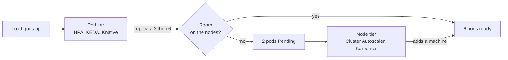
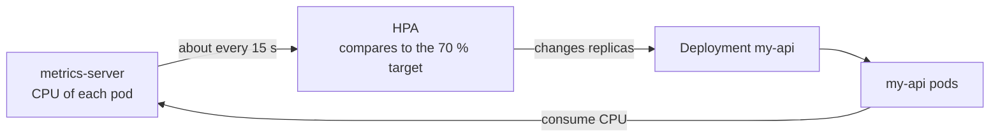
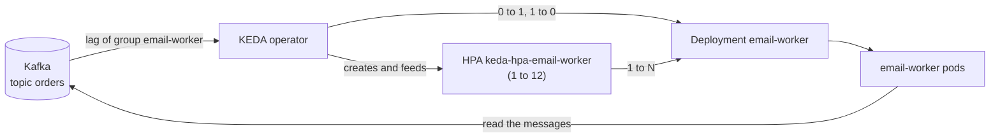
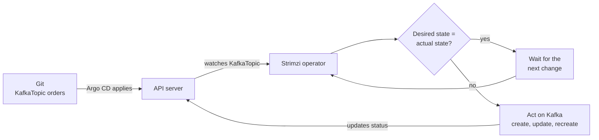

# Kubernetes at scale: autoscaling and operators

!!! warning "Disclaimer"
    These notes are personal cheat sheets, not a source of truth. They reflect my own understanding and choices: their content remains subjective, despite the quotes and references it contains. It may be incomplete, simplified, inaccurate or outdated. Always check the official documentation before applying it. This content is provided as is, without any warranty: you use it at your own risk.

!!! audience "Who and what for"
    - **Roles**: SRE, platform engineer, back-end developer, tech lead...
    - **Uses**: I choose between HPA, KEDA and Cloud Run for a worker that reads a queue; I review a merge request that adds an HPA and check that `requests.cpu` is declared; I work out why pods stay `Pending` at the lunchtime peak; I decide whether Kafka should run in the cluster with Strimzi or at a provider.

!!! abstract "Scales"
    The colored badges under the headings say at which scale a notion applies:

    - <span class="pill pill-scope pill-scope-code">Code</span> the classes, functions and modules of one program;
    - <span class="pill pill-scope pill-scope-app">Application</span> one service or application and its internal split;
    - <span class="pill pill-scope pill-scope-system">System</span> several services talking to each other over the network;
    - <span class="pill pill-scope pill-scope-infra">Infrastructure</span> servers, network, zones and clusters, physical or virtual;
    - <span class="pill pill-scope pill-scope-enterprise">Enterprise</span> the whole information system and its organization.

    Details and ambiguous words: [map of scales](architecture.md#map-of-scales).

When the load varies during the day, or a complex piece of software like Kafka has to run in the cluster, Kubernetes can do the work for me: add pods and machines when the load rises and remove them afterwards (autoscaling), or administer that software for me (an operator). This page assumes the basics of the [Containers, Kubernetes and deployment](kubernetes.md) page: [pod and Deployment](kubernetes.md#deployment), [requests and limits](kubernetes.md#resources-requests-and-limits), [Helm](kubernetes.md#helm-the-deployment-template) and [Argo CD](kubernetes.md#argo-cd-git-decides-what-runs).

<span class="term" data-term="yaml">YAML</span> values and numbers are examples. `my-api` and `email-worker` are fictitious services.

## Terminology

| Word | What it is | Example |
|---|---|---|
| <span class="term" data-term="autoscaling">autoscaling</span> | adjusting capacity to the load without human action, by adding or removing pods or machines | `my-api` goes from 2 to 6 pods at lunchtime, then back to 2 at night |
| replica | an identical copy of a pod; the `replicas` field of a Deployment says how many to run | `replicas: 3` gives 3 `my-api` pods |
| `Pending` pod | a pod Kubernetes created but cannot place on any node, for lack of free CPU or memory | 2 of the 6 pods wait for one more machine |
| lag | how far a consumer is behind on a queue: the number of messages that arrived but are not processed yet | 12,000 messages waiting on the `emails` topic |
| scale to zero | removing every pod of a service when it has nothing to do, and starting one again on the first request | `email-worker` runs 0 pods at night |
| <span class="term" data-term="k8s-operator">operator</span> | a program installed in the cluster that administers a specific piece of software for me: install, upgrade, replace a failed member | Strimzi manages a Kafka cluster |
| <span class="term" data-term="custom-resource">custom resource</span> | a new kind of object added to Kubernetes by a tool, which I describe in YAML like a Deployment | `kind: KafkaTopic`, `kind: ScaledObject` |

:material-book-open-variant: Reference docs: [Kubernetes, Autoscaling Workloads](https://kubernetes.io/docs/concepts/workloads/autoscaling/) (accessed November 2026); [Kubernetes, Operator pattern](https://kubernetes.io/docs/concepts/extend-kubernetes/operator/) (accessed November 2026)
{ .doc-ref }

## Autoscaling and serverless: HPA, KEDA, Knative, Karpenter

<a class="pill pill-scope pill-scope-infra" href="../architecture/#map-of-scales">Scale · Infrastructure</a>

!!! info "Written on 2026-11-04"
    API versions, project statuses and options quoted here date from this writing. They change fast, check each project's documentation: [HPA](https://kubernetes.io/docs/concepts/workloads/autoscaling/horizontal-pod-autoscale/), [KEDA](https://keda.sh/docs/), [Knative](https://knative.dev/docs/serving/), [Karpenter](https://karpenter.sh/docs/), [Cluster Autoscaler](https://github.com/kubernetes/autoscaler/tree/master/cluster-autoscaler) (read in November 2026).

<span class="term" data-term="autoscaling">Autoscaling</span> adjusts capacity to load without human action. There are two levels, not to be confused:

!!! noob "As noob"
    I think of a supermarket: open more checkouts when the queue grows (pod level), and open an extra room when there is no space left for another checkout (node level). The first takes seconds, the second takes longer. The one thing to remember: **the pod level adds copies, the node level adds room to host them.**

``` { .text .ex-illus title="Illustration" }
pod level  : how many copies of my-api?          HPA, KEDA, Knative
node level : how many machines in the cluster?   Cluster Autoscaler, Karpenter
```

They chain: the pod level asks for 6 pods, there is room for 4, the other 2 stay `Pending` (waiting for a node), and the node level adds a machine. Without autoscaling, we set `replicas: 3` and the node count by hand, as in the [Deployment](kubernetes.md#deployment) above.



| Signal | Lead |
|---|---|
| my API gets a crowd at noon and almost nobody at night, but I pay for the same number of pods all the time | HPA |
| a worker reads a queue, and messages arrive in waves: a mountain at once, then almost nothing for hours | KEDA |
| I have many small HTTP services called a few times a day, like internal tools or webhooks, and the nodes hosting them are paid to do nothing | Knative (or Cloud Run without a cluster) |
| pods stay `Pending` because no machine has room for them, or on the contrary I pay for half-empty nodes | Cluster Autoscaler or Karpenter |
| my load is roughly the same all day, and I can predict it | nothing: a fixed `replicas`, simpler to reason about |

### HPA: the baseline
<span class="pill pill-status pill-status-ok" title="Still valid, checked November 2026">Current · 11/2026</span>


*HPA: complements KEDA, Karpenter, Cluster Autoscaler*
{ .tool-rel }

**When**: an HTTP service whose load follows CPU or memory (peak at noon, quiet at night). Not for a queue worker: its CPU can stay low while 50,000 messages wait.

**Why**: not paying for 10 pods at night, not falling over with 3 pods at the peak. Cost: a reaction delay (the metric is read about every 15 s, then the pod must start and pass its [readiness probe](kubernetes.md#readiness-probe)), and CPU requests that must be right.

**How**: the **HorizontalPodAutoscaler** (HPA), built into Kubernetes, compares the pods' average usage with a target expressed as a percentage of their **request** (see [requests and limits](kubernetes.md#resources-requests-and-limits)), and changes the Deployment's `replicas`.

!!! noob "As noob"
    The HPA is cruise control: I set the target (70% CPU), it measures continuously and speeds up (adds pods) or eases off (removes them) to get back to it, without leaving its minimum and maximum. Limit: it reacts after the fact, it does not see the hill coming. The one thing to remember: **the HPA adjusts the number of pods to bring average usage back to the target.**

The HPA control loop, which runs continuously:



``` { .yaml .ex-ref title="Reference" }
# Example: HPA aiming at 70% average CPU, between 2 and 10 pods
apiVersion: autoscaling/v2
kind: HorizontalPodAutoscaler
metadata:
  name: my-api
spec:
  scaleTargetRef:
    apiVersion: apps/v1
    kind: Deployment
    name: my-api
  minReplicas: 2
  maxReplicas: 10
  metrics:
    - type: Resource
      resource:
        name: cpu
        target:
          type: Utilization
          averageUtilization: 70
```

The math: desired pods = round up (current pods × current usage / target).

``` { .text .ex-illus title="Illustration" }
time   pods  average CPU (% of request)   decision
12:00  3     140%                         3 × 140 / 70 = 6 pods
12:02  6     72%                          close to target: nothing
14:00  6     20%                          6 × 20 / 70 = 1.7 so 2 pods (minReplicas), after the stabilization window
```

Pitfalls:

- Without `requests.cpu`, the percentage has no base: the HPA decides nothing.
- With Helm and [Argo CD](kubernetes.md#argo-cd-git-decides-what-runs), a `replicas: 3` written in the Deployment fights the HPA: Argo CD sets 3 back, the HPA sets 6 back. Remove `replicas` from the template when the HPA is on (or have Argo CD ignore that field).
- The HPA does not go below 1 pod (going to 0 needs an experimental Kubernetes option, to check). That is the job of KEDA and Knative.

:material-book-open-variant: Reference docs: [Kubernetes, HorizontalPodAutoscaler Walkthrough](https://kubernetes.io/docs/tasks/run-application/horizontal-pod-autoscale-walkthrough/) (accessed November 2026)
{ .doc-ref }

### KEDA: scaling on events, down to zero
<span class="pill pill-status pill-status-ok" title="Still valid, checked November 2026">Current · 11/2026</span>


*KEDA: partly competes with Knative; complements HPA, Karpenter*
{ .tool-rel }

**When**: a <span class="term" data-term="worker">worker</span> consuming a RabbitMQ queue, a Kafka topic, a Pub/Sub subscription, or a job started by a <span class="term" data-term="cron">cron</span>. The right signal is not CPU but **backlog**: the <span class="term" data-term="consumer-lag">lag</span> (messages published but not read yet). Not for an HTTP service that must answer the first request fast: at zero pods, the first message waits for a pod to start.

*RabbitMQ: partly competes with Pub/Sub, SQS; complements Kafka*<br>
*Kafka: partly competes with Pub/Sub; complements RabbitMQ, Strimzi*<br>
*Pub/Sub: partly competes with RabbitMQ, Kafka, SQS*
{ .tool-rel }


**Why**: <span class="term" data-term="scale-to-zero">scale to zero</span>. A worker that processes one batch a night costs nothing the rest of the time, and goes to 20 pods when 100,000 messages arrive. Cost: one more component to run, and a wake-up delay.

!!! noob "As noob"
    KEDA is a corridor light with a motion sensor: nobody there, light off (zero pods); someone walks in, it comes on after a short moment (the wake-up). Here the sensor watches waiting messages, not CPU. The one thing to remember: **KEDA wakes the worker up when work is waiting, and switches it off when there is nothing left.**

**How**: **KEDA** (*Kubernetes Event-Driven Autoscaling*, a CNCF graduated project since 2023, to check) is installed in the cluster. We describe a `ScaledObject`: KEDA creates and drives an HPA itself to go from 1 to N, and handles the 0 to 1 and 1 to 0 steps on its own. About sixty sources are supported (Kafka, RabbitMQ, Pub/Sub, Prometheus, cron, to check).

*Prometheus: competes with Datadog; complements Grafana, Alertmanager, OpenTelemetry*
{ .tool-rel }


``` { .yaml .ex-ref title="Reference" }
# Example: KEDA scales email-worker on the Kafka lag, from 0 to 12 pods
apiVersion: keda.sh/v1alpha1
kind: ScaledObject
metadata:
  name: email-worker
spec:
  scaleTargetRef:
    name: email-worker
  minReplicaCount: 0
  maxReplicaCount: 12
  cooldownPeriod: 300
  triggers:
    - type: kafka
      metadata:
        bootstrapServers: kafka:9092
        consumerGroup: email-worker
        topic: orders
        lagThreshold: "100"
```

`lagThreshold: "100"` means "one pod per 100 messages of lag". `cooldownPeriod: 300`: wait 5 minutes without messages before going back to zero.

Who does what: KEDA alone handles going from 0 to 1 pod (and back), then delegates to the HPA it created.



``` { .text .ex-illus title="Illustration" }
time   lag of group email-worker    pods
02:00  0                            0
02:01  1,200                        1 (woken by KEDA), then 12 (1,200 / 100)
02:06  80                           1
02:07  0                            1
02:12  0 for 5 min                  0
```

Same idea on RabbitMQ: `type: rabbitmq`, with `queueName: invoice-emails`, `mode: QueueLength` and `value: "50"` (50 waiting messages per pod), credentials coming from a `TriggerAuthentication`. Kafka pitfall: beyond the topic's partition count, extra pods have nothing to read, and KEDA caps at that number by default (to check per version).

:material-book-open-variant: Reference docs: [KEDA, Scaling Deployments](https://keda.sh/docs/latest/concepts/scaling-deployments/) (accessed November 2026); [KEDA, Apache Kafka scaler](https://keda.sh/docs/latest/scalers/apache-kafka/) (accessed November 2026)
{ .doc-ref }

### Knative Serving: serverless on my own cluster
<span class="pill pill-status pill-status-ok" title="Still valid, checked November 2026">Current · 11/2026</span>


*Knative: partly competes with KEDA*
{ .tool-rel }

**When**: many small, rarely called HTTP services (internal tools, webhooks, MR previews) on a cluster that already exists, and the wish to get the [Cloud Run](kubernetes.md#cloud-run-no-cluster) model without leaving Kubernetes. Not if Cloud Run is enough (nothing to run), nor for an API whose first request must answer in a few milliseconds: there is a <span class="term" data-term="cold-start">cold start</span>.

**Why**: <span class="term" data-term="serverless">serverless</span> on Kubernetes. The service drops to zero when nobody calls it and scales on concurrent requests, not CPU. Cost: Knative adds its own components and a networking layer (Kourier or Istio) to install and upgrade.

*Istio: competes with Linkerd; complements Envoy*
{ .tool-rel }


**How**: we describe a Knative `Service` (not the Kubernetes [Service](kubernetes.md#service)). Knative creates the Deployment, Service and routing, and a component (the *activator*) holds requests while a pod starts.

``` { .yaml .ex-ref title="Reference" }
# Example: Knative Service from 0 to 10 pods, target of 20 concurrent requests per pod
apiVersion: serving.knative.dev/v1
kind: Service
metadata:
  name: report-service
spec:
  template:
    metadata:
      annotations:
        autoscaling.knative.dev/min-scale: "0"
        autoscaling.knative.dev/max-scale: "10"
        autoscaling.knative.dev/target: "20"
    spec:
      containers:
        - image: report-service:1.4.0
```

`target: "20"`: about 20 concurrent requests per pod. Cloud Run follows the Knative Serving API, which makes moving from one to the other fairly direct (to check for supported fields).

:material-book-open-variant: Reference docs: [Knative, About autoscaling](https://knative.dev/docs/serving/autoscaling/) (accessed November 2026)
{ .doc-ref }

### Karpenter and Cluster Autoscaler: adding nodes
<span class="pill pill-status pill-status-ok" title="Still valid, checked November 2026">Current · 11/2026</span>


*Karpenter: competes with Cluster Autoscaler; complements HPA, KEDA*<br>
*Cluster Autoscaler: competes with Karpenter; complements HPA*
{ .tool-rel }

**When**: pods stay `Pending` because no <span class="term" data-term="node-k8s">node</span> has room, or on the contrary paid nodes run at 20%. Useless on Cloud Run, and often already handled by the provider on a fully automatic managed Kubernetes (GKE Autopilot for instance, to check).

**Why**: without it, HPA and KEDA ask for pods nobody can place. Gain: the bill follows the load. Cost: a node usually takes one to a few minutes to arrive (order of magnitude, to check per provider), and removing a node moves its pods.

**How**: two approaches.

- **Cluster Autoscaler** (the historical Kubernetes project) grows or shrinks **node groups** defined in advance ("group e2-standard-4, from 3 to 20 machines"). Simple, available at every provider, but it does not choose the machine type.
- **Karpenter** (created by AWS in 2021, version 1.0 in 2024, to check) looks at pending pods and orders the machine that fits them directly, with no predefined group. It also **consolidates**: it repacks pods to shut down underused nodes. It can target <span class="term" data-term="spot-instance">spot machines</span>. It runs mostly on AWS, and on Azure through its built-in equivalent (to check for other providers).

``` { .yaml .ex-ref title="Reference" }
# Example: Karpenter NodePool, spot or on-demand, consolidates underused nodes
apiVersion: karpenter.sh/v1
kind: NodePool
metadata:
  name: default
spec:
  template:
    spec:
      requirements:
        - key: karpenter.sh/capacity-type
          operator: In
          values: ["spot", "on-demand"]
        - key: kubernetes.io/arch
          operator: In
          values: ["amd64", "arm64"]
      nodeClassRef:
        group: karpenter.k8s.aws
        kind: EC2NodeClass
        name: default
  limits:
    cpu: "200"
  disruption:
    consolidationPolicy: WhenEmptyOrUnderutilized
    consolidateAfter: 1m
```

`limits.cpu: "200"` caps the total size: it is the bill's safety net.

| Criterion                      | Cluster Autoscaler           | Karpenter                          |
|--------------------------------|------------------------------|------------------------------------|
| Unit added                     | a node from a predefined group | the machine that fits the pending pods |
| Choice of machine type         | ★ (fixed per group)          | ★★★                                |
| Shrinking half-empty nodes     | ★★                           | ★★★ (consolidation)                |
| Providers                      | ★★★ (almost all)             | ★★ (AWS, Azure, to check)          |
| Simplicity                     | ★★★                          | ★★                                 |

:material-book-open-variant: Reference docs: [Karpenter, NodePools](https://karpenter.sh/docs/concepts/nodepools/) (accessed November 2026); [Cluster Autoscaler FAQ](https://github.com/kubernetes/autoscaler/blob/master/cluster-autoscaler/FAQ.md) (accessed November 2026)
{ .doc-ref }

### What to use for scaling

| I want... | I use... |
|---|---|
| my HTTP API to add pods when its CPU climbs at the noon peak and remove them at night, without ever going below 2 pods | HPA |
| a worker to add pods when messages pile up in its queue, and drop to zero pods at night when it has nothing to read | KEDA |
| my small, rarely called HTTP services to drop to zero when nobody calls them, on the Kubernetes cluster I already have | Knative Serving |
| the same thing, with no cluster to manage at all | [Cloud Run](kubernetes.md#cloud-run-no-cluster) |
| the cluster to add machines when pods wait for room and remove them when they empty out, whatever my cloud provider | Cluster Autoscaler |
| on AWS, the cluster to pick the right machine size for waiting pods on its own, spot machines included | Karpenter |
| nothing more, because my load barely moves | a fixed `replicas` |

!!! maturity "Measuring maturity"
    | Level | What I see in the team |
    |---|---|
    | N1 | `replicas` is set by hand, and someone raises it before an announced peak |
    | N2 | an HPA or a KEDA ScaledObject adjusts the pods, and a node autoscaler adds machines |
    | N3 | capacity follows the load on its own between a minimum and a ceiling, with no lasting `Pending` pod and no human action at the peak |
    | N4 | the team tunes targets, minimums and ceilings from peak latency, worker lag and the monthly bill |

    **I measure**: the time spent with `Pending` pods and the p95 latency during the peak, read in the metrics backend; the cluster cost relative to traffic served, read on the bill.

## Kubernetes operators: Strimzi

<a class="pill pill-scope pill-scope-infra" href="../architecture/#map-of-scales">Scale · Infrastructure</a> <span class="pill pill-status pill-status-ok" title="Still valid, checked November 2026">Current · 11/2026</span>


*Strimzi: complements Kafka*
{ .tool-rel }

!!! info "Written on 2026-11-04"
    Versions and project statuses quoted as of this date, to check: [Kubernetes operators](https://kubernetes.io/docs/concepts/extend-kubernetes/operator/), [Strimzi](https://strimzi.io/documentation/) (read in November 2026).

An **<span class="term" data-term="k8s-operator">operator</span>** is a program running in the cluster that does an administrator's job for one specific piece of software: install, upgrade, back up, replace a failed member. We describe the desired state in a **<span class="term" data-term="custom-resource">custom resource</span>** (CRD, *custom resource definition*, a new `kind` added to Kubernetes), and it keeps comparing desired and actual state in a loop, the way a Deployment does for its pods.

!!! noob "As noob"
    An operator is a specialist admin who never sleeps: I leave them a note saying "I want a 3-machine Kafka", they install it, watch it, replace what falls over, and keep coming back to check that reality matches the note. The one thing to remember: **an operator is an admin's know-how turned into an automatic loop.**

The reconcile loop, the heart of every operator (and of every Kubernetes controller):



**When**: running stateful software in-house (Kafka, PostgreSQL, Elasticsearch) in Kubernetes, without writing one's own operations scripts. Not when an equivalent <span class="term" data-term="managed-service">managed service</span> exists and the team has nobody to operate the database: the operator automates the actions, not the skill to diagnose an outage.

*PostgreSQL: competes with MySQL, MariaDB; partly competes with MongoDB; complements Redis, PgBouncer, BigQuery, Elasticsearch*<br>
*Elasticsearch: competes with OpenSearch; complements PostgreSQL*
{ .tool-rel }


**Why**: a hand-written Kafka `StatefulSet` cannot do a zero-downtime upgrade, add a broker or create a topic. The operator encodes that know-how. Cost: the operator itself is software to upgrade, and the team stays responsible for the data.

**How**: install the operator (often through a [Helm](kubernetes.md#helm-the-deployment-template) chart), then write its resources in Git, and [Argo CD](kubernetes.md#argo-cd-git-decides-what-runs) applies them like everything else. Example with **Strimzi**, the CNCF Kafka operator (incubating project, to check):

``` { .yaml .ex-ref title="Reference" }
# Example: Kafka cluster managed by the Strimzi operator
apiVersion: kafka.strimzi.io/v1beta2
kind: Kafka
metadata:
  name: events
spec:
  kafka:
    listeners:
      - name: plain
        port: 9092
        type: internal
        tls: false
  entityOperator:
    topicOperator: {}
```
``` { .yaml .ex-ref title="Reference" }
# Example: orders topic (6 partitions, 3 replicas), created by the operator
apiVersion: kafka.strimzi.io/v1beta2
kind: KafkaTopic
metadata:
  name: orders
  labels:
    strimzi.io/cluster: events
spec:
  partitions: 6
  replicas: 3
```

Simplified extract: recent versions also need a `KafkaNodePool` describing the brokers (count, disks), and API versions change (check the Strimzi documentation). Creating the `orders` topic means opening an MR that adds this file: Strimzi creates it in Kafka, and recreates it if someone deletes it by hand.

``` { .text .ex-ref title="Reference" }
$ kubectl get kafkatopic orders
NAME     CLUSTER   PARTITIONS   REPLICATION FACTOR   READY
orders   events    6            3                    True
```

Other common operators: CloudNativePG (PostgreSQL), Prometheus Operator, cert-manager (TLS certificates). Crossplane applies the same idea to cloud infrastructure ([Tech tools landscape](outils.md#infrastructure-as-code-terraform-opentofu-terragrunt-pulumi-crossplane-ansible-packer)).

*Crossplane: partly competes with Terraform; complements Kubernetes*
{ .tool-rel }


| I want... | I use... |
|---|---|
| to use Kafka or PostgreSQL while nobody on the team has the time or the skills to upgrade, back up and repair them | the provider's managed service |
| to run Kafka in my own cluster, because the managed offer costs too much, the data must stay on site, or there is no managed offer | Strimzi |
| the same thing for PostgreSQL | CloudNativePG |
| to deploy an application that keeps nothing on its disks, like an API that stores everything in an external database | a Deployment and a Helm chart, no operator |

:material-book-open-variant: Reference docs: [Kubernetes, Custom Resources](https://kubernetes.io/docs/concepts/extend-kubernetes/api-extension/custom-resources/) (accessed November 2026); [Kubernetes, Controllers](https://kubernetes.io/docs/concepts/architecture/controller/) (accessed November 2026)
{ .doc-ref }

!!! maturity "Measuring maturity"
    | Level | What I see in the team |
    |---|---|
    | N1 | Kafka or PostgreSQL run in the cluster with hand-written manifests, updated by a single person |
    | N2 | an operator (Strimzi, CloudNativePG) manages the software, and its resources are described in Git |
    | N3 | the operator replaces a failed member on its own and recreates a topic deleted by hand, and an automatic restore checks the backups |
    | N4 | the team regularly compares the cost and incidents of running it with those of a managed service, and decides to keep or migrate |

    **I measure**: the time to return to normal when a broker or an instance fails, read in incidents or measured in a game day; the date of the last successful backup restore.

## Measuring success

I know autoscaling works when latency stays stable at the peak without paying for empty machines the rest of the time. I take a baseline over four weeks (p95 latency at the peak, `Pending` pods, node cost), then I measure the same thing after the change.

| Solution or situation | Success indicator (SLI) | Likely SLO | Likely SLA |
|---|---|---|---|
| HPA, KEDA and node autoscaler | p95 latency at the peak; maximum worker lag | p95 under 300 ms at the peak; lag cleared in under 15 min | n/a: no external contract |

[Take with caution: example orders of magnitude, to set with the business]

## Pitfalls to avoid

| Pitfall | What happens | Solution |
| --- | --- | --- |
| **A fixed `replicas` next to the HPA**: I leave `replicas: 3` in the Helm template while the HPA is enabled. | Argo CD sets 3 while the HPA sets 6. | I remove `replicas` from the template, and I check that `requests.cpu` is declared, otherwise the HPA decides nothing ([HPA](#hpa-the-baseline)). |

## What interviews ask

Typical questions:

- "How do you scale a worker that reads a queue?", "HPA, KEDA or Karpenter?" How I answer: I take the lag as the signal, not the CPU, and I show that each tool acts at a different level ([What to use for scaling](#what-to-use-for-scaling)).
