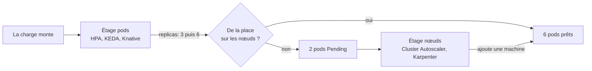
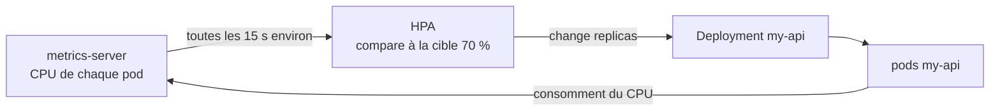
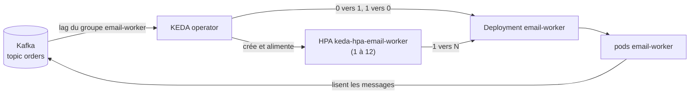
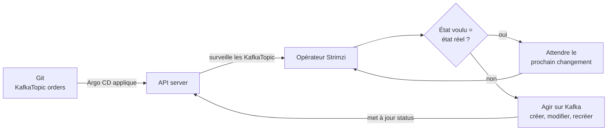

# Kubernetes à l'échelle : autoscaling et opérateurs

!!! warning "Avertissement"
    Ces notes sont des pense-bêtes personnels, pas une source de vérité. Elles reflètent ma compréhension et mes choix : leur contenu reste subjectif, malgré les citations et les références qu'il contient. Il peut être incomplet, simplifié, inexact ou dépassé. Vérifiez toujours dans la documentation officielle avant de l'appliquer. Ce contenu est fourni tel quel, sans aucune garantie : son utilisation se fait sous votre seule responsabilité.

!!! audience "Pour qui, pour quoi"
    - **Métiers** : SRE, platform engineer, développeur back-end, tech lead...
    - **Usages** : je choisis entre HPA, KEDA et Cloud Run pour un worker qui lit une file ; je relis une MR qui ajoute un HPA et je vérifie que `requests.cpu` est déclaré ; je comprends pourquoi des pods restent `Pending` au pic de midi ; je décide si Kafka doit tourner dans le cluster avec Strimzi ou chez un fournisseur.

!!! abstract "Les échelles"
    Les pastilles de couleur sous les titres disent à quelle échelle une notion s'applique :

    - <span class="pill pill-scope pill-scope-code">Code</span> les classes, fonctions et modules d'un programme ;
    - <span class="pill pill-scope pill-scope-app">Application</span> un service ou une application et son découpage interne ;
    - <span class="pill pill-scope pill-scope-system">Système</span> plusieurs services qui communiquent par le réseau ;
    - <span class="pill pill-scope pill-scope-infra">Infrastructure</span> les serveurs, le réseau, les zones et les clusters, physiques ou virtuels ;
    - <span class="pill pill-scope pill-scope-enterprise">Entreprise</span> le système d'information entier et son organisation.

    Détail et mots ambigus : [carte des échelles](architecture.md#carte-des-echelles).

Quand la charge varie dans la journée, ou qu'un logiciel compliqué comme Kafka doit tourner dans le cluster, Kubernetes peut faire le travail à ma place : ajouter des pods et des machines quand la charge monte, et les retirer ensuite (l'autoscaling), ou administrer ce logiciel à ma place (un opérateur). Cette page suppose connues les bases de la page [Conteneurs, Kubernetes et déploiement](kubernetes.md) : [pod et Deployment](kubernetes.md#deployment), [requests et limits](kubernetes.md#ressources-requests-et-limits), [Helm](kubernetes.md#helm-le-modele-de-deploiement) et [Argo CD](kubernetes.md#argo-cd-git-decide-de-ce-qui-tourne).

Les valeurs <span class="term" data-term="yaml">YAML</span> et les chiffres sont des exemples. `my-api` et `email-worker` sont des services fictifs.

## Vocabulaire

| Mot | Ce que c'est | Exemple |
|---|---|---|
| <span class="term" data-term="autoscaling">autoscaling</span> | ajuster la capacité à la charge sans intervention humaine, en ajoutant ou en retirant des pods ou des machines | `my-api` passe de 2 à 6 pods à midi, puis redescend à 2 la nuit |
| réplica | une copie identique d'un pod ; le champ `replicas` d'un Deployment dit combien en faire tourner | `replicas: 3` donne 3 pods `my-api` |
| pod `Pending` | un pod que Kubernetes a créé mais qu'il ne peut placer sur aucun nœud, faute de CPU ou de mémoire libre | 2 des 6 pods attendent une machine de plus |
| lag | le retard d'un consommateur sur une file : le nombre de messages arrivés mais pas encore traités | 12 000 messages en attente sur le topic `emails` |
| passage à zéro | retirer tous les pods d'un service quand il n'a rien à faire, et en relancer un à la première demande | `email-worker` tourne à 0 pod la nuit |
| <span class="term" data-term="k8s-operator">opérateur</span> | un programme installé dans le cluster qui administre un logiciel précis à ma place : installation, mise à jour, remplacement d'un membre tombé | Strimzi gère un cluster Kafka |
| <span class="term" data-term="custom-resource">ressource personnalisée</span> | un nouveau type d'objet ajouté à Kubernetes par un outil, que je décris en YAML comme un Deployment | `kind: KafkaTopic`, `kind: ScaledObject` |

:material-book-open-variant: Doc de référence : [Kubernetes, Autoscaling Workloads](https://kubernetes.io/docs/concepts/workloads/autoscaling/) (consultée en novembre 2026) ; [Kubernetes, Operator pattern](https://kubernetes.io/docs/concepts/extend-kubernetes/operator/) (consultée en novembre 2026)
{ .doc-ref }

## Autoscaling et serverless : HPA, KEDA, Knative, Karpenter

<a class="pill pill-scope pill-scope-infra" href="../architecture/#carte-des-echelles">Échelle · Infrastructure</a>

!!! info "Rédigé le 04/11/2026"
    Versions d'API, statuts de projets et options citées datent de cette rédaction. Elles évoluent vite, à vérifier dans la documentation de chaque projet : [HPA](https://kubernetes.io/docs/concepts/workloads/autoscaling/horizontal-pod-autoscale/), [KEDA](https://keda.sh/docs/), [Knative](https://knative.dev/docs/serving/), [Karpenter](https://karpenter.sh/docs/), [Cluster Autoscaler](https://github.com/kubernetes/autoscaler/tree/master/cluster-autoscaler) (consultées en novembre 2026).

L'<span class="term" data-term="autoscaling">autoscaling</span> ajuste la capacité à la charge sans intervention humaine. Il y a deux étages, à ne pas confondre :

!!! noob "As noob"
    Je pense à un supermarché : ouvrir plus de caisses quand la file s'allonge (étage pods), et ouvrir une salle de plus quand il n'y a plus la place d'installer une caisse (étage nœuds). La première action prend quelques secondes, la seconde plus longtemps. La phrase à retenir : **l'étage pods ajoute des copies, l'étage nœuds ajoute de la place pour les accueillir.**

``` { .text .ex-illus title="Illustration" }
étage pods   : combien de copies de my-api ?        HPA, KEDA, Knative
étage nœuds  : combien de machines dans le cluster ? Cluster Autoscaler, Karpenter
```

Les deux s'enchaînent : l'étage pods demande 6 pods, il n'y a de la place que pour 4, les 2 autres restent `Pending` (en attente d'un nœud), et l'étage nœuds ajoute une machine. Sans autoscaling, on fixe `replicas: 3` et le nombre de nœuds à la main, comme dans le [Deployment](kubernetes.md#deployment) plus haut.



| Signal | Piste |
|---|---|
| mon API reçoit beaucoup de monde à midi et presque personne la nuit, mais je paie le même nombre de pods tout le temps | HPA |
| un worker lit une file, et les messages arrivent par vagues : une montagne d'un coup, puis presque rien pendant des heures | KEDA |
| j'ai beaucoup de petits services HTTP appelés quelques fois par jour, comme des outils internes ou des webhooks, et les nœuds qui les portent sont payés à ne rien faire | Knative (ou Cloud Run sans cluster) |
| des pods restent `Pending` parce qu'aucune machine n'a la place de les accueillir, ou au contraire je paie des nœuds à moitié vides | Cluster Autoscaler ou Karpenter |
| ma charge est à peu près la même toute la journée, et je sais la prévoir | rien : `replicas` fixe, plus simple à comprendre |

### HPA : le point de départ
<span class="pill pill-status pill-status-ok" title="Toujours valable, vérifié en novembre 2026">Valable · 11/2026</span>


*HPA : complémentaire de KEDA, Karpenter, Cluster Autoscaler*
{ .tool-rel }

**Quand** : un service HTTP dont la charge suit le CPU ou la mémoire (pic à midi, creux la nuit). Pas pour un worker de file : son CPU peut rester bas alors que 50 000 messages attendent.

**Pourquoi** : ne pas payer 10 pods la nuit, ne pas tomber avec 3 pods au pic. Coût : un délai de réaction (la métrique est relevée toutes les 15 s environ, puis le pod doit démarrer et passer sa [readiness probe](kubernetes.md#readiness-probe)), et des requests CPU qui doivent être justes.

**Comment** : le **HorizontalPodAutoscaler** (HPA), intégré à Kubernetes, compare l'usage moyen des pods à une cible exprimée en pourcentage de leur **request** (voir [requests et limits](kubernetes.md#ressources-requests-et-limits)), et change `replicas` du Deployment.

!!! noob "As noob"
    Le HPA, c'est un régulateur de vitesse : je fixe la cible (70 % de CPU), il mesure en continu et accélère (ajoute des pods) ou lève le pied (en retire) pour y revenir, sans sortir de son minimum et de son maximum. Limite : il réagit après coup, il ne voit pas venir la côte. La phrase à retenir : **le HPA corrige le nombre de pods pour ramener l'usage moyen vers la cible.**

La boucle de contrôle du HPA, qui tourne en continu :



``` { .yaml .ex-ref title="Référence" }
# Exemple : HPA qui vise 70 % de CPU moyen, entre 2 et 10 pods
apiVersion: autoscaling/v2
kind: HorizontalPodAutoscaler
metadata:
  name: my-api
spec:
  scaleTargetRef:
    apiVersion: apps/v1
    kind: Deployment
    name: my-api
  minReplicas: 2
  maxReplicas: 10
  metrics:
    - type: Resource
      resource:
        name: cpu
        target:
          type: Utilization
          averageUtilization: 70
```

Le calcul : pods voulus = arrondi supérieur de (pods actuels × usage actuel / cible).

``` { .text .ex-illus title="Illustration" }
heure  pods  CPU moyen (en % de la request)   décision
12:00  3     140 %                            3 × 140 / 70 = 6 pods
12:02  6     72 %                             proche de la cible : rien
14:00  6     20 %                             6 × 20 / 70 = 1,7 donc 2 pods (minReplicas), après la fenêtre de stabilisation
```

Pièges :

- Sans `requests.cpu`, le pourcentage n'a pas de base : le HPA ne décide rien.
- Avec Helm et [Argo CD](kubernetes.md#argo-cd-git-decide-de-ce-qui-tourne), un `replicas: 3` écrit dans le Deployment se bat avec le HPA : Argo CD remet 3, le HPA remet 6. On retire `replicas` du modèle quand le HPA est activé (ou on fait ignorer ce champ par Argo CD).
- Le HPA ne descend pas sous 1 pod (descendre à 0 demande une option expérimentale de Kubernetes, à vérifier). C'est le rôle de KEDA et Knative.

:material-book-open-variant: Doc de référence : [Kubernetes, HorizontalPodAutoscaler Walkthrough](https://kubernetes.io/docs/tasks/run-application/horizontal-pod-autoscale-walkthrough/) (consultée en novembre 2026)
{ .doc-ref }

### KEDA : scaler sur les événements, jusqu'à zéro
<span class="pill pill-status pill-status-ok" title="Toujours valable, vérifié en novembre 2026">Valable · 11/2026</span>


*KEDA : concurrent en partie de Knative ; complémentaire de HPA, Karpenter*
{ .tool-rel }

**Quand** : un <span class="term" data-term="worker">worker</span> qui consomme une file RabbitMQ, un topic Kafka, un abonnement Pub/Sub, ou un job lancé par un <span class="term" data-term="cron">cron</span>. Le bon signal n'est pas le CPU mais le **retard** : le <span class="term" data-term="consumer-lag">lag</span> (messages publiés mais pas encore lus). Pas pour un service HTTP qui doit répondre vite à la première requête : à zéro pod, le premier message attend le démarrage d'un pod.

*RabbitMQ : concurrent en partie de Pub/Sub, SQS ; complémentaire de Kafka*<br>
*Kafka : concurrent en partie de Pub/Sub ; complémentaire de RabbitMQ, Strimzi*<br>
*Pub/Sub : concurrent en partie de RabbitMQ, Kafka, SQS*
{ .tool-rel }


**Pourquoi** : le <span class="term" data-term="scale-to-zero">scale to zero</span>. Un worker qui traite un lot par nuit ne coûte rien le reste du temps, et il passe à 20 pods quand 100 000 messages arrivent. Coût : un composant de plus à exploiter, et un délai au réveil.

!!! noob "As noob"
    KEDA, c'est la lumière à détecteur de présence d'un couloir : personne, lumière éteinte (zéro pod) ; quelqu'un entre, elle s'allume après un court instant (le réveil). Ici, le détecteur regarde les messages en attente, pas le CPU. La phrase à retenir : **KEDA réveille le worker quand du travail attend, et l'éteint quand il n'y a plus rien.**

**Comment** : **KEDA** (*Kubernetes Event-Driven Autoscaling*, projet diplômé de la CNCF en 2023, à vérifier) s'installe dans le cluster. On décrit un `ScaledObject` : KEDA crée et pilote lui-même un HPA pour aller de 1 à N, et gère seul le passage de 0 à 1 et de 1 à 0. Une soixantaine de sources sont prises en charge (Kafka, RabbitMQ, Pub/Sub, Prometheus, cron, à vérifier).

*Prometheus : concurrent de Datadog ; complémentaire de Grafana, Alertmanager, OpenTelemetry*
{ .tool-rel }


``` { .yaml .ex-ref title="Référence" }
# Exemple : KEDA dimensionne email-worker selon le lag Kafka, de 0 à 12 pods
apiVersion: keda.sh/v1alpha1
kind: ScaledObject
metadata:
  name: email-worker
spec:
  scaleTargetRef:
    name: email-worker
  minReplicaCount: 0
  maxReplicaCount: 12
  cooldownPeriod: 300
  triggers:
    - type: kafka
      metadata:
        bootstrapServers: kafka:9092
        consumerGroup: email-worker
        topic: orders
        lagThreshold: "100"
```

`lagThreshold: "100"` veut dire « un pod pour 100 messages de retard ». `cooldownPeriod: 300` : attendre 5 minutes sans message avant de revenir à zéro.

Qui fait quoi : KEDA gère seul le passage de 0 à 1 pod (et retour), puis délègue au HPA qu'il a créé.



``` { .text .ex-illus title="Illustration" }
heure  lag du groupe email-worker   pods
02:00  0                            0
02:01  1 200                        1 (réveil par KEDA), puis 12 (1 200 / 100)
02:06  80                           1
02:07  0                            1
02:12  0 depuis 5 min               0
```

Même idée sur RabbitMQ : `type: rabbitmq`, avec `queueName: invoice-emails`, `mode: QueueLength` et `value: "50"` (50 messages en attente par pod), les identifiants venant d'un `TriggerAuthentication`. Piège Kafka : au-delà du nombre de partitions du topic, les pods en plus n'ont rien à lire, et KEDA plafonne par défaut à ce nombre (à vérifier selon la version).

:material-book-open-variant: Doc de référence : [KEDA, Scaling Deployments](https://keda.sh/docs/latest/concepts/scaling-deployments/) (consultée en novembre 2026) ; [KEDA, Apache Kafka scaler](https://keda.sh/docs/latest/scalers/apache-kafka/) (consultée en novembre 2026)
{ .doc-ref }

### Knative Serving : du serverless sur son propre cluster
<span class="pill pill-status pill-status-ok" title="Toujours valable, vérifié en novembre 2026">Valable · 11/2026</span>


*Knative : concurrent en partie de KEDA*
{ .tool-rel }

**Quand** : beaucoup de petits services HTTP peu appelés (outils internes, webhooks, aperçus de MR) sur un cluster qui existe déjà, et l'envie d'avoir le modèle de [Cloud Run](kubernetes.md#cloud-run-sans-cluster) sans quitter Kubernetes. Pas si Cloud Run suffit (rien à exploiter), ni pour une API dont la première requête doit répondre en quelques millisecondes : il y a un <span class="term" data-term="cold-start">démarrage à froid</span>.

**Pourquoi** : <span class="term" data-term="serverless">serverless</span> sur Kubernetes. Le service tombe à zéro quand personne ne l'appelle et monte selon le nombre de requêtes simultanées, pas le CPU. Coût : Knative ajoute ses propres composants et une couche réseau (Kourier ou Istio) à installer et mettre à jour.

*Istio : concurrent de Linkerd ; complémentaire de Envoy*
{ .tool-rel }


**Comment** : on décrit un `Service` Knative (différent du [Service](kubernetes.md#service) Kubernetes). Knative crée Deployment, Service et routage, et un composant (l'*activator*) retient les requêtes pendant qu'un pod démarre.

``` { .yaml .ex-ref title="Référence" }
# Exemple : Service Knative de 0 à 10 pods, cible de 20 requêtes simultanées par pod
apiVersion: serving.knative.dev/v1
kind: Service
metadata:
  name: report-service
spec:
  template:
    metadata:
      annotations:
        autoscaling.knative.dev/min-scale: "0"
        autoscaling.knative.dev/max-scale: "10"
        autoscaling.knative.dev/target: "20"
    spec:
      containers:
        - image: report-service:1.4.0
```

`target: "20"` : environ 20 requêtes simultanées par pod. Cloud Run reprend l'API de Knative Serving, ce qui rend le passage de l'un à l'autre assez direct (à vérifier sur les champs pris en charge).

:material-book-open-variant: Doc de référence : [Knative, About autoscaling](https://knative.dev/docs/serving/autoscaling/) (consultée en novembre 2026)
{ .doc-ref }

### Karpenter et Cluster Autoscaler : ajouter des nœuds
<span class="pill pill-status pill-status-ok" title="Toujours valable, vérifié en novembre 2026">Valable · 11/2026</span>


*Karpenter : concurrent de Cluster Autoscaler ; complémentaire de HPA, KEDA*<br>
*Cluster Autoscaler : concurrent de Karpenter ; complémentaire de HPA*
{ .tool-rel }

**Quand** : des pods restent `Pending` parce qu'aucun <span class="term" data-term="node-k8s">nœud</span> n'a la place, ou à l'inverse des nœuds payés tournent à 20 %. Inutile sur Cloud Run, et souvent déjà réglé par le fournisseur sur un Kubernetes managé en mode tout automatique (GKE Autopilot par exemple, à vérifier).

**Pourquoi** : sans lui, HPA et KEDA demandent des pods que personne ne peut placer. Gain : la facture suit la charge. Coût : un nœud met en général une à quelques minutes à arriver (ordre de grandeur, à vérifier selon le fournisseur), et retirer un nœud déplace ses pods.

**Comment** : deux approches.

- **Cluster Autoscaler** (projet Kubernetes historique) agrandit ou réduit des **groupes de nœuds** définis à l'avance (« groupe e2-standard-4, de 3 à 20 machines »). Simple, présent chez tous les fournisseurs, mais il ne choisit pas le type de machine.
- **Karpenter** (créé par AWS en 2021, version 1.0 en 2024, à vérifier) regarde les pods en attente et commande directement la machine qui leur convient, sans groupe prédéfini. Il **consolide** aussi : il replace les pods pour éteindre les nœuds sous-utilisés. Il peut viser des <span class="term" data-term="spot-instance">machines spot</span>. Il tourne surtout sur AWS, et sur Azure via son équivalent intégré (à vérifier pour les autres fournisseurs).

``` { .yaml .ex-ref title="Référence" }
# Exemple : NodePool Karpenter, spot ou à la demande, consolide les nœuds sous-utilisés
apiVersion: karpenter.sh/v1
kind: NodePool
metadata:
  name: default
spec:
  template:
    spec:
      requirements:
        - key: karpenter.sh/capacity-type
          operator: In
          values: ["spot", "on-demand"]
        - key: kubernetes.io/arch
          operator: In
          values: ["amd64", "arm64"]
      nodeClassRef:
        group: karpenter.k8s.aws
        kind: EC2NodeClass
        name: default
  limits:
    cpu: "200"
  disruption:
    consolidationPolicy: WhenEmptyOrUnderutilized
    consolidateAfter: 1m
```

`limits.cpu: "200"` plafonne la taille totale : c'est le garde-fou de la facture.

| Critère                        | Cluster Autoscaler           | Karpenter                          |
|--------------------------------|------------------------------|------------------------------------|
| Unité ajoutée                  | un nœud d'un groupe prédéfini | la machine qui convient aux pods en attente |
| Choix du type de machine       | ★ (fixé par groupe)          | ★★★                                |
| Réduction des nœuds à moitié vides | ★★                       | ★★★ (consolidation)                |
| Fournisseurs                   | ★★★ (presque tous)           | ★★ (AWS, Azure, à vérifier)        |
| Simplicité                     | ★★★                          | ★★                                 |

:material-book-open-variant: Doc de référence : [Karpenter, NodePools](https://karpenter.sh/docs/concepts/nodepools/) (consultée en novembre 2026) ; [Cluster Autoscaler FAQ](https://github.com/kubernetes/autoscaler/blob/master/cluster-autoscaler/FAQ.md) (consultée en novembre 2026)
{ .doc-ref }

### Quoi utiliser pour scaler

| Je veux... | J'utilise... |
|---|---|
| que mon API HTTP ajoute des pods quand son CPU monte au pic de midi et en retire la nuit, sans jamais descendre sous 2 pods | HPA |
| qu'un worker ajoute des pods quand les messages s'accumulent dans sa file, et tombe à zéro pod la nuit quand il n'a rien à lire | KEDA |
| que mes petits services HTTP peu appelés tombent à zéro quand personne ne les appelle, sur le cluster Kubernetes que j'ai déjà | Knative Serving |
| la même chose, sans aucun cluster à gérer | [Cloud Run](kubernetes.md#cloud-run-sans-cluster) |
| que le cluster ajoute des machines quand des pods attendent une place et en retire quand elles se vident, quel que soit mon fournisseur cloud | Cluster Autoscaler |
| sur AWS, que le cluster choisisse lui-même la bonne taille de machine pour les pods en attente, y compris des machines spot | Karpenter |
| rien de plus, parce que ma charge ne bouge presque pas | `replicas` fixe |

!!! maturity "Mesurer la maturité"
    | Niveau | Ce que j'observe dans l'équipe |
    |---|---|
    | N1 | `replicas` est fixé à la main, et quelqu'un l'augmente avant un pic annoncé |
    | N2 | un HPA ou un ScaledObject KEDA ajuste les pods, et un autoscaler de nœuds ajoute des machines |
    | N3 | la capacité suit seule la charge entre un minimum et un plafond, sans pod `Pending` durable ni intervention humaine au pic |
    | N4 | l'équipe ajuste cibles, minimums et plafonds d'après la latence au pic, le lag des workers et la facture du mois |

    **Je mesure** : le temps passé avec des pods `Pending` et la latence p95 pendant le pic, lus dans le backend de métriques ; le coût du cluster rapporté au trafic servi, lu sur la facture.

## Opérateurs Kubernetes : Strimzi

<a class="pill pill-scope pill-scope-infra" href="../architecture/#carte-des-echelles">Échelle · Infrastructure</a> <span class="pill pill-status pill-status-ok" title="Toujours valable, vérifié en novembre 2026">Valable · 11/2026</span>


*Strimzi : complémentaire de Kafka*
{ .tool-rel }

!!! info "Rédigé le 04/11/2026"
    Versions et statuts de projets cités à cette date, à vérifier : [opérateurs Kubernetes](https://kubernetes.io/docs/concepts/extend-kubernetes/operator/), [Strimzi](https://strimzi.io/documentation/) (consultées en novembre 2026).

Un **<span class="term" data-term="k8s-operator">opérateur</span>** est un programme qui tourne dans le cluster et fait le travail d'un administrateur pour un logiciel précis : installer, mettre à jour, sauvegarder, remplacer un membre tombé. On lui décrit l'état voulu dans une **<span class="term" data-term="custom-resource">ressource personnalisée</span>** (CRD, *custom resource definition*, un nouveau `kind` ajouté à Kubernetes), et il compare en boucle l'état voulu à l'état réel, comme un Deployment le fait pour ses pods.

!!! noob "As noob"
    Un opérateur, c'est un administrateur spécialisé qui ne dort jamais : je lui laisse une fiche « je veux un Kafka de 3 machines », il installe, surveille, remplace ce qui tombe, et revient sans cesse vérifier que la réalité colle à la fiche. La phrase à retenir : **un opérateur, c'est le savoir-faire d'un administrateur transformé en boucle automatique.**

La boucle de réconciliation, le cœur de tout opérateur (et de tout contrôleur Kubernetes) :



**Quand** : faire tourner soi-même un logiciel avec état (Kafka, PostgreSQL, Elasticsearch) dans Kubernetes, sans écrire ses propres scripts d'exploitation. Pas quand un <span class="term" data-term="managed-service">service managé</span> équivalent existe et que l'équipe n'a personne pour exploiter la base : l'opérateur automatise les gestes, pas la compétence pour diagnostiquer une panne.

*PostgreSQL : concurrent de MySQL, MariaDB ; concurrent en partie de MongoDB ; complémentaire de Redis, PgBouncer, BigQuery, Elasticsearch*<br>
*Elasticsearch : concurrent de OpenSearch ; complémentaire de PostgreSQL*
{ .tool-rel }


**Pourquoi** : un `StatefulSet` Kafka écrit à la main ne sait pas faire une mise à jour sans coupure, ajouter un broker ou créer un topic. L'opérateur encode ce savoir-faire. Coût : l'opérateur lui-même est un logiciel à mettre à jour, et la responsabilité des données reste à l'équipe.

**Comment** : on installe l'opérateur (souvent par un chart [Helm](kubernetes.md#helm-le-modele-de-deploiement)), puis on écrit ses ressources dans Git, et [Argo CD](kubernetes.md#argo-cd-git-decide-de-ce-qui-tourne) les applique comme le reste. Exemple avec **Strimzi**, l'opérateur Kafka de la CNCF (projet en incubation, à vérifier) :

``` { .yaml .ex-ref title="Référence" }
# Exemple : cluster Kafka géré par l'opérateur Strimzi
apiVersion: kafka.strimzi.io/v1beta2
kind: Kafka
metadata:
  name: events
spec:
  kafka:
    listeners:
      - name: plain
        port: 9092
        type: internal
        tls: false
  entityOperator:
    topicOperator: {}
```
``` { .yaml .ex-ref title="Référence" }
# Exemple : topic orders (6 partitions, 3 répliques), créé par l'opérateur
apiVersion: kafka.strimzi.io/v1beta2
kind: KafkaTopic
metadata:
  name: orders
  labels:
    strimzi.io/cluster: events
spec:
  partitions: 6
  replicas: 3
```

Extrait simplifié : les versions récentes demandent aussi un `KafkaNodePool` qui décrit les brokers (nombre, disques), et les versions d'API changent (à vérifier dans la documentation Strimzi). Créer le topic `orders` revient à faire une MR qui ajoute ce fichier : Strimzi le crée dans Kafka, et le remet si quelqu'un le supprime à la main.

``` { .text .ex-ref title="Référence" }
$ kubectl get kafkatopic orders
NAME     CLUSTER   PARTITIONS   REPLICATION FACTOR   READY
orders   events    6            3                    True
```

Autres opérateurs courants : CloudNativePG (PostgreSQL), Prometheus Operator, cert-manager (certificats TLS). Crossplane applique la même idée à l'infrastructure cloud ([Panorama des outils techniques](outils.md#infrastructure-as-code-terraform-opentofu-terragrunt-pulumi-crossplane-ansible-packer)).

*Crossplane : concurrent en partie de Terraform ; complémentaire de Kubernetes*
{ .tool-rel }


| Je veux... | J'utilise... |
|---|---|
| utiliser Kafka ou PostgreSQL alors que personne dans l'équipe n'a le temps ou la compétence pour les mettre à jour, les sauvegarder et les réparer | le service managé du fournisseur |
| faire tourner Kafka dans mon propre cluster, parce que l'offre managée coûte trop cher, que les données doivent rester sur place, ou qu'il n'existe pas d'offre managée | Strimzi |
| la même chose pour PostgreSQL | CloudNativePG |
| déployer une appli qui ne garde rien sur ses disques, comme une API qui range tout dans une base externe | un Deployment et un chart Helm, pas d'opérateur |

:material-book-open-variant: Doc de référence : [Kubernetes, Custom Resources](https://kubernetes.io/docs/concepts/extend-kubernetes/api-extension/custom-resources/) (consultée en novembre 2026) ; [Kubernetes, Controllers](https://kubernetes.io/docs/concepts/architecture/controller/) (consultée en novembre 2026)
{ .doc-ref }

!!! maturity "Mesurer la maturité"
    | Niveau | Ce que j'observe dans l'équipe |
    |---|---|
    | N1 | Kafka ou PostgreSQL tournent dans le cluster avec des manifestes écrits à la main, mis à jour par une seule personne |
    | N2 | un opérateur (Strimzi, CloudNativePG) gère le logiciel, et ses ressources sont décrites dans Git |
    | N3 | l'opérateur remplace seul un membre tombé et recrée un topic supprimé à la main, et une restauration automatique vérifie les sauvegardes |
    | N4 | l'équipe compare régulièrement le coût et les incidents de cette exploitation à ceux d'un service managé, et décide de garder ou de migrer |

    **Je mesure** : le délai de retour à la normale quand un broker ou une instance tombe, lu dans les incidents ou mesuré en game day ; la date de la dernière restauration de sauvegarde réussie.

## Mesurer le succès

Je sais que l'autoscaling marche quand la latence reste stable au pic sans que je paie des machines vides le reste du temps. Je relève une base sur quatre semaines (latence p95 au pic, pods `Pending`, coût des nœuds), puis je mesure la même chose après le changement.

| Solution ou situation | Indicateur de succès (SLI) | SLO probable | SLA probable |
|---|---|---|---|
| HPA, KEDA et autoscaler de nœuds | latence p95 au pic ; lag maximal d'un worker | p95 sous 300 ms au pic ; lag résorbé en moins de 15 min | sans objet : pas de contrat externe |

[À prendre avec précaution : ordres de grandeur d'exemple, à fixer avec le métier]

## Pièges à éviter

| Piège | Ce qui se passe | Solution |
| --- | --- | --- |
| **Un `replicas` fixe à côté du HPA** : je laisse `replicas: 3` dans le modèle Helm alors que le HPA est activé. | Argo CD remet 3 pendant que le HPA remet 6. | Je retire `replicas` du modèle, et je vérifie que `requests.cpu` est déclaré, sans quoi le HPA ne décide rien ([HPA](#hpa-le-point-de-depart)). |

## Ce qu'on demande en entretien

Les questions typiques :

- « Comment fais-tu scaler un worker qui lit une file ? », « HPA, KEDA ou Karpenter ? » Pour répondre : je prends le lag comme signal, pas le CPU, et je montre que chaque outil agit à un étage différent ([Quoi utiliser pour scaler](#quoi-utiliser-pour-scaler)).

Les questions par métier, avec des réponses plus détaillées et des exercices corrigés : [Software Architect](../entretiens/software-architect/questions.md).
