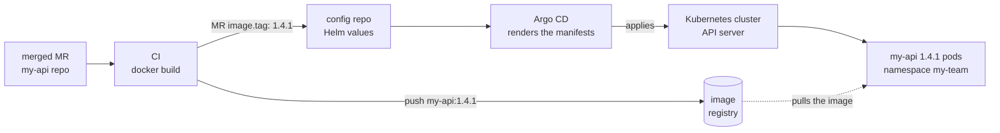
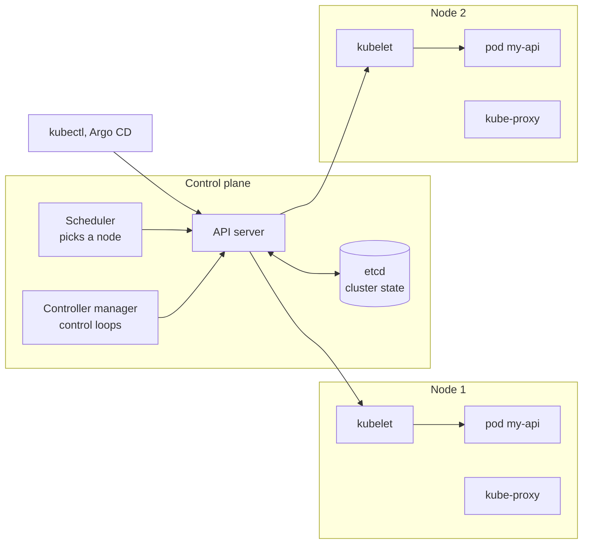
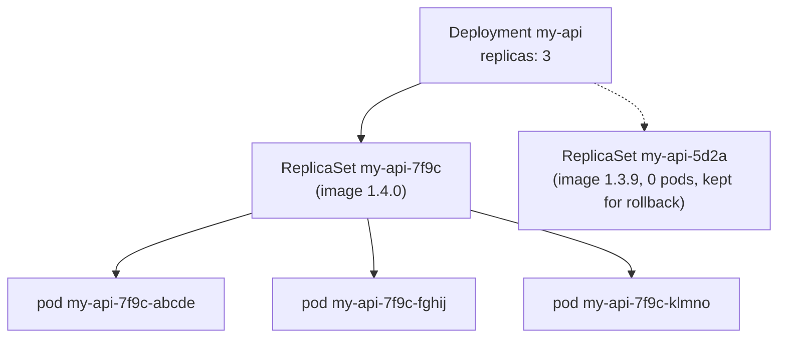
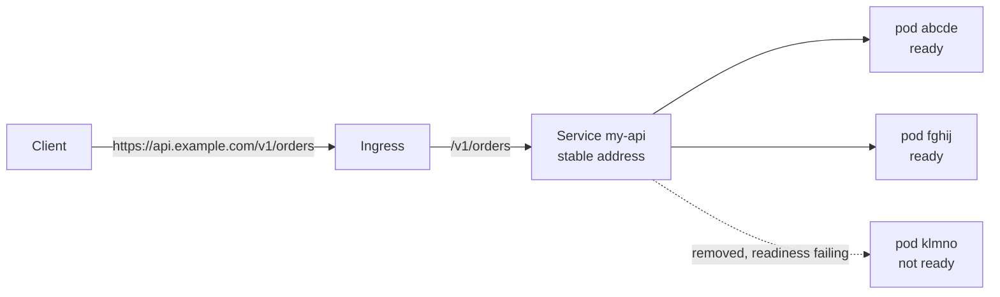
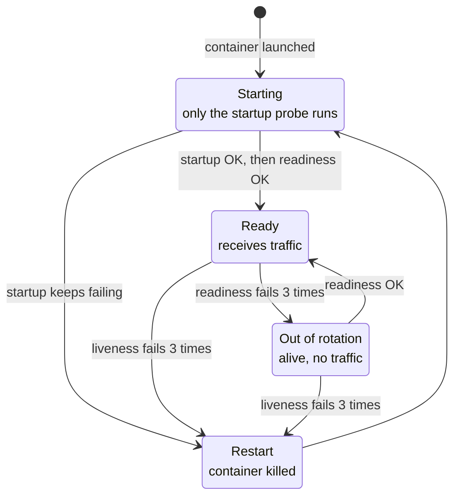
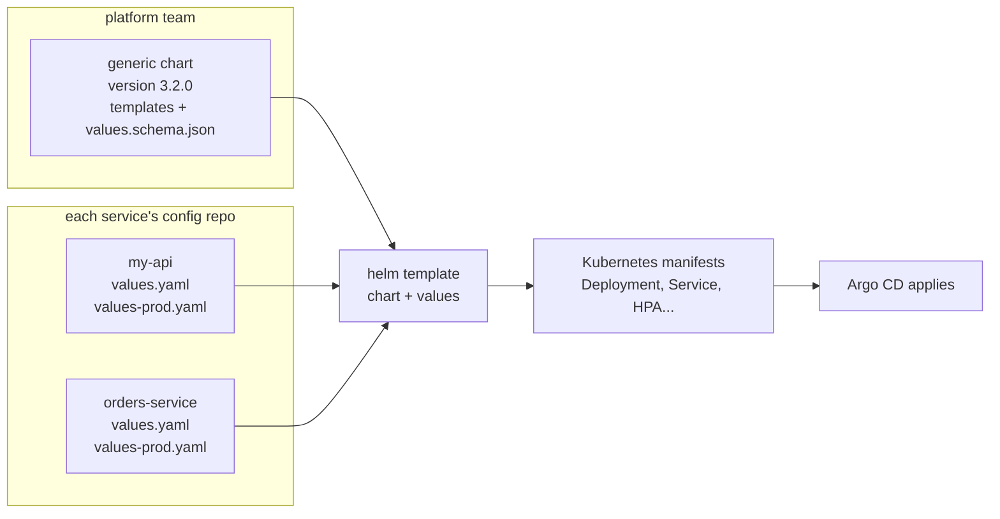
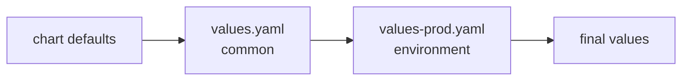
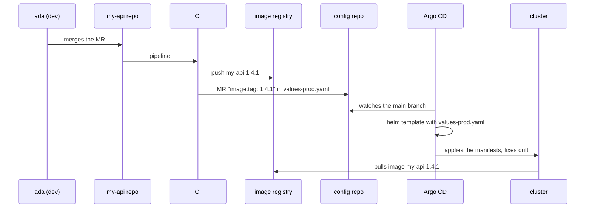

# Containers, Kubernetes and deployment

!!! warning "Disclaimer"
    These notes are personal cheat sheets, not a source of truth. They reflect my own understanding and choices: their content remains subjective, despite the quotes and references it contains. It may be incomplete, simplified, inaccurate or outdated. Always check the official documentation before applying it. This content is provided as is, without any warranty: you use it at your own risk.

!!! audience "Who and what for"
    - **Roles**: back-end developer, SRE, platform engineer, QA engineer, tech lead...
    - **Uses**: I prepare an interview where I am asked the difference between readiness and liveness; I write the Deployment and Helm values of a new service; I review a merge request that adds a probe, limits or an HPA; I work out why a pod restarts in a loop with `OOMKilled`.

!!! abstract "Scales"
    The colored badges under the headings say at which scale a notion applies:

    - <span class="pill pill-scope pill-scope-code">Code</span> the classes, functions and modules of one program;
    - <span class="pill pill-scope pill-scope-app">Application</span> one service or application and its internal split;
    - <span class="pill pill-scope pill-scope-system">System</span> several services talking to each other over the network;
    - <span class="pill pill-scope pill-scope-infra">Infrastructure</span> servers, network, zones and clusters, physical or virtual;
    - <span class="pill pill-scope pill-scope-enterprise">Enterprise</span> the whole information system and its organization.

    Details and ambiguous words: [map of scales](architecture.md#map-of-scales).

<span class="term" data-term="kubernetes">Kubernetes</span> runs applications in <span class="term" data-term="container">containers</span>, checks that they are healthy and restarts them when needed. This page covers what I need to know on the application side: <span class="term" data-term="pod">pods</span>, <span class="term" data-term="k8s-deployment">deployments</span> and <span class="term" data-term="probe">probes</span>, then the path of an image to the cluster (Docker, Helm, Argo CD, Cloud Run), and points to [Kubernetes at scale](kubernetes-echelle.md) for autoscaling (HPA, KEDA, Knative, Karpenter) and operators. To understand what the application produces once it runs (<span class="term" data-term="logs">logs</span>, <span class="term" data-term="metric">metrics</span>, <span class="term" data-term="trace-distributed">traces</span>), see the [Observability](observabilite.md) page.

!!! info "Where to start"
    - **I only want to deploy my service**, without becoming a Kubernetes expert: most often a platform team gives me a paved path (template, [generic chart](#one-generic-chart-for-every-service), Argo CD), described from the organization side in [Golden paths and templates](devx.md#golden-paths-and-templates). Here, I only read [the path of a change to the pod](#the-path-of-a-change-to-the-pod).
    - **I want to understand or debug a pod** that restarts, gets no traffic or runs out of memory: [Pods, containers and probes](#pods-containers-and-probes), then [Namespace and kubectl](#namespace-and-kubectl).
    - **I build or review the deployment chain**: [Building and deploying](#building-and-deploying-docker-helm-argo-cd-cloud-run), and the pipeline that triggers it in [Continuous delivery and deployment](livraison.md#continuous-delivery-and-deployment).
    - **I need to handle load or run Kafka**: [Kubernetes at scale](kubernetes-echelle.md).
    - **I build the platform for other teams**: [Platform engineering](devx.md#platform-engineering-the-platform-as-a-product), then the generic chart and Argo CD here.

Ports, <span class="term" data-term="yaml">YAML</span> values and business routes are examples. `my-api` is a fictitious service.

:material-swap-horizontal: The tools mentioned on this page: which ones replace each other, which ones combine? See [Complementary or competing](outils.md#complementary-or-competing).
{ .doc-ref }

## Terminology

The general web notions this page uses have their own page: API, route and JSON in the [API page Terminology](api-rest-async.md#terminology), HTTP codes in [Response codes](api-rest-async.md#response-codes), caching in [Where to put a cache](architecture.md#where-to-put-a-cache), SLI, SLO and SLA in [SLI, SLO, error budget](observabilite.md#sli-slo-error-budget). Here, only the words of deployment.

### The path of a change to the pod

I fixed a bug in `my-api` and I want the fix to run in production. Between my MR and the pod that answers, the same words keep coming back. The drawing puts them in order, the table defines them, and each one has its own section further down.



| Word | What it is | Example | Details |
|---|---|---|---|
| <span class="term" data-term="container">container</span> | an isolated process that carries its application and its libraries, so it runs the same on my laptop, in CI and in production | `my-api` runs with Python 3.12 even if the machine has Python 3.9 | [Container](#container) |
| <span class="term" data-term="docker-image">image</span> | the frozen template of a container, built once by CI from a `Dockerfile` | the `my-api` image at version 1.4.1 | [Docker: the image](#docker-the-image) |
| <span class="term" data-term="image-tag">image tag</span> | the version label written after the colon: changing the tag means choosing which version runs | `my-api:1.4.1` | [Docker: the image](#docker-the-image) |
| <span class="term" data-term="container-registry">image registry</span> | the server where CI stores images, and where the cluster fetches them when a pod starts | `registry.example.com/my-api` | [Docker: the image](#docker-the-image) |
| <span class="term" data-term="k8s-manifest">manifest</span> | a YAML file that describes a desired resource (a Deployment, a Service): Kubernetes makes reality match it | `kind: Deployment` with `replicas: 3` | [Deployment](#deployment) |
| <span class="term" data-term="k8s-namespace">namespace</span> | a name space inside the cluster that separates the resources of a team or an environment | `my-team`, `preview-mr-42` | [Namespace and kubectl](#namespace-and-kubectl) |
| <span class="term" data-term="kubectl">kubectl</span> | the command line that talks to the cluster API: read the state, describe a pod, read its logs | `kubectl get pods -n my-team` | [Namespace and kubectl](#namespace-and-kubectl) |
| <span class="term" data-term="helm-chart">Helm</span>, chart, values | a template of manifests with holes (the chart), filled by a different values file per environment | `values-prod.yaml` holds `replicaCount: 3` | [Helm](#helm-the-deployment-template) |
| <span class="term" data-term="gitops">GitOps</span> | the rule "what runs is what Git describes": I deploy through an MR, never with a command by hand | an MR that sets `image.tag` to `1.4.1` | [Argo CD](#argo-cd-git-decides-what-runs) |
| <span class="term" data-term="argo-cd">Argo CD</span> | the GitOps tool installed in the cluster: it reads the config repo, renders the manifests, applies them, then fixes any drift | the `my-api-prod` application goes from `OutOfSync` to `Synced` | [Argo CD](#argo-cd-git-decides-what-runs) |

### Kubernetes, cluster, node

*Kubernetes: competes with Cloud Run; complements Docker, Helm, Argo CD*
{ .tool-rel }

**<span class="term" data-term="kubernetes">Kubernetes</span>** (often shortened to K8s) is the system that launches applications in containers, watches them, restarts them and spreads the <span class="term" data-term="network-traffic">traffic</span>. A **<span class="term" data-term="cluster">cluster</span>** is the set of machines it manages, and each machine is a **<span class="term" data-term="node-k8s">node</span>**.
``` { .text .ex-illus title="Illustration" }
cluster prod
├─ node 1 : pod my-api-abcde, pod worker-x1
├─ node 2 : pod my-api-fghij
└─ node 3 : pod my-api-klmno, pod worker-x2
```

The components of a cluster, as the Kubernetes documentation draws them: the control plane decides, the nodes execute.



:material-book-open-variant: Reference docs: [Kubernetes, Cluster Architecture](https://kubernetes.io/docs/concepts/architecture/) (accessed November 2026); [Kubernetes, Nodes](https://kubernetes.io/docs/concepts/architecture/nodes/) (accessed November 2026)
{ .doc-ref }

### Namespace and kubectl

In a shared cluster, two teams each want a Service called `api`, and the platform team wants to cap what each one consumes. A **namespace** solves this: it is a name space, names only need to be unique inside it, and quotas and permissions are set per namespace. **kubectl** is the command-line client of the cluster API. When Argo CD drives the cluster, I use it to read and diagnose, not to change what runs: a change made with kubectl would be undone at the next sync.

``` { .text .ex-ref title="Reference" }
$ kubectl get namespaces
NAME            STATUS   AGE
my-team         Active   210d
preview-mr-42   Active   2d

$ kubectl get pods -n my-team
NAME                 READY   STATUS    RESTARTS   AGE
my-api-7f9c-abcde    1/1     Running   0          3h
my-api-7f9c-fghij    1/1     Running   0          3h

$ kubectl describe pod my-api-7f9c-abcde -n my-team
$ kubectl logs my-api-7f9c-abcde -n my-team --previous
```

| I want... | I use... |
|---|---|
| to know whether my service's pods are running and how many times they restarted since this morning's deployment | `kubectl get pods -n my-team` |
| to understand why a pod does not start, for example an image missing from the registry or a failing probe | `kubectl describe pod`, `Events` section |
| to read what the application wrote just before it crashed and was restarted | `kubectl logs --previous` |
| to change the version that runs, or the number of copies | not kubectl: an MR on the config repo, see [Argo CD](#argo-cd-git-decides-what-runs) |

:material-book-open-variant: Reference docs: [Kubernetes, Namespaces](https://kubernetes.io/docs/concepts/overview/working-with-objects/namespaces/) (accessed November 2026); [kubectl Quick Reference](https://kubernetes.io/docs/reference/kubectl/quick-reference/) (accessed November 2026)
{ .doc-ref }

### Deployment
The Kubernetes object that says "I want 3 copies of my-api, with this image". Kubernetes creates the <span class="term" data-term="pod">pods</span> and recreates them if they disappear.

!!! noob "As noob"
    The Deployment is a restaurant's head chef: I say "I always want 3 cooks", they replace one who falls ill, and swap them one at a time when the recipe changes. The one thing to remember: **I describe the desired state, Kubernetes works to stay there.**

``` { .yaml .ex-ref title="Reference" }
# Example: minimal Deployment, 3 copies of my-api
kind: Deployment
metadata:
  name: my-api
spec:
  replicas: 3
```

In between sits an intermediate object, the **ReplicaSet**: the Deployment creates one ReplicaSet per image version, and the ReplicaSet is what keeps the right number of pods. A rolling update grows the new ReplicaSet and shrinks the old one.



:material-book-open-variant: Reference docs: [Kubernetes, Deployments](https://kubernetes.io/docs/concepts/workloads/controllers/deployment/) (accessed November 2026); [Kubernetes, ReplicaSet](https://kubernetes.io/docs/concepts/workloads/controllers/replicaset/) (accessed November 2026)
{ .doc-ref }

### Rolling update
When the image changes, the Deployment does not replace every pod at once: it performs a <span class="term" data-term="rollout">rollout</span>, pod by pod. `maxSurge` says how many pods above the desired count it may create, `maxUnavailable` how many ready pods it may lose.

!!! noob "As noob"
    It is a shift change in a shop that never closes: a new clerk arrives, and only once they are at their post does an old one leave. If the new one cannot run the till, the old one stays and customers notice nothing. The one thing to remember: **with `maxUnavailable: 0`, an old pod is stopped only once a new one is ready.**

The setting I still come across: `Recreate`. It stops every pod before starting the new ones, so the API does not answer during the whole startup, and stays down if the new version does not start. It is only justified when two versions cannot run at the same time (for example a single copy holding an exclusive lock).
``` { .yaml .ex-bad title="Avoid" }
# Avoid: Recreate stops the 3 pods before starting the new ones, so an outage on every deployment
spec:
  replicas: 3
  strategy:
    type: Recreate
```

``` { .yaml .ex-good title="Recommended" }
# Good: rolling update, one extra pod at a time, no ready pod removed first
spec:
  replicas: 3
  strategy:
    rollingUpdate:
      maxSurge: 1
      maxUnavailable: 0
```
Moving from 1.4.0 to 1.4.1 with these settings (example times):
``` { .text .ex-illus title="Illustration" }
time      pods 1.4.0   pods 1.4.1            total
10:00:00  3 ready      0                     3
10:00:01  3 ready      1 starting            4   (maxSurge: one extra pod)
10:00:20  3 ready      1 ready               4
10:00:21  2 ready      1 ready               3   (a 1.4.0 pod stops only once the 1.4.1 one is ready)
10:00:22  2 ready      1 ready, 1 starting   4
10:00:41  1 ready      2 ready               3
10:01:02  0            3 ready               3   rollout done
```
With `maxUnavailable: 0`, there are always 3 ready pods. If the 1.4.1 pods never become ready, the rollout stays stuck and the 1.4.0 pods keep serving.

Going back to the previous version (<span class="term" data-term="rollback">rollback</span>) runs the same movement the other way:
``` { .text .ex-ref title="Reference" }
$ kubectl rollout status deployment/my-api
deployment "my-api" successfully rolled out
$ kubectl rollout undo deployment/my-api
deployment.apps/my-api rolled back
```
Trap: with Argo CD, a manual `rollout undo` is overwritten at the next sync. Revert the MR instead (see [Argo CD](#argo-cd-git-decides-what-runs)).

:material-book-open-variant: Reference docs: [Kubernetes, Updating a Deployment](https://kubernetes.io/docs/concepts/workloads/controllers/deployment/#updating-a-deployment) (accessed November 2026); [kubectl rollout](https://kubernetes.io/docs/reference/kubectl/generated/kubectl_rollout/) (accessed November 2026)
{ .doc-ref }

### Service
Pods are born and die, and their IP address changes every time. A **<span class="term" data-term="k8s-service">Service</span>** gives a stable address (`http://my-api` inside the cluster) and spreads traffic across every pod carrying the label requested in `selector`, as long as they are ready.

!!! noob "As noob"
    The Service is a company's switchboard number: staff change desks and direct lines, but I always dial the same number and the switchboard puts me through to someone available. The one thing to remember: **we call the Service, never a pod directly, because pods change address.**

``` { .yaml .ex-ref title="Reference" }
# Example: Service sending port 80 to port 8080 of the app=my-api pods
kind: Service
metadata:
  name: my-api
spec:
  selector:
    app: my-api
  ports:
    - port: 80
      targetPort: 8080
```
``` { .text .ex-illus title="Illustration" }
Service my-api (http://my-api:80)
├─ pod my-api-7f9c-abcde   label app=my-api, ready       receives traffic
├─ pod my-api-7f9c-fghij   label app=my-api, ready       receives traffic
└─ pod my-api-7f9c-klmno   label app=my-api, not ready   removed: its readiness probe fails
```
The removed pod is not killed: it comes back into the Service as soon as its [readiness probe](#readiness-probe) passes again.

From outside the cluster, an **Ingress** (or its successor, the Gateway API) receives HTTP requests and sends them to the right Service based on host and path. The full path of a request:



:material-book-open-variant: Reference docs: [Kubernetes, Service](https://kubernetes.io/docs/concepts/services-networking/service/) (accessed November 2026); [Kubernetes, Ingress](https://kubernetes.io/docs/concepts/services-networking/ingress/) (accessed November 2026)
{ .doc-ref }

## Pods, containers and probes

<a class="pill pill-scope pill-scope-app" href="../architecture/#map-of-scales">Scale · Application</a> <a class="pill pill-scope pill-scope-infra" href="../architecture/#map-of-scales">Scale · Infrastructure</a>

### Pod
<span class="pill pill-status pill-status-ok" title="Still valid, checked November 2026">Current · 11/2026</span>

The smallest unit Kubernetes runs. It holds one or more <span class="term" data-term="container">containers</span>.

``` { .text .ex-illus title="Illustration" }
Deployment my-api (prod)
├─ pod my-api-7f9c-abcde   (container my-api)
├─ pod my-api-7f9c-fghij   (container my-api)
└─ pod my-api-7f9c-klmno   (container my-api)
```
The 3 <span class="term" data-term="pod">pods</span> are identical, and <span class="term" data-term="network-traffic">traffic</span> is spread across them. Each pod gets its own <span class="term" data-term="probe">probes</span>.

**Risks.** A pod is disposable: when Kubernetes moves or restarts it, everything it kept in memory or on its local disk is gone. If my-api stores Léa's basket in a local file, the basket vanishes at the next deployment: I keep state in a database or a shared cache. Putting unrelated containers in the same pod also ties them together: they start, fail and scale as one, so I keep that for helpers (*sidecars*) that really serve the main container.

:material-book-open-variant: Reference docs: [Kubernetes, Pods](https://kubernetes.io/docs/concepts/workloads/pods/) (accessed November 2026); [Kubernetes, Pod Lifecycle](https://kubernetes.io/docs/concepts/workloads/pods/pod-lifecycle/) (accessed November 2026)
{ .doc-ref }

### Container
The application packaged with everything it needs to run, built from a <span class="term" data-term="docker-image">Docker image</span>.

``` { .text .ex-illus title="Illustration" }
image my-api:1.4.2
├─ Python 3.12
├─ dependencies (requirements)
└─ my-api code
```

:material-book-open-variant: Reference docs: [Kubernetes, Containers](https://kubernetes.io/docs/concepts/containers/) (accessed November 2026); [Docker, What is a container?](https://docs.docker.com/get-started/docker-concepts/the-basics/what-is-a-container/) (accessed November 2026)
{ .doc-ref }

### Probe
<span class="pill pill-status pill-status-ok" title="Still valid, checked November 2026">Current · 11/2026</span>

A <span class="term" data-term="http-request">request</span> that Kubernetes sends on its own, at regular intervals, to check a container's state. It then acts on the answer.

The classic mistake: pointing the liveness probe at the same route as the readiness probe. That route queries MySQL, so the day the database goes down, the liveness of every pod fails and Kubernetes restarts them all in a loop. With `failureThreshold: 1`, a single pause of a few seconds (a slightly long garbage collection) is also enough to kill the container.
``` { .yaml .ex-bad title="Avoid" }
# Avoid: liveness on /readyz, which depends on MySQL, and one failure is enough to restart
livenessProbe:
  httpGet:
    path: /readyz
    port: 8080
  periodSeconds: 5
  failureThreshold: 1
```

``` { .yaml .ex-good title="Recommended" }
# Good: readiness, takes the pod out of traffic after 3 failures
readinessProbe:
  httpGet:
    path: /readyz
    port: 8080
  periodSeconds: 10
  failureThreshold: 3
# Good: liveness, restarts the container after 3 failures
livenessProbe:
  httpGet:
    path: /livez
    port: 8080
  periodSeconds: 30
  failureThreshold: 3
```
`periodSeconds: 10` means "every 10 s". `failureThreshold: 3` means "3 failures in a row before acting".

:material-book-open-variant: Reference docs: [Kubernetes, Liveness, Readiness, and Startup Probes](https://kubernetes.io/docs/concepts/configuration/liveness-readiness-startup-probes/) (accessed November 2026); [Configure Liveness, Readiness and Startup Probes](https://kubernetes.io/docs/tasks/configure-pod-container/configure-liveness-readiness-startup-probes/) (accessed November 2026)
{ .doc-ref }

### Readiness probe
<span class="pill pill-status pill-status-ok" title="Still valid, checked November 2026">Current · 11/2026</span>

"<span class="term" data-term="readiness-probe">Readiness</span>" means "being ready". The question is: "are you ready to receive traffic?" If the probe fails, the pod stops receiving traffic, but it is not killed.

``` { .text .ex-illus title="Illustration" }
10:00:00  GET /readyz  200  pod in rotation
10:00:10  GET /readyz  503  MySQL unreachable
10:00:20  GET /readyz  503
10:00:30  GET /readyz  503  3 failures: pod taken out of rotation
10:01:00  GET /readyz  200  MySQL back: pod put back in rotation
```

**Risks.** If readiness checks a dependency shared by every pod, like the database, an outage of that dependency removes every pod from the Service at once: customers get a connection error instead of a clear message, and a degraded answer served from a cache becomes impossible. I keep readiness for what the pod really needs to answer, and I decide in advance what the service can still do without the dependency. A readiness slower than its `timeoutSeconds` counts as a failure, and the pod keeps going in and out of rotation.

### Liveness probe
<span class="pill pill-status pill-status-ok" title="Still valid, checked November 2026">Current · 11/2026</span>

"Are you still alive?" If it fails several times in a row, Kubernetes kills the container and restarts it.

!!! noob "As noob"
    Readiness is the swamped waiter who says "stop seating people at my tables for now": they get no new tables, but they stay on the floor. Liveness is the waiter who has frozen and no longer answers at all: they are sent out and come back fresh. The one thing to remember: **a failing readiness takes the pod out of traffic, a failing liveness restarts the container.**

``` { .text .ex-illus title="Illustration" }
10:00:00  GET /livez  200      OK
10:00:30  GET /livez  timeout  application stuck (deadlock)
10:01:00  GET /livez  timeout
10:01:30  GET /livez  timeout  3 failures: container restarted
10:01:45  GET /livez  200      OK after restart
```

**Risks.** A liveness probe that checks the my-api database restarts every pod at once the day the database goes down, and fixes nothing: I only check the process itself (`/livez` answers without calling anyone). Thresholds that are too tight (`failureThreshold: 1`, `timeoutSeconds: 1`) kill a container that is merely slow, for example during a traffic peak, which removes capacity at the worst moment: I allow several failures in a row. Without liveness, an app stuck in a <span class="term" data-term="deadlock">deadlock</span> stays frozen, answering nothing, until someone restarts it by hand.

### Startup probe
<span class="pill pill-status pill-status-ok" title="Still valid, checked November 2026">Current · 11/2026</span>

"Have you finished starting?" Until it succeeds, the <span class="term" data-term="liveness-probe">liveness</span> probe checks nothing, which avoids killing an application that is slow to start.

!!! noob "As noob"
    It is a newcomer's first day: until they have finished settling in, nobody blames them for not answering the phone. Once settled, the usual rules apply. Limit: if they never finish settling in within the allowed time, the container is restarted anyway. The one thing to remember: **the startup probe protects the startup, then hands over to liveness and readiness.**

``` { .text .ex-illus title="Illustration" }
10:00:00  container launched, loading the cache (40 s)
10:00:10  startup probe  failure  (normal, still starting)
10:00:40  startup probe  200      startup finished
10:00:40  liveness and readiness take over
```

**Risks.** An overly generous margin (`failureThreshold` times `periodSeconds` at 10 minutes for an app that starts in 40 s) delays by as much the detection of a real crash at startup, and a broken deployment takes a long time to get stuck: I set the margin to two or three times the measured startup time. Without a startup probe, I am tempted to raise the liveness `initialDelaySeconds`, which also delays the detection of a frozen app after every restart.

### Which probe for which need

The three probes seen as the states of a container (settings from the example: 3 failures in a row before acting):



| I want... | Probe |
|---|---|
| users to stop landing on a pod whose database no longer answers, without killing the pod, since it will be useful again as soon as the database is back | readiness |
| Kubernetes to restart a frozen application on its own, for example one stuck in a deadlock: it still runs but no longer answers anything | liveness |
| Kubernetes to give a slow application 2 minutes to start, for example because it loads a big cache at launch, before the liveness probe kills it | <span class="term" data-term="startup-probe">startup</span> |

Classic trap: I put the <span class="term" data-term="database">database</span> check in the liveness probe. The day the database goes down, the liveness probe of every pod fails at the same time, so Kubernetes restarts them all <span class="term" data-term="restart-loop">in a loop</span>. Restarting does not fix the database, and my pods spend their time restarting instead of answering.

### Health check
Generic term for "checking health". Probes are the Kubernetes version of the <span class="term" data-term="health-check">health check</span>.

``` { .text .ex-ref title="Reference" }
$ curl -i http://localhost:8080/livez
HTTP/1.1 200 OK
```

### Probes in traces
Probes are HTTP requests like any other: <span class="term" data-term="instrumentation">instrumentation</span> traces them. Since they run day and night, they can make up almost all the <span class="term" data-term="trace-distributed">traces</span> of a little-used service. This case is detailed in [Observability: probe noise](observabilite.md#case-study-kubernetes-probe-noise).

### Resources: requests and limits
<span class="pill pill-status pill-status-ok" title="Still valid, checked November 2026">Current · 11/2026</span>

Each container declares what it consumes. The **request** is what Kubernetes reserves for it: it is used to pick a node with enough room. The **limit** is the ceiling. Above its CPU limit, the container is slowed down. Above its memory limit, it is killed (`OOMKilled`, for "<span class="term" data-term="oomkilled">out of memory</span>") and then restarted.

!!! noob "As noob"
    The request is my reserved seat on a train: Kubernetes only lets me board a carriage where that seat is free. The limit is the maximum allowed: too much CPU and I am slowed down, too much memory and I am put off the train (the container is killed, then restarted). The one thing to remember: **the request places the pod, the limit contains it.**

The frequent omission: no `resources` block at all. The pod then falls into the *BestEffort* class: Kubernetes places it without reserving anything, it can take all the node's memory, it is the first evicted when the node runs short, and the HPA has no base to compute its percentage.
``` { .yaml .ex-bad title="Avoid" }
# Avoid: no resources block, nothing is reserved or capped
containers:
  - name: my-api
    image: my-api:1.4.0
```

``` { .yaml .ex-good title="Recommended" }
# Good: reserves 250m CPU and 256Mi, caps at 1 CPU and 512Mi
resources:
  requests:
    cpu: 250m
    memory: 256Mi
  limits:
    cpu: "1"
    memory: 512Mi
```
`250m` means 0.25 CPU core. `Mi` is a mebibyte.

Diagnosing a pod that keeps restarting:
``` { .text .ex-ref title="Reference" }
$ kubectl describe pod my-api-7f9c-abcde
...
    State:          Running
    Last State:     Terminated
      Reason:       OOMKilled
      Exit Code:    137
    Restart Count:  4
```
`137` = 128 + 9: the container received signal 9 (`SIGKILL`), it could not shut down cleanly. If the restart count keeps rising, it is a memory leak or a limit set too low: restarting fixes nothing.

**Risks.** A CPU limit that is too low kills nothing, it slows down: my-api stays "healthy" but its responses go from 80 ms to 600 ms at peak hours (example figures), and nobody thinks of the CPU. I watch *throttling* (`container_cpu_cfs_throttled_periods_total`) before lowering a limit. A request that is too high reserves cores that are never used: nodes look full, and the cluster adds machines paid for nothing. I set requests from the real usage measured at p95, not from a guess.

:material-book-open-variant: Reference docs: [Kubernetes, Resource Management for Pods and Containers](https://kubernetes.io/docs/concepts/configuration/manage-resources-containers/) (accessed November 2026)
{ .doc-ref }

!!! maturity "Measuring maturity"
    | Level | What I see in the team |
    |---|---|
    | N1 | pods run without probes, or with a probe copied from another service, and with no `resources` block |
    | N2 | every Deployment declares readiness and liveness (and startup when needed) on distinct routes, plus requests and limits, from a shared template |
    | N3 | Kubernetes removes sick pods from traffic and restarts them on its own, and a CI check refuses a manifest with no probes or `resources` |
    | N4 | the team tunes probe thresholds and requests from measured restarts, `OOMKilled` events and real usage |

    **I measure**: the number of restarts and `OOMKilled` events per pod and per week, read with `kubectl get pods` or in the metrics backend; the gap between the request and real CPU and memory usage at p95.

## Building and deploying: Docker, Helm, Argo CD, Cloud Run

<a class="pill pill-scope pill-scope-infra" href="../architecture/#map-of-scales">Scale · Infrastructure</a>

<a class="pill pill-practice" href="../livraison/#continuous-delivery-and-deployment" title="level 2: it is automated">Practice · Continuous deployment · L2</a>
<a class="pill pill-dora" href="https://dora.dev/capabilities/deployment-automation/">DORA · Deployment automation</a> <a class="pill pill-dora" href="https://dora.dev/capabilities/flexible-infrastructure/">DORA · Flexible infrastructure</a>


The path of a change to production: package the application into an image, describe how to run it, then a tool applies that description to the cluster. Choosing between these tools (mini benchmark) is covered in the [Tech tools landscape](outils.md#containers-and-deployment-docker-kubernetes-helm-argo-cd-cloud-run).

### Docker: the image
<span class="pill pill-status pill-status-ok" title="Still valid, checked November 2026">Current · 11/2026</span>


*Docker: complements Kubernetes, Helm*
{ .tool-rel }

**Docker** packages an application and everything it needs (language, libraries, files) into an <span class="term" data-term="docker-image">image</span>. The same image runs on the developer's laptop, in CI and in production. It is described in a `Dockerfile`.

!!! noob "As noob"
    The image is a vacuum-packed ready meal: everything is inside, and it tastes the same in any kitchen with the same oven (a container engine). The container is a plate of that meal being served: one pack can fill several plates. The one thing to remember: **the image is the frozen template, the container is one run of that template.**

The first-draft version works, but `python:latest` can move from one Python version to the next between two builds, `COPY . .` placed before the install reruns `pip install` for every changed line of code, and without `USER` the app runs as root: a flaw in the app then gives root rights inside the container.
``` { .dockerfile .ex-bad title="Avoid" }
# Avoid: latest image, code copied before the dependencies, app run as root
FROM python:latest
WORKDIR /app
COPY . .
RUN pip install -r requirements.txt
CMD ["uvicorn", "my_api.main:app", "--host", "0.0.0.0", "--port", "8080"]
```

``` { .dockerfile .ex-good title="Recommended" }
# Good: Python image of my-api, run as a non-root user (USER 1000)
FROM python:3.12-slim
WORKDIR /app
COPY requirements.txt .
RUN pip install --no-cache-dir -r requirements.txt
COPY . .
USER 1000
CMD ["uvicorn", "my_api.main:app", "--host", "0.0.0.0", "--port", "8080"]
```

``` { .text .ex-ref title="Reference" }
$ docker build -t my-api:1.4.0 .
$ docker run -p 8080:8080 my-api:1.4.0
$ curl localhost:8080/readyz
{"status": "ok"}
```

Copying `requirements.txt` before the rest of the code uses the <span class="term" data-term="docker-layer-cache">layer cache</span>: as long as the dependencies do not change, `pip install` is not run again. `USER 1000` avoids running the app as root.

*pip: competes with uv, Poetry, pdm*
{ .tool-rel }


**Risks.** Whatever is copied into a layer stays there, even if a later line deletes it: a `.env` file holding the database password, copied by `COPY . .`, can be found by extracting the image (`docker save`). I exclude such files with `.dockerignore` and pass secrets at run time, not at build time. An image built once does not get the fixes published later for its base image: the my-api image built six months ago ships known vulnerabilities. I rebuild it at least weekly and scan it in CI.

:material-book-open-variant: Reference docs: [Docker, Dockerfile reference](https://docs.docker.com/reference/dockerfile/) (accessed November 2026); [Docker, Build cache](https://docs.docker.com/build/cache/) (accessed November 2026)
{ .doc-ref }

### Multi-stage image: fast to rebuild, light in production
<span class="pill pill-status pill-status-ok" title="Still valid, checked November 2026">Current · 11/2026</span>

*uv: competes with pip, Poetry, pdm*
{ .tool-rel }

The `my-api` image weighs 1.1 GB, and every changed line of code reruns the installation of all dependencies: the build takes four minutes on my laptop as in CI. Three Docker tools fix this. A <span class="term" data-term="multi-stage-build">multi-stage build</span> splits the `Dockerfile` into stages named with `AS`; `docker build --target dev` or `--target prod` picks the stage to produce, and the final image keeps only what its last stage contains. <span class="term" data-term="buildkit">BuildKit</span>'s **cache mount** (Docker's default build engine since version 23, released in 2023, to check) keeps a folder, such as uv's download cache, from one build to the next with `RUN --mount=type=cache`: even when the dependency layer must be redone, packages are not downloaded again. The **`.dockerignore`** file lists what does not go into the *build context*, the set of files sent to the engine: without it, `.git` or a local `.venv` are sent on every build, slow the upload down and can end up in the image.

!!! noob "As noob"
    A multi-stage Dockerfile is a kitchen with a worktop and a serving hatch: everything is prepared on the worktop (build tools, test dependencies), and only the finished plate goes through the hatch to the dining room. The cache mount is the pantry: no new shopping trip for every dish. The takeaway: **build with everything, ship only what runs the app.**

**When**: as soon as the image goes to production, or the build comes back several times an hour in the work loop. For a throwaway script run once, the simple version is enough. **Why**: a build that only redoes the last layer when only the code changes, a smaller production image (less to download when a pod starts, fewer packages to find vulnerabilities in), and a single file for the laptop and production. The cost: a longer `Dockerfile`, to review carefully. **How**: I copy the dependency files and the lockfile first, install with a cache mount, then copy the code; I separate a `dev` target (test tools, automatic reload) from a `prod` target (no dev tools, non-root user).

Avoid: code copied before the installation, on the full `python:3.12` image. Any file change invalidates the layer, so every dependency is reinstalled on every build; the image carries compilers, test and lint tools, `uv sync` without `--frozen` can resolve other versions from one build to the next, and the app runs as root.

``` { .dockerfile .ex-bad title="Avoid" }
# Avoid: code copied before dependencies, full image, dev tools in production, root
FROM python:3.12
WORKDIR /app
COPY . .
RUN pip install uv && uv sync
CMD ["uv", "run", "uvicorn", "my_api.main:app", "--host", "0.0.0.0"]
```

``` { .dockerfile .ex-good title="Recommended" }
# syntax=docker/dockerfile:1
# Good: common base, uv copied from its official image
FROM python:3.12-slim AS base
WORKDIR /app
ENV UV_COMPILE_BYTECODE=1 \
    UV_LINK_MODE=copy \
    PYTHONUNBUFFERED=1
COPY --from=ghcr.io/astral-sh/uv:0.4.30 /uv /usr/local/bin/uv

# Good: dependencies only, from the frozen lockfile, with uv's cache kept between builds
FROM base AS deps
COPY pyproject.toml uv.lock ./
RUN --mount=type=cache,target=/root/.cache/uv \
    uv sync --frozen --no-install-project --no-dev

# Good: development target, with test tools and automatic reload
FROM deps AS dev
RUN --mount=type=cache,target=/root/.cache/uv \
    uv sync --frozen --no-install-project
CMD ["uv", "run", "uvicorn", "my_api.main:app", "--host", "0.0.0.0", "--reload"]

# Good: production target, code copied last, no dev tools, non-root user
FROM deps AS prod
COPY src ./src
RUN --mount=type=cache,target=/root/.cache/uv \
    uv sync --frozen --no-dev
RUN useradd --uid 10001 --no-create-home app
USER app
CMD ["/app/.venv/bin/uvicorn", "my_api.main:app", "--host", "0.0.0.0"]
```

The `.dockerignore` next to it:

``` { .text .ex-ref title="Reference" }
.git
.venv
.uv-cache
__pycache__
tests
*.md
```

``` { .text .ex-ref title="Reference" }
$ docker build --target dev -t my-api:dev .
$ docker build --target prod -t my-api:1.4.0 .
```

| What I change | Before | After |
|---|---|---|
| one line of code in `src/` | full reinstallation of dependencies | only the last layer is redone |
| an added dependency | full reinstallation, everything downloaded again | reinstallation, but packages come from the cache mount |
| my local work | a build for every try | `dev` target, code mounted through a volume, automatic reload |

uv options and the version of its image to check in their documentation at the time of use.

| I want... | I use... |
|---|---|
| to stop waiting four minutes of build every time I change a line of code | dependency files copied before the code |
| adding one dependency not to download the 200 other packages again | `RUN --mount=type=cache` |
| a dev image with test tools and a prod image without them, from a single file | a multi-stage build with `--target dev` and `--target prod` |
| `.git` or my local `.venv` not to go into the build or the image | a `.dockerignore` |

:material-book-open-variant: Reference docs: [Docker, Multi-stage builds](https://docs.docker.com/build/building/multi-stage/) (accessed November 2026); [Docker, Optimize cache usage in builds](https://docs.docker.com/build/cache/optimize/) (accessed November 2026); [Docker, Build context](https://docs.docker.com/build/concepts/context/) (accessed November 2026)
{ .doc-ref }

### ConfigMap and Secret: config per environment
<span class="pill pill-status pill-status-ok" title="Still valid, checked November 2026">Current · 11/2026</span>

Rule: **the same image everywhere, the config changes per environment**. The `my-api:1.4.0` image tested in staging is the one that goes to prod, only its <span class="term" data-term="environment-variable">environment variables</span> change. A **<span class="term" data-term="configmap">ConfigMap</span>** holds non-sensitive config, a **Secret** holds <span class="term" data-term="secret">secrets</span> (passwords, keys).

!!! noob "As noob"
    It is a rental car: the same model leaves the garage for every customer, only the settings (ConfigMap) and the key (Secret) change. Limit: by default a Secret is only encoded, not encrypted, so who can read it must stay restricted. The one thing to remember: **we do not rebuild the image to change environment, we change its config.**

``` { .yaml .ex-ref title="Reference" }
# Example: ConfigMap holding the non-secret config of my-api
kind: ConfigMap
metadata:
  name: my-api-config
data:
  LOG_LEVEL: "info"
  ORDERS_SERVICE_URL: "http://orders-service"
```

What I still find in repositories: the password written in clear in the manifest, so readable by anyone who can read Git, and a `latest` image, so no way to know which version runs or to go back to the previous one, since each node may have pulled a different `latest` image.
``` { .yaml .ex-bad title="Avoid" }
# Avoid: latest image and a clear-text password in the versioned manifest
containers:
  - name: my-api
    image: my-api:latest
    env:
      - name: DB_PASSWORD
        value: "s3cr3t-prod"
```

The Deployment reads both in `env`:
``` { .yaml .ex-good title="Recommended" }
# Good: LOG_LEVEL read from the ConfigMap, DB_PASSWORD from the Secret
containers:
  - name: my-api
    image: my-api:1.4.0
    env:
      - name: LOG_LEVEL
        valueFrom:
          configMapKeyRef:
            name: my-api-config
            key: LOG_LEVEL
      - name: DB_PASSWORD
        valueFrom:
          secretKeyRef:
            name: my-api-secrets
            key: DB_PASSWORD
```

| Env     | Image          | `LOG_LEVEL` | `DB_PASSWORD`                      |
|---------|----------------|-------------|------------------------------------|
| staging | `my-api:1.4.0` | `debug`     | staging `my-api-secrets` Secret    |
| prod    | `my-api:1.4.0` | `info`      | prod `my-api-secrets` Secret       |

Traps: a Secret is only base64-encoded, not encrypted, so never commit it in clear in Git (it is usually filled from a secret manager, to check for the cluster). And changing a ConfigMap does not restart the pods: environment variables are read at startup.

:material-book-open-variant: Reference docs: [Kubernetes, ConfigMaps](https://kubernetes.io/docs/concepts/configuration/configmap/) (accessed November 2026); [Kubernetes, Secrets](https://kubernetes.io/docs/concepts/configuration/secret/) (accessed November 2026)
{ .doc-ref }

### Helm: the deployment template
<span class="pill pill-status pill-status-ok" title="Still valid, checked November 2026">Current · 11/2026</span>


*Helm: partly competes with Kustomize; complements Argo CD, Kubernetes*
{ .tool-rel }

**Helm** is a package manager for Kubernetes. A **<span class="term" data-term="helm-chart">chart</span>** is a template of <span class="term" data-term="k8s-manifest">manifests</span>, filled by a different `values.yaml` per environment. Every service can share the same chart.

!!! noob "As noob"
    A chart is a mail-merge letter with fields to fill in ("Dear {name}"); the values file is the list of recipients. The same letter goes to staging with 2 copies and to prod with 3. The one thing to remember: **the chart describes the shape once, the values say what changes per environment.**

``` { .yaml .ex-ref title="Reference" }
# templates/deployment.yaml (excerpt)
# Example: Helm template, the name and replica count come from the values
kind: Deployment
metadata:
  name: {{ .Release.Name }}
spec:
  replicas: {{ .Values.replicaCount }}
```
``` { .yaml .ex-ref title="Reference" }
# values-staging.yaml
# Example: staging values, 2 copies
replicaCount: 2
image:
  tag: "1.4.0"
```
``` { .yaml .ex-ref title="Reference" }
# values-prod.yaml
# Example: prod values, 3 copies of the same image
replicaCount: 3
image:
  tag: "1.4.0"
```
`helm template` shows the result without installing anything:
``` { .text .ex-ref title="Reference" }
$ helm template my-api ./chart -f values-staging.yaml
kind: Deployment
metadata:
  name: my-api
spec:
  replicas: 2

$ helm template my-api ./chart -f values-prod.yaml
kind: Deployment
metadata:
  name: my-api
spec:
  replicas: 3
```

**Risks.** A badly indented template or a misspelled value produces a wrong manifest, or a value that is simply ignored, with no clear error: I run `helm lint` and `helm template` in CI, and I add a `values.schema.json`. Per-environment values files drift if everyone copies everything into them: I keep what is shared in a single file and only the differences per environment. A `helm upgrade` run by hand from a laptop leaves the cluster in a state Git does not describe: I leave it to Argo CD or to CI.

:material-book-open-variant: Reference docs: [Helm, Charts](https://helm.sh/docs/topics/charts/) (accessed November 2026); [Helm, Values Files](https://helm.sh/docs/chart_template_guide/values_files/) (accessed November 2026)
{ .doc-ref }

### One generic chart for every service
<span class="pill pill-status pill-status-ok" title="Still valid, checked November 2026">Current · 11/2026</span>

Writing one chart per service means copying the same templates (Deployment, Service, probes, HPA...) twenty times and fixing them twenty times. The alternative: **a single generic chart**, maintained by a platform team and versioned like a library. Each service no longer writes templates: it only provides its **values** (image, port, probes, resources, scaling). Helm even has a chart type for this, the *library chart*, which only holds reusable templates. Public examples: `app-template` (bjw-s), `application` (Stakater), and Bitnami's `common` library. It is the base brick of the deployment [golden path](devx.md#golden-paths-and-templates) a platform team offers.

!!! noob "As noob"
    The generic chart is a pre-printed form: the platform team drew the boxes once and for all, each service only fills in its own boxes (name, image, port). Nobody redraws the form, and when the platform improves it (a new security setting, a better probe), every service benefits by moving to the new version.



**Layered values.** Helm accepts several `-f` files: each one overrides the previous one, key by key. The common part goes in `values.yaml`, and only the differences go in the environment's file.

``` { .yaml .ex-ref title="Reference · values.yaml (common to every environment)" }
# Example: image, port, probes and resources shared by every environment
image:
  repository: registry.example.com/my-api
  tag: "1.4.0"
port: 8080
probes:
  readiness: /readyz
  liveness: /livez
resources:
  requests: {cpu: 100m, memory: 256Mi}
```

``` { .yaml .ex-ref title="Reference · values-prod.yaml (only what changes)" }
# Example: prod only declares its replicas and its autoscaling
replicas: 3
autoscaling:
  enabled: true
  maxReplicas: 10
```

``` { .text .ex-ref title="Reference" }
$ helm template my-api platform/generic --version 3.2.0 \
    -f values.yaml -f values-prod.yaml
```



**When to use it.** As soon as a team or a platform runs more than a handful of similar services (an HTTP API, a worker, a scheduled job). **When not to**: a very specific component (a database, a third-party tool that already ships an official chart); use the vendor's chart then.

**Why.** Gain: one fix benefits everyone, good practices (probes, limits, security) apply by default, and reviewing values is much shorter than reviewing templates. Cost: the chart becomes a product of its own, with versions, documentation and breaking changes to announce.

**The "everything configurable" trap.** If every Kubernetes field becomes a value, the values file turns into a second language, harder than the original manifests. A good generic chart exposes few things, with safe defaults, and leaves a documented way out for rare cases (extra manifests next to it).

**How to test it**, from fastest to most complete:

| I want to check... | I use... |
|---|---|
| that the values have the right shape (a typo, a wrong type) | a `values.schema.json` in the chart: Helm rejects invalid values as early as `helm template` |
| that the chart renders valid YAML | `helm lint`, then `helm template ... \| kubeconform` |
| that a value gives the expected manifest | template unit tests (the `helm-unittest` plugin) |
| what a new chart version will change for my service | `helm diff` (plugin) or Argo CD's diff before syncing |
| that a breaking change does not arrive by surprise | a chart version pinned per service, bumped through an MR |

:material-book-open-variant: Reference docs: [Helm, Library Charts](https://helm.sh/docs/topics/library_charts/) (accessed November 2026); [Helm, Schema Files](https://helm.sh/docs/topics/charts/#schema-files) (accessed November 2026); [bjw-s, app-template](https://bjw-s-labs.github.io/helm-charts/docs/app-template/) (accessed November 2026)
{ .doc-ref }

### Argo CD: Git decides what runs
<span class="pill pill-status pill-status-ok" title="Still valid, checked November 2026">Current · 11/2026</span>


*Argo CD: competes with Flux; complements Helm, Kubernetes*
{ .tool-rel }

My team deploys `my-api` by running `helm upgrade` from CI, and sometimes from a laptop during an incident. Three months later, nobody can say which version runs in production without looking inside the cluster, a replica count changed by hand during a traffic peak is still there, and CI holds admin rights on the production cluster. **<span class="term" data-term="gitops">GitOps</span>** fixes this by reversing the direction: instead of CI pushing to the cluster, an agent installed in the cluster pulls the desired state from Git and applies it. **<span class="term" data-term="argo-cd">Argo CD</span>** is that agent. Together with Flux, it is one of the two GitOps tools that graduated from the CNCF (late 2022).

!!! noob "As noob"
    GitOps is a thermostat: I set the temperature I want (the Git repository), and the device heats or cuts off on its own to get back there, even if someone opens the window (a change made by hand in the cluster). The one thing to remember: **to change what runs, we change Git, not the cluster.**

The CNCF OpenGitOps working group sums up GitOps in four principles (version 1.0.0, 2021):

| Principle | What it means for `my-api` |
|---|---|
| declarative | Git describes the desired result (3 pods on 1.4.1), not the commands to get there |
| versioned and immutable | every desired state is a commit: I know who deployed what and when, and I can go back to any commit |
| pulled automatically | Argo CD, inside the cluster, fetches Git: CI no longer needs access to the cluster |
| continuously reconciled | Argo CD keeps comparing Git and the cluster, then reports or fixes the gap |

**The words of Argo CD.**

| Word | What it is | Example |
|---|---|---|
| <span class="term" data-term="argo-application">Application</span> | the Argo CD resource that links a source (a Git folder, a Helm chart) to a namespace of a cluster | `my-api-prod`: the generic chart with the `my-api` values, to the `my-team` namespace |
| <span class="term" data-term="config-repo">config repo</span> | the Git repository that describes what runs, separate from the code repository: the application's CI opens an MR there for every new version | `deploy-config`, which holds `my-api/values-prod.yaml` |
| sync | the action of applying Git to the cluster, by hand (button, `argocd app sync`) or automatically | Argo CD applies the MR merged a minute ago |
| sync status | `Synced` when the cluster matches Git, `OutOfSync` otherwise | `OutOfSync` right after the merge, `Synced` once applied |
| health | the state of the resources once applied: `Healthy`, `Progressing` (rollout under way), `Degraded` (pods never ready) | `Degraded` when the 1.4.1 readiness probe fails |
| <span class="term" data-term="configuration-drift">drift</span> | a difference between Git and the cluster, most often a change made by hand | someone ran `kubectl scale --replicas=6` |
| `selfHeal` | option that reverts drift on its own, without waiting for a new commit | the 6 replicas go back to 3 a few seconds later |
| `prune` | option that deletes from the cluster a resource removed from Git, off by default for safety | the CronJob removed from the chart disappears from the cluster |
| <span class="term" data-term="argo-applicationset">ApplicationSet</span> | a generator of Applications: one per environment, per cluster, or per open MR | an Application `preview-mr-42` created when MR 42 opens, deleted when it closes |

The production Application of `my-api`. It takes the platform team's [generic chart](#one-generic-chart-for-every-service) and the `my-api` values from the config repo (two sources, the second one referenced by `$values`), and it lives in Git too:

``` { .yaml .ex-ref title="Reference" }
# Example: Argo CD Application of my-api in production, automated sync
apiVersion: argoproj.io/v1alpha1
kind: Application
metadata:
  name: my-api-prod
  namespace: argocd
spec:
  project: default
  sources:
    - repoURL: https://charts.example.com/platform
      chart: generic
      targetRevision: 3.2.0
      helm:
        valueFiles:
          - $values/my-api/values.yaml
          - $values/my-api/values-prod.yaml
    - repoURL: https://git.example.com/my-team/deploy-config.git
      targetRevision: main
      ref: values
  destination:
    server: https://kubernetes.default.svc
    namespace: my-team
  syncPolicy:
    automated:
      prune: true
      selfHeal: true
```

The full path of a version, from the code MR to the pod:



**Rolling back.** Version 1.4.1 returns 500 errors. With automated sync, Argo CD refuses `argocd app rollback`, and a `kubectl rollout undo` would be reverted by `selfHeal`: I roll back through Git. By default, Argo CD polls Git every 2 to 3 minutes; a repository webhook makes detection immediate. Times are examples:
``` { .text .ex-illus title="Illustration" }
time   action                                              Argo CD status
14:02  MR "image.tag: 1.4.1" merged                        OutOfSync
14:04  Argo CD sees the commit and applies it              Synced, Progressing
14:05  rollout finished, the 5xx alert fires               Synced, Healthy
14:08  I revert the MR (git revert), reviewed and merged   OutOfSync
14:09  Argo CD applies image.tag: 1.4.0                    Synced, Progressing
14:10  1.4.0 pods ready, the 5xx drop                      Synced, Healthy
```
At 14:05, Argo CD says `Healthy` while the application returns 500s: it reads the Kubernetes state (pods ready, rollout finished), not the error rate. To stop a version that degrades the service automatically, I need a [progressive deployment](livraison.md#progressive-deployment) that reads the metrics (Argo Rollouts, Flagger).

**When.** As soon as several people or several services deploy to the same Kubernetes cluster, and I want to answer "what runs in production, and since when?" by reading Git. **Not when**: a single service on Cloud Run or another PaaS, with no cluster to watch; a team whose CI does not build versioned images yet (that is the step before, level N2 below); my work loop on a dev cluster, where I wait for the result in seconds, not minutes (see [Speeding up the inner loop](devx.md#speeding-up-the-inner-loop)).

**Why.** The gain: history and audit for free (`git log` says who deployed what), a rollback that is an MR like any other, a CI with no rights at all on the production cluster, drift that is visible and fixed, and the same procedure for every service. The cost: one more repository and one more MR per deployment, a few minutes of delay, Argo CD itself to install, upgrade and monitor, and secrets that must never be written in clear text in Git (see [ConfigMap and Secret](#configmap-and-secret-config-per-environment)).

**How**, step by step:

1. I split the config repo from the code repo: a config MR does not rerun the whole application CI, and merge rights on production are not the same.
2. I describe each service and each environment with an Application, or with an ApplicationSet when they all look alike, and I store these files in Git.
3. The application's CI, after pushing the image, opens an MR that changes `image.tag`; in production, that MR is reviewed.
4. I start with manual sync in production, reading the Argo CD diff before each sync. I switch to automated sync with `selfHeal` once the team trusts it, and I turn on `prune` last.
5. I monitor Argo CD like a production service, and I send its notifications (failed sync, `Degraded` application) to the team channel.

**Risks.** An MR merged into the config repo reaches production at the next sync, mistakes included: I protect the branch, I have production MRs reviewed, and I look at the Argo CD diff before syncing. With `selfHeal`, an emergency fix made by hand in the cluster is reverted a few seconds later: during an incident, I go through an MR, or I suspend the application's automated sync and say so in the channel. With `prune`, a folder renamed by mistake in the config repo deletes the resources of the old name: I review MRs that move files. If Argo CD is down, nothing deploys any more: I monitor it like everything else.

| Situation | Choice |
|---|---|
| several teams deploy to Kubernetes clusters and want to see the state of each application in a web UI, with the diff before every sync | Argo CD |
| a platform team wants the same GitOps principle driven entirely by Kubernetes resources and the command line, with no web UI shipped by the project (to check) | Flux |
| a single small service on a single cluster, a team of two: CI runs `helm upgrade --atomic` with an account limited to its namespace | CI-pushed deployment, giving up drift correction |
| no cluster at all, I hand over an image and the provider runs it | [Cloud Run](#cloud-run-no-cluster) |

:material-book-open-variant: Reference docs: [Argo CD, Core Concepts](https://argo-cd.readthedocs.io/en/stable/core_concepts/) (accessed November 2026); [Argo CD, Automated Sync Policy](https://argo-cd.readthedocs.io/en/stable/user-guide/auto_sync/) (accessed November 2026); [OpenGitOps, Principles](https://opengitops.dev/) (version 1.0.0, 2021)
{ .doc-ref }

### Cloud Run: no cluster
<span class="pill pill-status pill-status-ok" title="Still valid, checked November 2026">Current · 11/2026</span>


*Cloud Run: competes with Kubernetes; complements Docker*
{ .tool-rel }

**Cloud Run**: we hand over an image, Google runs and scales it, down to zero instances. No cluster to manage, but less control (networking, probes, resources). **GKE** is Google's managed Kubernetes.

**Risks.** At zero instances, the first request waits for a container to start, from a few hundred milliseconds to several seconds depending on the image (to check): I keep a minimum instance for a service that must answer fast. I depend on a single provider's limits and prices, with settings (network, probes, resources) less rich than on Kubernetes: I keep my app in a standard image, so I can move it.

:material-book-open-variant: Reference docs: [Google Cloud, What is Cloud Run](https://cloud.google.com/run/docs/overview/what-is-cloud-run) (accessed November 2026); [GKE overview](https://cloud.google.com/kubernetes-engine/docs/concepts/kubernetes-engine-overview) (accessed November 2026)
{ .doc-ref }

### What to use

| I want... | I use... |
|---|---|
| my application to run the same way on my laptop, in CI and in prod, instead of crashing in prod because a library has a different version there | Docker |
| my build not to reinstall every dependency for each changed line of code, and my prod image not to contain the test tools | a [multi-stage build](#multi-stage-image-fast-to-rebuild-light-in-production) with a cache mount |
| to run many services that must be watched, restarted, scaled and able to call each other, like `orders-service` calling `my-api` | Kubernetes |
| to stop rewriting the same deployment YAML files for every service and every environment | Helm |
| each service team to write only what is specific to it (image, port, resources), and a platform team to maintain the rest once for everyone | a [generic chart](#one-generic-chart-for-every-service) |
| to answer "what is running in prod?" by reading Git, and to have a manual change made in the cluster undone on its own | Argo CD |
| to run a small service or a job launched now and then, with nobody to manage a cluster | Cloud Run |

!!! maturity "Measuring maturity"
    | Level | What I see in the team |
    |---|---|
    | N1 | the image is built on a laptop and deployed with `kubectl apply` by hand |
    | N2 | CI builds the image with a version tag, and Helm generates the manifests from each environment's values |
    | N3 | Argo CD applies on its own what Git says and reverts changes made by hand, and an unreviewed config MR cannot reach production |
    | N4 | the team tracks build duration, image size and the delay from merge to deployment, and reduces them when they rise |

    **I measure**: the share of production deployments made by Argo CD from Git, with no `kubectl` by hand, read in the Argo CD history and the cluster audit log; the median image build duration, read in CI.

## Autoscaling and operators

<a class="pill pill-scope pill-scope-infra" href="../architecture/#map-of-scales">Scale · Infrastructure</a>

Scaling the number of pods and nodes with the load (HPA, KEDA, Knative, Karpenter), and handing software like Kafka to an operator (Strimzi): these topics have their own page, [Kubernetes at scale](kubernetes-echelle.md). It assumes [requests and limits](#resources-requests-and-limits) are known: without a declared `requests.cpu`, the HPA decides nothing.

## Environments

<a class="pill pill-scope pill-scope-infra" href="../architecture/#map-of-scales">Scale · Infrastructure</a>

| Env | Name         | For whom                               |
|-----|--------------|----------------------------------------|
| dev | <span class="term" data-term="integration-env">integration</span>  | devs test their changes                |
| staging | <span class="term" data-term="staging-env">staging</span>      | pre-production, close to prod          |
| prod | <span class="term" data-term="production-env">production</span>   | real users                             |

**Risks.** A staging that does not look like production (different database version, tiny data, different config) lets through the bugs it was meant to stop, and gives false confidence: I deploy the same image everywhere and keep the same config, apart from secrets and sizes. Every extra environment costs money and upkeep: three are often enough, and an ephemeral environment per MR sometimes replaces a shared dev that is always broken. Real data copied into staging raises a privacy problem: I anonymise it.

!!! maturity "Measuring maturity"
    | Level | What I see in the team |
    |---|---|
    | N1 | a test environment exists, but its config and versions differ from production, and it is updated by hand |
    | N2 | the same image moves automatically from dev to staging then to production, only the config changes |
    | N3 | a version cannot reach production without going through staging with green tests |
    | N4 | the team tracks production bugs that staging should have caught, and brings staging closer to production where they get through |

    **I measure**: the number of production incidents whose cause would have been visible in staging, noted in postmortems; the version gaps (database, dependencies) between staging and production, read in each environment's values.

## Measuring success

I know my Kubernetes settings work when users no longer notice deployments or restarts, not when the manifests are longer. I take a baseline over four weeks: 5xx errors during deployments, restarts per pod, `Pending` pods at the peak, build duration. I measure the same thing over the four weeks after the change, and I watch the cluster cost as a guard metric: autoscaling that keeps 30 pods at night fixes latency by blowing up the bill. The table gives example values.

| Solution or situation | Success indicator (SLI) | Likely SLO | Likely SLA |
|---|---|---|---|
| rolling update with `maxUnavailable: 0` | share of 5xx requests during a deployment | under 0.1% during every rollout | n/a: no external contract |
| readiness, liveness and startup probes | restarts per pod and per week, outside deployments | under 1 on average, no restart loop | n/a: no external contract |
| requests and limits | number of `OOMKilled` events per week | zero on critical services | n/a: no external contract |
| multi-stage build | build duration when only the code changes | under 1 min, versus 4 min before | n/a: no external contract |
| Argo CD and GitOps | time from merging the config MR to the pod ready in production | median under 10 min | n/a: no external contract |
| customer-facing service, like `my-api` | availability measured at the Ingress | 99.9% over 30 days | 99.5% per month, 10% credit below that: looser than the SLO to keep a margin |

[Take with caution: example orders of magnitude, to set with the business]

!!! noob "As noob"
    On the motorway, the speedometer shows my real speed: that is the SLI. I set myself a maximum of 120 km/h: that is the SLO. The 130 limit, which gets me a fine if I go over it, is the SLA. The gap between the two gives me time to slow down before I pay. The takeaway: **the SLO is my own rule, stricter than the SLA promised to the customer, so I react before the penalty.**

## Pitfalls to avoid

| Pitfall | What happens | Solution |
| --- | --- | --- |
| **The database in the liveness probe**: I check the database in the liveness probe. | The day the database goes down, Kubernetes restarts every pod in a loop without fixing anything. | I put the dependency in the readiness probe, and the liveness probe only checks the app itself ([Which probe for which need](#which-probe-for-which-need)). |
| **No startup probe for a slow app**: my app loads a big cache at startup. | The liveness probe kills it before it has finished starting. | I add a startup probe, which holds the liveness probe back until startup is done ([Startup probe](#startup-probe)). |
| **Restarting instead of understanding an `OOMKilled`**: I let the pod restart in a loop with code `137`. | The memory leak or the too-low limit stays. | I read `kubectl describe pod`, then fix the leak or adjust the limit ([requests and limits](#resources-requests-and-limits)). |
| **A Secret in plain text in Git**: I commit a Secret believing it is encrypted, while it is only base64-encoded. | Anyone who reads the repo has the password. | I fill it from a secrets manager ([ConfigMap and Secret](#configmap-and-secret-config-per-environment)). |
| **A modified ConfigMap that changes nothing**: I change `LOG_LEVEL` in the ConfigMap and wait for the effect. | Environment variables are read at startup, so the pods keep the old value. | I restart the pods after the change ([ConfigMap and Secret](#configmap-and-secret-config-per-environment)). |
| **A manual rollback under Argo CD**: I run `kubectl rollout undo`. | Argo CD puts back the Git version at the next sync. | I revert the MR that changed the image tag ([Argo CD](#argo-cd-git-decides-what-runs)). |
| **A generic chart where everything is configurable**: every Kubernetes field becomes a value. | The values file turns into a second language, harder than the manifests. | I expose few things, with safe defaults and a documented way out ([the generic chart](#one-generic-chart-for-every-service)). |

## What interviews ask

The typical questions:

- "What is the difference between readiness, liveness and startup probes?", "What happens if I check the database in the liveness probe?" How I answer: I describe what Kubernetes does in each case, take out of traffic or restart ([Which probe for which need](#which-probe-for-which-need)).
- "How do you deploy without downtime?", "How do you roll back?" How I answer: I describe the rolling update with `maxSurge` and `maxUnavailable`, then reverting the MR when Argo CD drives the cluster ([Rolling update](#rolling-update), [Argo CD](#argo-cd-git-decides-what-runs)).
- "A pod restarts in a loop, what do you look at?", "Request or limit, what is the difference?" How I answer: I run `kubectl describe pod` and look for the `OOMKilled` reason and the `137` code ([Resources: requests and limits](#resources-requests-and-limits)).
- "Why go through a Service rather than a pod's address?" How I answer: I recall that pods change address, while the Service keeps a stable address and only sends traffic to ready pods ([Service](#service)).
- "What is GitOps?", "What is Helm for?" How I answer: I say that Git describes the desired state and Argo CD fixes the drift, and that Helm avoids rewriting the same manifests per environment ([Argo CD](#argo-cd-git-decides-what-runs), [Helm](#helm-the-deployment-template)).
- "My image weighs 1 GB and rebuilds in four minutes on every change, what do you do?" How I answer: I copy the dependency files before the code, add a BuildKit cache mount and a `.dockerignore`, and separate the `dev` and `prod` targets of a multi-stage build ([Multi-stage image](#multi-stage-image-fast-to-rebuild-light-in-production)).
- "How do you prove a Kubernetes configuration change helped?" How to answer: I compare errors during deployments, restarts and peak latency before and after, with cluster cost as a guard metric ([Measuring success](#measuring-success)).

What makes a good answer: tell what the user sees and what Kubernetes does, step by step (the pod taken out of traffic, the container restarted, the pod stuck `Pending`), rather than reciting YAML fields.
