# Containers, Kubernetes and deployment

!!! warning "Disclaimer"
    These notes are personal cheat sheets, not a source of truth. They reflect my own understanding and choices: their content remains subjective, despite the quotes and references it contains. It may be incomplete, simplified, inaccurate or outdated. Always check the official documentation before applying it. This content is provided as is, without any warranty: you use it at your own risk.

!!! abstract "Scales"
    The colored badges under the headings say at which scale a notion applies:

    - <span class="pill pill-scope pill-scope-code">Code</span> the classes, functions and modules of one program;
    - <span class="pill pill-scope pill-scope-app">Application</span> one service or application and its internal split;
    - <span class="pill pill-scope pill-scope-system">System</span> several services talking to each other over the network;
    - <span class="pill pill-scope pill-scope-infra">Infrastructure</span> servers, network, zones and clusters, physical or virtual;
    - <span class="pill pill-scope pill-scope-enterprise">Enterprise</span> the whole information system and its organization.

    Details and ambiguous words: [map of scales](architecture.md#map-of-scales).

<span class="term" data-term="kubernetes">Kubernetes</span> runs applications in <span class="term" data-term="container">containers</span>, checks that they are healthy and restarts them when needed. This page covers what I need to know on the application side: <span class="term" data-term="pod">pods</span>, <span class="term" data-term="k8s-deployment">deployments</span> and <span class="term" data-term="probe">probes</span>, then the path of an image to the cluster (Docker, Helm, Argo CD, Cloud Run), autoscaling (HPA, KEDA, Knative, Karpenter) and operators. To understand what the application produces once it runs (<span class="term" data-term="logs">logs</span>, <span class="term" data-term="metric">metrics</span>, <span class="term" data-term="trace-distributed">traces</span>), see the [Observability](observabilite.md) page.

Ports, <span class="term" data-term="yaml">YAML</span> values and business routes are examples. `my-api` is a fictitious service.

:material-swap-horizontal: The tools mentioned on this page: which ones replace each other, which ones combine? See [Complementary or competing](outils.md#complementary-or-competing).
{ .doc-ref }

## Terminology

### API, route, JSON
An **<span class="term" data-term="api">API</span>** is a service's front door for other programs. A **<span class="term" data-term="endpoint">route</span>** (or endpoint) is one specific address of that API. Responses are often in **<span class="term" data-term="json">JSON</span>**, a text data format.
```
GET /readyz         health route
GET /v1/orders/42          business route
{"id": 42, "title": "..."}   JSON response
```

:material-book-open-variant: Reference docs: [RFC 8259, The JSON Data Interchange Format](https://www.rfc-editor.org/rfc/rfc8259) (2017); [MDN, HTTP overview](https://developer.mozilla.org/en-US/docs/Web/HTTP/Overview) (accessed November 2026)
{ .doc-ref }

### HTTP codes and timeout
Every <span class="term" data-term="http-response">HTTP response</span> carries a <span class="term" data-term="http-status-code">code</span> that says how things went.

| Code      | Meaning                                           |
|-----------|---------------------------------------------------|
| `200`     | OK                                                |
| `404`     | resource not found                                |
| `500`     | internal service error                            |
| `503`     | service unavailable for now (for example its database does not answer) |
| <span class="term" data-term="timeout">timeout</span>   | no answer at all within the expected delay        |


:material-book-open-variant: Reference docs: [RFC 9110, HTTP Semantics, status codes](https://www.rfc-editor.org/rfc/rfc9110#name-status-codes) (2022); [MDN, HTTP response status codes](https://developer.mozilla.org/en-US/docs/Web/HTTP/Status) (accessed November 2026)
{ .doc-ref }

### Cache
A temporary copy of some data, kept close at hand to answer faster without recomputing everything. The trade-off: the copy can lag behind the real data.

:material-book-open-variant: Reference docs: [MDN, HTTP caching](https://developer.mozilla.org/en-US/docs/Web/HTTP/Caching) (accessed November 2026)
{ .doc-ref }

### Deadlock
Two processes wait for each other and neither can move forward. The application is running but no longer answers.
```
process A : holds row 1, waits for row 2
process B : holds row 2, waits for row 1
```

:material-book-open-variant: Reference docs: [PostgreSQL, Deadlocks](https://www.postgresql.org/docs/current/explicit-locking.html#LOCKING-DEADLOCKS) (version 18, 2025)
{ .doc-ref }

### Kubernetes, cluster, node

*Kubernetes: competes with Cloud Run; complements Docker, Helm, Argo CD*
{ .tool-rel }

**<span class="term" data-term="kubernetes">Kubernetes</span>** (often shortened to K8s) is the system that launches applications in <span class="term" data-term="container">containers</span>, watches them, restarts them and spreads the <span class="term" data-term="network-traffic">traffic</span>. A **<span class="term" data-term="cluster">cluster</span>** is the set of machines it manages, and each machine is a **<span class="term" data-term="node-k8s">node</span>**.
```
cluster prod
├─ node 1 : pod my-api-abcde, pod worker-x1
├─ node 2 : pod my-api-fghij
└─ node 3 : pod my-api-klmno, pod worker-x2
```

The components of a cluster, as the Kubernetes documentation draws them: the control plane decides, the nodes execute.

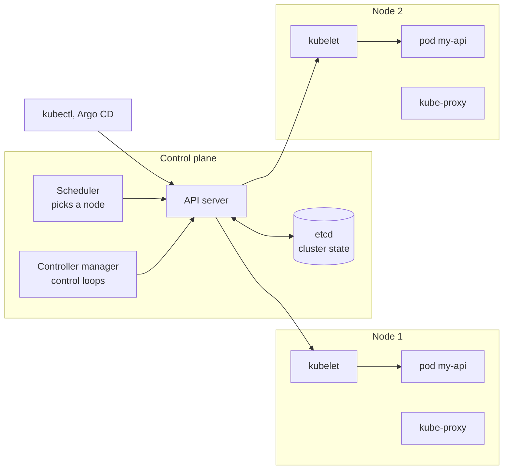

:material-book-open-variant: Reference docs: [Kubernetes, Cluster Architecture](https://kubernetes.io/docs/concepts/architecture/) (accessed November 2026); [Kubernetes, Nodes](https://kubernetes.io/docs/concepts/architecture/nodes/) (accessed November 2026)
{ .doc-ref }

### Deployment
The Kubernetes object that says "I want 3 copies of my-api, with this <span class="term" data-term="docker-image">image</span>". Kubernetes creates the <span class="term" data-term="pod">pods</span> and recreates them if they disappear.

!!! noob "As noob"
    The Deployment is a restaurant's head chef: I say "I always want 3 cooks", they replace one who falls ill, and swap them one at a time when the recipe changes. The one thing to remember: **I describe the desired state, Kubernetes works to stay there.**

```yaml
# Example: minimal Deployment, 3 copies of my-api
kind: Deployment
metadata:
  name: my-api
spec:
  replicas: 3
```

In between sits an intermediate object, the **ReplicaSet**: the Deployment creates one ReplicaSet per image version, and the ReplicaSet is what keeps the right number of pods. A rolling update grows the new ReplicaSet and shrinks the old one.

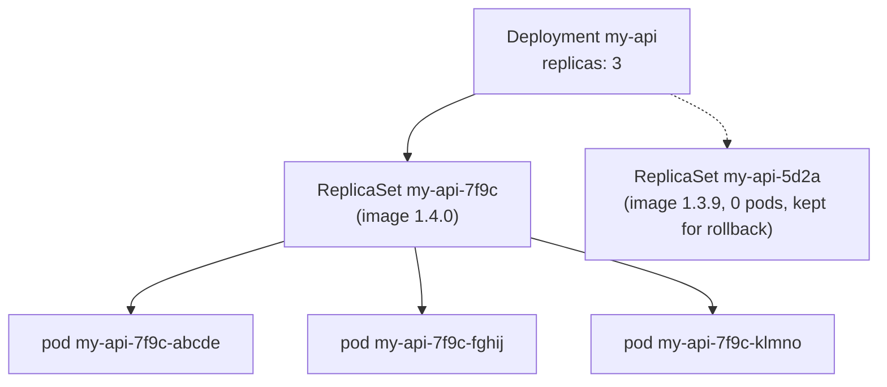

:material-book-open-variant: Reference docs: [Kubernetes, Deployments](https://kubernetes.io/docs/concepts/workloads/controllers/deployment/) (accessed November 2026); [Kubernetes, ReplicaSet](https://kubernetes.io/docs/concepts/workloads/controllers/replicaset/) (accessed November 2026)
{ .doc-ref }

### Rolling update
When the image changes, the Deployment does not replace every pod at once: it performs a <span class="term" data-term="rollout">rollout</span>, pod by pod. `maxSurge` says how many pods above the desired count it may create, `maxUnavailable` how many ready pods it may lose.
```yaml
# Example: rolling update, one extra pod at a time, no ready pod removed first
spec:
  replicas: 3
  strategy:
    rollingUpdate:
      maxSurge: 1
      maxUnavailable: 0
```
Moving from 1.4.0 to 1.4.1 with these settings (example times):
```
time      pods 1.4.0   pods 1.4.1            total
10:00:00  3 ready      0                     3
10:00:01  3 ready      1 starting            4   (maxSurge: one extra pod)
10:00:20  3 ready      1 ready               4
10:00:21  2 ready      1 ready               3   (a 1.4.0 pod stops only once the 1.4.1 one is ready)
10:00:22  2 ready      1 ready, 1 starting   4
10:00:41  1 ready      2 ready               3
10:01:02  0            3 ready               3   rollout done
```
With `maxUnavailable: 0`, there are always 3 ready pods. If the 1.4.1 pods never become ready, the rollout stays stuck and the 1.4.0 pods keep serving.

Going back to the previous version (<span class="term" data-term="rollback">rollback</span>) runs the same movement the other way:
```
$ kubectl rollout status deployment/my-api
deployment "my-api" successfully rolled out
$ kubectl rollout undo deployment/my-api
deployment.apps/my-api rolled back
```
Trap: with Argo CD, a manual `rollout undo` is overwritten at the next sync. Revert the MR instead (see [Argo CD](#argo-cd-git-decides-what-runs)).

:material-book-open-variant: Reference docs: [Kubernetes, Updating a Deployment](https://kubernetes.io/docs/concepts/workloads/controllers/deployment/#updating-a-deployment) (accessed November 2026); [kubectl rollout](https://kubernetes.io/docs/reference/kubectl/generated/kubectl_rollout/) (accessed November 2026)
{ .doc-ref }

### Service
Pods are born and die, and their IP address changes every time. A **<span class="term" data-term="k8s-service">Service</span>** gives a stable address (`http://my-api` inside the cluster) and spreads traffic across every pod carrying the label requested in `selector`, as long as they are ready.

!!! noob "As noob"
    The Service is a company's switchboard number: staff change desks and direct lines, but I always dial the same number and the switchboard puts me through to someone available. The one thing to remember: **we call the Service, never a pod directly, because pods change address.**

```yaml
# Example: Service sending port 80 to port 8080 of the app=my-api pods
kind: Service
metadata:
  name: my-api
spec:
  selector:
    app: my-api
  ports:
    - port: 80
      targetPort: 8080
```
```
Service my-api (http://my-api:80)
├─ pod my-api-7f9c-abcde   label app=my-api, ready       receives traffic
├─ pod my-api-7f9c-fghij   label app=my-api, ready       receives traffic
└─ pod my-api-7f9c-klmno   label app=my-api, not ready   removed: its readiness probe fails
```
The removed pod is not killed: it comes back into the Service as soon as its [readiness probe](#readiness-probe) passes again.

From outside the cluster, an **Ingress** (or its successor, the Gateway API) receives HTTP requests and sends them to the right Service based on host and path. The full path of a request:

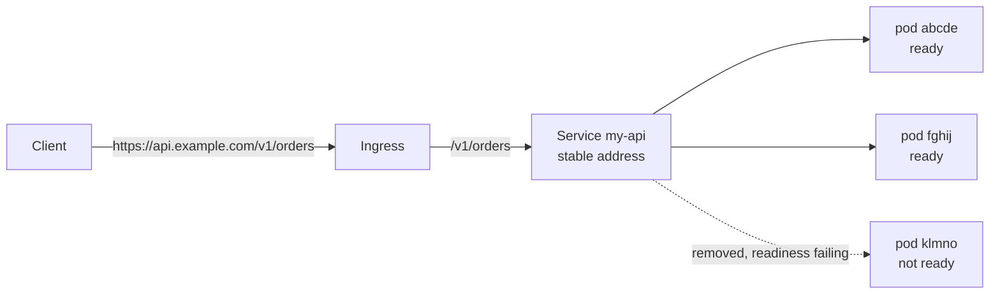

:material-book-open-variant: Reference docs: [Kubernetes, Service](https://kubernetes.io/docs/concepts/services-networking/service/) (accessed November 2026); [Kubernetes, Ingress](https://kubernetes.io/docs/concepts/services-networking/ingress/) (accessed November 2026)
{ .doc-ref }

## Pods, containers and probes

<a class="pill pill-scope pill-scope-app" href="../architecture/#map-of-scales">Scale · Application</a> <a class="pill pill-scope pill-scope-infra" href="../architecture/#map-of-scales">Scale · Infrastructure</a>

### Pod
<span class="pill pill-status pill-status-ok" title="Still valid, checked November 2026">Current · 11/2026</span>

The smallest unit Kubernetes runs. It holds one or more <span class="term" data-term="container">containers</span>.

```
Deployment my-api (prod)
├─ pod my-api-7f9c-abcde   (container my-api)
├─ pod my-api-7f9c-fghij   (container my-api)
└─ pod my-api-7f9c-klmno   (container my-api)
```
The 3 <span class="term" data-term="pod">pods</span> are identical, and <span class="term" data-term="network-traffic">traffic</span> is spread across them. Each pod gets its own <span class="term" data-term="probe">probes</span>.

:material-book-open-variant: Reference docs: [Kubernetes, Pods](https://kubernetes.io/docs/concepts/workloads/pods/) (accessed November 2026); [Kubernetes, Pod Lifecycle](https://kubernetes.io/docs/concepts/workloads/pods/pod-lifecycle/) (accessed November 2026)
{ .doc-ref }

### Container
The application packaged with everything it needs to run, built from a <span class="term" data-term="docker-image">Docker image</span>.

```
image my-api:1.4.2
├─ Python 3.12
├─ dependencies (requirements)
└─ my-api code
```

:material-book-open-variant: Reference docs: [Kubernetes, Containers](https://kubernetes.io/docs/concepts/containers/) (accessed November 2026); [Docker, What is a container?](https://docs.docker.com/get-started/docker-concepts/the-basics/what-is-a-container/) (accessed November 2026)
{ .doc-ref }

### Probe
<span class="pill pill-status pill-status-ok" title="Still valid, checked November 2026">Current · 11/2026</span>

A <span class="term" data-term="http-request">request</span> that Kubernetes sends on its own, at regular intervals, to check a container's state. It then acts on the answer.

```yaml
# Example: readiness, takes the pod out of traffic after 3 failures
readinessProbe:
  httpGet:
    path: /readyz
    port: 8080
  periodSeconds: 10
  failureThreshold: 3
# Example: liveness, restarts the container after 3 failures
livenessProbe:
  httpGet:
    path: /livez
    port: 8080
  periodSeconds: 30
  failureThreshold: 3
```
`periodSeconds: 10` means "every 10 s". `failureThreshold: 3` means "3 failures in a row before acting".

:material-book-open-variant: Reference docs: [Kubernetes, Liveness, Readiness, and Startup Probes](https://kubernetes.io/docs/concepts/configuration/liveness-readiness-startup-probes/) (accessed November 2026); [Configure Liveness, Readiness and Startup Probes](https://kubernetes.io/docs/tasks/configure-pod-container/configure-liveness-readiness-startup-probes/) (accessed November 2026)
{ .doc-ref }

### Readiness probe
<span class="pill pill-status pill-status-ok" title="Still valid, checked November 2026">Current · 11/2026</span>

"<span class="term" data-term="readiness-probe">Readiness</span>" means "being ready". The question is: "are you ready to receive traffic?" If the probe fails, the pod stops receiving traffic, but it is not killed.

```
10:00:00  GET /readyz  200  pod in rotation
10:00:10  GET /readyz  503  MySQL unreachable
10:00:20  GET /readyz  503
10:00:30  GET /readyz  503  3 failures: pod taken out of rotation
10:01:00  GET /readyz  200  MySQL back: pod put back in rotation
```

### Liveness probe
<span class="pill pill-status pill-status-ok" title="Still valid, checked November 2026">Current · 11/2026</span>

"Are you still alive?" If it fails several times in a row, Kubernetes kills the container and restarts it.

!!! noob "As noob"
    Readiness is the swamped waiter who says "stop seating people at my tables for now": they get no new tables, but they stay on the floor. Liveness is the waiter who has frozen and no longer answers at all: they are sent out and come back fresh. The one thing to remember: **a failing readiness takes the pod out of traffic, a failing liveness restarts the container.**

```
10:00:00  GET /livez  200      OK
10:00:30  GET /livez  timeout  application stuck (deadlock)
10:01:00  GET /livez  timeout
10:01:30  GET /livez  timeout  3 failures: container restarted
10:01:45  GET /livez  200      OK after restart
```

### Startup probe
<span class="pill pill-status pill-status-ok" title="Still valid, checked November 2026">Current · 11/2026</span>

"Have you finished starting?" Until it succeeds, the <span class="term" data-term="liveness-probe">liveness</span> probe checks nothing, which avoids killing an application that is slow to start.

```
10:00:00  container launched, loading the cache (40 s)
10:00:10  startup probe  failure  (normal, still starting)
10:00:40  startup probe  200      startup finished
10:00:40  liveness and readiness take over
```

### Which probe for which need

The three probes seen as the states of a container (settings from the example: 3 failures in a row before acting):

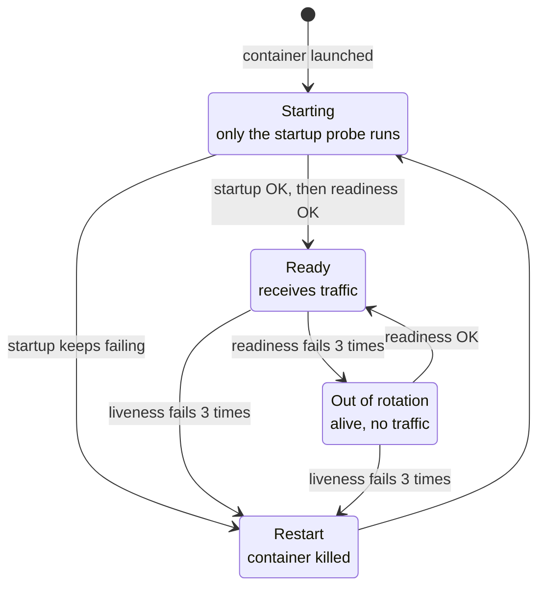

| I want... | Probe |
|---|---|
| users to stop landing on a pod whose database no longer answers, without killing the pod, since it will be useful again as soon as the database is back | readiness |
| Kubernetes to restart a frozen application on its own, for example one stuck in a deadlock: it still runs but no longer answers anything | liveness |
| Kubernetes to give a slow application 2 minutes to start, for example because it loads a big cache at launch, before the liveness probe kills it | <span class="term" data-term="startup-probe">startup</span> |

Classic trap: I put the <span class="term" data-term="database">database</span> check in the liveness probe. The day the database goes down, the liveness probe of every pod fails at the same time, so Kubernetes restarts them all <span class="term" data-term="restart-loop">in a loop</span>. Restarting does not fix the database, and my pods spend their time restarting instead of answering.

### Health check
Generic term for "checking health". Probes are the Kubernetes version of the <span class="term" data-term="health-check">health check</span>.

```
$ curl -i http://localhost:8080/livez
HTTP/1.1 200 OK
```

### Probes in traces
Probes are HTTP requests like any other: <span class="term" data-term="instrumentation">instrumentation</span> traces them. Since they run day and night, they can make up almost all the <span class="term" data-term="trace-distributed">traces</span> of a little-used service. This case is detailed in [Observability: probe noise](observabilite.md#case-study-kubernetes-probe-noise).

### Resources: requests and limits
<span class="pill pill-status pill-status-ok" title="Still valid, checked November 2026">Current · 11/2026</span>

Each container declares what it consumes. The **request** is what Kubernetes reserves for it: it is used to pick a node with enough room. The **limit** is the ceiling. Above its CPU limit, the container is slowed down. Above its memory limit, it is killed (`OOMKilled`, for "<span class="term" data-term="oomkilled">out of memory</span>") and then restarted.

!!! noob "As noob"
    The request is my reserved seat on a train: Kubernetes only lets me board a carriage where that seat is free. The limit is the maximum allowed: too much CPU and I am slowed down, too much memory and I am put off the train (the container is killed, then restarted). The one thing to remember: **the request places the pod, the limit contains it.**

```yaml
# Example: reserves 250m CPU and 256Mi, caps at 1 CPU and 512Mi
resources:
  requests:
    cpu: 250m
    memory: 256Mi
  limits:
    cpu: "1"
    memory: 512Mi
```
`250m` means 0.25 CPU core. `Mi` is a mebibyte.

Diagnosing a pod that keeps restarting:
```
$ kubectl describe pod my-api-7f9c-abcde
...
    State:          Running
    Last State:     Terminated
      Reason:       OOMKilled
      Exit Code:    137
    Restart Count:  4
```
`137` = 128 + 9: the container received signal 9 (`SIGKILL`), it could not shut down cleanly. If the restart count keeps rising, it is a memory leak or a limit set too low: restarting fixes nothing.

:material-book-open-variant: Reference docs: [Kubernetes, Resource Management for Pods and Containers](https://kubernetes.io/docs/concepts/configuration/manage-resources-containers/) (accessed November 2026)
{ .doc-ref }

## Building and deploying: Docker, Helm, Argo CD, Cloud Run

<a class="pill pill-scope pill-scope-infra" href="../architecture/#map-of-scales">Scale · Infrastructure</a>

<a class="pill pill-practice" href="../livraison/#continuous-delivery-and-deployment" title="level 2: it is automated">Practice · Continuous deployment · L2</a>
<a class="pill pill-dora" href="https://dora.dev/capabilities/deployment-automation/">DORA · Deployment automation</a> <a class="pill pill-dora" href="https://dora.dev/capabilities/flexible-infrastructure/">DORA · Flexible infrastructure</a>


The path of a change to production: package the application into an image, describe how to run it, then a tool applies that description to the cluster. Choosing between these tools (mini benchmark) is covered in the [Tech tools landscape](outils.md#containers-and-deployment-docker-kubernetes-helm-argo-cd-cloud-run).

### Docker: the image
<span class="pill pill-status pill-status-ok" title="Still valid, checked November 2026">Current · 11/2026</span>


*Docker: complements Kubernetes, Helm*
{ .tool-rel }

**Docker** packages an application and everything it needs (language, libraries, files) into an <span class="term" data-term="docker-image">image</span>. The same image runs on the developer's laptop, in CI and in production. It is described in a `Dockerfile`.

```dockerfile
# Example: Python image of my-api, run as a non-root user (USER 1000)
FROM python:3.12-slim
WORKDIR /app
COPY requirements.txt .
RUN pip install --no-cache-dir -r requirements.txt
COPY . .
USER 1000
CMD ["uvicorn", "my_api.main:app", "--host", "0.0.0.0", "--port", "8080"]
```

```
$ docker build -t my-api:1.4.0 .
$ docker run -p 8080:8080 my-api:1.4.0
$ curl localhost:8080/readyz
{"status": "ok"}
```

Copying `requirements.txt` before the rest of the code uses the <span class="term" data-term="docker-layer-cache">layer cache</span>: as long as the dependencies do not change, `pip install` is not run again. `USER 1000` avoids running the app as root.

*pip: competes with uv, Poetry, pdm*
{ .tool-rel }


:material-book-open-variant: Reference docs: [Docker, Dockerfile reference](https://docs.docker.com/reference/dockerfile/) (accessed November 2026); [Docker, Build cache](https://docs.docker.com/build/cache/) (accessed November 2026)
{ .doc-ref }

### ConfigMap and Secret: config per environment
<span class="pill pill-status pill-status-ok" title="Still valid, checked November 2026">Current · 11/2026</span>

Rule: **the same image everywhere, the config changes per environment**. The `my-api:1.4.0` image tested in staging is the one that goes to prod, only its <span class="term" data-term="environment-variable">environment variables</span> change. A **<span class="term" data-term="configmap">ConfigMap</span>** holds non-sensitive config, a **Secret** holds <span class="term" data-term="secret">secrets</span> (passwords, keys).

!!! noob "As noob"
    It is a rental car: the same model leaves the garage for every customer, only the settings (ConfigMap) and the key (Secret) change. Limit: by default a Secret is only encoded, not encrypted, so who can read it must stay restricted. The one thing to remember: **we do not rebuild the image to change environment, we change its config.**

```yaml
# Example: ConfigMap holding the non-secret config of my-api
kind: ConfigMap
metadata:
  name: my-api-config
data:
  LOG_LEVEL: "info"
  ORDERS_SERVICE_URL: "http://orders-service"
```
The Deployment reads both in `env`:
```yaml
# Example: LOG_LEVEL read from the ConfigMap, DB_PASSWORD from the Secret
containers:
  - name: my-api
    image: my-api:1.4.0
    env:
      - name: LOG_LEVEL
        valueFrom:
          configMapKeyRef:
            name: my-api-config
            key: LOG_LEVEL
      - name: DB_PASSWORD
        valueFrom:
          secretKeyRef:
            name: my-api-secrets
            key: DB_PASSWORD
```

| Env     | Image          | `LOG_LEVEL` | `DB_PASSWORD`                      |
|---------|----------------|-------------|------------------------------------|
| staging | `my-api:1.4.0` | `debug`     | staging `my-api-secrets` Secret    |
| prod    | `my-api:1.4.0` | `info`      | prod `my-api-secrets` Secret       |

Traps: a Secret is only base64-encoded, not encrypted, so never commit it in clear in Git (it is usually filled from a secret manager, to check for the cluster). And changing a ConfigMap does not restart the pods: environment variables are read at startup.

:material-book-open-variant: Reference docs: [Kubernetes, ConfigMaps](https://kubernetes.io/docs/concepts/configuration/configmap/) (accessed November 2026); [Kubernetes, Secrets](https://kubernetes.io/docs/concepts/configuration/secret/) (accessed November 2026)
{ .doc-ref }

### Helm: the deployment template
<span class="pill pill-status pill-status-ok" title="Still valid, checked November 2026">Current · 11/2026</span>


*Helm: partly competes with Kustomize; complements Argo CD, Kubernetes*
{ .tool-rel }

**Helm** is a package manager for Kubernetes. A **<span class="term" data-term="helm-chart">chart</span>** is a template of <span class="term" data-term="k8s-manifest">manifests</span>, filled by a different `values.yaml` per environment. Every service can share the same chart.

```yaml
# templates/deployment.yaml (excerpt)
# Example: Helm template, the name and replica count come from the values
kind: Deployment
metadata:
  name: {{ .Release.Name }}
spec:
  replicas: {{ .Values.replicaCount }}
```
```yaml
# values-staging.yaml
# Example: staging values, 2 copies
replicaCount: 2
image:
  tag: "1.4.0"
```
```yaml
# values-prod.yaml
# Example: prod values, 3 copies of the same image
replicaCount: 3
image:
  tag: "1.4.0"
```
`helm template` shows the result without installing anything:
```
$ helm template my-api ./chart -f values-staging.yaml
kind: Deployment
metadata:
  name: my-api
spec:
  replicas: 2

$ helm template my-api ./chart -f values-prod.yaml
kind: Deployment
metadata:
  name: my-api
spec:
  replicas: 3
```

:material-book-open-variant: Reference docs: [Helm, Charts](https://helm.sh/docs/topics/charts/) (accessed November 2026); [Helm, Values Files](https://helm.sh/docs/chart_template_guide/values_files/) (accessed November 2026)
{ .doc-ref }

### One generic chart for every service
<span class="pill pill-status pill-status-ok" title="Still valid, checked November 2026">Current · 11/2026</span>

Writing one chart per service means copying the same templates (Deployment, Service, probes, HPA...) twenty times and fixing them twenty times. The alternative: **a single generic chart**, maintained by a platform team and versioned like a library. Each service no longer writes templates: it only provides its **values** (image, port, probes, resources, scaling). Helm even has a chart type for this, the *library chart*, which only holds reusable templates. Public examples: `app-template` (bjw-s), `application` (Stakater), and Bitnami's `common` library.

!!! noob "As noob"
    The generic chart is a pre-printed form: the platform team drew the boxes once and for all, each service only fills in its own boxes (name, image, port). Nobody redraws the form, and when the platform improves it (a new security setting, a better probe), every service benefits by moving to the new version.

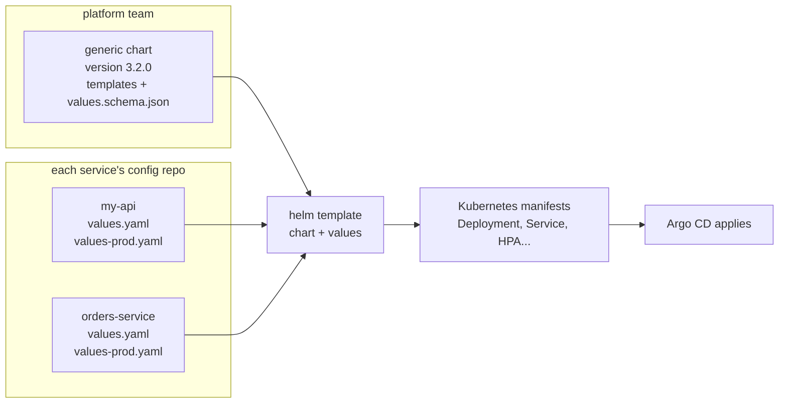

**Layered values.** Helm accepts several `-f` files: each one overrides the previous one, key by key. The common part goes in `values.yaml`, and only the differences go in the environment's file.

```yaml title="values.yaml (common to every environment)"
# Example: image, port, probes and resources shared by every environment
image:
  repository: registry.example.com/my-api
  tag: "1.4.0"
port: 8080
probes:
  readiness: /readyz
  liveness: /livez
resources:
  requests: {cpu: 100m, memory: 256Mi}
```

```yaml title="values-prod.yaml (only what changes)"
# Example: prod only declares its replicas and its autoscaling
replicas: 3
autoscaling:
  enabled: true
  maxReplicas: 10
```

```
$ helm template my-api platform/generic --version 3.2.0 \
    -f values.yaml -f values-prod.yaml
```

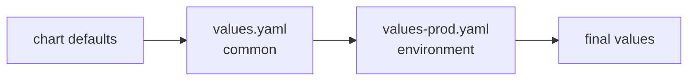

**When to use it.** As soon as a team or a platform runs more than a handful of similar services (an HTTP API, a worker, a scheduled job). **When not to**: a very specific component (a database, a third-party tool that already ships an official chart); use the vendor's chart then.

**Why.** Gain: one fix benefits everyone, good practices (probes, limits, security) apply by default, and reviewing values is much shorter than reviewing templates. Cost: the chart becomes a product of its own, with versions, documentation and breaking changes to announce.

**The "everything configurable" trap.** If every Kubernetes field becomes a value, the values file turns into a second language, harder than the original manifests. A good generic chart exposes few things, with safe defaults, and leaves a documented way out for rare cases (extra manifests next to it).

**How to test it**, from fastest to most complete:

| I want to check... | I use... |
|---|---|
| that the values have the right shape (a typo, a wrong type) | a `values.schema.json` in the chart: Helm rejects invalid values as early as `helm template` |
| that the chart renders valid YAML | `helm lint`, then `helm template ... \| kubeconform` |
| that a value gives the expected manifest | template unit tests (the `helm-unittest` plugin) |
| what a new chart version will change for my service | `helm diff` (plugin) or Argo CD's diff before syncing |
| that a breaking change does not arrive by surprise | a chart version pinned per service, bumped through an MR |

:material-book-open-variant: Reference docs: [Helm, Library Charts](https://helm.sh/docs/topics/library_charts/) (accessed November 2026); [Helm, Schema Files](https://helm.sh/docs/topics/charts/#schema-files) (accessed November 2026); [bjw-s, app-template](https://bjw-s-labs.github.io/helm-charts/docs/app-template/) (accessed November 2026)
{ .doc-ref }

### Argo CD: Git decides what runs
<span class="pill pill-status pill-status-ok" title="Still valid, checked November 2026">Current · 11/2026</span>


*Argo CD: competes with Flux; complements Helm, Kubernetes*
{ .tool-rel }

**Argo CD** is a **GitOps** tool. The Git repository describes the desired state of the <span class="term" data-term="cluster">cluster</span>, and Argo CD applies it and fixes any drift. Deploying means opening an <span class="term" data-term="merge-request">MR</span> that changes the <span class="term" data-term="image-tag">image tag</span>. Rolling back means reverting that MR.

!!! noob "As noob"
    GitOps is a thermostat: I set the temperature I want (the Git repository), and the device heats or cuts off on its own to get back there, even if someone opens the window (a change made by hand in the cluster). The one thing to remember: **to change what runs, we change Git, not the cluster.**

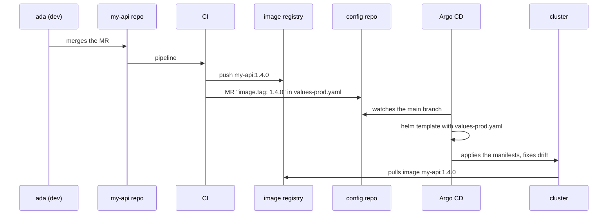

:material-book-open-variant: Reference docs: [Argo CD, Core Concepts](https://argo-cd.readthedocs.io/en/stable/core_concepts/) (accessed November 2026); [OpenGitOps, Principles](https://opengitops.dev/) (version 1.0.0, 2021)
{ .doc-ref }

### Cloud Run: no cluster
<span class="pill pill-status pill-status-ok" title="Still valid, checked November 2026">Current · 11/2026</span>


*Cloud Run: competes with Kubernetes; complements Docker*
{ .tool-rel }

**Cloud Run**: we hand over an image, Google runs and scales it, down to zero instances. No cluster to manage, but less control (networking, probes, resources). **GKE** is Google's managed Kubernetes.

:material-book-open-variant: Reference docs: [Google Cloud, What is Cloud Run](https://cloud.google.com/run/docs/overview/what-is-cloud-run) (accessed November 2026); [GKE overview](https://cloud.google.com/kubernetes-engine/docs/concepts/kubernetes-engine-overview) (accessed November 2026)
{ .doc-ref }

### What to use

| I want... | I use... |
|---|---|
| my application to run the same way on my laptop, in CI and in prod, instead of crashing in prod because a library has a different version there | Docker |
| to run many services that must be watched, restarted, scaled and able to call each other, like `orders-service` calling `my-api` | Kubernetes |
| to stop rewriting the same deployment YAML files for every service and every environment | Helm |
| each service team to write only what is specific to it (image, port, resources), and a platform team to maintain the rest once for everyone | a [generic chart](#one-generic-chart-for-every-service) |
| to answer "what is running in prod?" by reading Git, and to have a manual change made in the cluster undone on its own | Argo CD |
| to run a small service or a job launched now and then, with nobody to manage a cluster | Cloud Run |

## Autoscaling and serverless: HPA, KEDA, Knative, Karpenter

<a class="pill pill-scope pill-scope-infra" href="../architecture/#map-of-scales">Scale · Infrastructure</a>

!!! info "Written on 2026-11-04"
    API versions, project statuses and options quoted here date from this writing. They change fast, check each project's documentation: [HPA](https://kubernetes.io/docs/concepts/workloads/autoscaling/horizontal-pod-autoscale/), [KEDA](https://keda.sh/docs/), [Knative](https://knative.dev/docs/serving/), [Karpenter](https://karpenter.sh/docs/), [Cluster Autoscaler](https://github.com/kubernetes/autoscaler/tree/master/cluster-autoscaler) (read in November 2026).

<span class="term" data-term="autoscaling">Autoscaling</span> adjusts capacity to load without human action. There are two levels, not to be confused:

!!! noob "As noob"
    I think of a supermarket: open more checkouts when the queue grows (pod level), and open an extra room when there is no space left for another checkout (node level). The first takes seconds, the second takes longer. The one thing to remember: **the pod level adds copies, the node level adds room to host them.**

```
pod level  : how many copies of my-api?          HPA, KEDA, Knative
node level : how many machines in the cluster?   Cluster Autoscaler, Karpenter
```

They chain: the pod level asks for 6 pods, there is room for 4, the other 2 stay `Pending` (waiting for a node), and the node level adds a machine. Without autoscaling, we set `replicas: 3` and the node count by hand, as in the [Deployment](#deployment) above.

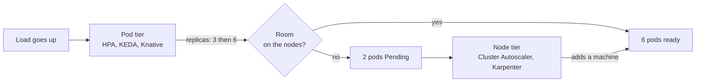

| Signal | Lead |
|---|---|
| my API gets a crowd at noon and almost nobody at night, but I pay for the same number of pods all the time | HPA |
| a worker reads a queue, and messages arrive in waves: a mountain at once, then almost nothing for hours | KEDA |
| I have many small HTTP services called a few times a day, like internal tools or webhooks, and the nodes hosting them are paid to do nothing | Knative (or Cloud Run without a cluster) |
| pods stay `Pending` because no machine has room for them, or on the contrary I pay for half-empty nodes | Cluster Autoscaler or Karpenter |
| my load is roughly the same all day, and I can predict it | nothing: a fixed `replicas`, simpler to reason about |

### HPA: the baseline
<span class="pill pill-status pill-status-ok" title="Still valid, checked November 2026">Current · 11/2026</span>


*HPA: complements KEDA, Karpenter, Cluster Autoscaler*
{ .tool-rel }

**When**: an HTTP service whose load follows CPU or memory (peak at noon, quiet at night). Not for a queue worker: its CPU can stay low while 50,000 messages wait.

**Why**: not paying for 10 pods at night, not falling over with 3 pods at the peak. Cost: a reaction delay (the metric is read about every 15 s, then the pod must start and pass its [readiness probe](#readiness-probe)), and CPU requests that must be right.

**How**: the **HorizontalPodAutoscaler** (HPA), built into Kubernetes, compares the pods' average usage with a target expressed as a percentage of their **request** (see [requests and limits](#resources-requests-and-limits)), and changes the Deployment's `replicas`.

The HPA control loop, which runs continuously:

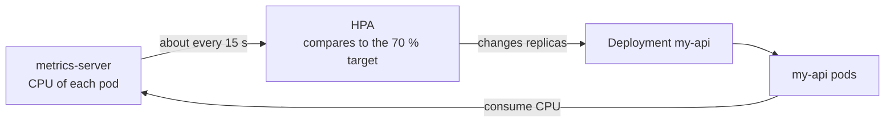

```yaml
# Example: HPA aiming at 70% average CPU, between 2 and 10 pods
apiVersion: autoscaling/v2
kind: HorizontalPodAutoscaler
metadata:
  name: my-api
spec:
  scaleTargetRef:
    apiVersion: apps/v1
    kind: Deployment
    name: my-api
  minReplicas: 2
  maxReplicas: 10
  metrics:
    - type: Resource
      resource:
        name: cpu
        target:
          type: Utilization
          averageUtilization: 70
```

The math: desired pods = round up (current pods × current usage / target).

```
time   pods  average CPU (% of request)   decision
12:00  3     140%                         3 × 140 / 70 = 6 pods
12:02  6     72%                          close to target: nothing
14:00  6     20%                          6 × 20 / 70 = 1.7 so 2 pods (minReplicas), after the stabilization window
```

Pitfalls:

- Without `requests.cpu`, the percentage has no base: the HPA decides nothing.
- With Helm and [Argo CD](#argo-cd-git-decides-what-runs), a `replicas: 3` written in the Deployment fights the HPA: Argo CD sets 3 back, the HPA sets 6 back. Remove `replicas` from the template when the HPA is on (or have Argo CD ignore that field).
- The HPA does not go below 1 pod (going to 0 needs an experimental Kubernetes option, to check). That is the job of KEDA and Knative.

:material-book-open-variant: Reference docs: [Kubernetes, HorizontalPodAutoscaler Walkthrough](https://kubernetes.io/docs/tasks/run-application/horizontal-pod-autoscale-walkthrough/) (accessed November 2026)
{ .doc-ref }

### KEDA: scaling on events, down to zero
<span class="pill pill-status pill-status-ok" title="Still valid, checked November 2026">Current · 11/2026</span>


*KEDA: partly competes with Knative; complements HPA, Karpenter*
{ .tool-rel }

**When**: a <span class="term" data-term="worker">worker</span> consuming a RabbitMQ queue, a Kafka topic, a Pub/Sub subscription, or a job started by a <span class="term" data-term="cron">cron</span>. The right signal is not CPU but **backlog**: the <span class="term" data-term="consumer-lag">lag</span> (messages published but not read yet). Not for an HTTP service that must answer the first request fast: at zero pods, the first message waits for a pod to start.

*RabbitMQ: partly competes with Pub/Sub, SQS; complements Kafka*<br>
*Kafka: partly competes with Pub/Sub; complements RabbitMQ, Strimzi*<br>
*Pub/Sub: partly competes with RabbitMQ, Kafka, SQS*
{ .tool-rel }


**Why**: <span class="term" data-term="scale-to-zero">scale to zero</span>. A worker that processes one batch a night costs nothing the rest of the time, and goes to 20 pods when 100,000 messages arrive. Cost: one more component to run, and a wake-up delay.

**How**: **KEDA** (*Kubernetes Event-Driven Autoscaling*, a CNCF graduated project since 2023, to check) is installed in the cluster. We describe a `ScaledObject`: KEDA creates and drives an HPA itself to go from 1 to N, and handles the 0 to 1 and 1 to 0 steps on its own. About sixty sources are supported (Kafka, RabbitMQ, Pub/Sub, Prometheus, cron, to check).

*Prometheus: competes with Datadog; complements Grafana, Alertmanager, OpenTelemetry*
{ .tool-rel }


```yaml
# Example: KEDA scales email-worker on the Kafka lag, from 0 to 12 pods
apiVersion: keda.sh/v1alpha1
kind: ScaledObject
metadata:
  name: email-worker
spec:
  scaleTargetRef:
    name: email-worker
  minReplicaCount: 0
  maxReplicaCount: 12
  cooldownPeriod: 300
  triggers:
    - type: kafka
      metadata:
        bootstrapServers: kafka:9092
        consumerGroup: email-worker
        topic: orders
        lagThreshold: "100"
```

`lagThreshold: "100"` means "one pod per 100 messages of lag". `cooldownPeriod: 300`: wait 5 minutes without messages before going back to zero.

Who does what: KEDA alone handles going from 0 to 1 pod (and back), then delegates to the HPA it created.

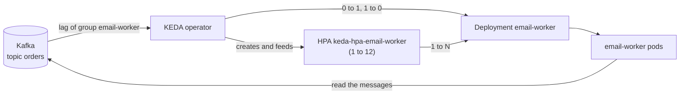

```
time   lag of group email-worker    pods
02:00  0                            0
02:01  1,200                        1 (woken by KEDA), then 12 (1,200 / 100)
02:06  80                           1
02:07  0                            1
02:12  0 for 5 min                  0
```

Same idea on RabbitMQ: `type: rabbitmq`, with `queueName: invoice-emails`, `mode: QueueLength` and `value: "50"` (50 waiting messages per pod), credentials coming from a `TriggerAuthentication`. Kafka pitfall: beyond the topic's partition count, extra pods have nothing to read, and KEDA caps at that number by default (to check per version).

:material-book-open-variant: Reference docs: [KEDA, Scaling Deployments](https://keda.sh/docs/latest/concepts/scaling-deployments/) (accessed November 2026); [KEDA, Apache Kafka scaler](https://keda.sh/docs/latest/scalers/apache-kafka/) (accessed November 2026)
{ .doc-ref }

### Knative Serving: serverless on my own cluster
<span class="pill pill-status pill-status-ok" title="Still valid, checked November 2026">Current · 11/2026</span>


*Knative: partly competes with KEDA*
{ .tool-rel }

**When**: many small, rarely called HTTP services (internal tools, webhooks, MR previews) on a cluster that already exists, and the wish to get the [Cloud Run](#cloud-run-no-cluster) model without leaving Kubernetes. Not if Cloud Run is enough (nothing to run), nor for an API whose first request must answer in a few milliseconds: there is a <span class="term" data-term="cold-start">cold start</span>.

**Why**: <span class="term" data-term="serverless">serverless</span> on Kubernetes. The service drops to zero when nobody calls it and scales on concurrent requests, not CPU. Cost: Knative adds its own components and a networking layer (Kourier or Istio) to install and upgrade.

*Istio: competes with Linkerd; complements Envoy*
{ .tool-rel }


**How**: we describe a Knative `Service` (not the Kubernetes [Service](#service)). Knative creates the Deployment, Service and routing, and a component (the *activator*) holds requests while a pod starts.

```yaml
# Example: Knative Service from 0 to 10 pods, target of 20 concurrent requests per pod
apiVersion: serving.knative.dev/v1
kind: Service
metadata:
  name: report-service
spec:
  template:
    metadata:
      annotations:
        autoscaling.knative.dev/min-scale: "0"
        autoscaling.knative.dev/max-scale: "10"
        autoscaling.knative.dev/target: "20"
    spec:
      containers:
        - image: report-service:1.4.0
```

`target: "20"`: about 20 concurrent requests per pod. Cloud Run follows the Knative Serving API, which makes moving from one to the other fairly direct (to check for supported fields).

:material-book-open-variant: Reference docs: [Knative, About autoscaling](https://knative.dev/docs/serving/autoscaling/) (accessed November 2026)
{ .doc-ref }

### Karpenter and Cluster Autoscaler: adding nodes
<span class="pill pill-status pill-status-ok" title="Still valid, checked November 2026">Current · 11/2026</span>


*Karpenter: competes with Cluster Autoscaler; complements HPA, KEDA*<br>
*Cluster Autoscaler: competes with Karpenter; complements HPA*
{ .tool-rel }

**When**: pods stay `Pending` because no <span class="term" data-term="node-k8s">node</span> has room, or on the contrary paid nodes run at 20%. Useless on Cloud Run, and often already handled by the provider on a fully automatic managed Kubernetes (GKE Autopilot for instance, to check).

**Why**: without it, HPA and KEDA ask for pods nobody can place. Gain: the bill follows the load. Cost: a node usually takes one to a few minutes to arrive (order of magnitude, to check per provider), and removing a node moves its pods.

**How**: two approaches.

- **Cluster Autoscaler** (the historical Kubernetes project) grows or shrinks **node groups** defined in advance ("group e2-standard-4, from 3 to 20 machines"). Simple, available at every provider, but it does not choose the machine type.
- **Karpenter** (created by AWS in 2021, version 1.0 in 2024, to check) looks at pending pods and orders the machine that fits them directly, with no predefined group. It also **consolidates**: it repacks pods to shut down underused nodes. It can target <span class="term" data-term="spot-instance">spot machines</span>. It runs mostly on AWS, and on Azure through its built-in equivalent (to check for other providers).

```yaml
# Example: Karpenter NodePool, spot or on-demand, consolidates underused nodes
apiVersion: karpenter.sh/v1
kind: NodePool
metadata:
  name: default
spec:
  template:
    spec:
      requirements:
        - key: karpenter.sh/capacity-type
          operator: In
          values: ["spot", "on-demand"]
        - key: kubernetes.io/arch
          operator: In
          values: ["amd64", "arm64"]
      nodeClassRef:
        group: karpenter.k8s.aws
        kind: EC2NodeClass
        name: default
  limits:
    cpu: "200"
  disruption:
    consolidationPolicy: WhenEmptyOrUnderutilized
    consolidateAfter: 1m
```

`limits.cpu: "200"` caps the total size: it is the bill's safety net.

| Criterion                      | Cluster Autoscaler           | Karpenter                          |
|--------------------------------|------------------------------|------------------------------------|
| Unit added                     | a node from a predefined group | the machine that fits the pending pods |
| Choice of machine type         | ★ (fixed per group)          | ★★★                                |
| Shrinking half-empty nodes     | ★★                           | ★★★ (consolidation)                |
| Providers                      | ★★★ (almost all)             | ★★ (AWS, Azure, to check)          |
| Simplicity                     | ★★★                          | ★★                                 |

:material-book-open-variant: Reference docs: [Karpenter, NodePools](https://karpenter.sh/docs/concepts/nodepools/) (accessed November 2026); [Cluster Autoscaler FAQ](https://github.com/kubernetes/autoscaler/blob/master/cluster-autoscaler/FAQ.md) (accessed November 2026)
{ .doc-ref }

### What to use for scaling

| I want... | I use... |
|---|---|
| my HTTP API to add pods when its CPU climbs at the noon peak and remove them at night, without ever going below 2 pods | HPA |
| a worker to add pods when messages pile up in its queue, and drop to zero pods at night when it has nothing to read | KEDA |
| my small, rarely called HTTP services to drop to zero when nobody calls them, on the Kubernetes cluster I already have | Knative Serving |
| the same thing, with no cluster to manage at all | [Cloud Run](#cloud-run-no-cluster) |
| the cluster to add machines when pods wait for room and remove them when they empty out, whatever my cloud provider | Cluster Autoscaler |
| on AWS, the cluster to pick the right machine size for waiting pods on its own, spot machines included | Karpenter |
| nothing more, because my load barely moves | a fixed `replicas` |

## Kubernetes operators: Strimzi

<a class="pill pill-scope pill-scope-infra" href="../architecture/#map-of-scales">Scale · Infrastructure</a> <span class="pill pill-status pill-status-ok" title="Still valid, checked November 2026">Current · 11/2026</span>


*Strimzi: complements Kafka*
{ .tool-rel }

!!! info "Written on 2026-11-04"
    Versions and project statuses quoted as of this date, to check: [Kubernetes operators](https://kubernetes.io/docs/concepts/extend-kubernetes/operator/), [Strimzi](https://strimzi.io/documentation/) (read in November 2026).

An **<span class="term" data-term="k8s-operator">operator</span>** is a program running in the cluster that does an administrator's job for one specific piece of software: install, upgrade, back up, replace a failed member. We describe the desired state in a **<span class="term" data-term="custom-resource">custom resource</span>** (CRD, *custom resource definition*, a new `kind` added to Kubernetes), and it keeps comparing desired and actual state in a loop, the way a Deployment does for its pods.

!!! noob "As noob"
    An operator is a specialist admin who never sleeps: I leave them a note saying "I want a 3-machine Kafka", they install it, watch it, replace what falls over, and keep coming back to check that reality matches the note. The one thing to remember: **an operator is an admin's know-how turned into an automatic loop.**

The reconcile loop, the heart of every operator (and of every Kubernetes controller):

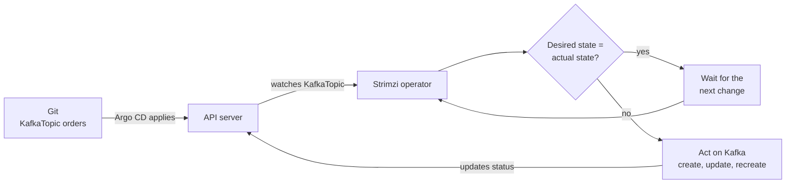

**When**: running stateful software in-house (Kafka, PostgreSQL, Elasticsearch) in Kubernetes, without writing one's own operations scripts. Not when an equivalent <span class="term" data-term="managed-service">managed service</span> exists and the team has nobody to operate the database: the operator automates the actions, not the skill to diagnose an outage.

*PostgreSQL: competes with MySQL, MariaDB; partly competes with MongoDB; complements Redis, PgBouncer, BigQuery, Elasticsearch*<br>
*Elasticsearch: competes with OpenSearch; complements PostgreSQL*
{ .tool-rel }


**Why**: a hand-written Kafka `StatefulSet` cannot do a zero-downtime upgrade, add a broker or create a topic. The operator encodes that know-how. Cost: the operator itself is software to upgrade, and the team stays responsible for the data.

**How**: install the operator (often through a [Helm](#helm-the-deployment-template) chart), then write its resources in Git, and [Argo CD](#argo-cd-git-decides-what-runs) applies them like everything else. Example with **Strimzi**, the CNCF Kafka operator (incubating project, to check):

```yaml
# Example: Kafka cluster managed by the Strimzi operator
apiVersion: kafka.strimzi.io/v1beta2
kind: Kafka
metadata:
  name: events
spec:
  kafka:
    listeners:
      - name: plain
        port: 9092
        type: internal
        tls: false
  entityOperator:
    topicOperator: {}
```
```yaml
# Example: orders topic (6 partitions, 3 replicas), created by the operator
apiVersion: kafka.strimzi.io/v1beta2
kind: KafkaTopic
metadata:
  name: orders
  labels:
    strimzi.io/cluster: events
spec:
  partitions: 6
  replicas: 3
```

Simplified extract: recent versions also need a `KafkaNodePool` describing the brokers (count, disks), and API versions change (check the Strimzi documentation). Creating the `orders` topic means opening an MR that adds this file: Strimzi creates it in Kafka, and recreates it if someone deletes it by hand.

```
$ kubectl get kafkatopic orders
NAME     CLUSTER   PARTITIONS   REPLICATION FACTOR   READY
orders   events    6            3                    True
```

Other common operators: CloudNativePG (PostgreSQL), Prometheus Operator, cert-manager (TLS certificates). Crossplane applies the same idea to cloud infrastructure ([Tech tools landscape](outils.md#infrastructure-as-code-terraform-opentofu-terragrunt-pulumi-crossplane-ansible-packer)).

*Crossplane: partly competes with Terraform; complements Kubernetes*
{ .tool-rel }


| I want... | I use... |
|---|---|
| to use Kafka or PostgreSQL while nobody on the team has the time or the skills to upgrade, back up and repair them | the provider's managed service |
| to run Kafka in my own cluster, because the managed offer costs too much, the data must stay on site, or there is no managed offer | Strimzi |
| the same thing for PostgreSQL | CloudNativePG |
| to deploy an application that keeps nothing on its disks, like an API that stores everything in an external database | a Deployment and a Helm chart, no operator |

:material-book-open-variant: Reference docs: [Kubernetes, Custom Resources](https://kubernetes.io/docs/concepts/extend-kubernetes/api-extension/custom-resources/) (accessed November 2026); [Kubernetes, Controllers](https://kubernetes.io/docs/concepts/architecture/controller/) (accessed November 2026)
{ .doc-ref }

## Environments

<a class="pill pill-scope pill-scope-infra" href="../architecture/#map-of-scales">Scale · Infrastructure</a>

| Env | Name         | For whom                               |
|-----|--------------|----------------------------------------|
| dev | <span class="term" data-term="integration-env">integration</span>  | devs test their changes                |
| staging | <span class="term" data-term="staging-env">staging</span>      | pre-production, close to prod          |
| prod | <span class="term" data-term="production-env">production</span>   | real users                             |

## Pitfalls to avoid

- **The database in the liveness probe**: I check the database in the liveness probe, so the day the database goes down, Kubernetes restarts every pod in a loop without fixing anything. I put the dependency in the readiness probe, and the liveness probe only checks the app itself ([see Which probe for which need](#which-probe-for-which-need)).
- **No startup probe for a slow app**: my app loads a big cache at startup, so the liveness probe kills it before it has finished starting. I add a startup probe, which holds the liveness probe back until startup is done ([see Startup probe](#startup-probe)).
- **Restarting instead of understanding an `OOMKilled`**: I let the pod restart in a loop with code `137`, so the memory leak or the too-low limit stays. I read `kubectl describe pod`, then fix the leak or adjust the limit ([see requests and limits](#resources-requests-and-limits)).
- **A Secret in plain text in Git**: I commit a Secret believing it is encrypted, while it is only base64-encoded, so anyone who reads the repo has the password. I fill it from a secrets manager ([see ConfigMap and Secret](#configmap-and-secret-config-per-environment)).
- **A modified ConfigMap that changes nothing**: I change `LOG_LEVEL` in the ConfigMap and wait for the effect, but environment variables are read at startup, so the pods keep the old value. I restart the pods after the change ([see ConfigMap and Secret](#configmap-and-secret-config-per-environment)).
- **A manual rollback under Argo CD**: I run `kubectl rollout undo`, so Argo CD puts back the Git version at the next sync. I revert the MR that changed the image tag ([see Argo CD](#argo-cd-git-decides-what-runs)).
- **A fixed `replicas` next to the HPA**: I leave `replicas: 3` in the Helm template while the HPA is enabled, so Argo CD sets 3 while the HPA sets 6. I remove `replicas` from the template, and I check that `requests.cpu` is declared, otherwise the HPA decides nothing ([see HPA](#hpa-the-baseline)).
- **A generic chart where everything is configurable**: every Kubernetes field becomes a value, so the values file turns into a second language, harder than the manifests. I expose few things, with safe defaults and a documented way out ([see the generic chart](#one-generic-chart-for-every-service)).

## What interviews ask

The typical questions:

- "What is the difference between readiness, liveness and startup probes?", "What happens if I check the database in the liveness probe?" How I answer: I describe what Kubernetes does in each case, take out of traffic or restart ([Which probe for which need](#which-probe-for-which-need)).
- "How do you deploy without downtime?", "How do you roll back?" How I answer: I describe the rolling update with `maxSurge` and `maxUnavailable`, then reverting the MR when Argo CD drives the cluster ([Rolling update](#rolling-update), [Argo CD](#argo-cd-git-decides-what-runs)).
- "A pod restarts in a loop, what do you look at?", "Request or limit, what is the difference?" How I answer: I run `kubectl describe pod` and look for the `OOMKilled` reason and the `137` code ([Resources: requests and limits](#resources-requests-and-limits)).
- "Why go through a Service rather than a pod's address?" How I answer: I recall that pods change address, while the Service keeps a stable address and only sends traffic to ready pods ([Service](#service)).
- "What is GitOps?", "What is Helm for?" How I answer: I say that Git describes the desired state and Argo CD fixes the drift, and that Helm avoids rewriting the same manifests per environment ([Argo CD](#argo-cd-git-decides-what-runs), [Helm](#helm-the-deployment-template)).
- "How do you scale a worker that reads a queue?", "HPA, KEDA or Karpenter?" How I answer: I take the lag as the signal, not the CPU, and I show that each tool acts at a different level ([What to use for scaling](#what-to-use-for-scaling)).

What makes a good answer: tell what the user sees and what Kubernetes does, step by step (the pod taken out of traffic, the container restarted, the pod stuck `Pending`), rather than reciting YAML fields.
