# Conteneurs, Kubernetes et déploiement

!!! warning "Avertissement"
    Ces notes sont des pense-bêtes personnels, pas une source de vérité. Elles reflètent ma compréhension et mes choix : leur contenu reste subjectif, malgré les citations et les références qu'il contient. Il peut être incomplet, simplifié, inexact ou dépassé. Vérifiez toujours dans la documentation officielle avant de l'appliquer. Ce contenu est fourni tel quel, sans aucune garantie : son utilisation se fait sous votre seule responsabilité.

!!! abstract "Les échelles"
    Les pastilles de couleur sous les titres disent à quelle échelle une notion s'applique :

    - <span class="pill pill-scope pill-scope-code">Code</span> les classes, fonctions et modules d'un programme ;
    - <span class="pill pill-scope pill-scope-app">Application</span> un service ou une application et son découpage interne ;
    - <span class="pill pill-scope pill-scope-system">Système</span> plusieurs services qui communiquent par le réseau ;
    - <span class="pill pill-scope pill-scope-infra">Infrastructure</span> les serveurs, le réseau, les zones et les clusters, physiques ou virtuels ;
    - <span class="pill pill-scope pill-scope-enterprise">Entreprise</span> le système d'information entier et son organisation.

    Détail et mots ambigus : [carte des échelles](architecture.md#carte-des-echelles).

<span class="term" data-term="kubernetes">Kubernetes</span> fait tourner les applications dans des <span class="term" data-term="container">conteneurs</span>, vérifie qu'elles vont bien et les redémarre si besoin. Cette page couvre ce qu'il faut connaître côté appli : <span class="term" data-term="pod">pods</span>, <span class="term" data-term="k8s-deployment">déploiements</span> et <span class="term" data-term="probe">probes</span>, puis le chemin d'une image jusqu'au cluster (Docker, Helm, Argo CD, Cloud Run), l'autoscaling (HPA, KEDA, Knative, Karpenter) et les opérateurs. Pour comprendre ce que l'appli produit une fois lancée (<span class="term" data-term="logs">logs</span>, <span class="term" data-term="metric">métriques</span>, <span class="term" data-term="trace-distributed">traces</span>), voir la page [Observabilité](observabilite.md).

Les ports, les valeurs <span class="term" data-term="yaml">YAML</span> et les routes métier sont des exemples. `my-api` est un service fictif.

:material-swap-horizontal: Les outils cités dans cette page : lesquels se remplacent, lesquels se combinent ? Voir [Complémentaires ou concurrents](outils.md#complementaires-ou-concurrents).
{ .doc-ref }

## Vocabulaire

### API, route, JSON
Une **<span class="term" data-term="api">API</span>** est la porte d'entrée d'un service pour les autres programmes. Une **<span class="term" data-term="endpoint">route</span>** (ou endpoint) est une adresse précise de cette API. Les réponses sont souvent en **<span class="term" data-term="json">JSON</span>**, un format texte de données.
```
GET /readyz         route de santé
GET /v1/orders/42          route métier
{"id": 42, "title": "..."}   réponse JSON
```

:material-book-open-variant: Doc de référence : [RFC 8259, The JSON Data Interchange Format](https://www.rfc-editor.org/rfc/rfc8259) (2017) ; [MDN, HTTP overview](https://developer.mozilla.org/en-US/docs/Web/HTTP/Overview) (consultée en novembre 2026)
{ .doc-ref }

### Codes HTTP et timeout
Chaque <span class="term" data-term="http-response">réponse HTTP</span> porte un <span class="term" data-term="http-status-code">code</span> qui dit comment ça s'est passé.

| Code      | Sens                                              |
|-----------|---------------------------------------------------|
| `200`     | OK                                                |
| `404`     | ressource introuvable                             |
| `500`     | erreur interne du service                         |
| `503`     | service indisponible pour l'instant (par exemple sa base ne répond pas) |
| <span class="term" data-term="timeout">timeout</span>   | pas de réponse du tout dans le délai prévu        |


:material-book-open-variant: Doc de référence : [RFC 9110, HTTP Semantics, status codes](https://www.rfc-editor.org/rfc/rfc9110#name-status-codes) (2022) ; [MDN, HTTP response status codes](https://developer.mozilla.org/en-US/docs/Web/HTTP/Status) (consultée en novembre 2026)
{ .doc-ref }

### Cache
Une copie temporaire d'une donnée, gardée à portée de main pour répondre plus vite sans tout recalculer. Contrepartie : la copie peut être en retard sur la vraie donnée.

:material-book-open-variant: Doc de référence : [MDN, HTTP caching](https://developer.mozilla.org/en-US/docs/Web/HTTP/Caching) (consultée en novembre 2026)
{ .doc-ref }

### Deadlock (interblocage)
Deux traitements s'attendent mutuellement et aucun ne peut avancer. L'appli tourne mais ne répond plus.
```
traitement A : tient la ligne 1, attend la ligne 2
traitement B : tient la ligne 2, attend la ligne 1
```

:material-book-open-variant: Doc de référence : [PostgreSQL, Deadlocks](https://www.postgresql.org/docs/current/explicit-locking.html#LOCKING-DEADLOCKS) (version 18, 2025)
{ .doc-ref }

### Kubernetes, cluster, nœud

*Kubernetes : concurrent de Cloud Run ; complémentaire de Docker, Helm, Argo CD*
{ .tool-rel }

**<span class="term" data-term="kubernetes">Kubernetes</span>** (souvent abrégé K8s) est le système qui lance les applications dans des <span class="term" data-term="container">conteneurs</span>, les surveille, les redémarre et répartit le <span class="term" data-term="network-traffic">trafic</span>. Un **<span class="term" data-term="cluster">cluster</span>** est l'ensemble des machines qu'il gère, et chaque machine est un **<span class="term" data-term="node-k8s">nœud</span>** (node).
```
cluster prod
├─ nœud 1 : pod my-api-abcde, pod worker-x1
├─ nœud 2 : pod my-api-fghij
└─ nœud 3 : pod my-api-klmno, pod worker-x2
```

Les composants d'un cluster, tels que la documentation Kubernetes les dessine : le plan de contrôle décide, les nœuds exécutent.

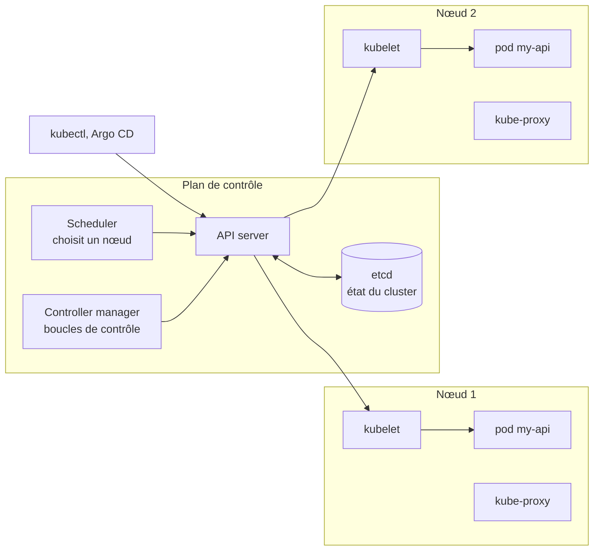

:material-book-open-variant: Doc de référence : [Kubernetes, Cluster Architecture](https://kubernetes.io/docs/concepts/architecture/) (consultée en novembre 2026) ; [Kubernetes, Nodes](https://kubernetes.io/docs/concepts/architecture/nodes/) (consultée en novembre 2026)
{ .doc-ref }

### Deployment
L'objet Kubernetes qui dit « je veux 3 copies de my-api, avec telle <span class="term" data-term="docker-image">image</span> ». Kubernetes crée les <span class="term" data-term="pod">pods</span> et les recrée s'ils disparaissent.

!!! noob "As noob"
    Le Deployment, c'est le chef d'équipe d'un restaurant : je lui dis « je veux toujours 3 cuisiniers », il en remplace un s'il tombe malade, et il les change un par un quand la recette évolue. La phrase à retenir : **je décris l'état voulu, Kubernetes s'occupe d'y rester.**

```yaml
# Exemple : Deployment minimal, 3 copies de my-api
kind: Deployment
metadata:
  name: my-api
spec:
  replicas: 3
```

Entre les deux se cache un objet intermédiaire, le **ReplicaSet** : le Deployment crée un ReplicaSet par version de l'image, et c'est le ReplicaSet qui garde le bon nombre de pods. Un rolling update fait grossir le nouveau ReplicaSet et maigrir l'ancien.

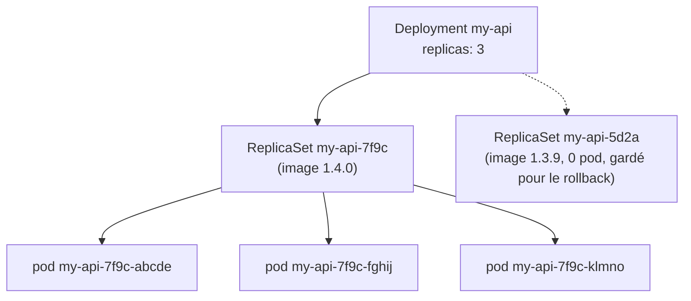

:material-book-open-variant: Doc de référence : [Kubernetes, Deployments](https://kubernetes.io/docs/concepts/workloads/controllers/deployment/) (consultée en novembre 2026) ; [Kubernetes, ReplicaSet](https://kubernetes.io/docs/concepts/workloads/controllers/replicaset/) (consultée en novembre 2026)
{ .doc-ref }

### Rolling update (mise à jour progressive)
Quand l'image change, le Deployment ne remplace pas tous les pods d'un coup : il fait un <span class="term" data-term="rollout">rollout</span> pod par pod. `maxSurge` dit combien de pods en plus du nombre voulu il peut créer, `maxUnavailable` combien de pods prêts il peut perdre.
```yaml
# Exemple : rolling update, un pod en plus à la fois, aucun pod prêt retiré avant
spec:
  replicas: 3
  strategy:
    rollingUpdate:
      maxSurge: 1
      maxUnavailable: 0
```
Passage de 1.4.0 à 1.4.1 avec ces réglages (heures en exemple) :
```
heure     pods 1.4.0   pods 1.4.1          total
10:00:00  3 prêts      0                   3
10:00:01  3 prêts      1 démarre           4   (maxSurge : un pod de plus)
10:00:20  3 prêts      1 prêt              4
10:00:21  2 prêts      1 prêt              3   (un 1.4.0 n'est arrêté qu'une fois le 1.4.1 prêt)
10:00:22  2 prêts      1 prêt, 1 démarre   4
10:00:41  1 prêt       2 prêts             3
10:01:02  0            3 prêts             3   rollout terminé
```
Avec `maxUnavailable: 0`, il y a toujours 3 pods prêts. Si les pods 1.4.1 ne deviennent jamais prêts, le rollout reste bloqué et les 1.4.0 continuent de servir.

Revenir à la version précédente (<span class="term" data-term="rollback">rollback</span>) refait le même mouvement dans l'autre sens :
```
$ kubectl rollout status deployment/my-api
deployment "my-api" successfully rolled out
$ kubectl rollout undo deployment/my-api
deployment.apps/my-api rolled back
```
Piège : avec Argo CD, un `rollout undo` à la main est écrasé à la prochaine synchronisation. On annule plutôt la MR (voir [Argo CD](#argo-cd-git-decide-de-ce-qui-tourne)).

:material-book-open-variant: Doc de référence : [Kubernetes, Updating a Deployment](https://kubernetes.io/docs/concepts/workloads/controllers/deployment/#updating-a-deployment) (consultée en novembre 2026) ; [kubectl rollout](https://kubernetes.io/docs/reference/kubectl/generated/kubectl_rollout/) (consultée en novembre 2026)
{ .doc-ref }

### Service
Les pods naissent et meurent, et leur adresse IP change à chaque fois. Un **<span class="term" data-term="k8s-service">Service</span>** donne une adresse stable (`http://my-api` dans le cluster) et répartit le trafic entre tous les pods qui portent le label demandé dans `selector`, à condition qu'ils soient prêts.

!!! noob "As noob"
    Le Service, c'est le numéro du standard d'une entreprise : les employés changent de bureau et de ligne directe, mais j'appelle toujours le même numéro, et le standard me passe quelqu'un de disponible. La phrase à retenir : **on appelle le Service, jamais un pod directement, parce que les pods changent d'adresse.**

```yaml
# Exemple : Service qui envoie le port 80 vers le port 8080 des pods app=my-api
kind: Service
metadata:
  name: my-api
spec:
  selector:
    app: my-api
  ports:
    - port: 80
      targetPort: 8080
```
```
Service my-api (http://my-api:80)
├─ pod my-api-7f9c-abcde   label app=my-api, prêt       reçoit du trafic
├─ pod my-api-7f9c-fghij   label app=my-api, prêt       reçoit du trafic
└─ pod my-api-7f9c-klmno   label app=my-api, pas prêt   retiré : sa readiness probe échoue
```
Le pod retiré n'est pas tué : il revient dans le Service dès que sa [readiness probe](#readiness-probe) repasse.

Depuis l'extérieur du cluster, un **Ingress** (ou son successeur, la Gateway API) reçoit les requêtes HTTP et les envoie au bon Service selon l'hôte et le chemin. Le chemin complet d'une requête :

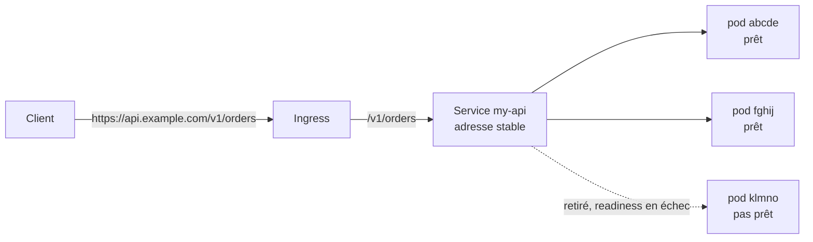

:material-book-open-variant: Doc de référence : [Kubernetes, Service](https://kubernetes.io/docs/concepts/services-networking/service/) (consultée en novembre 2026) ; [Kubernetes, Ingress](https://kubernetes.io/docs/concepts/services-networking/ingress/) (consultée en novembre 2026)
{ .doc-ref }

## Pods, conteneurs et probes

<a class="pill pill-scope pill-scope-app" href="../architecture/#carte-des-echelles">Échelle · Application</a> <a class="pill pill-scope pill-scope-infra" href="../architecture/#carte-des-echelles">Échelle · Infrastructure</a>

### Pod
<span class="pill pill-status pill-status-ok" title="Toujours valable, vérifié en novembre 2026">Valable · 11/2026</span>

La plus petite unité que Kubernetes fait tourner. Il contient un ou plusieurs <span class="term" data-term="container">conteneurs</span>.

```
Deployment my-api (prod)
├─ pod my-api-7f9c-abcde   (conteneur my-api)
├─ pod my-api-7f9c-fghij   (conteneur my-api)
└─ pod my-api-7f9c-klmno   (conteneur my-api)
```
Les 3 <span class="term" data-term="pod">pods</span> sont identiques, et le <span class="term" data-term="network-traffic">trafic</span> est réparti entre eux. Chaque pod reçoit ses propres <span class="term" data-term="probe">probes</span>.

:material-book-open-variant: Doc de référence : [Kubernetes, Pods](https://kubernetes.io/docs/concepts/workloads/pods/) (consultée en novembre 2026) ; [Kubernetes, Pod Lifecycle](https://kubernetes.io/docs/concepts/workloads/pods/pod-lifecycle/) (consultée en novembre 2026)
{ .doc-ref }

### Conteneur
L'appli empaquetée avec tout ce qu'il lui faut pour tourner, à partir d'une <span class="term" data-term="docker-image">image Docker</span>.

```
image my-api:1.4.2
├─ Python 3.12
├─ dépendances (requirements)
└─ code de my-api
```

:material-book-open-variant: Doc de référence : [Kubernetes, Containers](https://kubernetes.io/docs/concepts/containers/) (consultée en novembre 2026) ; [Docker, What is a container?](https://docs.docker.com/get-started/docker-concepts/the-basics/what-is-a-container/) (consultée en novembre 2026)
{ .doc-ref }

### Probe (sonde)
<span class="pill pill-status pill-status-ok" title="Toujours valable, vérifié en novembre 2026">Valable · 11/2026</span>

Une <span class="term" data-term="http-request">requête</span> que Kubernetes envoie tout seul, à intervalle régulier, pour vérifier l'état d'un conteneur. Il agit ensuite selon la réponse.

```yaml
# Exemple : readiness, retire le pod du trafic après 3 échecs
readinessProbe:
  httpGet:
    path: /readyz
    port: 8080
  periodSeconds: 10
  failureThreshold: 3
# Exemple : liveness, redémarre le conteneur après 3 échecs
livenessProbe:
  httpGet:
    path: /livez
    port: 8080
  periodSeconds: 30
  failureThreshold: 3
```
`periodSeconds: 10` veut dire « toutes les 10 s ». `failureThreshold: 3` veut dire « 3 échecs d'affilée avant d'agir ».

:material-book-open-variant: Doc de référence : [Kubernetes, Liveness, Readiness, and Startup Probes](https://kubernetes.io/docs/concepts/configuration/liveness-readiness-startup-probes/) (consultée en novembre 2026) ; [Configure Liveness, Readiness and Startup Probes](https://kubernetes.io/docs/tasks/configure-pod-container/configure-liveness-readiness-startup-probes/) (consultée en novembre 2026)
{ .doc-ref }

### Readiness probe
<span class="pill pill-status pill-status-ok" title="Toujours valable, vérifié en novembre 2026">Valable · 11/2026</span>

« <span class="term" data-term="readiness-probe">Readiness</span> » veut dire « le fait d'être prêt ». La question est : « es-tu prêt à recevoir du trafic ? » Si la probe échoue, le pod ne reçoit plus de trafic, mais il n'est pas tué.

```
10:00:00  GET /readyz  200  pod dans le circuit
10:00:10  GET /readyz  503  MySQL injoignable
10:00:20  GET /readyz  503
10:00:30  GET /readyz  503  3 échecs : pod retiré du circuit
10:01:00  GET /readyz  200  MySQL revenu : pod remis dans le circuit
```

### Liveness probe
<span class="pill pill-status pill-status-ok" title="Toujours valable, vérifié en novembre 2026">Valable · 11/2026</span>

« Es-tu encore vivant ? » Si elle échoue plusieurs fois d'affilée, Kubernetes tue le conteneur et le redémarre.

!!! noob "As noob"
    La readiness, c'est le serveur de restaurant débordé qui dit « ne m'envoie plus de tables pour l'instant » : on arrête de lui en donner, mais il reste en salle. La liveness, c'est le serveur figé qui ne répond plus du tout : on le fait sortir et revenir frais. La phrase à retenir : **readiness en échec retire le pod du trafic, liveness en échec redémarre le conteneur.**

```
10:00:00  GET /livez  200      OK
10:00:30  GET /livez  timeout  appli bloquée (deadlock)
10:01:00  GET /livez  timeout
10:01:30  GET /livez  timeout  3 échecs : conteneur redémarré
10:01:45  GET /livez  200      OK après redémarrage
```

### Startup probe
<span class="pill pill-status pill-status-ok" title="Toujours valable, vérifié en novembre 2026">Valable · 11/2026</span>

« As-tu fini de démarrer ? » Tant qu'elle n'a pas réussi, la <span class="term" data-term="liveness-probe">liveness</span> ne vérifie rien, ce qui évite de tuer une appli lente au démarrage.

```
10:00:00  conteneur lancé, chargement du cache (40 s)
10:00:10  startup probe  échec  (normal, encore en démarrage)
10:00:40  startup probe  200    démarrage terminé
10:00:40  la liveness et la readiness prennent le relais
```

### Quelle probe pour quel besoin

Les trois probes vues comme les états d'un conteneur (réglages de l'exemple : 3 échecs d'affilée avant d'agir) :

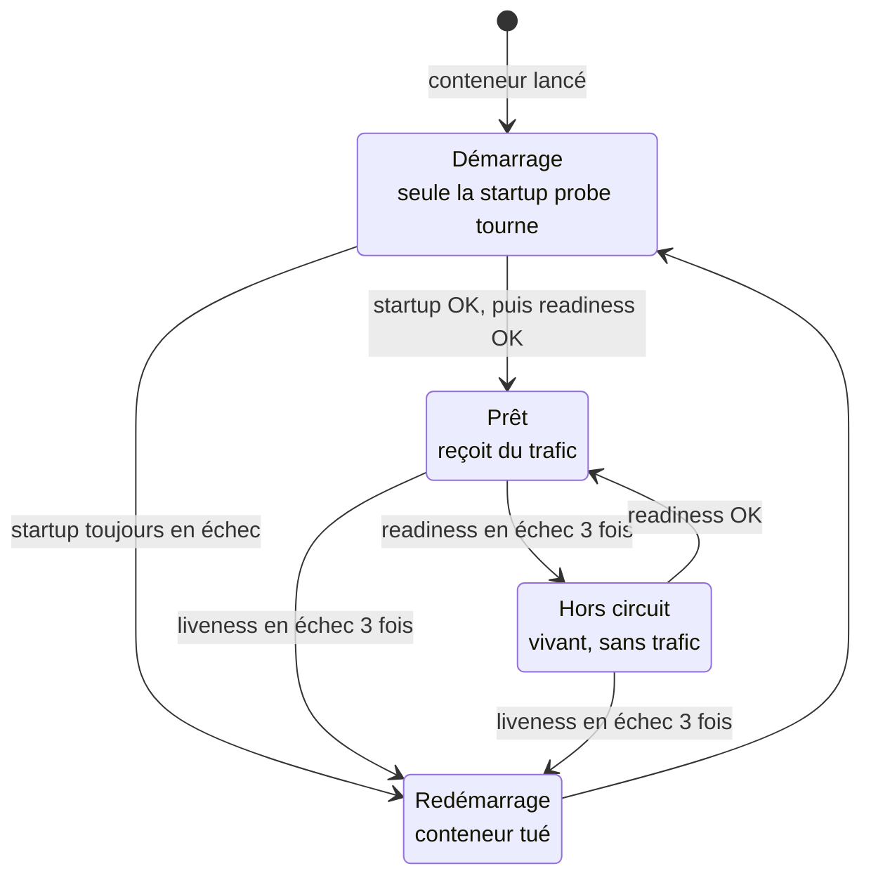

| Je veux... | Probe |
|---|---|
| que les utilisateurs ne tombent plus sur un pod dont la base ne répond plus, sans le tuer pour autant, puisqu'il redeviendra utile dès que la base revient | readiness |
| que Kubernetes relance tout seul une appli figée, par exemple bloquée par un deadlock : elle tourne encore mais ne répond plus à rien | liveness |
| que Kubernetes laisse 2 minutes à une appli lente à démarrer, par exemple parce qu'elle charge un gros cache au lancement, avant que la liveness ne la tue | <span class="term" data-term="startup-probe">startup</span> |

Piège classique : je mets la vérification de la <span class="term" data-term="database">base</span> dans la liveness. Le jour où la base tombe, la liveness de tous les pods échoue en même temps, donc Kubernetes les redémarre tous <span class="term" data-term="restart-loop">en boucle</span>. Redémarrer ne répare pas la base, et mes pods passent leur temps à redémarrer au lieu de répondre.

### Health check
Terme générique pour « vérification de santé ». Les probes sont la version Kubernetes du <span class="term" data-term="health-check">health check</span>.

```
$ curl -i http://localhost:8080/livez
HTTP/1.1 200 OK
```

### Les probes dans les traces
Les probes sont des requêtes HTTP comme les autres : l'<span class="term" data-term="instrumentation">instrumentation</span> les trace. Comme elles tournent jour et nuit, elles peuvent représenter presque toutes les <span class="term" data-term="trace-distributed">traces</span> d'un service peu utilisé. Ce cas est détaillé dans [Observabilité : le bruit des probes](observabilite.md#cas-concret-le-bruit-des-probes-kubernetes).

### Ressources : requests et limits
<span class="pill pill-status pill-status-ok" title="Toujours valable, vérifié en novembre 2026">Valable · 11/2026</span>

Chaque conteneur déclare ce qu'il consomme. La **request** est ce que Kubernetes lui réserve : elle sert à choisir un nœud qui a la place. La **limit** est le plafond. Au-dessus de sa limit CPU, le conteneur est ralenti. Au-dessus de sa limit mémoire, il est tué (`OOMKilled`, pour « <span class="term" data-term="oomkilled">out of memory</span> ») puis redémarré.

!!! noob "As noob"
    La request, c'est ma place réservée dans un train : Kubernetes ne me fait monter que dans une voiture où cette place est libre. La limit, c'est le maximum autorisé : trop de CPU et on me ralentit, trop de mémoire et on me fait descendre (le conteneur est tué puis redémarré). La phrase à retenir : **la request sert à placer le pod, la limit sert à le contenir.**

```yaml
# Exemple : réserve 250m de CPU et 256Mi, plafonne à 1 CPU et 512Mi
resources:
  requests:
    cpu: 250m
    memory: 256Mi
  limits:
    cpu: "1"
    memory: 512Mi
```
`250m` veut dire 0,25 cœur de CPU. `Mi` est un mébioctet.

Diagnostic d'un pod qui redémarre :
```
$ kubectl describe pod my-api-7f9c-abcde
...
    State:          Running
    Last State:     Terminated
      Reason:       OOMKilled
      Exit Code:    137
    Restart Count:  4
```
`137` = 128 + 9 : le conteneur a reçu le signal 9 (`SIGKILL`), il n'a pas pu s'arrêter proprement. Si le nombre de redémarrages monte, c'est une fuite mémoire ou une limit trop basse : redémarrer ne répare rien.

:material-book-open-variant: Doc de référence : [Kubernetes, Resource Management for Pods and Containers](https://kubernetes.io/docs/concepts/configuration/manage-resources-containers/) (consultée en novembre 2026)
{ .doc-ref }

## Construire et déployer : Docker, Helm, Argo CD, Cloud Run

<a class="pill pill-scope pill-scope-infra" href="../architecture/#carte-des-echelles">Échelle · Infrastructure</a>

<a class="pill pill-practice" href="../livraison/#livraison-et-deploiement-continus" title="niveau 2 : elle est automatisée">Pratique · Déploiement continu · N2</a>
<a class="pill pill-dora" href="https://dora.dev/capabilities/deployment-automation/">DORA · Deployment automation</a> <a class="pill pill-dora" href="https://dora.dev/capabilities/flexible-infrastructure/">DORA · Flexible infrastructure</a>


Le chemin d'une modification jusqu'à la production : on emballe l'application dans une image, on décrit comment la faire tourner, puis un outil applique cette description au cluster. Le choix entre ces outils (mini benchmark) est dans le [Panorama des outils techniques](outils.md#conteneurs-et-deploiement-docker-kubernetes-helm-argo-cd-cloud-run).

### Docker : l'image
<span class="pill pill-status pill-status-ok" title="Toujours valable, vérifié en novembre 2026">Valable · 11/2026</span>


*Docker : complémentaire de Kubernetes, Helm*
{ .tool-rel }

**Docker** emballe une application et tout ce dont elle a besoin (langage, bibliothèques, fichiers) dans une <span class="term" data-term="docker-image">image</span>. La même image tourne sur le poste du dev, en CI et en production. Elle se décrit dans un `Dockerfile`.

```dockerfile
# Exemple : image Python de my-api, lancée en utilisateur non root (USER 1000)
FROM python:3.12-slim
WORKDIR /app
COPY requirements.txt .
RUN pip install --no-cache-dir -r requirements.txt
COPY . .
USER 1000
CMD ["uvicorn", "my_api.main:app", "--host", "0.0.0.0", "--port", "8080"]
```

```
$ docker build -t my-api:1.4.0 .
$ docker run -p 8080:8080 my-api:1.4.0
$ curl localhost:8080/readyz
{"status": "ok"}
```

Copier `requirements.txt` avant le reste du code profite du <span class="term" data-term="docker-layer-cache">cache des couches</span> : tant que les dépendances ne changent pas, `pip install` n'est pas relancé. `USER 1000` évite de faire tourner l'appli en root.

*pip : concurrent de uv, Poetry, pdm*
{ .tool-rel }


:material-book-open-variant: Doc de référence : [Docker, Dockerfile reference](https://docs.docker.com/reference/dockerfile/) (consultée en novembre 2026) ; [Docker, Build cache](https://docs.docker.com/build/cache/) (consultée en novembre 2026)
{ .doc-ref }

### ConfigMap et Secret : la config par environnement
<span class="pill pill-status pill-status-ok" title="Toujours valable, vérifié en novembre 2026">Valable · 11/2026</span>

Règle : **la même image partout, la config change par environnement**. L'image `my-api:1.4.0` testée en staging est celle qui part en prod, seules ses <span class="term" data-term="environment-variable">variables d'environnement</span> changent. Un **<span class="term" data-term="configmap">ConfigMap</span>** porte la config non sensible, un **Secret** porte les <span class="term" data-term="secret">secrets</span> (mots de passe, clés).

!!! noob "As noob"
    C'est une voiture de location : le même modèle sort du garage pour chaque client, seuls les réglages (ConfigMap) et la clé (Secret) changent. Limite : par défaut, un Secret est seulement encodé, pas chiffré, donc qui peut le lire doit rester restreint. La phrase à retenir : **on ne reconstruit pas l'image pour changer d'environnement, on change sa config.**

```yaml
# Exemple : ConfigMap avec la config non secrète de my-api
kind: ConfigMap
metadata:
  name: my-api-config
data:
  LOG_LEVEL: "info"
  ORDERS_SERVICE_URL: "http://orders-service"
```
Le Deployment lit les deux dans `env` :
```yaml
# Exemple : LOG_LEVEL lu dans le ConfigMap, DB_PASSWORD dans le Secret
containers:
  - name: my-api
    image: my-api:1.4.0
    env:
      - name: LOG_LEVEL
        valueFrom:
          configMapKeyRef:
            name: my-api-config
            key: LOG_LEVEL
      - name: DB_PASSWORD
        valueFrom:
          secretKeyRef:
            name: my-api-secrets
            key: DB_PASSWORD
```

| Env     | Image          | `LOG_LEVEL` | `DB_PASSWORD`              |
|---------|----------------|-------------|----------------------------|
| staging | `my-api:1.4.0` | `debug`     | Secret `my-api-secrets` de staging |
| prod    | `my-api:1.4.0` | `info`      | Secret `my-api-secrets` de prod    |

Pièges : un Secret est seulement encodé en base64, pas chiffré, donc jamais en clair dans Git (on le remplit en général depuis un gestionnaire de secrets, à vérifier selon le cluster). Et modifier un ConfigMap ne relance pas les pods : les variables d'environnement sont lues au démarrage.

:material-book-open-variant: Doc de référence : [Kubernetes, ConfigMaps](https://kubernetes.io/docs/concepts/configuration/configmap/) (consultée en novembre 2026) ; [Kubernetes, Secrets](https://kubernetes.io/docs/concepts/configuration/secret/) (consultée en novembre 2026)
{ .doc-ref }

### Helm : le modèle de déploiement
<span class="pill pill-status pill-status-ok" title="Toujours valable, vérifié en novembre 2026">Valable · 11/2026</span>


*Helm : concurrent en partie de Kustomize ; complémentaire de Argo CD, Kubernetes*
{ .tool-rel }

**Helm** est un gestionnaire de paquets pour Kubernetes. Un **<span class="term" data-term="helm-chart">chart</span>** est un modèle de <span class="term" data-term="k8s-manifest">manifestes</span>, rempli par un fichier `values.yaml` différent par environnement. Tous les services peuvent partager le même chart.

```yaml
# templates/deployment.yaml (extrait)
# Exemple : modèle Helm, le nom et le nombre de copies viennent des values
kind: Deployment
metadata:
  name: {{ .Release.Name }}
spec:
  replicas: {{ .Values.replicaCount }}
```
```yaml
# values-staging.yaml
# Exemple : values de staging, 2 copies
replicaCount: 2
image:
  tag: "1.4.0"
```
```yaml
# values-prod.yaml
# Exemple : values de prod, 3 copies de la même image
replicaCount: 3
image:
  tag: "1.4.0"
```
`helm template` affiche le résultat sans rien installer :
```
$ helm template my-api ./chart -f values-staging.yaml
kind: Deployment
metadata:
  name: my-api
spec:
  replicas: 2

$ helm template my-api ./chart -f values-prod.yaml
kind: Deployment
metadata:
  name: my-api
spec:
  replicas: 3
```

:material-book-open-variant: Doc de référence : [Helm, Charts](https://helm.sh/docs/topics/charts/) (consultée en novembre 2026) ; [Helm, Values Files](https://helm.sh/docs/chart_template_guide/values_files/) (consultée en novembre 2026)
{ .doc-ref }

### Un chart générique pour tous les services
<span class="pill pill-status pill-status-ok" title="Toujours valable, vérifié en novembre 2026">Valable · 11/2026</span>

Écrire un chart par service, c'est copier vingt fois les mêmes templates (Deployment, Service, probes, HPA...) et les corriger vingt fois. L'alternative : **un seul chart générique**, maintenu par une équipe plateforme, versionné comme une bibliothèque. Chaque service n'écrit plus de template : il fournit seulement ses **values** (image, port, probes, ressources, scaling). Helm prévoit même un type de chart pour ça, le *library chart*, qui ne contient que des modèles réutilisables. Des exemples publics : `app-template` (bjw-s), `application` (Stakater), et la bibliothèque `common` de Bitnami.

!!! noob "As noob"
    Le chart générique, c'est un formulaire administratif pré-imprimé : l'équipe plateforme a dessiné les cases une fois pour toutes, chaque service remplit seulement ses cases (nom, image, port). Personne ne redessine le formulaire, et quand la plateforme l'améliore (une nouvelle sécurité, une meilleure probe), tous les services en profitent en changeant de version.

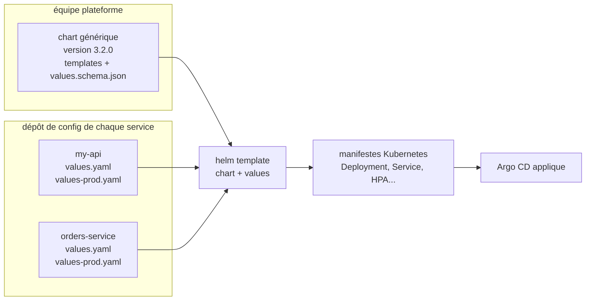

**Les values en couches.** Helm accepte plusieurs fichiers `-f` : le suivant écrase le précédent, clé par clé. On met le commun dans `values.yaml`, et seulement les différences dans le fichier de l'environnement.

```yaml title="values.yaml (commun à tous les environnements)"
# Exemple : image, port, probes et ressources communs à tous les environnements
image:
  repository: registry.example.com/my-api
  tag: "1.4.0"
port: 8080
probes:
  readiness: /readyz
  liveness: /livez
resources:
  requests: {cpu: 100m, memory: 256Mi}
```

```yaml title="values-prod.yaml (seulement ce qui change)"
# Exemple : la prod ne déclare que ses copies et son autoscaling
replicas: 3
autoscaling:
  enabled: true
  maxReplicas: 10
```

```
$ helm template my-api platform/generic --version 3.2.0 \
    -f values.yaml -f values-prod.yaml
```

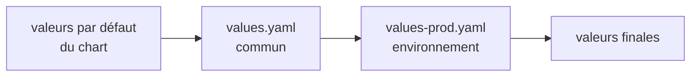

**Quand l'utiliser.** Dès qu'une équipe ou une plateforme gère plus d'une poignée de services qui se ressemblent (une API HTTP, un worker, un job planifié). **Quand ne pas l'utiliser** : un composant très particulier (une base de données, un outil tiers qui a déjà son chart officiel) ; on prend alors le chart de l'éditeur.

**Pourquoi.** Gain : une seule correction profite à tous, les bonnes pratiques (probes, limites, sécurité) sont appliquées par défaut, et une revue de values est bien plus courte qu'une revue de templates. Coût : le chart devient un produit à part entière, avec ses versions, sa documentation et ses changements cassants à annoncer.

**Le piège du « tout configurable ».** Si chaque champ Kubernetes devient une value, le fichier de values devient un deuxième langage, plus difficile que les manifestes d'origine. Un bon chart générique expose peu de choses, avec des valeurs par défaut sûres, et laisse une porte de sortie documentée pour les cas rares (des manifestes supplémentaires à côté).

**Comment le tester**, du plus rapide au plus complet :

| Je veux vérifier... | J'utilise... |
|---|---|
| que les values ont la bonne forme (une faute de frappe, un type faux) | un `values.schema.json` dans le chart : Helm refuse les values invalides dès `helm template` |
| que le chart produit un YAML valide | `helm lint`, puis `helm template ... \| kubeconform` |
| qu'une value donne bien le manifeste attendu | des tests unitaires de templates (plugin `helm-unittest`) |
| ce qu'une nouvelle version du chart va changer pour mon service | `helm diff` (plugin) ou le diff d'Argo CD avant de synchroniser |
| qu'un changement cassant n'arrive pas par surprise | une version de chart épinglée par service, montée par MR |

:material-book-open-variant: Doc de référence : [Helm, Library Charts](https://helm.sh/docs/topics/library_charts/) (consultée en novembre 2026) ; [Helm, Schema Files](https://helm.sh/docs/topics/charts/#schema-files) (consultée en novembre 2026) ; [bjw-s, app-template](https://bjw-s-labs.github.io/helm-charts/docs/app-template/) (consultée en novembre 2026)
{ .doc-ref }

### Argo CD : Git décide de ce qui tourne
<span class="pill pill-status pill-status-ok" title="Toujours valable, vérifié en novembre 2026">Valable · 11/2026</span>


*Argo CD : concurrent de Flux ; complémentaire de Helm, Kubernetes*
{ .tool-rel }

**Argo CD** est un outil **GitOps**. Le dépôt Git décrit l'état voulu du <span class="term" data-term="cluster">cluster</span>, et Argo CD l'applique et corrige tout écart. Déployer, c'est faire une <span class="term" data-term="merge-request">MR</span> qui change le <span class="term" data-term="image-tag">tag d'image</span>. Revenir en arrière, c'est annuler cette MR.

!!! noob "As noob"
    GitOps, c'est un thermostat : je règle la température voulue (le dépôt Git), et l'appareil chauffe ou coupe tout seul pour y revenir, même si quelqu'un ouvre la fenêtre (une modification faite à la main dans le cluster). La phrase à retenir : **pour changer ce qui tourne, on change Git, pas le cluster.**

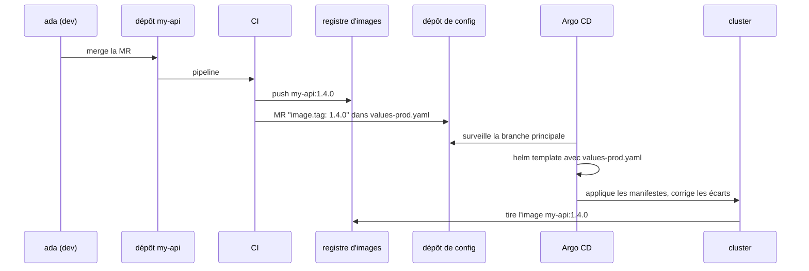

:material-book-open-variant: Doc de référence : [Argo CD, Core Concepts](https://argo-cd.readthedocs.io/en/stable/core_concepts/) (consultée en novembre 2026) ; [OpenGitOps, Principles](https://opengitops.dev/) (version 1.0.0, 2021)
{ .doc-ref }

### Cloud Run : sans cluster
<span class="pill pill-status pill-status-ok" title="Toujours valable, vérifié en novembre 2026">Valable · 11/2026</span>


*Cloud Run : concurrent de Kubernetes ; complémentaire de Docker*
{ .tool-rel }

**Cloud Run** : on donne une image, Google la fait tourner et la met à l'échelle, jusqu'à zéro instance. Pas de cluster à gérer, mais moins de contrôle (réseau, probes, ressources). **GKE** est, lui, le Kubernetes managé de Google.

:material-book-open-variant: Doc de référence : [Google Cloud, What is Cloud Run](https://cloud.google.com/run/docs/overview/what-is-cloud-run) (consultée en novembre 2026) ; [GKE overview](https://cloud.google.com/kubernetes-engine/docs/concepts/kubernetes-engine-overview) (consultée en novembre 2026)
{ .doc-ref }

### Quoi utiliser

| Je veux... | J'utilise... |
|---|---|
| que mon appli tourne pareil sur mon poste, en CI et en prod, au lieu de planter en prod parce qu'une bibliothèque n'y a pas la même version | Docker |
| faire tourner beaucoup de services qui doivent être surveillés, redémarrés, mis à l'échelle et s'appeler entre eux, comme `orders-service` qui appelle `my-api` | Kubernetes |
| ne pas réécrire les mêmes fichiers YAML de déploiement pour chaque service et chaque environnement | Helm |
| que l'équipe de chaque service écrive seulement ce qui lui est propre (image, port, ressources), et qu'une équipe plateforme maintienne le reste une seule fois pour tous | un [chart générique](#un-chart-generique-pour-tous-les-services) |
| pouvoir répondre à « qu'est-ce qui tourne en prod ? » en lisant Git, et qu'une modification faite à la main dans le cluster soit annulée toute seule | Argo CD |
| faire tourner un petit service ou un job lancé de temps en temps, sans personne pour gérer un cluster | Cloud Run |

## Autoscaling et serverless : HPA, KEDA, Knative, Karpenter

<a class="pill pill-scope pill-scope-infra" href="../architecture/#carte-des-echelles">Échelle · Infrastructure</a>

!!! info "Rédigé le 04/11/2026"
    Versions d'API, statuts de projets et options citées datent de cette rédaction. Elles évoluent vite, à vérifier dans la documentation de chaque projet : [HPA](https://kubernetes.io/docs/concepts/workloads/autoscaling/horizontal-pod-autoscale/), [KEDA](https://keda.sh/docs/), [Knative](https://knative.dev/docs/serving/), [Karpenter](https://karpenter.sh/docs/), [Cluster Autoscaler](https://github.com/kubernetes/autoscaler/tree/master/cluster-autoscaler) (consultées en novembre 2026).

L'<span class="term" data-term="autoscaling">autoscaling</span> ajuste la capacité à la charge sans intervention humaine. Il y a deux étages, à ne pas confondre :

!!! noob "As noob"
    Je pense à un supermarché : ouvrir plus de caisses quand la file s'allonge (étage pods), et ouvrir une salle de plus quand il n'y a plus la place d'installer une caisse (étage nœuds). La première action prend quelques secondes, la seconde plus longtemps. La phrase à retenir : **l'étage pods ajoute des copies, l'étage nœuds ajoute de la place pour les accueillir.**

```
étage pods   : combien de copies de my-api ?        HPA, KEDA, Knative
étage nœuds  : combien de machines dans le cluster ? Cluster Autoscaler, Karpenter
```

Les deux s'enchaînent : l'étage pods demande 6 pods, il n'y a de la place que pour 4, les 2 autres restent `Pending` (en attente d'un nœud), et l'étage nœuds ajoute une machine. Sans autoscaling, on fixe `replicas: 3` et le nombre de nœuds à la main, comme dans le [Deployment](#deployment) plus haut.

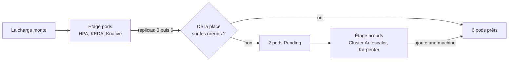

| Signal | Piste |
|---|---|
| mon API reçoit beaucoup de monde à midi et presque personne la nuit, mais je paie le même nombre de pods tout le temps | HPA |
| un worker lit une file, et les messages arrivent par vagues : une montagne d'un coup, puis presque rien pendant des heures | KEDA |
| j'ai beaucoup de petits services HTTP appelés quelques fois par jour, comme des outils internes ou des webhooks, et les nœuds qui les portent sont payés à ne rien faire | Knative (ou Cloud Run sans cluster) |
| des pods restent `Pending` parce qu'aucune machine n'a la place de les accueillir, ou au contraire je paie des nœuds à moitié vides | Cluster Autoscaler ou Karpenter |
| ma charge est à peu près la même toute la journée, et je sais la prévoir | rien : `replicas` fixe, plus simple à comprendre |

### HPA : le point de départ
<span class="pill pill-status pill-status-ok" title="Toujours valable, vérifié en novembre 2026">Valable · 11/2026</span>


*HPA : complémentaire de KEDA, Karpenter, Cluster Autoscaler*
{ .tool-rel }

**Quand** : un service HTTP dont la charge suit le CPU ou la mémoire (pic à midi, creux la nuit). Pas pour un worker de file : son CPU peut rester bas alors que 50 000 messages attendent.

**Pourquoi** : ne pas payer 10 pods la nuit, ne pas tomber avec 3 pods au pic. Coût : un délai de réaction (la métrique est relevée toutes les 15 s environ, puis le pod doit démarrer et passer sa [readiness probe](#readiness-probe)), et des requests CPU qui doivent être justes.

**Comment** : le **HorizontalPodAutoscaler** (HPA), intégré à Kubernetes, compare l'usage moyen des pods à une cible exprimée en pourcentage de leur **request** (voir [requests et limits](#ressources-requests-et-limits)), et change `replicas` du Deployment.

La boucle de contrôle du HPA, qui tourne en continu :

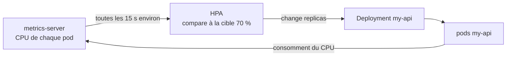

```yaml
# Exemple : HPA qui vise 70 % de CPU moyen, entre 2 et 10 pods
apiVersion: autoscaling/v2
kind: HorizontalPodAutoscaler
metadata:
  name: my-api
spec:
  scaleTargetRef:
    apiVersion: apps/v1
    kind: Deployment
    name: my-api
  minReplicas: 2
  maxReplicas: 10
  metrics:
    - type: Resource
      resource:
        name: cpu
        target:
          type: Utilization
          averageUtilization: 70
```

Le calcul : pods voulus = arrondi supérieur de (pods actuels × usage actuel / cible).

```
heure  pods  CPU moyen (en % de la request)   décision
12:00  3     140 %                            3 × 140 / 70 = 6 pods
12:02  6     72 %                             proche de la cible : rien
14:00  6     20 %                             6 × 20 / 70 = 1,7 donc 2 pods (minReplicas), après la fenêtre de stabilisation
```

Pièges :

- Sans `requests.cpu`, le pourcentage n'a pas de base : le HPA ne décide rien.
- Avec Helm et [Argo CD](#argo-cd-git-decide-de-ce-qui-tourne), un `replicas: 3` écrit dans le Deployment se bat avec le HPA : Argo CD remet 3, le HPA remet 6. On retire `replicas` du modèle quand le HPA est activé (ou on fait ignorer ce champ par Argo CD).
- Le HPA ne descend pas sous 1 pod (descendre à 0 demande une option expérimentale de Kubernetes, à vérifier). C'est le rôle de KEDA et Knative.

:material-book-open-variant: Doc de référence : [Kubernetes, HorizontalPodAutoscaler Walkthrough](https://kubernetes.io/docs/tasks/run-application/horizontal-pod-autoscale-walkthrough/) (consultée en novembre 2026)
{ .doc-ref }

### KEDA : scaler sur les événements, jusqu'à zéro
<span class="pill pill-status pill-status-ok" title="Toujours valable, vérifié en novembre 2026">Valable · 11/2026</span>


*KEDA : concurrent en partie de Knative ; complémentaire de HPA, Karpenter*
{ .tool-rel }

**Quand** : un <span class="term" data-term="worker">worker</span> qui consomme une file RabbitMQ, un topic Kafka, un abonnement Pub/Sub, ou un job lancé par un <span class="term" data-term="cron">cron</span>. Le bon signal n'est pas le CPU mais le **retard** : le <span class="term" data-term="consumer-lag">lag</span> (messages publiés mais pas encore lus). Pas pour un service HTTP qui doit répondre vite à la première requête : à zéro pod, le premier message attend le démarrage d'un pod.

*RabbitMQ : concurrent en partie de Pub/Sub, SQS ; complémentaire de Kafka*<br>
*Kafka : concurrent en partie de Pub/Sub ; complémentaire de RabbitMQ, Strimzi*<br>
*Pub/Sub : concurrent en partie de RabbitMQ, Kafka, SQS*
{ .tool-rel }


**Pourquoi** : le <span class="term" data-term="scale-to-zero">scale to zero</span>. Un worker qui traite un lot par nuit ne coûte rien le reste du temps, et il passe à 20 pods quand 100 000 messages arrivent. Coût : un composant de plus à exploiter, et un délai au réveil.

**Comment** : **KEDA** (*Kubernetes Event-Driven Autoscaling*, projet diplômé de la CNCF en 2023, à vérifier) s'installe dans le cluster. On décrit un `ScaledObject` : KEDA crée et pilote lui-même un HPA pour aller de 1 à N, et gère seul le passage de 0 à 1 et de 1 à 0. Une soixantaine de sources sont prises en charge (Kafka, RabbitMQ, Pub/Sub, Prometheus, cron, à vérifier).

*Prometheus : concurrent de Datadog ; complémentaire de Grafana, Alertmanager, OpenTelemetry*
{ .tool-rel }


```yaml
# Exemple : KEDA dimensionne email-worker selon le lag Kafka, de 0 à 12 pods
apiVersion: keda.sh/v1alpha1
kind: ScaledObject
metadata:
  name: email-worker
spec:
  scaleTargetRef:
    name: email-worker
  minReplicaCount: 0
  maxReplicaCount: 12
  cooldownPeriod: 300
  triggers:
    - type: kafka
      metadata:
        bootstrapServers: kafka:9092
        consumerGroup: email-worker
        topic: orders
        lagThreshold: "100"
```

`lagThreshold: "100"` veut dire « un pod pour 100 messages de retard ». `cooldownPeriod: 300` : attendre 5 minutes sans message avant de revenir à zéro.

Qui fait quoi : KEDA gère seul le passage de 0 à 1 pod (et retour), puis délègue au HPA qu'il a créé.

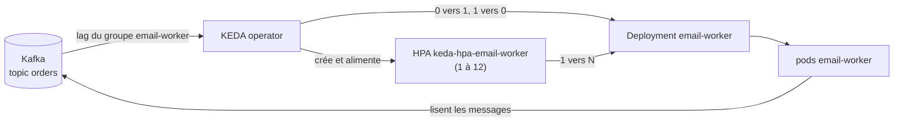

```
heure  lag du groupe email-worker   pods
02:00  0                            0
02:01  1 200                        1 (réveil par KEDA), puis 12 (1 200 / 100)
02:06  80                           1
02:07  0                            1
02:12  0 depuis 5 min               0
```

Même idée sur RabbitMQ : `type: rabbitmq`, avec `queueName: invoice-emails`, `mode: QueueLength` et `value: "50"` (50 messages en attente par pod), les identifiants venant d'un `TriggerAuthentication`. Piège Kafka : au-delà du nombre de partitions du topic, les pods en plus n'ont rien à lire, et KEDA plafonne par défaut à ce nombre (à vérifier selon la version).

:material-book-open-variant: Doc de référence : [KEDA, Scaling Deployments](https://keda.sh/docs/latest/concepts/scaling-deployments/) (consultée en novembre 2026) ; [KEDA, Apache Kafka scaler](https://keda.sh/docs/latest/scalers/apache-kafka/) (consultée en novembre 2026)
{ .doc-ref }

### Knative Serving : du serverless sur son propre cluster
<span class="pill pill-status pill-status-ok" title="Toujours valable, vérifié en novembre 2026">Valable · 11/2026</span>


*Knative : concurrent en partie de KEDA*
{ .tool-rel }

**Quand** : beaucoup de petits services HTTP peu appelés (outils internes, webhooks, aperçus de MR) sur un cluster qui existe déjà, et l'envie d'avoir le modèle de [Cloud Run](#cloud-run-sans-cluster) sans quitter Kubernetes. Pas si Cloud Run suffit (rien à exploiter), ni pour une API dont la première requête doit répondre en quelques millisecondes : il y a un <span class="term" data-term="cold-start">démarrage à froid</span>.

**Pourquoi** : <span class="term" data-term="serverless">serverless</span> sur Kubernetes. Le service tombe à zéro quand personne ne l'appelle et monte selon le nombre de requêtes simultanées, pas le CPU. Coût : Knative ajoute ses propres composants et une couche réseau (Kourier ou Istio) à installer et mettre à jour.

*Istio : concurrent de Linkerd ; complémentaire de Envoy*
{ .tool-rel }


**Comment** : on décrit un `Service` Knative (différent du [Service](#service) Kubernetes). Knative crée Deployment, Service et routage, et un composant (l'*activator*) retient les requêtes pendant qu'un pod démarre.

```yaml
# Exemple : Service Knative de 0 à 10 pods, cible de 20 requêtes simultanées par pod
apiVersion: serving.knative.dev/v1
kind: Service
metadata:
  name: report-service
spec:
  template:
    metadata:
      annotations:
        autoscaling.knative.dev/min-scale: "0"
        autoscaling.knative.dev/max-scale: "10"
        autoscaling.knative.dev/target: "20"
    spec:
      containers:
        - image: report-service:1.4.0
```

`target: "20"` : environ 20 requêtes simultanées par pod. Cloud Run reprend l'API de Knative Serving, ce qui rend le passage de l'un à l'autre assez direct (à vérifier sur les champs pris en charge).

:material-book-open-variant: Doc de référence : [Knative, About autoscaling](https://knative.dev/docs/serving/autoscaling/) (consultée en novembre 2026)
{ .doc-ref }

### Karpenter et Cluster Autoscaler : ajouter des nœuds
<span class="pill pill-status pill-status-ok" title="Toujours valable, vérifié en novembre 2026">Valable · 11/2026</span>


*Karpenter : concurrent de Cluster Autoscaler ; complémentaire de HPA, KEDA*<br>
*Cluster Autoscaler : concurrent de Karpenter ; complémentaire de HPA*
{ .tool-rel }

**Quand** : des pods restent `Pending` parce qu'aucun <span class="term" data-term="node-k8s">nœud</span> n'a la place, ou à l'inverse des nœuds payés tournent à 20 %. Inutile sur Cloud Run, et souvent déjà réglé par le fournisseur sur un Kubernetes managé en mode tout automatique (GKE Autopilot par exemple, à vérifier).

**Pourquoi** : sans lui, HPA et KEDA demandent des pods que personne ne peut placer. Gain : la facture suit la charge. Coût : un nœud met en général une à quelques minutes à arriver (ordre de grandeur, à vérifier selon le fournisseur), et retirer un nœud déplace ses pods.

**Comment** : deux approches.

- **Cluster Autoscaler** (projet Kubernetes historique) agrandit ou réduit des **groupes de nœuds** définis à l'avance (« groupe e2-standard-4, de 3 à 20 machines »). Simple, présent chez tous les fournisseurs, mais il ne choisit pas le type de machine.
- **Karpenter** (créé par AWS en 2021, version 1.0 en 2024, à vérifier) regarde les pods en attente et commande directement la machine qui leur convient, sans groupe prédéfini. Il **consolide** aussi : il replace les pods pour éteindre les nœuds sous-utilisés. Il peut viser des <span class="term" data-term="spot-instance">machines spot</span>. Il tourne surtout sur AWS, et sur Azure via son équivalent intégré (à vérifier pour les autres fournisseurs).

```yaml
# Exemple : NodePool Karpenter, spot ou à la demande, consolide les nœuds sous-utilisés
apiVersion: karpenter.sh/v1
kind: NodePool
metadata:
  name: default
spec:
  template:
    spec:
      requirements:
        - key: karpenter.sh/capacity-type
          operator: In
          values: ["spot", "on-demand"]
        - key: kubernetes.io/arch
          operator: In
          values: ["amd64", "arm64"]
      nodeClassRef:
        group: karpenter.k8s.aws
        kind: EC2NodeClass
        name: default
  limits:
    cpu: "200"
  disruption:
    consolidationPolicy: WhenEmptyOrUnderutilized
    consolidateAfter: 1m
```

`limits.cpu: "200"` plafonne la taille totale : c'est le garde-fou de la facture.

| Critère                        | Cluster Autoscaler           | Karpenter                          |
|--------------------------------|------------------------------|------------------------------------|
| Unité ajoutée                  | un nœud d'un groupe prédéfini | la machine qui convient aux pods en attente |
| Choix du type de machine       | ★ (fixé par groupe)          | ★★★                                |
| Réduction des nœuds à moitié vides | ★★                       | ★★★ (consolidation)                |
| Fournisseurs                   | ★★★ (presque tous)           | ★★ (AWS, Azure, à vérifier)        |
| Simplicité                     | ★★★                          | ★★                                 |

:material-book-open-variant: Doc de référence : [Karpenter, NodePools](https://karpenter.sh/docs/concepts/nodepools/) (consultée en novembre 2026) ; [Cluster Autoscaler FAQ](https://github.com/kubernetes/autoscaler/blob/master/cluster-autoscaler/FAQ.md) (consultée en novembre 2026)
{ .doc-ref }

### Quoi utiliser pour scaler

| Je veux... | J'utilise... |
|---|---|
| que mon API HTTP ajoute des pods quand son CPU monte au pic de midi et en retire la nuit, sans jamais descendre sous 2 pods | HPA |
| qu'un worker ajoute des pods quand les messages s'accumulent dans sa file, et tombe à zéro pod la nuit quand il n'a rien à lire | KEDA |
| que mes petits services HTTP peu appelés tombent à zéro quand personne ne les appelle, sur le cluster Kubernetes que j'ai déjà | Knative Serving |
| la même chose, sans aucun cluster à gérer | [Cloud Run](#cloud-run-sans-cluster) |
| que le cluster ajoute des machines quand des pods attendent une place et en retire quand elles se vident, quel que soit mon fournisseur cloud | Cluster Autoscaler |
| sur AWS, que le cluster choisisse lui-même la bonne taille de machine pour les pods en attente, y compris des machines spot | Karpenter |
| rien de plus, parce que ma charge ne bouge presque pas | `replicas` fixe |

## Opérateurs Kubernetes : Strimzi

<a class="pill pill-scope pill-scope-infra" href="../architecture/#carte-des-echelles">Échelle · Infrastructure</a> <span class="pill pill-status pill-status-ok" title="Toujours valable, vérifié en novembre 2026">Valable · 11/2026</span>


*Strimzi : complémentaire de Kafka*
{ .tool-rel }

!!! info "Rédigé le 04/11/2026"
    Versions et statuts de projets cités à cette date, à vérifier : [opérateurs Kubernetes](https://kubernetes.io/docs/concepts/extend-kubernetes/operator/), [Strimzi](https://strimzi.io/documentation/) (consultées en novembre 2026).

Un **<span class="term" data-term="k8s-operator">opérateur</span>** est un programme qui tourne dans le cluster et fait le travail d'un administrateur pour un logiciel précis : installer, mettre à jour, sauvegarder, remplacer un membre tombé. On lui décrit l'état voulu dans une **<span class="term" data-term="custom-resource">ressource personnalisée</span>** (CRD, *custom resource definition*, un nouveau `kind` ajouté à Kubernetes), et il compare en boucle l'état voulu à l'état réel, comme un Deployment le fait pour ses pods.

!!! noob "As noob"
    Un opérateur, c'est un administrateur spécialisé qui ne dort jamais : je lui laisse une fiche « je veux un Kafka de 3 machines », il installe, surveille, remplace ce qui tombe, et revient sans cesse vérifier que la réalité colle à la fiche. La phrase à retenir : **un opérateur, c'est le savoir-faire d'un administrateur transformé en boucle automatique.**

La boucle de réconciliation, le cœur de tout opérateur (et de tout contrôleur Kubernetes) :

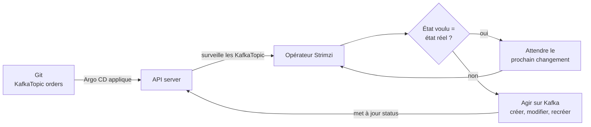

**Quand** : faire tourner soi-même un logiciel avec état (Kafka, PostgreSQL, Elasticsearch) dans Kubernetes, sans écrire ses propres scripts d'exploitation. Pas quand un <span class="term" data-term="managed-service">service managé</span> équivalent existe et que l'équipe n'a personne pour exploiter la base : l'opérateur automatise les gestes, pas la compétence pour diagnostiquer une panne.

*PostgreSQL : concurrent de MySQL, MariaDB ; concurrent en partie de MongoDB ; complémentaire de Redis, PgBouncer, BigQuery, Elasticsearch*<br>
*Elasticsearch : concurrent de OpenSearch ; complémentaire de PostgreSQL*
{ .tool-rel }


**Pourquoi** : un `StatefulSet` Kafka écrit à la main ne sait pas faire une mise à jour sans coupure, ajouter un broker ou créer un topic. L'opérateur encode ce savoir-faire. Coût : l'opérateur lui-même est un logiciel à mettre à jour, et la responsabilité des données reste à l'équipe.

**Comment** : on installe l'opérateur (souvent par un chart [Helm](#helm-le-modele-de-deploiement)), puis on écrit ses ressources dans Git, et [Argo CD](#argo-cd-git-decide-de-ce-qui-tourne) les applique comme le reste. Exemple avec **Strimzi**, l'opérateur Kafka de la CNCF (projet en incubation, à vérifier) :

```yaml
# Exemple : cluster Kafka géré par l'opérateur Strimzi
apiVersion: kafka.strimzi.io/v1beta2
kind: Kafka
metadata:
  name: events
spec:
  kafka:
    listeners:
      - name: plain
        port: 9092
        type: internal
        tls: false
  entityOperator:
    topicOperator: {}
```
```yaml
# Exemple : topic orders (6 partitions, 3 répliques), créé par l'opérateur
apiVersion: kafka.strimzi.io/v1beta2
kind: KafkaTopic
metadata:
  name: orders
  labels:
    strimzi.io/cluster: events
spec:
  partitions: 6
  replicas: 3
```

Extrait simplifié : les versions récentes demandent aussi un `KafkaNodePool` qui décrit les brokers (nombre, disques), et les versions d'API changent (à vérifier dans la documentation Strimzi). Créer le topic `orders` revient à faire une MR qui ajoute ce fichier : Strimzi le crée dans Kafka, et le remet si quelqu'un le supprime à la main.

```
$ kubectl get kafkatopic orders
NAME     CLUSTER   PARTITIONS   REPLICATION FACTOR   READY
orders   events    6            3                    True
```

Autres opérateurs courants : CloudNativePG (PostgreSQL), Prometheus Operator, cert-manager (certificats TLS). Crossplane applique la même idée à l'infrastructure cloud ([Panorama des outils techniques](outils.md#infrastructure-as-code-terraform-opentofu-terragrunt-pulumi-crossplane-ansible-packer)).

*Crossplane : concurrent en partie de Terraform ; complémentaire de Kubernetes*
{ .tool-rel }


| Je veux... | J'utilise... |
|---|---|
| utiliser Kafka ou PostgreSQL alors que personne dans l'équipe n'a le temps ou la compétence pour les mettre à jour, les sauvegarder et les réparer | le service managé du fournisseur |
| faire tourner Kafka dans mon propre cluster, parce que l'offre managée coûte trop cher, que les données doivent rester sur place, ou qu'il n'existe pas d'offre managée | Strimzi |
| la même chose pour PostgreSQL | CloudNativePG |
| déployer une appli qui ne garde rien sur ses disques, comme une API qui range tout dans une base externe | un Deployment et un chart Helm, pas d'opérateur |

:material-book-open-variant: Doc de référence : [Kubernetes, Custom Resources](https://kubernetes.io/docs/concepts/extend-kubernetes/api-extension/custom-resources/) (consultée en novembre 2026) ; [Kubernetes, Controllers](https://kubernetes.io/docs/concepts/architecture/controller/) (consultée en novembre 2026)
{ .doc-ref }

## Environnements

<a class="pill pill-scope pill-scope-infra" href="../architecture/#carte-des-echelles">Échelle · Infrastructure</a>

| Env | Nom          | Pour qui                               |
|-----|--------------|----------------------------------------|
| dev | <span class="term" data-term="integration-env">intégration</span>  | les devs testent leurs changements     |
| staging | <span class="term" data-term="staging-env">staging</span>      | pré-production, proche de la prod      |
| prod | <span class="term" data-term="production-env">production</span>   | les vrais utilisateurs                 |

## Pièges à éviter

- **La base dans la liveness** : je vérifie la base de données dans la liveness, donc le jour où la base tombe, Kubernetes redémarre tous les pods en boucle sans rien réparer. Je mets la dépendance dans la readiness, et la liveness ne vérifie que l'appli elle-même ([voir Quelle probe pour quel besoin](#quelle-probe-pour-quel-besoin)).
- **Pas de startup probe pour une appli lente** : mon appli charge un gros cache au démarrage, donc la liveness la tue avant qu'elle ait fini de démarrer. J'ajoute une startup probe, qui retient la liveness tant que le démarrage n'est pas terminé ([voir Startup probe](#startup-probe)).
- **Redémarrer au lieu de comprendre un `OOMKilled`** : je laisse le pod redémarrer en boucle avec le code `137`, donc la fuite mémoire ou la limit trop basse reste là. Je lis `kubectl describe pod`, puis je corrige la fuite ou j'ajuste la limit ([voir requests et limits](#ressources-requests-et-limits)).
- **Un Secret en clair dans Git** : je commite un Secret en le croyant chiffré, alors qu'il est seulement encodé en base64, donc quiconque lit le dépôt a le mot de passe. Je le remplis depuis un gestionnaire de secrets ([voir ConfigMap et Secret](#configmap-et-secret-la-config-par-environnement)).
- **Un ConfigMap modifié qui ne change rien** : je change `LOG_LEVEL` dans le ConfigMap et j'attends l'effet, mais les variables d'environnement sont lues au démarrage, donc les pods gardent l'ancienne valeur. Je relance les pods après le changement ([voir ConfigMap et Secret](#configmap-et-secret-la-config-par-environnement)).
- **Un rollback à la main sous Argo CD** : je lance `kubectl rollout undo`, donc Argo CD remet la version de Git à la synchronisation suivante. J'annule la MR qui a changé le tag d'image ([voir Argo CD](#argo-cd-git-decide-de-ce-qui-tourne)).
- **Un `replicas` fixe à côté du HPA** : je laisse `replicas: 3` dans le modèle Helm alors que le HPA est activé, donc Argo CD remet 3 pendant que le HPA remet 6. Je retire `replicas` du modèle, et je vérifie que `requests.cpu` est déclaré, sans quoi le HPA ne décide rien ([voir HPA](#hpa-le-point-de-depart)).
- **Un chart générique où tout est configurable** : chaque champ Kubernetes devient une value, donc le fichier de values devient un deuxième langage, plus dur que les manifestes. J'expose peu de choses, avec des valeurs par défaut sûres et une porte de sortie documentée ([voir le chart générique](#un-chart-generique-pour-tous-les-services)).

## Ce qu'on demande en entretien

Les questions typiques :

- « Quelle différence entre readiness, liveness et startup probe ? », « Que se passe-t-il si je vérifie la base dans la liveness ? » Pour répondre : je décris ce que fait Kubernetes dans chaque cas, retirer du trafic ou redémarrer ([Quelle probe pour quel besoin](#quelle-probe-pour-quel-besoin)).
- « Comment déploies-tu sans coupure ? », « Comment reviens-tu en arrière ? » Pour répondre : je décris le rolling update avec `maxSurge` et `maxUnavailable`, puis l'annulation de la MR quand Argo CD pilote le cluster ([Rolling update](#rolling-update-mise-a-jour-progressive), [Argo CD](#argo-cd-git-decide-de-ce-qui-tourne)).
- « Un pod redémarre en boucle, que regardes-tu ? », « Request ou limit, quelle différence ? » Pour répondre : je lance `kubectl describe pod` et je cherche la raison `OOMKilled` et le code `137` ([Ressources : requests et limits](#ressources-requests-et-limits)).
- « Pourquoi passer par un Service plutôt que par l'adresse d'un pod ? » Pour répondre : je rappelle que les pods changent d'adresse, alors que le Service garde une adresse stable et n'envoie le trafic qu'aux pods prêts ([Service](#service)).
- « Qu'est-ce que GitOps ? », « À quoi sert Helm ? » Pour répondre : je dis que Git décrit l'état voulu et qu'Argo CD corrige les écarts, et que Helm évite de réécrire les mêmes manifestes par environnement ([Argo CD](#argo-cd-git-decide-de-ce-qui-tourne), [Helm](#helm-le-modele-de-deploiement)).
- « Comment fais-tu scaler un worker qui lit une file ? », « HPA, KEDA ou Karpenter ? » Pour répondre : je prends le lag comme signal, pas le CPU, et je montre que chaque outil agit à un étage différent ([Quoi utiliser pour scaler](#quoi-utiliser-pour-scaler)).

Ce qui fait une bonne réponse : raconter ce que voit l'utilisateur et ce que fait Kubernetes, étape par étape (le pod retiré du trafic, le conteneur redémarré, le pod en `Pending`), plutôt que réciter des champs YAML.
